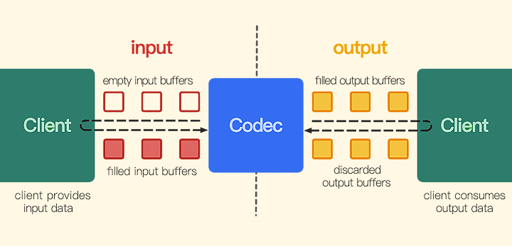
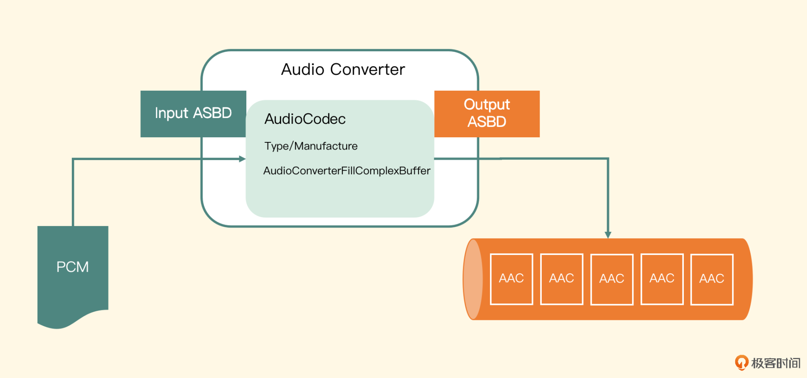

# 13 | 如何使用硬件编码器来编码AAC？

你好，我是展晓凯。今天我们一起学习使用移动平台的硬件编码器编码 AAC。

上一节课，我们学习了 AAC 编码格式，还用 FFmpeg 书写了一个 AAC 编码工具类，这节课我们一起学习一下如何使用平台自身提供的硬件编码方法来给音频编码。因为两个平台的硬件编码器编码出来的是裸的 ES 流，如果要保存为可播放的 AAC，还需要自己加上 ADTS 的头。

## Android 平台的硬件编码器 MediaCodec

我们先来看如何使用 Android 平台提供的 MediaCodec 来编码 AAC。MediaCodec 是 Android系统提供的硬件编码器，它可以利用设备的硬件来完成编码，大大提升了编码的效率，并且可以节省 CPU，让你的 App 运行起来更加流畅。

但使用 MediaCodec 编码对 Android 系统是有要求的，必须是 4.1 以上的系统，Android 的版本代号在 Jelly_Bean 以上。而且因为 Android 设备的碎片化太严重，所以兼容性方面不如软件编码好，你可以根据自己的实际情况决定是否使用 Android 平台的硬件编码能力。

下面我们来看 MediaCodec 使用方法。类似于软件编码提供的三个接口方法，这里也提供三个接口方法，分别完成初始化、编码数据和销毁编码器操作。

### 初始化

在初始化方法的实现中要构造一个 MediaCodec 实例出来，通过这个类的静态方法来构建。如果要构造一个 AAC 的 Codec，代码如下：

```
MediaCodec mediaCodec = MediaCodec.createEncoderByType("audio/mp4a-latm");
```

上面这个方法，类似于前面讲到的 FFmpeg 中根据 Codec 的 name 来找出编码器，在构造出这个实例之后，就需要配置这个编码器了。配置编码器最重要的是传递一个 MediaFormat 类型的对象，这个对象里配置的是比特率、采样率、声道数以及编码 AAC 的 Profile，此外，还要配置输入 Buffer 的最大值，代码如下：

```
MediaFormat encodeFormat = MediaFormat.createAudioFormat(MINE_TYPE, sampleRate, c
encodeFormat.setInteger(MediaFormat.KEY_BIT_RATE, bitRate);
encodeFormat.setInteger(MediaFormat.KEY_AAC_PROFILE, MediaCodecInfo.CodecProfileL
encodeFormat.setInteger(MediaFormat.KEY_MAX_INPUT_SIZE, 10 * 1024);
```

然后将这个对象配置到编码器中。

```
mediaCodec.configure(encodeFormat, null, null, MediaCodec.CONFIGURE_FLAG_ENCODE);
```

最后一个参数代表了我们要配置一个编码器，而非解码器（如果是解码器则传递为 0）。然后调用 start 方法就可以开启这个编码器了。

那接下来如何将 PCM 数据送给 MediaCodec 进行编码呢？我们先来看一下 MediaCodec 的工作原理图，如图所示。



- MediaCodec的工作原理

左右两边的 Client 代表我们应用层书写代码的地方，左边 Client 元素代表需要应用层将 PCM放到 inputBuffers 里某一个具体的 buffer 里去，右边的 Client 元素代表将编码之后的原始AAC 数据从 outputBuffers 里一个具体的 buffer 中取出来。

开发者可以从 MediaCodec 实例中取出两个 buffer 来，一个是 inputBuffers，用来存放输入的PCM 数据（类似于 FFmpeg 编码的 AVFrame）；另外一个是 outputBuffers，用来存放编码之后的原始 AAC 的数据（类似于 FFmpeg 编码的 AVPacket）。

```
ByteBuffer[] inputBuffers = mediaCodec.getInputBuffers();
ByteBuffer[] outputBuffers = mediaCodec.getOutputBuffers();
```

初始化方法的核心实现完成了，接下来我们看一下编码方法的实现。

### 编码

首先，从 MediaCodec 里拿出一个空闲的 InputBuffer，其实这里获取的不是一个 buffer，而是一个 buffer Index，然后从我们上面取出来的这个 InputBuffers 里面拿出 buffer Index 所代表的这个 buffer，然后填充数据，并且把填充好的 buffer 送给 Codec，就是调用 Codec 的codec.queueInputBuffer。

```
int bufferIndex = codec.dequeueInputBuffer(-1);
if (inputBufferIndex >= 0) {
   ByteBuffer inputBuffer = inputBuffers[bufferIndex];
   inputBuffer.clear();
   inputBuffer.put(data);
   long time = System.nanoTime();
   codec.queueInputBuffer(bufferIndex, 0, len, time, 0);
}
```

将 PCM 数据送给 MediaCodec 之后，那如何获取出编码之后的数据呢？我们只需要从 Codec里面拿出一个编码好的 buffer 的 Index，通过 Index 取出对应的 outputBuffer，然后将数据读取出来就可以了。读取出来数据是裸的 AAC 的 ES 流，需要我们自己添加上 ADTS 头部，然后写文件，最后把这个 outputBuffer 放回待编码填充队列里面去。

```
BufferInfo info = new BufferInfo();
int index = codec.dequeueOutputBuffer(info, 0);
while (index >= 0) {
   ByteBuffer outputBuffer = outputBuffers[index];
   if (outputAACDelegate != null) {
       int outPacketSize = info.size + 7;
       outputBuffer.position(info.offset);
       outputBuffer.limit(info.offset + info.size);
       byte[] outData = new byte[outPacketSize];
       //添加ADTS 代码后面会贴上
       addADTStoPacket(outData, outPacketSize);
       //将编码得到的AAC数据 取出到byte[]中 偏移量offset=7
       outputBuffer.get(outData, 7, info.size);
       outputBuffer.position(info.offset);
       outputAACDelegate.outputAACPacket(outData);
   }
   codec.releaseOutputBuffer(index, false);
   index = mediaCodec.dequeueOutputBuffer(bufferInfo, 0);
}
```

上述代码中构造出了 BufferInfo 类型的对象，当从 Codec 的输出缓冲区拿取一个 buffer 的时候，Codec 会把这个 buffer 的描述信息放到这个对象中，接下来我们读取数据以及确定数据大小都要根据这个对象的信息来处理。

这样周而复始地调用这个方法，就可以将 PCM 数据编码成 AAC，并且交给 Delegate 把数据输出到文件中。在编码工作完成之后需要调用销毁方法，接下来我们就来看一下销毁方法。

### 销毁

使用完 MediaCodec 编码器之后，就需要停止运行并释放编码器。

```
if (null != mediaCodec) {
   mediaCodec.stop();
   mediaCodec.release();
}
```

这样整个类的核心实现我们就讲完了，外界调用端需要做的事情是先初始化这个类，然后读取PCM 文件并调用这个类的编码方法，实现这个类的 Delegate 接口，在重写的方法中将输出带有 ADTS 头的 AAC 码流直接写文件，最终编码结束之后，调用这个类的停止编码方法。

## iOS 平台的硬件编码器 AudioToolbox

在 iOS 平台上可使用 AudioToolbox 下面的 Audio Converter Services 来完成硬件编码，iOS平台提供的这个服务，看名字就知道它是一个转换服务，那么它能够提供哪几方面的转换呢？

- PCM 到 PCM：可以转换位深度、采样率以及表示格式，也包括交错存储和平铺存储之间的转换，这与 FFmpeg 里的重采样器非常类似。

- PCM 到压缩格式的转换：相当于一个编解码器，当然可以应用在编解码场景。

iOS 平台在多媒体方面提供的 API 是非常强大的，并且兼容性也非常好。随着学习的深入，你会逐渐了解更多更好用的 API，而这节课，我们利用的就是它所提供的编码服务，将 PCM 数据编码为 AAC 格式的数据。

AudioToolbox 里编码出来的 AAC 数据也是裸数据，在写入文件之前也需要手动添加上 ADTS头信息，最终写出的文件才可以被系统播放器播放，具体添加头信息的操作和 Android 平台的操作是一样的，这里就不重复了。类似于软件编码提供的三个接口方法，这里也提供三个接口方法，分别完成初始化、编码数据和销毁编码器操作。

在介绍这三个方法的实现之前，我们先定义一个 Protocol，名称定为 FillDataDelegate，需要调用端来实现这个 Delegate，这里面定义了三个方法：

我们先看第一个方法的方法原型。

```
- (UInt32) fillAudioData:(uint8_t*) sampleBuffer bufferSize:(UInt32) bufferSize;
```

当编码器（转换器）需要编码一段 PCM 数据的时候，就通过调用这个方法来让实现这个Delegate 的调用端来填充 PCM 数据。

再看第二个方法的方法原型。

```
- (void) outputAACPakcet:(NSData*) data presentationTimeMills:(int64_t)presentati
```

待编码器成功编码出一帧 AAC 的 Packet 之后，我们先给这段数据添加 ADTS 头，然后通过调用上面这个方法来让调用端输出编码后的数据。

最后一个方法的方法原型是 onCompletion。

```
- (void) onCompletion;
```

待编码（转换）结束之后，调用上面这个方法来让调用端做资源销毁和关闭 IO 等操作。

接下来我们来看一下这三个接口的核心实现。

### 初始化

还记得之前我们讲过，在 iOS 平台提供的音视频 API 中，如果需要用到硬件 Device 相关的API，就需要配置各种 Session。而如果要用到与配置相关 API，一般就需要配置各种的Description 来描述配置的信息。而在这里需要配置的 Description 就是我们第一节课 iOS 平台的音频格式里讲过的。这里需要分别配置一个 input 和一个 output 部分的 Description，用来描述编码前后的音频格式。

首先是输入部分的 Description 的配置。

```
//构建InputABSD
AudioStreamBasicDescription inASBD = {0};
UInt32 bytesPerSample = sizeof (SInt16);
inASBD.mFormatID = kAudioFormatLinearPCM;
inASBD.mFormatFlags = kAudioFormatFlagIsSignedInteger | kAudioFormatFlagIsPacked;
inASBD.mBytesPerPacket = bytesPerSample * channels;
inASBD.mBytesPerFrame = bytesPerSample * channels;
inASBD.mChannelsPerFrame = channels;
inASBD.mFramesPerPacket = 1;
inASBD.mBitsPerChannel = 8 * channels;
inASBD.mSampleRate = inputSampleRate;
inASBD.mReserved = 0;
```

可以看到，这里输入的是 PCM 格式，表示格式是有符号整型并且是交错存储的，这一点十分关键，因为要按照设置的格式填充 PCM 数据，或者反过来说，客户端代码填充的 PCM 数据是什么格式的，就应该在这里配置给 input，描述的 mFormatFlags 是什么。存储格式是指交错存储或非交错存储，输出或者输入数据都存储于 AudioBufferList 中的属性 ioData 中。假设声道是双声道的，对于交错存储（IsPacked）来讲，对应的数据格式分布如下：

```
 ioData->mBuffers[0]: LRLRLRLRLRLR…
```

而对于非交错的存储（NonInterleaved）来讲，数据格式分布如下：

```
 ioData->mBuffers[0]: LLLLLLLLLLLL…
 ioData->mBuffers[1]: RRRRRRRRRRRR…
```

这也就要求客户端代码，要按照配置的格式描述进行填充或者获取数据，否则就会出现不可预知的问题。由于我们提供的数据就是交错存储的，所以 Description 后续几个关键值都得乘以channels。这样输入的配置就已经书写好了，我们再来看一下输出部分的 Description 的配置。

```
//构造OutputABSD
AudioStreamBasicDescription outASBD = {0};
outASBD.mSampleRate = inASBD.mSampleRate;
outASBD.mFormatID = kAudioFormatMPEG4AAC;
outASBD.mFormatFlags = kMPEG4Object_AAC_LC;
outASBD.mBytesPerPacket = 0;
outASBD.mFramesPerPacket = 1024;
outASBD.mBytesPerFrame = 0;
outASBD.mChannelsPerFrame = inASBD.mChannelsPerFrame;
outASBD.mBitsPerChannel = 0;
outASBD.mReserved = 0;
```

上面需要注意的是，mFormatID 需要配置成 AAC 的编码格式， Profile 配置为低运算复杂度的规格（LC），因为这样兼容性最好。另外，配置一帧数据的地方需要填写 1024，这是 AAC编码格式要求的帧大小。

到这里，输入和输出的 Description 就配置好了，接下来就需要构造一个编码器实例了，但是构造编码器实例也得从配置一个编码器描述开始。编码器的描述指定编码器类型是kAudioFormatMPEG4AAC，编码的实现方式使用兼容性更好的软件编码方式kAppleSoftwareAudioCodecManufacturer。通过这两个输入构造出一个编码器类的描述，它可以告诉 iOS 系统开发者到底想使用哪个编码器。



有了上述的三个 Description（输入和输出数据的描述、编码器的描述），就可以构造出一个AudioConverterRef 实例了，代码如下：

```
OSStatus status = AudioConverterNewSpecific(&inABSD, &outABSD, 1, codecDescriptio
```

第三个参数 1 是指明要创建编码器的个数，最后一个参数就是我们想要构造的转码器实例对象，返回值是 OSStatus 类型的变量，如果返回的不是 0，则表示出错了，成功的话返回常量noErr。

接下来就可以对这个转码实例设置比特率了。

```
AudioConverterSetProperty(_audioConverter, kAudioConverterEncodeBitRate, sizeof(b
```

要获取编码之后输出的 AAC 的 Packet size 最大值是多少，因为我们需要按照这个值来分配编码后数据的存储空间，从而让编码器输出到这个存储区域里面来，代码如下：

```
UInt32 size = sizeof(_aacBufferSize);
AudioConverterGetProperty(_audioConverter, kAudioConverterPropertyMaximumOutputPa
_aacBuffer = malloc(_aacBufferSize * sizeof(uint8_t));
memset(_aacBuffer, 0, _aacBufferSize);
```

到这里，初始化方法就结束了，这里面除了分配出编码器还有给编码器设置比特率之外，还根据输出的 AAC 的 Packet 大小分配了存储 AAC 的 Packet 的空间。接下来我们看编码方法的实现。

### 编码

第一步要用前面初始化好的 _aacBuffer 构造出一个 AudioBufferList 的结构体，作为编码器输出 AAC 数据的存储容器，代码如下：

```
AudioBufferList outAudioBufferList = {0};
outAudioBufferList.mNumberBuffers = 1;
outAudioBufferList.mBuffers[0].mNumberChannels = _channels;
outAudioBufferList.mBuffers[0].mDataByteSize = _aacBufferSize;
outAudioBufferList.mBuffers[0].mData = _aacBuffer;
```

构造出了这个结构体之后，就可以去调用编码器的编码函数了。但是你可能会问，我们还没有拿到 PCM 数据，怎么调用编码器编码呢，数据源从哪里来呢？

AudioToolbox 这里的设计是按照回调函数的方式获取数据源，而这个回调函数就设置在编码函数调用中，编码函数调用如下：

```
UInt32 ioOutputDataPacketSize = 1;
OSStatus status = AudioConverterFillComplexBuffer(
       _audioConverter, inInputDataProc, (__bridge void *)(self),
       &ioOutputDataPacketSize, &outAudioBufferList, NULL);
```

函数中，第一个参数是编码器；第二个参数就是用来填充 PCM 数据的回调函数，第三个参数就是对象本身，一般回调函数都会传一个 Context 进去，便于调用本对象的方法；接下来的参数就是输出的 AAC Packet 的大小，还有编码之后的 AAC Packet 存放的容器；最后一个参数是输出 AAC Packet 的 Description，一般填充为 NULL。

接下来我们看一下这个回调函数的原型，以及在回调函数中我们如何填充 PCM 数据。回调函数的原型如下：

```
OSStatus inInputDataProc(AudioConverterRef inAudioConverter, UInt32
       *ioNumberDataPackets, AudioBufferList *ioData,
       AudioStreamPacketDescription **outDataPacketDescription,
       void *inUserData)
```

这个回调函数中的第一个参数是编码器的实例；第二个参数是需要填充多少个 PCM 数据的数量；第三个参数就是应用层要填充 PCM 数据的容器；第四个参数是填充输出 Packet 的Description，但是在这里不使用；最后一个参数就是上下文，即在调用编码函数（转换函数）的时候传入的对象本身。这里我们直接将 inUserData 强制转换成这个类型的一个实例对象，就可以调用这个对象的方法了，代码如下：

```
AudioToolboxEncoder *encoder = (__bridge AudioToolboxEncoder *)(inUserData);
[encoder fillAudioRawData:ioData ioNumberDataPackets:ioNumberDataPackets];
```

在这个静态的回调函数里，通过上下文对象的强制类型转换，就可以得到对象本身，进而可以调用 fillAudioRawData 这个方法。

接下来我们看下这个方法的具体实现，首先根据需要填充的帧的数目、当前声道数以及表示格式，计算出需要填充的 uint8_t 类型的 buffer 大小。

```
int bufferLength = ioNumberDataPackets * channels * sizeof(short);
```

根据公式算出来的 bufferLength 来分配出 pcmBuffer，然后调用 Delegate 里面的fillAudioData:bufferSize: 方法来填充数据，最后将 Delegate 中填充好的 pcmBuffer 放入ioData 容器中并返回，这样就完成了给编码器提供 PCM 数据的回调函数。

编码函数执行结束之后，如果 status 是 noErr，那编码好的 AAC 数据就存放在前面定义好的outAudioBufferList 这个结构体里了。

从这个结构体的属性 mBuffers[0].mData 中，拿出 AAC 的原始 Packet，添加上 ADTS 头信息，然后调用 Delegate 的方法 outputAACPakcet，由 Delegate 输出 AAC 数据，这时候的AAC 数据就是编码之后带有 ADTS 头信息的数据。最终如果输入数据为空，则代表结束，我们就可以调用 Delegate 的方法 onCompletion，让调用端做一些资源关闭以及销毁操作了。

### 销毁

最后来看销毁接口的实现，我们先把分配的填充 PCM 数据的 pcmBuffer 释放掉，然后把分配的接收编码器输出的 aacBuffer 释放掉，最后释放掉编码器，代码如下：

```
if(_pcmBuffer) {
   free(_pcmBuffer);
   _pcmBuffer = NULL;
}
if(_aacBuffer) {
   free(_aacBuffer);
   _aacBuffer = NULL;
}
AudioConverterDispose( audioConverter);
```

到这里，这三个接口方法就全部实现了。

最后我们看集成阶段。首先，调用端需要实现这个类中定义的 FillDataDelegate 类型的Protocol，并且要重写里面的 fillAudioData 方法，以便给这个编码器类提供 PCM 数据。接着重写 outputAACPacket 方法来输出 AAC 的码流数据，重写 onCompletion 方法来关闭自己读写文件等操作；然后实例化我们的编码器，开启一个线程（使用 GCD）来调用编码方法；最终编码结束之后，在 dealloc 方法中调用结束编码的方法。

## 小结

最后，我们可以一起来回顾一下。

这节课我们使用 Android 平台的硬件编码器 MediaCodec 和 iOS 平台的硬件编码器AudioToolbox 来编码 AAC，最终得到 AAC 编码格式的数据。相比于上节课我们用软件编码器编码 AAC，使用硬件编码器可以有效提升我们的编码效率，节约 CPU 资源。

在 iOS 平台，你可以尝试使用硬件编码来实现速度的优化，当然也可以使用 ExtAudioFile 等API 接口来操作。Android 平台碎片化比较严重，可能会存在兼容性问题，所以我更推荐你直接使用软件编码，因为音频编码对于 CPU 的消耗或者计算性能要求并不会太高。

## 思考题

这两节课我们重点讲解了音频的 AAC 编码，那么我来考考你，AAC 常用的编码规格中，HE-AAC 和 LC-AAC 两种编码的每一帧音频帧的时长是多少呢？做一个实验来看看吧，欢迎在评论区分享你的答案，也欢迎你把这节课分享给更多对音视频感兴趣的朋友，我们一起交流、共同进步。下节课再见！
