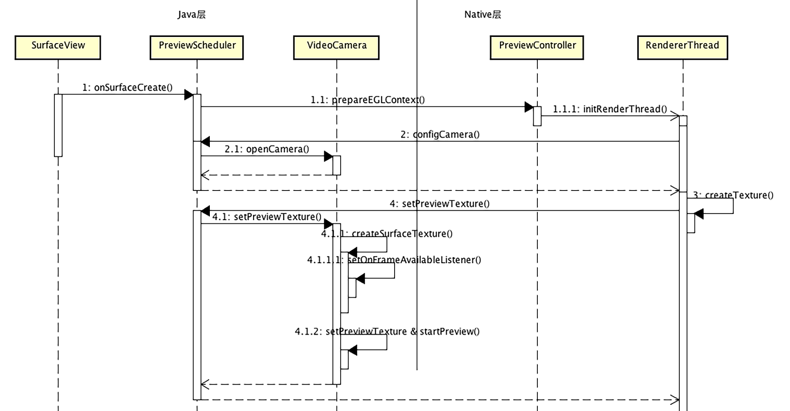
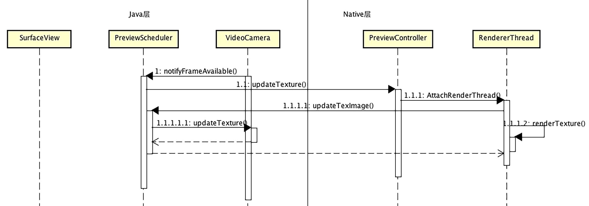
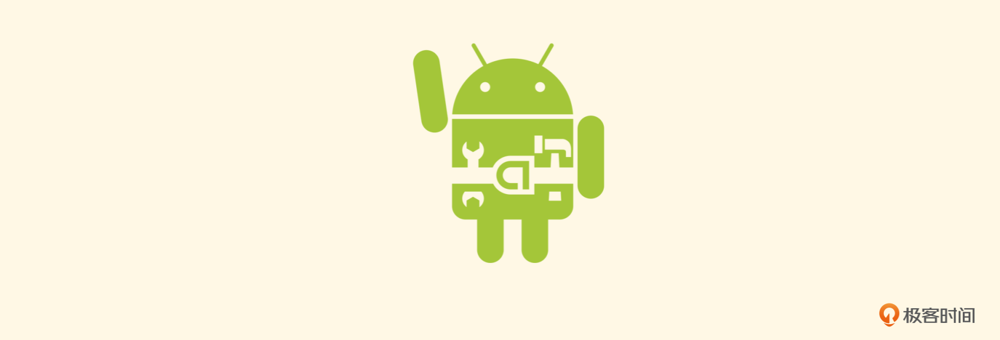
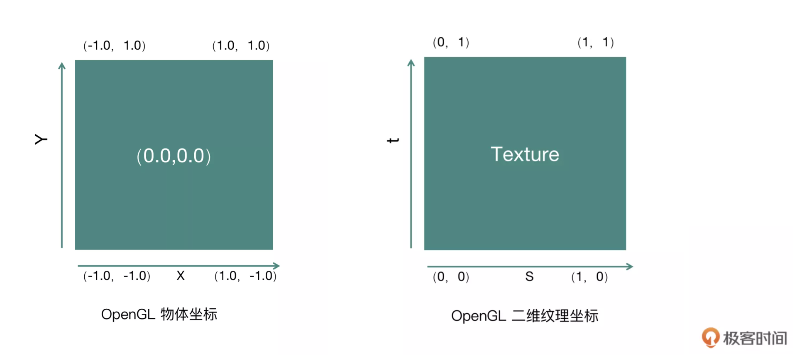
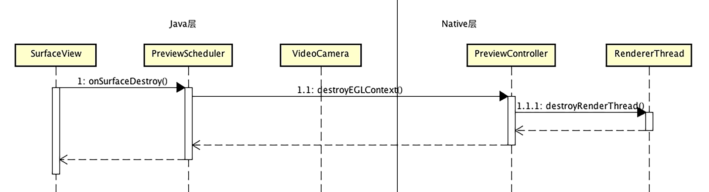
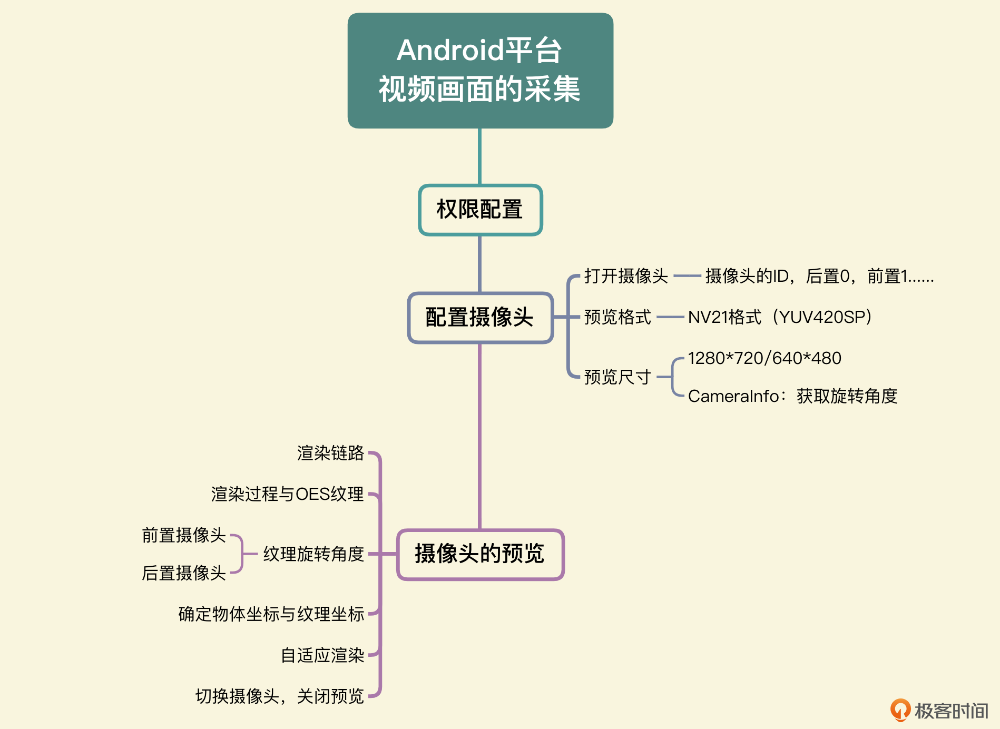

# 15 | Android平台是如何采集视频画面的？

你好，我是展晓凯。今天我们来一起学习 Android 平台视频画面的采集。

上一节课我们一起学习了 iOS 平台的视频画面采集，Android 平台的采集相对来讲会更复杂一些，因为我们整个系统的核心部分都是在 Native 层构建的，所以这就会涉及 JNI 层的一些转换操作。不过不用担心，我会带着你一步步构建起整个系统。

## 权限配置

要想使用 Android 平台提供的摄像头，必须在配置文件里添加权限要求。

```xml
<uses-permission android:name="android.permission.CAMERA" />
```

Android 6.0 及以上的系统，需要动态申请权限。

```
if (ContextCompat.checkSelfPermission(MainActivity.this, android.Manifest.permiss
 //没有权限就在这里申请
 ActivityCompat.requestPermissions(MainActivity.this, new String[]{Manifest.perm
}else {
 //说明已经获取到摄像头权限了
}
```

随着 Android 系统的发展，摄像头 API 也有了非常多的变化，这里我们使用的是给 Camera设置预览纹理的方式，而不是使用给 Camera 设置接收 YUV 数据回调的方式。这是因为得到纹理 ID 之后，进入我们的 OpenGL ES 渲染链路会更方便，同时视频滤镜处理、View 的渲染也会方便一些。

## 配置摄像头

使用 Android 的摄像头采集数据，需要打开摄像头并进行一些配置，我们先来看打开摄像头的操作。

### 打开摄像头

Android 平台提供的打开摄像头的接口如下：

```java
public static Camera open(int cameraId)
```

需要传入的参数就是摄像头的 ID。我们知道，是先有的后置摄像头，后有的前置摄像头，甚至目前部分手机已经有了更多的辅助摄像头，所以摄像头的 ID 也是按先后顺序排列的，后置摄像头是 0，前置摄像头是 1，然后才是其他的摄像头，需要使用 CameraInfo 这个类里面的两个常量，CAMERA_FACING_BACK 后置摄像头和 CAMERA_FACING_FRONT 前置摄像头这个函数返回的就是一个摄像头的实例，如果返回的是 NULL，或者抛出异常（因为不同厂商所给出的返回不一致），代表用户没有给这个应用授权，就不可以访问摄像头。拿到这个摄像头实例之后，要为这个摄像头实例做一些配置，参数的配置主要就是预览格式和预览的尺寸。先来看预览格式的设置。

### 预览格式

预览格式一般设置为 NV21 格式，实际上就是 YUV420SP 格式，即 UV 是交错（interleaved）存放的，设置代码如下：

```
List<Integer> supportedPreviewFormats = parameters.getSupportedPreviewFormats();
if (supportedPreviewFormats.contains(ImageFormat.NV21)) {
   parameters.setPreviewFormat(ImageFormat.NV21);
} else {
   throw new CameraParamSettingException("视频参数设置错误:设置预览图像格式异常");
}
```

代码显示，先取出摄像头支持的所有的预览格式，然后判断一下有没有我们要设定的格式，如果有，就设置进去；如果没有，就抛出异常，留给业务层处理。

### 预览尺寸

接下来是预览尺寸的设置，一般设置成 1280720，当然在某些特殊场景，也可以设置成640480 的分辨率，设置代码如下：

```
List<Size> supportedPreviewSizes = parameters.getSupportedPreviewSizes();
int previewWidth = 640;//1280
int previewHeight = 480;//720
boolean isSupportPreviewSize = isSupportPreviewSize(
       supportedPreviewSizes, previewWidth, previewHeight);
if (isSupportPreviewSize) {
   parameters.setPreviewSize(previewWidth, previewHeight);
} else {
   throw new CameraParamSettingException("视频参数设置错误:设置预览的尺寸异常");
}
```

执行代码就会获取摄像头支持的所有分辨率列表，然后判断要设置的分辨率是否在支持的列表中，如果在的话就设置进去，否则抛出异常，留给业务层去处理。

配置完上面的参数之后，就要把这个参数设置给 Camera 这个实例了，代码如下：

```
try {
   mCamera.setParameters(parameters);
} catch (Exception e) {
   throw new CameraParamSettingException("视频参数设置错误");
}
```

在宽高的设置中，要注意宽是 1280（或者 640），高是 720（或者 480），这是因为摄像头默认采集出来的视频画面是横版的。在显示的时候，需要获取当前摄像头采集出来的画面的旋转角度，我们可以通过下面这段代码来获取旋转角度。

```
int degrees = 0;
CameraInfo info = new CameraInfo();
Camera.getCameraInfo(cameraId, info);
if (info.facing == Camera.CameraInfo.CAMERA_FACING_FRONT) {
   degrees = (info.orientation) % 360;
} else { // back-facing
   degrees = (info.orientation + 360) % 360;
}
```

根据不同的摄像头取出对应的 CameraInfo，这个 CameraInfo 里的 orientation 属性表示的就是画面的旋转角度，不过要想正确地旋转还要再处理一下。如果是前置摄像头，就直接对 360进行取模；如果是后置摄像头，要加上 360 度再取模 360，从而得到要旋转的角度。这个角度对于将视频帧正确地显示到屏幕上是至关重要的，所以我们带着这个角度进入摄像头预览部分的学习吧。

## 摄像头的预览

摄像头的基础参数配置好之后，就可以接收摄像头采集的图像，然后将图像渲染到屏幕上了。OpenGL ES 渲染图像的基本流程是，先把图像解码成 RGBA 格式，然后将 RGBA 格式的字节数组上传到一个纹理上，最终将纹理渲染到屏幕 View 上，而这里的渲染也会使用 OpenGLES 实现。

### 渲染链路

整体渲染架构我们在 Java 层构造一个 Surface(Texture)View，来显示渲染的结果，然后在Native 层用 EGL 和 OpenGL ES 给这个 SurfaceView 做渲染。核心的连接点如下：

- 在 Native 层的 OpenGL 线程中，生成一个纹理 ID 并传递到 Java 层，Java 层利用这个纹理 ID 构造出一个 SurfaceTexture。

- 把这个 SurfaceTexture 设置给 Camera 的预览纹理，然后调用 Camera 的开始预览方法。



- 开始预览

但是我们怎么能够知道摄像头捕捉到了一张新的图片呢？答案就是给这个 SurfaceTexture 设置视频帧可用监听者。当 Camera 设备采集到一帧内容的时候，就会回调这个 Listener，你可以看一下代码。

```
mCameraSurfaceTexture = new SurfaceTexture(textureId);
try {
   mCamera.setPreviewTexture(mCameraSurfaceTexture);
   mCameraSurfaceTexture.setOnFrameAvailableListener(frameAvailableListener);
   mCamera.startPreview();
} catch (Exception e) {
   throw new CameraParamSettingException("设置预览纹理错误");
}
```

代码里的 frameAvailableListener 是继承自 OnFrameAvailableListener 的内部类的一个实例，这个内部类里需要重写 onFrameAvailable 方法。当摄像头采集到一帧图像后，就会调用这个方法，在方法中我们调用 Native 层的方法来渲染出摄像头刚刚捕捉的图像。

Native 层的这个方法会转换到渲染线程中调用 SurfaceTexture 的 updateTexImage 方法（因为必须在 OpenGL ES 线程才可以调用这个方法，所以绕了一大圈）。这个方法调用完毕之后，摄像头采集的视频帧就放到了 Native 层生成的纹理上去了，渲染线程就可以继续把这个纹理渲染到界面上去了。当摄像头再一次采集到一帧新图像的时候，就周而复始地执行上述过程，这样在设备屏幕上就可以流畅地预览摄像头采集的内容了。



- 刷新预览

### 渲染过程与 OES 纹理

上面我们在 Native 层的 OpenGL 线程中生成一个纹理 ID，然后传递到 Java 层，由 Java 层构造成一个 SurfaceTexture 类型的对象，并将 Camera 的 PreviewCallback 设置为这个SurfaceTexture 对象。

还记得在摄像头配置阶段，我们给摄像头配置的视频频帧格式是 NV21 吗？也就是YUV420SP 格式的，这个格式中 width * height 个像素点需要占用 width * height * 3 / 2 个字节数，即每一个像素点都会有一个 Y 放到数据存储的前 width * height 个数据中，每四个像素点共享一个 UV 放到后半部分进行交错存储。

而在 OpenGL 中使用的绝大部分纹理对象都是 RGBA 的格式，另外之前在讲播放器的时候，我们也讲过 Luminance 格式，但是那里面是开辟 3 个纹理来表示一张 YUV 的图片，而这里必须使用一个纹理 ID 来给 Camera 更新数据，那应该怎么把 3 个 Luminance 的纹理合并成一个纹理对象呢？

幸好 OpenGL ES 提供了一个扩展类型：GL_TEXTURE_EXTERNAL_OES，这种纹理在使用上会有一些特殊，比如，纹理需要绑定到类型 GL_TEXTURE_EXTERNAL_OES 上，而不是类型 GL_TEXTURE_2D 上，给纹理设置参数的时候也要使用GL_TEXTURE_EXTERNAL_OES 类型，生成这种类型的纹理与设置参数的代码如下：

```
glGenTextures(1, &texId);
glBindTexture(GL_TEXTURE_EXTERNAL_OES, texId);
glTexParameteri(GL_TEXTURE_EXTERNAL_OES, GL_TEXTURE_MAG_FILTER, GL_LINEAR);
glTexParameteri(GL_TEXTURE_EXTERNAL_OES, GL_TEXTURE_MIN_FILTER, GL_LINEAR);
glTexParameteri(GL_TEXTURE_EXTERNAL_OES, GL_TEXTURE_WRAP_S, GL_CLAMP_TO_EDGE);
glTexParameteri(GL_TEXTURE_EXTERNAL_OES, GL_TEXTURE_WRAP_T, GL_CLAMP_TO_EDGE);
```

在实际的渲染过程中绑定纹理的代码如下：

```
glActiveTexture(GL_TEXTURE0);
glBindTexture(GL_TEXTURE_EXTERNAL_OES, texId);
glUniform1i(uniformSamplers, 0);
```

在 OpenGL ES 的 shader 中需要声明对此扩展的使用，指令如下：

```
#extension GL_OES_EGL_image_external : require
```

在 shader 里也必须使用 samplerExternalOES 采样方式来声明纹理，FragmentShader 中的代码如下：

```
static char* GPU_FRAME_FRAGMENT_SHADER =
"#extension GL_OES_EGL_image_external : require                   \n"
"precision mediump float;                                           \n"
"uniform samplerExternalOES yuvTexSampler;                          \n"
"varying vec2 yuvTexCoords;
"                                                                     \n"
"void main() {                                                       \n"
"    gl_FragColor = texture2D(yuvTexSampler, yuvTexCoords);\n"
"}
```

从生成纹理到设置参数，再到真正渲染这一整个流程下来，我们就弄清楚了这种特殊格式的纹理的使用方法，接下来我们再看一下摄像头采集图像旋转角度的问题。

### 纹理旋转角度

在使用摄像头的时候，很容易在这个地方踩坑，比如手机摄像头预览的时候会出现倒立、镜像等问题，下面我就带你彻底地搞定它。

由于摄像头采集出来的视频都是横向的，比如摄像头的预览大小是 640 * 480，其实摄像头采集出来的视频帧宽是 640，高是 480，并且图片也是横向采集的。如果要能正确地预览出来需要旋转一个 90 度或 270 度，具体旋转多少度需要在当前这个摄像头的 CameraInfo 里面获取。

不同的手机甚至是不同的系统都会不一样，并且如果是前置摄像头的话，还需要再做一个VFlip（垂直镜像）用来修复镜像的问题。假设图像是横向采集出来的，就做竖直翻转，如果已经旋转过了，就做横向翻转。下面我们用实际的图片，来分别看一下前置摄像头和后置摄像头具体的渲染流程。先看一张实际摄像头要采集的物体。



在使用前置摄像头去采集这个物体的时候，得到最左边的图片，这个时候在摄像头的CameraInfo 里取出来的角度一般是 270 度。按照旋转角度，我们把图片顺时针旋转 270 度，得到中间的图片，再进行镜像处理，得到最右边的图片。最后我们在手机屏幕上看到的才是预期的图像。


如果是后置摄像头，一般在摄像头的 CameraInfo 里取出来的角度是 90 度，当然这是 ROM厂商定的，比如 LG 厂商的 Nexus5X 这个设备取出来的角度就是 270 度。不过无论是多少度，摄像头采集出来的图像，根据这个角度在旋转过后，就能得到一个正常的图像了，你可以看一下它的旋转流程。


如果是 LG 厂商的 Nexus5X 或者 HUAWEI 厂商的 Nexus6P 这两款设备，图像的后置摄像头需要顺时针旋转 270 度，得到正常显示的图像。


- Nexus 5/6P升级系统之后

### 确定物体坐标与纹理坐标

上述图像的旋转和镜像，在 OpenGL ES 中需要通过物体坐标和纹理坐标变换来实现。我们可以再回看一下之前物体坐标系和纹理坐标系的图。



而我们这里的物体坐标也是一个通用的坐标。

```
GLfloat squareVertices[8] = {
   -1.0, -1.0, //物体左下角
   1.0，-1.0，  //物体右下角
   -1.0，1.0，  //物体左上角
   1.0，1.0     //物体右上角
};
```

下面是不做任何旋转与镜像的 OpenGL 纹理坐标。

```
GLfloat textureCoordNoRotation[8] = {
   0.0，0.0，//图像的左下角
   1.0，0.0，//图像的右下角
   0.0，1.0，//图像的左上角
   1.0，1.0  //图像的右上角
};
```

然后，给出顺时针旋转 90 度的纹理坐标，你可以想象一下，把 OpenGL 的纹理坐标系的图顺时针旋转 90 度，然后再把对应的左下、右下、左上、右上的坐标点写下来。

```
GLfloat textureCoords[8] = {
   1.0，0.0，//图像的右下角
   1.0，1.0，//图像的右上角
   0.0，0.0，//图像的左下角
   0.0，1.0  //图像的左上角
};
```

给出顺时针旋转 180 度的纹理坐标。

```
GLfloat textureCoords[8] = {
   1.0，1.0，//图像的右上角
   0.0，1.0，//图像的左上角
   1.0，0.0，//图像的右下角
   0.0，0.0  //图像的左下角
};
```

然后，给出顺时针旋转 270 度的纹理坐标。

```
GLfloat textureCoords[8] = {
   0.0，1.0，//图像的左上角
   0.0，0.0，//图像的左下角
   1.0，1.0，//图像的右上角
   1.0，0.0  //图像的右下角
};
```

还记得前面我们讲过计算机图像的坐标系与 OpenGL 的坐标系不同吗？它们的 Y 恰好是相反的，所以这里要把每一个纹理坐标做一个 VFlip 的变换（垂直镜像，即把每一个顶点的 y 值由0 变为 1 或者由 1 变为 0），这样就可以得到一个正确的图像旋转了。而我们的前置摄像头存在镜像的问题，这时候需要对每一个纹理坐标做一个 HFlip 变换（水平镜像，即把每一个顶点的 x 值由 0 变为 1 或者由 1 变为 0），从而让图片在预览界面中看起来和在镜子中一样。

### 自适应渲染

上面的步骤其实就是一个特殊格式（OES）的纹理经过旋转和渲染，变成了正常格式（RGBA）的一个纹理，那接下来就可以把这个正常格式的纹理渲染到屏幕上去了。

但这里需要补充一句，由于这个纹理的宽和高实际上是摄像头捕捉过来的图像的高和宽（做了一个 90 度或者 270 度的旋转），而我们的目标是要渲染到 SurfaceView 上面去，但是如果Java 层提供的 SurfaceView 的宽高和处理过后的这个纹理 ID 的宽高不一致，那么这一帧图像就会出现被压缩或者拉伸的问题，所以在渲染到屏幕上的时候，我们要做一个自适配，让纹理按照屏幕 View 的比例自动填充。

先来看纹理坐标，x 从 0.0 到 1.0 就说明要把纹理的 x 轴方向全部都绘制到物体表面（整个SurfaceView）上去，而如果我们只想绘制一部分，比如中间的一半，那么就可以将 x 轴的坐标写成 0.25 到 0.75，类似的适配也可以应用到 y 轴上。但这个 0.25 和 0.75 是如何得出来的呢？

答案很简单，如果不想被拉伸，SurfaceView 的宽高比例和纹理的宽高比例就应该是相同的。假设这一张纹理的宽为 texWidth，高为 texHeight，而物体表面的宽为 screenWidth，高为screenHeight，就可以利用下面的公式来完成自动填充的坐标计算。

```sql
float textureAspectRatio = texHeight / texWidth;
float viewAspectRatio = screenHeight / screenWidth;
float xOffset = 0.0f;
float yOffset = 0.0f;
if(textureAspectRatio > viewAspectRatio){
   //Update Y Offset
   int expectedHeight = texHeight*screenWidth/texWidth+0.5f;
   yOffset = (expectedHeight - screenHeight) / (2 * expectedHeight);
} else if(textureAspectRatio < viewAspectRatio){
   //Update X Offset
   int expectedWidth = texHeight * screenWidth / screenHeight + 0.5);
   xOffset = (texWidth - expectedWidth)/(2*texWidth);
}
```

计算得到的 xOffset 和 yOffset 在纹理坐标中分别替换掉 0.0 的位置，利用 1.0-xOffset 以及1.0-yOffset 替换掉 1.0 的位置，最终得到一个纹理坐标矩阵。

```
GLfloat textureCoordNoRotation[8] = {
   xOffset，           yOffset，
   1.0 - xOffset，     yOffset，
   xOffset，           1.0 - yOffset，
   1.0 - yOffset，     1.0 - yOffset
};
```

到这里，摄像头预览流程就可以随着摄像头所采集的图像一帧一帧地绘制下去了，也就实现了整个预览过程。

### 切换摄像头与关闭预览

当用户切换摄像头的时候，就可以给 Native 层发一个指令，Native 层会在 OpenGL 线程中关闭当前摄像头，然后重新打开另外一个摄像头，并配置参数，然后设置预览的SurfaceTexture，最后调用开始预览方法，这样就可以切换成功了，用户看到的就是切换摄像头之后的预览画面。

最终关闭预览时，要先停掉整个渲染线程，然后关闭 Camera，当然还要释放之前建立的SurfaceTexture，把摄像头的 PreviewCallback 设置为 null，最终释放掉摄像头。



- 结束预览

到这里，摄像头预览相关的操作就全都讲完了，这个部分的内容是十分重要的，对后面搭建整个录制视频的项目来说，是最基础的部分，所以一定要掌握。

## 小结

最后，我们可以一起来回顾一下这节课的主要内容。这节课我们从权限配置开始，然后讲解了摄像头的配置与打开摄像头的操作，接着详细讲解了如何将摄像头采集到的图像一步步渲染到屏幕 View 上，整体流程如下：

- 在 Native 层创建一个 OpenGL 线程，并且构建出一个 OES 类型的纹理 ID 传递给 Java 层构造成一个 SurfaceTexture，然后配置给摄像头。

- 当摄像头采集到一帧图像之后，就会通过回调的方式告诉我们，我们将在 OpenGL 线程中调用 update 方法将这一帧图像更新到纹理 ID 上。

- 接着按照旋转角度确定纹理矩阵，将 OES 的纹理渲染成为一个标准的 RGBA 的纹理。

- 最后将 RGBA 类型的纹理在渲染到屏幕上。

如果你了解清楚整个过程，那么后面学习编码也会更加顺畅。



## 思考题

这节课我们学习了摄像头预览的流程，那我来考考你，摄像头采集的出来的纹理类型是什么类型，它又是怎么被绘制到屏幕 View 上去的呢？欢迎你把这节课分享给更多对音视频感兴趣的朋友，我们一起交流、共同进步。下节课再见！
