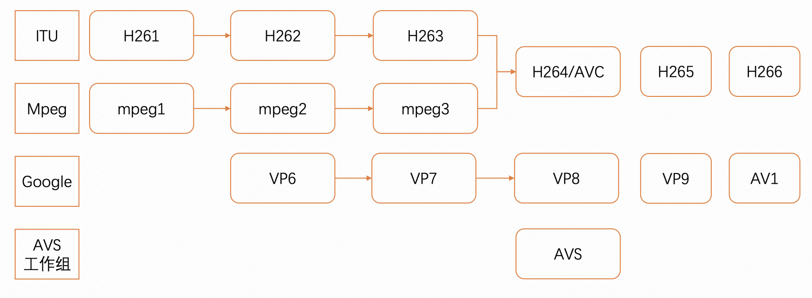
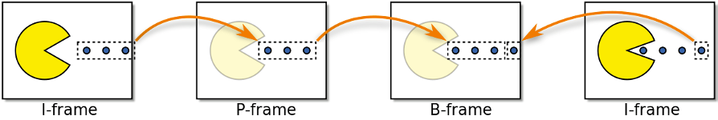
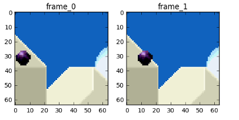
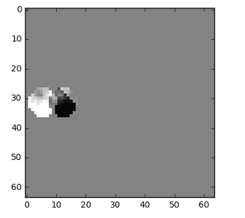
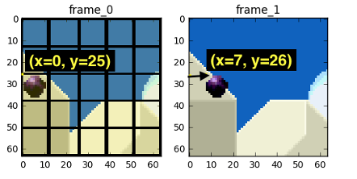
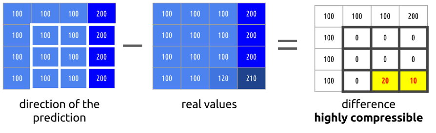
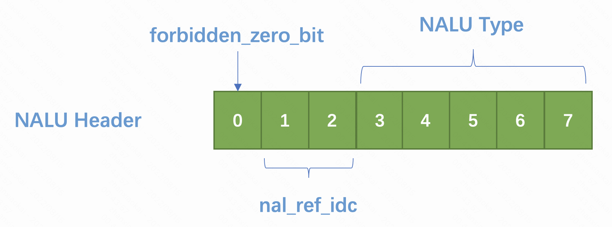
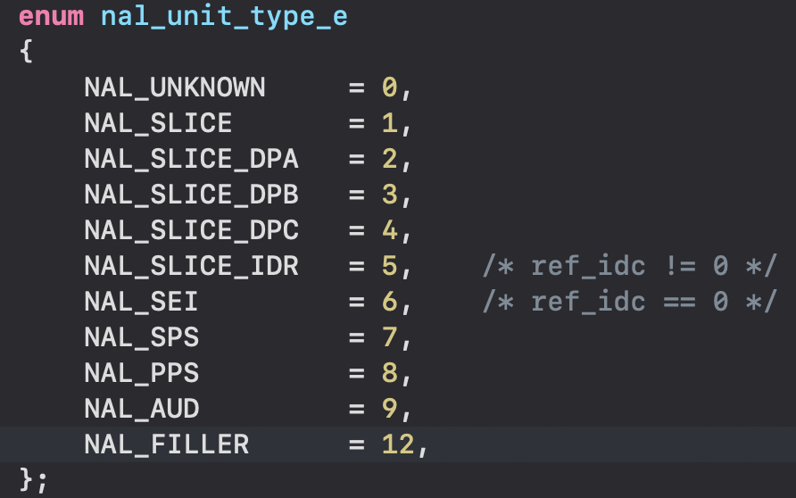

# 16 | 视频编码的工作原理与H.264封装格式

你好，我是展晓凯。今天我们来一起学习视频编码的工作原理与 H.264 的封装格式。

前两节课我们一起学习了 iOS 与 Android 平台的视频画面采集，但是采集下来的内容最终是需要保存到一个视频文件中的，所以就需要用到视频编码相关的知识。

还记得前面我们讨论的音频压缩方式吗？音频编码主要是去除冗余信息，从而达到数据量压缩的目的。那视频方面的编码，又是通过什么方式来压缩数据的呢？其实和音频编码类似，视频编码也是通过去找出冗余信息来压缩数据的。但相比于音频数据，视频数据有极强的相关性，也就是说有大量的冗余信息，包括空间上的冗余信息和时间上的冗余信息。接下来我们就一起看一下目前比较主流的视频压缩标准。

## 编码标准介绍

我想你一定知道你 JPEG 格式的图片吧，其实它就是 ISO 制定的 JPEG 的图像编码标准。对于视频，ISO 同样也制定了标准，Motion JPEG 就是 MPEG，MPEG 算法是适用于动态视频的压缩算法，它除了可以对单幅图像进行编码外，还可以利用图像序列中的相关性原则，去掉冗余信息，这样就可以大大提高视频的压缩比。

发展到现在，MPEG 也已经经历过了好多代，版本一直在不断更新中，主要有这几个版本：Mpeg1，VCD 用的就是它；Mpeg2，在 DVD 中使用；还有 Mpeg4 AVC，现在的流媒体中使用最多的就是它了。

相较于 ISO 制定的 MPEG 的视频压缩标准，ITU-T 制定的 H.261、H.262、H.263、H.264 一系列视频编码标准是另外一套体系。其中 H.264 汲取了以往标准制定中积累的经验，采用简洁的设计，使用的范围越来越广。

现在用得最多的就是 H.264 标准，H.264 创造了多参考帧、多块类型、整数变换、帧内预测等新的压缩技术，使用了更精细的分象素运动矢量（1/4、1/8）和新一代的环路滤波器，大大提高了压缩性能，系统更加完善。从 H.264 开始，它与 Mpeg 标准的 AVC 合并成为了一个，后续又衍生出了 H.265、H.266 等新一代的视频编码标准。

除了上述两个组织制定的标准之外，还有 Google 制定的 VP 系列的视频编码和我们国家 AVS工作组制定的 AVS 编码标准，整体的图示如下图所示：



接下来我们会重点学习 H.264 这一视频编码的工作原理及它的封装格式。

## 编码器的工作编码原理介绍

由于人类眼睛的生理特点（视锥细胞对亮度的敏感程度强于颜色的敏感程度），所以出现了YUV420P 的无损表示格式，但只是做到这样还是远远不够的，还应该使用有损的压缩方式，将 YUV420P 的原始数据压缩到更小，而压缩主要考虑到视频有以下两个特性。

- 一段视频中包含大量的视频帧，而相邻的视频帧之间几乎没有任何变化。

- 一帧图像内部包含了许多使用相同或相似颜色的区域。

第一是去除时域上的冗余信息；第二是去除单张视频帧的空间冗余信息。那这两部分工作也是编码器工作的重点，这节课我就来介绍一下这两部分的通用实现手段，但是在不同的编码器中实现的方式又有所不同，编码出来的视频质量以及性能消耗也是不同的，而性能和质量也是开发者选用编码器的衡量指标。

### 帧类型介绍

在尝试着消除冗余信息（不论是时间的冗余信息还是空间的冗余信息）之前，先来假设一个视频内容，一个帧率（fps）为 30 的电影，下面是前四帧的内容：


在这四帧视频帧中，我们可以看到大量的重复信息，比如蓝色的背景，它从第一帧到第四帧并没有任何变化，为了消除这些冗余信息，我们可以将视频帧的类型抽象为 3 种类型。

- I Frame

I 帧是一个仅包含当前帧信息的视频帧类型，所以它又被称为参考帧、关键帧。在解码过程中它不需要依赖任何帧就可以被解码出来，一个 I 帧看起来和一张静态图片非常类似，视频流或者视频文件中第一帧通常是 I 帧，并且会定期在其他帧类型中间插入 I 帧；

- P Frame

P 帧是前向参考帧，可以使用前面的 I 帧与 P 帧来呈现出当前视频帧，这也是解码器的解码规则，例如上图中第二帧视频帧与第一帧视频帧的变化只是小球向右前方移动了，所以我们可以基于第一帧视频帧计算出变化部分，作为第二帧视频帧的内容，这样第二帧视频帧所占用的空间就大大减少了。

- B Frame

相比于 P 帧只参考前面的视频帧内容，B 帧又增加了对后边视频帧的参考，这样可以提供更好的压缩，但是这对于编码器来讲，计算量增大的同时还增加了编码输出的延迟时间（因为需要参考后续过来的视频帧），所以在一些实时性要求较高的场景下通常不使用 B 帧。

这些帧类型共同组成了一个完整的视频，如下图所示：



如果仅从存储或者网络带宽角度来衡量，我们可以认为 I 帧是最昂贵的，P 帧会便宜一些，但是最便宜的是 B 帧。接下来我们看一下，这几种类型的帧是如何产生的。

### 消除时间上的冗余信息

我们先来一起讨论一下如何消除视频帧在时间上的冗余信息，比较成熟的技术就是帧间预测技术（inter-frame prediction），先来看这两帧视频帧。



我们将去除掉时间上的冗余信息来达到使用更少的字节存储这两帧视频帧的目的，首先想到的就是这两帧视频帧相减，得到 Diff 值，就是我们要进行编码的东西，如下图所示。



但其实还有一种更好的方法，可以使用更少的比特数来存储第二帧视频帧的内容，首先我们将每一帧视频帧（frame_0）分为很多个部分，然后将这两帧视频帧中的每一部分进行匹配，这种算法我们可以看作是运动估计，如下图所示。



在第一帧变化到第二帧的过程中，我们可以估计第一帧视频帧中的黑色球从点（x=0, y=25）到点（x=7, y=26），而 x 和 y 组成的值的集合就叫做运动向量。我们可以更进一步来节省编码内容，即只对这两帧之间的运动矢量差进行编码，所以最终运动矢量是 x=6（6-0)） y=1（26-25）。当然在真实的编码过程中，图中的小球会再被划分为 N 个部分，前面把它当作一部分只是为了方便理解。所以我们可以看到，当应用了运动估算算法之后，编码的数据要比简单地计算 Diff 值进行编码的数据要少得多。

我们可以使用 FFmpeg 工具来查看一个视频编码的运动矢量情况，命令如下：

```
ffplay -flags2 +export_mvs -vf codecview=mv=pf+bf+bb input.flv
```

到这里，时间冗余信息我们可以靠运动估计算法给消除掉了，而要想使用运动估计，就需要一个帧作为参考帧，一般称之为 I 帧，那么 I 帧是如何进行压缩的呢？其实就是接下来我们要讲解的空间冗余信息的消除部分。

### 消除空间上的冗余信息

在一帧视频帧中我们可以看到大量的重复信息。


从图中可以看到有大量的蓝色和白色组成，如果这是一帧 I 帧的话，我们就无法使用帧间预测技术来压缩它了。但我们还是有办法来压缩这张图片，因为它的重复信息还是比较多的。


如图所示，我们将对标出来的红色块的部分进行编码，我们可以根据红色块周围的颜色趋势来预测当前部分的颜色值，比如可以预测，帧将继续垂直地传播颜色，这意味着未知像素的颜色将保持其邻居的值，如图所示。


但是我们的预测有可能是错误的，所以我们需要使用另外一项技术，即帧内预测技术。我们使用真正的值减去预测的值可以得到一个矩阵，如下所示：



我们通过帧内预测技术实现了空间压缩，也简单了解了空间压缩的原理，但是一个编码器的内部工作机制还是非常复杂的，有非常多的复杂流程，最经典的就是 DCT 变换，它利用图像在低频部分的能量分布比较多，在高频比较少这一特点，将图像变换到频域上来进一步消除空间的冗余信息，这就是有损压缩最核心的一部分。除此之外，编码器还需要使用量化、熵编码等步骤共同来编码出最终的视频。如果你有兴趣了解更多的内部细节，可以参考 libx264 的官方文档。

## H264 的 NALU

NALU 的全称是 Network Abstract Layer Unit，即网络抽象层，在 H.264/AVC 视频编码标准中，整个系统框架被分成了两层，即视频编码层面（VCL）和网络抽象层面（NAL）。前者负责有效表示视频数据的内容，而后者负责格式化数据并提供头信息，以保证数据适合各种信道和存储介质上的传输。我们平时的每帧数据就是一个 NAL 单元，也就是我们常说的 NALU。一个完整的 NALU 由 Header 和 Payload 组成，其中 Header 部分占一个字节，每一位代表含义如下：



其中第一位固定为 0；第二位、第三位组成一个 nal_ref_idc 代表了这个 NAL 的重要性，取值范围是 0～3，值越大表示当前 NALU 越重要，需要优先受到保护，比如 IDR、SPS、PPS 类型的 NALU，这个值一定不是 0；最后 5 位共同组成 NALUType，判定规则就是“与”上 0x1f 得出的值再和下述数值做比较。



我们经常使用的有 IDR、SEI、SPS、PPS，IDR 代表了关键帧，从这一帧开始不需要再参考前序的视频帧。SEI 帧代表视频增强信息的帧，像之前风靡一时的视频答题应用就使用这种类型的帧来承载题目以及答案，通常用法是把这个帧加入到每一个关键帧的前面。

SPS 和 PPS 保存了一组编码视频序列的全局参数，每一帧编码后的数据所依赖的参数保存在图像参数集里，里面的信息至关重要，如果其中的数据丢失或出现错误，那么解码过程很可能会失败。一般情况下 SPS 和 PPS 的 NAL Unit 处于整个码流的起始位置，初始化解码器的时候需要将这两者设置给解码器。你从图中也可以看到像 SEI 帧它的 nal_ref_idc 就是等于 0的，而像 IDR、SPS、PPS 类型的 nal_ref_idc 就不能为 0。

## H.264 的封装格式

在熟悉了 H.264 里面的 NALU 之后，接下来我们就再介绍一下 H.264 里面的封装格式，就像音频的 AAC 编码有两种封装格式，H.264 的编码也有两种封装格式，一种是 AVCC 格式，一种是 Annex-B 格式。

### AVCC 格式

AVCC 格式也叫 AVC1 格式，是属于 MPEG-4 标准定义的格式，通常用于存储MP4/FLV/MKV 等文件，也可以用于 RTMP 直播中，格式如下图所示：


最前面是 extraData 部分，这部分描述了整体编码的一些信息，主要部分是由 sps 和 pps 组成，后边跟的是许多个 NALU，但是每一个 NALU 前面一般会使用 4 个字节来表示这个NALU 的长度，然后紧接着跟着这个 NALU。

### Annex-B 格式

Annex-B 格式也叫 MPEG-2 transport stream format 格式，是属于 MPEG-4 标准定义的格式，通常用于 ts 流以及视频会议中，格式如下图所示：


其中 startCode 有可能是三个字节或者四个字节，会用 0x001 或者 0x0001 来表示，这个格式会以它作为 NALU 的分界点，SPS 和 PPS 按照一个 NALU 的方式写在头部。

在 FFmpeg 中提供了一个 bitstreamFilter 叫做 h264_mp4toannexb，在解码场景中可以方便地将 AVCC 格式的 H.264 转换为 Annexb 格式的 H.264。当然在编码场景中，如果需要逆方向的格式转换，你也可以自己将 startCode 部分替换为 NALULength。

## 小结

最后，我们可以一起来回顾一下。

- 各个组织的视频编码标准，包括 ISO 的 Mpeg、ITU-T 的 H26x、Google 的 VPx 还有 AVS工作的 AVS 标准。

- 视频编码器的工作原理，编码器需要消除掉视频帧里面的空间冗余信息和时间冗余信息，在这里引出了帧的类型，包括 I 帧、P 帧和 B 帧。

- 这节课的重点是 H.264 的 NALU 以及封装格式，在 NALU 部分我们一起学习了 NALU 的组成方式以及各种 NALU Type，包括 SPS、PPS、IDR、SEI 等，在封装格式部分重点讲解了两种封装格式的区别和具体构造。

理解我们这节课的内容是非常重要的，因为在接下来的两节课我们会使用这节课学到的知识来开发代码，分别使用软件编码（基于 FFmpeg）以及硬件编码（Android 与 iOS 平台本身提供的硬件编码接口）的形式，来完成 H.264 的编码，这样就可以用上一节课采集到的 YUV 数据，生成一个 H.264 的数据了。

## 思考题

你可以思考一下，如果让你做一个推流的 SDK，涉及网络的抖动，一定要做一些实时码率的变化，但是在码率变化的同时常用的一个做法是丢弃掉一部分高码率视频帧，在 H.264 中哪些视频帧可以丢弃，哪些又不可以丢弃呢？欢迎在评论区中告诉我你的答案，也欢迎你把这节课分享给更多对音视频感兴趣的朋友，我们一起交流、共同进步。下节课再见！
