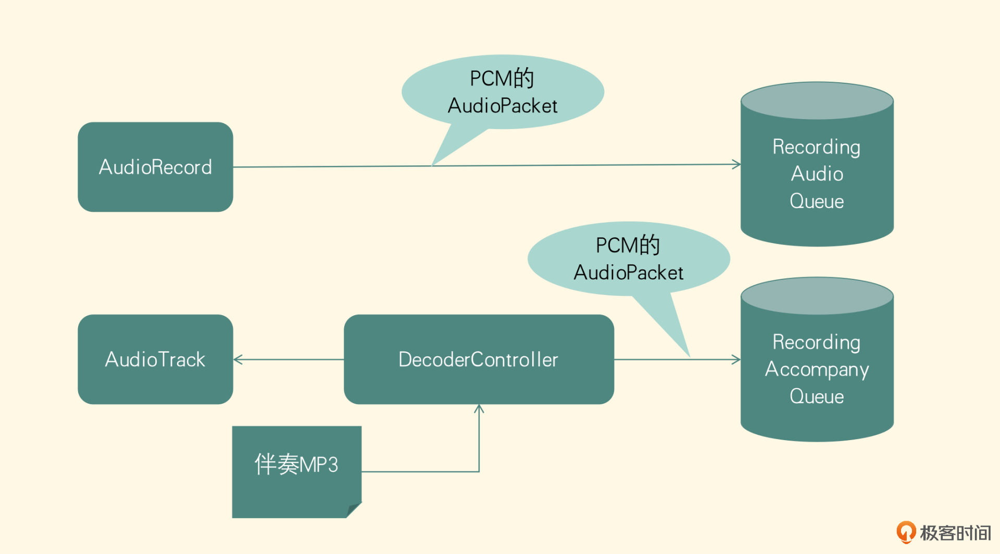
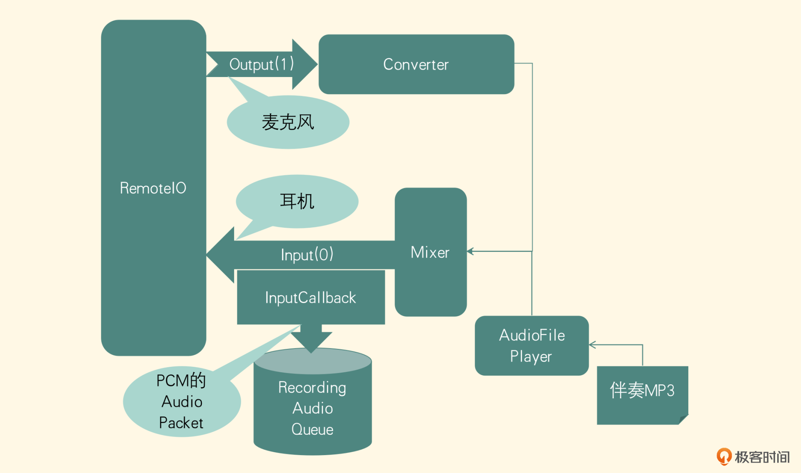
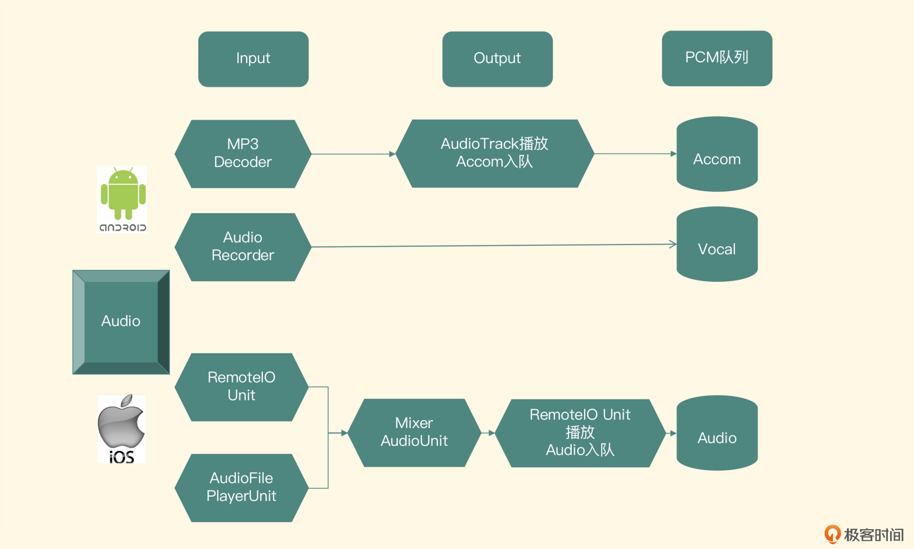

# 20 | 如何实现视频录制器的底层模块？（上）

你好，我是展晓凯。今天我们来一起学习视频录制器底层核心模块的实现。

上一节课我们从视频录制器的场景分析入手，设计出了一个视频录制器的架构，并且详细讲解了每个模块的职责与技术选型。接下来这两节课，我们就来分别实现音视频两个大模块下面的子模块。这节课我们要实现的是音频模块中的音频队列，目标是把音频（采集到的声音+BGM）的 PCM 数据放到 PCM 队列里。

## 音频模块

具体如何采集音频，你可以回顾一下前面第 10 节课和第 11 节课的内容。这节课我们主要讲解音频队列在 Android 平台和 iOS 平台的实现，还有如何把采集的音频数据放到队列里的问题，最重要的还有一部分是如何在音频模块里加入播放背景音乐的功能。其中音频队列的实现在双端我们采用一套代码，都使用 C++ 来实现。

### 音频队列的实现

### 队列元素定义

讲解队列的具体实现之前，我们先来看一下队列里存放的元素，结构体定义如下：

```sql
typedef struct AudioPacket {
   short * buffer;
   int size;
   AudioPacket() {
       buffer = NULL;
       size = 0;
   }
   ~AudioPacket() {
       if (NULL != buffer) {
           delete[] buffer;
           buffer = NULL;
       }
   }
} AudioPacket;
```

这个结构体定义了一个 AudioPacket，每采集一段时间的 PCM 音频数据，就封装成一个这样的结构体对象，然后放到 PCM 队列里。上一节课我们也提到过自己写一个链表来实现这个队列，链表的节点定义如下：

```
typedef struct AudioPacketList {
   AudioPacket *pkt;
   struct AudioPacketList *next;
   AudioPacketList(){
       pkt = NULL;
       next = NULL;
   }
} AudioPacketList;
```

### 队列实现

为了保证线程的安全性，需要定义以下两个变量：

```
pthread_mutex_t mLock;
pthread_cond_t mCondition;
```

然后定义一个 mFirst 节点来指向头部节点，定义一个 mLast 节点指向尾部节点。队列提供的两个最重要的接口就是 push 和 pop，我们分别定义为 put 和 get 方法，put 函数定义如下：

```
int put(AudioPacket* audioPacket);
```

在这个 put 方法的实现中，会先判断队列是否被 abort 掉了，如果被 abort 掉了就代表队列不再工作，直接返回；如果不是 abort 状态，就把调用端传递进来的 AudioPacket 实例组装成一个链表节点放入链表中。当然为了保证线的程安全性，在放入链表的过程中要先上锁，再操作链表。

当放入链表结束之后发出一个 signal 指令。原因是 get 方法有可能被 block 住了（队列是一个Blocking Queue），所以要通过发送这个指令让 wait 线程继续从队列里取得元素，最后释放锁。核心代码如下：

```sql
if (mAbortRequest) {
   delete pkt;
   return -1;
}
AudioPacketList *pkt1 = new AudioPacketList();
if (!pkt1)
   return -1;
pkt1->pkt = pkt;
pkt1->next = NULL;
pthread_mutex_lock(&mLock);
if (mLast == NULL) {
   mFirst = pkt1;
} else {
   mLast->next = pkt1;
}
mLast = pkt1;
pthread_cond_signal(&mCondition);
pthread_mutex_unlock(&mLock);
return 0;
```

接下来是 get 接口，方法原型如下：

```
int get(AudioPacket **audioPacket);
```

get 方法的主要实现是把 mFirst 指向的节点拿出来返回调用端，并把 mFirst 指向它的下一级节点。如果当前队列为空的话，就 block 住（用来实现 Blocking Queue 的特性），等有元素后再放进来，或者这个队列被 abort 掉之后，才可以返回，实现代码如下：

```sql
AudioPacketList *pkt1;
int ret = 0;
pthread_mutex_lock(&mLock);
for (;;) {
   if (mAbortRequest) {
       ret = -1;
       break;
   }
   pkt1 = mFirst;
   if (pkt1) {
       mFirst = pkt1->next;
       if (!mFirst)
           mLast = NULL;
       mNbPackets--;
       *pkt = pkt1->pkt;
       delete pkt1;
       pkt1 = NULL;
       ret = 1;
       break;
   else {
       pthread_cond_wait(&mCondition, &mLock);
   }
=}
pthread_mutex_unlock(&mLock);
return ret;
```

最核心的两个方法已经实现了，剩下的就是 abort 方法了，这个方法需要把我们的布尔型变量mAbortRequest 设置为 true，并且同时要发出一个 signal 指令，防止别的线程会被 block 在取数据的接口中（即 get 方法中）；还有一个销毁方法，就是把队列中所有的元素遍历出来，然后释放掉。

到这里，队列实现就完成了。

### Android 平台音频模块的实现

接下来我们看 Android 平台上音频模块的实现，下图是音频模块的结构图。



- 音频模块的结构图

图里 AudioRecord 音频采集的代码，第 11 节课我们已经详细讲解过了，你可以先回顾一下。这节课我们会根据项目做一下结构调整，最重要的是添加背景音乐播放模块，最终把采集到的人声和解码后的背景音乐这两部分 PCM 音频数据分别入队。

### 伴奏的解码与播放

因为要给录制的视频增加背景音乐，所以我们要先看一下如何解码并播放伴奏。在视频播放器中我们详细讲解过，背景音乐的播放相当于一个音频播放器，工程实现步骤如下：

1. 解码控制器

基于 FFmpeg 建立一个伴奏的解码器，负责把背景音乐解码成 PCM 的数据。建立一个解码控制器来开启一个线程不断调用解码器进行解码，解码出的音频数据放到一个缓冲队列中，当队列元素到达一个阈值的时候就暂停解码，如果收到 signal 指令就继续调用解码器解码。同时解码控制器给客户端提供一个 readSamples 方法，方法完成两个职责：

- 不断从队列中取出解码好的伴奏 PCM 数据并返回给调用端。

- 要监测缓冲队列大小，当队列小于某个阈值的时候，发送一个 signal 指令让解码线程继续工作。

2. 伴奏音频渲染

业务层把 AudioTrack 作为渲染 PCM 数据的技术选型，客户端会创建一个播放器线程，从而不断地调用解码控制器的 readSamples 方法，最后把获取出来的 PCM 数据提供给AudioTrack 进行播放。当停止播放的时候，先停掉解码控制器，然后停止并释放 AudioTrack的资源。

这就是背景音乐播放器的整体流程，总体来讲就是，解码控制器中的解码线程作为生产者把解码的 PCM 数据放到一个解码队列里，而在客户端中 AudioTrack 所在的播放线程则作为消费者（调用 readSamples 方法），不断从解码队列中拿出 PCM 数据播放给用户。

3. 伴奏音频入队

在当前场景下，除了让用户可以听到伴奏，同时还要把用户听到的伴奏存储下来，那就要在背景音乐播放器的基础上做一些改动。先修改初始化方法，在初始化方法中添加一个伴奏音频队列的初始化。注意这个队列和上述的解码队列不是同一个队列，解码队列可以作为解码线程和播放器这一对生产者和消费者之间的桥梁，而这里的队列是指把播放器当作生产者，把Consumer 模块的编码线程当作消费者。

为了全局都可以访问到这个队列，要把队列放到一个单例模式设计的池子中，初始化两个队列的代码如下：

```
packetPool = LiveCommonPacketPool::GetInstance();
packetPool->initDecoderAccompanyPacketQueue();
packetPool->initAccompanyPacketQueue(sampleRate, CHANNEL);
```

接下来要修改 readSamples 方法，因为这个方法的职责发生了变化，不再单单给上层的播放器 PCM 提供数据，同时也要作为伴奏音频队列的生产者。所以我们要把这个解码控制器中的方法名 readSamples 修改为 readSamplesAndProducePacket。在方法的实现中，把这个伴奏的 AudioPacket 中的数据拷贝给客户端之后，再它放到伴奏音频队列里。代码如下：

```
packetPool->pushAccompanyPacketToQueue(accompanyPacket);
```

这样就在播放背景音乐的同时，把伴奏放到了队列中，是不是很简单呢？接下来我们看一下采集的人声如何放入队列中。

### 音频入队

前面第 11 节课我们把 AudioRecord 采集出来的 PCM 数据，直接写入文件中了，但是在当前的场景中不应该写入文件中，而要放到人声的 PCM 队列里。在 Native 层新建一个RecordProcessor 类，负责接收 PCM 数据并把这些数据放入队列中，同时维护声音的编码线程。下面来看一下这个类里的方法和实现，首先是初始化方法：

```
void initAudioBufferSize(int sampleRate, int audioBufferSize);
```

这个方法主要是把采样率和队列里每一个元素的大小作为参数传入进来。在这个方法的实现中，要把这两个参数赋值给全局变量，并按照这个 audioBufferSize 分配一块 audioBuffer 的存储空间，用来积攒采集到的音频数据。最后构造出编码器，并初始化这个编码器。

接下来看第二个接受人声 PCM 数据的方法定义：

```
void pushAudioBufferToQueue(short* samples, int size)
```

这个方法用来积攒本来要在 Java 层送入的 PCM 的数据，并把数据放入队列中。为什么要积攒呢？因为在不同的设备上 Java 层的 AudioRecorder 采集出来的 buffer 大小有可能不同，所以要在这个方法内部做一个积攒，当积攒到初始化方法中设定的 audioBufferSize 的时候，再把这一段 buffer 构造成一个 AudioPacket 放到人声队列里。实现代码如下：

```
void pushAudioBufferToQueue(short* samples, int size) {
   int samplesCursor = 0;
   int samplesCnt = size;
   while (samplesCnt > 0) {
       if ((audioSamplesCursor + samplesCnt) < audioBufferSize) {
           cpyToAudioSamples(samples + samplesCursor, samplesCnt);
           audioSamplesCursor += samplesCnt;
           samplesCursor += samplesCnt;
           samplesCnt = 0;
       } else {
           int subFullSize = audioBufferSize – audioSamplesCursor;
           cpyToAudioSamples(samples + samplesCursor, subFullSize);
           audioSamplesCursor += subFullSize;
           samplesCursor += subFullSize;
           samplesCnt -= subFullSize;
           flushAudioBufferToQueue();
       }
   }
}
```

在代码中先定义一个游标来表示访问到 samples 这个 buffer 的哪个位置，然后进入一个循环， 把这个 buffer 的数据全部都拷贝出来，直到全都使用完了就退出这个循环。

循环内部首先判断在全局的 audioBuffer 中是否有足够的空间来存放有效数据（就是 buffer 中还没被取出的数据）。如果可以存放，就全部都拷贝到全局 audioBuffer 中，然后给全局的audioBuffer 游标和当前 buffer 的游标增加对应的数值，把 sampleCnt 设置为 0，标志当前buffer 使用完毕了；如果全局的 audioBuffer 存放不了的话，那么就先计算出全局的audioBuffer 还能存放多少，代码如下：

```
int subFullSize = audioBufferSize – audioSamplesCursor;
```

cpyToAudioSamples 这个方法可以把对应数量（subFullSize）个 sample 从当前 buffer 中拷贝到全局的 audioBuffer 中，然后给全局 audioBuffer 对应的游标增加对应数量，当前 buffer的有效采样数目减去对应数量，最后再把全局的 audioBuffer 封装成一个 AudioPacket 放入人声队列中。把 audioBuffer 封装成 AudioPacket 并且入队的代码如下：

```
short* packetBuffer = new short[audioSamplesCursor];
memcpy(packetBuffer, audioSamples, audioSamplesCursor * sizeof(short));
AudioPacket * audioPacket = new AudioPacket();
audioPacket->buffer = packetBuffer;
audioPacket->size = audioSamplesCursor;
packetPool->pushAudioPacketToQueue(audioPacket);
```

上述代码就是 flushAudioBufferToQueue 方法的具体实现，实际上就是分配一个新的内存空间，将全局变量 audioBuffer 的内容拷贝进去，然后封装成 AudioPacket，最终放到队列中。

这个类的最后一个方法就是销毁方法，这个方法的实现非常简单，首先要把在初始化方法中分配的全局 audioBuffer 这块内存给释放掉，然后调用编码器的销毁方法，最终再释放掉编码器这个对象。

到这里我们就完成了伴奏的播放、伴奏和人声 PCM 数据入队的 Android 平台的实现，接下来我们看一下 iOS 平台的实现。

### iOS 平台的实现

这个部分我们要实现在 iOS 平台采集音频、播放伴奏，同时把采集的人声 PCM 数据和播放的伴奏 PCM 数据合并成一轨 PCM 数据存到队列里。我们先来看一下整体架构图。



图里的人声采集，第 10 节课详细讲解过，当时是把采集的声音直接编码到磁盘的文件中了。这节课我们会对人声采集部分进行相应的改造，而播放伴奏的部分，你可以回想一下我们之前留的 MixerUnit，就是为了后续扩展使用的。而扩展的地方就在这里，播放伴奏就是把AudioFilePlayer 这个 AudioUnit 也连接上 MixerUnit，这样用户听到的就是伴奏和人声合并到一起的声音了。

- 为了支持开发的 App 可以在后续扩展出 Mix 一轨伴奏这个功能，我们需要额外在 AUGraph中增加 MultiChannelMixer 这个 AudioUnit。——第 10 节课内容回顾

### 伴奏的解码与播放

这个部分我们重点来看一下伴奏的解码以及与 MixerUnit 的连接操作，具体的入队操作我们下节课会介绍。我们在第 10 节课类的基础上进行改造，从构造 AUGraph 的类中找到方法addAudioUnitNodes，添加以下代码：

```
AudioComponentDescription playerDescription;
bzero(&playerDescription, sizeof(playerDescription));
playerDescription.componentManufacturer = kAudioUnitManufacturer_Apple;
playerDescription.componentType = kAudioUnitType_Generator;
playerDescription.componentSubType = kAudioUnitSubType_AudioFilePlayer;
AUGraphAddNode(_auGraph, &playerDescription, &mPlayerNode);
```

这段代码是向 AUGraph 中加入 AudioFilePlayer 这个 AUNode。接着在 getUnitsFromNode方法中加入下面代码：

```
AUGraphNodeInfo(mPlayerGraph, mPlayerNode, NULL, &mPlayerUnit);
```

上述代码是找出 mPlayerNode 对应的 AudioUnit，并赋值给全局变量 mPlayerUnit，以便后续给它设置参数。接着在 setUnitProperties 方法的最后一行给新找出来的 AudioUnit 设置声音格式。

```
AudioUnitSetProperty(mPlayerUnit, kAudioUnitProperty_StreamFormat,
       kAudioUnitScope_Output, 0, &_clientFormat32float,
       sizeof(_clientFormat32float));
```

接下来就将这个 mPlayerUnit 连接到 Mixer 上，首先更改 Mixer 这个 AudioUnit 中输入 Unit的数目，也就是把这个函数中定义的局部变量 mixerElementCount 更改为 2，代表有两路输入要给 Mixer 这个 AUNode。然后把 mPlayerNode 连接到 mixerNode 的 bus 为 1 的输入端，代码如下：

```
AUGraphConnectNodeInput(_auGraph, mPlayerNode, 0, _mixerNode, 1);
```

在执行完 AUGraph 初始化方法之后，要给 Player 这个 AudioUnit 来配置参数，下面是配置过程。

首先要把想要播放的文件路径设置给 Player Unit，代码如下：

```
AudioFileID musicFile;
CFURLRef songURL = (__bridge  CFURLRef) _playPath;
AudioFileOpenURL(songURL, kAudioFileReadPermission, 0, &musicFile);
AudioUnitSetProperty(mPlayerUnit, kAudioUnitProperty_
       ScheduledFileIDs, kAudioUnitScope_Global, 0, &musicFile,
       sizeof(musicFile));
```

设置完播放的文件之后，要看一个对 AudioFilePlayer 这个 AudioUnit 非常重要的概念，即ScheduledAudioFileRegion，它是 AudioToolbox 里提供的一个结构体，从名字上看是计划对AudioFile 进行访问的区域，其实这个结构体就是用来控制 AudioFilePlayer 的，结构体里面可以设置的内容如下：

- mAudioFile：要播放的音频文件的 AudioFileID。

- mFramesToPlay：要播放的音频帧数目，通过获取出要播放的 AudioFile 的 Format 和总的Packet 数目来计算。

- mLoopCount：设置循环播放的次数。

- mStartTime：设置开始播放的时间，拖动（Seek）功能一般通过设置这个参数来实现。

- mCompletionProc：播放音频完成之后的回调函数。

- mCompletionProcUserData：用来设置回调函数的上下文。

配置好这个结构体之后，把它设置给 AudioFilePlayer 这个 Unit。

```
AudioUnitSetProperty(mPlayerUnit, kAudioUnitProperty_ScheduledFileRegion,
     kAudioUnitScope_Global, 0,&rgn, sizeof(rgn))
```

最后给出 AudioFilePlayer 最后一部分的配置。

```
UInt32 defaultVal = 0;
AudioUnitSetProperty(mPlayerUnit, kAudioUnitProperty_ScheduledFilePrime,
     kAudioUnitScope_Global, 0, &defaultVal, sizeof(defaultVal));
AudioTimeStamp startTime;
memset (&startTime, 0, sizeof(startTime));
startTime.mFlags = kAudioTimeStampSampleTimeValid;
startTime.mSampleTime = -1;
AudioUnitSetProperty(mPlayerUnit, kAudioUnitProperty_ScheduleStartTimeStamp,
     kAudioUnitScope_Global, 0, &startTime, sizeof(startTime));
```

注意，这个配置必须在 AUGraph 初始化之后，否则是不生效的，因为在构造的 AUGraph 初始化之后，内部才会真正地初始化 AudioFilePlayer 这个 AudioUnit，所以配置放到这个位置，它设置的参数才是有效的。这一点类似于把 AUGraph 里的 AUNode 找出来赋值给AudioUnit，如果 AUGraph 没有被打开的话，就相当于这个 Graph 里面的 AUNode 还没有被实例化，我们也不可能找出对应的 AudioUnit。

在播放的过程中，可以通过获取 kAudioUnitProperty_CurrentPlayTime 得到播放时长（是相对于设置的开始时间的时间），计算出当前播放到的位置。其实，播放器的配置时机正确是最重要的，具体的配置信息比较简单，你可以对照着整个项目中的代码示例梳理一遍。

第 10 节课，我们已经把 RemoteIO 这个 AudioUnit 采集的音频直接编码到了文件中，但这节课不能直接写入文件中，而是要封装成 AudioPacket 放入队列里，那应该如何实现呢？

### 音频入队

首先找到给 RemoteIO 设置的回调函数，我们原来的操作是从前一级 MixerNode 里取出数据写文件，现在要把这个函数里关于写文件的操作都去掉，把取出来的数据封装成 AudioPacket放到队列里。但队列要求 PCM 数据是 SInt16 格式的，而从 MixerNode 里取出来的是Float32 格式的数据，如何转换呢？答案也非常简单，就是使用 ConvertNode。

先在 MixerNode 后面添加一个 Float32 转换为 SInt16 的 ConvertNode。但是，不可以直接把这个 ConvertNode 连接到 RemoteIO 上。因为 SInt16 的表示格式和 RemoteIO 要求的输入格式不匹配，所以需要在这个 ConvertNode 之后再添加一级 ConvertNode，用来把 SInt16 格式转换成 Float32 格式。然后把第二个 ConvertNode 连接到原来的 RemoteIO 上。

获取数据的话，可以在第一个 ConvertNode 对应的 Unit 上添加一个 RenderNotify 回调函数，在函数里把数据封装成 AudioPacket 送入队列。接下来看一下具体实现。

首先构建 Float32 转换 SInt16 的 ConvertNode，代码如下：

```
AudioComponentDescription convertDescription;
bzero(&convertDescription, sizeof(convertDescription));
convertDescription.componentManufacturer = kAudioUnitManufacturer_Apple;
convertDescription.componentType = kAudioUnitType_FormatConverter;
convertDescription.componentSubType = kAudioUnitSubType_AUConverter;
AUGraphAddNode(_auGraph, &convertDescription, &_c32fTo16iNode);
```

然后取出这个 AUNode 对应的 AudioUnit，分别构造 Float32 的 Format 和 SInt16 的Format，把这两个 Format 作为参数分别设置给 AudioUnit 的输入和输出，代码如下：

```
AudioUnitSetProperty(_c32fTo16iUnit,
       kAudioUnitProperty_StreamFormat, kAudioUnitScope_Output, 0,
       &c16iFmt, sizeof(c16iFmt));
AudioUnitSetProperty(_c32fTo16iUnit,
       kAudioUnitProperty_StreamFormat, kAudioUnitScope_Input, 0,
       &c32fFmt, sizeof(c32fFmt));
```

接下来给这个 ConvertNode 的 AudioUnit 增加一个 RenderNotify。注意，RenderNotify 和之前使用的 InputCallback 是不一样的，InputCallback 是下一级节点需要数据的时候会调用的函数，让配置的这个函数来填充数据；但 RenderNotify 的调用机制不同，它从它的上一级节点获取到数据之后才会在这个节点调用这个函数，并且它可以让开发者做一些额外的操作（比如音频处理或编码文件），所以在这个场景下使用 RenderNotify 这个方法会更合理。设置代码如下：

```
AudioUnitAddRenderNotify(c32fTO16iUnit, &mixerRenderNotify,
        (__bridge void *)self);
```

在 mixerRenderNotify 这个回调函数里，拿到的 PCM 数据就是 SInt16 格式的了，之后将PCM 数据封装成 AudioPacket 放到音频队列里，代码如下：

```
AudioBuffer buffer = ioData->mBuffers[0];
int sampleCount = buffer.mDataByteSize / 2;
short *packetBuffer = new short[sampleCount];
memcpy(packetBuffer, buffer.mData, buffer.mDataByteSize);
AudioPacket *audioPacket = new AudioPacket();
audioPacket->buffer = packetBuffer;
audioPacket->size = buffer.mDataByteSize / 2;
packetPool->pushAudioPacketToQueue(audioPacket);
```

接下来，构建将 SInt16 格式转换成 Float32 格式的 ConvertNode，构建 AUNode 的方法和之前是一样的，但设置的参数和之前恰好是相反的，代码如下：

```
AudioUnitSetProperty(_c16iTo32fUnit, kAudioUnitProperty_StreamFormat,
     kAudioUnitScope_Output, 0, &c32fFmt, sizeof(c32fFmt));
AudioUnitSetProperty(_c16iTo32fUnit, kAudioUnitProperty_StreamFormat,
     kAudioUnitScope_Input, 0, &c16iFmt, sizeof(c16iFmt));
```

最后让 c32fTo16iNode 连接上 c16iTo32fNode，并将 c16iTo32fNode 连接到 RemoteIO 上，代码如下：

```
AUGraphConnectNodeInput(_auGraph, _c32fTo16iNode, 0, _c16iTo32fNode, 0);
AUGraphConnectNodeInput(_auGraph, _c16iTo32fNode, 0, _ioNode, 0);
```

通过这一系列改造，就可以把 PCM 数据取出来并存入到音频队列里，同时用户也可以听到伴奏以及自己声音的耳返。注意当用户没有插入有线耳机的时候，要把 MixerUnit 对人声的这一路 mute 掉，否则会出现啸叫的现象。

那 PCM 数据存入音频队列之后，又该如何处理呢？答案是编码，下节课我们会进行音频编码模块的实现。

## 小结

最后，我们可以一起来回顾一下音频模块的具体实现。



在音频队列的实现中，最重要的就是解码伴奏以及实现控制器，其中包括使用 FFmpeg 做解码、线程的控制，以及实现一个伴奏播放器，同时又把采集到的人声 PCM 和播放出来的伴奏PCM 存到队列里。现在这两种 PCM 数据已经放到 PCM 队列里了，下节课我们会继续实现音频编码模块，这个模块会从 PCM 队列里获取出 PCM 数据，然后编码成 AAC 的码流，存入AAC 队列里。

## 思考题

音频模块的底层实现已经学完了，我们一起来思考一个问题，在播放背景音乐同时开录音，可能会漏音，降低了整体音频的音质，这个时候我们应该如何处理呢？欢迎把你的答案留在评论区，也欢迎你把这节课分享给更多对音视频感兴趣的朋友，我们一起交流、共同进步。下节课再见！
