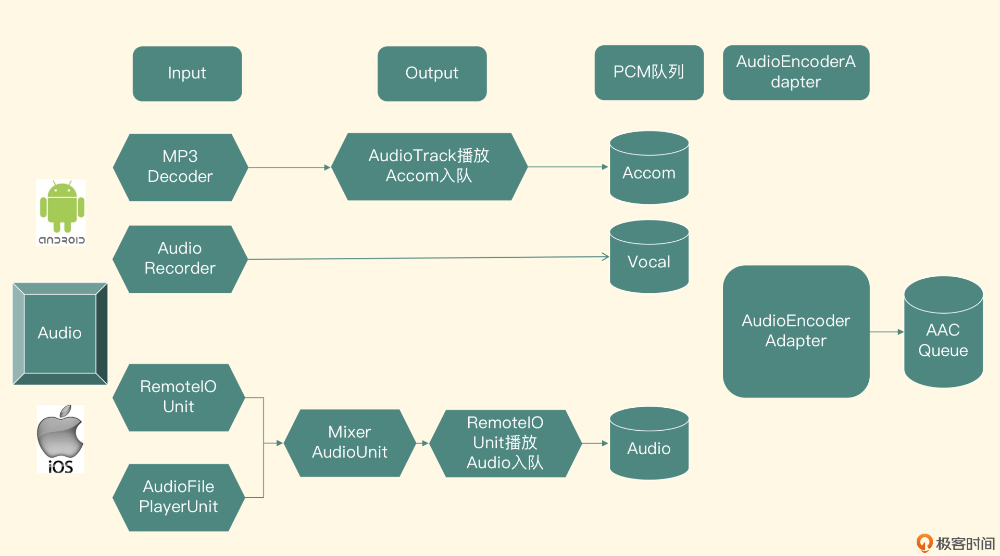
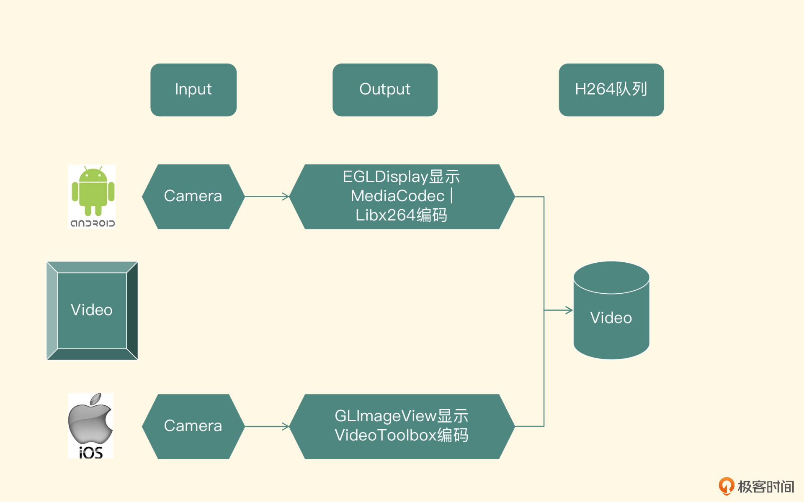

# 21 | 如何实现视频录制器的底层模块？（下）

你好，我是展晓凯。今天我们一起来学习视频录制器底层核心模块的实现。

上节课我们一起实现了视频录制器中的音频模块，把人声和伴奏的 PCM 数据放到了 PCM 队列中。这节课我们会先构造出音频编码器，把 PCM 数据编码成 AAC 的包放到音频队列里，然后进入视频模块的学习，视频模块的目标是把采集到视频帧编码成 H264 的包放到视频队列里。

### 音频编码模块的实现

我们先来看音频编码模块，输入是从 PCM 音频队列里获取的 PCM 数据，输出会放到另外一个 AAC 格式的音频队列中。这节课的重点是把这个编码器集成到整个系统中，这里我们会以软件编码为例来讲解。如果你有兴趣，还可以自己把硬件编码的实现集成到这个视频录制器项目中。

音频的编码应该也放到一个单独的线程里，所以我们建立一个类 AudioEncoderAdapter，利用PThread 维护一个编码线程，不断从音频队列里取出 PCM 数据，然后调用编码器把这些数据编码成 AAC 数据，最后把 AAC 数据封装成 AudioPacket 数据结构，并放入 AAC 的队列里。其中编码器是我们自己封装的一个 AudioEncoder 类，它是在第 12 节课编码器类的基础上进行改造的，下面我们来逐一看一下各个类的具体实现。

### 改造编码器

先看 AudioEncoder 类，回顾一下第 12 节课中编码器的结构，当时在初始化函数中直接给出了一个文件路径，让 FFmpeg 帮我们输出到这个文件中，而在这里要改造一下。

因为这个类只负责编码，不需要完成封装格式以及写文件的工作，用不到 FFmpeg 中libavformat 这个模块，使用它的 libavcodec 模块就可以完成工作。所以我们改造一下初始化方法，只需要分配出编码器，把编码器的参数设置进去，然后分配出存放 PCM 数据的缓冲区以及输送给编码器之前的 AVFrame 结构体就可以了。

实际的编码过程也需要修改一下，首先在 AudioEncoder 这个类中定义一个回调方法。

```
static int fill_pcm_frame_callback(int16_t *samples, int frame_size,
     int nb_channels, void *context)
```

这个回调函数用来让调用端填充 PCM 数据，把 PCM 数据编码之后是 FFmpeg 中 AVPacket的结构体，最后把这个 FFmpeg 的数据结构转换成我们自己定义的数据结构 AudioPacket，返回给调用端。

最终的销毁方法比较简单，释放掉分配的存放 PCM 数据的缓存区，以及编码前的 AVFrame数据结构，关掉编码器上下文并释放掉。这就是编码器类核心的改造过程。

### 编码器适配器

接下来我们完成编码器的适配器——AudioEncoderAdapter，从名字上就可以看出这个类承担的职责就是控制线程调度与转换数据送给编码器进行编码。初始化方法原型如下：

```javascript
void init(LivePacketPool* pcmPacketPool, int audioSampleRate, int audioChannels,
     int audioBitRate, const char* audio_codec_name);
```

初始化方法需要调用端把 PCM 数据存放的队列的池子传递进来，因为这个类需要往从池子的PCM 队列中取数据以及向池子里 AAC 队列里存数据，此外还需要调用端把编码文件的采样率、声道数、比特率，还有编码器的名称传递进来，因为这个类还需要按照这些参数去寻找并配置编码器。这个方法的实现需要构建出编码后的 AAC 存放队列，并启动一个编码线程来编码，接下来我们看一下编码线程的主要工作流程。

```sql
audioEncoder = new AudioEncoder();
audioEncoder->init(audioBitRate,audioChannels,audioSampleRate,
       audioCodecName,fill_pcm_frame_callback,this);
while(isEncoding){
   AudioPacket *audioPacket = NULL;
   int ret = audioEncoder->encode(&audioPacket);
   if(ret >= 0 && NULL != audioPacket){
       aacPacketPool->pushAudioPacketToQueue(audioPacket);
   }
}
if (NULL != audioEncoder) {
   audioEncoder->destroy();
   delete audioEncoder;
   audioEncoder = NULL;
}
```

先用初始化函数的参数来实例化一个编码器，除此之外还要加上一个回调函数，这个回调函数负责按照帧大小和声道数取出 PCM 数据队列里的 PCM 数据，接下来我们看一下这个回调函数的实现。

```
int AudioEncoderAdapter::getAudioFrame(int16_t * samples,
       int frame_size, int nb_channels) {
   int sampleCnt = frame_size * nb_channels;
   int samplesInShortCursor = 0;
   while (true) {
       if (packetBufferSize == 0) {
           int ret = this->getAudioPacket();
           if (ret < 0) {
               return ret;
           }
       }
       int copyToSamplesInShortSize = sampleCnt - samplesInShortCursor;
       if (packetBufferCursor + copyToSamplesInShortSize <= packetBufferSize) {
           memcpy(samples + samplesInShortCursor, packetBuffer
                   + packetBufferCursor, copyToSamplesInShortSize *
                   sizeof(short));
           packetBufferCursor += copyToSamplesInShortSize;
           samplesInShortCursor = 0;
           break;
       } else {
           int subPacketBufferSize = packetBufferSize – packetBufferCursor;
           memcpy(samples + samplesInShortCursor, packetBuffer
                   + packetBufferCursor, subPacketBufferSize *
                   sizeof(short));
           samplesInShortCursor += subPacketBufferSize;
           packetBufferSize = 0;
           continue;
       }
   }
   return frame_size * nb_channels;
}
```

这个函数看起来很复杂，下面我们来一一分析。

- 在这个函数的输入参数里，希望我们填充的帧大小是 frame_size，声道数是nb_channels，填充目标是 samples 这一块内存区域，所以需要填充进去的采样的数目可以这样计算：

```
int sampleCnt = frame_size * nb_channels;
```

- 由于从 PCM 队列中取出的 PCM 的 buffer 大小和编码器需要的 sampleCnt 大小不一定相同，所以如果 PCM 队列的 buffer 小于 sampleCnt，就需要积攒多个放到这个内存区域里，如果大于 sampleCnt，就需要拆分，并放入下一次编码器要求放入的内存区域里。所以这

- 里设置一个 samplesInShortCursor 的变量，代表已经给这个填充区域填充进去了多少个采样。对于 PCM 队列读取出来的 buffer，用 packetBuffer 来代表，使用 packetBufferSize 代表这个 buffer 的大小，使用 packetBufferCursor 代表已经使用了这个 buffer 多少数据。

- 如果 PCM 队列里读取出来的 buffer 已经被耗尽了，就调用 getAudioPacket 方法去 PCM队列中读取一个新的 buffer。如果返回小于 0 的值，代表已经结束，就返回小于 0 的值，编码器则结束；如果返回大于 0 的值，就代表正确读出了 PCM 数据，并且把采样存放到了全局变量 packetBuffer 里，采样数目存放到 packetBufferSize 里，然后计算还需要为编码器填充的内存区域填充多少数据。

```
int copyToSamplesInShortSize = sampleCnt - samplesInShortCursor;
```

- 然后判断当前 PCM 队列读取出来的 Buffer 是否还有这么多的数据可用于填充。

```
if (packetBufferCursor + copyToSamplesInShortSize <= packetBufferSize)
```

- 如果 packetBuffer 里面还有足够多的数据，就拷贝数据，然后把 packetBufferCursor 的大小加上拷贝的大小；如果数据不够用，就先计算一下 packetBuffer 里面还有多少数据，并把剩余的数据全部拷贝到编码器需要我们填充的内存区域里，然后把 packetBufferSize 设置为 0，进行下一次循环，再一次从 PCM 队列中读取出新的 packetBuffer，重复做这个循环中的事情，直到填充满编码器需要我们填充的内存区域为止。

再来看一下 getAudioPacket 方法，在两个平台音频采集的实现不同，在 Android 平台上，伴奏和人声都要单独入队，而在 iOS 平台上，人声和伴奏是合并之后入队，所以实现有所不同。

- iOS 平台的实现是把伴奏和人声合并之后放到了人声队列中，所以在 iOS 平台就从人声队列中取出数据直接填充 packetBuffer 了。

- 对于 Android 平台，我们需要实现一个子类，继承自当前类并且重写 getAudioPacket 这个方法，在这个方法的实现中首先调用父类方法拿到人声数据，然后再读取伴奏队列中的PCM 数据，把读取出来的数据与父类填充的 packetBuffer 合并之后，再存入 packetBuffer中，这样就可以无缝地接入到整个系统中了。

继续回到编码线程的主体流程中，有一个判断 isEncoding 的 while 循环，这个布尔型变量为了控制编码循环，在循环中不断调用编码器的编码方法。当然，编码器编码时，第一步就是调用上面说的回调函数填充 PCM 数据，然后把它编码成一个 AudioPacket 结构体并返回。调用端拿到 AudioPacket 之后，判断返回值是正确编码，就把它放到 AAC 的队列里；如果返回值是编码失败的话，就跳出循环，最终销毁编码器。

这个适配器还要提供一个销毁的方法，进入销毁方法之后先把 isEncoding 这个变量设置为false，然后丢弃 PCM 的队列，然后等待编码线程结束，最后销毁分配的 packetBuffer 等资源。

这样一来，编码器适配器类就完成了。接下来我们看一下视频模块的实现。

## 视频模块

这个部分与前面第 18 节课的工程不同之处在于编码之后的 H264 数据不会直接写入文件，而是会放到视频队列中，所以这里我们会重点介绍视频队列的实现，还有怎么把编码之后的H264 数据放入队列里，如果你对视频画面的采集和编码还不熟悉的话，要回头认真学习一下专栏第五部分的内容。

### 视频队列的实现

视频队列的实现其实和音频队列是非常类似的，所以就不再重复了，但是要看一下具体的接口，以便后续使用。

初始化接口，负责队列的初始化工作，要想使用队列，第一步就应该调用这个方法。

```
void init();
```

入队接口，如果要存入队列一个视频帧，调用这个接口方法，如果存入成功则返回 0，否则返回负数。

```
int put(VideoPacket* videoPacket);
```

获取视频帧接口，职责是从队列里拿出一个视频帧。

```
int get(VideoPacket** packet);
```

这个方法是一个阻塞方法，如果队列为空就会阻塞住，直到队列被丢弃或者有了新的视频帧放入。如果正确取到视频帧就返回 0，而如果返回小于 0 的值，则代表队列被丢弃掉了。

丢弃队列方法，即不再接受任何入队和出队的请求，一般在队列使用结束之前调用这个方法。

```
void abort();
```

接下来的这个方法是私有方法，当队列被销毁的时候调用，这个方法会把队列中所有的元素取出来并且销毁掉。

```
void flush();
```

另外，存放的每个元素和音频队列也是不一样的，视频帧结构体定义如下：

```sql
typedef struct VideoPacket {
   byte * buffer;
   int size;
   int timeMills;
   int duration;
   VideoPacket() {
       buffer = NULL;
       size = 0;
       timeMills = -1;
       duration = 0;
   }
   ~VideoPacket() {
       if (NULL != buffer) {
           delete[] buffer;
           buffer = NULL;
       }
   }
} VideoPacket;
```

可以看到这个结构体中记录了这一帧视频帧的数据和数据长度，还有这一帧视频帧的时间戳和时长，在析构函数中会释放掉视频帧所占的内存。

### Android 平台画面编码后入队

Android 平台的实现将基于第 18 节课的硬件编码项目进行改造，来适配当前场景下的需求。先找到 HWEncoderAdapter 这个类，然后找到方法 drainEncodedData，目前这个方法的实现是从 MediaCodec 中取出编码之后的 H264 数据，然后写入文件。那我们要做的改造就是删除写文件的代码部分，然后把 H264 的数据封装为 VideoPacket 放入队列中。

在改造之前，我们再来回顾一个重点，就是 MediaCodec 这个编码器会在开始编码之后给出SPS 和 PPS 信息，两者会放在同一帧中，PPS 放在 SPS 之后。具体如何判断当前帧是否是SPS 和 PPS 所代表的数据帧呢？因为 MediaCodec 编码器给开发者的 H264 数据是有一个开始码的，也就是说一定是从 00 00 00 01 开始，之后是代表帧类型的位，所以可以通过以下代码取出帧类型。

```
int nalu_type = (outputData[4] & 0x1F);
```

拿出数组中下标为 4 的字节和 0X1F 进行[相与]操作，得到 nalu_type，比较 nalu_type 和H264 协议中预设的 Type，来判断到底是哪种类型的 NALU 类型。

之前的操作是把 SPS 和 PPS 保存下来，然后在每一个关键帧前面拼接上 SPS 和 PPS 信息，形成 Annex-b 封装格式的 H264 码流。但在 Mux 模块（下节课中会讲到）把 H264 数据封装到一个 MP4 文件中的时候，只需要一次 SPS 和 PPS 的设置，所以这里也只需要把 SPS和 PPS 信息放入队列中一次，并且确保即便再有 SPS 和 PPS 信息，也不会再一次填充入队列。

```
if(isSPSUnWriteFlag){
   VideoPacket* videoPacket = new VideoPacket();
   videoPacket->buffer = new byte[size];
   memcpy(videoPacket->buffer, outputData, size);
   videoPacket->size = size;
   videoPacket->timeMills = timeMills;
   packetPool->pushRecordingVideoPacketToQueue(videoPacket);
   isSPSUnWriteFlag = false;
}
```

如果不是 SPS 和 PPS 的话，就直接进行封装成 VideoPacket，然后放入队列中，代码就不再展示了。这样我们就按照与 Mux 模块约定好的格式把 MediaCodec 编码出来的 H264 数据填入队列里了。

这里我们只改动了硬件编码部分，软件编码部分不再讲解，但是代码示例中会有针对软件编码分支的处理，如果有兴趣，之后你可以自己研究一下。

### iOS 平台画面编码后入队

iOS 平台的实现也会基于第 18 节课的硬件编码项目做一些改动，把编码后的 H264 的Packet 放入视频队列里替换掉之前写文件的操作，以供后续的 Muxer 模块使用。

通过之前的学习我们知道每一帧的前面都必须要拼接上开始码（StartCode 00 00 00 01），这样当解码器每读取到 00 00 00 01 这个开始码的时候，就知道这是一个视频帧的开始了，然后读取下一个开始码的时候，就知道上一个视频帧结束了。所以我们在 SPS 和 PPS 以及普通的视频帧前面都拼接上这样一个开始码。

但是在不同的封装格式里，视频帧的封装是不确定的，所以这里只负责把视频帧前面拼接上开始码，然后送到视频队列里，后续的封装处理就是 Mux 模块的事情了。又因为 muxer 模块最终会封装成 MP4 格式的，所以 SPS 和 PPS 只需要入队一次，我们可以在全局变量列表中新增一个布尔类型变量来标志是否做了 SPS 和 PPS 入队，然后把 SPS 和 PPS 前面都加上开始码，并将这个数组拼接到一起，封装成一个 VideoPacket，最后放入队列中。代码如下：

```javascript
const char bytesHeader[] = "\x00\x00\x00\x01";
size_t headerLength = 4;
VideoPacket* spsPpsPacket = new VideoPacket();
size_t length = 2 * headerLength + sps.length + pps.length;
spsPpsPacket->buffer = new unsigned char[length];
spsPpsPacket->size = int(length);
memcpy(spsPpsPacket->buffer, bytesHeader, headerLength);
memcpy(spsPpsPacket->buffer + headerLength, (unsigned
       char*)[sps bytes], sps.length);
memcpy(spsPpsPacket->buffer + headerLength + sps.length,
       bytesHeader, headerLength);
memcpy(spsPpsPacket->buffer + headerLength*2 + sps.length,
        (unsigned char*)[pps bytes], pps.length);
spsPpsPacket->timeMills = 0;
LivePacketPool::GetInstance()->pushRecordingVideoPacketToQueue(spsPpsPacket);
```

在上述代码中可以看到，先在 SPS 前面拼接上开始码，再拼接上 SPS 的内容，接下来会再拼接上一个开始码，然后再拼接上 PPS 的内容。到这里，这一帧特殊类型的帧就拼接完成了。接下来封装成一个 VideoPacket，最后把构造好的这个 packet 推送到视频队列里。而具体放入队列之后如何进行封装以及输出，我们下节课会讲到。

## 小结

最后，我们可以一起来回顾一下音频模块与视频模块的具体实现。



音频编码模块的实现流程是从上一步的 PCM 队列中获取出 PCM 数据，然后编码为 AAC 的码流，存入到 AAC 队列中。



在视频模块的学习中，我们也是先实现了视频队列，然后在第 18 节课的编码工程的基础上做了一些改造，把编码出来的 H264 码流由写文件修改成存入 H264 的队列里，并且 SPS 和PPS 信息只存储一份，其他类型的视频帧则直接拼接 startCode 之后进行存储。

到这里，视频录制器的底层模块已经实现完毕了，一个 AAC 的队列和一个 H264 的队列已经源源不断地存入数据了。接下来我们会进入 Muxer 模块的讲解，让整个视频录制器跑起来。

## 思考题

最后，我们来思考一个问题，音频 AAC 编码和视频的 H264 编码是怎么与时间戳关联起来的呢？欢迎把你的答案留在评论区，也欢迎你把这节课分享给更多对音视频感兴趣的朋友，我们一起交流、共同进步。下节课再见！
