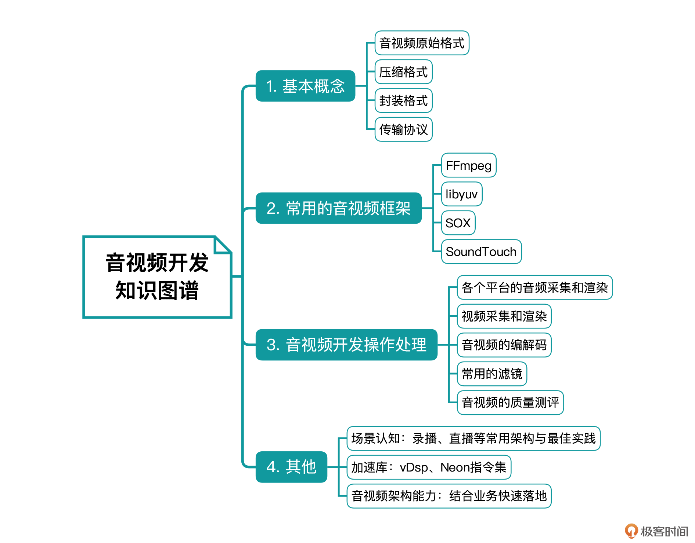
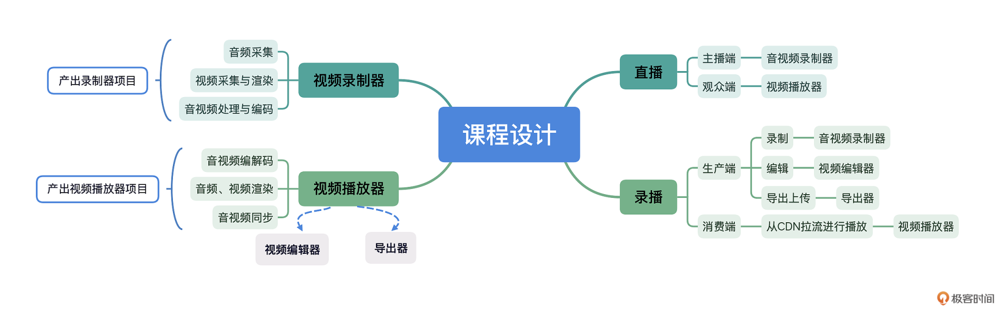
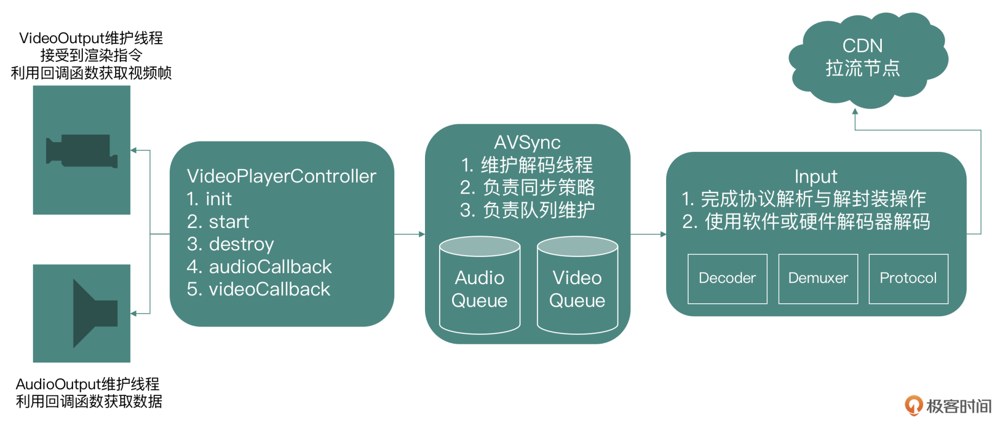
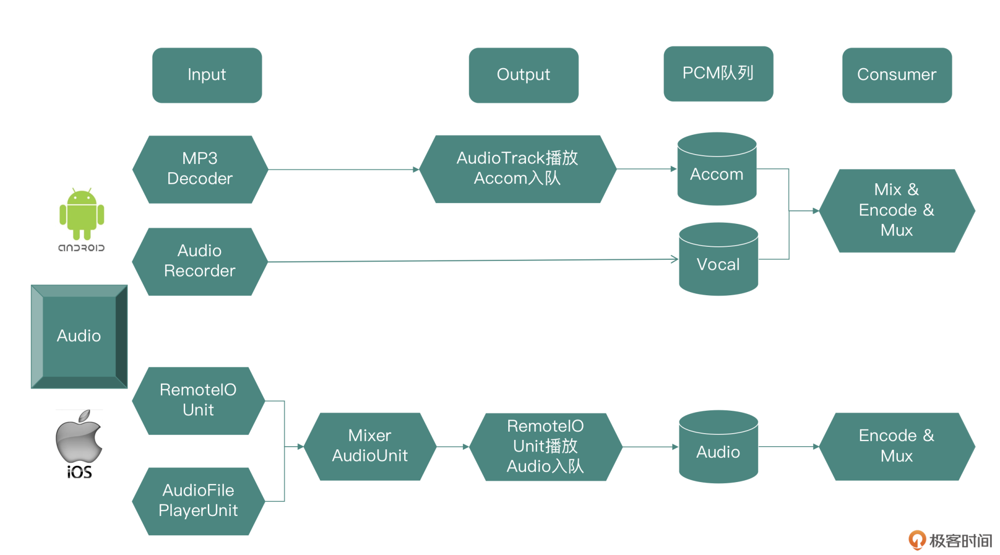
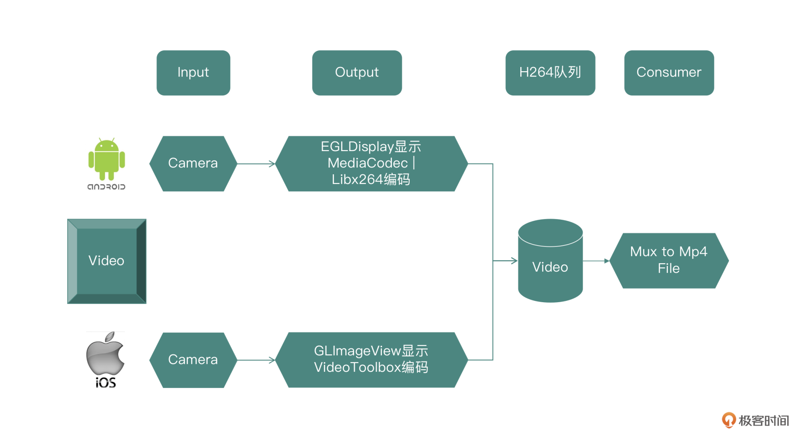

# 开篇词 | 系统学习移动端音视频开发技术，为业务赋能

- 登录

### 下线通知

- 该账号已在其他同类设备登录，如非本人操作，则密码可能已经泄露，建议立即更换密码

- 确定

你好，我是展晓凯，目前是快手音视频首席架构师，也是《音视频开发进阶指南：基于

从今天开始跟我一起系统地学习移动端音视频开发吧！

## 我在音视频领域的探索

迄今为止，我在移动互联网的音视频领域已经奋战十年了。回想起点，当时担任的是唱吧的音视频架构师，负责多条产品线核心的架构设计与开发工作，包括视频录播系统、唱吧直播间、视频合唱、视频特效、火星直播等等，一手搭建起了唱吧的整体音视频系统。

那段经历，让我逐渐积累起了自己的音视频技术图谱，也是从那个时候，我开始有意识地去沉淀经验，尝试分享给更多的人，《音视频开发进阶指南》就是在那段时间写出来的。

之后我又加入到 StarMaker 担任商业化技术负责人，又一次从零开始，这次是搭建 StarMaker

- 登录

的在线 KTV 和直播系统。遇到的问题，也是一度让我很头痛，比如由于印度网络基建的落后，我们整个技术团队不得不自行建立直播源站，并将 SRT 协议引入到主播的上行链路中。

类似的突破还有很多，现在让我再去回溯那段经历的话，我感觉就一句话：“关关难过关关过”。但我很庆幸，在我入行之初就有这样的好机会。如果说唱吧给予我的是技术上施展拳脚的空间，那么 StarMaker 给予我的就是技术上的深度和广度。在这个阶段我充分认知到技术和业务像是连接在一起的齿轮，相互带动、相互促进。

后来，我也做了很多其他音视频相关的尝试。18 年我加入了阿里巴巴的 XLab，开始探索音乐赛道，我所在的团队开发并维护了唱鸭、鲸鸣、虾米音乐等产品。当时我们将弹唱的实时耳返做到了业界最佳并独创了音乐弹幕的交互形式，领先了竞品长达半年以上的技术窗口期。

对于一个技术人来说，利用过硬的技术为平台实现弯道超车是一件很酷的事儿，我也想把这样

### 下线通知

的事一直做下去，并依靠先进的团队实现业务上的更多可能。

- 该账号已在其他同类设备登录，如非本人

于是，我选择在 22 年 5 月份加入快手，继续做音视频相关应用的架构与开发工作。基于快手

- 操作，则密码可能已经泄露，建议立即更换密码

强大的音视频能力，我们的技术可以很快赋能到各个业务中，让业务方快速地验证自己的想法，在业务所在的赛道跑到前方，拿到好的结果。

- 确定

希望我的亲身经历也能给期待探索音视频领域的你一点启发吧，当然在这个过程中，我确实遇到了不少挑战，但也迎来了很多机遇。所以，我是非常鼓励你去实战中磨炼技能的，因为我就是这么过来的。

## 为什么要系统地学习移动端音视频开发知识？

在移动互联网音视频开发的这十年，我深感当下与十年前的互联网环境相比，已经发生了翻天覆地的变化。虽然各种点播云、视频云、RTC 等基建成熟了很多，但是人工成本、买量成本也与日俱增，互联网用户的增量市场也已经渐渐匮乏，各大厂也都在做降本增效的事情。所以在这样的大背景下，技术人员如何能在业务中贡献出自己的价值变得更加重要了。大环境在赋予人机遇，只看你怎么做。

那我们作为技术人员应该怎么在业务中凸显出自己的价值呢？在我看来，至少要做到这 3 点。

- 首先，在业务的各个阶段，技术要能够快速满足业务的迭代需求，让业务先赢；登录其次，在完成业务迭代的同时要考虑中长期的变化，设计出合理的架构；

- 最后，能做出一些技术沉淀以及流程机制的升级。

里面的每一项都离不开我们扎实的基本功和丰富的实战经验。现在市面上任何一款 App 其实都离不开音视频的能力，甚至说音视频能力已然是决定业务的关键因素之一。

这就需要大量的音视频技术人员参与其中，但目前音视频的人才储备仍旧不足。很多技术人员因为业务的需要被临时调去做音视频的项目；没有实际开发经验的小白直接上手参与项目开发。这种情况并不少见。

你可能会想：既然是这样，那音视频开发的入门门槛应该挺低的吧？事实恰恰相反，如果只有一些零散的音视频相关的技能，或者只做过一两个音视频相关的功能，还远远达不到入门的级

### 下线通知

别。因为音视频开发涉及的概念与技术繁多而复杂，零散的知识点虽然能够让我们“小步挪动”，但如果想要全面了解音视频开发整体的知识地图还是十分困难的。

- 该账号已在其他同类设备登录，如非本人操作，则密码可能已经泄露，建议立即更

### 音视频开发知识图谱

- 换密码

从我的经验来看，我们至少需要了解各种音视频基本概念，比如音视频的原始数据格式、压缩

- 确定

格式、封装格式、传输协议等，熟练使用常用的音视频框架，比如 FFmpeg、libyuv、SOX、SoundTouch 等，还要熟悉各个平台的音视频采集和渲染、音视频的编解码（软件 / 硬件）以及常用的滤镜处理；还有音视频的质量评测，比如视频质量评测 PSNR、VMAF、无参考评测等。最后我们还要对各个场景有系统性的认知，包括但不限于录播、直播、RTC 等场景的常用架构和最佳实践。

除此之外在移动平台上，还有一些与平台相关的加速库可以提高性能，比如 vDsp、Neon 指令集等，我们也需要了解。

当然最重要的还是开发者或者架构师本身自己的音视频架构能力，如何将音视频的能力与业务结合起来，设计出最符合当前业务阶段的架构并且快速地落地。

- 登录

### 下线通知

- 该账号已在其他同类设备登录，如非本人操作，则密码可能已经泄露，建议立即更换密码

- 图1 音视频开发知识图谱确定

听我说完，是不是有一种任重而道远的感觉？不过这并不是要劝退你，因为我们都清楚，行百里者半九十。相信在这个专栏的引导下，你这“百里路”会比别人行得更快、更轻松些。具体怎么做到这一点？我想并不难。

我们的专栏会以代码示例、项目实战的方式展开，带你系统地学习移动端的音视频开发，其中会涉及多平台、多项技术、多个场景。接下来我们不妨看看课程的具体安排吧！

## 我是怎么设计这门课的？

本专栏我们主要围绕直播与录播两个场景进行架构设计与实践，基本的思路就是从基础开始，拆分场景和核心技术，最终实操实练地去还原真实项目。

- 登录

- 图2 课程设计

当然，实操的过程是有一定难度的。你要理解直播场景所对应的核心流程是主播端和观众端，前者推流、后者拉流，核心体验是处理好秒开与内部的追赶逻辑。还要理解录播场景可以拆分为生产端和消费端，前者负责录制、编辑和导出上传，后者负责从 CDN 拉流进行播放。

里面的每一个技术细节都将影响你的业务，而我们要做的就是搞定它们，比如主播端要进行美

### 下线通知

颜、魔表处理，要根据网络情况做动态码率策略，观众端要能做主动的追赶逻辑等等；再比如生产端硬件编解码的使用、导出上传速度的优化、消费端要能够根据网络以及设备情况做多分

- 该账号已在其他同类设备登录，如非本人

辨率的切换等等。

- 操作，则密码可能已经泄露，建议立即更换密码

视频播放器项目：如果想要成功播放一个视频，就需要我们掌握音视频解码、音频渲染、视频

- 确定

渲染以及音视频同步等知识。所以针对于这些知识点，我都会系统地进行分析和讲解，这样在处理相关工作时，便于你做技术选型。学完移动端的音视频渲染后，我们即可产出一个视频播放器项目，这个项目会帮你把前面的知识点串联起来，同时还可以作为视频编辑器、导出器的先导知识。

- 登录

- 图3 视频播放器

视频录制器项目：如果想要把麦克风和摄像头采集的数据记录下来，就需要我们掌握音频采集、视频采集与渲染、音视频处理与编码等知识。学完这些相关知识后，我们最终会产出一个

### 下线通知

视频录制器项目，在这个项目中你还可以学到很多音视频架构相关的内容，可以帮助你在日后的工作中，做出更符合当下阶段的架构设计。

- 该账号已在其他同类设备登录，如非本人操作，则密码可能已经泄露，建议立即更

- 换密码

- 确定

- 图4 音频录制器

- 登录

- 图5 视频录制器

### 下线通知

这就是我们整个专栏的设计。希望你能跟着我的步伐，一步步地去实践，提升自己的开发能力

- 该账号已在其他同类设备登录，如非本人

与架构设计能力，更重要的是我希望你能通过这个专栏提升全链路思考能力，拥有更开阔的视

- 操作，则密码可能已经泄露，建议立即更

野。最终让技术发挥更大的价值，为业务赋能。话不多说，让我们马上开始这一段能力升级之

- 换密码

旅吧！

- 确定
