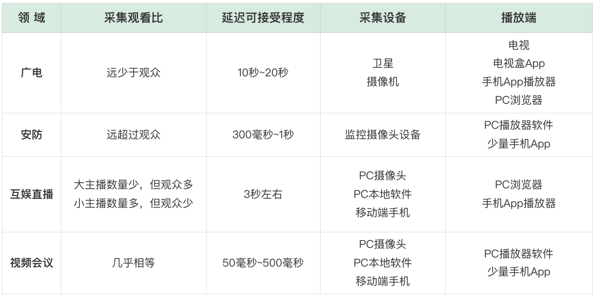
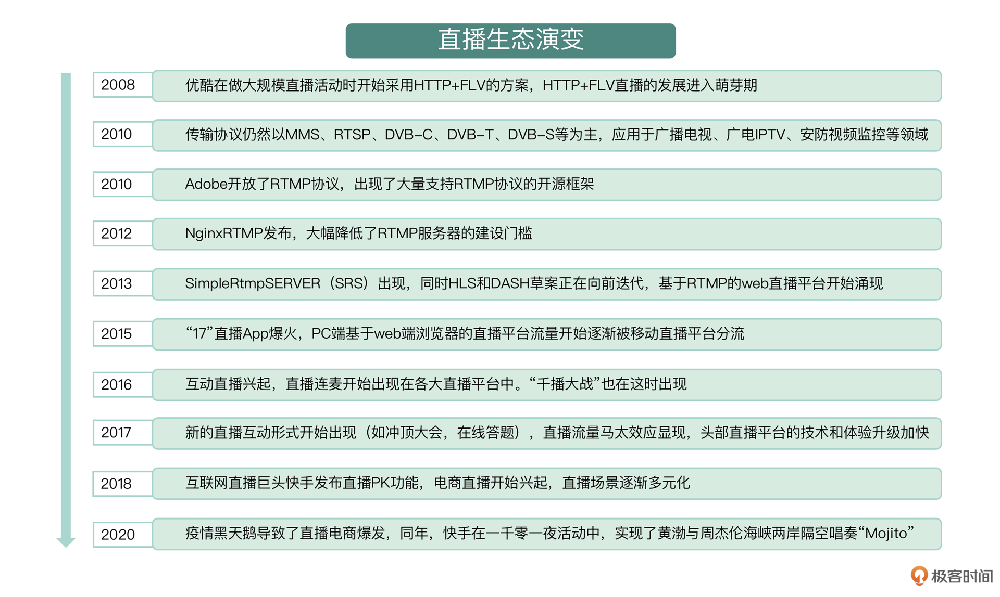
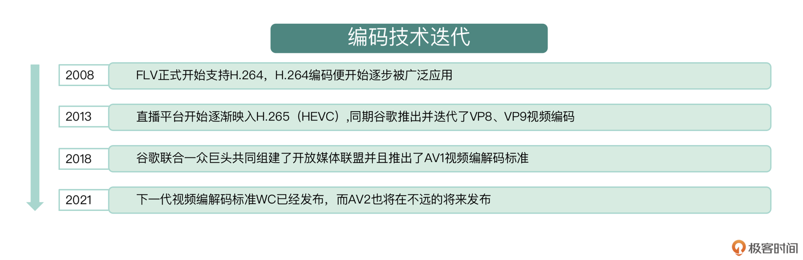
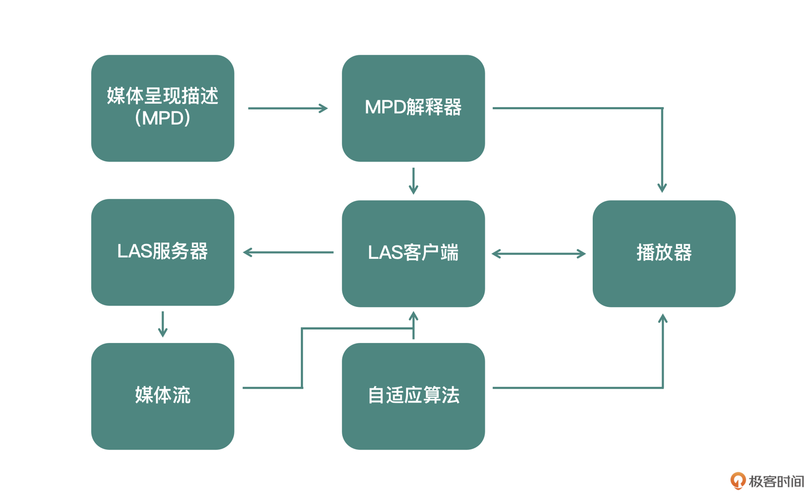

# 04 | 直播行业的发展概况与技术迭代

你好，我是刘歧。

上一节课我们了解了音视频编解码和封装基础，还讲解了 MP4 的容器格式。我们都知道 MP4常见于视频点播场景，那 MP4 格式能用于直播场景吗？

其实稍微改一下容器格式是可以的，例如我们在做直播播放的时候常见的是 fragment mp4 格式，或者 cmaf 格式。如果我们想要观看 HLS 标准的直播，并且想要看比 H.264 码率更低的HEVC 视频编码的直播，就需要在 HLS 子容器中支持 fragment mp4 格式。所以 MP4 的另一种封装形式是可以做直播的。

那么除了 fragment mp4 之外，我们还有哪些格式和协议可以做直播？这节课我们来了解一下直播在过去这十年之间发展的经过以及基本信息，以便我们对自己即将进入的直播场景有一个基本的了解。

## 行业的演变

2010 年之前，直播技术的应用主要还集中在广播电视、广电 IPTV、安防视频监控、视频会议以及个人媒体中心等领域，使用的传输协议主要为 MMS、RTSP、DVB-C、DVB-T、DVB-S等。除了这些领域与协议，偶尔还会用 RTMP 与 HTTP+FLV 的方式做直播服务应用，例如一些广电领域的客户，还有像优酷这样的平台会在重大活动的直播中使用这种方式。当时 RTMP与 HTTP+FLV 直播并未像后来这么火热，FMS、Wowza 等流媒体服务器当时还是主流。

2010 年之后，随着 Adobe 开放了 RTMP 协议，像 CRtmpServer、libRTMP、Red5 等支持RTMP 协议的开源框架如雨后春笋般大量涌出，但是这些流媒体服务器还需要再做一部分开发才能真正建立起服务端的能力。2012 年夏天，NginxRTMP 的出现打破了这场僵局，它通过大幅降低 RTMP 服务器的建设门槛，将 RTMP 协议的直播发展带入快车道。

紧接着，2013 年秋天，SimpleRtmpServer（SRS）的出现为 RTMP 服务器的建设带来了革命性的改变，SRS 发展至今已经发布了 4.0 版本，它采用了比较前卫的协程方式（用StateThread 做基础库）做任务控制，也可以理解为单进程单线程的工作方式，不需要考虑信号量和锁操作相关的问题，而如果需要提升更高的并发时，需要扩展多进程的方式，就可以借助第三方的能力来处理，例如 Docker，自己启动多进程来控制多任务。

SRS 原生支持的功能比较全，例如 RTMP 转 HTTP+FLV、转 HLS、转 WebRTC 等常用功能，运维操作方面支持 Reload，项目文档健全。在互联网娱乐直播领域，由于 RTMP 可以保证从画面采集端至播放器端的整体延迟在 3s 左右，所以这个协议被广泛应用。

与此同时，支持动态多码率的解决方案 HLS（HTTP Live Streaming ）与 DASH（DynamicAdaptive Streaming over HTTP）目前还在以草案的方式向前迭代，并未发布正式的参考标准。FFmpeg、Gstreamer 等工具软件，也在跟随草案的更新进行功能迭代。当时，HLS 主要用于移动端与电视盒中，DASH 也开始逐步被一些服务商采用，比如 YouTube、Vimeo、Akamai 等。

同期动态多码率的解决方案除了 HLS 与 DASH 外，还有 Adobe 的 HDS（HTTP DynamicStreaming）。由于 HDS 的参考标准并不像 HLS 和 DASH 那样，由 RFC 或者 ITU 两个开放标准定制、组织、维护，而是 Adobe 自己在维护，所以推动起来并不是很顺畅，应用的客户也并不多。

从 2013 年开始，基于 RTMP 的直播平台开始逐渐发迹，呈现形式也主要是互联网的 Web 浏览器。基于 RTMP 协议的直播成为主流选择的原因如下：

1. Flash Player 能够直接播放基于 RTMP 协议传输的音视频数据；

2. Web 浏览器已经默认内置 Flash Player 插件，不需要额外安装插件；

3. RTMP 推流、播放有很多开源实现，能够快速搭建起端到端的解决方案。

技术的成熟使 PC 端涌现出大量基于 Web 浏览器的视频秀场类直播、游戏类直播以及部分户外直播。与此同时，移动端直播 App 也开始零零散散地出现。

虽然安防监控、视频会议、广播电视与互联网行业也在使用直播技术，但是其应用领域、方式、场景差异很大。此时安防监控也在逐步接入互联网，例如通过家用的监控摄像头，用户可以用手机观看家里的实时画面。视频会议厂商在 2013 年还在加紧兼容 WebRTC 框架以提升其通用性，H.323/SIP+RTP 的使用方案也还比较普遍，因此当时做 RTC 的服务商与平台并不多。

2015 年，一个名为“17”的移动端 App 毫无征兆地成为了当时的爆款，但又迅速被 App Store下架。自此事件开始，直播领域拉开了千播大战的序幕。各色各样的直播 App 开始被大力推广，其底层的技术原理大同小异，推流协议也仍然是 RTMP，拉流协议均以 RTMP 或HTTP+FLV 为主，各家 App 主要的差别在于起播时间，视频清晰度以及直播卡顿率。

伴随着千播大战的开场，基于 PC 端 Web 浏览器直播平台的用户流量开始逐渐被移动端直播App 所蚕食，直播平台的形态也渐渐开始形成分化。此时的直播应用主要集中在以下四大领域：

1. 广电单向发布直播流，如 IPTV、电视盒、常用 HLS、DASH、HDS 这类端到端且画面延迟10s 左右的直播流媒体协议；

2. 安防监控采集直播流，如海康、大华、水滴摄像头等，常用 H.323/SIP+RTP 等延迟 50ms～500ms 左右的协议；

3. 互联网 / 移动互联网互娱直播流，如秀场直播、游戏电竞直播、户外活动直播、街拍直播等，常用 RTMP、HTTP+FLV 等延迟 3s 左右的直播协议；

4. 视频会议直播流，如 Polycom、Cisco 等，常用 H.323/SIP+RTP 等协议。

我们可以看一下这四个领域的主要特点：

这四个领域是当时直播应用的主要场景。但随着时间的推进，直播场景也变得越来越复杂了。

2016 年，大量互娱直播平台逐渐增加了视频会议功能，也就是常说的“连麦”功能，使用场景也变得更复杂。实际上连麦采用的技术与视频会议几乎相同，但要兼顾互娱直播原有的场景，也就是一个直播间里，用户通过连麦进行实时交流，其他观众依然可以以原方式观看视频，例如歌曲合唱、实时采访、表演节目 PK 等。主播间也可以通过这种方式导入粉丝进行创收。当然，创新并没有止步于此，移动直播平台数量激增导致的“千播大战”让 2016 年被称为“直播元年”。

2017，大量的互娱直播平台又创新地增加了主播与观众互动的能力，例如冲顶大会、在线答题等功能。另一方面，直播创业的热潮开始消退，主要是由于用户流量再次向巨头靠拢，头部直播平台马太效应开始显现，随着流量的增加巨头也不断进行技术迭代和升级，进一步提升了用户的直播观看体验，从而加深了自己的护城河。

2018，PC 互联网和移动互联网直播开始逐渐从单纯的秀场、游戏、户外直播演变出直播带货场景。而当年的互联网直播巨头快手发布了实时交互性更强的直播 PK 功能，直播的形态从单纯的观看转为互动，又从互动转为挖掘用户需求。

从 2019 年至今，尤其是在疫情期间直播电商的市场规模达到了近万亿，在巨大的音视频互联网体量下，直播电商市场规模还能达到 100% 以上的增长，说明音视频已经成为了互联网行业非常重要的一项基础设施。

快手平台 2019 年至 2020 年举办了多次大型活动，从 2019 年的阅兵到跨年的春晚，在线数据一直在突破。快手春晚转播，最高在线人数创纪录，达到了 2000 多万人；2020 年董明珠在快手直播卖货，一天卖了 3.1 个亿；周杰伦疫情期间从台湾连线，跨海峡两岸进行直播首秀，为快手用户提供了一个全新的云端演唱会的体验，直播观看人数约 6800 万，在一千零一夜活动中黄渤与周杰伦隔空唱奏“Mojito”，更是将直播同唱一首歌类型的实时直播技术做到了极致，打破了常规互联网直播的形态。

这就是从 2008 年起 PC 互联网 / 移动互联网环境直播的发展概况。

## 技术迭代

通过了解直播行业的发展过程，我们发现，现在的直播应用和场景已经远超于十年前的范畴了，直播技术也一步步进化成如今完整的体系。

发展过程中有关技术部分的迭代包含了 5 个维度：音视频编码的迭代、音视频传输协议的迭代、音视频封装的迭代、音视频传输质量优化策略的迭代以及平台功能的迭代。接下来我们就从这五个维度出发系统地阐述直播技术的发展和演进过程。

### 音视频编码的迭代

自 2008FLV 正式支持 H.264 开始，H.264 编码逐步被广泛应用，同期 VP6、VC-1、H.263、mpeg4video、mpeg2video 等编码方式一样比较火热，但只有 H.264 编码因为码率较低、图像质量高、容错和网络适应性更强，后续在国内脱颖而出。

2013 年，PPLive 和迅雷率先宣布采用 H.265（即 HEVC）进行视频压缩，在实现同等清晰度的前提下视频码率比 H.264 更低，这引起了直播行业的普遍关注。随后各大平台开始相继引入 HEVC 编码的视频直播流，但因为 HEVC 专利池问题的复杂性，又出现了一个比较诡异的情况：只有 Safari 浏览器支持 HEVC 的解码，而 Chrome 等浏览器不支持，这就导致时至今日依然有大量直播平台还在使用 H.264 的视频编码。

除了 HEVC 在发展，谷歌同期还推出并迭代了 VP8、VP9 视频编码，主要应用于 YouTube 等海外视频平台，在国内并未被大规模采用。在谷歌的 WebRTC 被大规模推广后，因为WebRTC 最初对 H.264 的支持不太友好，VP9 才勉强得到了一些发展。

2018 年之后，谷歌联合一众巨头共同组建了开放媒体联盟（Alliance for Open Media）并推出了 AV1 视频编解码标准，同样在 WebRTC 中被大范围应用。

直到今天，视频编码标准中应用最广泛的依然是 H.264、HEVC 以及 AV1，下一代视频编解码标准 VVC 已经正式发布，而 AV2 也在紧锣密鼓地制订中，业界很多企业也在用 AI 技术进行视频编解码方面的相关研究。相信在不久的将来，会出现更多优秀的视频编码标准。

相对于视频编码，音频编码标准从十年前单向直播领域的 MP3 发展为现在大范围应用的复杂音乐内容压缩编码标准的 AAC。会议直播从 G.711、G.729 音频编码标准发展到更优秀的语音通话实时编码与处理标准 Opus，再到谷歌刚刚发布的 Lyra，音频编码也随着时代的发展与应用场景的演变在不断迭代。

近些年来编解码人才逐年递增，数字信号处理专家也逐渐成长起来，更多人参与到了音视频标准的制订中，打破了原来大一统的局面，视频编解码标准的发展随之进入了快车道，加上参与的公司与相关的组织逐年增加，今后用户和不同业务场景可以选择的音视频编码方案会更加丰富。

### 音视频传输协议的迭代

音视频编码的迭代给我们提供了更多的选择，能够在保证清晰度的前提下占用更少的空间。而音视频传输协议的迭代带给我们的则是更低的延时。

### 低延时直播场景（延迟 3s 左右）

2010 年前，直播多采用 RTSP 传输协议，用户想要在浏览器中观看视频需要额外安装插件，所以多数用户选择在客户端观看直播。

当 Adobe 的 RTMP 传输协议开放后，涌现出很多基于 RTMP 协议的框架，例如 librtmp、crtmpd、nginx-rtmp、simple-realtime-server 等，加上 OBS、FFmpeg 等客户端开源套件的出现，在 PC Web 浏览器中可以直接使用默认安装的 Flash Player 插件来播放 RTMP 协议的直播内容，因而基于 RTMP 的应用开始广泛了起来，直播延迟也缩短至可以满足主播与观众的交流需求。

随着用户数量的增多，他们对直播回看的需求也随之增加，同时对首屏指标的要求也提高了，平台逐渐将播放协议从 RTMP 协议转变为 HTTP 协议，在建立连接时会节省很多 Handshake相关操作，缩短首画显示的时间。

直播延迟的影响因素有很多，如果只考虑合适的传输协议，通常只能勉强达到秒开的效果，但速度依然较慢，加之个别地区会出现域名劫持等现象，低延迟直播场景的需求仍然无法被满足。于是在域名解析方面，业界又做了一些优化，主要分为三种：DNS、HTTPDNS、私有化协议预解析域名，可以预先将用户调度至直播所属的服务节点，无须在用户发起请求时再进行域名解析，从而节省了域名解析时间，进一步降低直播延迟。

整体来看，国内直播目前还是以 RTMP、HTTP 传输协议为主，为了降低延迟，主要采用DNS 协议调度，并额外增加了 HTTPDNS 与私有化的协议解析域名进行调度，从而解决运营商的内容和流量劫持问题。之所以 RTMP 和 HTTP 会成为主流选择，主要还是因为传输协议比较通用，CDN 厂商支持比较健全。除 RTMP 与 HTTP 外，还有一些介于封装和传输协议之间较为模糊的标准，如 HLS 和 DASH。之后我们会具体介绍。

### 视频会议场景（延迟 50ms～500ms）

在谷歌的 WebRTC 大规模应用之前，很多直播会议采用的是类似 RTSP+RTCP+RTP 或者H.323/SIP+RTP 的方案，视频采集与播放均需要客户端开发解决，无法直接在 Web 浏览器中使用，因而门槛较高。

在 WebRTC 大规模应用后，应用视频会议技术的直播平台逐渐增多，只不过这些平台中大部分并不把它叫做直播会议，而是体现为连麦、PK 等互动直播形式。

在互动直播出现前，大多数直播以秀场、竞技、体育等场景为主，主播与观众的交流方式主要是留言或者发送弹幕。而在互动直播出现后，诞生了在线抓娃娃、主播与观众连麦交流等全新的互动方式，后来火爆全球的 Clubhouse 也采用了同样的技术。

### 视频封装的迭代

201­0 年之前，直播流传输的通常是音视频的裸流，或者是常用的 mpegts 直播流。在 Adobe开放 RTMP 后，FLV 随即成为了主流的直播流封装格式，该格式常见于秀场直播、游戏竞技类直播，在移动端直播也比较常见。

在支持 HEVC 方面，国内由熊猫 TV 在 2017 年开始发起并联合多家公司共同定制了支持HEVC 的 FLV 视频标准。当然，由于目前 Adobe 并未对 FLV 参考标准作出任何更新，所以现在来看熊猫 TV 发起的这个标准在实际应用中不会出现任何问题。但如果 Adobe 突然有一天开始继续维护 FLV 并更新了 HEVC 的支持，将出现比较大的风险，市面上大多数支持 HEVC的 FLV 封装内容将无法播放。

在 PC 直播平台与移动端直播出现的早期，HLS 与 DASH 是同时存在的。HLS 与 DASH 采用的是 mpegts 与 fragment mp4 的子封装格式，虽然 HLS 与 DASH 也支持动态多码率切换，但是延迟较高。近期推出的 LLDASH 与 LLHLS 都改善了延迟的状况，但由于依然需要在关键帧处切片，高延时问题并没有得到很好地解决，反而还会带来额外的协议方面的开销。

时至今日，FLV 封装格式在国内依然被大范围应用，随着 Flash Player 播放器在浏览器中停止更新，PC 直播平台也开始逐渐转向 HLS 与 DASH。但是 FLV 格式因为可以自行开发移动客户端的特性，在移动端仍有很大的用武之地。

两年前，快手自研了一套动态多码率自适应切换清晰度的技术 LAS（Live AdaptiveStreaming），并于 2020 年开源。开源前该技术已经在快手大规模平稳运行多年，解决了 HLS的高延迟问题，同时也解决了 RTMP 和 HTTP+FLV 的直播过程因网络质量变化，不能自动动态切换清晰度，导致直播卡顿率高等问题。

视频封装的迭代还在不断演进，而且愈加丰富。单从 FFmpeg 的 Formats 格式支持来看，十年间发展了不计其数的封装格式。由于环境差异，国内外侧重使用的封装技术略有差别，国内还是以 FLV 为主，其次是 HLS/DASH 及其衍生的封装格式，还有已经形成实际使用标准且有数亿用户的 LAS。随着时间的发展，相信视频封装格式的演变将会越来越倾向于特定的业务与场景，从而可以针对不同场景使用不同的封装格式。

### 音视频传输质量优化策略的迭代

在移动网络处于 2.5G 向 3G 升级的年代，移动端直播主要还是以 HLS、RTSP 传输为主，由于当时的网络基础建设并不太适合高清视频传输，再加上视频采集与编码设备能力较弱，所以直播清晰度普遍较低，且直播链路会出现卡顿。在之后的 4 到 5 年，也就是 3G 向 4G 升级的时代，主要是以自研 TCP 优化或者采用 AppEx 的 TCP 优化，来保证视频内容传输质量。

2016 年，谷歌公布 BBR 网络传输优化算法并提供源代码以后，做 TCP 传输优化的专家越来越多，大量更优的网络传输质量优化算法随之出现。

还有很多直播平台基于 UDP 在不断地做一些直播传输质量优化的尝试，例如使用 KCP 替代TCP，再比如快手发布的 KTP 传输优化，都可以替代 TCP 传输来提升音视频传输质量。再后来，还有很多平台尝试用 QUIC 替代 TCP 传输，来提升音视频传输质量，降低音视频端到端的延迟。

对于主播推流端遇到弱网或网络上行质量较差的情况，各个平台也加大投入，来保障弱网服务质量，例如在直播推流时做动态切换帧率、动态切换码率、降低分辨率等操作，确保主播端推流不会卡顿，但是这种做法又提升了服务端处理录制兼容、转码兼容等问题的难度，这些问题都在努力解决中。

为了降低直播卡顿率，各直播平台还在不断地优化传输协议，从 AppEx 到 BBR、KCP，再到QUIC，整个行业投入了大量的精力对网络进行针对性地优化，专门处理丢包、拥塞、抖动、慢启动等常见的网络问题，也有越来越多的链路传输优化专家开始着手进行更多的探索与深入研究。

### 平台功能的迭代

在互联网直播平台刚刚出现的时候，平台方主要关注音视频直播技术的功能性完善，随着音视频技术人员的增多以及直播平台的功能趋于同质化，大家比拼的点从功能完善性逐渐转变成了功能创新，例如设计冲顶大会、在线抓娃娃等新的直播场景。

创新很容易被复制，在创意逐渐干涸后，比拼的关键点从音视频流媒体技术本身转变为音视频平台服务质量。这对直播平台提出了更高的要求和挑战，因为提升 QoS 与 QoE 需要的不单单是音视频技术，还包括大数据、弹性计算、深度学习等。通过大数据可以及时发现用户体验的好坏，通过弹性计算可以实时调整相关服务，而通过深度学习则可以节省运维、运营成本。这些都需要大量的用户积累，长时间的技术投入以及深厚的技术功底，确保用户体验、降低卡顿率、提升清晰度、节省运维成本等工作也被纳入到直播技术中。

时至今日，要想提升服务质量，已经不单单需要功能的创新了。更重要的是要有大量的数据作为服务的支撑，以数据来驱动业务发展。如果没有健康的数据展现，我们所做的技术投入都有可能是徒劳，我们将无法准确评估 QoE、QoS 都是否得到了有效提升，也无法判断研发完成并投入使用的功能是否被大多数用户所喜爱。

## 小结

这节课，我们通过过去十多年直播的发展了解了直播技术的演变，从直播传输协议，音视频编解码标准、音视频封装容器格式、适用场景与直播内容延迟等属性，最后到直播平台的质量考量等方面的介绍。相信你对直播技术已经有了一个整体的认识。其实每个阶段音视频技术的发展，都会有一个公共的参考标准，而过去的几十年中，直播相关的参考标准一直在不断迭代和演进，我们可以通过 RFC、ITU、MPEG 等工作组中找到这些标准。

到这里，我们对音视频基础部分已经有了一个基本的认识。从下一节课开始，我们将重点讲解实际操作部分的内容了。

## 思考题

学完这节课的知识，我们一起来思考一个问题吧！如果我想自己搭建一个课程直播，自己推流，课堂里有一千个学生，这样的场景我该选用哪种技术呢？希望能够在评论区看到你思考后的成果，也希望你能把这节课分享给需要的朋友，我们下节课再见！
