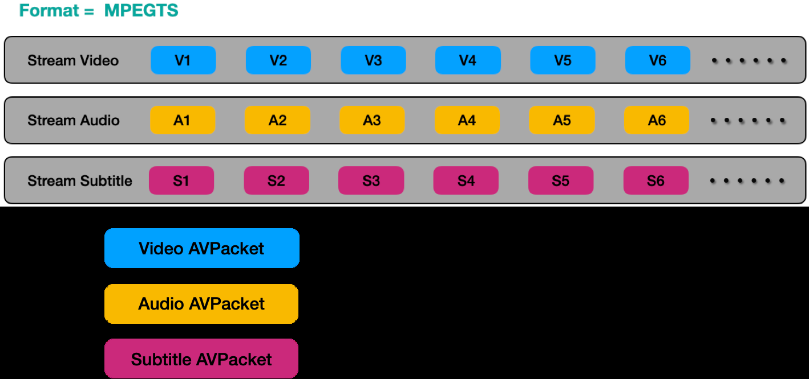
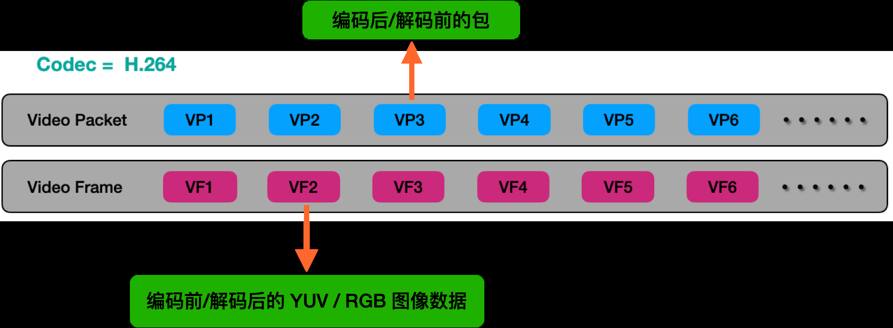
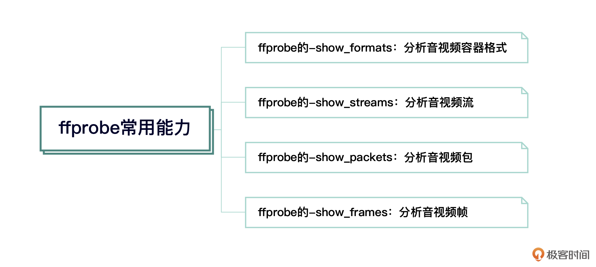

# 06 | 如何使用ffprobe分析音视频参数与内容？

你好，我是刘歧。

上一节课我们学习了如何使用 FFmpeg 和 OBS 做直播推流，当时我给你留了一个思考题，怎么确认播放的流是我们自己推的那个直播流呢？想回答这个问题，就需要用到我们今天要学习的这个视频信息分析神器——ffprobe。它是 FFmpeg 提供的一个工具，能够用来分析音视频容器格式、音视频流信息、音视频包以及音视频帧等信息，在我们做音视频转码、故障分析时，这个工具能提供很大的帮助。

下面，我们就来看看怎么使用 ffprobe 来分析音视频相关信息。

## 音视频容器格式分析

当我们拿到一个视频文件、一个视频直播 URL 链接时，通常的操作是播放，或者是分析其音视频容器格式的信息。播放操作比较简单，这里就不说了，如果想要分析音视频容器格式的信息，我们应该怎么做呢？

其实使用 ffprobe 的 -show_format 参数就能得到对应的信息了，我们看一下输出的内容。

```
[FORMAT]
filename=/Users/liuqi/Movies/Test/ToS-4k-1920.mov
nb_streams=2
nb_programs=0
format_name=mov,mp4,m4a,3gp,3g2,mj2
format_long_name=QuickTime / MOV
start_time=0.000000
duration=734.167000
size=738876331
bit_rate=8051316
probe_score=100
TAG:major_brand=qt
TAG:minor_version=512
TAG:compatible_brands=qt
TAG:encoder=Lavf54.29.104
[/FORMAT]
```

我们来逐一地解读一下里面蕴含的信息。

从输出信息第二行的后缀可以看到，这是一个 mov 文件。nb_streams 显示的是 2，也就是说这个容器格式里有两个流；nb_programs 是 0，表示这里面不存在 program 信息，这个program 信息常见于广电用的 mpegts 流里，比如某个卫视频道的节目；start_time 是这个容器里正常的显示开始的时间 0.00000；duration 是这个容器文件的总时长 734.167 秒；接着就是 size 表示这个 mov 文件大小；bit_rate 是这个文件的码率。

然后下面就是 probe 查找容器格式的得分，FFmpeg 在 probe 这个文件中对应的得分是 100，这个得分通常用来确定使用哪个容器模块来解析这个 probe 文件。最后就是对应容器的TAG。

其实分析容器格式的话，得到的信息并不是特别全，但是容器格式里面的这些信息是具有一定的参考价值的，如果想要获得容器格式里一些更详细的信息，还需要对容器格式里面的音视频流进行分析。

## 音视频流分析

音视频流的信息我们可以使用 ffprobe 的 -show_streams 获取到，我们看一下通过show_streams 能得到哪些内容呢？我们以视频文件中的视频流为例来分析一下，如果你对音频流有兴趣，也可以按照我们分析视频流的方式分析一下音频流。

```
[STREAM]
index=0 //流的索引号
codec_name=h264 //流的编码名
codec_long_name=H.264 / AVC / MPEG-4 AVC / MPEG-4 part 10 //流的编码详细描述
profile=High //流的profile
codec_type=video //流的codec类型
codec_tag_string=avc1 // 流的codec tag 字符串
codec_tag=0x31637661 // 流的codec tag，也是字符串，只不过以16进制方式存储
width=1920 //视频的宽，流内容部分
height=800 //视频的高，流内容部分
coded_width=1920 // 编码视频的宽，编解码时的部分，对齐的数据，显示时不用
coded_height=800 // 编码视频的高，编解码时的部分，对齐的数据，显示时不用
has_b_frames=2 // IPB 帧排列时两个P之间包含两个B
sample_aspect_ratio=1:1 //像素点采样比例
display_aspect_ratio=12:5 // 显示图像比例
pix_fmt=yuv420p // 像素点格式
level=40 // 与profile一起出现，对应的是参考标准中有对应的参数描述
color_range=unknown //调色必备参数
color_space=unknown //调色必备参数
color_transfer=unknown  //调色必备参数
color_primaries=unknown //调色必备参数
field_order=progressive // 隔行扫描逐行扫描标识
r_frame_rate=24/1  // 实际帧率
avg_frame_rate=24/1 // 平均帧率
time_base=1/24 //时间基，通常和帧率有对应关系
start_pts=0 // 开始时间戳
start_time=0.000000 // 开始时间
duration_ts=17620 //duration 时间戳
duration=734.166667 // duration 时间
bit_rate=7862427 // 码率
max_bit_rate=N/A // 最大码率
bits_per_raw_sample=8 // 原始数据每个采样占位
nb_frames=17620 // 总帧数
extradata_size=42 // extradata 大小
TAG:language=eng // 这个是TAG，主要是展示语种
TAG:handler_name=VideoHandle // 句柄名
TAG:vendor_id=FFMP // 生成MP4文件的工具
TAG:encoder=libx264 // 视频编码器标识
[/STREAM]
```

从我们获取的这个视频流的内容中可以看到，音视频流的信息，用[STREAM]标签括起来了，标签里面的内容是我们要关注的。

我们可以根据 codec_type 来区分这个流是音频还是视频。通过 codec_name 来确定这个流是什么编码的，例如我们这个流是 H.264 编码的视频流。而这个流的 profile 是 High profile，Level 是 40，也就是我们通常说的 4.0。H.264 编码不仅仅有 High Profile，还有 MainProfile、Baseline Profile，各种 Profile 还可以配合多种 Level，不同组合标准的编码参数信息会有一些不同，应用场景也会有差别，更详细的信息你可以查看 H.264 的参考标准文档的附录 A 部分。

我们回来继续看这个流信息，注意这个 codec 的 tag_string 是 avc1，因为视频编码会封装到容器中，不同的容器对 tag_string 的支持也不同，我们现在看到的是 H.264，其实在 HLS 的参考标准里，fragment mp4 里 HEVC 编码的 tag_string 就不只是 avc1 一种 TAG 了，HEVC编码被封装到 fragment mp4 的话还可以支持 HVC1、HEV1。而在 HLS 的 fragment mp4里，我们需要指定封装成 HVC1 的 tag_string 才可以被正常地播放出来，这个在我们排查问题时也是需要用到的。

接下来是宽高信息，是否包含 B 帧，每个 GOP（图像组，可以理解为两个关键帧中间的数据，包含图像组的头部关键帧）之间包含多少个 B 帧。sample_aspect_ratio（SAR）数据采样宽高比，display_aspect_ratio（DAR）显示宽高比，这两个数值中间如果有差别的话，肯定有一个因素，就是像素点不是矩形的，不是 1 比 1 的单个像素点。这就产生了 Pixel AspectRatio（PAR）像素宽高比。我们可以这么理解它们的关系：

## DAR = SAR × PAR

我们可以看到 pix_fmt 是 yuv420p，在第 5 节课中，我们学推流编码时像素点用的也是yuv420p，因为在视频领域它的兼容性更好。通常互联网上的视频流对应的像素点格式，最常见的也是 yuv420p。

然后在视频流的信息里面，我们还可以看到一些视频色彩空间对应的信息，在示例代码中，我们看到没有解析正确的，全都是 unkown。

视频的场编码我们可以看到字段是 field_order=progressive，也就是逐行编码。关于场编码，我们第 1 节课说过，因为以前显示设备刷新能力有限，在编码和解码的时候需要支持顶场和底场的隔行扫描编解码，所以我们现在拿到的这个视频流不是隔行扫描了，而是逐行扫描。因为分辨率是 1920x800 的，所以我们可以简单地称之为 1080p。

视频的 start_time 与容器格式中一样，是 0.000000。duration 则与容器格式里面的 duration有些不同了，duration=734.166667，因为容器格式和视频流是两个信息存储空间，所以难免会有一些差别。视频码率是 7862427，帧率共分为三部分，分别是：实际上最基础的帧率r_frame_rate=24/1；实际上平均帧率 avg_frame_rate=24/1；时间基，通常称之为timebase，time_base=1/24。

为什么会有这么多帧率表示呢？

因为我们在给视频编码对应成视频流，封装到容器中的时候，会有多个地方记录视频帧信息，加上视频流有可能是可变帧率的，因此需要多个参考值。在解决问题的时候，我们可以把多个值提取出来，分析哪个更适合我们自己的使用场景，当然并不是固定某一个就肯定是准确的，帧率在复杂业务场景下很容易出现各种诡异的问题，FFmpeg 能做的就是把各个节点的帧率信息尽量全面地提供给我们。

然后我们可以看到这个视频流里面一共包含了 17620 帧图像，这个数据有些容器不一定能拿得到，有些不一定能拿得准，所以我们除了通过 show_streams 获取这些信息之外，还可以单独对视频包进行逐包查看与分析，下面我们来看一下怎么用 ffprobe 参数来查看音视频包的信息。

## 音视频包分析

在我们拿到视频文件或视频流 URL 之后，为了更精准地分析问题，也会经常用到 ffprobe 的 -show_packets 参数，ffprobe 的 show_packets 参数可以将音视频的所有包都列出来。

因为音频包和视频包放在一起交错显示，看上去会比较复杂并且费劲，我们可以通过使用select_streams v 来只读取视频流的包。ffprobe 默认输出内容是平铺模式的，所以一屏只能输出几个包的信息，为了一屏能够输出更多的信息，我们可以考虑使用 -of 来定制输出的信息格式，例如 xml，那么输出的 packet 信息格式就是这样：

```xml
<packets>
       <packet codec_type="video" stream_index="0" pts="0" pts_time="0.000000" d
       <packet codec_type="video" stream_index="0" pts="4" pts_time="0.166667" d
       <packet codec_type="video" stream_index="0" pts="2" pts_time="0.083333" d
       <packet codec_type="video" stream_index="0" pts="1" pts_time="0.041667" d
       <packet codec_type="video" stream_index="0" pts="3" pts_time="0.125000" d
       <packet codec_type="video" stream_index="0" pts="8" pts_time="0.333333" d
       <packet codec_type="video" stream_index="0" pts="6" pts_time="0.250000" d
       <packet codec_type="video" stream_index="0" pts="5" pts_time="0.208333" d
       <packet codec_type="video" stream_index="0" pts="7" pts_time="0.291667" d
       <packet codec_type="video" stream_index="0" pts="12" pts_time="0.500000"
       <packet codec_type="video" stream_index="0" pts="10" pts_time="0.416667"
       <packet codec_type="video" stream_index="0" pts="9" pts_time="0.375000" d
       <packet codec_type="video" stream_index="0" pts="11" pts_time="0.458333"
       <packet codec_type="video" stream_index="0" pts="16" pts_time="0.666667"
       <packet codec_type="video" stream_index="0" pts="14" pts_time="0.583333"
       <packet codec_type="video" stream_index="0" pts="13" pts_time="0.541667"
       <packet codec_type="video" stream_index="0" pts="15" pts_time="0.625000"
```

从输出的内容中可以看到，show_packets 里面包含了多个 packet 包，因为我们选择的是视频流，所以 codec_type 是视频 codec，流的索引是 0。后面就是 pts 与 pts_time、dts 与dts_time、duratrion 和 duration_time、包的 size 大小、包的数据所在文件的偏移位置，最后是查看这个数据包是 Keyframe 关键帧还是普通帧，是不是 Discard 包等。

Discard 包通常会在解码或者播放的时候被丢弃，这个是需要注意的，分析问题的时候可能会遇到这种情况。在这些信息中，我们发现 pts 还有对应的 pts_time，这是为什么呢？因为 pts是跟 stream 的 timebase 做时间转换之前的数值，而 pts_time 这个值是与 stream 的timebase 做时间转换之后的值，pts、dts、duration 是 int64 的类型，pts_time、dts_time、duration_time 是 double 浮点类型。

我们还可以看到，pts 与 dts 数值的排列顺序有些不太一样，dts 是顺序排列的，pts 是前后跳的，这是因为编码的时候视频数据中有 B 帧，解码的时候可以顺序解码，但是显示的时候需要重新按照 pts 的顺序显示。用 show_packet 我们能看到 pts 与 dts 的顺序不是一一对应的，也能看到是否是 keyframe，但无法确认 packet 是 I 帧、P 帧还是 B 帧。

为了能够确认这些信息，除了 show_packets 之外，ffprobe 还可以通过 show_frames 来查看帧类型等信息，接下来我们看一下音视频的帧分析。

## 音视频帧分析

前面我们介绍了容器格式分析、音视频流分析以及音视频包分析三种分析方法，其实以上三个维度的分析是可以拿到音视频帧以外的信息的。如果想要拿到音视频帧相关的信息，还是需要通过音视频帧的信息来分析的，例如可以分析出当前这个视频帧是 I 帧、P 帧还是 B 帧。

我们这里还是用视频来举例，学完之后你可以根据这节课学到的技能用音频来练习。我们用ffprobe 的 -show_frames 来看一下拿到的帧信息都有哪些。

```xml
<frames>
       <frame media_type="video" stream_index="0" key_frame="1" pts="0" pts_time
           <side_data_list>
               <side_data side_data_type="H.26[45] User Data Unregistered SEI me
           </side_data_list>
       </frame>
       <frame media_type="video" stream_index="0" key_frame="0" pts="1" pts_time
       <frame media_type="video" stream_index="0" key_frame="0" pts="2" pts_time
       <frame media_type="video" stream_index="0" key_frame="0" pts="3" pts_time
       <frame media_type="video" stream_index="0" key_frame="0" pts="4" pts_time
       <frame media_type="video" stream_index="0" key_frame="0" pts="5" pts_time
       <frame media_type="video" stream_index="0" key_frame="0" pts="6" pts_time
       <frame media_type="video" stream_index="0" key_frame="0" pts="7" pts_time
       <frame media_type="video" stream_index="0" key_frame="0" pts="8" pts_time
       <frame media_type="video" stream_index="0" key_frame="0" pts="9" pts_time
       <frame media_type="video" stream_index="0" key_frame="0" pts="10" pts_tim
       <frame media_type="video" stream_index="0" key_frame="0" pts="11" pts_tim
       <frame media_type="video" stream_index="0" key_frame="0" pts="12" pts_tim
       <frame media_type="video" stream_index="0" key_frame="0" pts="13" pts_tim
       <frame media_type="video" stream_index="0" key_frame="0" pts="14" pts_tim
       <frame media_type="video" stream_index="0" key_frame="0" pts="15" pts_tim
       <frame media_type="video" stream_index="0" key_frame="0" pts="16" pts_tim
       <frame media_type="video" stream_index="0" key_frame="0" pts="17" pts_tim
       <frame media_type="video" stream_index="0" key_frame="1" pts="18" pts_tim
```

从视频帧信息中可以看到，第一个 keyframe 中携带着 side_data，是关于 H.264 的编码器相关的用户信息。也就是当我们使用开源的 x264 做视频编码的时候，会看到 x264 的标识信息。

这一段输出信息中帧信息有两个 keyframe，也可以理解是一个 GOP 大小的帧，这个帧的个数与我们用 show_packets 参数时看到的 packet 的数量，应该是能匹配得上的，但差别是这里的 pts 是顺序排列的，也能看到对应的 packet size 和 packet pos，而且这里还能看到帧的类型、图像宽高、像素点格式、宽高比等场编码一类的信息。show_packets 与 show_frames 搭配一起分析音视频数据包，会精确很多。

从上面的信息中，我们能够发现一个共同的问题，就是我们经常会拿到一大堆我们可能并不需要的字段，为了精准地获得自己需要的字段，我们可以使用 ffprobe 中的 -show_entries 来指定自己想要的字段，例如配合 show_packet，我想拿到 packet 的 pts_time、dts_time 和flags，那么就可以用 show_packets 与 show_entries 来操作。命令如下：

```
ffprobe -show_packets -select_streams v -of xml -show_entries packet=pts_time,dts
```

然后输出的内容就会精简很多，如下所示：

```xml
   <packets>
       <packet pts_time="0.000000" dts_time="-0.083333" flags="K_"/>
       <packet pts_time="0.166667" dts_time="-0.041667" flags="__"/>
       <packet pts_time="0.083333" dts_time="0.000000" flags="__"/>
       <packet pts_time="0.041667" dts_time="0.041667" flags="__"/>
       <packet pts_time="0.125000" dts_time="0.083333" flags="__"/>
       <packet pts_time="0.333333" dts_time="0.125000" flags="__"/>
       <packet pts_time="0.250000" dts_time="0.166667" flags="__"/>
       <packet pts_time="0.208333" dts_time="0.208333" flags="__"/>
       <packet pts_time="0.291667" dts_time="0.250000" flags="__"/>
       <packet pts_time="0.500000" dts_time="0.291667" flags="__"/>
       <packet pts_time="0.416667" dts_time="0.333333" flags="__"/>
       <packet pts_time="0.375000" dts_time="0.375000" flags="__"/>
       <packet pts_time="0.458333" dts_time="0.416667" flags="__"/>
       <packet pts_time="0.666667" dts_time="0.458333" flags="__"/>
       <packet pts_time="0.583333" dts_time="0.500000" flags="__"/>
       <packet pts_time="0.541667" dts_time="0.541667" flags="__"/>
       <packet pts_time="0.625000" dts_time="0.583333" flags="__"/>
```

关于音视频封装容器、音视频流、音视频包、音视频帧之间对应的关系，我们用图片来表示会更直观一些。



以 MPEGTS 封装为例，封装里面包含 3 个流，分别是视频流，音频流，字幕流，视频流中需要存储对应的视频编码参数信息，用来在解码器解码时使用，而视频、音频和字幕流在存储或者传输的时候是一一对应的，如果偏差太大的话会造成音视频不同步问题。



而我们刚才讲到的音视频包和音视频帧之间的对应关系，你可以理解为一个 AVPacket 对应一个 AVFrame，对照着图片理解会更清晰。

## 小结

这节课我们学习使用 ffprobe 来分析音视频的容器格式、音视频的流、音视频的包、音视频的帧信息。拿到这些信息之后我们可以精确地分析音视频多个维度的信息，无论是做音视频转码、故障分析等，都会有很大的用处。

因为 ffprobe 的黑科技参数还有很多，更细节的内容，还需要你参考 FFmpeg 的官方手册中的ffprobe 页面，自己在使用过程中去探索、挖掘。



## 思考题

如果你拿到一个电影视频，想做分片转码，根据学过的内容，你该怎么分片呢？欢迎在评论区留下你的思考，也欢迎你把这节课分享给需要的朋友，我们下节课再见！
