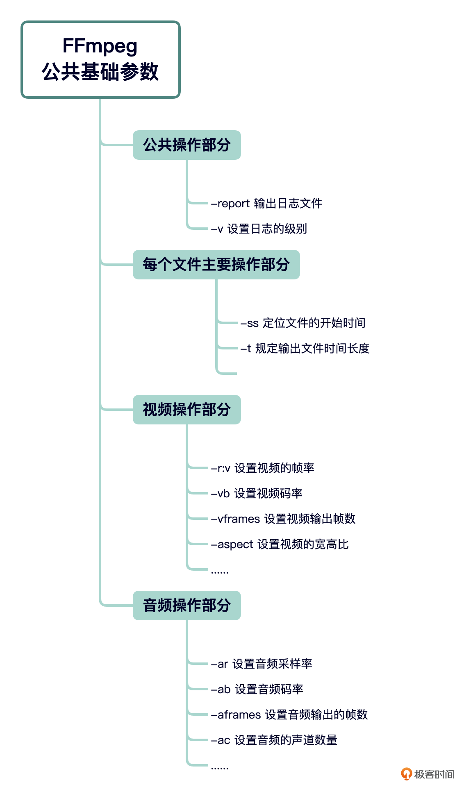

# 07-如何高效查找并使用FFmpeg常用参数？

你好，我是刘歧。

我们讲述直播推流的时候曾简单介绍过FFmpeg 推直播流的操作，但是并不是特别全面，遇到一些问题的时候我们还是无法很好地解决。有时候，我们想要使用 FFmpeg 的某个功能，但不知道怎么查找，甚至可能不知道 FFmpeg 是否包含我们需要的能力。那么这节课我们会更全面地介绍 FFmpeg 中常用的参数，还有遇到问题的时候如何确认 FFmpeg 是否可以达到我们预期的目的。

如果你是第一次使用 FFmpeg，肯定会有很多疑惑，尤其是看到命令行的一堆参数之后。所以这节课我会一步一步引导你先学会使用 FFmpeg，最后让你拥有自己深度挖掘 FFmpeg 里面各种黑科技的能力。先吃到“鱼”，然后学会“钓鱼”，之后你就可以自己慢慢收获各种“鱼”了。

## FFmpeg 输入输出组成

FFmpeg 的工作原理比较简单，它没有指定输出文件的参数。一般的工具都会带一个 -o 来指定输出文件，但 FFmpeg 不是，它不用 -o 指定输出，FFmpeg 自己会分析命令行然后确定输出。例如我们输入这么一段命令：

```
ffmpeg -i i.mp4 a.mp4 -vcodec mpeg4 b.mp4
```

这段命令会输出两个文件，分别是 a.mp4 和 b.mp4。

```
(base) liuqi05:xx liuqi$ ls
a.mp4 b.mp4
(base) liuqi05:xx liuqi$
```

因为 b.mp4 的输出参数部分我指定了 vcodec 为 mpeg4，所以 b.mp4 的视频编码采用的是mpeg4。而 a.mp4 的输出部分我没有指定任何信息，所以 a.mp4 使用的是 mp4 格式默认的视频编码，也就是 H.264 编码。我们一起来看一下命令行执行的输出信息。

```
Output #0, mp4, to 'a.mp4':
 Metadata:
   major_brand     : mp42
   minor_version   : 512
   compatible_brands: mp42iso2avc1mp41
   encoder         : Lavf59.25.100
 Stream #0:0(und): Video: h264 (avc1 / 0x31637661), yuv420p(tv, bt709, progressi
   Metadata:
     creation_time   : 2022-04-01T09:59:10.000000Z
     handler_name    : VideoHandler
     vendor_id       : [0][0][0][0]
     encoder         : Lavc59.33.100 libx264
   Side data:
     cpb: bitrate max/min/avg: 0/0/0 buffer size: 0 vbv_delay: N/A
 Stream #0:1(eng): Audio: aac (LC) (mp4a / 0x6134706D), 44100 Hz, stereo, fltp,
   Metadata:
     creation_time   : 2022-04-01T09:59:10.000000Z
     handler_name    : Stereo
     vendor_id       : [0][0][0][0]
     encoder         : Lavc59.33.100 aac
Output #1, mp4, to 'b.mp4':
 Metadata:
   major_brand     : mp42
   minor_version   : 512
   compatible_brands: mp42iso2avc1mp41
   encoder         : Lavf59.25.100
 Stream #1:0(und): Video: mpeg4 (mp4v / 0x7634706D), yuv420p(tv, bt709, progress
   Metadata:
     creation_time   : 2022-04-01T09:59:10.000000Z
     handler_name    : VideoHandler
     vendor_id       : [0][0][0][0]
     encoder         : Lavc59.33.100 mpeg4
   Side data:
     cpb: bitrate max/min/avg: 0/0/200000 buffer size: 0 vbv_delay: N/A
 Stream #1:1(eng): Audio: aac (LC) (mp4a / 0x6134706D), 44100 Hz, stereo, fltp,
   Metadata:
     creation_time   : 2022-04-01T09:59:10.000000Z
     handler_name    : Stereo
     vendor_id       : [0][0][0][0]
     encoder         : Lavc59.33.100 aac
frame=  116 fps= 73 q=28.0 q=2.0 size=       0kB time=00:00:05.22 bitrate=   0.1k
```

可以看到，FFmpeg 的输入可以是多个，输出也可以是多个，但是每一个输出都会根据输入的信息做一个参数复制。遇到不用于输出封装格式的默认 codec，FFmpeg 会转成默认的封装格式对应的编码。

如果想要指定编码，每个输出格式都需要输出对应的编码，如果不想重新编码，可以使用 -vcodec copy，-acodec copy、-scodec copy 这样的参数，来进行只转封装不转码（做解码后再编码）的操作。不做视频转码操作的话，会节省 CPU 的计算资源，CPU 占用率会降低很多，但是如果输入的视频码率特别高的话，文件也会特别大，这种情况做一下转码还是有必要的。

FFmpeg 的命令行参数分布通常是这样：

```
ffmpeg [第一个输入文件对应的解析参数] -i 第一个输入文件名 [第二个输入文件对应的解析参数 ] -i
```

FFmpeg 的输入输出组成看上去比较简单，但是参数和官方文档的使用说明还是太多，怎么办呢？没关系，多数的畏难情绪是因为不了解。接下来，我们看一下 FFmpeg 的参数组成，了解清楚它的参数内容，相信你的疑虑就会打消大半了。

## 如何查找各个模块参数的帮助信息？

当我们查看 FFmpeg 的帮助信息和官方的文档的时候，第一感觉是文档和参数太多了，一时间根本无从下手。其实 FFmpeg 官方文档和帮助信息中的内容并不多，主要取决于你怎么看、怎么用。比如，我们使用命令行的时候，能够看到 FFmpeg 参数的情况。

```
ffmpeg --help
```

如果认真看帮助信息的话，你就会发现开头还有一部分关于查看帮助的方法。

```
Getting help:
   -h      -- print basic options
   -h long -- print more options
   -h full -- print all options (including all format and codec specific options
   -h type=name -- print all options for the named decoder/encoder/demuxer/muxer
   See man ffmpeg for detailed description of the options.
```

查看帮助，我们可以看到基础版本，也就是–help，而–help 还有两个常用参数，long 和 full。long 这个参数，除了可以查看基础帮助信息之外，还能查看更多高级操作的帮助内容；full 可以输出所有的帮助信息，可以全部打印出来查看。

下面还有个 type=name 的方式查看帮助信息，正如前面几节课我们讲到的 FFmpeg 一样，FFmpeg 是包含了封装与解封装、编码与解码、滤镜以及传输协议模块的，所以我们可以通过type=name 来过滤掉我们不需要的信息，只查看我们会用到的模块。例如我想查看 FLV 的封装，那就可以输入帮助操作。

```
ffmpeg -h muxer=flv
Muxer flv [FLV (Flash Video)]:
   Common extensions: flv.
   Mime type: video/x-flv.
   Default video codec: flv1.
   Default audio codec: adpcm_swf.
flv muxer AVOptions:
 -flvflags          <flags>      E.......... FLV muxer flags (default 0)
    aac_seq_header_detect              E.......... Put AAC sequence header based
    no_sequence_end              E.......... disable sequence end for FLV
    no_metadata                  E.......... disable metadata for FLV
    no_duration_filesize              E.......... disable duration and filesize
    add_keyframe_index              E.......... Add keyframe index metadata
```

这样的话，我们得到的参数就比直接用 ffmpeg --help full 要简洁多了，只看到了我们想看到的部分。如果想要看编码对应的帮助信息，也可以用同样的方法，把 muxer 换成 encoder 就可以了。

```sql
ffmpeg -h encoder=libx264
Encoder libx264 [libx264 H.264 / AVC / MPEG-4 AVC / MPEG-4 part 10]:
   General capabilities: dr1 delay threads
   Threading capabilities: other
   Supported pixel formats: yuv420p yuvj420p yuv422p yuvj422p yuv444p yuvj444p n
libx264 AVOptions:
 -preset            <string>     E..V....... Set the encoding preset (cf. x264 -
 -tune              <string>     E..V....... Tune the encoding params (cf. x264
 -profile           <string>     E..V....... Set profile restrictions (cf. x264
 -fastfirstpass     <boolean>    E..V....... Use fast settings when encoding fir
 -level             <string>     E..V....... Specify level (as defined by Annex
 -passlogfile       <string>     E..V....... Filename for 2 pass stats
 -wpredp            <string>     E..V....... Weighted prediction for P-frames
 -a53cc             <boolean>    E..V....... Use A53 Closed Captions (if availab
 -x264opts          <string>     E..V....... x264 options
 -crf               <float>      E..V....... Select the quality for constant qua
 -crf_max           <float>      E..V....... In CRF mode, prevents VBV from lowe
 -qp                <int>        E..V....... Constant quantization parameter rat
 -aq-mode           <int>        E..V....... AQ method (from -1 to INT_MAX) (def
    none            0            E..V.......
    variance        1            E..V....... Variance AQ (complexity mask)
    autovariance    2            E..V....... Auto-variance AQ
    autovariance-biased 3            E..V....... Auto-variance AQ with bias to d
 -aq-strength       <float>      E..V....... AQ strength. Reduces blocking and b
 -psy               <boolean>    E..V....... Use psychovisual optimizations. (de
 -psy-rd            <string>     E..V....... Strength of psychovisual optimizati
 -rc-lookahead      <int>        E..V....... Number of frames to look ahead for
 -weightb           <boolean>    E..V....... Weighted prediction for B-frames. (
 -weightp           <int>        E..V....... Weighted prediction analysis method
    none            0            E..V.......
    simple          1            E..V.......
    smart           2            E..V.......
 -ssim              <boolean>    E..V....... Calculate and print SSIM stats. (de
 -intra-refresh     <boolean>    E..V....... Use Periodic Intra Refresh instead
 -bluray-compat     <boolean>    E..V....... Bluray compatibility workarounds. (
 -b-bias            <int>        E..V....... Influences how often B-frames are u
 -b-pyramid         <int>        E..V....... Keep some B-frames as references. (
    none            0            E..V.......
    strict          1            E..V....... Strictly hierarchical pyramid
    normal          2            E..V....... Non-strict (not Blu-ray compatible)
 -mixed-refs        <boolean>    E..V....... One reference per partition, as opp
 -8x8dct            <boolean>    E..V....... High profile 8x8 transform. (defaul
 -fast-pskip        <boolean>    E..V....... (default auto)
 -aud               <boolean>    E..V....... Use access unit delimiters. (defaul
 -mbtree            <boolean>    E..V....... Use macroblock tree ratecontrol. (d
 -deblock           <string>     E..V....... Loop filter parameters, in <alpha:b
 -cplxblur          <float>      E..V....... Reduce fluctuations in QP (before c
 -partitions        <string>     E..V....... A comma-separated list of partition
 -direct-pred       <int>        E..V....... Direct MV prediction mode (from -1
    none            0            E..V.......
    spatial         1            E..V.......
    temporal        2            E..V.......
    auto            3            E..V.......
 -slice-max-size    <int>        E..V....... Limit the size of each slice in byt
 -stats             <string>     E..V....... Filename for 2 pass stats
 -nal-hrd           <int>        E..V....... Signal HRD information (requires vb
    none            0            E..V.......
    vbr             1            E..V.......
    cbr             2            E..V.......
 -avcintra-class    <int>        E..V....... AVC-Intra class 50/100/200/300/480
 -me_method         <int>        E..V....... Set motion estimation method (from
    dia             0            E..V.......
    hex             1            E..V.......
    umh             2            E..V.......
    esa             3            E..V.......
    tesa            4            E..V.......
 -motion-est        <int>        E..V....... Set motion estimation method (from
    dia             0            E..V.......
    hex             1            E..V.......
    umh             2            E..V.......
    esa             3            E..V.......
    tesa            4            E..V.......
 -forced-idr        <boolean>    E..V....... If forcing keyframes, force them as
 -coder             <int>        E..V....... Coder type (from -1 to 1) (default
    default         -1           E..V.......
    cavlc           0            E..V.......
    cabac           1            E..V.......
    vlc             0            E..V.......
    ac              1            E..V.......
 -b_strategy        <int>        E..V....... Strategy to choose between I/P/B-fr
 -chromaoffset      <int>        E..V....... QP difference between chroma and lu
 -sc_threshold      <int>        E..V....... Scene change threshold (from INT_MI
 -noise_reduction   <int>        E..V....... Noise reduction (from INT_MIN to IN
 -udu_sei           <boolean>    E..V....... Use user data unregistered SEI if a
 -x264-params       <dictionary> E..V....... Override the x264 configuration usi
```

比全部输出简洁多了，但是我们怎么确认我们使用的 type 名称是真实存在的呢？如果我直接输入 ffmpeg -h encoder=helloworld，肯定是拿不到任何信息的，而且会返回错误。这个时候我们就需要从头部看 FFmpeg 的 help 信息了。

```
Print help / information / capabilities:
-L                  show license
-h topic            show help
-? topic            show help
-help topic         show help
--help topic        show help
-version            show version
-buildconf          show build configuration
-formats            show available formats
-muxers             show available muxers
-demuxers           show available demuxers
-devices            show available devices
-codecs             show available codecs
-decoders           show available decoders
-encoders           show available encoders
-bsfs               show available bit stream filters
-protocols          show available protocols
-filters            show available filters
-pix_fmts           show available pixel formats
-layouts            show standard channel layouts
-sample_fmts        show available audio sample formats
-dispositions       show available stream dispositions
-colors             show available color names
-sources device     list sources of the input device
-sinks device       list sinks of the output device
-hwaccels
show available HW acceleration methods
```

FFmpeg 帮助信息中提供了一些查看各个模块的全部列表，例如我们如果想查看我们机器上的FFmpeg 是否支持 nvidia 的 H.264 编码器的话，就可以通过参数 ffmpeg -encoders 来确认机器上当前安装的 FFmpeg 中是否涵盖了 nvidia 的 H.264 编码器。

```
ffmpeg -encoders|grep H.264
```

我把所有输出信息通过管道用 grep 过滤了一遍，得到的输出信息是这样的。

```
V....D libx264              libx264 H.264 / AVC / MPEG-4 AVC / MPEG-4 part 10 (c
V....D libx264rgb           libx264 H.264 / AVC / MPEG-4 AVC / MPEG-4 part 10 RG
V....D h264_videotoolbox    VideoToolbox H.264 Encoder (codec h264)
```

从输出的内容中可以看到，我的机器上没有安装 nvidia 的 H.264 编码器，但是我机器上安装了 lib264 和 h264_videotoolbox 的编码器，所以可以直接查看 libx264 或者h264_videotoolbox 的帮助信息。

只要有针对性地查找帮助信息，就可以过滤掉很多我们不想看到的内容。另外，还有一小部分是常用的参数，接下来我们通过一些实际场景来学习一下。

## FFmpeg 公共基础参数

当我们使用 FFmpeg 时，有一些贯穿 FFmpeg 各个组件的核心参数，在我们查看帮助信息时就可以看到，help 不带参数的话就会输出基础帮助信息。

基础帮助信息中包含了这几部分：

1. 公共操作部分

公共操作部分的参数主要包括把日志输出到日志文件的参数 -report，输出日志文件名的格式是 ffmpeg-20220703-170736.log，也就是 ffmpeg- 年月日 - 时分秒.log 的文件名格式。你可以使用命令行 ffmpeg -report 试验一下。

还可以将 FFmpeg 的日志输出到终端，通过 -v 参数来设置日志的级别，主要分为 quiet、panic、fatal、error、warning、info、verbose、debug、trace9 个级别，按先后顺序输出的内容越来越多。如果我们想看到全部的处理信息，用 trace 就可以。如果不特意设置的话，默认是 info 级别，所以我们看到的通常是 info、warning、error 以及更严重的错误信息。如果我们什么信息都不想看到，用 quiet 就能做到。

2. 每个文件主要操作部分

文件主要操作部分的参数除了我们前面课程提到的 -codec、-c、-f 之外，还可以使用 -ss 来定位文件的开始时间，通过 -t 来规定输出文件时间长度。

如果我们想做分片转码的话，就可以使用 -ss 和 -t 两个参数分隔视频文件。另外，要注意 -ss指定的位置最好是关键帧位置。比如说，我们可以通过 ffprobe -show_packet input.mp4 找到视频关键帧对应的 pts 位置，然后通过 -ss 定位到关键帧位置，-t 设置为下一个关键帧减去当前关键帧位置的时间长度，这样就能完成切片了。

需要注意的是，-ss 放在 -i 参数左侧来定位开始的位置会比放在右侧要快很多，但是放在 -i 左侧的话，定位通常不准确，但如果我们把 -ss 的时间点位设置为关键帧对应的点位，那定位就是准确的。另外，我们还可以使用 -codec:v copy -an 去掉音频，从而达到分离音视频的目的。

如果想给视频添加 metadata 信息的话，例如指定文件的标题等信息，可以通过 -metadata 参数来设置 metadata。

我们通过命令行测一下效果。

```
ffmpeg -f lavfi -i testsrc=s=176x144 -metadata title="This Is A Test" -t 2 out.mp
```

我们先确认一下输出的 out.mp4 文件是否包含了我们设定的 Title“This Is A Test.”。

```
ffmpeg -i out.mp4
Input #0, mov,mp4,m4a,3gp,3g2,mj2, from 'out.mp4':
 Metadata:
   major_brand     : isom
   minor_version   : 512
   compatible_brands: isomiso2avc1mp41
   title           : This Is A Test
   encoder         : Lavf58.77.100
 Duration: 00:00:02.00, start: 0.000000, bitrate: 49 kb/s
 Stream #0:0(und): Video: h264 (High 4:4:4 Predictive) (avc1 / 0x31637661), yuv4
   Metadata:
     handler_name    : VideoHandler
     vendor_id       : [0][0][0][0]
```

从输出的信息中可以看到文件里带有我们设定的 title 信息。

3. 视频操作部分

既然是做音视频处理，FFmpeg 除了文件公共部分，还有视频操作公共部分的参数。比如说：

- -r:v 设置视频的帧率；

- -vb 设置视频码率；

- -vframes 设置视频输出的帧数；

- -aspect 设置视频的宽高比；

- -vn 关闭视频流处理操作，也就是屏蔽视频流；

- -vf 给视频做简单滤镜处理，简单滤镜处理一般不支持多图层、多输入、多输出的滤镜。

4. 音频操作部分

同样的，除了视频操作部分的参数，FFmpeg 还有音频操作公共部分的参数，比如说：

- -ar 设置音频采样率；

- -ab 设置音频码率；

- -aframes 设置音频输出的帧数；

- -ac 设置音频的声道数量

- -an 关闭音频流处理操作，也就是屏蔽音频流

- -af 给音频做简单滤镜处理，简单滤镜处理一般不支持多图层、多输入、多输出的滤镜；

- -vol 设置音频的音量。



## FFmpeg 公共高级参数

前面我们讲到了一些基础操作部分，也提到了通过 help long 还可以查看到高级操作部分。高级操作部分是基于基础部分做的一些更高级的内容延伸。

-filter_complex 参数可以将音视频混合在一条参数字符串里进行操作，也可以输入、输出多个视频流和音频流。如果滤镜字符串太长的话，一条命令行可能会遇到很多麻烦，例如命令行支持的输入内容长度有最长限制，从而导致无法输入完整的 FFmpeg 命令参数，这时我们可以考虑使用外挂 filter 脚本来处理，使用参数 -filter_script 能够解决这些问题。

-copytb 参数设定 timebase 与输入的相同，确保时间戳不会跳变，当然这么做会有一定的风险，毕竟视频的 MPEGTS 封装格式与 MP4 的封装格式对应的 timebase 还是有差别的，如果强制使用相同的 timebase 则会引起时间戳间隔相关问题，严重的话甚至会引起丢帧。-force_key_frames 在做编码的时候可以根据这个参数做强制关键帧设定，-force_key_frames支持表达式方式处理。FFmpeg 的表达式处理可以参考FFmpeg 官方文档。

## 小结

最后，我们来对这节课的内容做一个回顾吧！

FFmpeg 常用的参数主要分为输入输出组成、公共基础参数、高级参数几方面内容，这节课学习这些参数的用法除了让你了解 FFmpeg 常用的参数混个脸熟之外，更深层次的目的是消除你的畏难情绪。

FFmpeg 作为一个必备的音视频开发工具，确实参数比较多，但入门之后你就会发现，里面的参数是分模块的，非常好记也非常好用，尤其是 FFmpeg 公共基础参数部分，我们把这部分内容分成了公共操作参数、每个文件主要的操作参数、音频和视频操作参数四部分，每个部分的参数功能都非常明确清晰。

除此之外，学会查看各个模块参数的帮助手册，就算是掌握了“钓鱼”的方法。我希望你可以好好地利用这些方法，真正地用起来，让这些参数知识、查找方法真正成为你趁手的工具。

## 思考题

最后，我给你留道思考题。使用 FFmpeg 的 filter_complex 和表达式，实现这个场景：前景是一个小图（也可以是 logo），背景是一个视频；logo 位置与视频的进度同步，在视频下方游动，也就是视频开始的时候 logo 在视频的最左下角，视频结束的时候在视频的最右下角，视频播放的时候按照视频进度比例从左下角向右下角移动。

我们应该怎么去实现这个场景呢？欢迎你把自己的想法写在评论区和我交流，也欢迎你把这节课分享给需要的朋友，我们下节课再见！
