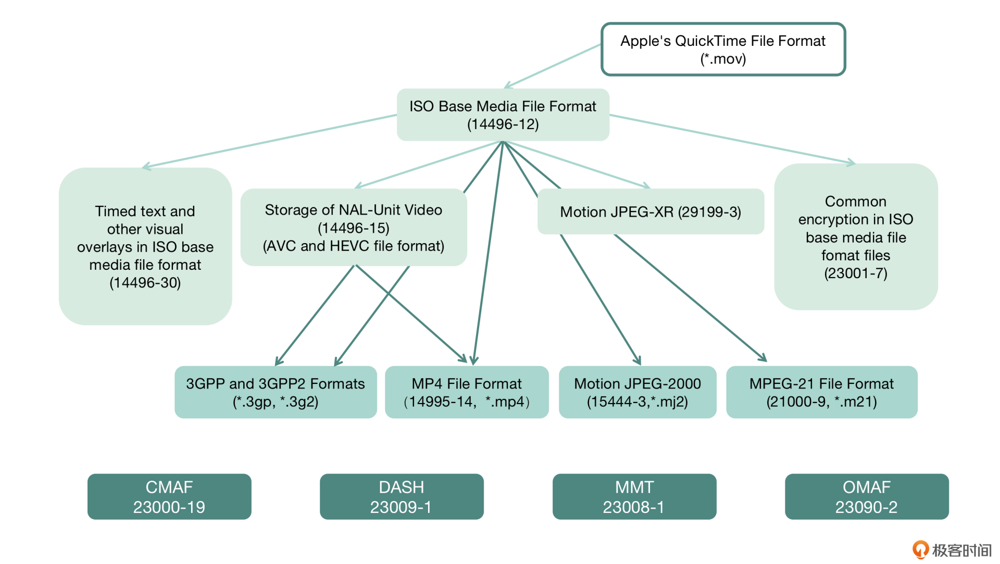
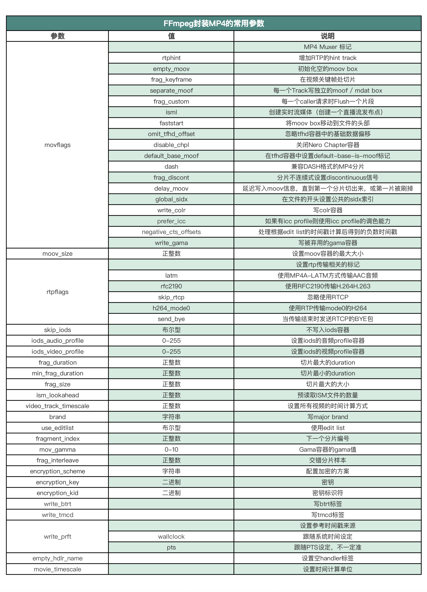
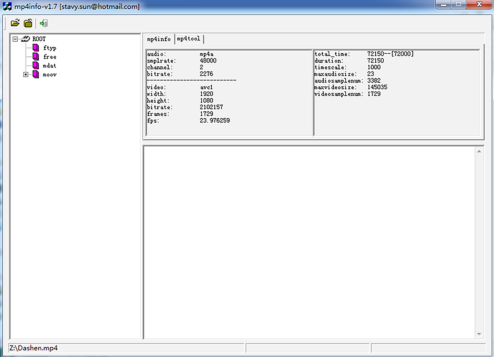
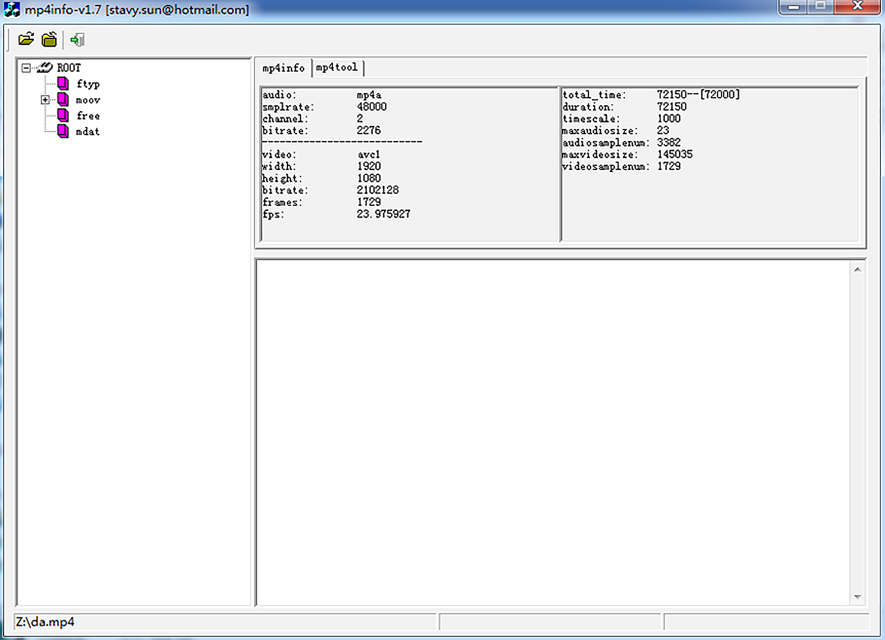
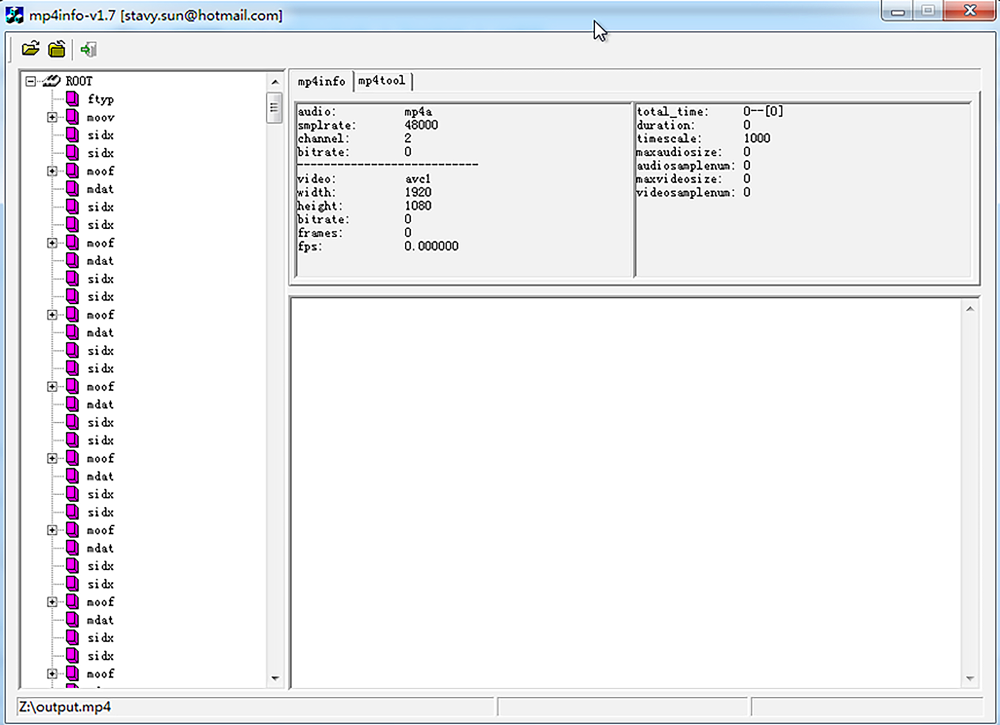
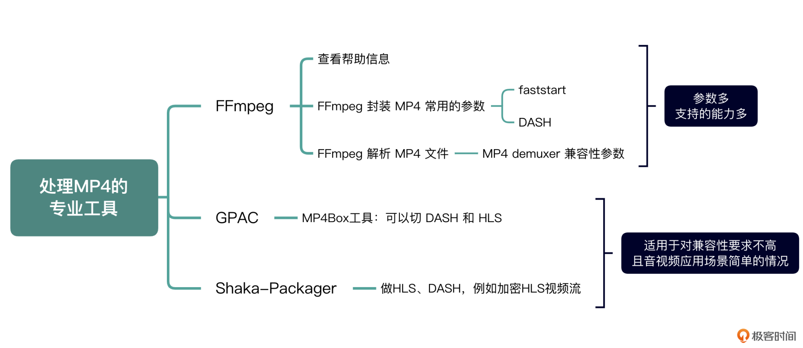

# 08 | FFmpeg和它的朋友们是怎么处理MP4的？

你好，我是刘歧。

我们日常看电视剧，录视频时，最常见的就是 MP4 格式了。你有没有想过，MP4 格式为什么使用得这么广泛呢？

因为 MP4 标准非常灵活，可扩展性比较好，有很多常见的格式是基于 MP4 做了一些扩展，然后被应用到比较广的范围，比如 CMAF、DASH、HLS。而且 MP4 的参考标准是一个开放的标准，我们通常以编号为 ISO-14496-12 来查找标准文档。因为 MP4 的使用范围比较广，我们在第 3 节课的时候，也着重讲了 MP4 封装容器格式，你可以回顾一下。



- MP4扩展出来的格式

基于 MP4 的重要地位，我这节课来给你讲一讲，如何用 FFmpeg、GPAC 等工具生成与解析MP4。

尽管 FFmpeg 的目标是自己不去创造标准，但是难免会有一些工具或者用户会根据自己的臆测做一些定制或者修改，导致与我们公认的标准出现一些偏差。为了让 MP4 的标准性更好地得到验证，我们通常会选择使用多种工具，所以这节课除了给你介绍 FFmpeg 对 MP4 的 mux与 demux（封装与解封装）之外，我还会介绍一些其他的 MP4 相关的工具，例如 MP4Box、Shaka- Packager。

在我们使用 FFmpeg 做音视频处理的时候，经常会使用 FFmpeg 生成 MP4 文件，或者使用FFmpeg 输入 MP4 文件然后转换成其他格式。这里我们就先来了解一下 FFmpeg 对 MP4 都有哪些能力支持。这就需要用到上节课的知识了，你可以停下来先想一下我们应该怎么在FFmpeg 中查找自己想要的帮助信息。

### 用 FFmpeg 生成 MP4 文件

首先，查看 MP4 的 muxer 对应的参数，输入 ffmpeg -h muxer=mp4，看一下输出的内容。

```
Muxer mp4 [MP4 (MPEG-4 Part 14)]:
   Common extensions: mp4.
   Mime type: video/mp4.
   Default video codec: h264.
   Default audio codec: aac.
mov/mp4/tgp/psp/tg2/ipod/ismv/f4v muxer AVOptions:
 -movflags          <flags>      E.......... MOV muxer flags (default 0)
    rtphint                      E.......... Add RTP hint tracks
    empty_moov                   E.......... Make the initial moov atom empty
    frag_keyframe                E.......... Fragment at video keyframes
    frag_every_frame              E.......... Fragment at every frame
    separate_moof                E.......... Write separate moof/mdat atoms for
    frag_custom                  E.......... Flush fragments on caller requests
    isml                         E.......... Create a live smooth streaming feed
    faststart                    E.......... Run a second pass to put the index
    omit_tfhd_offset              E.......... Omit the base data offset in tfhd
    disable_chpl                 E.......... Disable Nero chapter atom
    default_base_moof              E.......... Set the default-base-is-moof flag
    dash                         E.......... Write DASH compatible fragmented MP
    cmaf                         E.......... Write CMAF compatible fragmented MP
    frag_discont                 E.......... Signal that the next fragment is di
    delay_moov                   E.......... Delay writing the initial moov unti
    global_sidx                  E.......... Write a global sidx index at the st
    skip_sidx                    E.......... Skip writing of sidx atom
    write_colr                   E.......... Write colr atom even if the color i
    prefer_icc                   E.......... If writing colr atom prioritise usa
    write_gama                   E.......... Write deprecated gama atom
    use_metadata_tags              E.......... Use mdta atom for metadata.
    skip_trailer                 E.......... Skip writing the mfra/tfra/mfro tra
    negative_cts_offsets              E.......... Use negative CTS offsets (redu
 -moov_size         <int>        E.......... maximum moov size so it can be plac
 -rtpflags          <flags>      E.......... RTP muxer flags (default 0)
    latm                         E.......... Use MP4A-LATM packetization instead
    rfc2190                      E.......... Use RFC 2190 packetization instead
    skip_rtcp                    E.......... Don't send RTCP sender reports
    h264_mode0                   E.......... Use mode 0 for H.264 in RTP
    send_bye                     E.......... Send RTCP BYE packets when finishin
 -skip_iods         <boolean>    E.......... Skip writing iods atom. (default tr
 -iods_audio_profile <int>        E.......... iods audio profile atom. (from -1
 -iods_video_profile <int>        E.......... iods video profile atom. (from -1
 -frag_duration     <int>        E.......... Maximum fragment duration (from 0 t
 -min_frag_duration <int>        E.......... Minimum fragment duration (from 0 t
 -frag_size         <int>        E.......... Maximum fragment size (from 0 to IN
 -ism_lookahead     <int>        E.......... Number of lookahead entries for ISM
 -video_track_timescale <int>        E.......... set timescale of all video trac
 -brand             <string>     E.......... Override major brand
 -use_editlist      <boolean>    E.......... use edit list (default auto)
 -fragment_index    <int>        E.......... Fragment number of the next fragmen
 -mov_gamma         <float>      E.......... gamma value for gama atom (from 0 t
 -frag_interleave   <int>        E.......... Interleave samples within fragments
 -encryption_scheme <string>     E.......... Configures the encryption scheme, a
 -encryption_key    <binary>     E.......... The media encryption key (hex)
 -encryption_kid    <binary>     E.......... The media encryption key identifier
 -use_stream_ids_as_track_ids <boolean>    E.......... use stream ids as track i
 -write_btrt        <boolean>    E.......... force or disable writing btrt (defa
 -write_tmcd        <boolean>    E.......... force or disable writing tmcd (defa
 -write_prft        <int>        E.......... Write producer reference time box w
    wallclock       1            E..........
    pts             2            E..........
 -empty_hdlr_name   <boolean>    E.......... write zero-length name string in hd
 -movie_timescale   <int>        E.......... set movie timescale (from 1 to INT_
```

就像开头我说的那样，因为 MP4 的灵活性比较好，变种形态也比较多，为了方便使用，FFmpeg 就增加了很多符合标准但又有可能用不到的参数，我们一会儿抽取一些例子来讲讲。

在讲例子之前，我们先看一下这个帮助信息里面的内容，帮助信息的头部给出了 MP4 的文件扩展名.mp4，视频默认用 H.264 编码，音频默认用 AAC 编码。

接下来我们来看一下 FFmpeg 封装 MP4 常用的参数有哪些。



从参数的列表中可以看到，MP4 的 muxer 支持的参数比较复杂，例如支持在视频关键帧处切片、支持设置 moov 容器的最大大小、支持设置 encrypt 加密等。下面我们用常见的参数来举几个例子。

### faststart 参数

正常情况下，FFmpeg 生成 moov 是在 mdat 写完成之后，但我们可以通过参数 faststart 把moov 容器移动到 mdat 前面，我们可以参考下面这个例子。

```
./ffmpeg -i input.flv -c copy -f mp4 output.mp4
```

使用 mp4info 查看 output.mp4 的容器出现顺序。



可以看到图中 moov 容器是在 mdat 的下边，如果使用参数 faststart，就会在生成上边的结构之后将 moov 移动到 mdat 前面。

```
./ffmpeg -i input.flv -c copy -f mp4 -movflags faststart output.mp4
```

然后我们再使用 mp4info 查看 MP4 的容器顺序，可以看到 moov 被移动到了 mdat 前面。



### DASH 参数

当生成 DASH 格式的时候，里面有一种特殊的 MP4 格式，其实我们也可以把它理解成 MP4切片，可以通过 DASH 参数生成。

```
./ffmpeg -i input.flv -c copy -f mp4 -movflags dash output.mp4
```

使用 mp4info 查看容器格式的信息，稍微有些特殊，我们来看一下图片。



从图中可以看到，这个 DASH 格式的 MP4 文件存储的容器信息与常规的 MP4 格式有些差别，以 sidx、moof 与 mdat 这三种容器为主。

有些时候，我们在做 MP4 切片操作的时候，可能会出现一些问题，例如，editlist 的时间戳相关计算变量与实际数据对应的时间戳有偏差，导致视频丢帧或音画略有不同步的现象。这个时候我们可以考虑把 use_edilist 操作项设置成忽略。

MP4 切片很常用，当我们做 HLS/DASH 直播、生成点播内容，还有做 MP4 上传云端实时转码等操作时，MP4 切片都是比较常见的操作。

通过这些例子，相信你已经对 MP4 生成部分的能力有一些了解了，剩余的能力我们可以课后自己一点点挖掘。接下来我们看一下 FFmpeg 的 MP4 文件解析操作。

### 用 FFmpeg 解析 MP4 文件

首先 FFmpeg 在解析 MP4 文件格式的时候，可能会因为 MP4 的内容生成得不标准产生一些奇奇怪怪的问题，例如前面我们提到的音视频不同步或者视频抖动等问题。FFmpeg 针对出现的这类问题也做了格式上的兼容，但用户可能需要自己手动设置一些参数，定制一下，才可以解决这些问题。

FFmpeg 这么做的主要原因是之前大部分用户使用时是正常的，异常素材只有少部分用户才会遇到。为了尽量不改变原有用户的使用习惯，只能通过新用户自己设置参数的形式来避免出现异常情况。我们看一下操作选项。

```
Demuxer mov,mp4,m4a,3gp,3g2,mj2 [QuickTime / MOV]:
   Common extensions: mov,mp4,m4a,3gp,3g2,mj2,psp,m4b,ism,ismv,isma,f4v,avif.
mov,mp4,m4a,3gp,3g2,mj2 AVOptions:
 -use_absolute_path <boolean>    .D.V....... allow using absolute path when open
 -seek_streams_individually <boolean>    .D.V....... Seek each stream individual
 -ignore_editlist   <boolean>    .D.V....... Ignore the edit list atom. (default
 -advanced_editlist <boolean>    .D.V....... Modify the AVIndex according to the
 -ignore_chapters   <boolean>    .D.V.......  (default false)
 -use_mfra_for      <int>        .D.V....... use mfra for fragment timestamps (f
    auto            -1           .D.V....... auto
    dts             1            .D.V....... dts
    pts             2            .D.V....... pts
 -use_tfdt          <boolean>    .D.V....... use tfdt for fragment timestamps (d
 -export_all        <boolean>    .D.V....... Export unrecognized metadata entrie
 -export_xmp        <boolean>    .D.V....... Export full XMP metadata (default f
 -activation_bytes  <binary>     .D......... Secret bytes for Audible AAX files
 -audible_key       <binary>     .D......... AES-128 Key for Audible AAXC files
 -audible_iv        <binary>     .D......... AES-128 IV for Audible AAXC files
 -audible_fixed_key <binary>     .D......... Fixed key used for handling Audible
 -decryption_key    <binary>     .D......... The media decryption key (hex)
 -enable_drefs      <boolean>    .D.V....... Enable external track support. (def
 -max_stts_delta    <int>        .D......... treat offsets above this value as i
```

从内容中可以看到，FFmpeg 的 MP4 demuxer 里提供了 editlist 相关的一些操作，比如ignore_editlist、-use_tfdt 等。MP4 切片时，可能会遇到切片的时间戳与 editlist 参考计算出来的时间戳对不上的问题，用户就可以使用 -use_tfdt 选项，来选择是否使用 tfdt 里面的时间戳。

FFmpeg 为什么会给 MP4 的 demuxer 加这么多兼容性的参数呢？

因为可以生成和处理 MP4 文件的工具不止 FFmpeg，还有其他的工具，例如 GPAC、Shaka-Packager。工具多了，生成出来的 MP4 文件可能不统一，存在一定的差异，这个差异就可能引起兼容性问题。

## 如何用 GPAC 生成 MP4？

其实要说生成 MP4 更接近参考标准的，就要数 GPAC 了，可能你之前并没有听说过 GPAC，但是 GPAC 里的 MP4Box 工具你应该听说过。下面我们先来了解一下 MP4Box。和使用FFmpeg 类似，我们先看一下 help 信息。

```
MP4Box --help
```

这是输出的内容。

```
MP4Box [option] input [option]
General Options:
-h (string):                   print help
 * general: general options help
 * hint: hinting options help
 * dash: DASH segmenter help
 * import: import options help
 * encode: encode options help
 * meta: meta handling options help
 * extract: extraction options help
 * dump: dump options help
 * swf: Flash (SWF) options help
 * crypt: ISMA E&A options help
 * format: supported formats help
 * live: BIFS streamer help
 * core: libgpac core options
 * all: print all the above help screens
 * opts: print all options
 * VAL: search for option named VAL (without - or --) in MP4Box, libgpac core an
-hx (string):                  look for given string in all possible options
-nodes:                        list supported MPEG4 nodes
-node (string):                get given MPEG4 node syntax and QP infolist
-xnodes:                       list supported X3D nodes
-xnode (string):               get given X3D node syntax
-snodes:                       list supported SVG nodes
-languages:                    list supported ISO 639 languages
-boxes:                        list all supported ISOBMF boxes and their syntax
-fstat:                        print filter session statistics (import/export/enc
-fgraph:                       print filter session graph (import/export/encrypt/
-v:                            verbose mode
-version:                      get build version
---  INPUT:                    escape option if INPUT starts with - character
```

帮助信息里有更详细的参数帮助信息，使用 -h 加对应的参数就可以得到，例如 MP4Box -hdash，就可以查看 dash 切片帮助信息了。

我们使用 MP4Box 查看一下 MP4 文件信息。

```
# MP4Box -info ~/Movies/Test/ToS-4k-1920.mov
* Movie Info *
 Timescale 1000 - 2 tracks
 Computed Duration 00:12:14.167 - Indicated Duration 00:12:14.167
 Fragmented File: no
 File Brand qt   - version 512
   Compatible brands: qt
 Created: UNKNOWN DATE  Modified: UNKNOWN DATE
File has no MPEG4 IOD/OD
1 UDTA types: A9737772 (1)
Track # 1 Info - TrackID 1 - TimeScale 24
Media Duration 00:12:14.166 - Indicated Duration 00:12:14.166
Track has 1 edit lists: track duration is 00:12:14.167
Media Info: Language "Undetermined (und)" - Type "vide:avc1" - 17620 samples
Visual Sample Entry Info: width=1920 height=800 (depth=24 bits)
Visual Track layout: x=0 y=0 width=1920 height=800
MPEG-4 Config: Visual Stream - ObjectTypeIndication 0x21
AVC/H264 Video - Visual Size 1920 x 800
 AVC Info: 1 SPS - 1 PPS - Profile High @ Level 4
 NAL Unit length bits: 32
 Pixel Aspect Ratio 1:1 - Indicated track size 1920 x 800
 Chroma format YUV 4:2:0 - Luma bit depth 8 - chroma bit depth 8
 SPS#1 hash: DEC7C9D830854068543D5AE5BC84AA68081EC57C
 PPS#1 hash: 12874FF8439E10C45D6C9B519B94BDAADC9759BD
Self-synchronized
 RFC6381 Codec Parameters: avc1.640028
 Average GOP length: 17 samples
 Max sample duration: 1 / 24
Track # 2 Info - TrackID 2 - TimeScale 44100
Media Duration 00:12:14.122 - Indicated Duration 00:12:14.122
Track has 1 edit lists: track duration is 00:12:14.123
Media Info: Language "Undetermined (und)" - Type "soun:mp4a" - 31616 samples
MPEG-4 Config: Audio Stream - ObjectTypeIndication 0x40
MPEG-4 Audio AAC LC (AOT=2 implicit) - 2 Channel(s) - SampleRate 44100
Synchronized on stream 1
 RFC6381 Codec Parameters: mp4a.40.2
Alternate Group ID 1
 All samples are sync
 Max sample duration: 1024 / 44100
```

其实从帮助信息中我们可以看到，MP4Box 也可以切 DASH 和 HLS，除了 MP4Box，我们还可以尝试使用 Shaka-Packager 来做对应的操作。

## Shaka-Packager 的 HLS 与 DASH

Shaka-Packager 是 Google 的一个开源项目，除了用 FFmpeg 和 GPAC 做 HLS、DASH 之外，用 Shaka-Packager 其实也是个不错的选择，我们稍微了解一下。

例如，用 Shaka-Packager 做一个 HLS 视频流加密操作。

```
packager 'input=../in.mp4,stream=video,segment_template=output$Number$.m4s,playli
--hls_master_playlist_output="master_playlist.m3u8"
--hls_base_url="http://127.0.0.1/" --enable_raw_key_encryption
--protection_scheme cbcs --keys
key=61616161616161616161616161616161:key_id=61616161616161616161616161616161
--clear_lead 0
```

这样就可以通过 Shaka-Packager 生成一个 DRM 的 HLS 了，输入一个 MP4 文件，视频流输出 m4s，列表名为 video_playlist.m3u8，mp4 切片的初始文件名为 init.mp4，master 列表名为 master_playlist.m3u8，使用 raw_key 方式加密内容，加密保护模式为 cbcs 模式，密钥是61616161616161616161616161616161，切片的 init 之后的第一个 MP4 切片文件不加密，从第二片开始加密。

Shaka-Packager 也是一个很大的项目，更多的能力需要你自己慢慢去挖掘。Shaka-Packager 官方文档的内容也比较全，你可以参考一下。

总的来说，Shaka-Packager 和 GPAC 比 FFmpeg 要简单得多，使用的 API 操作也比较容易，所以如果不是多格式、多 codec，对兼容性要求不高且音视频应用场景简单的话，Shaka-Packager 和 GPAC 也是不错的选择。

## 小结

MP4 格式因其开放性和灵活性，使用范围非常广泛，用 MP4 做切片后可以封装成 HLS 或者DASH 做分发，日常的使用频率是比较高的。因此它是我们必须要掌握的一种格式。



能够生成和解析 MP4 的工具有很多，FFmpeg 就是其中之一。考虑兼容性的问题，FFmpeg给出了很多参数，其中有一些比较常用的参数，如 faststart（把 moov 容器移动到 mdat 前面）、DASH（兼容 DASH 格式的 MP4 分片）等参数是需要我们掌握的。除了 FFmpeg 之外，在简单场景下我们还可以用 GPAC 或者 Shaka-Packager 做 MP4 的流媒体处理。

学完今天的内容，你就可以使用 FFmpeg 做一些 MP4 的日常处理了，如果你想要获得更多的能力支持，需要再深入研究一下这三个工具的参数，并且动手去操作一下。

## 思考题

一个视频流转成 MP4 文件时，如何用 FFmpeg 对视频流内容做加密呢？加密之后如何用FFmpeg 解密并顺利地播放出来呢？欢迎在评论区留下你的思考，也欢迎你把这节课分享给需要的朋友，我们下节课再见！
