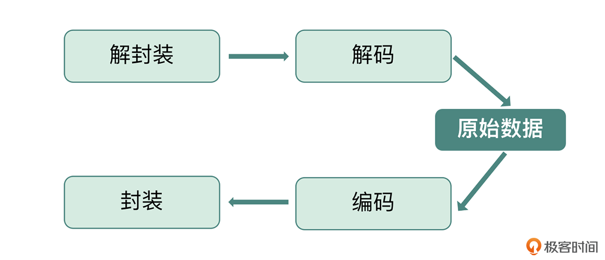
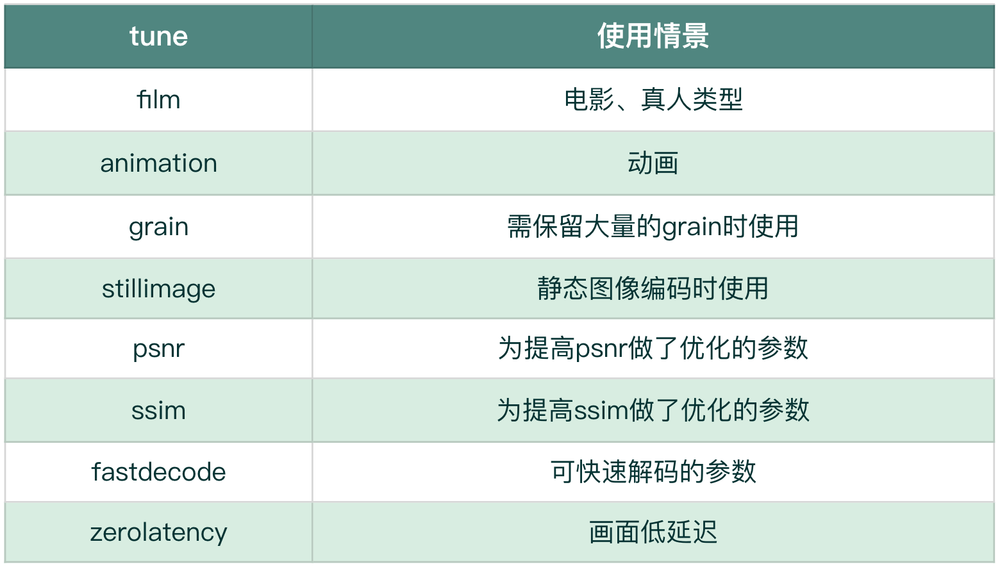
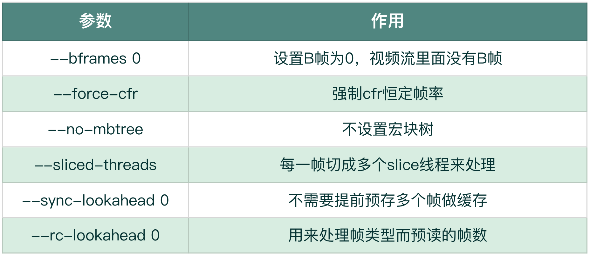
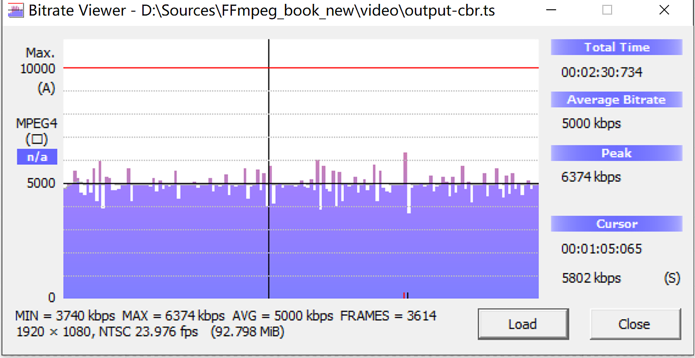
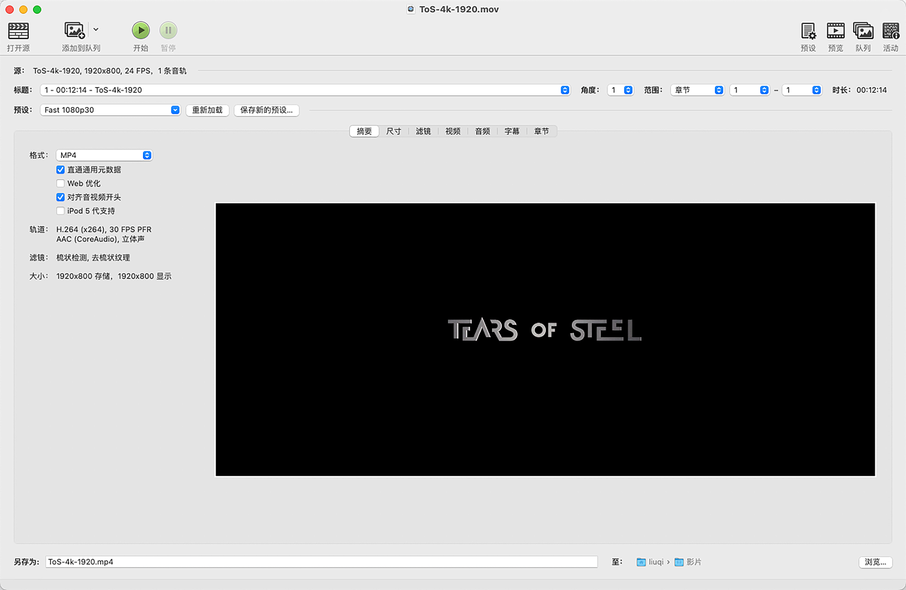
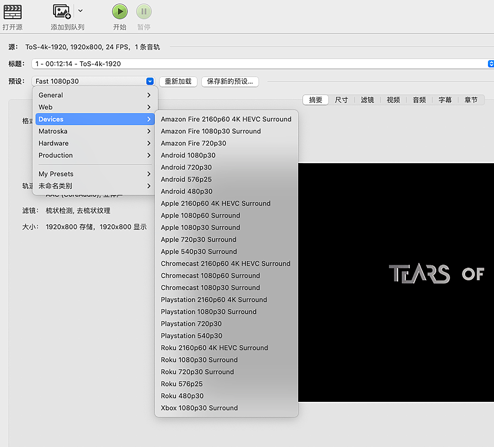
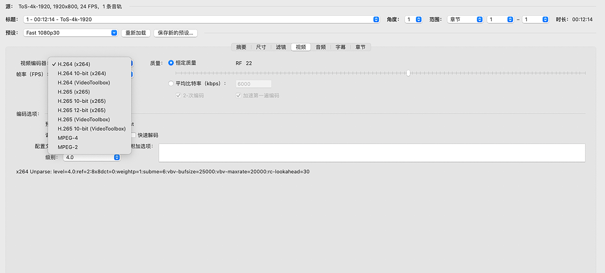
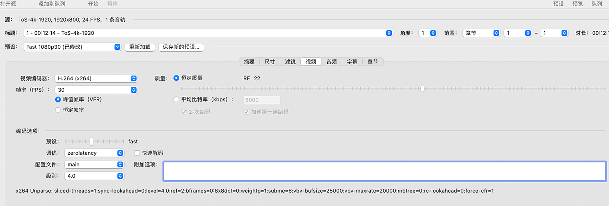
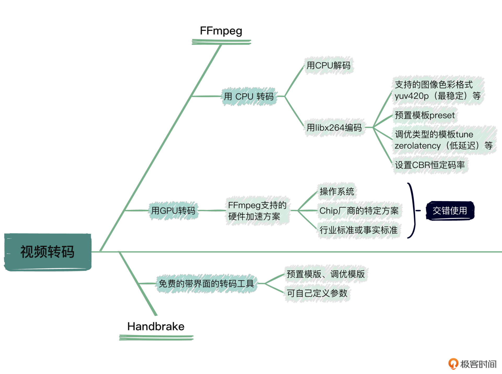

# 09 | 如何使用FFmpeg与Handbrake做转码？

你好，我是刘歧。

学到这里，不知道你有没有发现一个事情：从开始到现在，我们讲得最多的就是 FFmpeg 的命令行工具和参数，很少讲到界面操作。其实在做视频转码时，大多数人除了经常用 FFmpeg之外，还会用一些免费的带界面的转码工具，这节课我除了会教你如何使用 FFmpeg 转码之外，还会给你介绍一个非常好用的本地化转码工具 Handbrake。

## 如何使用 FFmpeg 转码？

在我们专栏开篇的基础部分，我给你讲过音视频相关的图像色彩、编解码、封装（Mux）与解封装（Demux）的基本原理。第 7 节课，我又给你讲了如何高效地使用 FFmpeg 帮助信息和文档。在前面这些内容的基础上，我们来学以致用，讲一讲怎么用 FFmpeg 转码。

首先我们需要确定我们在转码的时候输出文件的应用场景。假如你是希望传到快手这样的内容发布平台，那么我们是需要转换成平台要求的转码规格的。既然要转码，就需要先看一下自己电脑系统的环境是否支持这一操作，比如使用 CPU 做转码，电脑会不会变得很慢，如果电脑上有 GPU，使用 GPU 转码的话，CPU 理所当然地会空出来，这样就不会影响我们继续使用电脑做其他的事情了。

我们先来了解一下怎么使用 CPU 做转码。

### 用 CPU 转码

使用 CPU 转码的话，通常是用 CPU 解码，然后用 libx264、libx265、librav1e 之类的编码器编码，也叫软编码。当然也有人用 OpenH264 或者其他自己定制的编码器，因为编码参数大多数是与编码的参考标准对应的，通用的或者常见的编码参数在 libx264、libx265、librav1e里面相差无几，所以这里为了简洁一点，我使用 FFmpeg 与 libx264 来做软编码。我们先来回顾一下转码的基本操作流程。



首先是读取文件后解析文件，然后对文件进行解封装，也就是 demux。将解封装后的音视频流数据进行解码，得到原始数据，也就是我们第 1 节课讲的 YUV 数据或者 PCM 数据，然后用我们设置的目标编码对应的编码器进行编码，编码后的数据写入音频流或者视频流里，封装音频流或者视频流，写入文件里。

回顾完流程之后，我们用第 7 节课学到的知识查看一下我们能如何使用 libx264。首先看一下 libx264 在 FFmpeg 里面支持的参数。

使用命令行 ffmpeg -h encoder=libx264 查看一下参数内容。

```sql
Encoder libx264 [libx264 H.264 / AVC / MPEG-4 AVC / MPEG-4 part 10]:
   General capabilities: dr1 delay threads
   Threading capabilities: other
   Supported pixel formats: yuv420p yuvj420p yuv422p yuvj422p yuv444p yuvj444p n
libx264 AVOptions:
 -preset            <string>     E..V....... Set the encoding preset (cf. x264 -
 -tune              <string>     E..V....... Tune the encoding params (cf. x264
 -profile           <string>     E..V....... Set profile restrictions (cf. x264
 -fastfirstpass     <boolean>    E..V....... Use fast settings when encoding fir
 -level             <string>     E..V....... Specify level (as defined by Annex
 -passlogfile       <string>     E..V....... Filename for 2 pass stats
 -wpredp            <string>     E..V....... Weighted prediction for P-frames
 -a53cc             <boolean>    E..V....... Use A53 Closed Captions (if availab
 -x264opts          <string>     E..V....... x264 options
 -crf               <float>      E..V....... Select the quality for constant qua
 -crf_max           <float>      E..V....... In CRF mode, prevents VBV from lowe
 -qp                <int>        E..V....... Constant quantization parameter rat
 -aq-mode           <int>        E..V....... AQ method (from -1 to INT_MAX) (def
    none            0            E..V.......
    variance        1            E..V....... Variance AQ (complexity mask)
    autovariance    2            E..V....... Auto-variance AQ
    autovariance-biased 3            E..V....... Auto-variance AQ with bias to d
 -aq-strength       <float>      E..V....... AQ strength. Reduces blocking and b
 -psy               <boolean>    E..V....... Use psychovisual optimizations. (de
 -psy-rd            <string>     E..V....... Strength of psychovisual optimizati
 -rc-lookahead      <int>        E..V....... Number of frames to look ahead for
 -weightb           <boolean>    E..V....... Weighted prediction for B-frames. (
 -weightp           <int>        E..V....... Weighted prediction analysis method
    none            0            E..V.......
    simple          1            E..V.......
    smart           2            E..V.......
 -ssim              <boolean>    E..V....... Calculate and print SSIM stats. (de
 -intra-refresh     <boolean>    E..V....... Use Periodic Intra Refresh instead
 -bluray-compat     <boolean>    E..V....... Bluray compatibility workarounds. (
 -b-bias            <int>        E..V....... Influences how often B-frames are u
 -b-pyramid         <int>        E..V....... Keep some B-frames as references. (
    none            0            E..V.......
    strict          1            E..V....... Strictly hierarchical pyramid
    normal          2            E..V....... Non-strict (not Blu-ray compatible)
 -mixed-refs        <boolean>    E..V....... One reference per partition, as opp
 -8x8dct            <boolean>    E..V....... High profile 8x8 transform. (defaul
 -fast-pskip        <boolean>    E..V....... (default auto)
 -aud               <boolean>    E..V....... Use access unit delimiters. (defaul
 -mbtree            <boolean>    E..V....... Use macroblock tree ratecontrol. (d
 -deblock           <string>     E..V....... Loop filter parameters, in <alpha:b
 -cplxblur          <float>      E..V....... Reduce fluctuations in QP (before c
 -partitions        <string>     E..V....... A comma-separated list of partition
 -direct-pred       <int>        E..V....... Direct MV prediction mode (from -1
    none            0            E..V.......
    spatial         1            E..V.......
    temporal        2            E..V.......
    auto            3            E..V.......
 -slice-max-size    <int>        E..V....... Limit the size of each slice in byt
 -stats             <string>     E..V....... Filename for 2 pass stats
 -nal-hrd           <int>        E..V....... Signal HRD information (requires vb
    none            0            E..V.......
    vbr             1            E..V.......
    cbr             2            E..V.......
 -avcintra-class    <int>        E..V....... AVC-Intra class 50/100/200/300/480
 -me_method         <int>        E..V....... Set motion estimation method (from
    dia             0            E..V.......
    hex             1            E..V.......
    umh             2            E..V.......
    esa             3            E..V.......
    tesa            4            E..V.......
 -motion-est        <int>        E..V....... Set motion estimation method (from
    dia             0            E..V.......
    hex             1            E..V.......
    umh             2            E..V.......
    esa             3            E..V.......
    tesa            4            E..V.......
 -forced-idr        <boolean>    E..V....... If forcing keyframes, force them as
 -coder             <int>        E..V....... Coder type (from -1 to 1) (default
    default         -1           E..V.......
    cavlc           0            E..V.......
    cabac           1            E..V.......
    vlc             0            E..V.......
    ac              1            E..V.......
 -b_strategy        <int>        E..V....... Strategy to choose between I/P/B-fr
 -chromaoffset      <int>        E..V....... QP difference between chroma and lu
 -sc_threshold      <int>        E..V....... Scene change threshold (from INT_MI
 -noise_reduction   <int>        E..V....... Noise reduction (from INT_MIN to IN
 -udu_sei           <boolean>    E..V....... Use user data unregistered SEI if a
 -x264-params       <dictionary> E..V....... Override the x264 configuration usi
```

从帮助信息中可以看到，libx264 编码支持的图像色彩格式主要包括 yuv420p、yuvj420p、yuv422p、yuvj422p、yuv444p、yuvj444p、nv12、nv16、nv21、yuv420p10le、yuv422p10le、yuv444p10le、nv20le、gray、gray10le，我们通常统一编码成 yuv420p 即可。如果确定播放器可以支持 HDR 的话，也可以考虑用 yuv420p10le。但是如果想要在 Web浏览器上正常播放出来的话，yuv420p 是最稳定的格式。

为了解决设置编码参数时参数太多、太琐碎的问题，libx264 提供了预置模板 preset，在FFmpeg 里默认用的是 medium 模板，也就是平衡画质与编码速度的最优选择。除了medium，还可以按照帮助信息里面的提示，通过使用 x264 --fullhelp 查看 x264 的其他preset，例如还有 ultrafast、superfast、veryfast、faster、fast、slow、slower、veryslow、placebo。

除了 preset 模板，还有调优类型的模板 tune，包括 film、animation、grain、stillimage、psnr、ssim、fastdecode、zerolatency 等不同的模版。



不同的模板支持的参数也略有差别，比如视频编码想做画面延迟低的直播流的话，可以考虑设置 tune 为 zerolatency。因为 zerolatency 模板里已经包含了低延迟编码的参数。



其中宏块树是一种视频编码结构，在编码时它可以增加 slice 处理的层数，降低视频编码的码率，但是复杂度会略有提升，所以耗时也会增加一些。你可以结合极客时间上视频编码及帧内预测相关的课程来理解，这里我就不展开说了。

slice 的的意思是将一帧图像切成多个切片，然后将多个片放到多个线程里处理，从而达到并发处理的的目的。因为 lookahead 是 0，不需要提前预存多个帧做缓存，也没有双向参考帧 B帧，不需要预读多个帧做缓存，所以最大限度地降低了帧缓存引起的画面延迟。

除了以上两类模板，在给视频转码做转码的时候，有时也会被要求转成恒定码率的视频流，也就是我们常说的 CBR，这个 CBR 可以通过参数 nal-hrd cbr 来设置，但是实际的码率不一定能够控制得很好，所以通常会搭配 FFmpeg 的 maxrate、minrate 与 bufsize 来精确地控制码率，一般 bufsize 控制比 maxrate 小大概 1/3 ~ 1/2 即可，达到的效果如图所示：



如果使用当前 FFmpeg 里面的 libx264 参数无法达到要求，但用 x264 没问题的话，我们就可以通过 FFmpeg 预留的 x264opts 来设置更多 x264 的参数，例如设置 x264 为 OpenGOP 模式，就需要使用参数 -x264opts “open-gop=1”，来达到使用 OpenGOP 的编码模式的目的。

在同画质下，使用 OpenGOP 比 CloseGOP 码率更低一些，但是也可能会引入一些不稳定因素，例如视频切片的时候找不到关键帧，这一点需要我们注意。

说了这么多，接下来我们实际操练一下，使用 FFmpeg 命令行来做转码。

你先下载一个《大雄兔》或者《钢铁之泪》的电影，这两部电影是开放版权的，在互联网上能够搜到对应的视频文件，自己测试的时候可以随便用。先输入命令行：

```
ffmpeg -i ~/Movies/Test/ToS-4k-1920.mov -pix_fmt yuv420p -vcodec libx264 -nal-hrd
```

命令行执行后，输出的内容是这样的：

```
Input #0, mov,mp4,m4a,3gp,3g2,mj2, from '/Users/liuqi/Movies/Test/ToS-4k-1920.mov
 Metadata:
   major_brand     : qt
   minor_version   : 512
   compatible_brands: qt
   encoder         : Lavf54.29.104
 Duration: 00:12:14.17, start: 0.000000, bitrate: 8051 kb/s
 Stream #0:0[0x1](eng): Video: h264 (High) (avc1 / 0x31637661), yuv420p(progress
   Metadata:
     handler_name    : VideoHandler
     vendor_id       : FFMP
     encoder         : libx264
 Stream #0:1[0x2](eng): Audio: aac (LC) (mp4a / 0x6134706D), 44100 Hz, stereo, f
   Metadata:
     handler_name    : SoundHandler
     vendor_id       : [0][0][0][0]
Stream mapping:
 Stream #0:0 -> #0:0 (h264 (native) -> h264 (libx264))
 Stream #0:1 -> #0:1 (aac (native) -> mp2 (native))
Press [q] to stop, [?] for help
[libx264 @ 0x619000006480] CBR HRD requires constant bitrate
[libx264 @ 0x619000006480] using SAR=1/1
[libx264 @ 0x619000006480] using cpu capabilities: MMX2 SSE2Fast SSSE3 SSE4.2 AVX
[libx264 @ 0x619000006480] profile High, level 4.0, 4:2:0, 8-bit
Output #0, mpegts, to 'output.ts':
 Metadata:
   major_brand     : qt
   minor_version   : 512
   compatible_brands: qt
   encoder         : Lavf59.25.100
 Stream #0:0(eng): Video: h264, yuv420p(progressive), 1920x800 [SAR 1:1 DAR 12:5
   Metadata:
     handler_name    : VideoHandler
     vendor_id       : FFMP
     encoder         : Lavc59.33.100 libx264
   Side data:
     cpb: bitrate max/min/avg: 900000/0/0 buffer size: 300000 vbv_delay: N/A
 Stream #0:1(eng): Audio: mp2, 44100 Hz, stereo, s16, 384 kb/s (default)
   Metadata:
     handler_name    : SoundHandler
     vendor_id       : [0][0][0][0]
     encoder         : Lavc59.33.100 mp2
frame=  240 fps=0.0 q=39.0 Lsize=     778kB time=00:00:09.99 bitrate= 637.3kbits/
video:218kB audio:469kB subtitle:0kB other streams:0kB global headers:0kB muxing
[libx264 @ 0x619000006480] frame I:3     Avg QP:16.91  size: 16651
[libx264 @ 0x619000006480] frame P:237   Avg QP: 6.68  size:   733
[libx264 @ 0x619000006480] mb I  I16..4: 71.5% 23.2%  5.3%
[libx264 @ 0x619000006480] mb P  I16..4:  0.3%  0.7%  0.0%  P16..4:  2.3%  0.0%
[libx264 @ 0x619000006480] 8x8 transform intra:43.0% inter:46.2%
[libx264 @ 0x619000006480] coded y,uvDC,uvAC intra: 19.4% 18.2% 3.9% inter: 0.1%
[libx264 @ 0x619000006480] i16 v,h,dc,p: 60%  9% 24%  7%
[libx264 @ 0x619000006480] i8 v,h,dc,ddl,ddr,vr,hd,vl,hu: 12% 15% 27%  9%  6%  7%
[libx264 @ 0x619000006480] i4 v,h,dc,ddl,ddr,vr,hd,vl,hu: 20% 19% 29%  5%  5%  6%
[libx264 @ 0x619000006480] i8c dc,h,v,p: 78% 10% 10%  2%
[libx264 @ 0x619000006480] Weighted P-Frames: Y:1.3% UV:0.0%
[libx264 @ 0x619000006480] kb/s:178.99
```

从输出的内容中可以看到，编码的帧类型里只有 I 帧和 P 帧，设置的 CBR 模式已经生效，你也可以尝试把输入文件改成直播推流。

但是需要注意的是，设置视频编码流为 CloseGOP，关键帧间隔的 -g 设置成 fps 的一半即可，fps 需要使用参数 -r:v 来设置，例如设置 -r:v 为 30，就是 30 fps，那么 -g 可以设置为15，也就是每隔 15 帧会有一个关键帧，这样可以达到 0.5 秒钟一个关键帧。当然，实际上这么做会很浪费带宽，常规的秀场直播设置 2~5 秒钟一个关键帧就可以了。

如果我们平时用 CPU 转码的话，对 CPU 的消耗会比较高，转码的时候电脑做其他事情会比较慢，一般电脑上有 GPU 的话直接选择用 GPU 转码，这样可以节省一些 CPU 计算资源。

### 用 GPU 转码

用 GPU 转码之前，你需要先确认一下自己当前电脑里的 GPU 是否可以做转码，然后安装对应的音视频编解码环境（GPU 相关的驱动、软件、开发库等）。

FFmpeg 支持的硬件加速方案，按照各 OS 厂商、Chip 厂商特定方案，还有行业联盟定义的标准来分的话，大致可以分成 3 类：

- 操作系统：包括 Windows、Linux、macOS /iOS、Android 等。

- Chip 厂商的特定方案：包括 Intel、AMD、Nvidia 等。

- 行业标准或事实标准：包括 OpenMAX 和 OpenCL、Vulkan、OpenGL 还有 cuda 等。

这只是一个粗略的分类，很多时候，这几者之间纵横交错，联系密切，之间的关系并非像列出的这般泾渭分明。

下面就是 Windows 环境下，在 AMD、Intel、Nvidia 的 GPU 上用 dxva2 和 d3d11va 来解码，再使用厂商提供的编码器编码的例子。

1. AMD AMF

```
ffmpeg -hwaccel dxva2 -hwaccel_output_format dxva2_vld -i <video> -c:v h264_amf -
ffmpeg -hwaccel d3d11va -hwaccel_output_format d3d11 -i <video> -c:v h264_amf -b:
```

2. Intel QSV

```
ffmpeg -hwaccel dxva2 -hwaccel_output_format dxva2_vld -i <video> -c:v h264_qsv -
ffmpeg -hwaccel d3d11va -hwaccel_output_format d3d11 -i <video> -c:v h264_qsv -vf
```

3. Nvidia NVENC

```
ffmpeg -hwaccel d3d11va -hwaccel_output_format d3d11 -i <video> -c:v h264_nvenc -
```

比如我自己本机是苹果电脑，那么我使用 videotoolbox 做转码就可以。

```
./ffmpeg -vcodec h264_vda -i input.mp4 -vcodec h264_videotoolbox -b:v 2000k outpu
```

更多 GPU 转码或音视频滤镜处理相关的操作，你可以通过 GPU 对应的开发者官方网站了解，当然，FFmpeg 也提供了一些快速上手的操作手册，你也可以作为参考。

讲到这里，我们一直在用命令做转码，还要记好多参数，有没有一种更简单的方式来实现转码呢？当然有，接下来我们看一下带界面的转码工具——Handbrake。

## 使用 Handbrake 转码

我们打开 Handbrake 之后，先选择一个我们想要转码的视频文件，然后就会顺利打开Handbrake 的界面。



设置基础能力部分有很多预置模板，点“预设”的话，我们可以把参数调整为适配最终输出的格式。



不用预设的参数也可以自己定义，例如自己定制输出尺寸、滤镜以及视频编码参数，也有对应的使用 FFmpeg 做转码时相关参数的设置项。



如果选择使用 x264 编码的话，也有预设模板和调优模板。



由于是界面操作并且已经汉化，所以比较容易上手，你可以自己下载一个试试看，Handbrake设置还有更多黑科技，你可以在使用过程中慢慢挖掘。

## 小结

最后，我们总结一下这节课的内容吧！



给视频做转码时，我们最常用的工具就是 FFmpeg，使用 FFmpeg 转码的时候，我们既可以选择使用软编码做转码，也可以使用硬编码做转码。

具体使用哪一种需要你根据自己的使用场景来决定，如果是 CPU 特别富裕的话，使用软编码是一个不错的选择。因为软编码对画质相关调优的参数自主可控性更高一些，硬编码因硬件设计比较固定，所以有些时候画质调优方面比较受限，例如对不同视频应用场景的高清低码率相关的调优，使用硬转码效果会比软转码差一些。同时因可控性受限，硬转码的码率普遍会比软转码的视频码率高。

除了使用 FFmpeg 来做软硬转码之外，我们还可以借助 Handbrake 这个界面工具，里面的参数设置我们可以使用它给出的模版，也可以自己根据需要去定义。

## 思考题

结合前面讲过的知识，你可以自己分析一下 x264 的编码参数，按照这样的参数输出视频编码。

1. 每秒钟 30fps 的 720p 的视频。

2. 2 秒钟一个关键帧（GOP）。

3. 每两个 P 帧（包括 I 帧）之间两个 B 帧。

欢迎在评论区留下你的答案，也欢迎你把这节课分享给需要的朋友。我们下节课再见！
