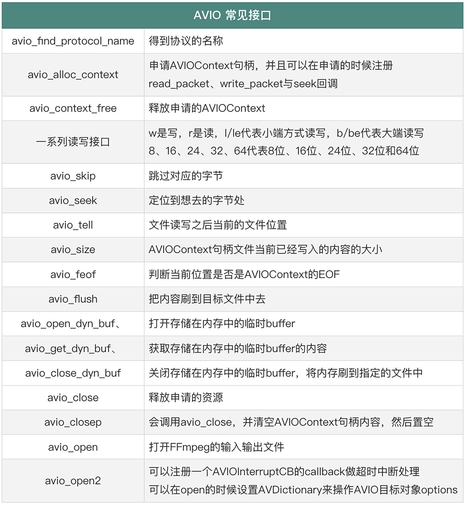
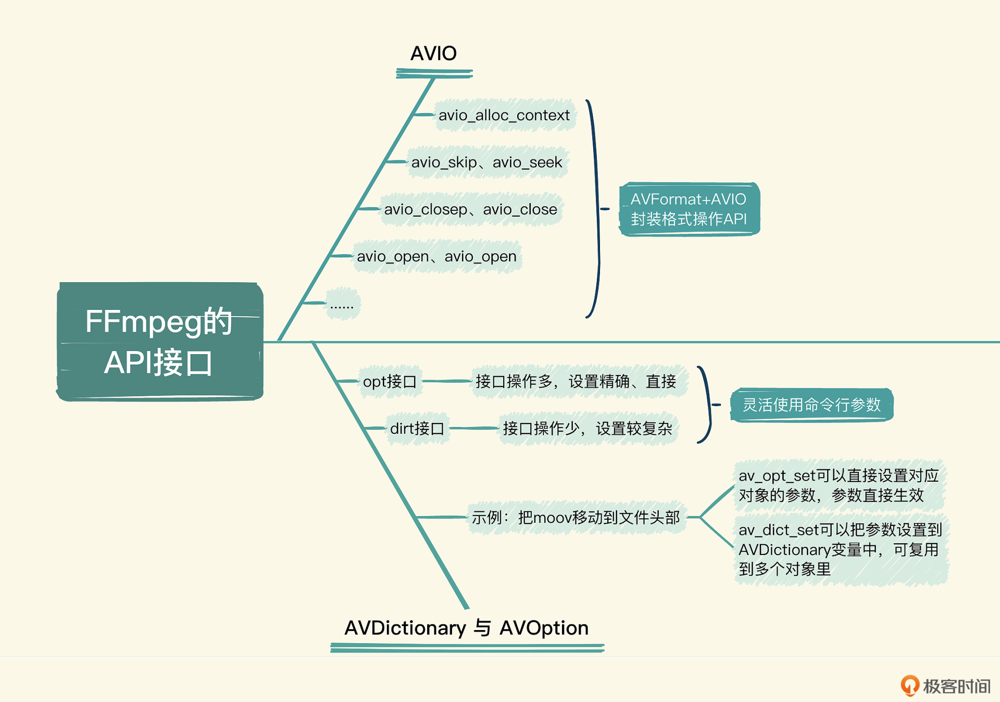

# 11-FFmpeg基础模块（二）：AVIO、AVDictionary与AVOption

你好，我是刘歧。

上一节课我们了解了 AVFormat 中的 API 接口的功能，从实际操作经验看，这些接口是可以满足大多数音视频的 mux 与 demux，或者说 remux 场景的。但是除此之外，在日常使用API 开发应用的时候，我们还会遇到需要从自己定义的内存或文件中读写数据，然后套用在AVFormat 中的场景。遇到这种场景的时候我们应该怎么办呢？使用 AVIO 就可以做到。

## AVIO

我们先来认识一下 AVIO。AVIO 部分常见的接口看上去比较多，主要是为了方便读、写内容时做一些字节对齐与大小端定义的操作，了解了它内在的结构之后，你就会觉得清晰多了。下面我们来一一讲解一下。

当你想知道一个 URL 字符串是什么协议的时候，通过 avio_find_protocol_name 接口就能得到协议的名称，例如 http、rtmp、rtsp 等。

```javascript
const char *avio_find_protocol_name(const char *url);
```

avio_alloc_context 接口主要用来申请 AVIOContext 句柄，并且可以在申请的时候注册read_packet、write_packet 与 seek 回调，然后可以将 AVIOContext 句柄挂载到AVFormatContext 的 pb 上面。挂载完成后，在操作 AVFormatContext 的 read_packet、write_packet、seek 的时候，会调用这里注册过的回调接口，注册的时候如果把回调接口设置成 NULL（空），就会使用 AVIOContext 子模块默认的流程。这里申请的 AVIOContext 可以通过 avio_context_free 来释放。

```
AVIOContext *avio_alloc_context(
                 unsigned char *buffer,
                 int buffer_size,
                 int write_flag,
                 void *opaque,
                 int (*read_packet)(void *opaque, uint8_t *buf, int buf_size),
                 int (*write_packet)(void *opaque, uint8_t *buf, int buf_size),
                 int64_t (*seek)(void *opaque, int64_t offset, int whence));
void avio_context_free(AVIOContext **s);
```

下面这一系列的读写接口，从名字就可以看出来，其中 w 是写，r 是读，l 或者 le 代表小端方式读写，b 或者 be 代表大端读写，8 代表 8 位，16 代表 16 位，24、32、64 分别代表 24位、32 位和 64 位。至于是大端读写还是小端读写，你可以根据实际的参考标准的要求进行操作。然后是字符串操作，这个部分也可以区分大小端的读写。

```javascript
void avio_w8(AVIOContext *s, int b);
void avio_write(AVIOContext *s, const unsigned char *buf, int size);
void avio_wl64(AVIOContext *s, uint64_t val);
void avio_wb64(AVIOContext *s, uint64_t val);
void avio_wl32(AVIOContext *s, unsigned int val);
void avio_wb32(AVIOContext *s, unsigned int val);
void avio_wl24(AVIOContext *s, unsigned int val);
void avio_wb24(AVIOContext *s, unsigned int val);
void avio_wl16(AVIOContext *s, unsigned int val);
void avio_wb16(AVIOContext *s, unsigned int val);
int avio_put_str(AVIOContext *s, const char *str);
int avio_put_str16le(AVIOContext *s, const char *str);
int avio_put_str16be(AVIOContext *s, const char *str);
int avio_read(AVIOContext *s, unsigned char *buf, int size);
int avio_read_partial(AVIOContext *s, unsigned char *buf, int size);
int          avio_r8  (AVIOContext *s);
unsigned int avio_rl16(AVIOContext *s);
unsigned int avio_rl24(AVIOContext *s);
unsigned int avio_rl32(AVIOContext *s);
uint64_t     avio_rl64(AVIOContext *s);
unsigned int avio_rb16(AVIOContext *s);
unsigned int avio_rb24(AVIOContext *s);
unsigned int avio_rb32(AVIOContext *s);
uint64_t     avio_rb64(AVIOContext *s);
int avio_get_str(AVIOContext *pb, int maxlen, char *buf, int buflen);
int avio_get_str16le(AVIOContext *pb, int maxlen, char *buf, int buflen);
int avio_get_str16be(AVIOContext *pb, int maxlen, char *buf, int buflen);
```

当解析部分封装格式的时候，有一些字段暂时不用或者不需要解析，就可以使用 avio_skip、avio_seek 来跳过对应的字节，或者通过 avio_seek 定位到想去的字节处，如果想要知道文件读写之后当前的文件位置，可以通过 avio_tell 来获得。

```
int64_t avio_seek(AVIOContext *s, int64_t offset, int whence);
int64_t avio_skip(AVIOContext *s, int64_t offset);
static av_always_inline int64_t avio_tell(AVIOContext *s)
```

AVIOContext 句柄文件当前已经写入的内容的大小，可以通过 avio_size 来获得。

```
int64_t avio_size(AVIOContext *s);
```

通过 avio_feof 可以判断当前位置是否是 AVIOContext 的 EOF（文件末尾）。

```
int avio_feof(AVIOContext *s);
```

如果在操作 AVIOContext 写内容的时候内存不断增长，可以尝试用 avio_flush 把内容刷到目标文件中去。

```
void avio_flush(AVIOContext *s);
```

当写入文件需要先临时放在内存中，最后按照自己的计划将内容刷到文件中的话，可以考虑使用 avio_open_dyn_buf、avio_get_dyn_buf、avio_close_dyn_buf 来操作。

```
int avio_open_dyn_buf(AVIOContext **s);
int avio_get_dyn_buf(AVIOContext *s, uint8_t **pbuffer);
int avio_close_dyn_buf(AVIOContext *s, uint8_t **pbuffer);
```

比如操作 HLS 直播流的时候，考虑到 fragment mp4 文件的特殊性，我希望先把文件内容写入到内存中，确保写入的数据拿到音视频包完整的流信息数据，然后生成 HLS 列表时能够写入准确的流信息内容，我会调用 avio_open_dyn_buf、avio_get_dyn_buf、avio_close_dyn_buf 来解决问题。

再比如生成 fragment mp4 的 HLS 时，需要有一个 fragment mp4 的 init 头内容，这个 init 头部内容，通常可以用 avio_open_dyn_buf、avio_get_dyn_buf、avio_close_dyn_buf 来做临时缓存，并且定时刷新到 init 头中。

avio_close 与 avio_closep 几乎相同，用来释放申请的资源，但是在 avio_closep 里会调用avio_close，并清空 AVIOContext 句柄内容，然后置空。这样可以确保 AVIOContext 的操作安全，不会出现 use-after-free 的问题，所以有时候用 avio_closep 会更安全一些。

```
int avio_close(AVIOContext *s);
int avio_closep(AVIOContext **s);
```

avio_open 和 avio_open2 都是用来打开 FFmpeg 的输入输出文件的，它们之间的差别是avio_open2 可以注册一个 AVIOInterruptCB 的 callback 做超时中断处理，而且可以在 open的时候设置 AVDictionary 来操作 AVIO 目标对象的 options。

```javascript
int avio_open(AVIOContext **s, const char *url, int flags);
int avio_open2(AVIOContext **s, const char *url, int flags, const AVIOInterruptCB
```



学完 AVIO 部分接口的用途和操作方式，就补齐了封装格式操作 API 方面的拼图。这是我们成为 FFmpeg API 用户的第一步。但你不要因此觉得成为 API 用户就可以不用 FFmpeg 的命令行了。

其实无论是 FFmpeg 的命令行还是各种 API 接口，都可以为我们所用，它们之间并不是割裂的。FFmpeg 提供的命令行支持很多参数，这些参数不单单是提供给命令行用户的，API 用户也可以使用。那具体 API 用户应该怎么去使用这些参数呢？

我们可以通过 AVDictionary 或者 AVOption 来设置参数，这两个 API 系列主要用来设置操作目标的 format、codec、protocol 的参数，最终达到与命令行使用参数一样的效果。因为AVDictionary 和 AVOption 都是基础操作接口，之后我们学习的操作接口都会涉及参数设置，所以今天我们也详细地了解一下 opt 和 dict 的操作方法。

## AVDictionary 与 AVOption

在使用 FFmpeg 命令行做封装、解封装、编解码、网络传输的时候，都会用到一些参数，比如我们录制 MP4 的时候，希望在录制完成之后把 moov 移动到文件头部，就需要添加一个参数‐movflags faststart。那么在使用 FFmpeg 的 SDK 时，就需要使用 dict 或 opt 的操作方式，来将参数传给 FFmpeg 内部 MP4 的 muxer 模块。

同样是把 moov 移动到文件头部，使用 dict 和使用 opt 有什么区别呢？下面我用两个例子来说明这个问题。

1. 通过 opt 操作设置参数

```
AVFormatContext *oc;
avformat_alloc_output_context2(&oc, NULL, NULL, "out.mp4");
av_opt_set(oc‐>priv_data, "movflags", "faststart", 0); /* 直接设置容器对象的参数 */
avformat_write_header(oc, NULL);
av_interleaved_write_frame(oc, pkt);
av_write_trailer(oc);
```

2. 通过 dict 操作设置参数。

```
AVFormatContext *oc;
AVDictionary *opt = NULL; /* 先定义一个AVDictionary变量 */
avformat_alloc_output_context2(&oc, NULL, NULL, "out.mp4");
av_dict_set(&opt, "movflags", "faststart", 0); /* 将参数设置到AVDictionary变量中 */
avformat_write_header(oc, &opt); /* 打开文件时传AVDictionary参数 */
av_dict_free(&opt); /* 使用完AVDictionary参数后立即释放以防止内存泄露 */
av_interleaved_write_frame(oc, pkt);
av_write_trailer(oc);
```

这两种操作方式都可以将 moov 容器移动到 MP4 文件的头部，我们从操作的代码中看到，av_opt_set 可以直接设置对应对象的参数，这样使用的话能够直接让设置的参数生效。而av_dict_set 可以把参数设置到 AVDictionary 变量中，放到 AVDictionary 里之后，可以复用到多个对象里，但是设置起来会稍微麻烦一些。二者各有优势，你可以通过个人的使用习惯而定。

除了 av_opt_set 与 av_dict_set 之外，opt 与 dict 还有很多的操作接口可以使用，我们可以通过列表来了解一下。

1. opt 接口列表

```
av_opt_set_int 只接受整数
av_opt_set_double 只接受浮点数
av_opt_set_q 只接受分子与分母，例如{1, 25}这样
av_opt_set_bin 只接受二进制数据
av_opt_set_image_size 只接受图像宽与高，例如1920，1080这样
av_opt_set_video_rate 只接受分子与分母，例如{1, 25}这样
av_opt_set_pixel_fmt 只接受枚举类型，例如AV_PIX_FMT_YUV420P
av_opt_set_sample_fmt 只接受采样数据格式枚举类型，例如AV_SAMPLE_FMT_S16
av_opt_set_channel_layout 只接受音频通道布局枚举类型，例如AV_CHANNEL_LAYOUT_5POINT0
av_opt_set_dict_val 接受AVDictionary类型，例如设置metadata时候可以使用
av_opt_set_chlayout 只接受音频通道布局枚举类型，例如AV_CHANNEL_LAYOUT_5POINT0
av_opt_set_defaults 设置对象的默认值，例如hlsenc有自己对应的操作选项的默认值，全部设置对应的
av_opt_set_defaults2 设置对象的默认值，例如hlsenc有自己对应的操作选项的默认值，全部设置对应的
av_opt_set_from_string 解析key=value格式的字符串并设置对应的参数与值
av_opt_next 获得opt操作的对象的下一个参数
av_opt_get_int 获得对象参数的值为整数
av_opt_get_double 获得对象参数的值为双精度浮点数
av_opt_get_q 获得对象参数为分子分母数，例如{1, 25}这样
av_opt_get_image_size 获得图像的宽和高，例如1920，1080这样
av_opt_get_video_rate 获得视频的帧率，例如{1, 25}这样
av_opt_get_pixel_fmt 获得视频的像素点格式枚举类型，例如AV_PIX_FMT_YUV420P
av_opt_get_sample_fmt 获得音频的采样格式枚举类型，例如AV_SAMPLE_FMT_S16
av_opt_get_channel_layout 获得音频的采样布局枚举类型，例如AV_CHANNEL_LAYOUT_5POINT0
av_opt_get_dict_val 获得AVDictionary类型，通常是key-value方式
av_opt_get_key_value 获得key=value类型
```

使用 opt 中的这些接口进行操作时，可以精确地设置到参数值的类型，直接操作对象，比如某个封装格式模块、某个编解码模块，非常方便。

2. dirt 接口列表

```
av_dict_count 获得dict参数的数量整数
av_dict_parse_string 一次性解析多组key=value格式的字符串为dict
av_dict_free 释放因设置dict申请的内存空间
av_dict_copy 复制dict参数与值
av_dict_get_string 获得dict的参数值为字符串，用key=value格式字符串获得到value
av_dict_set_int 设置dict参数的值为整数
```

和 opt 相比，dict 的操作接口比较少，给人感觉比较简单。但是注意，使用 dict 这些接口操作对象后，通常只是设置了 AVDictionary，并没有真正地设置具体对象。如果想让设置的参数生效，还需要在做封装格式 open 或编解码器 open 的时候，设置 AVDictionary，并且需要仔细斟酌内存使用情况，通常需要自己调用 av_dict_free 做内存释放。

在日常使用 API 进行开发的时候，你可以使用 opt 与 dict 相关的接口，高效地设置对应的参数。当然想要获得这项能力，还需要你勤加练习。

## 小结



关于封装格式的 API，除了上节课我们学习的 AVFormat 模块之外，还有 AVIO，它主要应用于在内存中直接操作数据的场景中。

AVIO 中包含很多常用的接口，比如用来查看协议名称的 avio_find_protocol_name 接口、用来申请 AVIOContext 句柄的 avio_alloc_context 接口，还有一系列的读写接口等。AVIO 操作接口和我们标准文件的操作接口基本相似，可以在申请之后与 FFmpeg 的 AVFormatContext的 pb 挂载，这样方便进入 FFmpeg 的 AVFormat 操作的内部流程。

除此之外，我们也应该合理利用 FFmpeg 命令行支持的参数，学会使用 opt 与 dict 相关的API 操作，灵活调用 FFmpeg 命令行支持的参数，为我们使用 API 开发应用提供更强大的能力。

## 思考题

最后，我们来思考一个问题，在 AVFormat 模块中可以看到频繁出现的一个参数 AVPacket，这个 AVPacket 属于 AVFormat 还是 AVCodec 呢？ 欢迎你在评论区留下你的答案，也欢迎你把这节课分享给感兴趣的朋友，我们下节课再见！
