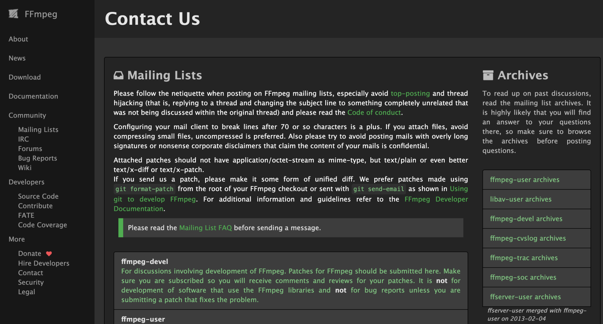
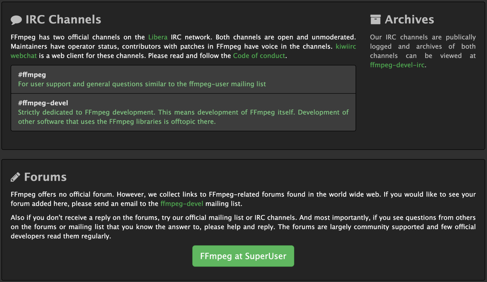
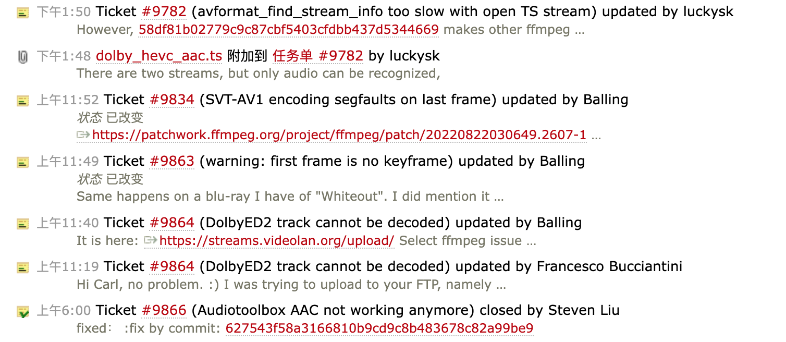
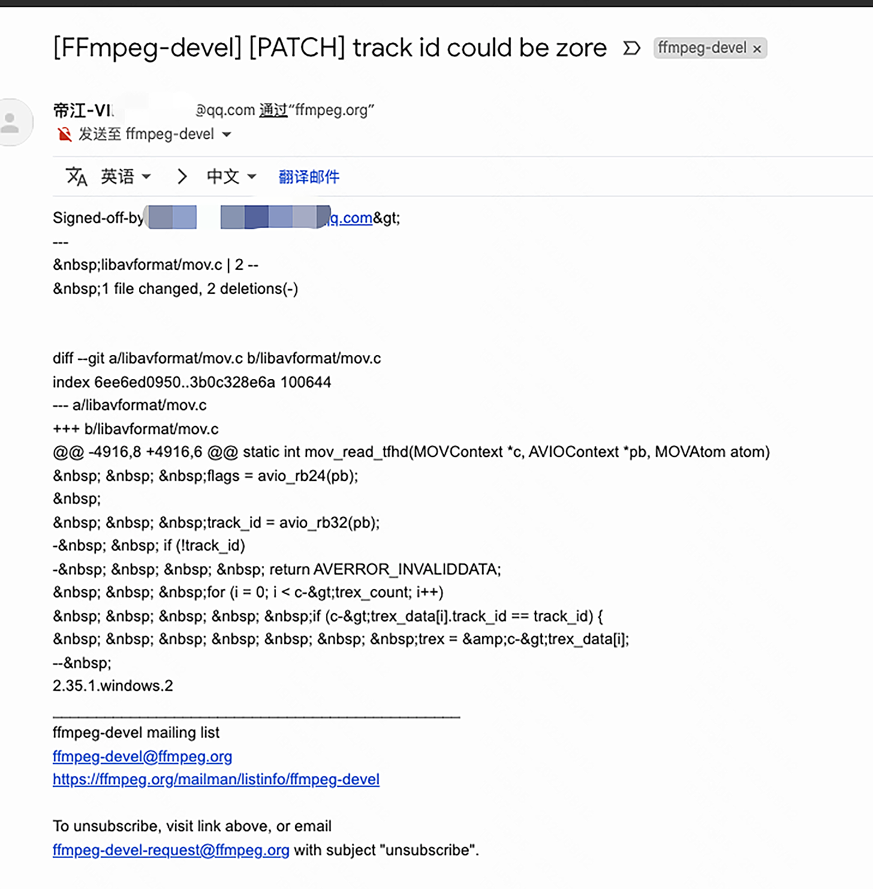
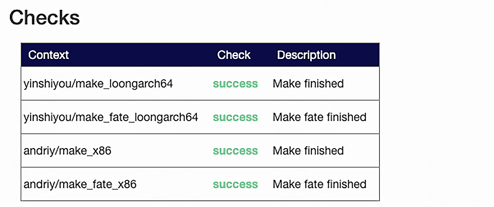
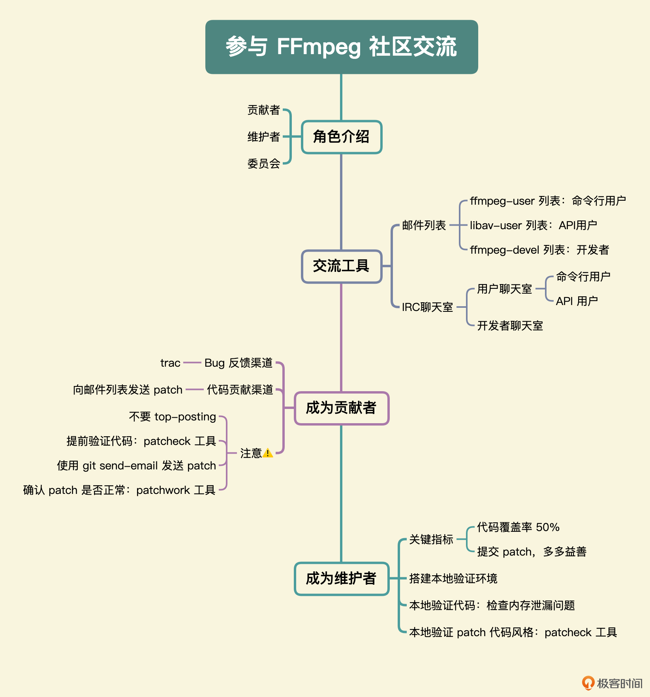

# 15 | 如何参与到FFmpeg社区交流中？

你好，我是刘歧。

我们在日常生活中经常会使用 FFmpeg 做一些音视频开发工作，但如果你在使用的过程中发现了一些自己解决不了的问题，你会怎么处理呢？

忽略问题或者想办法绕过去并不是一个好的选择，其实我们是可以通过参与 FFmpeg 社区的交流，来解决这些问题的。社区里有来自世界各地的专业能力很强的人，通过和他们交流，不仅可以解决工作中遇到的问题，还能够从交流中发现很多 FFmpeg 黑科技，拓宽自己的视野。

## 角色介绍

在交流过程中，我们会看到社区中主要有这么几类人。

- 贡献者（contributor）：主要指给开源项目贡献代码或文档的人，还有参与 code review 并且 review 意见被采纳的人。

- 维护者（maintainer）：主要指对代码或文档有提交和维护责任的人。

- 委员会（committee）：主要指负责社区日常运作、流程管理这一类工作的人。

我们可以通过把代码提供给 FFmpeg 的方式成为代码贡献者，让全世界更多的音视频流媒体开发者和 FFmpeg 使用者用上我们的代码，放大我们个人的价值。如果你不知道该如何在音视频领域闯出一片天地，那么成为 FFmpeg 社区的开发者可能是一条不错的路。

那具体我们应该怎么参与到开发中呢？首先我们需要了解社区交流使用的工具。

## 交流的工具

参与 FFmpeg 开源社区交流，比较通用的沟通方式不是 QQ、微信这一类社交软件。那用什么呢？其实说起来可能你会觉得比较落后，FFmpeg 开源社区主要是通过邮件列表和 IRC 聊天室沟通。IRC 聊天室比较即时，但是整体不如用邮件列表通用，因为邮件列表可以收发邮件，是最基础的通信工具，也是开发者人群覆盖面最全的工具，因为没有电子邮箱的开发者几乎为0。

### 邮件列表

通过 FFmpeg 官方网站邮件列表页我们可以看到，虽然命令行用户和 API 用户对 FFmpeg来说都是用户，但是咨询问题用的邮件列表不一样。命令行用户是在 ffmpeg-user 列表里交流，API 用户是在 libav-user 列表里交流，FFmpeg 的开发者是在 ffmpeg-devel 列表里面交流。



这几个列表的特点比较明显，在 libav-user 列表里问问题、交流，几乎没什么人回复，主要是因为 API 用户自己业务场景或自己使用的方式出现了一些问题，别人也不太愿意看你的代码，所以自己挖的坑还是需要自己仔细研究怎么填。

ffmpeg-devel 列表里，主要是以 Patch 为沟通的基础，在这里面提需求几乎没人理，反馈Bug 也没人理，但是你修改了 FFmpeg 内部的代码的话，做成 patch 发到这个列表里，获得回应的概率会高一些。

ffmpeg-user 里比较热闹，主要是命令行遇到问题，有些参数执行的效果有问题等。这个邮件列表里的用户比较多，相比另外两个，收到回复的概率更大。但是需要注意一点，不要“top-posting”，这是 FFmpeg 社区邮件列表里面沟通最基本的规则。“top-posting”是什么意思呢？就是在回复邮件的时候不要在邮件内容的最上面回复，推荐的做法是想要回复哪一句就在哪一句的下面新起一行回复。

如果对整个邮件都存在不同意见的话，可以在邮件的最下方回复，这么做除了能让大家看得更清晰之外，也方便归档。邮件列表是有每日归档的，归档时有统一的格式要求。所有的记录在归档列表里面都能找到。邮件列表的使用方法比较简单，先使用邮箱注册到邮件列表，然后在自己邮箱里确认注册成功就可以了。

正常参与社区交流的话，注册一个邮箱到邮件列表里还是有必要的，毕竟后面如果发 patch 到邮件列表的话，还是需要先注册邮箱才可以，否则 patch 发不出去。

### IRC



FFmpeg 项目沟通除了邮件列表之外，还可以通过 IRC 即时聊天室沟通，只不过即时聊天室里的人比邮件列表里面的人少很多。

聊天室主要是分为用户聊天室和开发者聊天室，用户主要是命令行用户和 API 用户，开发者是指 FFmpeg 内部代码开发者。用户聊天室人会多一些，活跃度高一些，开发者聊天室用户少，所以活跃度没有那么高，并且大多是关于开发内容的临时性沟通，主要沟通还是在邮件列表里面，所以通常大家不怎么用 IRC 交流，除非特别着急的时候。如果你有兴趣的话，可以看一下IRC 相关的参考链接。

如果想要在 FFmpeg 项目中和大家沟通，需要先学会使用这两种交流工具。这是成为contributor 的第一步，除了用工具进行日常的交流之外，成为 contributor 还需要给 FFmpeg反馈 Bug、贡献代码。接下来我们一起看一下 FFmpeg 反馈 Bug 和贡献代码的渠道。

## Bug 反馈渠道



FFmpeg 的维护不是在 GitHub 上面，所以 Bug 反馈在 GitHub 上面找不到 issue，FFmpeg是通过trac来管理 Bug 的。Bug 也分很多种，有需求类 Bug，也有阻塞型 Bug。提 Bug 的格式也需要注意，主要是需要说清楚自己的环境、FFmpeg 的版本和使用的参数，把 FFmpeg执行命令的那一行到结束的所有的内容都贴到 Bug 说明里，不需要自己做内容剪切。不然，开发者们可能无法理解你的 Bug 诉求。

自己提了 Bug 以后，不一定能够及时得到解决。如果我们自己分析并解决了 Bug，再把代码回馈给 FFmpeg 的话，是个参与 FFmpeg 开发不错的路径，而且还会降低使用风险。为什么我会这么说呢？因为 FFmpeg 是 LGPL 的 License，如果不反馈修改过的代码的话，可能会涉及开源使用合规相关的法务问题，尽管 FFmpeg 目前不太追究法律问题了，但是还是要考虑一下合规性的。

## 代码贡献渠道

当前，给 FFmpeg 贡献代码采用的是向邮件列表发送 patch 的方式，发送 patch 到邮件列表后，邮件列表里面的开发者和维护者们会通过回邮件的方式做 codec review，可能会提一些comments，他们做 code review 的时候，也是在邮件内容中对自己有意见的那一行或者那一部分做出回复，不会 top-posting。

而 patch 是需要通过 git format-patch 来生成的，在发送 patch 之前，你需要自己验证一下代码格式是否符合标准，还记得第 10 节课我们 git clone 过 FFmpeg 的源代码吗？在源代码目录的 tools 目录下有一个patcheck，它可以辅助你检查代码是否符合 FFmpeg 的基本标准，在修改完代码之后，自己本地需要做一下 FFmpeg 自测，操作步骤如下：

1. make fate-rsync SAMPLES=fate-suite/

2. make fate SAMPLES=fate-suite/

也可以在做 configure 编译配置的时候指定 fate 测试样本。

```
./configure --samples=fate-suite/
make fate-rsync
make fate
```

在配置（configure）的时候，添加一个–samples=fate-suite 来指定测试样本下载的目录。

在 make fate 通过以后，才能确保修改的代码对原有的 FFmpeg 代码和能力没有太大的影响。如果 make fate 不通过的话，说明代码修改得还是不够好，会影响一些我们没有看到的逻辑。

发送 patch 到邮件列表的时候，我推荐你使用 git send-email 的方式来发送，这样可以按照标准格式将 patch 发送到邮件列表，如果打开文本复制粘贴到邮件里面的话，很容易出现乱码，下面这个人的操作就是错误的。



这个 patch 发送得比较失败，内容乱码，不但复制粘贴了 patch 内容，还用的是富文本格式。patch 本身是纯文本格式，富文本格式会出现乱码。虽然我们的语言环境是中文，但是FFmpeg 项目是国际项目，所以全球哪里的人都有。试想一下如果人家发德文、法文、阿拉伯文、泰文、蒙文给我们，我们是否能看懂呢？所以把中文发给他们也是一样的道理。

而 FFmpeg 的邮件列表和其他工具基本上是联动的，如果我们发一个 patch 想确认是否正常的话，FFmpeg 还提供了个patchwork 工具，在 patchwork 里也可以看到你的 patch 是否正常。因为 FFmpeg 支持的平台比较多，包括我们的龙芯，所以平台兼容性也在考虑范围之内。



当然，我们在修改完代码以后，做 git commit 的时候提交信息需要尽量全面地描述修改的原因、你的思考以及背后的逻辑，这样别人才能知道你为什么这样修改代码。

上面我说的这些 FFmpeg 开发者的规则，说难其实也不难，只要你平时保持良好的代码开发习惯，这些应该都不是问题。

按照正确的规则给 FFmpeg 贡献代码、提交 patch 之后，我们就有了成为贡献者的资格，如果你想顺着这条路径继续往前走，最后就是成为 FFmpeg 的维护者，但成为维护者的难度要比贡献者大得多。

## 成为维护者

要想成为维护者的话，首先需要达到几个关键的指标。

1. 代码覆盖量达到一定的标准，就拿某个模块来说，如果这个模块代码有 5000 行，其中有超过 50% 的代码是你写的，那么你就有机会成为这个模块的维护者。

2. 在 FFmpeg 做 Bugfix 的 patch、完善功能的 patch 以及性能优化的 patch，达到一定数量以后，你就可以尝试申请成为 FFmpeg 的维护者。数量没有一个明确的量化值，但多多益善，你越活跃，邮件列表里的人们就会对你越熟悉，成为维护者之路才会越顺利。

### 搭建本地验证环境

当有人发 patch 到邮件列表里面的时候，patchwork 会自动将 patch 放到自己的队列里面。如果想要成为维护者，可以考虑自己在本地搭建一个环境，从 patchwork 队列里将自己维护的模块或相关的 patch 自动下载到本地的，合并到自己本地的代码库里自动地 make fate。

如果你希望成为维护者，patch 的兼容性就是一个必要条件，所以在本地构建自动化回测的各个系统环境是必不可少的，一些基本的可自动化验证的环境也是必不可少的。你可以参考以下几个环境。

1. 通过用 QEMU 模拟 MIPS+Linux 的环境。

```
../configure --target-exec='.../qemu-mips -cpu 74Kf -L/usr/mips-linux-gnu/' --sam
```

2. 通过 WINE 模拟 windows 环境。

```
../configure  --cc='ccache i686-w64-mingw32-gcc'  --samples=... --arch=x86 --targ
```

3. X86 Linux 环境

4. X86 MacOS 环境

5. M1 MacOS 环境

这些环境都 make fate 通过以后，相当于完成自动化 review 的第一步。

### 本地验证代码

新增的 patch 对代码的修改是否会引起内存泄露，这也是不可缺少的一步。你可以尝试使用AddressSanitizer 或 Valgrind 做代码修改的内存操作异常检测。比如我本地用的是AddressSanitizer。

```
--extra-cflags=' -O0 -g3 -fsanitize=address -Wno-error -fPIC -I/usr/local/include
```

如果出现异常，比如内存操作不标准的话，执行 FFmpeg 做验证的时候会报错。

```
==58865==ERROR: AddressSanitizer: attempting free on address which was not malloc
   #0 0x10cbf7639 in wrap_free+0xa9 (libclang_rt.asan_osx_dynamic.dylib:x86_64h+
   #1 0x10a4676f4 in av_free mem.c:251
   #2 0x109433230 in mov_free movenc.c:6755
   #3 0x109470296 in deinit_muxer mux.c:423
   #4 0x109471671 in av_write_trailer mux.c:1281
   #5 0x108e1eece in of_write_trailer ffmpeg_mux.c:533
   #6 0x108e41c77 in transcode ffmpeg.c:4095
   #7 0x108e410d2 in main ffmpeg.c:4242
   #8 0x11069f51d in start+0x1cd (dyld:x86_64+0x551d)
0x6130000013b8 is located 56 bytes inside of 304-byte region [0x613000001380,0x61
allocated by thread T0 here:
   #0 0x10cbf7c03 in wrap_posix_memalign+0xb3 (libclang_rt.asan_osx_dynamic.dyli
   #1 0x10a467536 in av_malloc mem.c:105
   #2 0x10a4678a4 in av_mallocz mem.c:266
   #3 0x10946f152 in avformat_alloc_output_context2 mux.c:122
   #4 0x108e2272a in open_output_file ffmpeg_opt.c:2900
   #5 0x108e20b4a in open_files ffmpeg_opt.c:3668
   #6 0x108e20998 in ffmpeg_parse_options ffmpeg_opt.c:3724
   #7 0x108e40ff7 in main ffmpeg.c:4225
   #8 0x11069f51d in start+0x1cd (dyld:x86_64+0x551d)
SUMMARY: AddressSanitizer: bad-free (libclang_rt.asan_osx_dynamic.dylib:x86_64h+0
==58865==ABORTING
```

### 本地验证 patch 代码风格

因为每一个 patch 贡献者都有可能忽略了自己代码风格的问题，如果合并到 FFmpeg 代码库里，其他人在阅读代码的时候看到各种各样的代码风格会感觉很混乱，所以在合并 patch 之前需要检测一下代码风格是否符合 FFmpeg 本身的风格，通过 patcheck 就可以搞定。

```
[root@onvideo-liuqi05-01 ffmpeg]# ./tools/patcheck 0001-avfilter-vsrc_ddagrab-add
patCHeck 1e10.0
This tool is intended to help a human check/review patches. It is very far from
being free of false positives and negatives, and its output are just hints of wha
may or may not be bad. When you use it and it misses something or detects
something wrong, fix it and send a patch to the ffmpeg-devel mailing list.
License: GPL, Author: Michael Niedermayer
possibly unused variables
possibly never written:allow_fallback
possibly constant     :allow_fallback
possibly never written:force_fmt
possibly constant     :force_fmt
Missing changelog entry (ignore if minor change)
[root@onvideo-liuqi05-01 ffmpeg]#
```

这些准备工作都完成之后，你就可以根据我们上面说的两个关键指标去努力了。

## 小结

好了，最后我们来回顾一下今天学到的内容吧！



想要参与到社区交流中，我们需要熟知社区中的角色和职能、交流的规则，以及常用的工具。

- FFmpeg 社区中有 3 种主要角色：贡献者、维护者和委员会。

- 常用的交流工具是邮件列表和即时聊天室 IRC，其中邮件列表更通用一些。

- 遇到 Bug 时需要通过trac反馈，解决了 Bug 以后可以用邮件列表发送 patch 的方式来反馈。

- 想要成为官方维护者，我们需要在社区保持一定的活跃度，多贡献代码，提交 patch。除此之外还要搭建本地验证环境，在本地验证代码和 patch 的代码风格。

最后，我还想强调一点，在参与社区交流和开发之前还是需要先观察，少发言，等到完全了解了基本操作规则和规范之后再交流也不迟。毕竟参与到 FFmpeg 社区交流以后，你就不是你自己了，而是代表我们的国家。所以需要慎之又慎，尽量职业化一些，因为在邮件列表和 IRC里你的一言一行都会被归档记录下来，十年甚至二十年之后都是可以查到的。所以切记，多用代码交流，代码是 FFmpeg 社区交流最好的语言。

## 思考题

光说不练假把式，最后我希望你可以动手操作一下。

1. 使用 git send-email 发送一个 patch 到自己的邮箱里面。提示：首先你需要配置你的 gitsend-email 环境。

2. 在留言处总结一下你看到的 FFmpeg 社区里面的规则，包括官方开发者文档里写的还有你自己发现的。

欢迎你在评论区留下你的思考，也欢迎你把这节课分享给需要的朋友，我们下节课再见！
