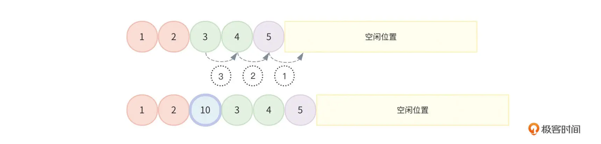
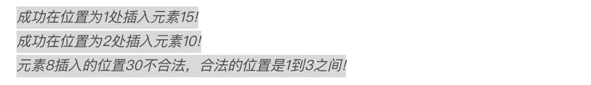
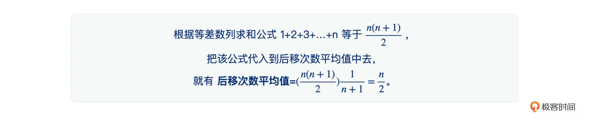

# 02 | 顺序表（上）：如何实现快速地随机访问？

你好，我是王健伟。

今天来聊一聊最基础的数据结构——“顺序表”。

在聊顺序表之前，首先我们要引入“线性结构”和“线性表”的概念。

## 线性结构与线性表

线性结构是一种数据结构，其中保存的数据像一条线一样按顺序排列，数据之间是一对一的关系，也就是每个数据只有一个直接前趋（也可写做前驱）和一个直接后继。不过，第一个数据没有前趋，最后一个数据没有后继，这意味着数据之间只有简单的前后（相邻）次序关系。你也可以想象一下排队的情景，这就是线性结构。

线性表是一种线性结构，是具有相同数据类型的 n（n≥0）个数据的有限序列，其中 n 是线性

## a

- ​1 a

## a

- ​i a

## a

- ,,…,,…,）。当 n=0 时，线性表就是一个空表。

表的长度。其一般表示为（

- ​2i+1​n​

## a

## a

## a

- 是第一个数据，是第 i 个数据，是最后一个数据，这表示线性表中的

在一般表示中，

- ​1​i​n

## a

## a

数据是有先后次序的。除

- 外，每个数据有且仅有一个直接前趋数据，除外，每个数据​1​n

有且仅有一个直接后继数据。

这表示什么呢？我们可以发现，除第一个数据外总有办法根据当前数据找到其直接前趋，除最后一个数据外，总有办法根据当前数据找到其直接后继。要注意的是，每个数据所占用的存储空间大小相同。数组、链表、栈、队列等都属于线性表中的一种，或者你也可以理解成，数组、链表、栈、队列等都可以用来表达线性表。

比如图 1，就是一个线性表。


- 图1 线性表

这里我们延伸一下，与线性表的概念相对应的，还有非线性表。非线性表里的数据之间并不是简单的一对一关系，可能是一对多或多对多关系。树、图、堆等都属于非线性表中的一种，后面课节都会进行详细讲解。


- 图2 树（非线性表）一种一对多关系的非线性表，比如a1有两个后继节点a2、a3等

话说回来，在有了一种数据结构之后（包括线性表、非线性表），一般还需要实现在该数据结构上的一些基本操作，才能够方便地操作其中的数据。我们习惯将这些基本操作封装成函数或接口，方便自己或团队其他成员使用，这样不但可以避免重复的工作，更可以在很大程度上减少对数据操作出错的可能性。

线性表上常用的操作有这么几种。

- 创建线性表后对数据进行初始化

- 销毁线性表前对资源进行释放

- 按位置插入元素

- 按位置删除元素

- 按位置获取元素值

- 按值查找线性表元素，返回该值在线性表中第一次出现的位置

- 显示线性表中所有元素值

- 获取线性表长度

接下来，我们就尝试实现这些操作。

## 线性表的顺序存储

线性表的顺序存储指的是用一段连续的内存空间依次存储线性表中的数据，而数组正好具有内存空间连续的特性，因此，线性表的顺序存储是采用一维数组来实现的（回忆一下 STL 中vector 容器也是用一段连续的内存空间来保存数据），采用一维数组实现的线性表也叫做顺序表。

我们看一下一维数组的存储结构。


- 图3 一维数组的存储结构

在图 3 中，一维数组（简称数组）的下标从 0 开始，最大的数组下标为 n，这意味着整个数组能容纳 n+1 个元素。这里要注意，在实现顺序表时，有两点需要说明。

- 随机访问

因为内存空间连续且数据类型相同，因此，随机访问数组中的任意元素（数据）就非常方便快捷。

那么什么是随机访问呢？它指的是通过数组首地址和所给元素下标就可以在最短的时间内找到任意的数组元素。另外，想一想，通过下标随机访问数组元素的时间复杂度是多少呢？

是的，O(1)。

我们再来说说随机访问的地址又是怎么得到的。比如有一个长度为 10 的整型数组 a，首地址为是 1000，那么这个数组中第 3 个元素，也就是数组元素 a[2]的地址，就可以直接用“a[i]地址 = 数组首地址 + 下标 *sizeof(整型)”得到。

举个例子，如果假设整型数据所占用的内存空间是 4 字节，那么数组元素 a[2]的地址是1000+2*4=1008。同理，数组元素 a[5]的地址是 1000+5*4=1020。

- 插入或删除元素

在顺序存储中，插入或者删除元素可能会碰到的情况就是要求数据之间彼此要紧挨在一起，数据之间不允许有空位，也就是说必须保证数据之间内存的连续性，所以当向数组中插入元素或删除数组中元素时，必须要做大量的数据搬运工作，所以插入或删除元素的效率会变得很低。这一点，你在后续进行代码实现的时候，会体会得更加深刻。

顺序表的第一种实现方式：为一维数组静态分配内存。比如，定义如下的 SeqList 结构来表示顺序表。

```
typedef struct
{
 int  m_data[10]; //静态数组来保存顺序表中的元素，一共10个位置（最多存入10个元素）
 int  m_length;   //顺序表当前实际长度（当前顺序表中已经存入了多少个元素）
}SeqList;
```

上述代码中，数组 m_data 的大小在编译时就已经确定，后续无法改变，这意味着该顺序表最多只能保存 10 个元素。

顺序表的第二种实现方式：为一维数组动态分配内存。比如，定义如下的 SeqList 结构来表示顺序表。

```
typedef struct
{
 int* m_data;    //顺序表中的元素保存在m_data所指向的动态数组内存中
 int m_length;   //顺序表当前实际长度
int m_maxsize;  //动态数组最大容量，因动态数组可以扩容，因此要记录该值
}SeqList;
```

上述代码中，数组 m_data 的大小事先是不确定的，在程序执行过程中，用 new 的方式为m_data 指针（一维数组）分配一定数量的内存。当顺序表中数据元素逐渐增多，当前分配的内存无法容纳时，可以用 new 新开辟一块更大的内存，并将当前内存中的数据拷贝到新内存中去，同时把旧的内存释放掉。

通过静态分配内存方式与动态分配内存方式实现顺序表的过程，在程序代码上大同小异，但后者代码实现起来要更加复杂一些。因此，后续我会特意采用后者的代码编写方式来实现顺序表。

## 顺序表的基础操作

好了，了解整体框架之后，下面我们就来看一看顺序表的具体实现代码，包括基本框架、插入、删除、获取以及其它的一些常用操作。

### 顺序表的类定义、初始化和释放操作

首先，要把顺序表相关的类的基本框架实现出来。这里的难度不大，代码中的注释也已经非常详细，你可以仔细看一下。

```sql
#define InitSize 10   //动态数组的初始尺寸
#define IncSize  5    //当动态数组存满数据后每次扩容所能多保存的数据元素数量
template <typename T> //T代表数组中元素的类型
class SeqList
{
public:
 SeqList(int length=InitSize); //构造函数，参数可以有默认值
 ~SeqList();                   //析构函数
public:
 bool ListInsert(int i, const T& e);  //在第i个位置插入指定元素e
 bool ListDelete(int i);              //删除第i个位置的元素
 bool GetElem(int i, T& e);           //获得第i个位置的元素值
 int  LocateElem(const T &e);         //按元素值查找其在顺序表中第一次出现的位置
 void DispList();                     //输出顺序表中的所有元素
 int  ListLength();                   //获取顺序表的长度
 void ReverseList();                  //翻转顺序表
private:
 void IncreaseSize();         //当顺序表存满数据后可以调用此函数为顺序表扩容
private:
 T*  m_data;                   //存放顺序表中的元素
 int m_length;                 //顺序表当前长度（当前有几个元素）
 int m_maxsize;                //动态数组最大容量
};
//通过构造函数对顺序表进行初始化
template <typename T>
SeqList<T>::SeqList(int length)
{
 m_data = new T[length]; //为一维数组动态分配内存
 m_length = 0;           //顺序表当前实际长度为0，表示还未向其中存入任何数据元素
 m_maxsize = length;     //顺序表最多可以存储m_maxsize个数据元素
}
//通过析构函数对顺序表进行资源释放
template <typename T>
SeqList<T>::~SeqList()
{
 delete[] m_data;
 m_length = 0; //非必须
}
```

注意，在 main 主函数中，加入下面的代码就可以创建一个初始大小为 10 的顺序表对象了。

```
SeqList<int> seqobj(10);
```

### 顺序表元素插入操作

还记得我们刚刚说的顺序存储的特点吗？因为顺序表中每个数据元素在内存中是连续存储的，所以如果要在某个位置插入一个元素，则需要把原来该位置的元素依次向后移动。如图 4 所示：



- 图4 顺序表插入元素10前后的元素位置对比图

仔细观察，如果我要将元素 10 插入到顺序表的第 3 个位置，为了保证元素之间内存的连续性，就需要将原来第 3 个位置以及第 3 个位置之后的所有元素依次向后移动 1 个位置，为新插入的元素腾出地方。

那么这里就有几点需要考虑的问题了，我们一个一个来说。

- 数组下标是多少？

这里所谈的插入位置是从编号 1 开始的，而数组下标是从 0 开始的，所以在写代码将插入的位置转换成数组下标时，需要减 1。

- 先从谁开始移动呢？

在移动 3、4、5 这几个元素时，需要先把元素 5 移动到第 6 个位置，再把元素 4 移动到第 5个位置，最后把元素 3 移动到第 4 个位置。也就是先从数组中最后一个元素开始依次向后移动。如果先把元素 3 移动到第 4 个位置了，那么就会把原来第 4 个位置的元素 4 直接覆盖掉。

- 插入位置和原有长度有什么关系吗？

如果在第 3 个位置插入元素，则顺序表中必须至少要有 2 个元素。试想一下，如果顺序表为空或只有 1 个元素，那么它的第 2 个位置肯定是空的。因为顺序表中各个元素的内存必须是连续的，我们不可以隔着一个或者多个空位置向顺序表中插入元素。

- 最后，如果顺序表已经满了，则不应该允许插入数据。

理清头绪之后，我们看一下插入操作 ListInsert 的实现代码。

```javascript
//在第i个位置（位置编号从1开始）插入指定元素e，时间复杂度：O(n)，时间开销主要源于元素的移动
template <typename T>
bool SeqList<T>::ListInsert(int i, const T& e)
{
 //如果顺序表已经存满了数据，则不允许再插入新数据了
 if (m_length >= m_maxsize)
 {
   cout << "顺序表已满，不能再进行插入操作了!" << endl;
   return false;
 }
 //判断插入位置i是否合法，i的合法值应该是1到m_length+1之间
 if(i < 1 || i > (m_length+1))
 {
   cout << "元素" << e <<"插入的位置" << i << "不合法，合法的位置是1到" << m_length+1
   return false;
 }
 //从最后一个元素开始向前遍历到要插入新元素的第i个位置，分别将这些位置中原有的元素向后移动一个位
 for (int j = m_length; j >= i; --j)
 {
   m_data[j] = m_data[j-1];
 }
 m_data[i-1] = e;   //在指定位置i处插入元素e，因为数组下标从0开始，所以这里用i-1表示插入位
 cout << "成功在位置为" << i << "处插入元素" << m_data[i - 1] << "!" << endl;
 m_length++;        //实际表长+1
 return true;
 }
```

在 main 主函数中，可以继续增加代码测试元素插入操作。

```
seqobj.ListInsert(1, 15);
seqobj.ListInsert(2, 10);
seqobj.ListInsert(30, 8);
```

执行结果如下，可以看到，前两个元素插入成功，第三个元素插入失败并给出提示。



接下来，我们分析一下 ListInsert 的时间复杂度。只需要关注 for 循环的执行次数与问题规模 n的关系，问题规模 n 在这里指的是顺序表的当前长度 m_length。一共分为 3 种情况。

- 最好情况时间复杂度

如果将元素插入到顺序表的尾部，则其他已有的顺序表中元素都不需要移动，for 循环一次都不会执行，这是最好情况时间复杂度 O(1)。

- 最坏情况时间复杂度

如果将元素插入到顺序表的头部，则其他已有的顺序表中所有元素都需要依次后移，for 循环执行的次数就会是顺序表中已有元素的个数，这是最坏情况时间复杂度 O(n)。

- 平均情况时间复杂度

因为元素 e 可以插入 1 到 m_length+1 之间的任何一个位置，其中 m_length 代表问题规模n，即 m_length 等于 n，所以如果假设元素 e 插入到任何一个位置的概率相同，那么插入到位

- 1

置 1，2，…，m_length+1 的概率就都为

- 。n+1​

我们试想一下，如果元素 e 要插入到第 1 个位置，则需要把后面的 n 个元素依次后移，也就是 for 循环会执行 n 次；如果元素 e 要插入到第 2 个位置则需要把后面的 n-1 个元素依次后移，也就是 for 循环会执行 n-1 次…以此类推，如果要插入到最后的位置（第 n+1 个位置），则 for 循环执行 0 次。

把每种情况下循环的次数累加起来，再除以 n+1，就可以得到数组中元素后移次数的平均值

- 1+2+3+…+n

（平均循环次数）：后移次数平均值 =

- 。n+1​



因为大 O 时间复杂度表示法中，系数可以忽略掉，所以平均情况时间复杂度为 O(n)。

这个分析有什么用呢？当然，如果将新元素插入到顺序表中间的某个位置，若顺序表中元素没有顺序要求，则可以通过将被插入位置原有元素移动到顺序表最后位置，然后把新元素放到被插入位置的方法来避免顺序表中的元素被大量移动。此时的时间复杂度就为 O(1)，相关的代码你可以尝试自行实现。

## 小结

这节课，我们首先引入了“线性结构”与“线性表”这两个基本概念，接着讲述了线性表的顺序存储——“顺序表”。你可以把顺序表理解为是线性表的一种。

我们实现了顺序表的基本定义、初始化、释放操作代码，向顺序表中插入元素操作的代码并分析了插入操作的时间复杂度。你可以看到，我在实现插入元素操作的代码时，加入了判断顺序表是否已满以及插入的位置是否合法的代码。虽然这些判断代码并不是必须的，但却可以增加健壮性，不要忘记，健壮性是一个好算法的设计要求之一。

最后，针对分析算法的时间复杂度这件事，我认为并非是必须的，但如果能做到对算法的时间复杂度心中有数，甚至能够通过改进算法的实现来进一步降低算法的时间复杂度，也能够让你后续的代码编写能力更上一层楼。不过，如果你有面试的需求，那么一些经典算法的时间复杂度还是要尽可能的去理解和记忆。

## 归纳思考

你可以尝试编写代码，实现一个时间复杂度为 O(1) 的新的顺序表插入操作：要求将被插入位置原有元素移动到顺序表最后的位置，并把新元素放到被插入位置。

欢迎你在留言区和我互动。如果觉得有所收获，也可以分享给更多的朋友一起学习。我们下一讲见！
