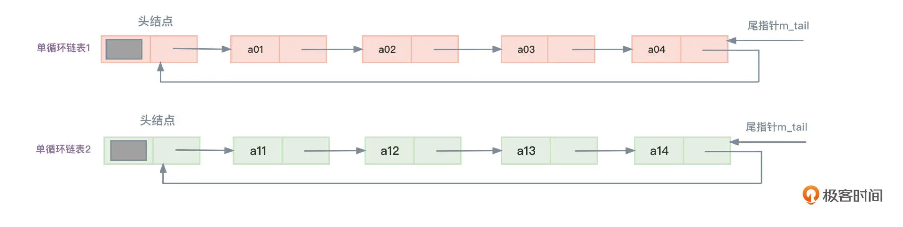
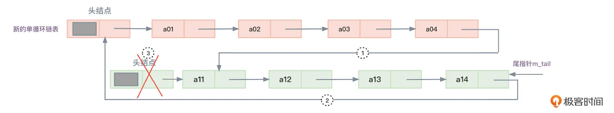

# 06 | 循环链表：如何更方便地寻找数据？

你好，我是王健伟。

今天我要和你分享的主题是“循环链表”。循环链表可以分为单（单向）循环链表和双（双向）循环链表，只需要在原有单链表或者双链表基础之上做一些比较小的改动即可。

那么，为什么一定要在单链表或者双链表基础上引入循环链表呢？接下来，我们就从它们面临的主要问题出发，分别探讨单循环链表以及双循环链表的相关内容。

## 单循环链表

这里我们把单循环链表分为两种情况来讨论，第一种情况是传统的单循环链表，第二种情况是改进的单循环链表。它们有什么不同呢？

## 传统单循环链表

我们说过，单链表的每个节点只有一个后继指针，用于指向后继节点，而最后一个节点的后继指针指向 nullptr（空），想一想，这会有什么不足呢？

没错，如果我们想找某个节点的前趋节点，除非拿到头节点的指针，否则是找不到的。

那么为了解决这个问题，我们就可以引入单循环链表了，它也被称为循环单链表。单循环链表，是在单链表的基础上，将链表中最后一个节点的后继指针由指向 nullptr 修改为指向头节点，从而整个单链表就构成了一个头尾相接的环，这种单链表称为单循环链表。

单循环链表的引入，实现了给定任意一个节点，都可以访问到链表中的所有节点，也就是遍历整个链表的可能。这样，我们就可以从遍历中找到指定节点的前趋节点了。

为了让实现的代码更简单，我们还是在链表中引入头节点，在单循环链表为空的时候，头节点的后继指针就是指向自身的，如图 1 所示：


- 图1 空单循环链表头节点的后继指针指向自身

当单循环链表不为空时，最后一个节点的后继指针，就会指向头节点，如图 2 所示：


- 图2 非空单循环链表最后一个节点的后继指针指向头节点

单循环链表的完整实现代码你可以参考课件，下面的讲解里，我们就只列出核心代码。

先说初始化的问题。在通过构造函数对单循环链表进行初始化的时候，不要忘记把头节点的next 指针指向自己， CirLinkList 类构造函数内的代码类似下面的示例。

```
m_head = new Node<T>;
m_head->next = m_head;
m_length = 0;
```

这里需要你思考一个问题，对比之前单循环列表为空和不为空的示意图，想一想，我们如果想要判断一个单循环链表是否为空的成员函数 Empty，应该怎么去编写代码呢？

没错，只需要判断头节点的 next 指针是否指向头节点自身即可。

```
if (m_head->next == m_head) //单循环链表为空
{
 return true;
}
return false;
```

另外，输出单循环链表中的所有元素的 DispList 成员函数中，相关的 while 循环条件也要从判断 p 是否为 nullptr 修改为“判断 p 是否指向头节点”。

```
Node<T>* p = m_head->next;
while (p != m_head)
{
 cout << p->data << " ";
 p = p->next;
}
cout << endl;
```

我们还可以再从上面的代码延伸想象一下，对于一个非空的单循环链表，若判断某个数据节点是否是链表中最后一个节点，则只需要判断该节点的 next 指针是否指向头节点即可。

至于节点的插入和删除操作，只要注意维护好最后一个节点的后继指针指向，保证其永远指向头节点就可以。幸运的是，前述单链表中在某个位置插入指定元素以及删除某个位置元素的方法 ListInsert 和 ListDelete 的代码，完全不需要修改，就可以在单循环链表中使用。

最后，在析构函数中对单循环链表进行资源释放时，也要注意 while 判断条件，从原有的while (pnode != nullptr) 修改为 while (pnode != m_head) 即可。

## 改进的单循环链表

所谓改进的单循环链表，指的是把链表的头指针修改为尾指针。

在当前的单循环链表中，如果不再使用 m_head 头指针来指向头节点，而是引入一个被称为尾指针的 m_tail 来指向最后一个节点（尾节点），那么 m_tail->next 就会正好指向头节点。当然，当链表为空时，尾指针指向的其实也是头节点。也就是如图 3 所示：


- 图3 取消头指针m_head，引入尾指针m_tail指向尾节点

可以看到，通过引入尾指针可以立即找到头节点（m_tail->next）。这样一来，一方面，对于在链表头部分进行插入或者删除操作，时间复杂度就会是 O(1)。另一方面，在链表的尾部进行插入或者删除操作等，也就不再需要从前向后遍历各个节点，时间复杂度也将会变成 O(1)。

总结下来，如果需要频繁地在链表头或者链表尾进行数据操作的话，可以考虑引入 m_tail 表尾指针，这样操作的效率就会更高。

不仅如此，引入尾指针的另外一个好处是可以迅速地将两个单循环链表连接起来形成一个更大的单循环链表。

假设现在，有单循环链表 1 和单循环链表 2：



- 图4 单循环链表1和单循环链表2

如果把上面的两个单循环链表连接起来，那可能就会是这样的一个情形了：



- 图5 将两个单循环链表连接起来形成一个新的单循环链表

那么如何实现图 5 的代码呢？这里我通过一些伪代码来实现，你可以尝试着参考这些伪代码理解思路，之后自己动手，写出实际的代码。

```
p1head = m_tail1->next; //先把单循环链表1的头节点暂存起来。
①m_tail1->next = m_tail2->next->next; //让单循环链表1的尾节点指向单循环链表2的头节点之后
p2head = m_tail2->next; //再把单循环链表2的头节点暂存起来。
②m_tail2->next = p1head; //让单循环链表2的尾节点的next域指向单循环链表1的头节点。
③//其他处理代码略：包括重新设置单循环链表2的长度、让单循环链表2的头指针的next域指向自己等。而对
```

当然，引入尾指针也增加了书写代码的难度，尤其要注意当删除链表尾部节点或者向链表尾部增加新节点时，尾指针也要进行相应的改变。

## 双循环链表

我们再说双循环链表，它也被称为循环双链表。

先来复习一下双链表的结构：


虽然双链表可以很方便地找到某个节点前后的所有节点，但寻找效率却不一定高。比如已经拿到了双链表中最后一个节点的指针，那我们要如何快速寻找第 1 个节点呢？双循环链表可以很好的解决这个问题。

在双链表的基础上，我们将链表中最后一个节点的后继指针由指向 nullptr 修改为指向头节点，将链表头节点的前趋指针由指向 nullptr 修改为指向最后一个节点，也就构成了双循环链表。

为了让实现代码简单，依旧在链表中引入头节点。当双循环链表为空时，头节点的前趋指针和后继指针都指向自身，如图 6 所示：


- 图6 空双循环链表头节点的后继和前趋指针都指向自身

当双循环链表不为空时，最后一个节点的后继指针指向头节点，头节点的前趋指针指向最后一个节点，如图 7 所示：


- 图7 带头节点的双循环链表数据存储描述图

从图 7 可以看到，双循环链表的所有后继指针形成了一个环，所有前趋指针也形成了一个环（一共两个环）。这样的话，给定一个数据节点，无论访问链表的后继节点还是前趋节点，都非常灵活和方便。

理解之后，我们说代码的编写。在通过构造函数对双循环链表进行初始化时，不要忘记将头节点的 next 指针和 prior 指针都指向自己，下面是 DblCirLinkList 类构造函数内的代码（详细实现代码参考课件）。

```
m_head = new DblNode<T>; //先创建一个头结点
m_head->next = m_head;
m_head->prior = m_head;
m_length = 0;  //头结点不计入双循环链表的长度
```

显然，判断一个双循环链表是否为空的成员函数 Empty，就只需要判断头节点的 next 指针（或者头节点的 prior 指针）是否指向头节点自身即可（这点与单循环链表一致）。

```
if (m_head->next == m_head) //双循环链表为空
{
   return true;
}
return false;
```

同样，输出双循环链表中的所有元素的 DispList 成员函数中，相关的 while 循环条件也要从“判断 p 是否为 nullptr”修改为“判断 p 是否指向头节点”。

```
DblNode<T>* p = m_head->next;
while (p != m_head)
{
 cout << p->data << " ";
 p = p->next;
}
cout << endl;
```

有了上面的代码，我们不难想象，对于一个非空的双循环链表，如果要判断某个数据节点是否是链表中最后一个节点，那么只需要判断“该节点的 next 指针是否指向头节点”即可。

对于节点的插入和删除操作，要注意维护好最后一个节点的后继指针指向，保证其永远指向头节点，也要注意维护好头节点的前趋指针指向，保证其永远指向最后一个节点。和单循环链表的情况类似，前述双链表中在某个位置插入指定元素以及删除某个位置元素的方法 ListInsert和 ListDelete 的代码完全不需要修改，即可在双循环链表中使用。

在析构函数中对双循环链表进行资源释放时，也要注意 while 判断条件，从原有的 while(pnode != nullptr) 修改为 while (pnode != m_head) 即可。

## 小结

这节课，我们讲解了循环链表，包含单循环链表和双循环链表。这两种链表都是为了更快速地查找链表中的数据而引入的。它们的便捷度也在逐步地提升。

不难看到，链表的实现方法非常多样且非常灵活，你只需要根据具体的应用场景来决定使用哪种类型的链表来保存数据即可，始终把握一个原则——使算法的执行效率尽可能得高。

一般来说，C++ 标准库中提供的容器基本上够用了。只有在不允许使用 C++ 标准库或者对程序性能有更严苛要求的场合，才需要自己写代码来实现各种链表。

## 归纳思考

在这节课的最后，我也给你留了两道归纳思考题。

1. 请实现一个不带头节点的单循环链表。

2. 请实现一个不带头节点的双循环链表。

欢迎你在留言区和我互动。如果你觉得有所收获，也可以把课程分享给更多的朋友一起交流学习。我们下一讲见！
