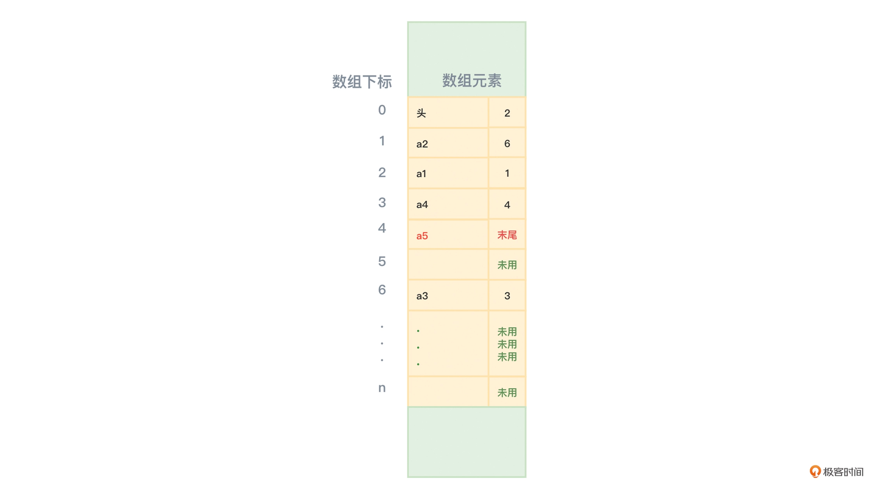
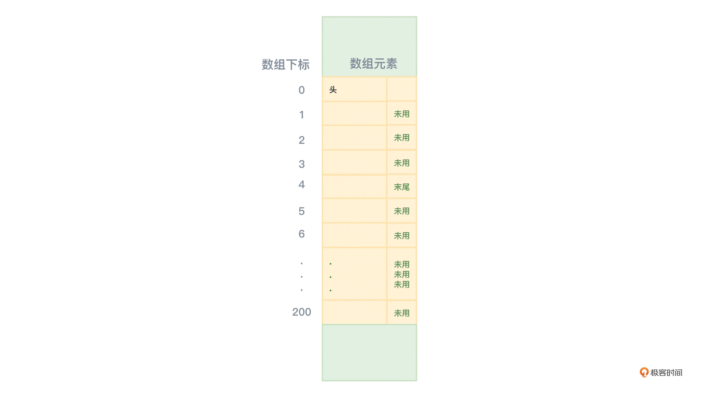
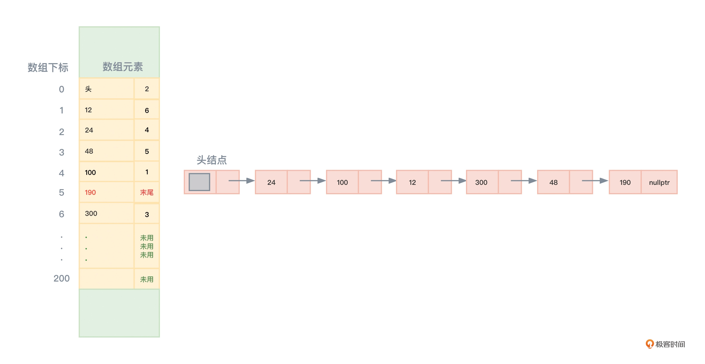
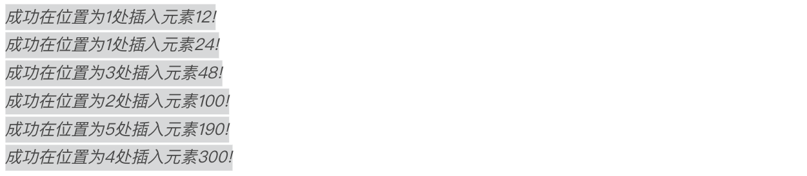
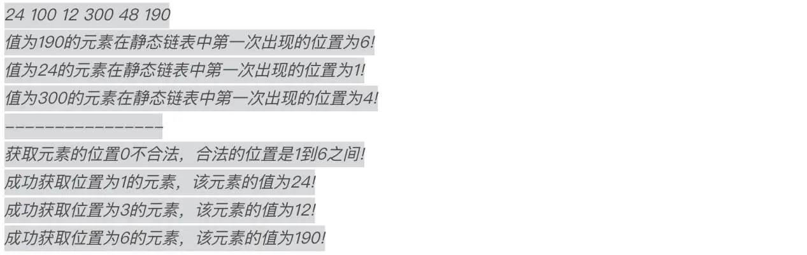
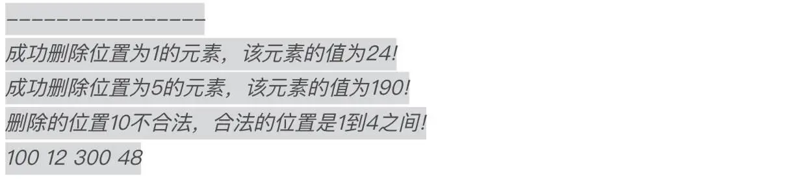
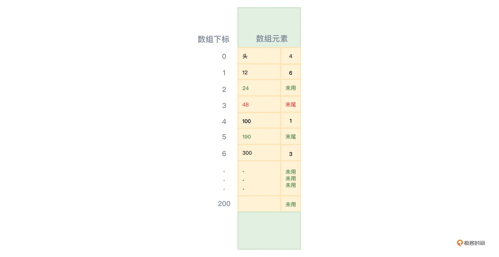
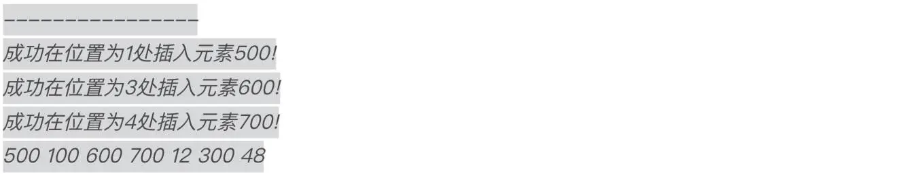

# 07 | 静态链表：用一维数组表达的链表

你好，我是王健伟。

前面已经聊了很多种链表，今天我们再来聊一聊最后一种链表——“静态链表”。

有些早期的高级语言，并没有指针这种概念，之前我们探讨的链表实现方法在这些高级语言中并不适用。于是，用一维数组代替指针来描述单链表的想法应运而生，这种用一维数组描述的链表，就称为静态链表。

之前我们说过，单链表节点之间在内存中并不需要紧密相连地存放，而采用数组存储数据时则需要数据在内存中紧密相连。所以不难想象，静态链表在内存中也需要分配一整块连续的内存空间，如图 8 所示：



- 图8 用静态链表存储数据（需要分配一整块连续的内存空间）

你会发现，说是内存空间紧密相连，但是链表中的各个节点却是并不需要紧密地连在一起的。

每个数组元素都是由两个数据域组成：data 和 cur。其中 data 用来存储链表中每个节点的数据，cur 用来存储链表中后继节点所属的数组元素的下标（cur 也称为游标，用来模拟指针）。比如图 8 中存储数据 a2 的区域就是 data 域，存储数字 6 的区域就是 cur 域。

注意，如果 cur 域的值为“末尾（一个负数作为标记）”，则表示该 cur 所代表的数组元素是链表中的最后一个节点，比如图 8 中存储数据 a5 的节点。下标为 0 的数组元素可以看成是链表的头节点，其 cur 域的值（数字 2）用于指示链表第一个数据节点对应的数组下标。所以，数据a1 所在的节点，其实就是静态链表的第一个数据节点。

理解之后，我们就来说具体的实现方式了。静态链表的实现代码有很多种，这里我选择一种从代码可读性上比较好理解的实现方法来讲解。在后面的课后思考中，我会让你实现一个稍微复杂点的静态链表。

## 静态链表的类定义、初始化操作

还是先说类定义和初始化操作。

下面是静态链表的类定义、初始化操作的相关实现代码。

```python
#define MaxSize 201 //静态链表的尺寸，可以根据实际需要设定该值。可用数组下标为0-200
//节点使用情况枚举标记值
enum NODEUSE
{
 //这些枚举值都给负值，以免和数组下标（从0开始的正值）冲突
 e_NOUSE = -1,  //未使用（未用）
 e_LAST  = -2   //最后一个节点（末尾）
};
//静态链表中每个节点的定义
template <typename T> //T代表数据元素的类型
struct Node
{
 T        data;  //元素数据域，存放数据元素
 int      cur;   //游标，记录下个静态链表节点的数组下标
};
//静态链表的定义
template <typename T>
class StaticLinkList
{
public:
 StaticLinkList();                    //构造函数
 ~StaticLinkList() {};                //析构函数
public:
 int  findAnIdlePos();                //找到一个空闲位置用于保存数据
 bool ListInsert(int i, const T& e);  //在第i个位置插入指定元素e
 bool ListDelete(int i);              //删除第i个位置的元素
 bool GetElem(int i, T& e);           //获得第i个位置的元素值
 int  LocateElem(const T& e);       //按元素值查找其在静态链表中第一次出现的位置
 void DispList();                     //输出静态链表中的所有元素
 int  ListLength();                   //获取静态链表的长度
 bool Empty();                        //判断静态链表是否为空
private:
 Node<T> m_data[MaxSize]; //保存节点数据的数组
 int m_length;            //当前长度，也就是当前保存的数据节点数目
};
//通过构造函数对静态链表进行初始化
template <typename T>
StaticLinkList<T>::StaticLinkList()
{
 for (int i = 1; i < MaxSize; ++i) //从下标1开始的节点用于保存实际的数据，这些节点的cur有
 {
   m_data[i].cur = e_NOUSE; //标记这些节点都没使用
 }
 m_length = 0; //还未向其中存入任何数据元素
}
```

之后，我们在 main 主函数中，可以加入下面的代码创建一个静态链表对象。

```
StaticLinkList<int> slinkobj;
```

这个时候，所创建的静态链表对象应该如图 9 所示，静态链表已经创建完毕，只不过这个链表中目前还没有存储任何数据，可以认为是一个空链表。



- 图9 新初始化的静态链表存储数据的情形

## 静态链表元素插入操作

在指定位置插入元素的操作，可以分为 4 个核心步骤。

1. 找到一个空闲位置代表新插入的节点，在其中存入数据元素。

2. 从头节点开始，找到待插入位置的前一个（前趋）节点。

3. 设置新插入节点的 cur 值以指向前趋节点所指向的节点，设置前趋节点的 cur 值以指向这个新插入的节点。

4. 如果新插入的节点是最后一个节点，要设置其 cur 标记为“末尾”。

下面是插入操作 ListInsert 的实现代码（同时引入辅助函数 findAnIdlePos）。

```javascript
//在m_data中找到一个空闲位置用于保存数据，若没有找到（静态链表满了），则返回-1
template <typename T>
int StaticLinkList<T>::findAnIdlePos()
{
 for (int i = 1; i < MaxSize; ++i) //因为下标0是头节点，不能用于保存数据，所以循环变量从
 {
   if (m_data[i].cur == e_NOUSE) //未使用
     return i;
 }
 return -1;
}
//在第iPos个位置（位置编号从1开始）插入指定元素e
template <typename T>
bool StaticLinkList<T>::ListInsert(int iPos, const T& e)
{
 if (iPos < 1 || iPos > (m_length + 1))
 {
   cout << "元素" << e << "插入的位置" << iPos << "不合法，合法的位置是1到" << m_lengt
   return false;
 }
 int iIdx;
 if ((iIdx = findAnIdlePos()) == -1) //静态链表满了
 {
   cout << "静态链表已满!" << endl;
   return false;
 }
 //既然需要在第iPos个位置插入元素，那么肯定要找到第iPos-1个位置。
 int iDataCount = 1; //统计静态链表中元素数量
 int iIdxPrev;       //保存第iPos-1个位置对应的m_data数组的下标
 if (iPos == 1) //向第一个位置插入元素，要单独处理
 {
   m_data[iIdx].data = e;
   if (m_length == 0) //空表
   {
     m_data[iIdx].cur = e_LAST;
   }
   else //非空表
   {
     m_data[iIdx].cur = m_data[0].cur;
   }
   m_data[0].cur = iIdx;
 }
 else
 {
   int iPosCount = 0; //位置计数
   int tmpcur = m_data[0].cur;
   //前面已经判断过插入位置合法，所以一定可以找到合适的位置，while(true)循环肯定可以正常退出
   while (true)
   {
     iPosCount++;
     if (iPosCount >= (iPos - 1)) //找到了第iPos-1个位置
     {
       iIdxPrev = tmpcur;
       break;
     }
     tmpcur = m_data[tmpcur].cur;
   } //end while
   int iTmpCurr = m_data[iIdxPrev].cur;
   m_data[iIdxPrev].cur = iIdx;
   m_data[iIdx].data = e;
   m_data[iIdx].cur = iTmpCurr;
 }
 cout << "成功在位置为" << iPos << "处插入元素" << e << "!" << endl;
 m_length++;     //实际表长+1
 return true;
}
```

在 main 主函数中，我们继续加入测试代码。

```
slinkobj.ListInsert(1, 12);
slinkobj.ListInsert(1, 24);
slinkobj.ListInsert(3, 48);
slinkobj.ListInsert(2, 100);
slinkobj.ListInsert(5, 190);
slinkobj.ListInsert(4, 300);
```

执行上述代码后，静态链表存储数据的情形以及对应的单链表应该如图 10 所示：



- 图10 插入一系列数据后静态链表存储数据的情形以及对应的单链表

执行结果为：



## 静态链表元素显示、获取等操作

静态链表元素的显示、获取操作相关的函数一共有三个，分别为 DispList、GetElem、LocateElem。取得静态链表长度的是 ListLength 函数，判断静态链表是否为空的为 Empty 函数。我们分别看一看。

首先，输出静态链表中的所有元素。

```
//输出静态链表中的所有元素，时间复杂度为O(n)
template<class T>
void StaticLinkList<T>::DispList()
{
 if (m_length < 1)
 {
   //静态链表为空
   return;
 }
 int tmpcur = m_data[0].cur;
 while (true)
 {
   cout << m_data[tmpcur].data << " ";
   if ((tmpcur = m_data[tmpcur].cur) == e_LAST)
     break;
 } //end while
 cout << endl; //换行
}
```

再来，是按照位置，或按照元素值查找。

```javascript
//获得第i个位置的元素值，时间复杂度为O(n)
template<class T>
bool StaticLinkList<T>::GetElem(int i, T& e)
{
 if (m_length < 1)
 {
   //静态链表为空
   cout << "当前静态链表为空，不能获取任何数据!" << endl;
   return false;
 }
 if (i < 1 || i > m_length)
 {
   cout << "获取元素的位置" << i << "不合法，合法的位置是1到" << m_length << "之间!" <<
   return false;
 }
 int tmpcur = m_data[0].cur;
 int iPos = 0;
 while (true)
 {
   iPos++;
   if (iPos == i)
   {
     e = m_data[tmpcur].data;
     cout << "成功获取位置为" << i << "的元素，该元素的值为" << e << "!" << endl;
     return true;
   }
   tmpcur = m_data[tmpcur].cur;
 }
 return false;
}
//按元素值查找其在静态链表中第一次出现的位置，时间复杂度为O(n)
template<class T>
int StaticLinkList<T>::LocateElem(const T& e)
{
 if (m_length < 1)
 {
   //静态链表为空
   cout << "当前静态链表为空，不能获取任何数据!" << endl;
   return -1;
 }
 int tmpcur = m_data[0].cur;
 int iPos = 0;
 while (true)
 {
   iPos++;
   if (m_data[tmpcur].data == e && m_data[tmpcur].cur != e_NOUSE)
   {
     cout << "值为" << e << "的元素在静态链表中第一次出现的位置为" << iPos << "!" << en
     return tmpcur;
   }
   if (m_data[tmpcur].cur == e_LAST)
   {
     //这是没找到
     break;
   }
   tmpcur = m_data[tmpcur].cur;
 }
 cout << "值为" << e << "的元素在静态链表中没有找到!" << endl;
 return -1;  //返回-1表示查找失败
}
```

最后，是两个其他操作，获取长度以及判断链表是否为空。

```
//获取静态链表的长度，时间复杂度为O(1)
template<class T>
int  StaticLinkList<T>::ListLength()
{
 return m_length;
}
//判断静态链表是否为空，时间复杂度为O(1)
template<class T>
bool StaticLinkList<T>::Empty()
{
 if (m_length < 1)
 {
   return true;
 }
 return false;
}
```

在 main 主函数中，继续增加代码。

```
slinkobj.DispList();
slinkobj.LocateElem(190);
slinkobj.LocateElem(24);
slinkobj.LocateElem(300);
cout << "----------------" << endl;
int eval = 0;
slinkobj.GetElem(0, eval); //如果GetElem()返回true，则eval中保存着获取到的元素值
slinkobj.GetElem(1, eval);
slinkobj.GetElem(3, eval);
slinkobj.GetElem(6, eval);
```

新增代码的执行结果为：



## 静态链表元素删除操作

删除指定位置元素的操作核心步骤我们可以分为 3 步。

1. 从头节点开始，找到待删除节点的前一个（前趋）节点。

2. 设置前趋节点的 cur 值等于当前待删除节点的 cur 值以指向当前节点所指向的节点。

3. 设置被删除节点的状态为“未用”状态。

下面是删除操作 ListDelete 的实现代码。

```
//删除第iPos个位置的元素
template < typename T>
bool StaticLinkList<T>::ListDelete(int iPos)
{
 if (m_length < 1)
 {
   cout << "当前静态链表为空，不能删除任何数据!" << endl;
   return false;
 }
 if (iPos < 1 || iPos > m_length)
 {
   cout << "删除的位置" << iPos << "不合法，合法的位置是1到" << m_length << "之间!" <<
   return false;
 }
 int tmpcur = m_data[0].cur; //第一个数据节点的数组下标
 if (iPos == 1) //删除第一个位置元素，要单独处理
 {
   if (m_length != 1)
   {
     //这个静态链表里有多个元素，那么
     m_data[0].cur = m_data[tmpcur].cur; //头节点指向第二个数据节点的数组下标
   }
   m_data[tmpcur].cur = e_NOUSE;
   cout << "成功删除位置为" << iPos << "的元素，该元素的值为" << m_data[tmpcur].data <
 }
 else
 {
   int iIdxPrev; //第iPos-1个位置对应的m_data数组的下标
   int iPosCount = 0; //位置计数
   //前面已经判断过删除位置合法，所以一定可以找到合适的位置，while(true)循环肯定可以正常退出
   while (true)
   {
     iPosCount++;
     if (iPosCount >= (iPos - 1)) //找到了第i-1个位置
     {
       iIdxPrev = tmpcur;
       break;
     }
     tmpcur = m_data[tmpcur].cur;
   } //end while
   int iTmpCurr = m_data[iIdxPrev].cur; //当前要删除的这个节点的数组下标
   m_data[iIdxPrev].cur = m_data[iTmpCurr].cur;//前一个节点的cur指向当前要删除节点的c
   m_data[iTmpCurr].cur = e_NOUSE; //标记被删除数据节点的数组下标为未用状态
   cout << "成功删除位置为" << iPos << "的元素，该元素的值为" << m_data[iTmpCurr].data
 } //end if (iPos == 1)
 m_length--;       //实际表长-1
 return true;
}
```

在 main 主函数中，继续增加代码测试。

```
cout << "----------------" << endl;
slinkobj.ListDelete(1);
slinkobj.ListDelete(5);
slinkobj.ListDelete(10);
slinkobj.DispList();
```

新增加代码行的执行结果为：



此时，静态链表存储数据的情形应该如图 11 所示：



- 图11 删除两个数据后静态链表存储数据的情形

在图 11 中，删除了两个数据后，原来值为 24 和 190 的位置已经被标记为“未用”状态，此时，该位置的数字就没有任何存在的意义了，因为该位置已经是一个未被使用的位置，下次插入新数据时，findAnIdlePos 函数会直接找到并使用这些“未用”的位置。

我们在 main 主函数中继续增加代码行。

```
cout << "----------------" << endl;
slinkobj.ListInsert(1, 500);
slinkobj.ListInsert(3, 600);
slinkobj.ListInsert(4, 700);
slinkobj.DispList();
```

新增加代码行的执行结果为：



结合图 11，想一想，这个时候的静态链表存储数据的情形如何呢？就留给你思考和亲测吧。

## 小结

这节课我们讲解了静态链表。静态链表的实现代码有很多种，非常灵活。

在今天的讲解中，我们是通过 findAnIdlePos 函数寻找了一个空闲位置，保存数据的时候，每次也都是从头节点的后继节点开始寻找，这就导致，当链表中数据较多的时候，恐怕会影响效率。

因此，你也可以采用不同的静态链表实现方式——比如将静态链表中的第一个和最后一个节点作为特殊节点来使用（不保存数据）。

- 第一个节点的 cur 存放第一个未被使用的节点所对应的数组下标（这些未被使用的节点可以通过 cur 串起来，构成一个未被使用的节点链）。

- 最后一个节点的 cur 存放第一个有数据的节点对应的数组下标（相当于头节点），该值为 0相当于链表为空。

这样的静态链表实现方式，虽然代码会更加繁琐，但在插入数据的时候可以明显提高寻找空闲节点的效率，时间复杂度会从 O(n) 变为 O(1)。如果你有兴趣，也可以自行实现相关的代码。

静态链表中，元素的插入和删除操作并不需要移动元素，仅仅是修改游标。所以仍旧具备链表的主要优点——插入和删除节点非常方便，同时，也避免了顺序表要求所有数据元素在内存中必须紧挨在一起的缺点。

另外，存取数据时，静态链表无法进行随机存取，只能从头节点开始依次向后查找。而且静态链表的大小是固定的，无法扩容，所以静态链表往往比较适合不支持指针的程序开发语言环境且数据最大容量是固定不变的场合，目前的应用并不是十分广泛，但其中代码的实现方式，绝对值得我们学习和借鉴。

最后，我们来总结一下目前为止所讲过的各种数据结构保存数据的特点。

- 顺序表：所分配的内存空间连续，其中保存的各个数据节点也紧密相连。

- 单（双）链表、单（双）循环链表：分配的内存空间不连续（每个数据节点单独分配内存），当然链表中的数据节点也就不可能紧密相连。

- 静态链表：所分配的内存空间连续，所有的数据节点都会保存在这块内存空间中，但因为引入了游标来寻找各个数据节点，所以静态链表中各个数据节点并不要求紧密相连。

## 归纳思考

在小结中，我们提到了一种不同的静态链表实现方式——将静态链表中的第一个和最后一个节点作为特殊节点来使用，你可以尝试自行实现这种静态链表相关的代码。

欢迎你在留言区和我互动。如果觉得有所收获，也可以把课程分享给更多的朋友一起学习进步。我们下节课见！
