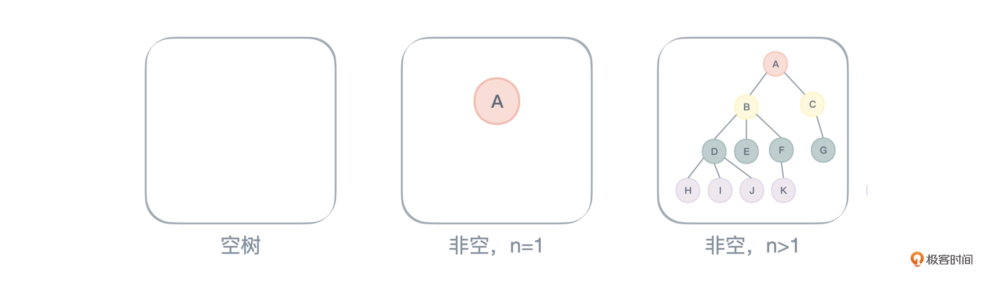
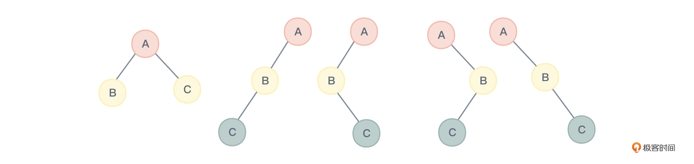
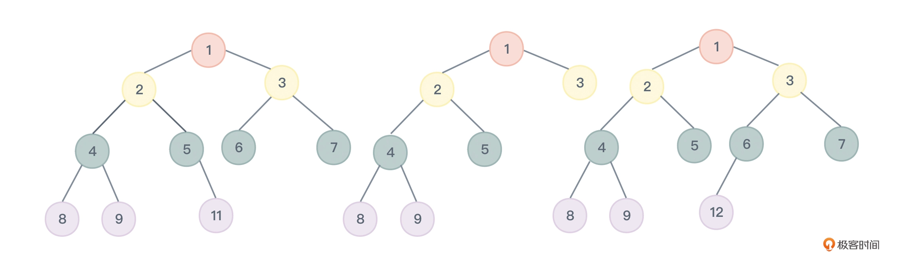
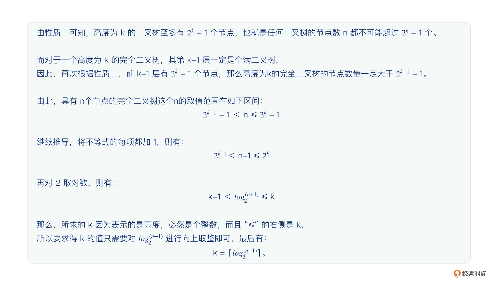
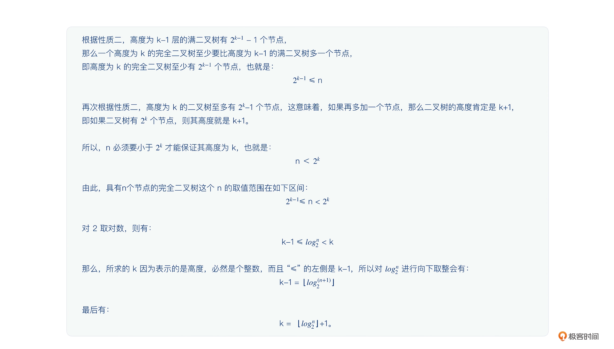

# 10 | 二叉树：二叉树到底长什么样子？

你好，我是王健伟。

前面讲解过的线性表，是以线性结构来组织数据的，数据之间只是简单的前后次序关系。但问题在于，线性结构对数据的组织结构过于单一，对于数据的访问速度也过于缓慢，在一些复杂的应用领域中，这种简单的线性结构不足以表达问题。

这个时候，我们就要引入“树形结构”这个概念了。

树形结构的应用场合非常多，比如计算机某块硬盘下的目录结构、一个公司的组织架构划分、一个家族的族谱等等。在计算机领域，树形结构也被广泛应用，比如编译器、数据库里都会用到，也因此，树形结构非常重要。而在众多树形结构中，最常用的一种，就是二叉树了。

## 树形结构的基本概念

在日常生活中，树是一种随处可见的植物，它由树根、树枝、树叶这些主要结构组成。而“树形结构”，就是基于日常生活中的树而得名的一种非线性数据结构。

什么是“非线性的数据结构”？想象一下，一根树枝可以分叉出很多树枝、树叶，我们也可以将“非线性的数据结构”理解成一种一对多的关系，而不是像一条线一样，按顺序排列的一对一关系。

在绘制树这种数据结构时，人们往往会从上向下绘制，也就是将树根绘制在最上面，图 1 就是一棵树：

- 图1 树

在这幅图中，所有标有字母的圆圈就是树的节点。树（Tree）是 n（n≥0）个节点的有限集。这里有了一个限定范围，n≥0。你可以尝试想象几种不同的情况，比如 n=0，n=1，以及 n>1这三种。

当 n=0 时，树就是一棵空树。如果树为非空，那么就会有两种情况。一种，就是 n=1 的时候，有且只有唯一一个称为根 / 树根（Root）的节点；另一种，就是 n>1 时，其余节点可以分为 m（m>0）个互不相交的有限集 T1、T2、…、Tm，其中每个集合自身又是一棵树，它们叫做根的子树（SubTree）。而节点 A 就是树根 / 根节点，注意，一棵树可以只有树根而没有其他节点。

子树的概念比较难理解，我们举个例子。图 1 中，B、D、E、F、H、I、J、K，也就是左半边，构成了以 B 为根节点的子树。

根据树的定义：有限集 T1 由 B、D、E、F、H、I、J、K 构成。C、G，也就是右半边，构成了以 C 为根节点的子树。根据树的定义：有限集 T2 由 C、G 构成。

子树，又可以看成是由更多更小的、互不相交的子树构成，所以我们也把树称为是一种递归定义的数据结构。如果树中节点的各子树从左到右是有次序的、不能互换的，则称该树为有序树，否则就叫做无序树。

注意，如果子树存在，那么子树之间不能相交，比如图 2 所列的情形就不是一棵树，节点 E和 F 之间以及节点 G 和 K 之间都不应该有连线：

- 图2 非法的树

树的节点包含一个数据元素以及若干指向其子树的分支（分支也可以称为指针或索引），这里会经常用到一些概念，我们先来预习一下这些内容。这些概念不需要死记硬背，只需要理解就好，将来忘记了可以随时来回顾。

1. 节点拥有的子树的个数，叫做节点的度（Degree），比如图 1 中节点 A 的度是 2，节点 B的度为 3，节点 C 的度为 1。

2. 如果度为 0，那么这个节点就叫做叶节点（Leaf）或终端节点，图 1 中节点 H、I、J、K、G 节点都是叶节点。相反，度不为 0 的节点称为分支节点或非终端节点。除根节点外的分支节点也称为内部节点。

3. 树的度是树内各节点度的最大值，图 1 中节点 B 或者节点 D 的度都为 3，是节点度的最大值，因此，树的度也是 3。

4. 节点的子树的根称为该节点的子节点（Child），图 1 中节点 A 的子节点是节点 B、C，而节点 B 的子节点是节点 D、E、F。同样，节点 B、C 的父节点（Parent）就是节点 A，节点D、E、F 的父节点就是节点 B。

这里注意，某个节点只能有一个父节点，在图 2 中，节点 E 和节点 F 之间有连线，那么节点B 和节点 E 都可以被认为是节点 F 的父节点；节点 G 和节点 K 之间有连线，那么节点 F 和节点 G 都可以被认为是节点 K 的父节点。因此图 2 是一个非法的树，这种数据结构应该称为图（后面会讲）。注意，根节点没有父节点。

5. 节点的层次（Level）是从树根开始算起的，根为第一层，根的孩子为第二层，以此类推，某个节点位于第 i 层，其子树就位于第 i+1 层。图 1 中节点 A 为第一层，节点 B、C 为第二层，节点 D、E、F、G 为第三层，节点 H、I、J、K 为第四层。树的高度或深度（Depth）是树中节点最大层数，因此图 1 树的深度是 4。

6. 相同父节点的孩子之间互称兄弟节点（Sibling），比如 D、E 节点是兄弟节点，H、I 节点也是兄弟节点。层次相同但父节点不同的孩子之间互称堂兄弟节点，比如图 1 中节点 F 与节点 G，节点 J 与节点 K。

## 二叉树的基本概念

树的结构多种多样，对树的操作也各不相同，但最常用是二叉树，因为大部分树都可以转换为二叉树。

那什么是二叉树呢？二叉树的特点是每个节点最多有两棵子树（左子树和右子树），这意味着每个节点的度都不大于 2。它的两棵子树有左右之分。想象一下，人的脚是分左右的，右脚不能穿左侧的鞋，和二叉树两棵子树的左右之分是一个道理。另外，次序也是不能随意颠倒的，这表明二叉树是一棵有序树。

这里，我们给二叉树下一个明确的定义：二叉树是 n（n≥0）个节点的有限集合，该集合或者为空集（即 n=0，叫做空二叉树），或者由一个根节点和两个互不相交的该根节点的左子树和右子树构成，左子树和右子树又分别是一棵二叉树。

除空二叉树外，图 3 列出了其他四种形态的二叉树，分别是只有根节点的二叉树、只有左子树的二叉树、只有右子树的二叉树、既有左子树又有右子树的二叉树。

- 图3 各种形态的二叉树

注意，即使只有一棵子树，我们依然要区分是左子树还是右子树，所以图 3 中只有左子树的二叉树和只有右子树的二叉树是两棵不同的二叉树。

你可以思考一下，有三个节点的二叉树会有几种形态呢？答案是有 5 种形态，如图 4 所示，你答对了吗？

- 图4 有三个节点的二叉树的5种形态

## 特殊二叉树

二叉树有一些特殊的形态在后面会经常被提到或者用到，这里我先带你认识一下满二叉树、完全二叉树以及斜树。

## 满二叉树

图 5 就是一棵满二叉树：

- 图5 满二叉树

观察图 5，我们先说下满二叉树有什么特点。

1. 所有的分支节点都存在左子树和右子树（非叶节点的度一定是 2）。

2. 所有的叶子都在同一层上（这也意味着叶节点只能出现在最下一层）。

3. 不存在度为非 0 和非 2 的节点。

可以看到，满二叉树看上去是很平衡的。在同样高度的二叉树当中，满二叉树一定是节点个数最多，叶子数最多的二叉树。

那要怎么去定义“满二叉树”呢？观察一下，图 5 中，第一层有 1 个节点，第二层有 2 个节点，

## 24

第三层有 4 个节点，第四层有 8 个节点，所以总共的节点数为 1+2+4+8=15 个，即

- -1 个。

## 2h

由此，我们可以给出满二叉树的定义：满二叉树是指一棵高度为 h，且含有

- -1 个节点的二

叉树。

最后，我们说一下编号的特点。按照图 5 的顺序给每个满二叉树的节点从上到下从左到右进行编号，比如图中的 1-15，不难发现，编号为 i 的分支节点，它的左孩子的编号为 2i，右孩子的编号为 2i+1。如果节点 i 存在父节点，则其父节点的编号是 i/2 的结果，如果没整除，那么去掉小数部分即可。

## 完全二叉树

完全二叉树理解起来有一点难度。我们先看图，图 6 就是一棵完全二叉树。

- 图6 完全二叉树

观察图 6，想一想，完全二叉树有什么特点呢？

1. 叶节点都在最底下两层。

2. 最后一层的叶节点都靠左侧排列（左侧连续），并且除最后一层，其他层的节点个数都要达到最大。

3. 倒数第二层如果有叶节点，则叶节点都靠右侧排列（右侧连续）。

4. 如果节点度为 1，则该节点只有左子树，不可以只有右子树。而且最多只有一个度为 1 的节点。

可以看到，满二叉树一定是一棵完全二叉树，但完全二叉树不一定是满二叉树。

现在，我们可以借助满二叉树的概念，给出完全二叉树的定义：一棵高度为 h 的完全二叉树，当且仅当其每个节点都与高度为 h 的满二叉树中编号为 1~n 的节点一一对应时，称为完全二叉树。

按照图 6 的顺序，我们给每个完全二叉树的节点从上到下从左到右进行编号，不难发现，编号为 i 的分支节点，其左孩子的编号为 2i，右孩子的编号为 2i+1。如果节点 i 存在父节点，则其父节点的编号是 i/2 的结果，如果没整除则去掉小数部分。

按照图 6 的顺序给每个完全二叉树的节点从上到下从左到右进行编号，随便拿出一个节点比如编号为 9 的节点，会发现该节点是编号为 4 的节点的右子树。此时观察图 5 这棵满二叉树，会发现，编号为 9 的节点与图 6 编号为 9 的节点位置完全相同，并且同样是编号为 4 的节点的右子树。

图 7 所示的几棵二叉树就都不是完全二叉树：

- 图7 非完全二叉树

图 7 中第一棵树的节点 5 缺少左子树（编号 10），第二棵树的节点 3 缺少两棵子树（编号 6、7），第三棵树的节点 5 缺少两棵子树（编号 10、11）。

所以，如何判断是否是完全二叉树，就可以按照下面的步骤去做。

- 在看到一棵树后，按照满二叉树的情形给该二叉树的节点进行逐层按顺序编号，如果编号出现了空缺，就不是完全二叉树，否则就是完全二叉树。

- 一棵满二叉树，依次把编号最大的 1 到多个节点去掉（比如去掉图 5 的 15、14、13 节点），得到的就是一棵完全二叉树。

- 如果一个完全二叉树有 n 个节点，那么当“节点的编号”≤(n/2) 时，这些节点就是分支节点，而当“节点的编号”>(n/2) 时，这些节点就是叶节点。注意，n/2 如果没有整除则去掉小数部分。

## 斜树

所有节点都只有左子树的二叉树叫左斜树。所有节点都只有右子树的二叉树叫右斜树。这两种树统称斜树。

斜树的特点是每一层只有一个节点，节点个数与二叉树深度相同。这种树看起来更像线性表。图 4 中第 2 棵是左斜树，第 5 棵树是右斜树。

## 二叉树的性质

在对二叉树进行编码过程中，尤其是涉及开辟多少空间保存数据的时候，往往会用到二叉树的性质。我们一个一个来说。

## 2i−1

- 性质一：在二叉树的第 i 层上，最多有个节点（i≥1）

满二叉树可以认为是第 i 层上节点最多的二叉树了。观察图 5 并回忆一下满二叉树的定义——

## 2h

满二叉树是指一棵高度为 h，且含有

- -1 个节点的二叉树。图 5 中，第一层有 1 个节点，第

二层有 2 个节点，第三层有 4 个节点，第四层有 8 个节点，满足二叉树的性质一。

## 2k

- 性质二：高度为 k 的二叉树至多有-1 个节点（k≥1）

满二叉树可以认为是有最多个节点的二叉树了。图 5 的满二叉树的高度为 4 层，第一层有 1个节点，第二层有 2 个节点，第三层有 4 个节点，第四层有 8 个节点，总共的节点数为

## 24

1+2+4+8=15 个，即

- -1 个节点，满足二叉树的性质二。

- 性质三：二叉树节点的总数量等于节点的总度数 +1

观察一棵二叉树不难发现，除根节点外，每个节点头上都有一个分支 / 树枝（每个节点都有一个父节点），那么一棵二叉树节点总数量其实就是这些分支的总数量 +1，之所以 +1，是因为根节点头上没有分支。一棵二叉树节点的总度数，其实就是每个节点头上分支的总数量，所以得出性质三的结论：二叉树节点的总数量 = 节点的总度数 + 1。

## n

## n2

- ，度为 2 的节点数量为性质四：对任何一棵二叉树，如果其叶节点数量为，则叶节点​0

## n

- ​0 n=+ 1。的数量比有两棵子树的节点数量多一个，即：​2

观察图 5 的满二叉树或图 6 的完全二叉树以及图 7 的非完全二叉树，除了叶节点（度为 0），

## n

其他的节点度数要么为 1 要么为 2，如果假设度为 1 的节点数量是

- ，那么该二叉树的节点​1

## n

## n

## n

总数量 n =

- ++。​0​1​2

再算一算节点的总度数，节点的总度数应该等于 2 度节点数量 *2+1 度节点数量 *1，因此，节

## n

## n

点的总度数 = 2

- +。​2​1

再根据性质三，节点的总数量 = 节点的总度数 + 1，就有：

## n

## n

节点总数量 n = 2

- ++ 1。​2​1

## n

## n

## n

## n

## n

- ++= 2++ 1。

结合刚才的节点总数量式子，可以得到：

- ​0​1​2​2​1

## n

## n

## n

## n

两边同时减少一个

- 和一个=+ 1，得出了性质四的结论。，不难得到：​1​2​0​2

## n

试想一下，如果有一个完全二叉树，知道了其节点总数 n，那么如何求出

- （叶节点数量）、​0

## n

## n

- （度为 1 的节点数量）、（度为 2 的节点数量）的值呢？

​1

- ​2

## n

## n

首先，完全二叉树最多只有一个度为 1 的节点，即

- = 0 或者= 1。​1​1

## n

## n

## n

其次，根据前面的公式 n = 2

- ++ 1。该公式中的 2+ 1 的结果肯定是奇数（不能被 2​2​1​2

整除的整数）。

## n

那么，如果该完全二叉树节点总数是偶数（能够被 2 所整除的整数）个，那么

- 必定是奇数​1

## n

也就是值 1。如果该完全二叉树节点总数是奇数，那么

- 必定是偶数也就是值 0。​1

## n

## n

## n

## n

最后，n 值已知，

- 值上步已推出，根据公式 n = 2++ 1，值就可以求得。再根据​1​2​1​2

## n

- ​0 n

## n

性质 4 的

- =+ 1，的值就可以求得。​2​0

- (n+1)n

## log

## log

- 性质五：具有 n（n>0）个节点的完全二叉树的高度为⌈⌉ 或者 ⌊⌋ +1。2​2​

这里要注意：

第一，符号⌈X⌉表示向上取整，也就是比 X 大的最小整数。如果 X 本身是整数，那么⌈X⌉就等于本身。

第二，符号⌊X⌋表示向下取整，也就是比 X 小的最大整数。如果 X 本身是整数，那么⌊X⌋就等于本身。

我们先来看一看第一个式子是如何推导的：

再看一看第二个式子是如何推导的。

- (k+1)k

## log

## log

所以，不妨扩展一下性质五：一个完全二叉树的第 k 的节点的高度为⌈

- ⌉ 或者 ⌊⌋2​2​

+1。

- 性质六：如果对一棵有 n 个节点的完全二叉树的节点按层从 1 开始编号（从上到下从左到右编号，如图 6），对任意节点 i（1≤i≤n），有：

如果 i=1，则节点 i 是二叉树的根，无父节点，如果 i>1，则其父节点编号是⌊i/2⌋。

如果 2i>n，则节点 i 为叶子节点（无孩子节点），否则，其左孩子是节点 2i。

如果 2i+1>n，则节点 i 无右孩子（但可能有左孩子），否则其右孩子是节点 2i+1。

## 小结

因为你可能初次接触树这种数据结构，所以这节课的内容就说这么多。

这节课，我们尝试描述了树形结构，也给出了许多和它相关的基本概念，其中比较重要的概念是树根、子树、节点的度，叶节点、子节点、父节点、兄弟节点、树的高度这几个部分。

之后引入了二叉树的概念。可以说，二叉树在树形结构中最常用，所以本节以及后面课节都会用很多篇幅讲述二叉树相关的知识。这节课我们将重点放在了认识各种形态的二叉树上，比如理解满二叉树、完全二叉树、斜树的概念。

最后，则是二叉树性质的学习。也许你会觉得这些性质离实际应用太过遥远，但其实它对于后面编写程序时决定内存空间分配多少、二叉树的高度和节点数量如何计算以及如何寻找某个节点的父或子节点等都具有重要的指导意义，这一点在后续编写代码时你会越来越清楚。

当然，这些性质不要死记硬背，理解性记忆即可，后面的课节中编程时会偶尔用到二叉树的性质。如果你忘记了这些性质，随时复习一下本节内容也就可以了。

## 课后思考

“度为 2 的有序树”与“二叉树”的区别是什么？

欢迎你在留言区和我探讨。如果你觉得有所收获，也可以把课程分享给更多的朋友一起学习进步，我们下一讲见！
