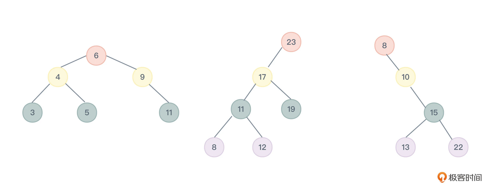
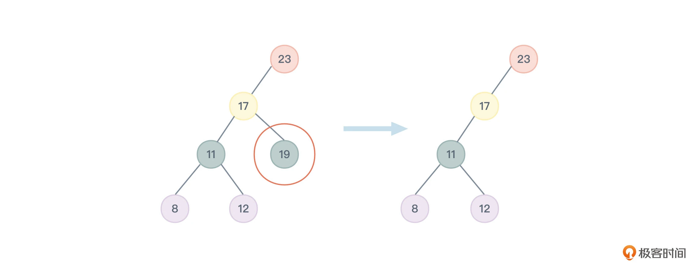
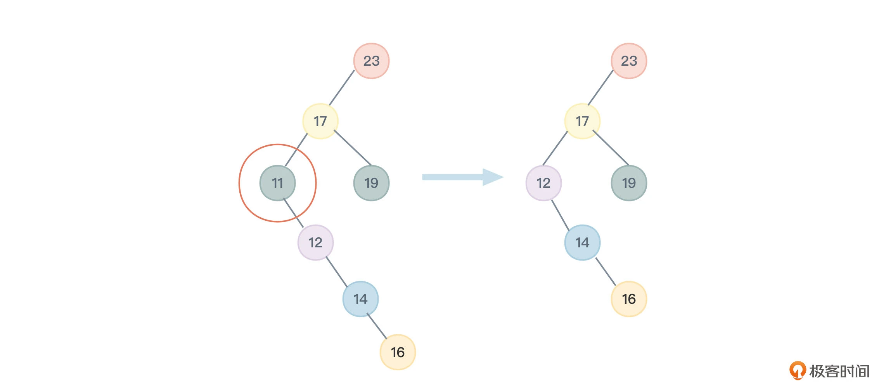
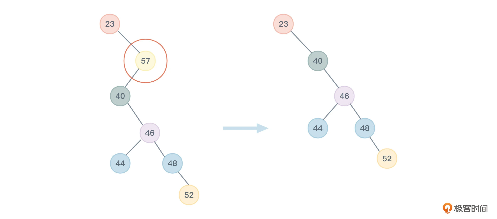
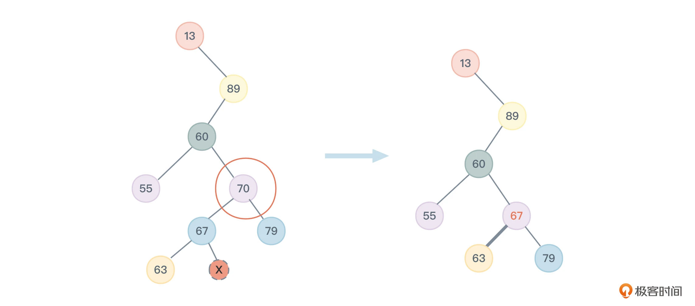
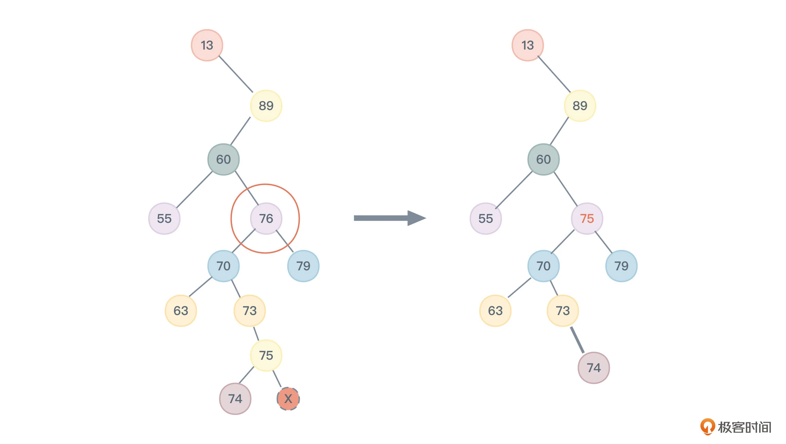
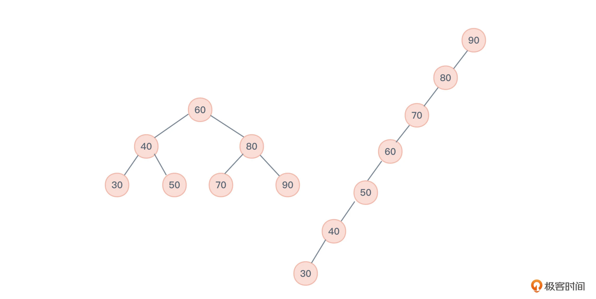
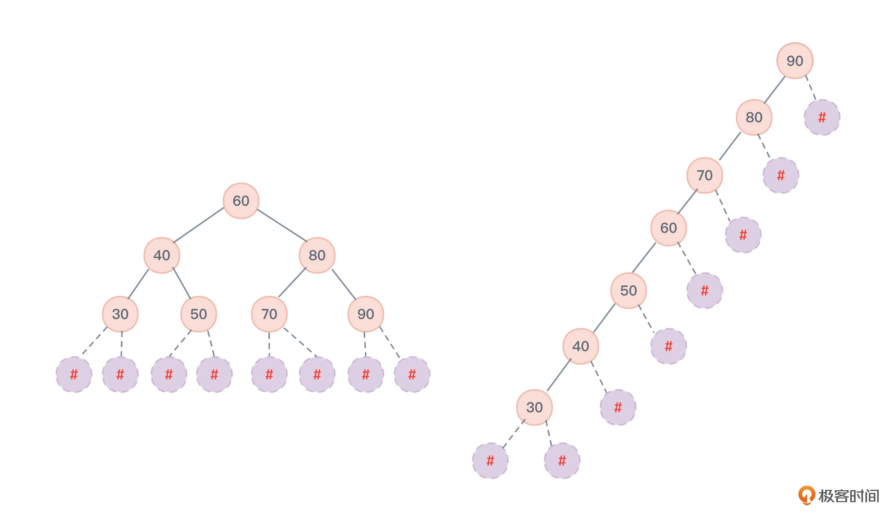

# 14 | 二叉查找树（BST）：查找速度你最行

你好，我是王健伟。

今天我要和你分享的主题是“二叉查找树”。

我们知道，二叉树是用来保存数据的。那么在需要的时候，这些保存在二叉树中的数据，要怎么才能被快速地找到和取出呢？这就需要在保存数据的时候遵循一定的规律。

遵循这种保存数据的规律所构成的二叉树，被称为“二叉查找树”。我们先从它的基本概念说起，再去了解它的实现方式。

## 基本概念及定义

二叉查找树也叫二叉搜索树（BST，Binary Search Tree），存在的意义在于实现快速查找，同时，它也支持快速插入和删除。

要使二叉树成为一棵二叉查找树，那么树中任意一个节点，左子树中每个节点的值都要小于该节点的值。而右子树中每个节点的值都要大于该节点的值。当然，左、右子树本身也是一棵二叉查找树。



- 图1 几棵典型二叉查找树

如果对二叉树查找树进行中序遍历，得到的结果就是一个有序序列，也就是说内部存储的数据是已经排好序的，所以它也叫做二叉排序树（Binary Sort Tree）。图 1 中的二叉查找树按中序遍历序列，第一棵为“3，4，5，6，9，11”，第二棵为“8，11，12，17，19，23”，第三棵为“8，10 ，13，15，22”。

下面，看一看二叉查找树的类模板定义代码，分为每个节点的定义，以及二叉查找树的定义两个部分。

```sql
//树中每个节点的定义
template <typename T> //T代表数据元素的类型
struct BinaryTreeNode
{
 T               data;
 BinaryTreeNode* leftChild,   //左子节点指针
         * rightChild;  //右子节点指针
};
//二叉查找树的定义
template <typename T>
class BinarySearchTree
{
public:
 BinarySearchTree()  //构造函数
 {
   root = nullptr;
 }
 ~BinarySearchTree() //析构函数
 {
   ReleaseNode(root);
 }
 //二叉树中序遍历代码（排序），方便测试时显示节点数据
 void inOrder()
 {
   inOrder(root);
 }
 void inOrder(BinaryTreeNode<T>* tNode)
 {
   if (tNode != nullptr)
   {
     //左根右顺序
     inOrder(tNode->leftChild);
     cout << tNode->data << " ";
     inOrder(tNode->rightChild);
   }
 }
private:
 void ReleaseNode(BinaryTreeNode<T>* pnode)
 {
   if (pnode != nullptr)
   {
     ReleaseNode(pnode->leftChild);
     ReleaseNode(pnode->rightChild);
   }
   delete pnode;
 }
private:
 BinaryTreeNode<T>* root; //树根指针
};
```

## 二叉查找树的常见操作

创建好二叉查找树，就可以进行一些常规的操作了。二叉查找树最常见的操作包括数据插入、查找以及删除操作。我们一个一个来说。

### 数据插入操作

在 BinarySearchTree 类模板的定义中，加入如下代码。

```javascript
//插入元素
void InsertElem(const T& e)  //不可以指定插入位置，程序内部会自动确定插入位置
{
 InsertElem(root, e);
}
void InsertElem(BinaryTreeNode<T>*& tNode, const T& e) //注意第一个参数类型
{
 if (tNode == nullptr) //空树
 {
   tNode = new BinaryTreeNode<T>;
   tNode->data = e;
   tNode->leftChild = nullptr;
   tNode->rightChild = nullptr;
   return;
 }
 if (e > tNode->data)
 {
   InsertElem(tNode->rightChild,e);
 }
 else if (e < tNode->data)
 {
   InsertElem(tNode->leftChild,e);
 }
else
 {
   //要插入的数据与当前树中某节点数据相同，则不允许插入
   //什么也不做
 }
 return;
}
```

在 main 主函数中加入如下代码进行测试。

```
BinarySearchTree<int> mybtr;
int array[] = { 23,17,11,19,8,12 };
int acount = sizeof(array) / sizeof(int);
for (int i = 0; i < acount; ++i)
 mybtr.InsertElem(array[i]);
mybtr.inOrder(); //中序遍历
```

执行结果为：


### 数据查找操作

如果是递归算法来实现，那么在 BinarySearchTree 类模板的定义中，要加入下面的代码。

```javascript
//查找某个节点
BinaryTreeNode<T>* SearchElem(const T& e)
{
 return SearchElem(root, e);
}
BinaryTreeNode<T>* SearchElem(BinaryTreeNode<T>* tNode, const T& e)
{
 if (tNode == nullptr)
   return nullptr;
 if (tNode->data == e)
   return tNode;
 if (e < tNode->data)
   return SearchElem(tNode->leftChild,e); //在左子树上做查找
 else
   return SearchElem(tNode->rightChild,e); //在右子树上左查找
}
```

在 main 主函数中，继续增加代码测试节点查找操作。

```
int val = 19;
cout << endl; //换行
BinaryTreeNode<int>* tmpp;
tmpp = mybtr.SearchElem(val);
if (tmpp != nullptr)
{
 cout << "找到了值为：" << val << "的节点。" << endl;
}
else
{
 cout << "没找到值为：" << val << "的节点!!" << endl;
}
```

新增代码的执行结果为：


注意，查找操作也可以通过非递归算法来实现，效率更高一些，同样也需要用到 while 循环，代码不复杂，这里给出相关代码参考。

```javascript
BinaryTreeNode<T>* SearchElem(BinaryTreeNode<T>* tNode, const T& e)
{
 if (tNode == nullptr)
   return nullptr;
 BinaryTreeNode<T>* tmpnode = tNode;
 while (tmpnode)
 {
   if (tmpnode->data == e)
     return tmpnode;
   if (tmpnode->data > e)
     tmpnode = tmpnode->leftChild;
   else
     tmpnode = tmpnode->rightChild;
 }
 return nullptr;
}
```

### 数据删除操作

二叉查找树的删除操作相对要更复杂一些，针对所要删除的节点的子节点个数不同，有几种情况需要处理。

第一种情况，如果要删除的节点左子树和右子树都为空（叶节点），那就这样操作：

1. 直接把这个节点删除。

2. 指向该被删除节点的父节点的相应孩子指针，将其设置为空。

第二种情况，如果要删除的节点的左子树为空或者右子树为空，那么就需要：

1. 把这个节点删除。

2. 更新指向该被删除节点的父节点的相应孩子指针，让该指针指向要删除节点的非空的子节点即可。

第三种情况最为复杂，如果要删除的节点左子树和右子树都不为空，那么就需要：

1. 找到这个要删除节点的左子树的最右下节点。当然，也可以找这个要删除节点右子树的最左下节点。

2. 将该节点的值替换到要删除的节点上。

3. 接着把刚刚找到的那个最右下节点删除。

在 BinarySearchTree 类模板的定义中，加入如下代码。

```sql
//删除某个节点
void DeleteElem(const T& e)
{
 return DeleteElem(root, e);
}
void DeleteElem(BinaryTreeNode<T>*& tNode, const T& e)  //注意第一个参数类型
{
 if (tNode == nullptr)
   return;
 if (e > tNode->data)
 {
   DeleteElem(tNode->rightChild,e);
 }
 else if (e < tNode->data)
 {
   DeleteElem(tNode->leftChild,e);
 }
 else
 {
   //找到了节点，执行删除操作：
   if (tNode->leftChild == nullptr && tNode->rightChild == nullptr) //要删除的节点
   {
     //即将被删除节点的左孩子和右孩子都为空
     BinaryTreeNode<T>* tmpnode = tNode;
     tNode = nullptr; //这实际上就是让指向该节点的父节点指向空
     delete tmpnode;
   }
   else if (tNode->leftChild == nullptr) //其实这个else if代码可以和上个if代码合并，这
   {
     //即将被删除节点的左孩子为空（但右孩子不为空）
     BinaryTreeNode<T>* tmpnode = tNode;
     tNode = tNode->rightChild;
     delete tmpnode;
   }
   else if (tNode->rightChild == nullptr)
   {
     //即将被删除节点的右孩子为空（但左孩子不为空）
     BinaryTreeNode<T>* tmpnode = tNode;
     tNode = tNode->leftChild;
     delete tmpnode;
   }
   else
   {
     // 即将被删除节点的左右孩子都不为空
     //(1)找到这个要删除节点的左子树的最右下节点
     BinaryTreeNode<T>* tmpparentnode = tNode;  //tmpparentnode代表要删除节点的父节点
     BinaryTreeNode<T>* tmpnode = tNode->leftChild; //保存要删除节点左子树的最右下节点
     while (tmpnode->rightChild)
     {
       tmpparentnode = tmpnode;
       tmpnode = tmpnode->rightChild;
     } //end while
     tNode->data = tmpnode->data;
     //此时，tmpnode指向要删除节点左子树的最右下节点（也就是真正要删除的节点），tmpparentnod
     //(2)删除tmpnode所指向的节点（该节点是真正要删除的节点）
     if (tmpparentnode == tNode)
     {
       //此条件成立，表示上面while循环一次都没执行，也就是意味着要删除节点左子树没有右孩子（但
       tNode->leftChild = tmpnode->leftChild;    //让要删除节点的左孩子  指向  真正要
     }
     else
     {
       //此条件成立，表示上面while循环至少执行一次，这意味着要删除节点的左子树有1到多个右孩子
       tmpparentnode->rightChild = tmpnode->leftChild; //tmpnode不可能有右孩子，最多
     }
     //(3)把最右下节点删除
     delete tmpnode;
   } //end if
 }
}
```

上述代码可能有些复杂不好理解，我们对应几个例子来看一下。

- 情况一，要删除的节点左右子树为空



- 图2 在二叉查找树中删除值为19的叶节点

- 情况二，要删除的节点的左子树或右子树为空



- 图3 在二叉查找树中删除值为11的节点（左子树为空）



- 图4 在二叉查找树中删除值为57的节点（右子树为空）

- 情况三，要删除的节点左子树和右子树都不为空

这种情况相对复杂，我们举两个例子。



- 图5 在二叉查找树中删除值为70的节点（左子树和右子树都存在）

在图 5 中，我们将要删除的节点临时取名为节点 A，它的值是 70，但节点 A 的左子树下并没有右节点，图里我用的是一个虚圆框中间带 X 符号表示，我们将节点 A 的左孩子节点临时取名为节点 B，再把它的值 67 替换成节点 A 的值，再把节点 A 的左孩子节点 B 删除，同时让原本要被删除的节点 A 的 leftChild 指针指向真正被删除节点 B 的左孩子，也就是值为 63 的节点。



- 图6 在二叉查找树中删除值为76的节点（左子树和右子树都存在）

在图 6 中，我们将要删除的节点临时取名为节点 A，它的值是 76，再将节点 A 的左子节点临时取名为节点 B，它的值为 70。我们发现，节点 B 一直往右下看有若干个右节点，比如值为73、75 的节点。一直沿着节点 B 的右孩子不断往右下找，找到最后一个右下节点，并把它临时取名节点 C，值为 75。用节点 C 的值 75 替换掉节点 A 的值。再把节点 C 删除，同时让节点 C 的父节点（值为 73）的 rightChild 指向节点 C 的左孩子（值为 74 的节点）。

话说回来，在 main 主函数中，可以继续增加如下代码测试节点删除操作。

```
mybtr.DeleteElem(val);
mybtr.inOrder();
```

上述的 DeleteElem() 实现代码中，在“找到了节点，执行删除操作”这个分支中，前三个 if…else 分支其实是可以合并的，而最后一个 else（即将被删除节点的左右孩子都不为空）中的代码也可以换一种写法以便于理解，修改后的完整 DeleteElem() 代码如下。

```sql
void DeleteElem(BinaryTreeNode<T>*& tNode, const T& e)  //注意第一个参数类型
{
 if (tNode == nullptr)
   return;
 if (e > tNode->data)
 {
   DeleteElem(tNode->rightChild, e);
 }
 else if (e < tNode->data)
 {
   DeleteElem(tNode->leftChild, e);
 }
 else
 {
   //找到了节点，执行删除操作：
   if (tNode->leftChild != nullptr && tNode->rightChild != nullptr)
   {
     BinaryTreeNode<T>* tmpnode = tNode->leftChild; //保存要删除节点左子树的最右下节点
     while (tmpnode->rightChild)
     {
       tmpnode = tmpnode->rightChild;
     } //end while
     tNode->data = tmpnode->data;
     DeleteElem(tNode->leftChild, tmpnode->data); //递归调用，因为上述是要删除节点左子
   }
   else
   {
     BinaryTreeNode<T>* tmpnode = tNode;
     if (tNode->leftChild == nullptr)
       tNode = tNode->rightChild;
     else
       tNode = tNode->leftChild;
     delete tmpnode;
   }
 }
}
```

你可以看到，代码可以有多种写法，只要能够实现功能，就不必拘泥于某一种。删除操作同样也可以通过非递归算法来实现，代码会相对难理解一些，你可以尝试自行实现。

二叉查找树的插入、删除等操作的实现方法可以有很多种，甚至有人并不真正对节点进行删除操作，只是做删除标记，这种做法你有兴趣可以自己尝试。所以写代码时，你也并不需要局限于我的写法，它们实现的难易程度不同，只要保证操作后得到的结果仍旧是一棵二叉查找树即可。

### 其他操作

接下来，我再为你补充一些二叉查找树的其他常用操作。

- 查找值最大、最小的节点

在 BinarySearchTree 类模板的定义中，加入下面的代码。

```
//查找值最大节点
BinaryTreeNode<T>* SearchMaxValuePoint()
{
 return SearchMaxValuePoint(root);
}
BinaryTreeNode<T>* SearchMaxValuePoint(BinaryTreeNode<T>* tNode)
{
 if (tNode == nullptr) //空树
   return nullptr;
 //从根节点开始往右侧找即可
 BinaryTreeNode<T>* tmpnode = tNode;
 while (tmpnode->rightChild != nullptr)
   tmpnode = tmpnode->rightChild;
 return tmpnode;
}
//查找值最小节点
BinaryTreeNode<T>* SearchMinValuePoint()
{
 return SearchMinValuePoint(root);
}
BinaryTreeNode<T>* SearchMinValuePoint(BinaryTreeNode<T>* tNode)
{
 if (tNode == nullptr) //空树
   return nullptr;
 //从根节点开始往左侧找即可
 BinaryTreeNode<T>* tmpnode = tNode;
 while (tmpnode->leftChild != nullptr)
   tmpnode = tmpnode->leftChild;
 return tmpnode;
}
```

- 找出中序遍历序列中当前节点的前趋和后继节点

解决这个问题的方法有很多，书写的程序代码也各不相同。如果每个节点要有一个指向父节点的指针，那么解决起来可能更容易一些，如果没有指向父节点的指针，那么一般就要从根节点开始找起。

但不管怎样，一定要把握住两个原则。

1. 当前节点的前趋节点一定是比当前节点值小的，也是再往前的一系列节点中最大的。

2. 当前节点的后继节点一定是比当前节点值大的，也是再往后的一系列节点中节点值最小的。

下面的代码有优化和合并的空间，但为了看得更清晰，我就不进行合并了，你可以自行优化。

```
//找按中序遍历的二叉查找树中当前节点的前趋节点
BinaryTreeNode<T>* GetPriorPoint_IO(BinaryTreeNode<T>* findnode)
{
 if (findnode == nullptr)
   return nullptr;
 /*
 //以下代码后来考虑了一下，没必要存在
 //(1)所以如果当前结点有左孩子, 那么找左子树中值最大的节点
 if (findnode->leftChild != nullptr)
   return SearchMaxValuePoint(findnode->leftChild);
 */
 BinaryTreeNode<T>* prevnode = nullptr;
 BinaryTreeNode<T>* currnode = root;  //当前节点，从根开始找
 while (currnode != nullptr)
 {
   if(currnode->data < findnode->data) //当前节点小
   {
     //(1)从一系列比当前要找的值小的节点中找一个值最大的当前趋节点
     //当前节点值比要找的  节点值小，所以当前节点认为有可能是前趋
     if(prevnode == nullptr)
     {
       //如果前趋节点还为空，那不妨把当前节点认为就是前趋
       prevnode = currnode;
     }
     else //prevnode不为空
     {
       //既然是找前趋，那自然是找到比要找的值小的 一系列节点中 值最大的
       if(prevnode->data < currnode->data)
       {
         prevnode = currnode; //前趋自然是找一堆 比当前值小的 值中 最大的一个。
       }
     }
     //(2)继续逼近要找的节点，一直到找到要找的节点，找到要找的节点后，要找的节点的左节点仍旧可
     currnode = currnode->rightChild;  //当前节点小，所以往当前节点的右子树转
   }
   else if(currnode->data > findnode->data) //当前节点值比要找的值大，所以当前节点肯定不
   {
     //当前节点大，所以往当前节点的左子树转
     currnode = currnode->leftChild;
   }
   else //(currnode->data == findnode->data) ，这个else其实可以和上个else合并，但为了清
   {
     //当前节点值  就是要找的节点值，那么 前趋也可能在当前节点的左子树中，所以往左子树转继续找
     currnode = currnode->leftChild;
   }
 } //end while
 return prevnode;
}
//找按中序遍历的二叉查找树中当前节点的后继节点
BinaryTreeNode<T>* GetNextPoint_IO(BinaryTreeNode<T>* findnode)
{
 if (findnode == nullptr)
   return nullptr;
 BinaryTreeNode<T>* nextnode = nullptr;
 BinaryTreeNode<T>* currnode = root;  //当前节点，从根开始找
 while (currnode != nullptr)
 {
   if (currnode->data > findnode->data) //当前节点大
   {
     //(1)从一系列比当前要找的值大的节点中找一个值最小的当后继节点
     //当前节点值比要找的  节点值大，所以当前节点认为有可能是后继
     if (nextnode == nullptr)
     {
       //如果后继节点还为空，那不防把当前节点认为就是后继
       nextnode = currnode;
     }
     else //nextnode不为空
     {
       //既然是找后继，那自然是找到比要找的值大的 一系列节点中 值最小的
       if (nextnode->data > currnode->data)
       {
         nextnode = currnode; //后继自然是找一堆 比当前值大的 值中 最小的一个。
       }
     }
     //(2)继续逼近要找的节点，一直到找到要找的节点，找到要找的节点后，要找的节点的右节点仍旧可
     currnode = currnode->leftChild;  //当前节点大，所以往当前节点的左子树转
   }
   else if (currnode->data < findnode->data) //当前节点值比要找的值小，所以当前节点肯定
   {
     //当前节点小，所以往当前节点的右子树转
     currnode = currnode->rightChild;
   }
   else //(currnode->data == findnode->data)
   {
     //当前节点值  就是要找的节点值，那么 后继也可能在当前节点的右子树中，所以往右子树转继续找
     currnode = currnode->rightChild;
   }
 } //end while
 return nextnode;
}
```

## 二叉查找树的实际应用

在上面的范例中，二叉查找树中保存的都是数字，而在实际的开发中，二叉查找树中保存的都是一个结构对象。一般都是利用结构对象中某个字段作为键（key）来创建二叉查找树。利用这个键就可以迅速找到这个结构对象，从而取得该对象中的其他数据，这些其他数据叫卫星数据。

换句话说，传递给 BinaryTreeNode 类模板的数据元素类型 T，一般是下面这样的一个结构，而不是 int 类型。

```
template <typename KEY> //KEY代表键(key)的类型，比如可以是一个int类型
struct ObjType
{
 KEY  key;   //关键字
 //.....其他各种必要的数据字段
 //.....
};
```

后续定义一个二叉查找树对象。

```
BinarySearchTree< ObjType<int> > mybtr2;
```

当然，可能需要对代码做出相应的调整或扩展，相信你可以自行完成。

## 二叉查找树如何存储重复节点

在前面的范例中，当要插入的数据（键）与当前树中某节点的数据相同，那么就不允许插入了。但如果希望能够插入，该怎样做呢？一般有两种解决办法。

第一种，扩充二叉查找树的每个节点。例如把每个节点扩充成一种链表或动态数组的形式。这样，每个节点就可以存储多个 key 值相同的数据。

第二种，插入数据时，遇到相同的节点数据，就将该数据当做大于当前已经存在的节点的数据来处理，放入当前已经存在的节点的 rightChild，当做小于当前已经存在的节点的数据来处理，放入已经存在的节点的 leftChild 也可以。当然，这需要对插入元素的代码做出调整。

当查找某个节点时，即便遇到了值相同的节点，也不能停止查找，而是要继续在右子树（或左子树）中查找，一直到寻找到的节点是叶子为止。当删除某个节点时，就要查到所有要删除的节点，然后逐个删除。

## 二叉查找树时间复杂度分析

我们前面说过，二叉查找树的意义在于实现快速查找。无论对二叉查找树做何种操作，首先把进行操作的节点找到才是最重要的。因此，这里的时间复杂度分析主要针对的是节点的查找操作。



- 图7 相同的中序遍历序列构造出的两种不同的二叉查找树

先说查找长度。在查找操作中，需要对比的节点次数就是查找长度，它反映了查找操作的时间复杂度。

图 7 的左侧是一棵满二叉树，如果要查找 50 这个节点，则需要分别与 60、40、50 这三个节点做对比，这意味着 50 这个节点的查找长度为 3。而图 7 右侧这棵失衡的二叉树（斜树），要查找 50 这个节点，则需要分别与 90、80、70、60、50 这 5 个节点做对比，这意味着 50 这个节点的查找长度为 5。

我们再引申到平均查找长度 ASL（Average Search Length）。它可以用来衡量整个二叉查找树的查找效率。

- 图 7 左侧图，查找节点 60，查找长度为 1，如果查找 40、80 这两个节点，查找长度为 2，如果查找 30、50、70、90 这四个节点，查找长度为 3。又因为图中有 7 个节点，所以所有节点的平均查找长度 ASL = （1*1 + 2*2 + 3*4）/ 7 = 2.42。

- 图 7 右侧图，同理，ASL = （1*1 + 2*1 + 3*1 +4*1 + 5*1 + 6*1 + 7*1）/ 7 = 4。

可以看到，虽然图中 2 棵二叉查找树存储的数据相同，但左侧的查找效率显然更高。

刚刚是查找节点成功时的平均查找长度，那么查找节点失败时的平均查找长度该如何计算呢？我们将图中的二叉树变为扩展二叉树。



- 图8 相同的中序遍历序列构造出的两种不同的二叉查找树的扩展二叉树

可以看到，如果查找失败，则最终的查找位置会停留在带有 # 标记的扩展节点上。

- 图 8 左侧图，带有 # 标记的扩展节点一共是 8 个，也就是说查找节点时需要对比的 3 次节点值的情形是 8 种。所以查找节点失败时的平均查找长度 ASL = （3*8）/ 8 = 3。

- 图 8 右侧图，带有 # 标记的扩展节点一共是 8 个，同理，查找节点时需要对比 1 次节点值的情形是 1 种，需要对比 2 次节点值的情形是 1 种，以此类推。所以查找节点失败时的平均查找长度 ASL = （1*1+2*1+3*1+4*1+5*1+6*1+7*2）/8 = 4.375。

显然，即便是查找节点失败时的平均查找长度，图 7 左侧二叉查找树的查找效率也是更高的。

不难看出，查找长度与树的高度是成正比的，也就是说，二叉查找树的查找效率主要取决于树的高度。在查找操作中，需要对比的节点次数一定不会超过该树的高度。

- n如果是一棵满二叉树或者完全二叉树，那么根据二叉树的性质五，该二叉树的高度为⌊⌋

## log

- ​2n+1。换句话说，对于有 n 个节点的二叉树，它的最小高度是⌊⌋ +1，这意味着查找操作

## log

- ​2n

## log

- 最好情况时间复杂度为 O()（n 代表该二叉树的节点数量）。​2如果一棵二叉树的高度和节点数相同，也就是一棵斜树，其高度为 n，这意味着查找操作最坏情况时间复杂度为 O(n), 看起来已经是一个链表了。

- n

那么为了提高查找效率，应该尽可能地让二叉查找树的高度变得最小（尽可能接近⌊

- ⌋

## log

- ​2

+1）。也就是说，在创建二叉查找树时，应该尽可能让该二叉查找树保持左右节点的平衡，从而引出平衡二叉树的概念。所谓平衡二叉树，就是该树上任意节点的左子树和右子树深度之差不超过 1。

## 小结

这节课，我们从二叉查找树的概念入手，了解了它的常见操作、具体应用以及优化方向。接下来我从代码记忆以及应用层面分别做个总结。

代码方面，我们实现了数据的插入、查找、删除操作，以及一些常见的找节点操作。插入操作需要我们首先找到正确的插入位置，之后的查找操作代码和它有一定的类似之处，可以通过对比的方式去记忆。其中，只有删除操作相对复杂，建议你结合配图理解后再去记忆。

应用方面，一方面，和我们初学二叉树时的例子不同，二叉树通常会保存一个结构对象。那么我们就可以利用结构对象中某个字段作为键（key）来创建二叉查找树，再利用这个键迅速找到结构对象，从而取得该对象中的其他数据。

另一方面，我们既然无法避免存储重复节点，那也可以选择扩充二叉查找树的每个节点，将其扩充成一种链表或动态数组的形式或将数据当做大于当前已经存在的节点的数据来处理，放入当前已经存在的节点的 rightChild。

回归到二叉查找树的初衷，既然要提升查找速度，就需要让二叉查找树的高度尽量变小，保持左右节点的平衡。

平衡，又是如何做到的？它真的有这么重要吗？下节课，我们就一起聊一聊“平衡”这件事。

## 归纳思考

请尝试用非递归算法来实现插入操作。提示：考虑用 while 循环，代码相对繁琐一些但并不复杂。

欢迎你在留言区分享自己的成果，如果觉得有所收获，也可以把课程分享给更多的朋友一起交流学习。我们下节课见。
