# 15 | 平衡二叉树（AVL）：平衡如此重要，怎么做到的？

你好，我是王健伟。

上节课我们讨论了“二叉查找树”这个话题，最后提到，为了提高查找效率，应该尽可能地让二叉查找树的高度变得最小。也就是说，在创建二叉查找树的时候，要尽可能让二叉查找树保持左右节点的平衡。这就是“平衡二叉树”的由来。

平衡二叉树作为后续红黑树学习的铺垫，很容易被人忽略。这节课，我们就来捋清“达到平衡”的思路，避免在写代码的时候手忙脚乱，也为后续的学习打好基础。

## 什么是平衡二叉树？

平衡二叉树也叫平衡二叉搜索树，英文名是 Balanced Binary Tree，简称 AVL 树（平衡树）。AVL 名字取自于发明平衡二叉树的两个人名字（Adelson-Velsky 以及 Landis）中的字母。平衡二叉树，首先是一棵二叉查找树，在构建这棵二叉查找树的过程中进行平衡化的处理形成平衡二叉树。

要理解平衡二叉树，就要先引入平衡因子 BF（Balance Factor）的概念：该节点左子树的高度减去右子树的高度。有的资料上也会用右子树高度减去左子树高度，也是可以的。

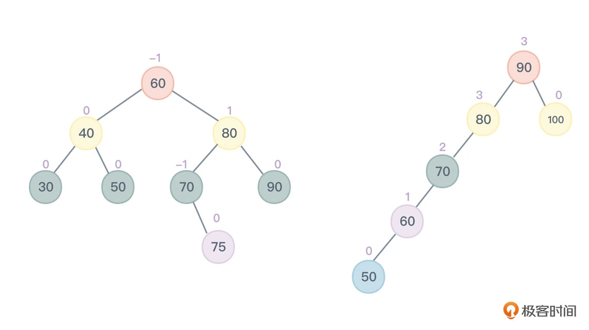

- 图1 平衡与非平衡二叉查找树各个节点的平衡因子值

所以，一棵平衡二叉树上任一节点的平衡因子只能是 -1、0、1 三个值中的一个。观察图 1 左侧二叉查找树各个节点的平衡因子值，显然就是一棵平衡二叉树。而右侧就不是。

平衡二叉树有两个性质。左子树和右子树都是平衡二叉树，而且任一节点的左子树和右子树的高度之差不超过 1。

目前，要解决的主要问题是在插入一个新的节点后，保持原有二叉查找树的平衡。比如图 2中，当插入新节点（值为 72）时，插入路线上所经过的所有节点的平衡因子都发生了改变，二叉树不再保持平衡，退化成了普通的二叉查找树。那么，为了提高查找效率，就要对二叉树进行平衡性调整。

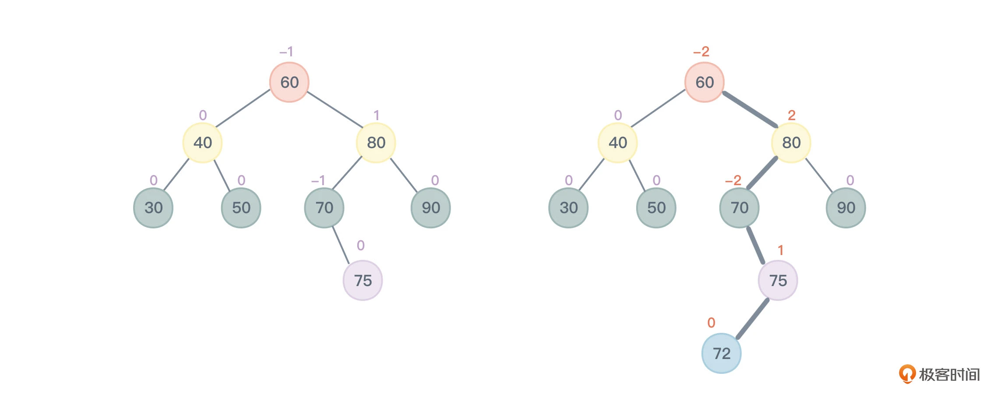

- 图2 平衡二叉树（左图）按照以往方式插入新节点将导致二叉树不再平衡（右图）

基础实现代码可以参考课件中针对类模板 AVLNode 的定义和类模板 AVLTree，包括其中的构造函数 AVLTree() 和析构函数~AVLTree() 的定义。

## 插入操作后的平衡性调整

一般来说，插入、删除这两种操作会改变平衡二叉树的平衡性。

当一棵平衡二叉树不再平衡时，就退化成了一棵二叉查找树，为了提高查找效率，必须对该二叉树进行平衡性调整。平衡性调整相关代码的实现方法并不唯一，这里我会选择比较传统和比较好理解的方式来进行代码实现，后续还会提供一个代码相对简单但理解起来难度更大的代码实现方法。

在图 2 中，插入新节点 72 后，节点 60、80、70 的平衡因子因为不在 -1 到 1 之间，从而打破了这棵二叉树的平衡。那么就从插入的新节点 72 回溯，经过节点 75，找到第一个不平衡的节点 70，对以这个节点为根的子树（包含节点 70、75、72）进行平衡性调整就可以了。

这里将以节点 70 为根的这棵需要进行平衡性调整的子树称为“最小不平衡子树”。之所以称为“最小”，是因为任何其他不平衡子树所包含的节点数量，比如节点 80、70、90、75、72 这棵子树，都比这棵“最小不平衡子树”包含的节点数量多。

只要将这棵“最小不平衡子树”调整平衡，其他不平衡节点的平衡因子都会恢复到原来的值。如图 3 所示。

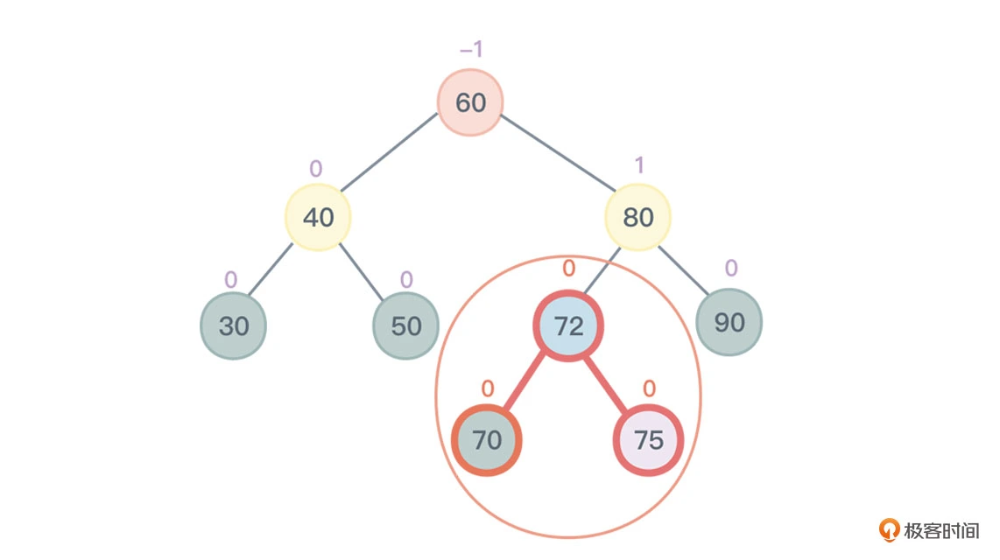

- 图3 将最小不平衡子树调整平衡后其他的不平衡节点因子值自动恢复

也就是说，只要将最小不平衡子树进行平衡性调整，整个二叉查找树就会恢复平衡。

在图 3 中，将最小不平衡子树（包含节点 70、75、72）进行了平衡性调整——将节点 72 作为了子树的新根（后面会详述平衡性调整的过程），将节点 70 作为 72 的左子树，将节点 75作为 72 的右子树。这样调整后，节点 60 和节点 80 的平衡因子也从 -2、2 恢复到 -1、1 了。

换句话说，本来图 2 左侧图中节点 80 的左子树（包括节点 70、75）的深度为 2，但因为加入了节点 72，导致 80 的左子树深度变为 3，通过图 3 的平衡性调整，节点 80 的左子树的深度又恢复回了 2，所以自然就可以得到结论——“只要将最小不平衡子树进行平衡性调整（高度复原），整个二叉查找树就会恢复平衡”。

平衡性调整是通过对该二叉树进行“旋转”操作来达成的。旋转被分为四种旋转方式，分别为左旋转，右旋转，先左后右旋转，先右后左旋转。其中前两个又叫做单旋转，后两个又叫做双旋转。每一次旋转，都会导致孩子节点变成父亲节点，父亲节点变成孩子节点，这一点印象通过后面的学习会进一步加深。

而对于最小不平衡子树（将该子树命名为 A）的产生又分为四种情况。

- 在 A 的“左孩子的左子树”中插入节点导致 A 不平衡（简称 LL：L 代表左 Left）。此时需要通过“右旋转”来调整平衡。

- 在 A 的“右孩子的右子树”中插入节点导致 A 不平衡（简称 RR：R 代表右 Right）。此时需要通过“左旋转”来调整平衡。

- 在 A 的“左孩子的右子树”中插入节点导致 A 不平衡（简称 LR）。此时需要通过“先左后右旋转”来调整平衡。

- 在 A 的“右孩子的左子树”中插入节点导致 A 不平衡（简称 RL）。此时需要通过“先右后左旋转”来调整平衡。

这里，你可以先实现一下基本的插入元素操作代码。在插入操作的实现中，需要借助以往实现过的栈代码来保存插入的节点路径信息，因此要把相关的链栈实现代码引入进来。

在类模板 AVLTree 的定义中，增加 InsertElem() 成员函数 (参见课件)。当然，此时的InsertElem() 成员函数还没写完整，其中还有与平衡性调整相关的代码后面再增加。

接下来，我们分别看一下这四种产生最小不平衡子树的情况。

### 在 A 的“左孩子的左子树”中插入节点导致 A 不平衡（简称 LL）

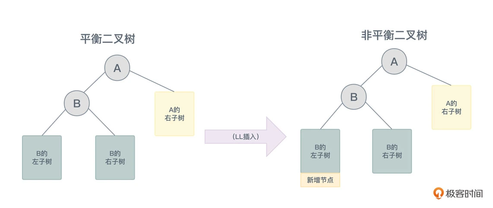

- 图4 在A左孩子（节点B）的左子树中插入节点导致失衡

结构图较为抽象，我也给你列举了一些具体的例子参考。

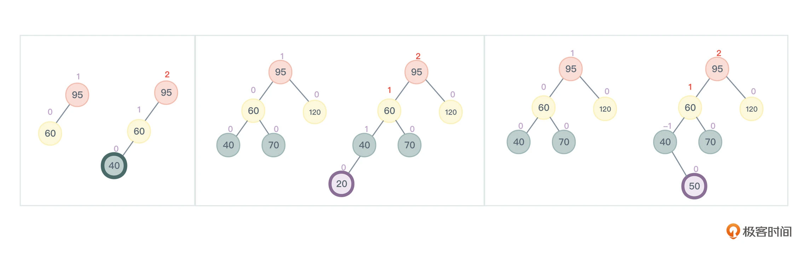

- 图5 在A（节点95）左孩子B（节点60）的左子树（以40为根）中插入节点导致失衡

想一想，想要图 5 中的最小不平衡子树恢复平衡要怎么做呢？通过右旋转的方式，可以理解为左边长了就向右转，用语言描述只需要一句话：

将失衡的节点 A（95）也就是最上边这个失衡的节点向右侧旋转来作为节点 B（60）的右孩子，当然，如果节点 A 有右孩子，那么该右孩子也要跟着节点 A 一起旋转。如果节点 B 原来有右孩子，则首先将节点 B 这个右孩子作为节点 A 的左孩子。

针对图 5 中的三个二叉排序树，重新调整为平衡二叉树后如图 6 所示：

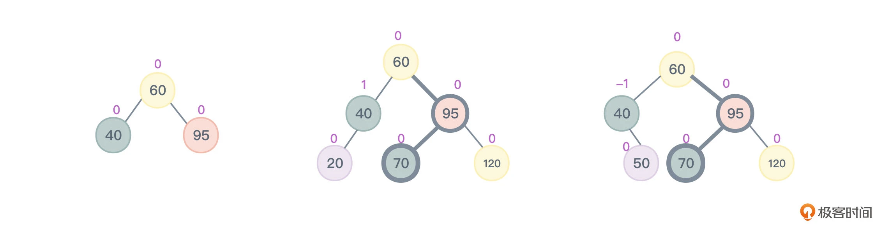

- 图6 将LL插入导致失衡的二叉排序树重新调整为平衡

观察图 5 与图 6 的调整过程，不难得到几个结论。

- 插入新节点导致失衡前这个子树有多高，调整平衡后这个树就会恢复为多高。

比如图 5 中间的图形，本来高度为 3，增加新节点 20 后，高度变为 4 并失衡，重新调整平衡后树的高度又恢复为 3。

- 将一棵最小不平衡子树进行平衡性调整平衡后，这棵调整后的子树的根的平衡因子变为 0。

比如图 5 右侧的图形，最小不平衡子树的根节点是 95，失衡前该节点的平衡因子是 1，失衡后该节点的平衡因子是 2，进行平衡性调整后，这棵调整后的子树的根变成了节点 60，同时这个根（节点 60）的平衡因子为 0（不用理会原来是多少）。

上面的结论同样适用于 RR、LR、RL 的情况，所以还是要好好理解。你可以多在纸上演练几遍平衡性调整的过程，理清思路。接下来，我们就要说说平衡性调整的程序编写思路了。

那从写程序的角度来看，当插入一个新节点导致原来的平衡二叉树失衡后，会发生什么呢？

首先，新插入的节点的平衡因子自然是 0, 因为新插入的节点肯定是叶子节点。

其次，沿着新插入的节点向上逐个找寻父节点并调整父节点的平衡因子。虽然理论上来说，插入路线上经过的所有节点的平衡因子都会发生改变，但是一旦找到最小不平衡子树并对这个子树调整平衡后，其他不平衡的节点的平衡因子都会恢复到不平衡之前的原值。这意味着此时“插入路线上所经过的所有没调整平衡因子的节点的平衡因子”不需要再调整了，因为他们应该保持原值。这句话有点难，该怎么理解呢？我们可以结合图 7 进一步解释一下。

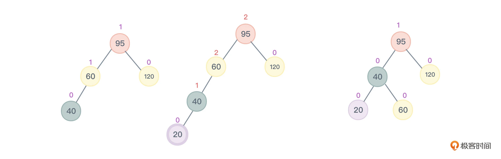

- 图7 阐述平衡性调整结束理论

- 图 7 左侧图，节点 95 和 60 的平衡因子是 1，当插入新节点 20 时，导致这棵二叉排序树失衡，此时理论上来说节点 95 和节点 60 的平衡因子都应该变为 2，如图 7 中间图。

- 但写程序时会从下向上（用一个循环）修改节点的平衡因子——新插入的节点 20 为叶子节点，平衡因子自然为 0，然后将节点 40 的平衡因子从 0 修改为 1，接着将节点 60 的平衡

- 因子从 1 修改为 2，此时注意节点 95 的平衡因子还没有被修改，依然保持为 1。因为节点60 的平衡因子为 2，显然节点 60、40、20 是一棵最小不平衡子树，要进行平衡性调整，调整后的新子树以节点 40 为根并且节点 40 的平衡因子变为 0，节点 60 的平衡因子也变为0，如图 7 右侧图。

- 此时，整个二叉排序树就平衡了，平衡性调整结束，不再需要修改节点 95 的平衡因子，还是保持原值 1（图 7 左侧图中的就是原值）即可。

这样，沿着新插入的节点向上逐个找寻父节点并调整父节点的平衡因子这件事就完成了。

此时，整个二叉排序树平衡，平衡性调整结束，不再需要修改节点 95 的平衡因子，还是保持原值 1（图 7 左侧图中的就是原值）即可。

- 图7 阐述平衡性调整结束理论

将 LL 插入导致失衡的二叉排序树重新调整为平衡的简明表示图如图 8 所示：

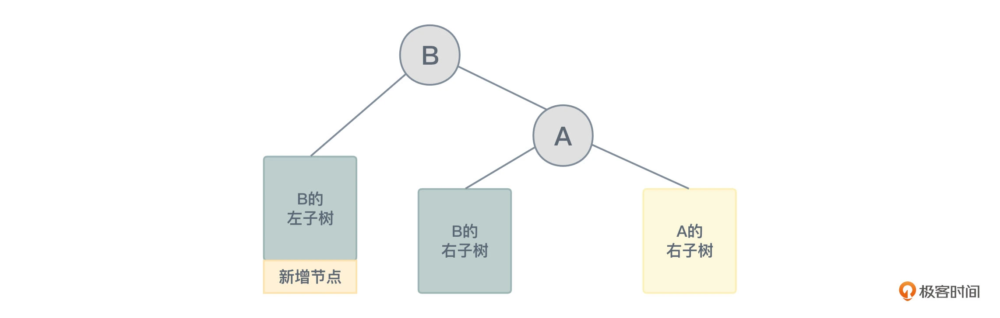

- 图8 将LL插入导致失衡的二叉排序树重新调整为平衡的简明表示

在代码实现上，我们引入 RotateRight 成员函数来针对 LL 插入导致的失衡来调整平衡，具体可以参考课件。

为了能够对这个成员函数进行测试，需要对前面 InsertElem 成员函数的如下语句中扩充一些代码。

```
//(2)找最小不平衡子树的根节点 并进行平衡性调整
if (parent->balfac < -1 || parent->balfac > 1)
{
   //参见课件中的标记有(1)的代码段
}
```

如果你看到了课件中的代码，会发现“根相关指针的调整”代码段理解起来稍微有点难度，这里解释一下。

- 观察图 5 与图 6，将二叉排序树调整平衡后，二叉排序树的根发生了改变，从节点 95 更改为节点 60，这是通过代码行 root = parent; 来完成的。

- 观察图 7，将二叉排序树调整平衡后，二叉排序树的根没有改变，依旧是节点 95，但节点95 的左孩子原来指向的是节点 60，现在要更改为指向节点 40，这是通过代码行pParentPoint->leftChild = parent; 或者 pParentPoint->rightChild = parent; 来完成的。

在 main 主函数中加入代码，可以通过更改 array 数组，在其中放入不同的数据来测试图 5 和图 7 情形下程序对二叉排序树平衡性的调整是否正确。

```
AVLTree<int> mybtr;
int array[] = { 95,60,120,40,20 };
int acount = sizeof(array) / sizeof(int);
for (int i = 0; i < acount; ++i)
 mybtr.InsertElem(array[i]);
```

你可以自行增加一段中序遍历代码来输出平衡二叉树的各个节点内容，以确定平衡调整的正确性。

### 在 A 的“右孩子的右子树”中插入节点导致 A 不平衡（简称 RR）

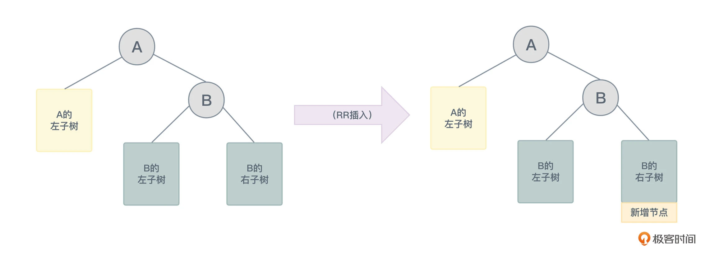

- 图9 在A右孩子（节点B）的右子树中插入节点导致失衡

结构图较为抽象，我也给你列举了一些具体的例子参考。

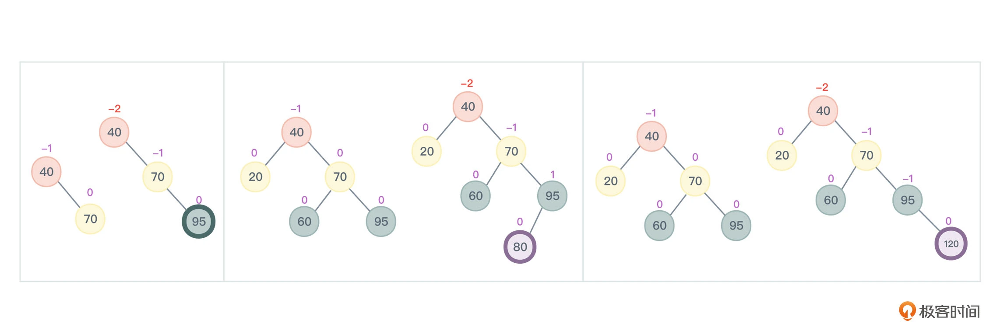

- 图10 在A（节点40）右孩子B（节点70）的右子树（以95为根）中插入节点导致失衡

那么如何通过左旋转（右边长了就向左转）让图 10 中的最小不平衡子树恢复平衡呢？用语言描述只需要一句话：

将失衡的节点 A（40）也就是最上边这个失衡的节点向左侧旋转，作为节点 B（70）的左孩子。当然，如果节点 A 有左孩子，那么该左孩子也要跟着节点 A 一起旋转。如果节点 B 原来有左孩子，则首先将节点 B 这个左孩子作为节点 A 的右孩子。

针对图 10 中的三个二叉排序树，重新调整为平衡二叉树后如图 11 所示。

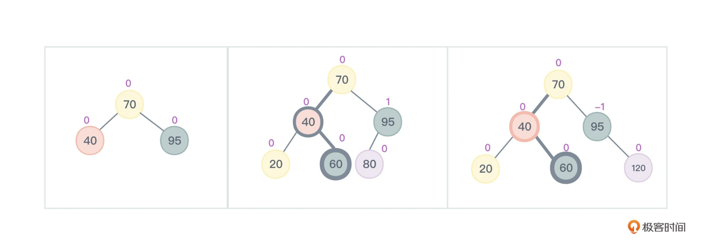

- 图11 将RR插入导致失衡的二叉排序树重新调整为平衡

将 RR 插入导致失衡的二叉排序树重新调整为平衡的简明表示图如图 12 所示。

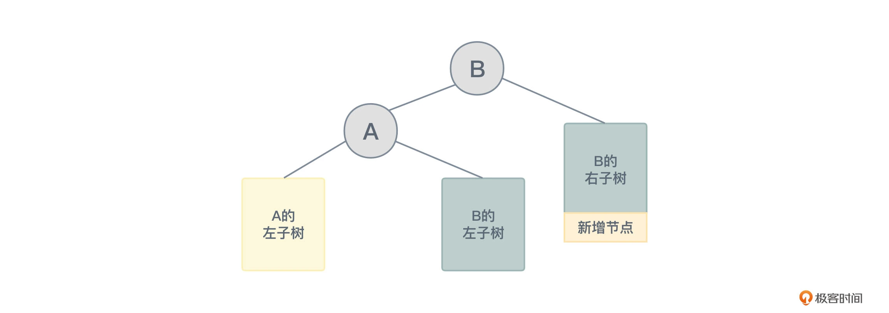

- 图12 将RR插入导致失衡的二叉排序树重新调整为平衡的简明表示

在代码实现上，我们引入 RotateLeft 成员函数来针对 RR 插入导致的失衡来调整平衡，具体可以参考课件，参考前面 LL 插入导致失衡的代码，这里其实很好写，你可以尝试一下。

为了能够对这个成员函数进行测试，继续在 InsertElem 成员函数的如下语句中扩充一些代码。

```
//(2)找最小不平衡子树的根节点 并进行平衡性调整
if (parent->balfac < -1 || parent->balfac > 1)
{
   //参见课件中的标记有(2)的代码段
}
```

在 main 主函数中加入代码，可以通过更改 array 数组，在其中放入不同的数据来测试图 10情形下程序对二叉排序树平衡性的调整是否正确。

```
AVLTree<int> mybtr;
int array[] = { 40,20,60,95,120 };
int acount = sizeof(array) / sizeof(int);
for (int i = 0; i < acount; ++i)
 mybtr.InsertElem(array[i]);
```

### 在子树 A 的“左孩子的右子树”中插入节点导致 A 不平衡（LR）

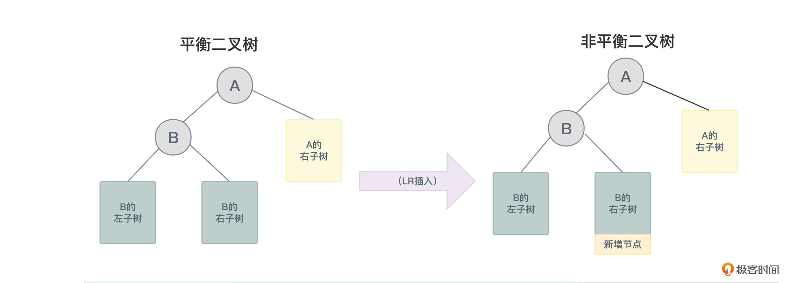

- 图13 在A左孩子（节点B）的右子树中插入节点导致失衡

图 14 所示的几棵二叉查找树都属于在 A 的“左孩子的右子树”中插入节点导致失衡的情形。

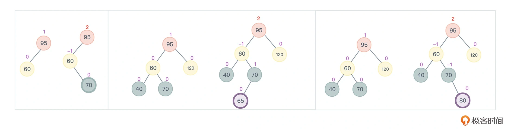

- 图14 在A（节点95）左孩子B（节点60）的右子树（以70为根）中插入节点导致失衡

那么如何通过先左后右旋转让图 14 中的最小不平衡子树恢复平衡呢？简单来说，就是通过一次左旋转先让节点 95、60、70 处于一条直线上，然后再通过一次右旋转（前面讲解过）让失衡子树恢复平衡。

这里可能有些复杂，我们尝试描述一下。

- 将节点 B（节点 60）也就是从上向下数第二行的节点向左侧旋转，让其向左下方下落，如果节点 B 有左孩子则该左孩子也要跟着节点 B 一起旋转，那么节点 B 的右子树（以 70 为根，可以称 70 这个节点为节点 C）就被提起来顶替了节点 B 的位置。得到的效果就是节点B（节点 60）变成了其原右孩子（节点 70）的左孩子。值得一提的是，这里存在两种情况：如果节点 C（节点 70）原来有左孩子，则将这个左孩子变成节点 B（节点 60）的右孩子；如果节点 C（节点 70）原来有右孩子，则这个右孩子要跟着节点 70 一起旋转。

- 将失衡的节点 A（节点 95）也就是最上边这个失衡的节点向右侧旋转来作为新节点 B（节点 70）的右孩子。这里也存在两种情况：如果节点 70 原来有右孩子，则将这个右孩子变成节点 95 的左孩子；如果节点 95 原来有右孩子，则这个右孩子要跟着节点 95 一起旋转。

针对图 14 中的三个二叉排序树，重新调整为平衡二叉树后如图 15 所示。

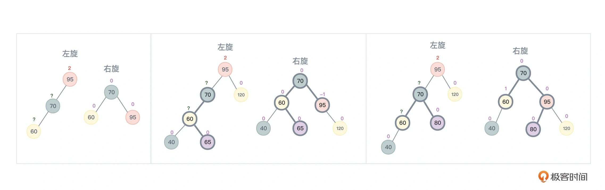

- 图15 将LR插入导致失衡的二叉排序树重新调整为平衡

将 LR 插入导致失衡的二叉排序树重新调整为平衡的简明表示图如图 16 所示。


- 图16 将LR插入导致失衡的二叉排序树重新调整为平衡的简明表示

在代码实现上，我们引入 RotateLeftRight 成员函数来针对 LR 插入导致的失衡来调整平衡，具体可以参见课件。

为了能够对这个成员函数进行测试，继续在 InsertElem 成员函数的如下语句中扩充一些代码。

```
//(2)找最小不平衡子树的根节点 并进行平衡性调整
if (parent->balfac < -1 || parent->balfac > 1)
{
 //参见课件中的标记有(3)的代码段
}
```

在 main 主函数中加入代码，通过更改 array 数组，在其中放入不同的数据来测试图 15 情形下程序对二叉排序树平衡性的调整是否正确。

```
AVLTree<int> mybtr;
int array[] = { 95,60,120,40,50 };
int acount = sizeof(array) / sizeof(int);
for (int i = 0; i < acount; ++i)
 mybtr.InsertElem(array[i]);
```

### 在子树 A 的“右孩子的左子树”中插入节点导致 A 不平衡（RL）

这种情况与 LR 正好相反，先来看一下结构示意图。

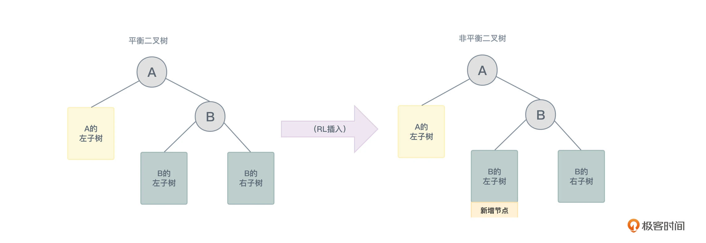

- 图17 在A右孩子（节点B）的左子树中插入节点导致失衡

下图 18 所示的几棵二叉查找树都属于在 A 的“右孩子的左子树”中插入节点导致失衡的情形：

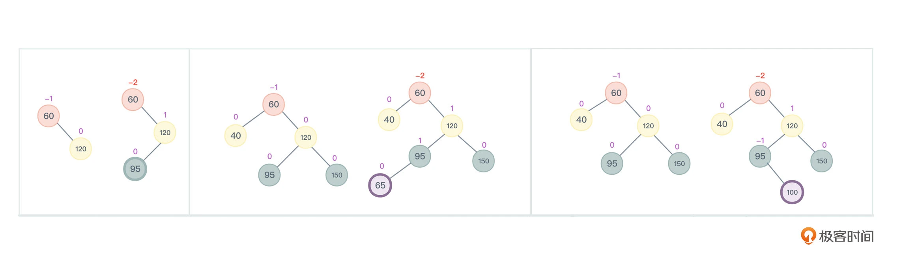

- 图18 在A（节点60）右孩子B（节点120）的左子树（以95为根）中插入节点导致失衡

那么如何通过先右后左旋转让图 18 中的最小不平衡子树恢复平衡呢？简单说来就是通过一次右旋转先让节点 60、120、95 处于一条直线上，然后再通过一次左旋转（前面讲解过）让失衡子树恢复平衡。

这里可能有些复杂，我们尝试描述一下。

- 将节点 B（节点 120）也就是从上向下数第二行的节点向右侧旋转让其向右下方下落，如果节点 B 有右孩子则该右孩子也要跟着节点 B 一起旋转，那么节点 B 的左子树（以 95 为根，可以称 95 这个节点为节点 C）就被提起来顶替了节点 B 的位置。得到的效果就是节点B（节点 120）变成了其原左孩子（节点 95）的右孩子。值得一提的是，这里存在两种情况：如果节点 C（节点 95）原来有左孩子，则这个左孩子要跟着节点 95 一起旋转；如果节点 C（节点 95）原来有右孩子，则将这个右孩子变成节点 B（节点 120）的左孩子。

- 将失衡的节点 A（节点 60）也就是最上边这个失衡的节点向左侧旋转来作为新节点 B（节点 95）的左孩子。值得一提的是，这里存在两种情况：如果节点 95 原来有左孩子，则将这个左孩子变成节点 60 的右孩子；如果节点 60 原来有左孩子，则这个左孩子要跟着节点60 一起旋转。

针对图 18 中的三个二叉排序树，重新调整为平衡二叉树后如图 19 所示。

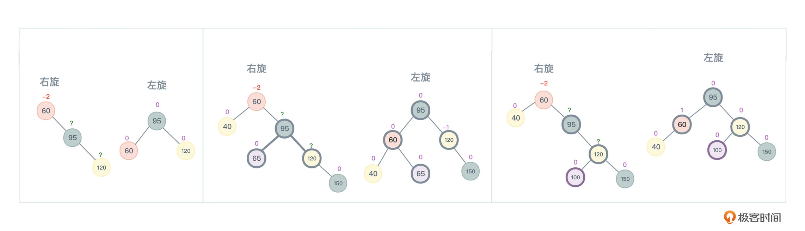

- 图19 将RL插入导致失衡的二叉排序树重新调整为平衡

将 RL 插入导致失衡的二叉排序树重新调整为平衡的简明表示图如图 20 所示。

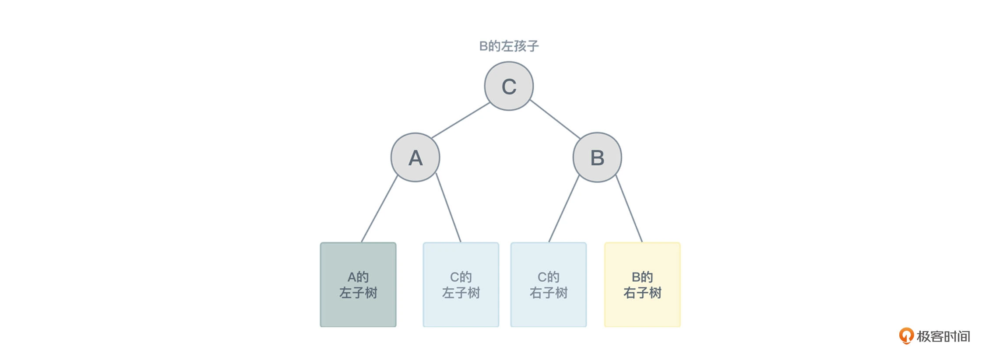

- 图20 将RL插入导致失衡的二叉排序树重新调整为平衡的简明表示

在代码实现上，我们引入 RotateRightLeft 成员函数来针对 RL 插入导致的失衡来调整平衡，具体可以参考课件。

你可以考虑一个问题，如果代码写熟练了的话，是否可以将这两次旋转合并为一次，不非得分开两次进行书写，这个尝试，就留给你了。

为了能够对这个成员函数进行测试，继续在 InsertElem 成员函数的如下语句中扩充一些代码。

```
//(2)找最小不平衡子树的根节点 并进行平衡性调整
if (parent->balfac < -1 || parent->balfac > 1)
{
 //参见课件中的标记有(4)的代码段
}
```

在 main 主函数中加入代码，通过更改 array 数组，在其中放入不同的数据来测试图 19 情形下程序对二叉排序树平衡性的调整是否正确。

```
AVLTree<int> mybtr;
int array[] = { 60,40,70,120,95 };
int acount = sizeof(array) / sizeof(int);
for (int i = 0; i < acount; ++i)
 mybtr.InsertElem(array[i]);
```

当然，二叉查找树插入操作后的平衡性调整及实现代码并不是只有上面这一种写法，只不过上面这种写法从理解的角度相对好理解。

在课件目录“二叉平衡树 _ 增加节点平衡性调整 _ 另一种实现方法”中，我提供了一位网友公开出的另一种二叉查找树进行节点插入操作后的平衡性调整实现代码供你参考，代码量相对较小，但是因为用到了递归调用，所以理解难度要稍微大一些。

这个实现代码中通过引入二叉树节点高度的概念取代平衡因子的概念，来调整二叉树的平衡；同时，其“先左后右旋转”与“先右后左旋转”没有写成单独的成员函数，而是通过先后调用“左旋转（rrRotation）、右旋转（llRotation）”以及“右旋转、左旋转”成员函数来实现的。你可以通过跟踪调试的手段对代码的实现步骤加深理解。

## 小结

通过上节课的学习，你已经知道，为了提高查找效率，在创建二叉树的时候，要尽可能让二叉树的节点保持左右平衡，这就引出了本节所讲述的平衡二叉树。

这节课，我们认识了平衡二叉树的基本概念、性质，也引入了平衡因子 BF（Balance Factor）的概念，书写了平衡二叉树的基础实现代码。接下来，我们就要考虑针对平衡二叉树的节点插入操作了。

这就涉及一个比较复杂的话题——“插入操作后的平衡性调整”。平衡性调整这件事有一个最普遍的结论，那就是“只要将最小不平衡子树进行平衡性调整（高度复原），整个二叉查找树就会恢复平衡”。

对于具体如何进行平衡性调整，我这里说了很多理论和思想性的东西，尽量保证了介绍的详细和全面性。四种旋转方法分别是左旋转、右旋转、先左后右旋转、先右后左旋转，它们可以应对各种不同形状的二叉查找树。我也分别提供了这四种旋转方法的实现代码，这里需要你加强记忆，面试官最喜欢考这个东西。

在“插入操作后的平衡性调整”话题中，我阐述了四种产生最小不平衡子树的情形，给出了详细的讲解图形、恢复平衡的调整方法，并且针对每一种情形都循序渐进地提供了详尽的实现代码。这里注意，我提供代码的目的是保持课程的完整性，并不是要求你一定要记下来，你只需要简单理解，做到有印象，和别人聊到这个话题的时候能聊上几句就行了。如果将来真在工作中遇到这些细节知识，你再来现回忆现查也是来得及的。

## 课后思考

有这样一组数据：

```
int array[] = { 12,4,1,3,7,8,10,9,2,11,6,5 };
```

现在，希望用这组提供的数据生成一棵平衡二叉树，请你在纸上画一画看如何手工把这个二叉树设置平衡，需要经历几次平衡性调整，分别是哪种平衡性调整，最终得到的平衡二叉树是什么样子的？

欢迎你在留言区分享自己的思考。如果觉得有所收获，也可以把课程分享给更多的朋友一起交流进步，我们下节课见。
