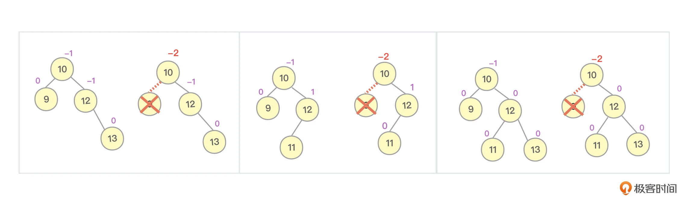
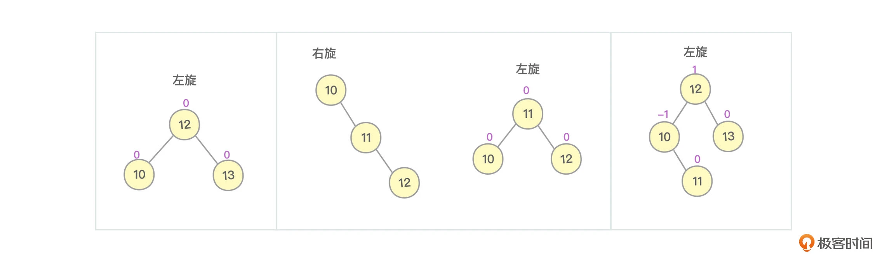
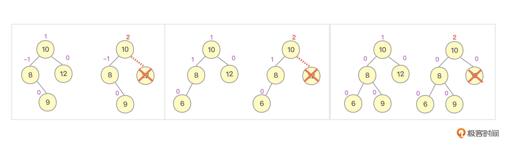
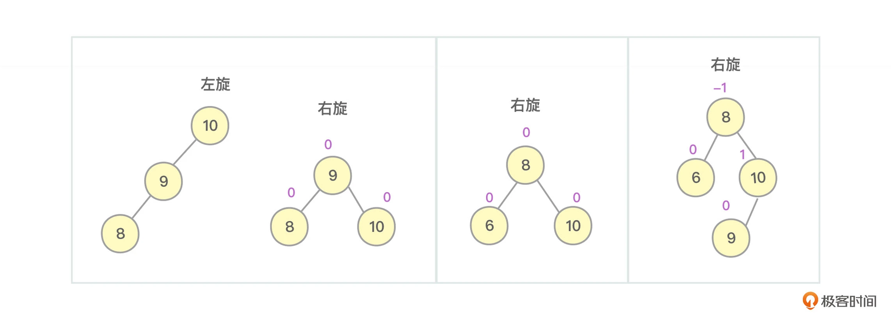
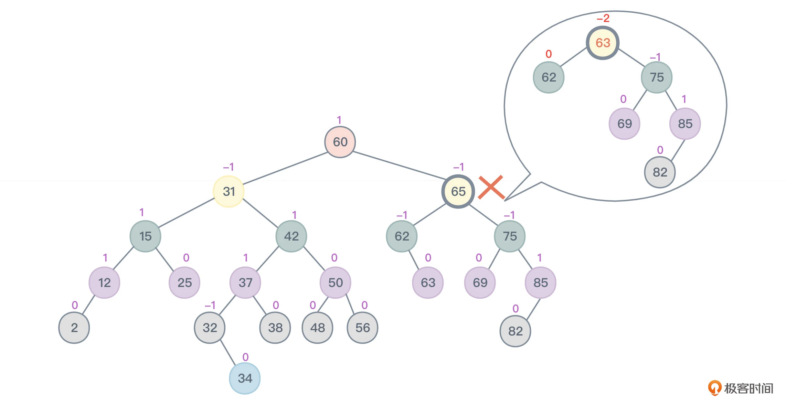
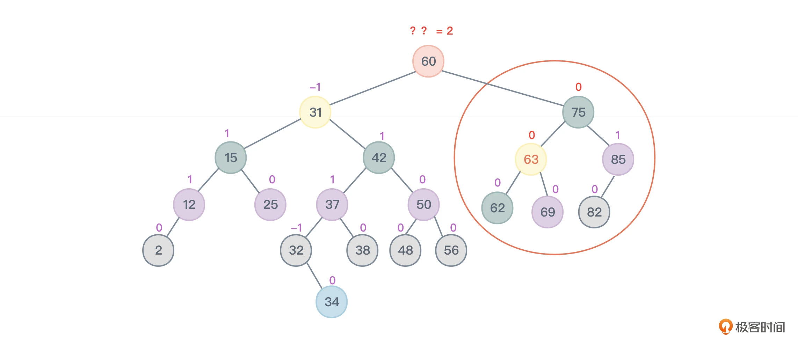
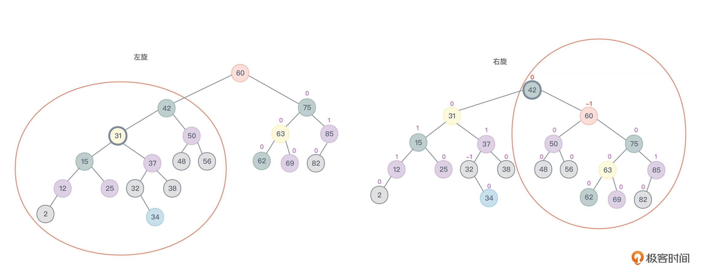

# 16 | 平衡二叉树（AVL）：节点删除后的平衡性调整

你好，我是王健伟。

上节课我们了解了什么是平衡二叉树，也详细讲解了插入一个新的节点后如何保持该树仍旧是一颗平衡二叉树。本节课我将继续与你分享在删除一个平衡二叉树中的节点后如何保持平衡的话题。

平衡二叉树删除某个节点的操作与二叉查找树删除某个节点的操作非常类似，但删除操作同样会使平衡二叉树失去平衡性。一旦因为删除某个节点导致平衡二叉树失衡，那么也要通过旋转使其恢复为平衡二叉树。删除操作的平衡性调整的实现代码有一定的复杂性，请你认真学习。我们先从删除过程的操作步骤开始说起。

## 删除过程的三个步骤

具体的删除过程可以分为三个主要步骤。

步骤一，在平衡二叉树中查找要删除的节点。

步骤二，针对所要删除的节点的子节点个数不同，分别处理几类情况。

- 要删除的节点是叶子节点，则直接把该节点删除并将指向该被删除节点的父节点的相应孩子指针设置为空。

- 要删除的节点有左子树或右子树（单分支节点），则把该节点删除并更新指向该被删除节点的父节点的相应孩子指针，让该指针指向要删除节点的非空的子节点（节点替换）。

- 要删除的节点左子树和右子树都不为空，则这里存在三种情况：找到这个要删除节点的左子树的最右下节点，也可以找这个要删除节点右子树的最左下节点；将该节点的值替换到要删除的节点上；把刚刚找到的那个最右下节点删除。

步骤三：平衡性调整，这需要从被删除的节点向根节点回溯，也就是从下向上寻找。

- 如果回溯发现所有节点都是平衡的，则不需要调整，因为这表示删除该节点并不影响二叉树的平衡性。

- 如果回溯找到了第一个不平衡的节点（以该节点为根的这棵需要进行平衡性调整的子树前面已经说过，叫做“最小不平衡子树”），这个不平衡节点的平衡因子为 -2 或 2，我们分开来说。

第一种，平衡因子（节点 10）为 -2，参考图 1。这里你可能会碰到三类情况。



- 图1 删除节点后找到平衡因子为-2的节点（节点10）并进行平衡性调整的示意图

1. 如果其右孩子（图 1 左侧图节点 12）的平衡因子为 -1，则说明该右孩子的右子树（以节点13 为根）更高，这种情形等同于 RR 型插入操作所要进行的平衡性调整，也就是要通过左旋转来恢复二叉树的平衡。

2. 如果其右孩子（图 1 中间图节点 12）的平衡因子为 1，则说明该右孩子的左子树（以节点11 为根）更高，这种情形等同于 RL 型插入操作所要进行的平衡性调整，也就是要通过先右后左旋转来恢复二叉树的平衡。

3. 如果其右孩子（图 1 右侧图节点 12）的平衡因子为 0，则既可以通过“左旋转”又可以通过“先右后左旋转”来恢复二叉树的平衡。

最后，对图 1 所示的三棵二叉树进行平衡性调整后的示意图如图 2 所示。



- 图2 对图1的三棵二叉树进行平衡性调整后的示意图

好，我们再说第二种情况，如果平衡因子（节点 10）为 2，参考图 3。同样，我们还是会碰到三种情况。



- 图3 删除节点后找到平衡因子为2的节点（节点10）并进行平衡性调整的示意图

1. 如果其左孩子（图 3 左侧图节点 8）的平衡因子为 -1，则说明该左孩子的右子树（以节点 9为根）更高，这种情形等同于 LR 型插入操作所要进行的平衡性调整，也就是要通过先左后右旋转来恢复二叉树的平衡。

2. 如果其左孩子（图 3 中间图节点 8）的平衡因子为 1，则说明该左孩子的左子树（以节点 6为根）更高，这种情形等同于 LL 型插入操作所要进行的平衡性调整，也就是要通过右旋转来恢复二叉树的平衡。

3. 如果其左孩子（图 3 右侧图节点 8）的平衡因子为 0，则即可以通过“右旋转”又可以通过“先左后右旋转”来恢复二叉树的平衡。

最后，对图 3 所示的三棵二叉树进行平衡性调整后的示意图如图 4 所示。



- 图4 对图3的三棵二叉树进行平衡性调整后的示意图

## 一个更复杂的节点删除范例

基本的操作过程熟悉之后，我们再尝试看一个复杂一点的范例：删除一个节点后，需要做两次平衡性调整才能使二叉树恢复平衡。

如图 5，希望对这个图的节点 65 做删除操作：



- 图5 对一棵较复杂的平衡二叉树的65节点做删除操作

当然，操作的步骤方法可能并不唯一，我先向你提供一种删除操作的步骤来借鉴。

- 如果希望删除节点 65，则会寻找到节点 63，用 63 替换 65，最终会把 63 这个叶节点删除。节点删除后，要尝试调整这棵二叉树的平衡性，于是开始回溯。

- 因为删除的是叶子节点 63，所以肯定第一个回溯到节点 62，该节点平衡因子从原来的 -1变为 0，继续回溯，回溯到节点 63（原来的节点 65），此时该节点的平衡因子从原来的 -1变为了 -2，必须对这棵以节点 63 为根的最小不平衡子树进行左旋转调整平衡。左旋转调整平衡后，整个二叉树看起来如图 6 所示：



- 图6 对一棵较复杂的平衡二叉树的65节点做删除后做平衡性调整

- 事情到这里并没有完，图 6 中根节点 60 的右子树平衡性调整完毕后，这棵右子树高度由 4变成了 3，而左子树高度还是 5 没有改变，这意味着根节点 60 的平衡因子从最初的 1 变成了 2，也就是说根节点 60 变得不平衡了。此时，就要对这棵以节点 60 为根的最小不平衡子树（实际上就是整棵树）进行先左后右的旋转调整平衡。最终调整的结果如图 7 所示：



- 图7 删除一个节点导致整棵二叉树做了两次平衡性调整才恢复为平衡二叉树

最终，经过了两次平衡性调整，整个二叉树又恢复了平衡。根节点也从原来的 60 变成了现在的 42。

## 实现代码

基本思路清晰之后，接下来我们就要进入到代码的写作了。内容比较长，但是只要沿着上述我讲解的步骤，实现代码并不难。引入 DeleteElem 成员函数来对节点进行删除，代码如下。

```sql
//删除某个节点
void DeleteElem(const T& e)
{
 return DeleteElem(root, e);
}
void DeleteElem(AVLNode<T>*& tNode, const T& e)  //注意第一个参数类型
{
 AVLNode<T>* ptmp = tNode; //要删除的节点
 AVLNode<T>* parent = nullptr;  //保存父亲节点，根节点的父节点肯定先为nullptr
 //借助栈保存删除的节点路径信息
 LinkStack< AVLNode<T>* > slinkobj;
 while (ptmp != nullptr) //通过while循环尝试让ptmp指向要被删除的节点
 {
   if (ptmp->data == e)
     break;
   parent = ptmp; //记录父节点
   slinkobj.Push(parent); //入栈
   if (ptmp->data > e)
     ptmp = ptmp->leftChild;
   else
     ptmp = ptmp->rightChild;
 } //end while
 if (ptmp == nullptr)//没有找到要删除的节点
   return;
 //找到了要删除的节点，前面二叉查找树删除节点分几种情况：
 AVLNode<T>* q = nullptr;         //临时指针变量
 if (ptmp->leftChild == nullptr && ptmp->rightChild == nullptr)
 {
   //如果要删除的节点左子树和右子树都为空（叶节点）
   if (parent != nullptr)
   {
     if (parent->leftChild == ptmp) //要删除的节点是其父的左孩子
       parent->leftChild = nullptr;
     else
       parent->rightChild = nullptr;
   }
 }
 else if (ptmp->leftChild != nullptr && ptmp->rightChild != nullptr)
 {
   //如果要删除的节点左子树和右子树都不为空，则把对当前节点的删除转换为对当前节点左子树的最右下
   //这里涉及到的问题是要记录最终真删除的节点的路径
   //删除举例：比如删除如下的D节点，最后会转变成删除F节点。ptmp指向的是F节点
   //        *
   //    D              *
   //  *        *         *
   //*   F        *
   //(1)该入栈的节点入栈
   parent = ptmp;  //记录父节点
   slinkobj.Push(parent); //入栈
   //(2)找到这个要删除节点的左子树的最右下节点（也可以找这个要删除节点右子树的最左下节点）,将该
   q = ptmp->leftChild;
   while (q->rightChild != nullptr)
   {
     parent = q;
     slinkobj.Push(parent); //入栈
     q = q->rightChild;
   }
   ptmp->data = q->data;
   ptmp = q; //让ptmp指向真正删除的节点，也就是把删除一个既有左子树又有右子树的节点转化为删除
   //上面找到这个节点肯定没有右子树，因为找的是左子树的最右下节点嘛！
   if (parent != nullptr)
   {
     if (parent->leftChild == ptmp)
       parent->leftChild = ptmp->leftChild;
     else
       parent->rightChild = ptmp->leftChild;
   }
 }
 else
 {
   //如果要删除的节点的左子树为空或者右子树为空(两者肯定有一个为空才能走到这个分支)，让q指向不空
   if (ptmp->leftChild != nullptr)
     q = ptmp->leftChild;
   else
     q = ptmp->rightChild;
   if (parent != nullptr)
   {
     //把被删除的节点的子节点链接到被删除节点的父节点上去
     if (parent->leftChild == ptmp) //要删除的节点是其父的左孩子
       parent->leftChild = q;
     else
       parent->rightChild = q;
   }
 }
 //--------------------------------------------------------------
 //parent不为空的情况上面都处理了，这里处理parent为空的情况,parent为空删除的肯定是根节点
 if (parent == nullptr) //有些代码可以合并，但为了方便理解，笔者并没有合并，读者可以自行合并
 {
   if (ptmp->leftChild == nullptr && ptmp->rightChild == nullptr)//这棵树就一个根节
     tNode = nullptr;
   else if(ptmp->leftChild == nullptr || ptmp->rightChild == nullptr) //要删除这棵
     tNode = q;
   else
   {
     //这个else条件应该一直不会成立
     assert(false);//记得#include <cassert>,assert(false);意味着代码不可能执行到这条语
   }
 }
 //--------------------------------------------------------------
 //处理平衡因子的改变（平衡性调整）
 while (slinkobj.Empty() != true)
 {
   if (slinkobj.Pop(parent) == true)
   {
     //如果删除的是叶子节点，并且其父亲只有一个叶子，那么删除后，其父亲就变成叶子了，叶子的平衡
     if (parent->leftChild == nullptr && parent->rightChild == nullptr)
       parent->balfac = 0;
     else if (parent->leftChild == q) //删除的是左树
       parent->balfac--; //平衡因子减少1
     else //删除右树
       parent->balfac++; //平衡因子增加
     if (parent->balfac == -1 || parent->balfac == 1)
     {
       //说明parent节点原来的平衡因子为0，也就是原来左右孩子都有，那么删除任意一个孩子，除pa
       break;
     }
     if (parent->balfac == 0)
     {
       //说明parent节点原来的平衡因子为-1或者1，得继续回溯向上尝试调整其他父节点平衡因子
       q = parent;
       continue;
     }
     //根据规则来
     if (parent->balfac == -2)
     {
       //平衡因子为-2，所以能确定的是，一定有右孩子
       if(parent->rightChild->balfac == -1) //左旋转
         RotateLeft(parent);
       else if (parent->rightChild->balfac == 1) //先右后左旋转
         RotateRightLeft(parent);
       else //if (parent->rightChild->balfac == 0) //左旋转，可以和上面合并，读者自己合
       {
         RotateLeft(parent);
         parent->balfac = 1;
         parent->leftChild->balfac = -1;
       }
     }
     else
     {
       //平衡因子为2，所以能确定的是，一定有左孩子
       if (parent->leftChild->balfac == -1) //先左后右旋转
         RotateLeftRight(parent);
       else if (parent->leftChild->balfac == 1) //右旋转
         RotateRight(parent);
       else //if (parent->rightChild->balfac == 0)
       {
         RotateRight(parent);
         parent->balfac = -1;
         parent->rightChild->balfac = 1;
       }
     } //end if (parent->balfac == -2)
     //根相关指针的调整
     if (slinkobj.Empty() == true)
     {
       //本条件成立，表示本次平衡性调整调整到了整个树最上面的根节点，因为平衡性调整会使树根节点
       root = parent;
     }
     else
     {
       //本次平衡性调整并没有调整到整个树最上面的根节点，但因为平衡性调整会使树根节点发生改变，
       AVLNode<T>* pParentPoint = nullptr;
       slinkobj.GetTop(pParentPoint);  //拿到老根的父节点，一定会取得成功，因为栈不为空
       //判断让老根父节点（pParentPoint）的左孩子指针还是右孩子指针指向新根（parent）
       if (pParentPoint->data > parent->data)
         pParentPoint->leftChild = parent;
       else
         pParentPoint->rightChild = parent;
     } //end if (slinkobj.Empty() == true)
   } //end if (slinkobj.Pop(parent) == true)
 } //end while
 delete ptmp; //释放掉被删除节点所占用的内存
 return;
}
```

在 main 主函数中，注释掉以往代码，重新加入如下代码，测试节点删除操作，下面是新代码。

```
AVLTree<int> mybtr;
int array[] = { 60,31,65,15,42,62,75,12,25,37,50,63,69,85,2,32,38,48,56,82,34 };
int acount = sizeof(array) / sizeof(int);
for (int i = 0; i < acount; ++i)
 mybtr.InsertElem(array[i]);
//删除测试
mybtr.DeleteElem(65);
```

可以通过跟踪调试来观察节点是否删除成功以及二叉查找树是否重新调整为了平衡二叉树。

## 小结

这节课，我带你详细地学习了“平衡二叉树删除操作后的平衡性调整”方法，我们详细阐述了删除的三个主要步骤，给出了详细的平衡性调整的方法。当然了，这些知识比较繁琐，也不存在哪块知识比较重要，哪块不太重要这个说法，你可以认为都挺重要，都应该了解一下。

另外，很少有资料能够介绍得像咱们这门课里这样细致全面，所以，对于这里的知识点，我不建议你花时间找更多的参考资料了！

我在讲解里给出了详细的讲解图形，提供了详尽的实现代码。代码量很大，所以我建议的学习方法是，去理解刚才我们阐述的理论，不要死记硬背这些代码，如果面试中被问起这部分知识，做到有印象、能大致描述清楚就可以了，不必花费巨大时间去背代码，背代码是学习中的大忌，任何事情只有在理解了的情形下才容易记忆。

如果你希望有一个可视化网站能够演示 AVL 树节点的插入和删除操作，可以访问旧金山大学网站，该网站在后面我会再次提到，它会为你学习和理解各种类型树形结构的节点插入和删除操作提供诸多便利。当然不仅是树形结构，还有很多其他的数据结构和算法的可视化展示也在其中，你可以看这里。

## 课后思考

如果让你自己构建一棵与图 5 所示一模一样的平衡二叉树，你构建得出来吗？如果将图 5 中的节点 31 删除，需要进行几次平衡性调整才能恢复为平衡二叉树? 不妨用本节所讲的程序代码执行试试。

欢迎你在留言区分享自己的思考。如果觉得有所收获，也可以把课程分享给更多的朋友一起学习进步。我们下一讲见！
