# 18 | 红黑（R-B）树：节点插入后的平衡性调整

你好，我是王健伟。

前面我们提到过，向红黑树中插入新的节点会导致红黑树失去平衡，所以，插入新节点后，必须对该红黑树进行平衡性调整。红黑树的平衡性调整，是通过节点变色或者旋转来实现的。

我们先来想想，红黑树插入节点操作一般分为几种情况呢？

首先，对于没有任何节点的空树，直接创建一个黑色节点作为根节点即可。

其次，对于非空的树，查找要插入的位置并插入一个红色节点，然后要判断该节点的父节点。

这里注意，之所以插入的是红色而不是黑色节点，是因为红色节点不会增加黑高度，从而尽量减少插入节点后导致的平衡性调整。如果父节点为黑色，此时不需要做什么；如果父节点为红色，会违背红黑树性质 3，此时必须进行平衡性调整。

这里我将通过观察到的一些现象来总结一下红黑树插入节点后的平衡性调整操作，从而总结出一些规律，而后根据这些规律来编写代码。为了能够观看到红黑树插入一个节点后的平衡性调整，你可以通过搜索引擎搜索“可视化数据结构算法演示”字样，会发现一个“可视化数据结构算法演示 - Data Structure Visualization”的链接，点击后会出现一个页面，点击页面中的“Red-Black Trees”链接，会跳转到图 1 所示的页面。

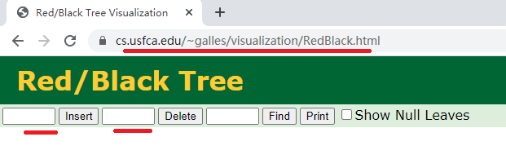

- 图1 一个用于测试红黑树插入、删除节点操作的页面

图 1 的页面操作非常简单，可以通过 Insert 和 Delete 按钮向红黑树中增加以及从红黑树中删除节点，也可以利用页面下面的一系列按钮控制插入和删除节点的动画，包括动画的前进、后退，动画步骤控制等等。

接下来，我们创建一棵红黑树。

如果现在向红黑树中分别插入 100、90、120 三个值来作为三个节点创建红黑树，那么不需要进行任何平衡性调整，得到的红黑树如图 2 的步骤所示。


- 图2 按顺序插入100、90、120得到的红黑树，不需要任何平衡性调整

继续增加 85 或者 95 节点，参考图 3。

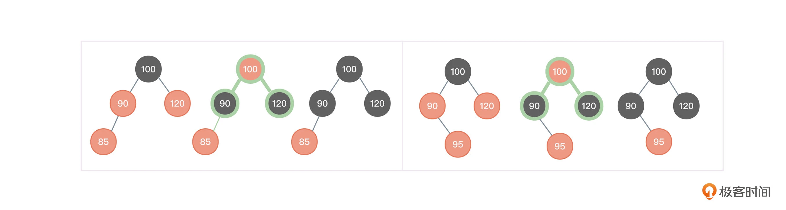

- 图3 继续增加85或者95节点后的平衡性调整

开始观察，有两种情况需要进行平衡性调整。

- 如果此时插入新节点 85，因为刚插入的节点 85 是红色节点，导致 85、90 两个红色节点相邻，违背红黑树性质 3，必须进行平衡性调整。

- 如果此时插入的新节点不是 85，而是 95，就会导致 90、95 两个红色节点相邻，也必须进行平衡性调整。

调整的方法是把 90 和 120 两个节点变成黑色，把 100 变为红色。如果 100 节点是根节点，那么要把 100 节点变回黑色。如果 100 节点不是根，那么如果 100 节点的父节点为黑色，则调整完毕，否则，继续向下看。

- 因为 100 节点从黑色变成了红色，其父节点也是红色，而又一次面临违反红黑树性质 3 的问题，所以这个平衡性调整会沿着 100 节点继续往上调整，一直调整到遇到一个黑色节点或者遇到了根节点。

- 如果遇到了根节点，一定要保证根节点最终是黑色。如图 3 所示。

下面开始总结：

现在的情形是爷爷节点 100 是黑色，父亲节点 90 是红色，叔叔节点 120 是红色，插入新节点之前是个红黑树。在插入红色新节点 85 或者 95 之后，造成了父亲节点和新节点（孩子节点）这两个红色节点相邻，从而需要进行平衡性调整的情况。从而得出了一条平衡性调整规则。

## 插入新节点后平衡调整情况 1

观察图 4，父亲节点是爷爷节点的左孩子，叔叔节点存在且为红色。


- 图4 爷爷节点为黑色，父亲节点为红色，有叔叔节点且为红色，父亲节点是爷爷节点的左孩子

调整方法：

将父亲节点和叔叔节点变成黑色，将爷爷节点变成红色，如果爷爷节点是整个红黑树的根，则要将爷爷节点恢复为黑色。如图 5 所示。

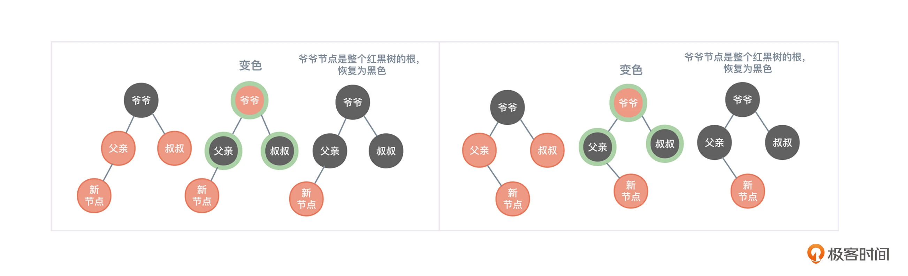

- 图5 爷爷节点为黑色，父亲节点为红色，有叔叔节点且为红色，父亲节点是爷爷节点的左孩子，插入新红色节点导致失衡的调整

从图 5 不难看到，调整完成后，产生的结果二叉树高度满足二叉树的要求，红色节点也不再相邻，但事情到这里没完。

1. 如果爷爷节点是整个二叉树的根节点，那么为了满足红黑树性质 1，要把爷爷节点设置回黑色，此时整个调整才完毕。

2. 如果爷爷节点不是整个二叉树的根节点，则还需要继续沿着爷爷节点向上调整，调整中如果遇到一个黑色的前辈节点，则整个平衡性调整完毕。

什么叫“继续沿着爷爷节点向上调整”？看图 6。

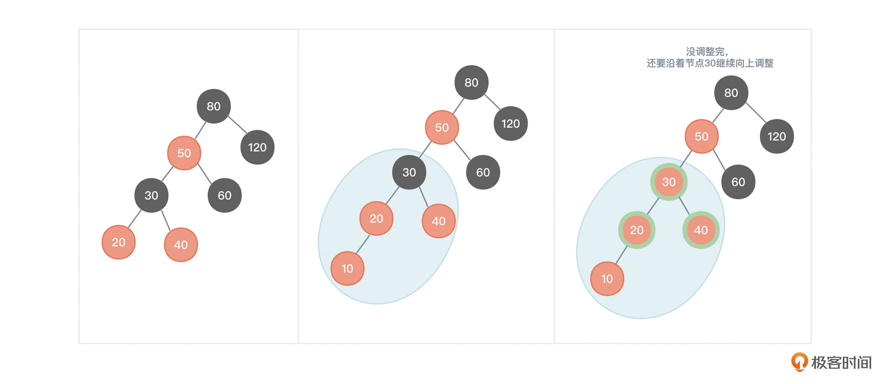

- 图6 阐述沿着爷爷节点向上调整的理论

图 6 左侧图是一个以 80 为根的红黑树，当插入一个新的节点 10（图 6 中间图）后，因为违反红黑树性质 3 导致失衡，要进行平衡性调整。正好，这里父节点 20 是爷爷节点 30 的左孩子，并且叔叔节点 40 是红色的，满足上述“平衡调整情况 1”，于是将爷爷节点 30 变成红色，将父亲节点 20 和叔叔节点 40 变成黑色（图 6 右侧图）。那么现在，“以节点 30 为根”的这棵子树就调整完毕了。

但是，因为节点 30 从原来的黑色变成了现在的红色，导致节点 30 和其父节点 50 不满足红黑树性质 3，所以要沿着节点 30 继续调整其父节点，也就是节点 50，这就叫“继续沿着爷爷节点向上调整”。继续调整时，将以 30 为根的子树看成一个整体（因为这个整体已经平衡）或者看成单独一个节点也可以，但不要忘记，节点 30 已经是红色了。那么怎么继续调整呢？这就要继续观察并尝试得出一条新的平衡性调整规则。

现在重新以 80、50、120、30 为节点创建一棵红黑树，并向这棵红黑树插入节点 10。继续开始观察，看图 7。

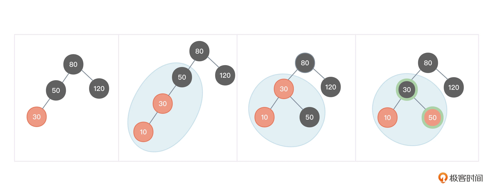

- 图7 80、50、120、30构成的红黑树继续增加节点10后的平衡性调整

- 刚插入的节点 10 是红色节点，导致节点 10、30 两个红色节点相邻，违背红黑树性质 3，必须进行平衡性调整。

- 以节点 50 为根，向右旋转，将 30 作为 50 的父节点。向右旋转你应该不陌生，前面讲平衡二叉树时已经详细讲解过；

- 将原来的 30 节点设置为黑色，将原来的 50 节点设置为红色。

继续观察前面的图 6，看看图 6 接下来会如何变换。参考图 8。

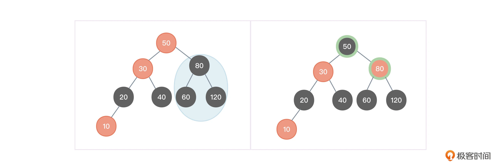

- 图8 爷爷节点向上调整的理论完整平衡性调整情形

- 以节点 80 为根，向右旋转，将 80 作为 50 的右子节点，50 原来的右子节点 60 作为 80 的左子节点。

- 将原来的 50 节点变黑，将原来的 80 节点设为红色。

开始总结：

图 7 的情形是爷爷节点 50 是黑色，父亲节点 30 是红色，没有叔叔节点，插入新节点之前是个红黑树，此时插入红色新节点 10。而图 6 右侧图的情形是爷爷节点 80 是黑色，父亲节点50 是红色，叔叔节点 120 是黑色，把以 30 为根的子树看成是一个新节点，并且该新节点为红色（节点 30 的颜色）。这就造成了父亲节点和新节点这两个红色节点相邻，从而需要进行平衡性调整，从而得出了一条平衡性调整规则。

## 插入新节点后平衡调整情况 2

看图 9，父亲节点是爷爷节点的左孩子，新节点是父亲节点的左孩子，叔叔节点不存在或者存在但为黑色。注意，图 9 中右侧并不是一个红黑树，只是一个红黑树调平衡时的某个中间状态，是从图 6 中的右侧图演变过来的。


- 图9 爷爷节点为黑色，父亲节点为红色，没叔叔节点或有叔叔节点且为黑色，父亲节点是爷爷节点的左孩子，插入的新红色节点是父亲节点的左孩子

调整方法：

在这里，爷爷、父亲、新节点构成了左斜的关系，所以，图 9 就需要首先以爷爷节点为根向右旋转。接着将原父亲节点变为黑色，原爷爷节点变为红色。如图 10 所示。

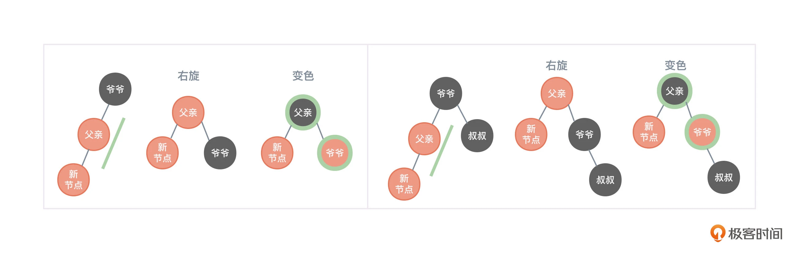

图10 爷爷节点为黑色，父亲节点为红色，没叔叔节点或有叔叔节点且为黑色，父亲节点是爷爷节点的左孩子，插入的

- 新红色节点是父亲节点的左孩子，插入新红色节点导致失衡的调整

借着平衡调整情况 2，再引入平衡调整情况 3。

## 插入新节点后平衡调整情况 3

看图 11，父亲节点是爷爷节点的左孩子，新节点是父亲节点的右孩子，叔叔节点不存在或者存在但为黑色。

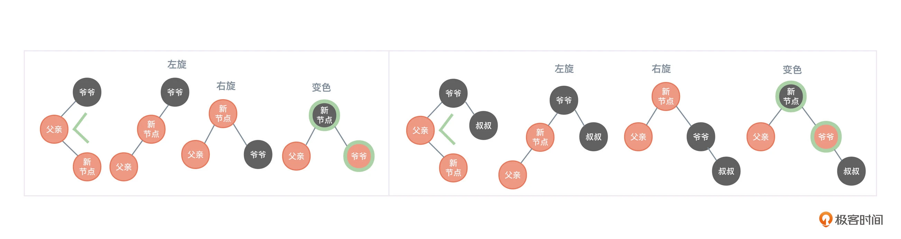

- 图11 爷爷节点为黑色，父亲节点为红色，没叔叔节点或有叔叔节点且为黑色，父亲节点是爷爷节点的左孩子，插入的新红色节点是父亲节点的右孩子，插入新红色节点导致失衡的调整

调整方法：

在这里，爷爷、父亲、新节点构成了先左斜后右斜的关系，所以，图 11 就需要首先以父亲节点为根向左旋转，然后再以爷爷节点为根向右旋转。接着将原来的新节点变为黑色，原来的爷爷节点变为红色。

当然，图 11 可能只是某棵红黑树的一部分，所以可能对于“以父亲节点为根向左旋转，然后再以爷爷节点为根向右旋转”的理解会造成一定的困扰，你可以继续参考图 12，会对旋转理解得更全面。

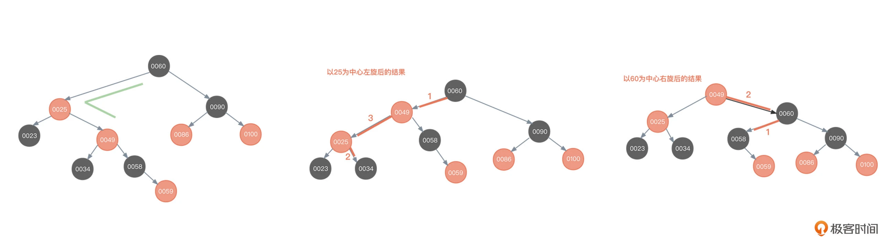

- 图12 对图11先左旋后右旋理解的补充图（变色问题没处理请忽略变色问题）

前面总结了平衡性调整的三种情况，其实还有另外三种情况与前面三种情况正好相反。另外三种情况是父节点是爷爷节点的右孩子，没有叔叔节点或者叔叔节点是爷爷节点的左孩子。这里就不赘述另外三种情况，只是通过图形来表示。

## 插入新节点后平衡调整情况 4

参考图 13。

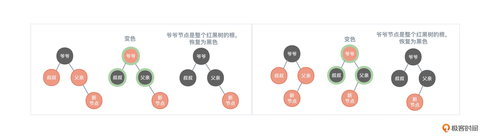

- 图13 爷爷节点为黑色，父亲节点为红色，有叔叔节点且为红色，父亲节点是爷爷节点的右孩子，插入新红色节点导致失衡的调整（对比图5）

## 插入新节点后平衡调整情况 5

参考图 14。

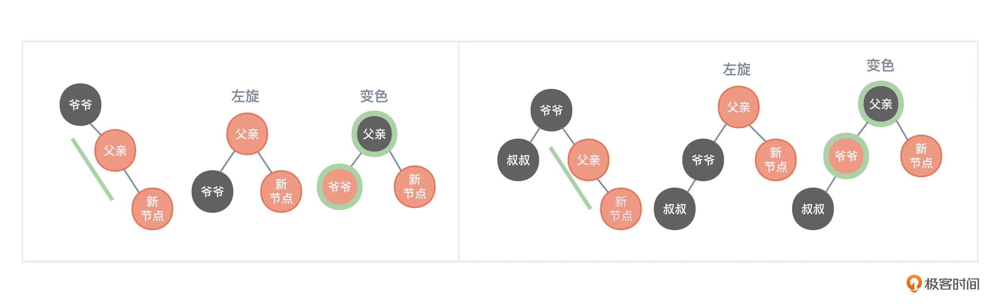

图14 爷爷节点为黑色，父亲节点为红色，没叔叔节点或有叔叔节点且为黑色，父亲节点是爷爷节点的右孩子，插入的

- 新红色节点是父亲节点的右孩子，插入新红色节点导致失衡的调整（对比图10）

## 插入新节点后平衡调整情况 6

参考图 15。

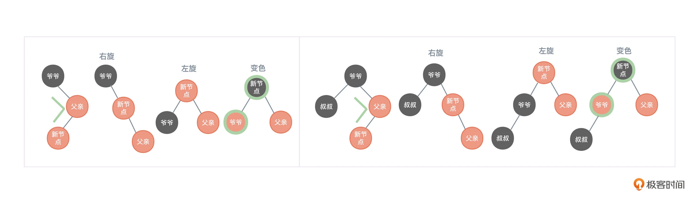

- 图15 爷爷节点为黑色，父亲节点为红色，没叔叔节点或有叔叔节点且为黑色，父亲节点是爷爷节点的右孩子，插入的新红色节点是父亲节点的左孩子，插入新红色节点导致失衡的调整（对比图11）

目前看来，大概所有的情况都已经包括在内，可以开始书写代码了。如果日后发现遗漏可以随时补充。当然，后面课节还会提供针对红黑树的合法性测试代码。

请注意，平衡性调整方法有很多种，并非一成不变，不同的人写出的平衡性调整代码可能都不相同，并没有固定的、可以遵循的套路，只要调整后仍旧是一棵合法的红黑树即可。

为了能够将一个红黑树比较直观地显示出来，方便进行红黑树平衡调整测试，在这里我也增加了前面讲解过的层序遍历接口 levelOrder 并稍加改造。

```javascript
//层序遍历二叉树，方便显示
void levelOrder()
{
 levelOrder(root);
}
//获取某个节点的高度（根高度为1，往下高度依次+1），用于显示节点时换行的目的
int getNodeLevel(RBNode<T>* tNode)
{
 int icurlvl = 0;
 while (tNode != nullptr)
 {
   tNode = tNode->parentNd;
   icurlvl++;
 } //end while
 return icurlvl;
}
void levelOrder(RBNode<T>* tNode)
{
 if (tNode != nullptr) //若二叉树非空
 {
   RBNode<T>* tmpnode;
   LinkQueue<RBNode<T>*> lnobj;//注意，队列的元素类型是“节点指针”类型
   lnobj.EnQueue(tNode); //先把根节点指针入队
   int currdislvl = 1;   //当前显示第几层，根算第一层
   const char* pr = "[红]";
   const char* pb = "[黑]";
   char* ptmp;
   while (!lnobj.IsEmpty()) //循环判断队列是否为空
   {
     lnobj.DeQueue(tmpnode); //出队列
     int lvl = getNodeLevel(tmpnode);
     if (lvl != currdislvl) //用于换行
     {
       currdislvl = lvl;
       cout <<  endl;
     }
     if (tmpnode->isRed == false)
       ptmp = (char *)pb;
     else
       ptmp = (char*)pr;
     cout << tmpnode->data <<ptmp << "       ";
     if (tmpnode->leftChild != nullptr)
       lnobj.EnQueue(tmpnode->leftChild);  //左孩子入队
     if (tmpnode->rightChild != nullptr)     //右孩子入队
       lnobj.EnQueue(tmpnode->rightChild);
   } //end while
 }
}
```

如果调用 levelOrder 接口，就会显示图 8 右侧所示的红黑树，后面测试时我也会详细讲解使用这个接口的方法。这里先看调用结果。

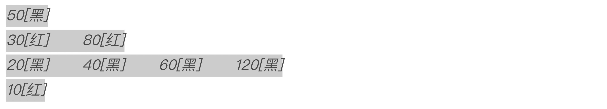

在类模板 RBTree 的定义中，我又继续加入了不少代码，包括 InsertElem()、BalanceTune()、getBrotherNode()、RotateLeft()、RotateRight()、RotateLeftRight()、RotateRightLeft() 成员函数（参见课件）。

在 main 主函数中加入代码，通过更改 array 数组，在其中放入不同的数据来测试红黑树节点的创建和平衡性的调整是否正确。

```
RBTree<int> myrbtr;
int array[] = { 60,25,90,23,49,86,100,34,58,59,80 };
int acount = sizeof(array) / sizeof(int);
for (int i = 0; i < acount; ++i)
{
 myrbtr.InsertElem(array[i]);
}
myrbtr.levelOrder();
```

执行结果如下：

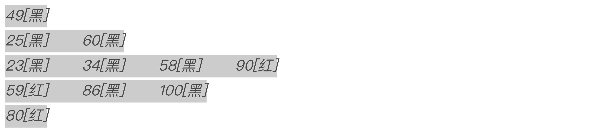

通过前面介绍的“可视化数据结构算法演示”网站，你可以看到创建的红黑树，也就是图 16。

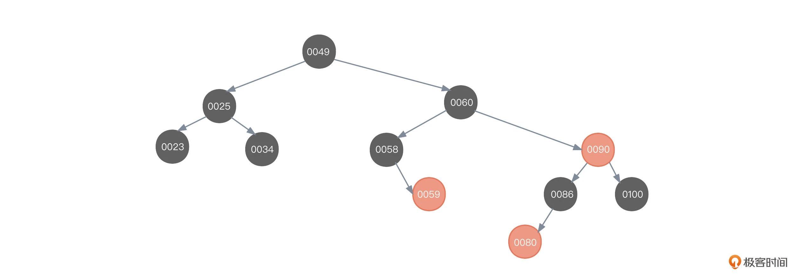

- 图16 通过插入60,25,90,23,49,86,100,34,58,59,80共11个节点创建出的红黑树

## 小结

本节课我带你学习了红黑树插入节点操作的各种情况以及插入操作后平衡性调整的方法。

如果要进行“向红黑树插入节点”的操作，我们总结了该操作所分的两种情况：没有任何节点的空树，以及非空的树。

这里尤其需要注意的是第二种情况，因为向红黑树中插入新的节点会导致红黑树失去平衡，所以插入新节点后必须对红黑树进行平衡性调整。

需要进行平衡性调整的情况分为 6 种，这节课已经总结了详细的图示和代码，我建议你理解这些图示和代码，没必要死记硬背。可以重点关注一下其中的旋转相关的代码包括RotateLeft()、RotateRight()、RotateLeftRight()、RotateRightLeft()。最后，我也总结了一张关于插入节点平衡性调整的各种情况图片，供你参考。

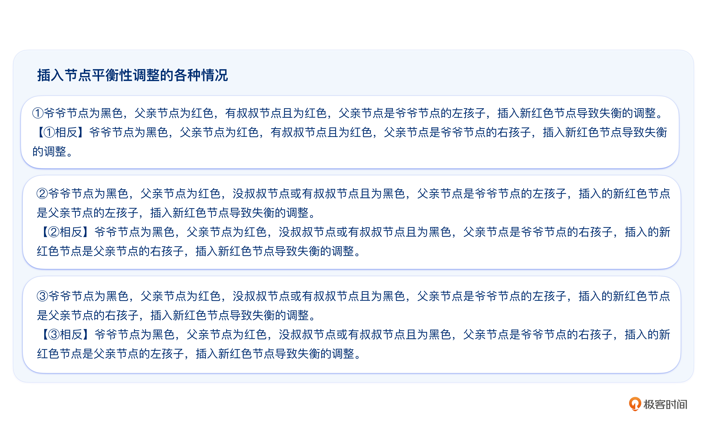

- 红黑树插入节点导致失衡的各种情形汇总

## 课后回顾

自查一下，你是否能够理解本节所讲解的各种插入新节点后的红黑树平衡性调整情况，是否能看懂本节所提供的课件代码？

欢迎你在留言区分享自己的思考。如果觉得有所收获，也可以把课程分享给更多的朋友一起学习、进步。咱们下节课见！
