# 19 | 红黑（R-B）树：节点删除后的平衡性调整（一）

你好，我是王健伟。

上次我和你分享了红黑树的概念和基础实现代码，以及向红黑树插入新节点后进行平衡性调整的方法。这次我将继续和你分享另一个重要的话题——从红黑树中删除一个节点后的平衡性调整。

红黑树的删除操作比较繁琐和复杂，所以我建议，如果能不实际删除则不做实际删除，比如将要删除的节点做个“删除”标记这样的解决方案看是否能解决问题。当然，本节课讲述的是如何将节点从红黑树中真正删除。

## 红黑树删除操作后的平衡性调整及实现代码

从红黑树中删除节点同样会让红黑树失衡，从而需要进行平衡性调整。前面曾经详细讲解过平衡二叉树（AVL）的节点删除操作，分三个主要步骤。

1. 查找要删除的节点。

2. 对节点进行相关的删除操作，注意，这里又分了几种情况。

3. 平衡性调整（旋转）。

对于红黑树的节点删除操作，同样分为 3 个主要步骤，而且其中前 2 个步骤与平衡二叉树的节点删除操作相同，实现代码也基本相同，需要注意的就是红黑树中有一个 parent 指针需要正确地指向父节点。而第 3 个步骤的平衡性调整除了进行旋转外还可能根据需要对节点进行变色操作。

首先回顾一下对节点进行删除操作所分的几种情况（这些知识前面已经讲解过）——针对所要删除的节点的子节点个数不同，有如下几种情况需要处理。

- 要删除的节点是叶子节点，则直接把该节点删除并将指向该被删除节点的父节点的相应孩子指针设置为空。

- 要删除的节点有左子树或右子树（单分支节点），则把该节点删除并更新指向该被删除节点的父节点的相应孩子指针，让该指针指向要删除节点的非空的子节点（节点替换），同时该非空子节点的父节点指针也要做正确指向。

- 要删除的节点左子树和右子树都不为空，则首先找到这个要删除节点的左子树的最右下节点，当然，也可以找这个要删除节点右子树的最左下节点；其次，将该节点的值替换到要删除的节点上；最后，把刚刚找到的那个左子树的最右下节点，或者右子树的最左下节点删除即可。当然，被删除的节点如果还带有子节点，则要正确地设置该子节点的父节点指针指向。

所以，对于删除节点来说，最终删除的节点也只分两种情况。

1. 删除的是叶子节点。

2. 删除的是仅有左子树或仅有右子树的节点。

因为对于删除左右子树都不为空的节点，最终是要转换成上述两种情况之一的。

举个例子，图 1 中第 1 张图所示的红黑树是经过了若干次插入节点和删除节点操作后所形成的模样。现在，要对这棵红黑树的某节点进行删除操作，在不考虑删除节点后需要进行平衡性调整的情况下，看一看删除节点的几种情况。

- 如果要删除节点 9：节点 9 是个纯叶子节点，可以直接删除掉。删除节点后得到的结果如图1 中第 2 张图所示。

- 如果要删除节点 8：节点 8 是节点 6 的右孩子并且有右孩子 9，删除节点 8 时，让节点 8的父亲节点 6 的右孩子指向节点 9，节点 9 的父指针也要指向节点 6。删除节点 8 后得到的结果如图 1 中第 3 张图所示。

- 如果要删除节点 6：节点 6 的左右子树都不为空，找到节点 6 左子树的最右下节点 4，用右下节点的值 4 覆盖节点 6 中的值 6（值 6 变成了值 4），最后再把最右下这个节点 4 删除。当然还要注意到节点 4 还带了一个左节点 3，因此节点 4 的父节点 2 要指向节点 3。当然，节点 3 的父指针也要指向节点 2。删除节点后得到的结果如图 1 中的第 4 张图所示。

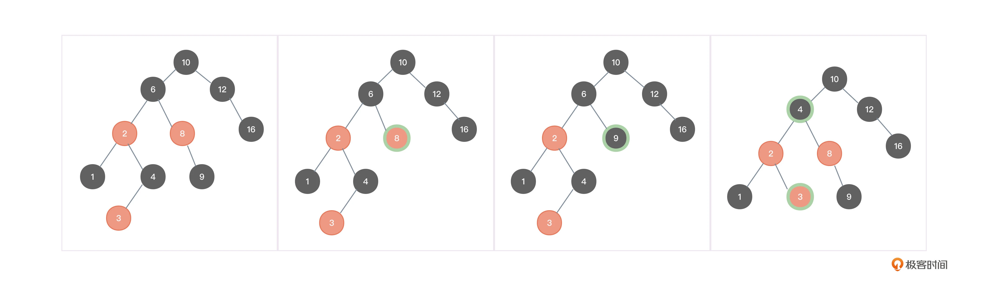

- 图1 演示删除红黑树节点9、8、6的情形（这里没有考虑删除节点后的平衡性问题）

前面已经说过，对于红黑树来讲，平衡性调整除了进行旋转操作，还可能根据需要进行变色操作。先记住这样两点。

- 如果最终删除的是一个红色节点，则不需要进行平衡性调整。

- 如果最终删除的是一个黑色节点，则因为黑色节点的删除会导致黑高度的变化，从而违反红黑树的性质 4，使红黑树失衡，因此必须进行平衡性调整。

但不管怎样调整，记得在调整完成之后，对于整棵红黑树的根节点，都需要将其设置为黑色，这一点后面就不再单独强调了。

根据上面的讨论可以知道，删除黑色节点会分为两种情况：删除的是仅有左子树或仅有右子树的节点；删除的是叶子节点。我们一个一个来说。

### 情况一：删除的是仅有左子树或者右子树的黑色节点

参考前面图 2 可知，这种黑色节点的孩子节点只可能是红色，否则会违背红黑树性质 2。如图2 所示：

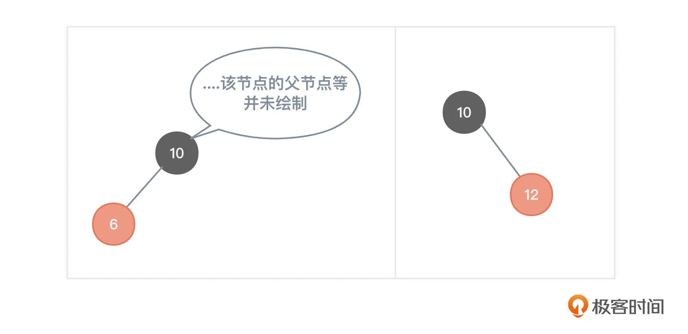

- 图2 删除仅有左子树或者仅有右子树的黑色节点10

操作步骤：

- 把节点 10 删除，让节点 10 的父节点的相应孩子指针指向节点 6 或者节点 12，同时让节点6 或者节点 12 的父节点指针指向节点 10 的父节点。

- 将节点 6 或者节点 12 的颜色从红色修改为黑色，因为路径上删除了一个黑色节点，导致黑高度减 1，所以要补上一个黑色节点。

### 情况二：删除的是黑色的叶子节点

这种情况最繁琐复杂，需要细分好多种情况，因为黑色节点的删除意味着黑高度的变化（红黑树的失衡），此时通常会借助兄弟节点来让红黑树重新平衡。

总之只要把各种细分的情况都考虑清楚和处理周到，写出的代码就会是正确的。但是，能把各种情况都考虑清楚是一件相当不简单的事，我参考众多资料，做到这点者寥寥无几。不过，即便没能一次性把各种情况都考虑到，写出的代码有 Bug 不够完善，也可以通过日后不断发现问题不断完善代码最终实现正确的功能。

调整平衡时有两件事情特别重要：

- 所调整的子树的根节点如果是黑色节点，调整平衡后一定不要把它变成红色节点，否则就会面临着要循环向上不断调整直至遇到黑色节点的情形。

- 调整完成后，该子树黑高度不能发生改变，比如原来黑高度是 3，调整完成变成 2 了。

随着后面各种情况的讲解，你一定会慢慢理解这两句话的。

在这里，待删节点用 D 表示，待删节点的兄弟节点用 S 表示，待删节点的父节点用 P 表示。会分 7 种情况，我们这节课先说前 6 个。

分别来看一看：

1. 待删除节点可以是左节点也可以是右节点，其父节点为红色，兄弟节点为黑色且不带孩子。

如图 3 中的第 1 或第 3 张图所示。注意，为了观察得更清晰，我把红黑树的 Nil 节点也都绘制出来了。

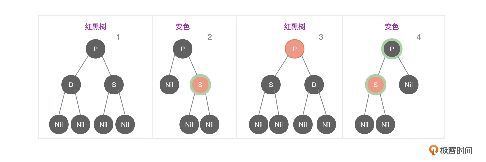

- 图3 待删节点是左或右节点，兄弟节点为黑色且其不带孩子

操作步骤：

- 把节点 D 删除。

- 将节点 P 变成黑色，将节点 S 变成红色。如图 3 中的第 2 个和第 4 张图所示。

2. 待删除节点是左节点，其父节点为红色，兄弟节点为黑色且只带红色的左孩子。

如图 4 中的第 1 图所示：

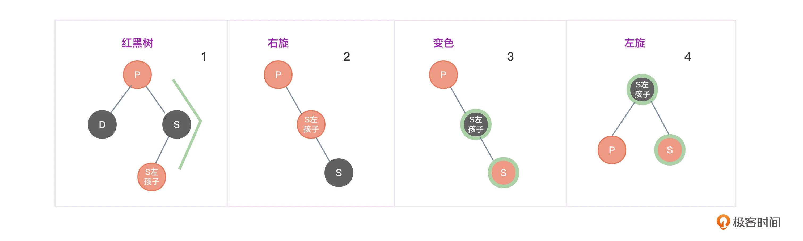

- 图4 待删除节点是左节点，其父节点为红色，兄弟节点为黑色且只带红色的左孩子

操作步骤：

- 把节点 D 删除，此时剩余的节点形状是一个先右斜后左斜。

- 以 S 节点为根向右旋转，如图 4 中的第 2 张图所示。

- 把节点 S 变成红色， S 左孩子变成黑色，如图 4 中的第 3 张图所示。

- 以 P 节点为根向左旋转，如图 4 中的第 4 张图所示。

与图 4 相反的，还有图 5：待删除节点是右节点，其父节点为红色，兄弟节点为黑色且只带红色的右孩子。如图 5 中的第 1 张图所示：

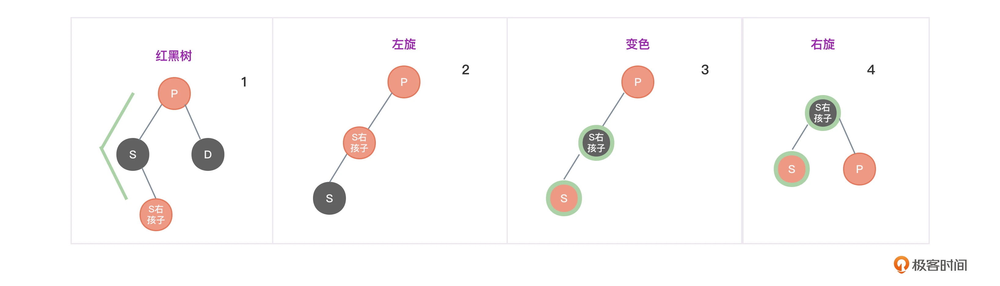

- 图5 待删除节点是右节点，其父节点为红色，兄弟节点为黑色且只带红色的右孩子

操作步骤：

- 把节点 D 删除，此时剩余的节点形状，是一个先左斜后右斜。

- 以 S 节点为根向左旋转，如图 5 中的第 2 张图所示。

- 把节点 S 变成红色， S 右孩子变成黑色，如图 5 中的第 3 张图所示。

- 以 P 节点为根向右旋转，如图 5 中的第 4 张图所示。

3. 待删除节点是左节点，其父节点为红色，兄弟节点为黑色且只带红色的右孩子。

如图 6 中的第 1 张图所示：

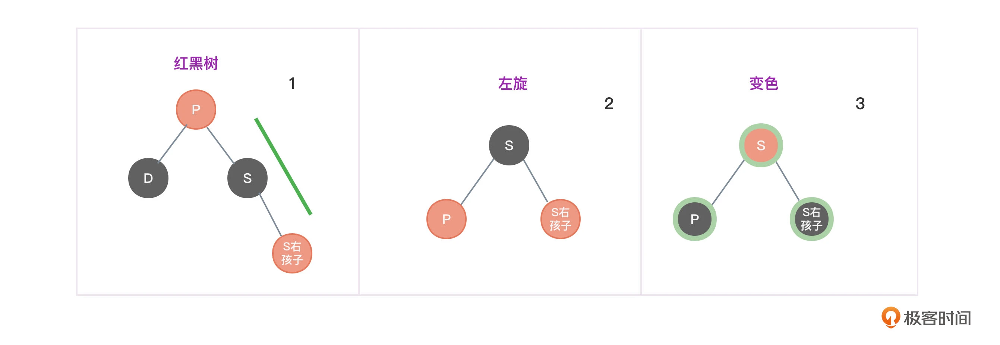

- 图6 待删除节点是左节点，其父节点为红色，兄弟节点为黑色且只带红色的右孩子

操作步骤：

- 把节点 D 删除，此时观察剩余的节点形状，是一个右斜。

- 以 P 节点为根向左旋转，如图 6 中的第 2 张图所示。

- 把节点 S 变成红色， S 的所有孩子变成黑色，如 5 中的第 3 张图所示。注意，这步并不是必须，但在平衡性调整中，把叶子节点变成黑色可能会让后续节点的插入操作需要更少的调整步骤。

与图 6 相反的，还有图 7：待删除节点是右节点，其父节点为红色，兄弟节点为黑色且只带红色的左孩子。如图 7 中的第 1 张图所示：

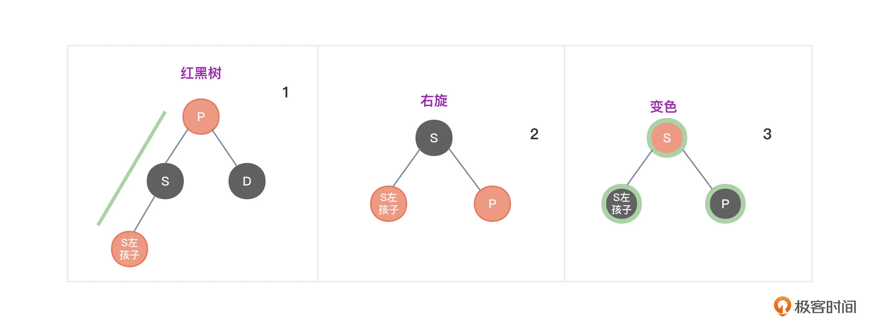

- 图7 待删除节点是右节点，其父节点为红色，兄弟节点为黑色且只带红色的左孩子

操作步骤：

- 把节点 D 删除，此时观察剩余的节点形状，是一个左斜。

- 以 P 节点为根向右旋转，如图 7 中的第 2 张图所示。

- 把节点 S 变成红色， S 的所有孩子变成黑色，如图 7 中的第 3 张图所示。注意，这步并不是必须。

4. 待删除节点是左节点，其父节点颜色随意，兄弟节点为黑色，兄弟节点的左孩子节点可以没有。如果有肯定是红色，否则会违背红黑树性质 4。另外，兄弟节点的右孩子为红色。

如图 8 中的第 1 张图所示。这里提前说明，这里用八边形代表该节点颜色随意（可红可黑），用 3 角形代表该节点可以没有，如果有必然为红色。

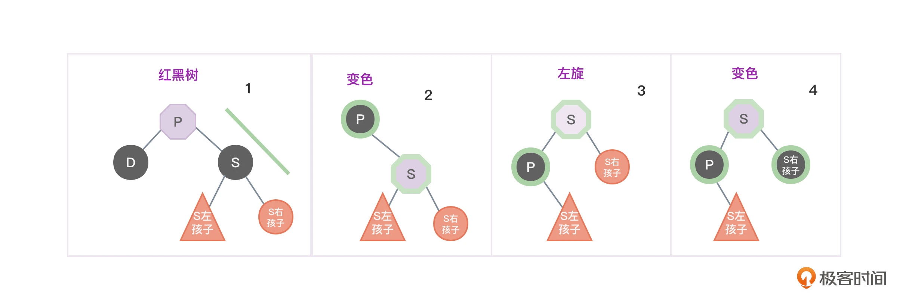

- 图8 待删除节点是左节点，其父节点颜色随意，兄弟节点为黑色，兄弟节点的左孩子没有或颜色为红，兄弟节点的右孩子颜色为红

操作步骤：

- 把节点 D 删除。

- 把节点 P 和节点 S 的颜色对调，因为父节点 P 颜色随意，所以对调之后 P 的颜色肯定为黑色，但节点 S 的颜色取决于原来 P 的颜色。

- 以 P 节点为根向左旋转。

- 将 S 右孩子节点设置为黑色。

与图 8 相反的，还有图 9：待删除节点是右节点，其父节点颜色随意，兄弟节点为黑色，兄弟节点的右孩子节点可以没有，如果有肯定为红色，兄弟节点的左孩子为红色。如图 9 中的第 1张图所示：

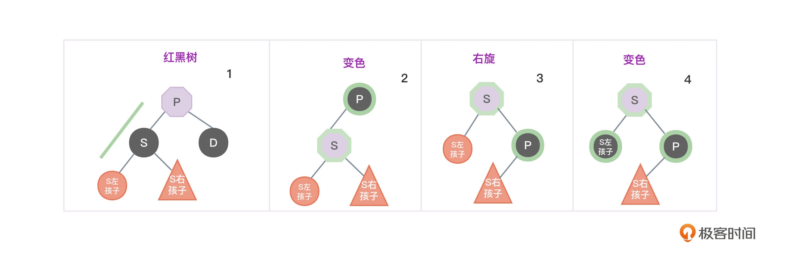

- 图9 待删除节点是右节点，其父节点颜色随意，兄弟节点为黑色，右孩子没有或颜色为红，左孩子颜色为红

操作步骤：

- 把节点 D 删除。

- 把节点 P 和节点 S 的颜色对调，因为父节点 P 颜色随意，所以对调之后 P 的颜色肯定为黑色，但节点 S 的颜色取决于原来 P 的颜色。

- 以 P 节点为根向右旋转。

- 将 S 左孩子节点设置为黑色。

5. 待删除节点是左节点，其父节点为黑色，兄弟节点为黑色，兄弟节点只带红色左孩子。

如图 10 中的第 1 图所示：

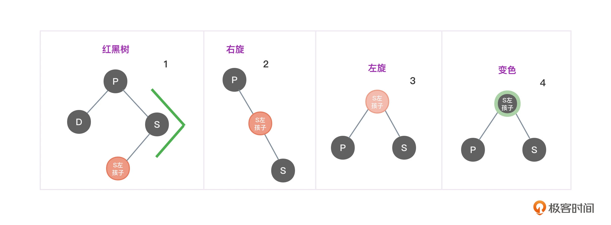

- 图10 待删除节点是左节点，其父节点为黑色，兄弟节点为黑色且只带红色的左孩子

操作步骤：

- 把节点 D 删除。

- 以 S 节点为根向右旋转，如图 10 中的第 2 张图所示。

- 以 P 节点为根向左旋转，如图 10 中的第 3 张图所示。

- 把 S 左孩子节点变成黑色，如图 10 中的第 4 张图所示。

与图 10 相反的，还有图 11：待删除节点是右节点，其父节点为黑色，兄弟节点为黑色只带红色右孩子。如图 11 中的第 1 图所示：

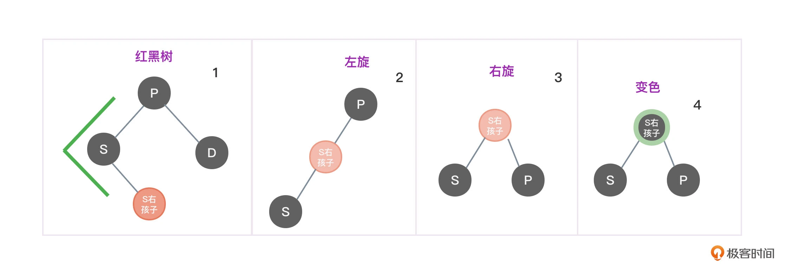

- 图11 待删除节点是右节点，其父节点为黑色，兄弟节点为黑色且只带红色的右孩子

操作步骤：

- 把节点 D 删除。

- 以 S 节点为根向左旋转，如图 11 中的第 2 张图所示。

- 以 P 节点为根向右旋转，如图 11 中的第 3 张图所示。

- 把 S 右孩子节点变成黑色，如图 11 中的第 4 张图所示。

6. 提前说明，这里用三角形代表该节点可以没有，如果有必然为红色。待删除节点的父节点为黑色，兄弟节点为红色且带有两个黑色的孩子。

（1）待删除节点 D 是左节点，兄弟节点 S 的左孩子不可以有孩子，右孩子可以任意，只要符合红黑树性质即可。如图 12 中的第 1 张图所示：

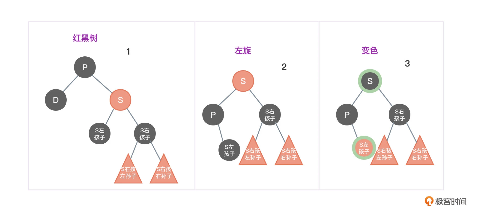

- 图12 待删除节点是左节点，其父节点为黑色，兄弟节点为红色且带2个黑色子节点。S右孩子可以有任意红色孩子，S左孩子不可以有孩子

操作步骤：

- 把节点 D 删除。

- 以 P 节点为根向左旋转，如图 12 中的第 2 张图所示。

- S 节点变成黑色，S 左孩子节点变成红色，如图 12 中的第 3 张图所示。

与图 12 相反的，还有图 13：待删除节点 D 是右节点，兄弟节点 S 左孩子可以任意，只要符合红黑树性质即可，右孩子不可以有孩子。如图 13 中的第 1 张图所示：

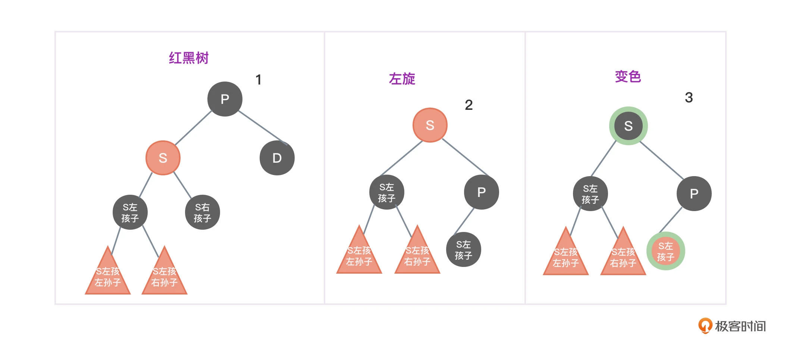

- 图13 待删除节点是右节点，其父节点为黑色，兄弟节点为红色且带2个黑色子节点。S左孩子可以有任意红色孩子，S右孩子不可以有孩子

操作步骤：

- 把节点 D 删除。

- 以 P 节点为根向右旋转，如图 13 中的第 2 张图所示。

- S 节点变成黑色，S 右孩子节点变成红色，如图 13 中的第 3 张图所示。

（2）待删除节点 D 是左节点，兄弟节点 S 的左孩子有一个右孩子，其他节点不用管，只要符合红黑树性质。那么，调整平衡的步骤如下图 14 所示：

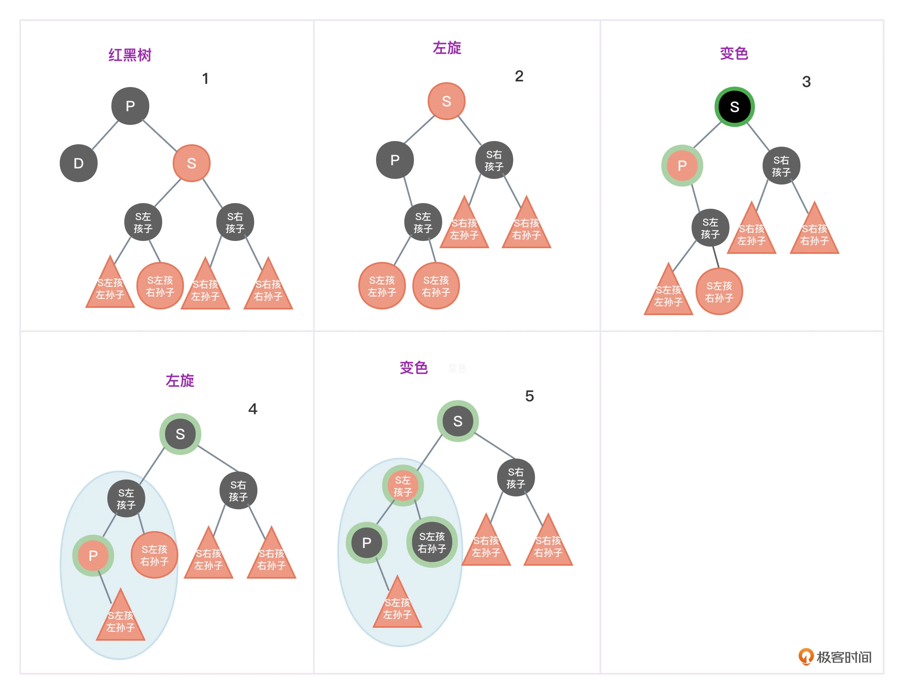

- 图14 待删除节点是左节点，其父节点为黑色，兄弟节点为红色且带2个黑色子节点。S右孩子可以有任意红色孩子，S左孩子带一个右孩子，也可以带或者不带左孩子

操作步骤：

- 把节点 D 删除。

- 以 P 节点为根向左旋转，如 33 中的第 2 张图所示。

- S 节点变成黑色，P 节点变成红色，如图 14 中的第 3 张图所示。

- 以 P 节点为根向左旋转，如图 14 中的第 4 张图所示。

- 将 S 左孩子节点变为红色，将 P 和 S 左孩右孙子节点变为黑色，避免两个红色节点挨在一起。

与图 14 相反的，还有图 15：待删除节点 D 是右节点，兄弟节点 S 的右孩子有一个左孩子，其他节点不用管，只要符合红黑树性质。

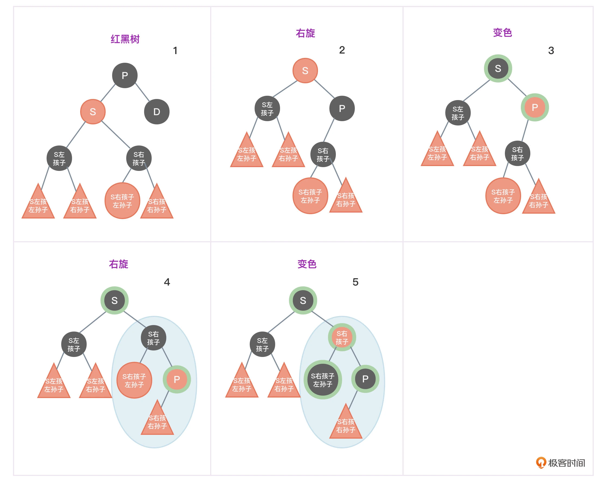

- 图15 待删除节点是右节点，其父节点为黑色，兄弟节点为红色且带2个黑色子节点。S左孩子可以有任意红色孩子，S右孩子带一个左孩子，也可以带或者不带右孩子

对于相反的情况，上述给出了相关调整平衡的图形，非常明显和直观，所以就不再写操作步骤了。

（3）待删除节点 D 是左节点，兄弟节点 S 的左孩子只有一个左孩子，没有右孩子，其他节点不用管，只要符合红黑树性质。那么，调整平衡的步骤如下图 16 所示：

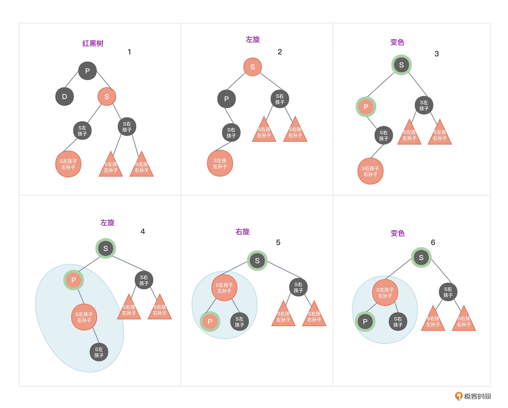

- 图16 待删除节点是左节点，其父节点为黑色，兄弟节点为红色且带2个黑色子节点。S右孩子可以有任意红色孩子，S左孩子带一个左孩子

操作步骤：

- 把节点 D 删除。

- 以 P 节点为根向左旋转，如图 16 中的第 2 张图所示。

- S 节点变成黑色，P 节点变成红色，如图 16 中的第 3 张图所示。

- 以 S 左孩子节点为根向右旋转，如图 16 中的第 4 张图所示。

- 以 P 节点为根向左旋转，如图 16 中的第 5 张图所示。

- 将 P 节点变成黑色，如图 16 中第 6 个图所示。

与图 16 相反的，还有图 17：待删除节点 D 是右节点，兄弟节点 S 的右孩子只有一个右孩子，没有左孩子，其他节点不用管，只要符合红黑树性质。

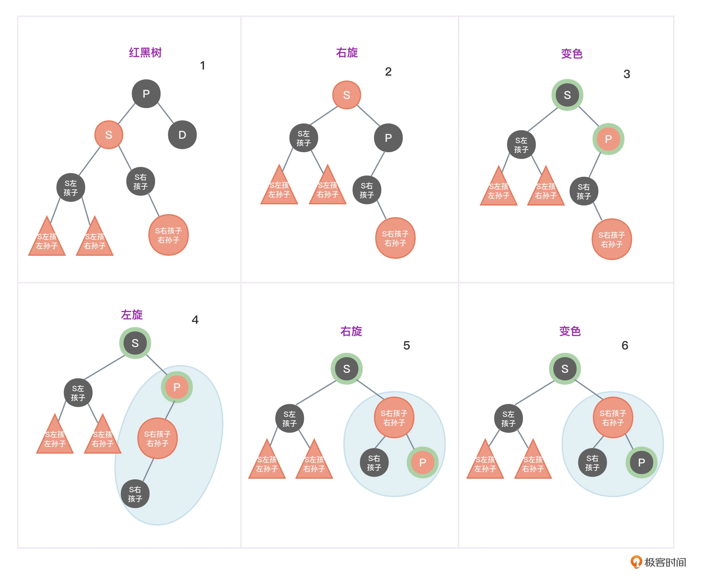

- 图17 待删除节点是右节点，其父节点为黑色，兄弟节点为红色且带2个黑色子节点。S左孩子可以有任意红色孩子，S右孩子带一个右孩子

## 小结

好了，这节课我们就先说这么多，这节课程我们主要讲了两大种删除操作后的平衡性调整。

情况一：删除的是仅有左子树或者右子树的黑色节点。

情况二：删除的是黑色的叶子节点。这种情况我们没讲完，参考下面的图，我们讲完了整个2.6。

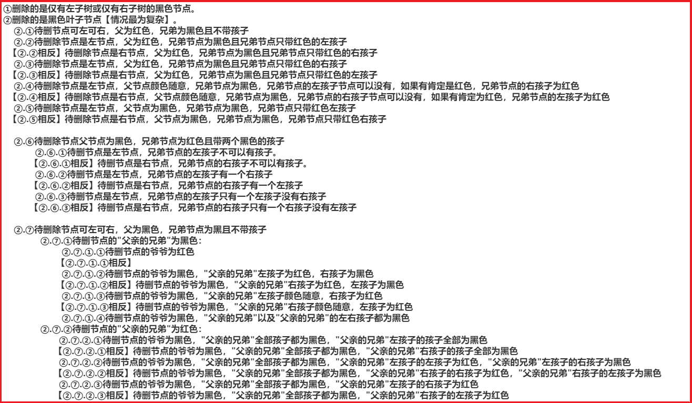

虽然这些平衡性调整的情况比较多变，不太容易看到调整规律，但还是能得到一些调整平衡的经验，是什么呢？

- 如果左子树高，就向右侧旋转，反之就向左侧旋转。

- 如果要减少黑高，则设法将某个黑色节点变红，但要注意不要让两个红色节点碰到一起。如果增加黑高，则设法将某个红色节点变黑。

下节课，我们继续从 2.7 开始说起。

## 归纳思考

下节课，我们会说一种比较特殊的情况——待删节点的父节点为黑色，兄弟节点也为黑色且兄弟节点不待任何孩子节点。为什么这种情况比较特殊呢？因为进行平衡性调整后，被调整部分子树的黑高度会减少 1。黑高度发生变化会导致什么问题的出现？具体又要怎样解决呢？

请你先想一想，看是否能想到什么好的解决办法。我们下节课见！
