# 22 | 树、森林、二叉树：相互之间的转换

你好，我是王健伟。

前面我们讲过了各种二叉树，这方面的知识已经够多的了，本节就来讲一讲更通用的概念：树、森林以及与二叉树之间的转换问题。

## 树的存储结构

前面我们学习了树形结构的基本概念，在满足这个概念的前提下，一棵树可以有任意形状，可以有任意多的孩子，所以对树的处理相对于二叉树等比较而言要复杂得多。

那么树的存储结构有哪些，他们的优缺点是什么呢？一起来看一看。

### 双亲表示法

双亲表示法保存树所采用的结构类似于静态链表，即用一维数组（一组连续的空间）来存储树的各个节点，数组中的一个元素对应树中的一个节点。节点是一个结构，其中不但包含了节点所包含的数据（数据域，data），还包含了该节点的父节点在数组中的下标（指针域，parent）。

节点结构如图 1 所示：


- 图1 双亲表示法存储树时树中每个节点的结构

树的节点结构以及树的实现代码如下。

```python
template <typename T>//T代表数据元素的类型
struct TreeNode
{
 T  data;     //数据域
 int parent;  //指针域，父节点在数组中的下标
};
#define MaxTreeSize 200 //树中能够保存的最大节点个数
//树的定义
template <typename T>
class Tree
{
public:
 Tree() //构造函数
 {
   for (int i = 0; i < MaxTreeSize; ++i)
   {
     m_data[i].parent = -1;  //-1表示目前还没有父亲，类似于空指针的作用
   }
   m_length = 0;
 }
private:
 TreeNode<T> m_data[MaxTreeSize];  //节点数组
 int m_length; //树中包含的节点数量
};
```

不难想象，对于图 2 所示的一棵树：

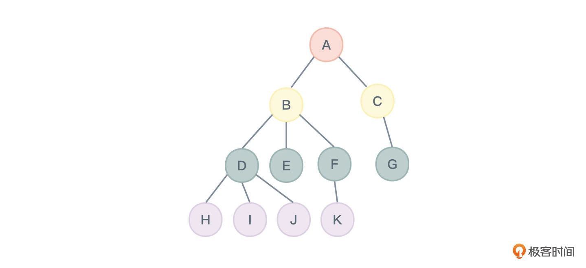

- 图2 一棵普通的树

用双亲表示法的存储结构如图 3 所示。

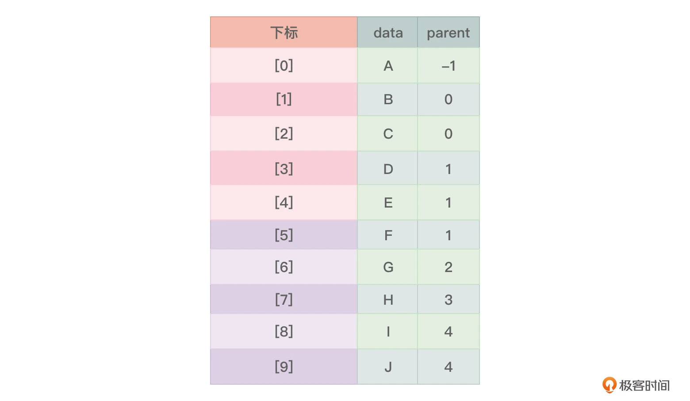

- 图3 双亲表示法保存一棵普通树时数组中的内容

图 3 中，寻找一个节点的父节点相当容易，因为就在其 parent 中记录着。但寻找一个节点的孩子节点，就比较繁琐，只能到数组中去找，看谁的 parent 值是该节点在数组中的下标值，谁就是该节点的孩子。可以向节点结构 TreeNode 中增加一个称为 firstchild 的新成员以记录该节点的第一个孩子在数组中的下标，那么图 3 的内容就可以进一步丰富，如图 4 所示：

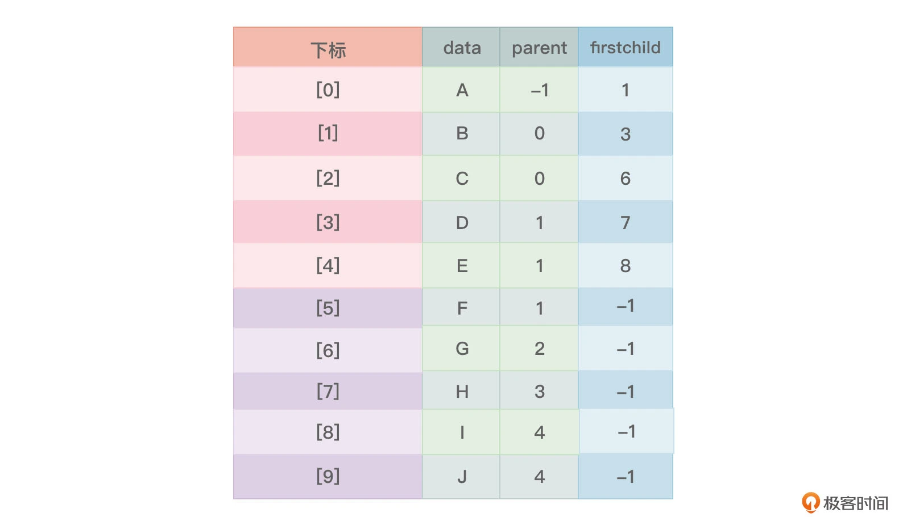

- 图4 双亲表示法保存一棵普通树时数组中的内容（增加firstchild字段记录第一个孩子节点）

那么，如果查找自己的兄弟节点（和自己父节点相同并在自己右侧的节点）呢？可以向节点结构 TreeNode 中再增加一个称为 rightbro 的新成员来记录，如图 5 所示：

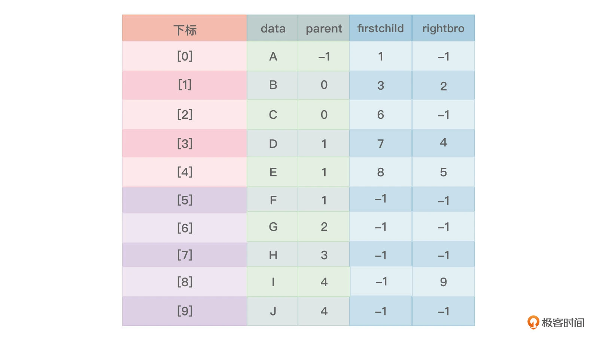

- 图5 双亲表示法保存一棵普通树时数组中的内容（增加rightbro字段记录右侧兄弟节点）

通过图 5 来查找一个节点的所有孩子节点就比较方便，比如要查找节点 B 的孩子节点，可以找到节点 B 的 firstchild 列，为 3，在找到下标 3 的 rightbro 列，为 4，再找到下标 4 的rightbro 列，为 5，再找下标 5 的 rightbro 列，发现为 -1，则寻找结束，所以，节点 B 的孩子从左到右为下标 3 对应的节点 D，下标 4 对应的节点 E 以及下标 5 对应的节点 F。

可以看到，节点结构 TreeNode 的设计非常灵活，设计时主要考虑的是方便性和灵活性，以及时间复杂度是否够好等，但越复杂的结构也意味着更多的时间和空间开销，需要根据实际情况做出取舍。

### 孩子表示法（链式存储方式）

因为树中的每个节点可能有多个子节点，所以每个节点包括一个数据域和多个指针域，而每个指针会指向该节点的一个孩子节点。这里有两种方案。

- 方案一

节点指针域的个数等于树的度。注意，节点拥有的子树数目就是节点的度，树的度是树内各节点度的最大值。此时树的节点结构如图 6 所示：


- 图6 孩子表示法（方案一）存储树时树中每个节点的结构

图 6 中，data 是数据域，child 是一个指针数组，其中的成员 child[0]-child[n-1]是指针域，用来指向该节点的孩子节点。我们看下此时树的节点结构代码。

```
//孩子表示法方案一作为树存储结构时，树的节点结构定义
template <typename T,int treedeg>//T代表数据元素的类型,treedeg代表树的度
struct TreeNode
{
 T  data;     //数据域
 TreeNode* child[treedeg];  //指针数组，其中的每个指针指向一个孩子节点
};
```

对于图 2 所示的树，使用孩子表示法方案一后的存储结构如图 7 所示：

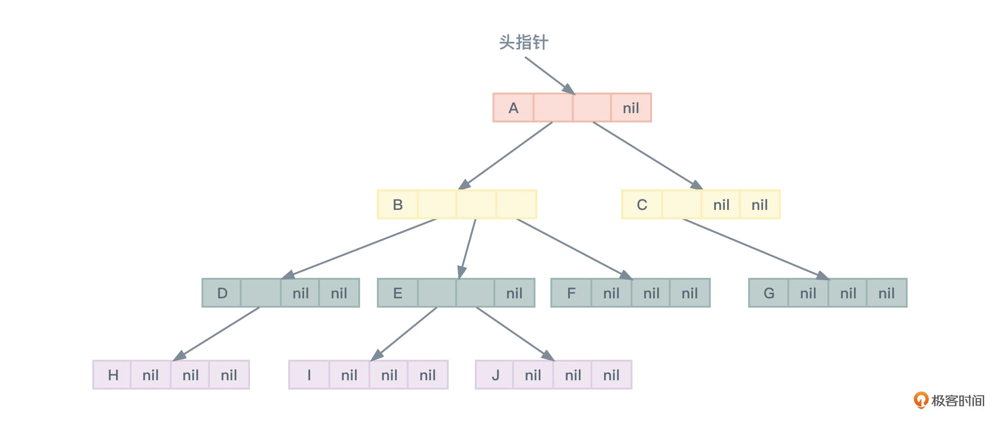

- 图7 孩子表示法（方案一）存储树时的存储结构图

在图 7 所代表的树度为 3，所以指针数组的大小也是 3。每个树节点中的 1 到多个 nil 标记表示该指针指向空，也就是不指向任何内容。

这种存储方式虽然比较直观，但是当树中各个节点的度差异较大时，是很浪费存储空间的，图7 中不难看到，很多指针域都是空的（nil 标记）。当然，如果树中各个节点的度差异很小时，这种存储方式就显得非常不错。

不管怎么说，如果能够避免空间的浪费，按需要来分配空间是最好的，所以，出现了方案二。

- 方案二

节点指针域的个数等于该节点的度，在节点结构 TreeNode 中专门增加一个新成员 degree 来记录节点指针域的个数，此时树的节点结构如图 8 所示：


- 图8 孩子表示法（方案二）存储树时树中每个节点的结构

图 8 中，data 是数据域，degree 称为度域，存放该节点的度，也就是该节点的孩子节点个数。child0~childn 是指针域，用来指向该节点的孩子节点。

对于图 2 所示的树，使用孩子表示法方案二后的存储结构如图 9 所示：

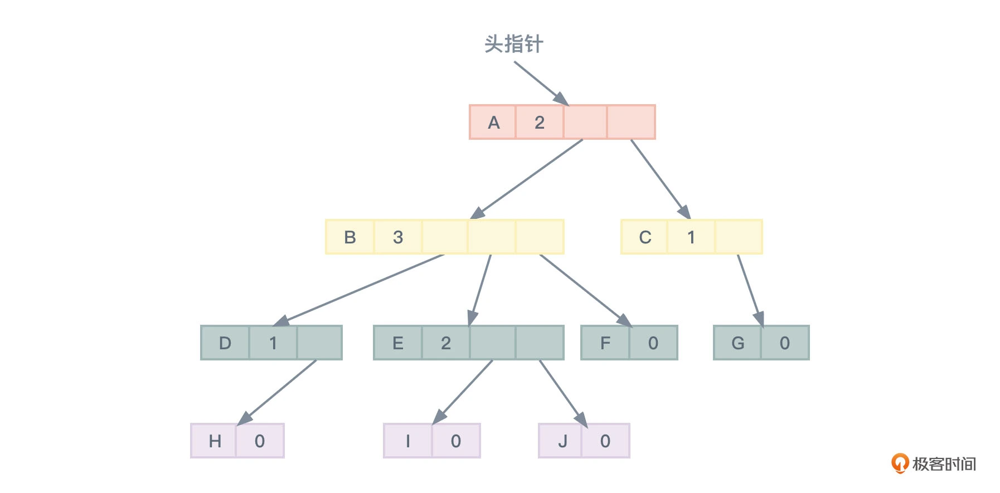

- 图9 孩子表示法（方案二）存储树时的存储结构图

此时树的节点结构代码如下。

```sql
//孩子表示法 方案二作为树存储结构时，树的节点结构定义
template <typename T>//T代表数据元素的类型
struct TreeNode
{
 T  data;     //数据域
 int  degree; //度域，存放该节点的度
 TreeNode **child; //指针的指针
public:
 TreeNode(int tmpdegree) //构造函数
 {
   degree = tmpdegree;
   child = new TreeNode* [degree]; //相当于定义了degree个指向TreeNode对象的指针
   for (int i = 0; i < degree; ++i)
     child[i] = nullptr;
 }
 ~TreeNode()  //析构函数
 {
   delete[]child;
 }
};
```

在 main 主函数中可以增加如下测试代码。

```sql
TreeNode<int> treenode1(5);
treenode1.data = 15;
treenode1.child[0] = new TreeNode<int>(4);  //指向一个含有4个孩子节点的TreeNode对象
//最后不要忘记释放内存
delete treenode1.child[0];
```

上面这种写法解决了浪费空间的问题，因为节点结构不一致，导致实现代码比较复杂，节点度数的差异性也会带来运算时间上的损耗。那么是否有更好的办法既能减少空间浪费又能使节点结构相同呢？可以。

为了遍历整棵树，可以将所有节点放到一个顺序存储结构的数组中构成一个线性表，但因为每个节点的孩子数量不确定，所以针对每个节点建立一个单链表把它的所有孩子节点链起来。在代码实现时需要有两个结构，一个是孩子节点的结构，如图 10 所示：


- 图10 孩子表示法（方案二的优化）存储树时孩子节点的结构ChildNode

一个是表头（父亲）节点的结构如图 11 所示：


- 图11 孩子表示法（方案二的优化）存储树时表头（父亲）节点结构TreeNode

看一下上述两个结构的代码。

```
//孩子节点结构：一个保存孩子下标的结构
struct ChildNode
{
 int child;//孩子下标
 ChildNode* next; //指向下个相同的结构
};
//表头（父亲）节点结构
template <typename T>//T代表数据元素的类型
struct TreeNode
{
 T data; //数据域
 ChildNode* firstchild; //通过该指针可以找到该节点的第一个孩子
};
```

对于图 2 所示的树，使用这种方案的存储结构如图 12 所示：

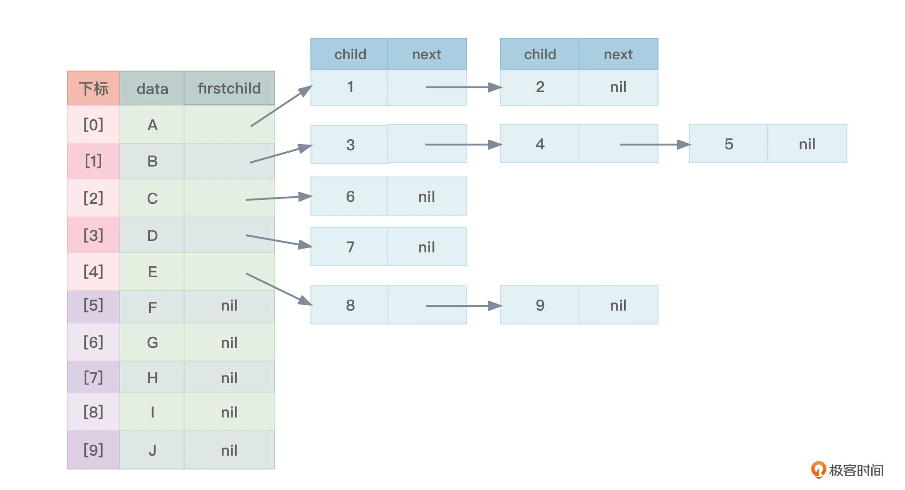

- 图12 孩子表示法（方案二优化后）存储树时的存储结构图

参考图 12，树的结构定义代码是这样的。

```python
#define MaxTreeSize 200 //树中能够保存的最大节点个数
template <typename T> //T代表数据元素的类型
class Tree
{
private:
 TreeNode<T> m_data[MaxTreeSize];  //节点数组
 int m_length; //树中包含的节点数量
};
```

在图 12 中，查找一个节点的孩子节点只需要沿着 firstchild 指针向右侧寻找即可，比如寻找 E节点的孩子节点只需要沿着 firstchild 链寻找，分别找到下标为 8 和 9 的节点即 I、J 节点。如果有要查找一个节点比如节点 A 的父节点，需要从上到下遍历 m_data 数组中的每个节点，沿着节点的子链逐个比较看所记录的数据是否是节点 A 的下标。这种查找方式无疑效率很低，所以如果需要快速地寻找到父亲节点，可以扩展一下 TreeNode 结构，在其中增加一个新成员parent 以记录父节点所在的 m_data 数组下标。

看一下修改后的 TreeNode。

```
//表头（父亲）节点结构
template <typename T>//T代表数据元素的类型
struct TreeNode
{
 T data; //数据域
 int parent; //父节点所在Tree结构中的m_data数组下标
 ChildNode* firstchild; //通过该指针可以找到该节点的第一个孩子
};
```

修改后的存储结构图如图 13 所示，这种表示方法称为双亲孩子表示法：

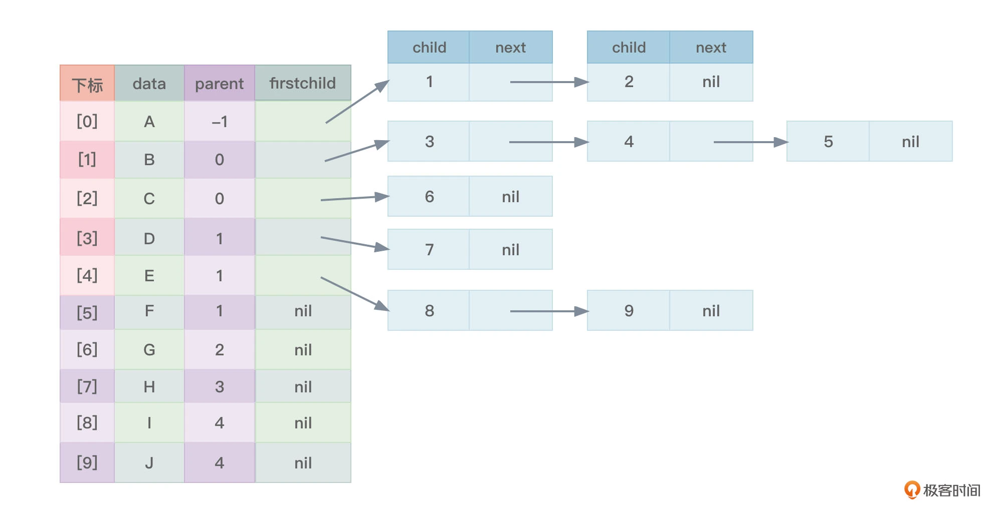

- 图13 双亲孩子表示法（孩子表示法的改进版）存储树时的存储结构图

图 12 以及图 13 使用了静态链表技术表示父节点，同时使用常规单链表（链式存储方式）来保存孩子节点。每个孩子节点的结构相同，无论是查找孩子还是查找父亲都比较方便。

### 孩子兄弟表示法

最后，我们看一下“孩子兄弟表示法”。这种表示法又称为二叉链表表示法（把树以二叉树的形式表现出来）是比较重要和常用的。对于任意一棵树，其节点的第一个孩子若存在就是唯一的，其右兄弟若存在也是唯一的，所以可以设置两个指针分别指向该节点的第一个孩子和该节点的右兄弟。节点的结构如图 14 所示：


- 图14 孩子兄弟表示法存储树时树中每个节点的结构

图 14 中，data 是数据域，firstchild 是指针域，指向第一个孩子节点。rightbro 也是指针域，指向右兄弟节点。下面是此时树的节点结构代码。

```
//孩子兄弟表示法作为树存储结构时，树的节点结构定义
template <typename T> //T代表数据元素的类型
struct TreeNode
{
 T  data;     //数据域
 TreeNode* firstchild;//指针域，指向第一个孩子节点
 TreeNode* rightbro; //指针域，指向右兄弟节点
};
```

对于图 2 所示的树，使用孩子兄弟表示法后的存储结构如图 15 所示：

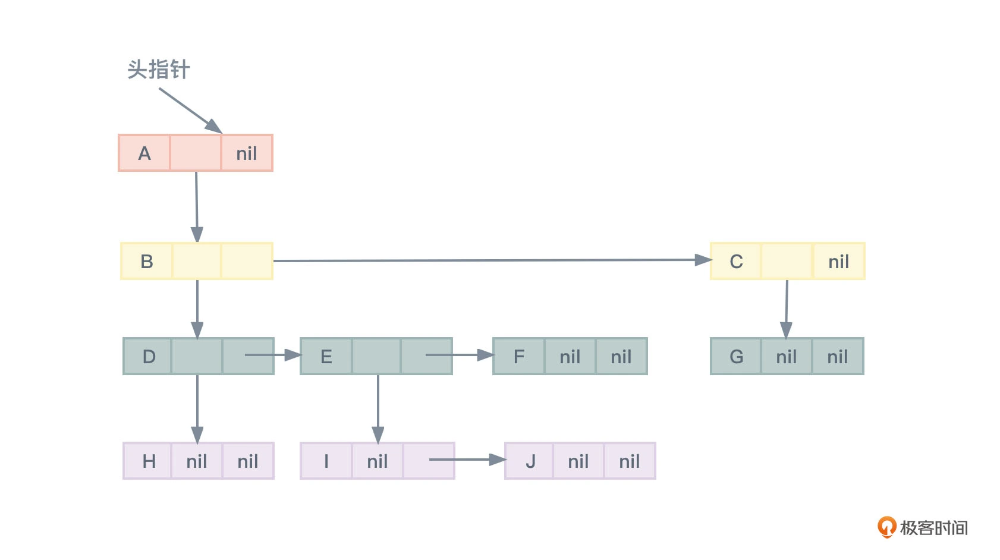

- 图15 孩子兄弟表示法存储树时的存储结构图

图 15 中，要查找某个节点的某个孩子节点会比较方便，只需要通过 firstchild 找到该节点的第一个孩子（长子），然后通过第一个孩子节点的 rightbro 继续找下去。当然，找某个节点的父节点不太方便，如果有必要可以考虑在 TreeNode 中增加新成员 parent 指针以记录该节点的父节点。

再次仔细观察图 15，稍微调整一下绘制的方向，但绘制内容不变。如图 6 所示：

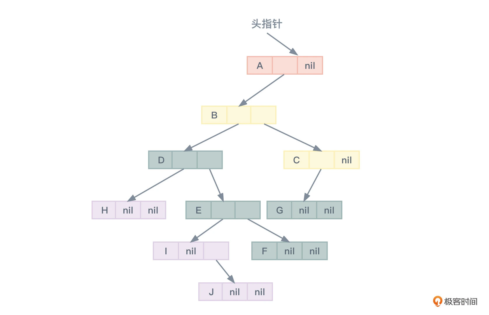

- 图16 孩子兄弟表示法存储树时的存储结构图绘制方向的调整

观察图 16，这是一棵二叉树，换句话说，通过孩子兄弟表示法，可以把一棵复杂的树表达为一棵二叉树。那么就可以使用二叉树中能用的许多特性和算法了。而上述结构 TreeNode 的firstchild 成员就相当于节点左孩子指针，rightbro 成员就相当于节点右孩子指针。

## 树转换为二叉树

树的形状千奇百怪，不好寻找规律，而操作二叉树就容易得多。所以将树转换为二叉树就显得非常必要。一棵树可以转换成一棵唯一的二叉树。将一棵图 2 所示的树转换为二叉树分下面几个步骤。

- 加线：在所有兄弟节点之间增加一条连线，如图 17 所示：

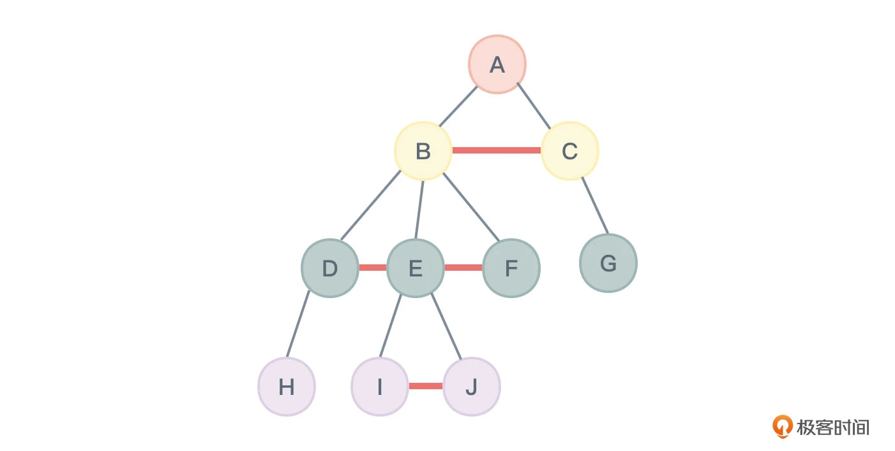

- 图17 树转换为二叉树之加线（加线）

- 去线：对树中的每个节点，只保留它与第一个孩子节点之间的连线，删除它与其他孩子节点之间的连线。如图 18 所示：

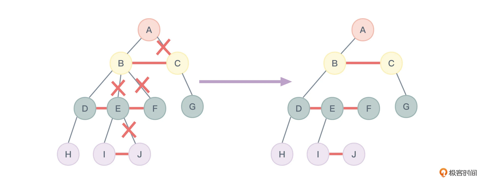

- 图18 树转换为二叉树之去线（去线）

- 调整方向（调整层次）：以根节点为轴心，将树顺时针（右）旋转一定角度，这样，整棵树看起来就是一棵二叉树了，如图 19 所示。注意，节点的第一个孩子是二叉树节点的左孩子。

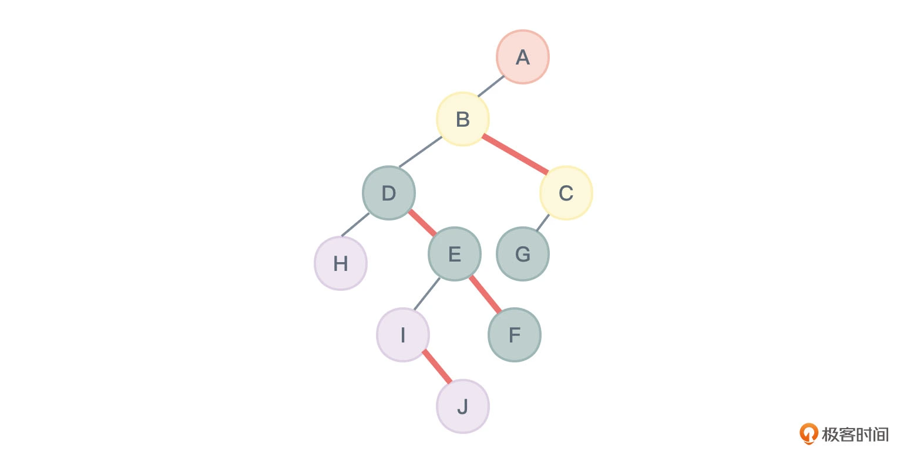

- 图19 树转换为二叉树之调整方向（调整方向）

图 19 中可以看到，采用左孩子右兄弟法，也就是节点的左侧孩子位置放该节点原来的第一个孩子，节点原来的其他孩子放在第一个孩子右侧的“孩子、孙子、重孙子”等位置，就可以把树转换成二叉树。但这棵转换后的二叉树，树根只有左子树没有右子树。并且，E 原来是 D 的右兄弟，现在变成 D 的右孩子，F 原来是 E 的右兄弟，现在变成 E 的右孩子。J 原来是 I 的右兄弟，现在变成了 I 的右孩子。

## 森林及森林转换为二叉树

森林的定义是 m（m≥0）棵互不相交的树的集合。每棵树去掉根节点后，其各个子树又组成森林。如果 m 等于 0，则是一棵空森林。所以至少要两棵互不相交的树才能看出森林的效果。如图 20 所示：

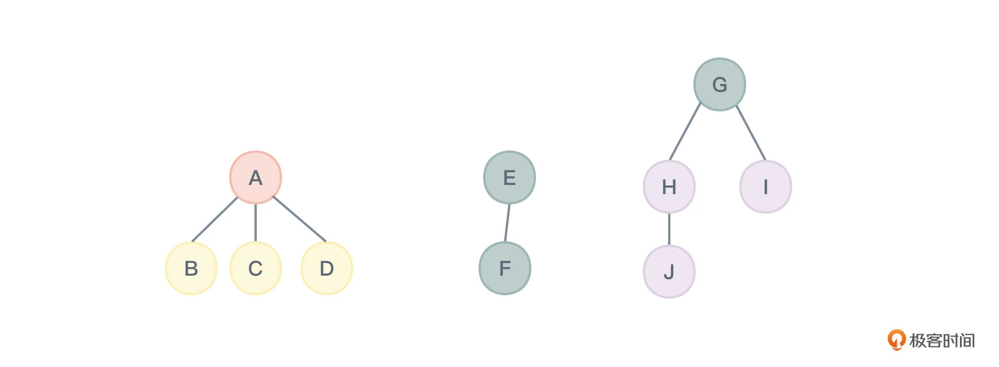

- 图20 三棵树组成的森林

要将森林中的三棵树转换成一棵二叉树分以下 3 个步骤。

- 将森林中的每棵树都转换成二叉树，如图 21 所示：

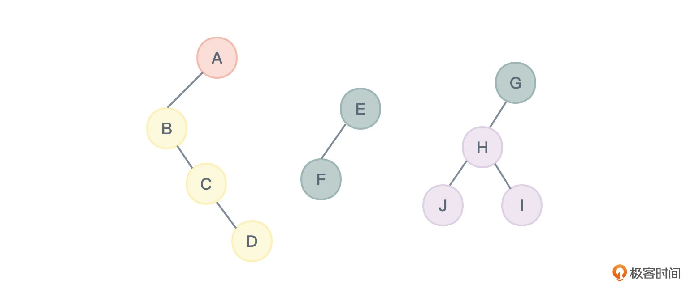

- 图21 将森林中的每棵树都转换成二叉树

- 第一棵二叉树不动，从第二棵二叉树开始，依次把后一棵二叉树的根节点作为前一棵二叉树根节点的右孩子用线连接起来，如图 22 所示：

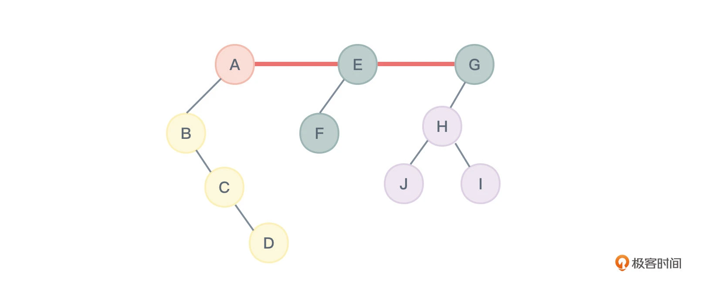

- 图22 将森林中的每棵二叉树的根节点连在一起

- 调整方向（调整层次）：以根节点为轴心，将树顺时针（右）旋转一定角度，这样，整棵树看起来就是一棵二叉树了，如图 23 所示：

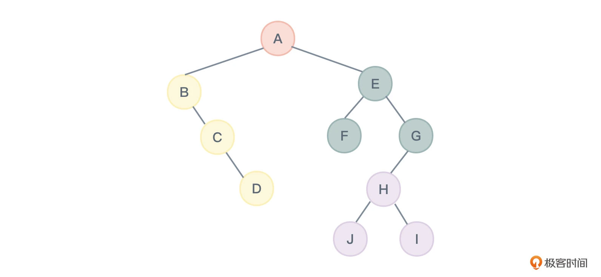

- 图23 将森林转换成一棵二叉树

图 23 中可以看到，区别于树转换成二叉树，森林转换成二叉树后，树根既有左子树又有右子树。

## 二叉树转换为树

最后，就是二叉树的转换问题了。二叉树转换为树是树转换为二叉树的逆过程，针对图 19 中的二叉树，要转换为树，分这样几个步骤。

- 加线：若某个节点 X 是其父节点 Y 的左孩子，则把 X 的右孩子，右孩子的右孩子……，都与 Y 用连线连接起来。A 和 C 相连，B 和 E 相连，B 和 F 相连，E 和 J 相连。如图 24 所示：

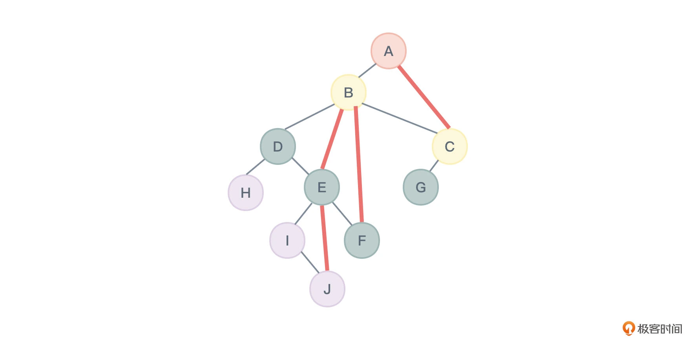

- 图24 将二叉树转换成树（加线）

- 去线：删除原二叉树中所有节点与其右孩子节点的连线，如图 25 所示：

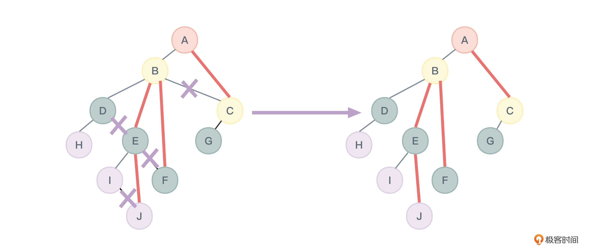

- 图25 将二叉树转换成树（去线）

- 调整方向（调整层次）：主要目的是使整棵树看起来更清晰明了，如图 26 所示：

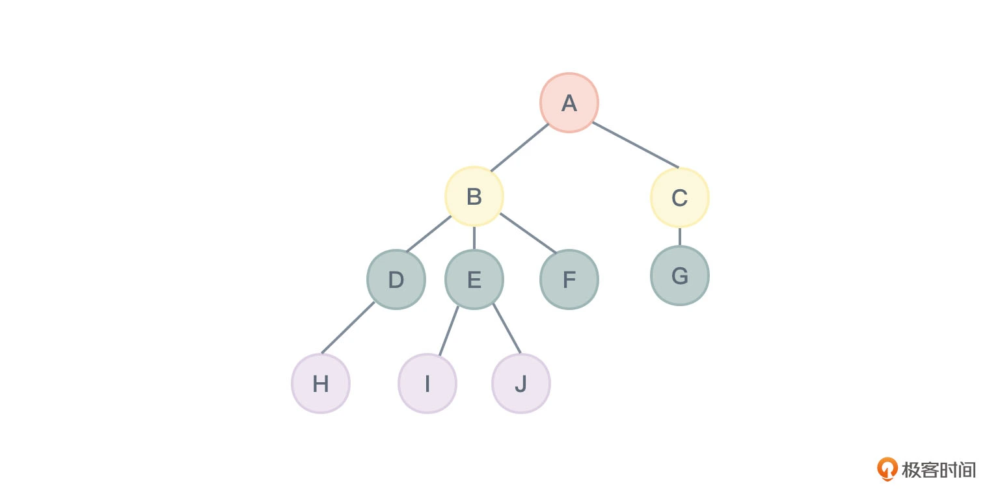

- 图26 将二叉树转换成树（调整方向）

其实，图 26 正是图 2。所以才说，二叉树转换为树是树转换为二叉树的逆过程。

## 二叉树转换为森林

判断一棵二叉树能转化成一棵树还是森林，只需要看这棵二叉树的根节点是否有右孩子。如果有就可以转换为森林，没有就只能转换成一棵树。

前面图 23 就是一棵由森林转换成的二叉树，如何将这棵二叉树转换回森林呢？分以下几个步骤。

- 查看该二叉树的树根是否有右孩子，若有，则把根与右孩子节点的连线删除。这样以这棵右孩子为树根又得到一棵新二叉树，判断该新二叉树的树根是否有右孩子，若有则继续把根与右孩子的连线删除，如此重复下去，就会得到几棵分离的二叉树，如图 27 所示：

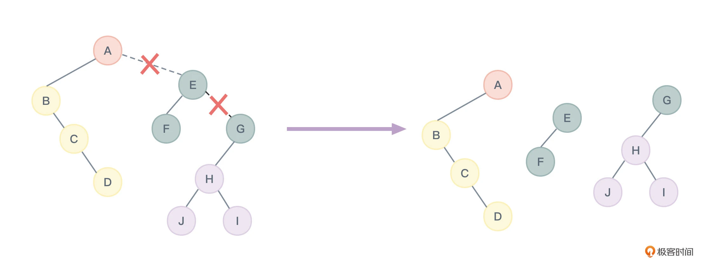

- 图27 将二叉树转换为森林（分离成多个二叉树）

- 将每棵分离的二叉树转换为树。参看前面的“二叉树转换为树”内容。得到结果如图 28 所示：

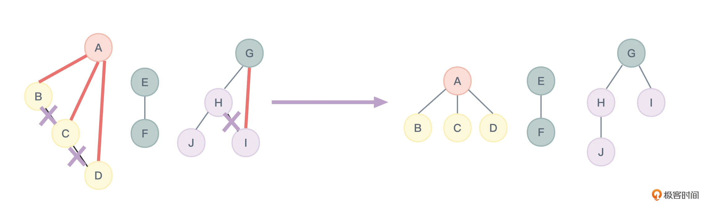

- 图28 将二叉树转换为森林

## 树的遍历

讲完了二叉树、树、森林之间相互转换的话题后，相信你也对树、森林以及二叉树之间的关系更为理解了。结合之前二叉树遍历的积累，现在，我们就说说树的遍历问题。

树的遍历包括前序遍历（二叉树前序遍历是：根左右）、后序遍历（二叉树后序遍历是：左右根）、层序遍历，这些概念在二叉树中都已经讲解过，在这里也是非常类似的。注意，树没有中序遍历。

### 前序遍历

前序遍历时，如果树为空，则直接返回，否则从根节点开始。每个节点都是先访问该节点，比如显示该节点的数据，再依次对每棵子树进行前序遍历。这里注意，子树是按从左到右的顺序遍历的。

对图 2 进行前序遍历所得到的结果应该为：ABDHEIJFCG，节点的访问顺序如图 29 所示：

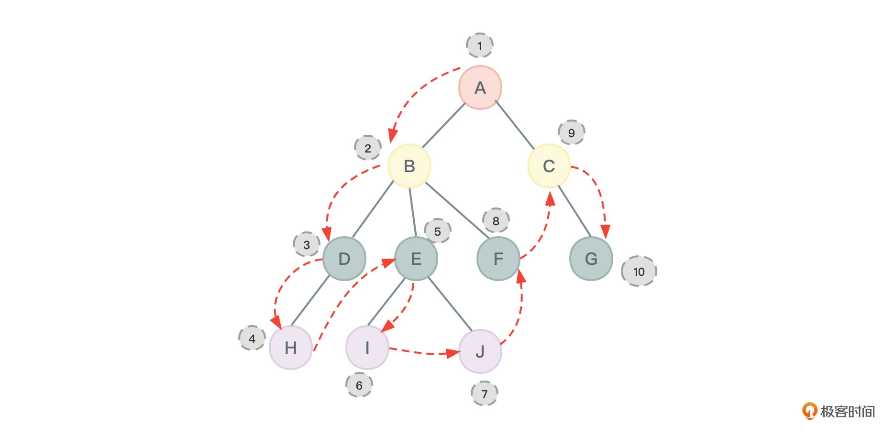

- 图29 前序遍历访问的树节点顺序

看下前序遍历的伪代码。

```
void preOrder(TreeNode* tNode)  //前序遍历树
{
 if (tNode != nullptr) //若树非空
 {
   //根左右顺序
   visit(tNode); //访问根节点，比如输出节点的数据域的值
   while(tNode节点有下一个子树TNodeChild) //访问TNode的各个子节点
     preOrder(TNodeChild); //递归方式前序遍历子树
 }
}
```

前面图 19 是图 29 对应的二叉树，不难验证，树的前序遍历序列与其对应的二叉树的前序遍历序列相同。

### 后序遍历

后序遍历时，如果二叉树为空，则直接返回，否则从访问根节点开始。每个节点都是按照从左到右的顺序后序遍历该节点的子树，最后访问该节点。

对图 2 进行后序遍历所得到的结果应该为：HDIJEFBGCA，节点的访问顺序如图 30 所示：

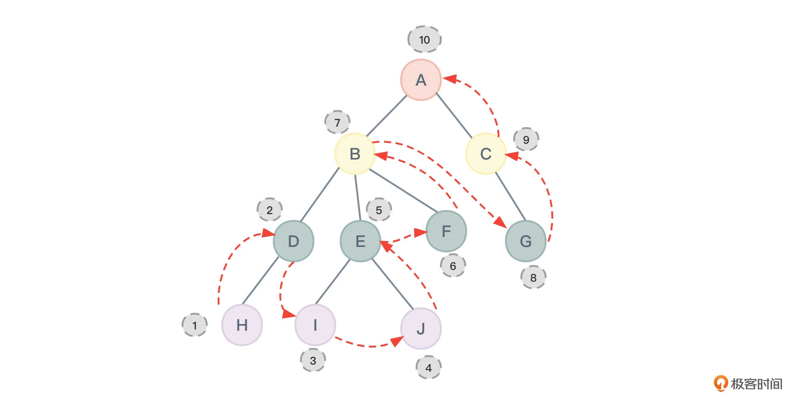

- 图30 后序遍历访问的树节点顺序

看下后序遍历的伪代码。

```
void postOrder(TreeNode* tNode)  //后序遍历树
{
 if (tNode != nullptr) //若二叉树非空
 {
   //左右根顺序
   while (tNode节点有下一个子树TNodeChild)
     postOrder(TNodeChild); //递归方式后序遍历子树
   visit(tNode); //访问根节点，比如输出节点的数据域的值
 }
}
```

前面图 19 是图 30 对应的二叉树，不难验证，树的后序遍历序列与其对应的二叉树的中序遍历序列相同。

### 层序遍历

如果二叉树为空，则直接返回，否则从树的第一层（根节点）开始，从上到下逐层遍历，而在同一层中，按照从左到右的顺序对节点进行逐个访问。

对图 2 进行层序遍历所得到的结果应该为：ABCDEFGHIJ，节点的访问顺序如图 31 所示：

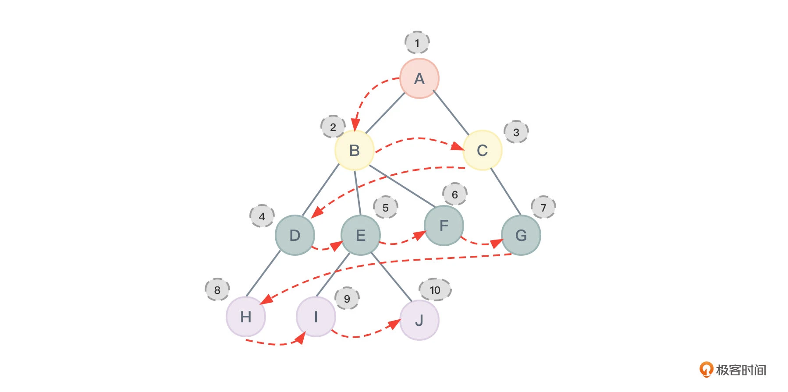

- 图31 层序遍历访问的树节点顺序

前面讲解二叉树层序遍历时借助的是队列来实现，树的层次遍历也是非常类似的。步骤是先将根节点入队列，然后采用 while 循环判断队列是否为空，在不为空时执行 3 个步骤。

- 将节点出队列并显示数据元素。

- 如果节点有孩子节点，则将这些孩子节点全部入队列。

- 重复这两个步骤一直到队列为空。

看下层序遍历的伪代码。

```
void levelOrder(TreeNode* tNode)//层序遍历树
{
 if (tNode != nullptr) //若二叉树非空
 {
   TreeNode* tmpnode;
   LinkQueue<TreeNode *> lnobj;//使用队列进行层序遍历
   lnobj.EnQueue(tNode); //先把根节点指针入队
   while (!lnobj.IsEmpty()) //循环判断队列是否为空
   {
     lnobj.DeQueue(tmpnode); //出队列
     cout << (char)tmpnode->data <<""; //显示节点数据
     while (tNode节点有下一个子树TNodeChild)
       lnobj.EnQueue(TNodeChild);
   } //end while
 }
}
```

## 森林的遍历

最后，我们了解下森林的遍历，包括前序遍历（二叉树前序遍历是：根左右）、后序遍历（二叉树后序遍历是：左右根）。

### 前序遍历

从第一棵树开始，我们依次前序遍历森林中的每一棵树。前面图 20 所示的森林进行前序遍历所得到的结果应该为：ABCD EF GHJI，如图 32 所示：

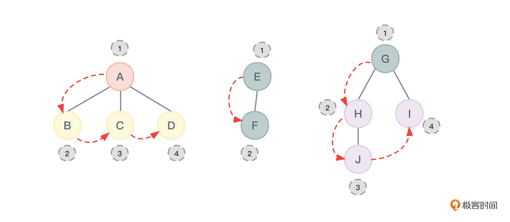

- 图32 前序遍历森林时访问各个树节点的顺序

当然，也可以把森林转换成相对应的二叉树（图 23）。然后对该二叉树进行前序遍历，所得到的遍历序列也与对森林进行前序遍历所得到的遍历序列相同，如图 33 所示：

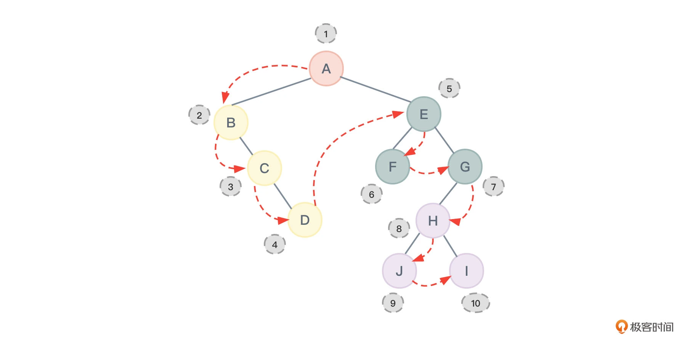

- 图33 前序遍历森林转换成前序遍历二叉树时访问各个节点的顺序

### 后序遍历

森林的后序遍历，有些资料上也称为中序遍历。从第一棵树开始，依次后序遍历森林中的每一棵树。前面图 20 所示的森林进行后序遍历所得到的结果应该为：BCDA FE JHIG，如图 34 所示：

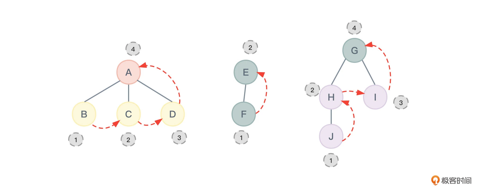

- 图34 后序遍历森林时访问各个树节点的顺序

当然，也可以把森林转换成相对应的二叉树（23）。然后对该二叉树进行中序遍历，所得到的遍历序列也与对森林进行后序遍历所得到的遍历序列相同，如图 35 所示：

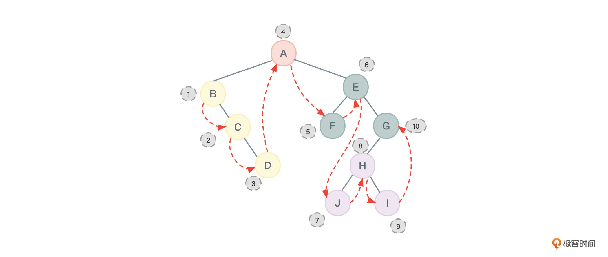

- 图35 后序遍历森林转换成中序遍历二叉树时访问各个节点的顺序

## 小结

本节所述内容理论知识较多，实现代码较少。因为无论是考试还是面试中，这些知识大都以理论的形式出现。如果你有需要，也可以自行实现相关代码，有以往知识做铺垫，这些代码并不复杂。

这节课我首先带你了解了树的存储结构，树的存储结构一般可以采用三种，分别是双亲表示法、孩子表示法以及孩子兄弟表示法。

- 双亲表示法每个树的节点结构设计比较灵活，可以记录父节点，甚至根据需要还可以记录孩子节点。

- 孩子表示法以记录孩子节点为主，但经过适当的改进也可以记录父节点。

- 孩子兄弟表示法，则是记录当前节点的第一个孩子节点和右兄弟节点，这样可以把一棵复杂的树表达为一棵二叉树，就可以使用二叉树中能用的许多特性和算法。这种表示法要求要重点掌握。

接下来涉及的话题是详细地阐述如何将树转换为二叉树。因为树的形状千奇百怪，不好寻找规律，而操作二叉树就容易得多。将树转换为二叉树只需要通过加线、去线、调整方向即可做到。

在森林转换为二叉树的话题中，我们讲述了通过将森林中的每棵树转换为二叉树、依次把后一棵二叉树的根节点作为前一棵二叉树根节点的右孩子用线连接起来、调整方向的方式即可将森林转换为二叉树。

二叉树转换为树是树转换为二叉树的逆过程，通过加线、去线、调整方向三个步骤即可做到。其实，树与二叉树的相互转换，本质上就是用孩子兄弟表示法存储树。

二叉树转换为森林是森林转换为二叉树的逆过程，通过连线删除得到多个分离的二叉树，再通过将每棵分离的二叉树转换为树即可。

接着我们学习了树的遍历，分为前序、后序、层序遍历，要注意的是树没有中序遍历。

最后，则是森林的遍历，包括前序、后序遍历的学习。

这节课要好好掌握树、森林与二叉树之间的相互转换。这样即便面对各种各样的题目，都会比较容易想出答案。

## 归纳思考

1. 请自己列举出一个森林并尝试将其转换为二叉树。

2. 请自己列举出一棵二叉树并将其转换为森林。

欢迎在留言区和我分享你的成果。如果觉得有所收获，也可以把课程分享给更多的朋友一起学习进步。我们下节课见。
