# 23 | 图：如何用图表达错综复杂的数据？

你好，我是王健伟。

经过了长期努力，我们一起学习了树相关的知识。树是整个课程中占据篇幅最大的话题，也是面试和使用中的热门话题。而这一次，我们来说一说图。

图这种数据结构比树更加复杂。我们回想一下，树形结构中的节点或者说数据之间有明显的层次关系，一个父节点可以有多个子节点，当然，一个子节点只能有唯一的父节点。但在图形结构中，节点之间可以有任意的关系，即任意两个数据都可能相关。

## 关于图，有哪些必备的基本概念和术语？

图涉及的概念和术语比较多，请你投入一定的耐心学习。不过，这些概念和术语不用强记，只需要有印象，后面使用到这些术语的时候再到这节课看看就可以，反复几次，这些概念和术语自然也就记住了。

### 顶点、边、阶

先看一些基本概念。在图中，数据元素被称为顶点，和在树中将数据元素称为节点是有区别的，用 v（Vertex）表示。不同的顶点之间的连线称为边，用 e（Edge）表示。

图（Graph）是由顶点的有穷非空集合和顶点之间的连线（边）的集合组成。通常表示为 G=(V,E)，其中 G 表示一个图，V(G) 代表图 G 中的顶点集合，E(G) 代表图 G 中的边集合。

用|V|表示图 G 中顶点个数，也称为图 G 的阶。

用|E|表示图 G 中边的条数。

图 1 所示就是一个图，其中 A、B、C、D、E、F 是顶点。

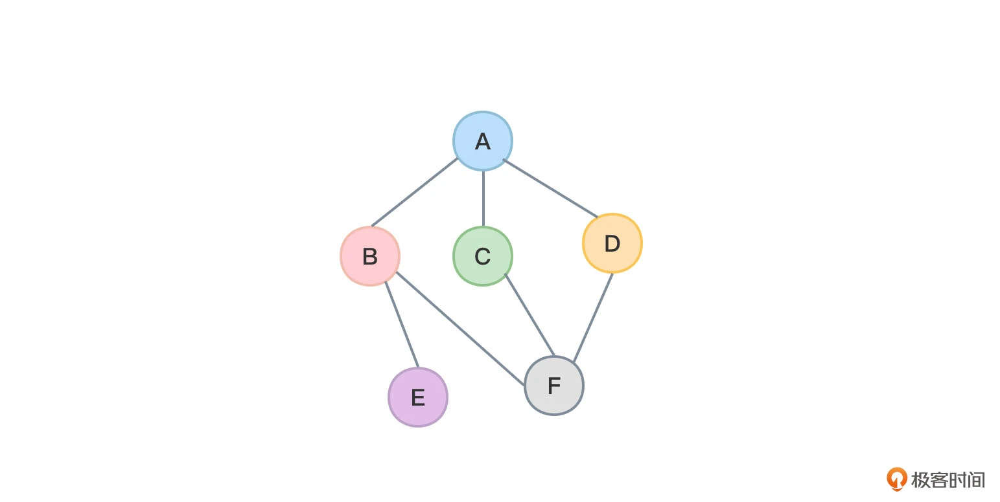

- 图1 图

注意了，图不可以为空，换句话说，顶点集合 V 不可以为空集。而边集合 E 可以为空，所以，图 2 也是一个图。

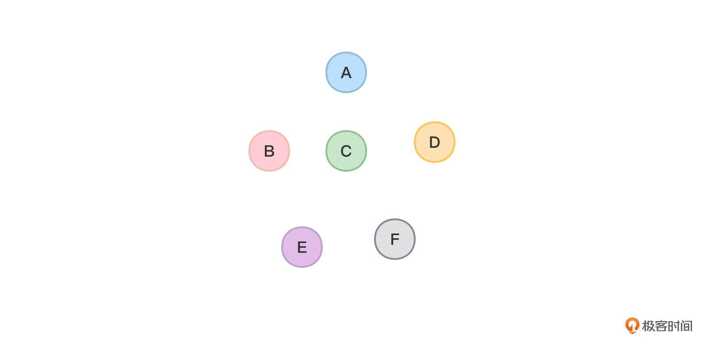

- 图2 包含6个顶点但不包含边的图

### 无向图、有向图、简单图、多重图、完全图

如果你刚才观察得仔细，一定会发现上面介绍的图中的边是没有方向的，这种边就叫做无向边（简称边）。如果图中任意两个顶点之间的边都是无向边，则称该图为无向图，比如图 1 就是无向图。

当然，从一个顶点到另外一个顶点的边也可以是有方向的，这种边称为有向边，也称为弧。如果图中任意两个顶点之间的边都是有向边，则称该图为有向图。图 3 就是一个有向图：

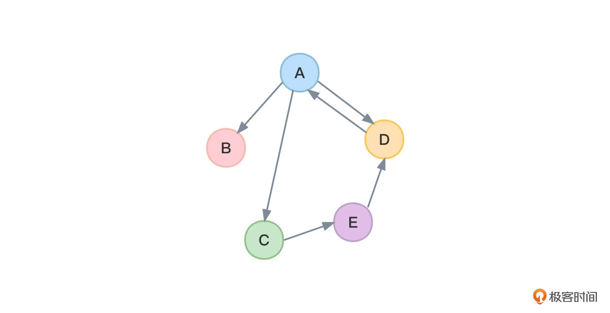

- 图3 有向图

对于无向图，只要两个顶点之间有一条边，则这两个顶点之间可以互相到达。图 1 中，连接顶点 A 与 B 之间的边因为不存在方向问题，因此可以表示为无序对 (A,B) 或者 (B,A)，注意这里用的是圆括号表示无向边。

有向图不同。在图 3 中，顶点 A 到 B 之间存在一条有向边（从 A 指向 B 的箭头），这表示从顶点 A 可以到达顶点 B，但因为顶点 B 到顶点 A 之间并不存在有向边，所以从顶点 B 不可以到达顶点 A。

这里你可以设想一下微博用户之间的关系。你关注喜欢的账号之后，可以看到对方发的消息，但这并不等于人家也关注了你，如果对方没有关注你，那也看不到你发的消息。

顶点 A 到顶点 B 的有向边（箭头）就是弧。箭头开始的顶点 A 叫弧尾，箭头指向的顶点 B 叫弧头。这条弧可以用 <A,B> 表示，注意这里用的是尖括号表示有向边。另外还需要注意方向，不可以写成 <B,A>。

图中若不存在顶点到其自身的边，并且同一条边不会重复出现，这种图称为简单图。简单图分为简单无向图（如图 1）和简单有向图（如图 3）。

图中某两个顶点之间的边数多于一条，或者顶点通过一条边和自己关联，这种图称为多重图。多重图分为多重无向图和多重有向图，如图 4 所示：

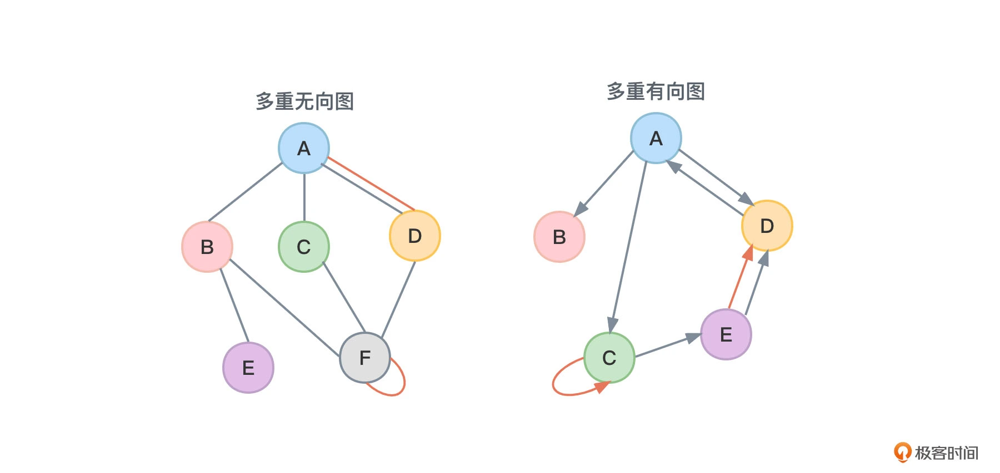

- 图4 多重图

数据结构中所讨论的图都是简单图，多重图不在讨论之中。基本上，绝大部分问题通过简单图都可以得到解决，比如微信中不需要自己加自己为好友，也不需要加同一个人多次好友。

在无向图中，如果任意两个顶点之间都存在边，则称该图为无向完全图。如图 5 所示：

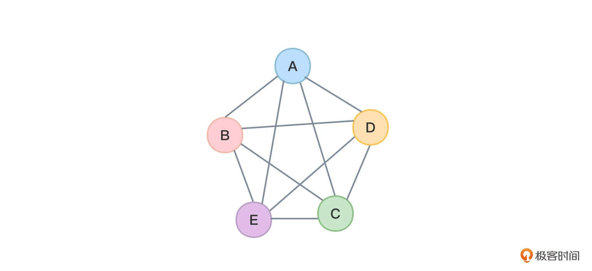

- 图5 无向完全图

- n(n−1)

仔细观察后会发现，含有 n 个顶点的无向完全图有

- 条边。比如图 5，一共有 5 个顶点，2​

每个顶点有 4 条边，所以一共有 20 条边，但因为边是两两重复的，比如顶点 A 与顶点 B 的边也是顶点 B 与顶点 A 的边，所以边数要除以 2 也就是 20/2=10 条边。

在有向图中，如果任意两个顶点之间都存在方向相反的两条弧，则称该图为有向完全图。如图6 所示：

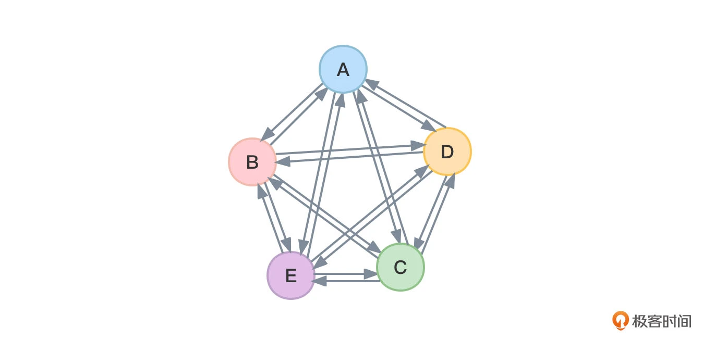

- 图6 有向完全图

从图 6 中不难看到，含有 5 个顶点的有向完全图含有 20 条边，因此，含有 n 个顶点的有向完全图有 n(n-1) 条边。

有很少条边或者弧的图称为稀疏图，反之称为稠密图。这里稀疏和稠密都是相对而言的，并不是一个精确的数值。

### 顶点的度、入度、出度

针对边的讨论结束之后，我们看看和顶点相关的一些概念。

在无向图中，顶点 v 的度（Degree）是和 v 相关联的边的数目，记为 TD(v)。

比如图 1 中，顶点 A 的度为 3。深入思考一下，无向图中，因为一条边可以给与这条边相连接的两个顶点分别提供 1 度，所以，无向图中所有顶点的度之和就应该是边数 *2，即 2|E|。

在有向图中，以顶点 v 为终点（箭头指向 v）的有向边的数目称为顶点 v 的入度（InDegree），记为 ID(v)。以顶点 v 为起点的有向边的数目称为顶点 v 的出度（OutDegree），记为 OD(v)。所以，有向图中顶点 v 的度等于其入度和出度之和，既TD(v)=ID(v)+OD(v)。

比如图 3 中，顶点 A 的入度为 1，出度为 3，所以顶点 A 的度为 4。有向图中，因为一条边可以给与这条边相连接的两个顶点分别提供 1 出度和 1 入度，所以有向图所有顶点的入度之和与出度之和相等并且等于弧的数量。

### 顶点之间的关系、路径、边

现在，我们可以把顶点和边联系起来了。

## v

## v

## v

- m v​1 v​2 v

## v

顶点

- 和顶点的路径是一个顶点序列,,,,……，该序列中的顶点属于图中的​3m​n​n​​

顶点集合。两个顶点的路径并不唯一，图 7 展示了无向图中从顶点 B 到 D 四种不同的路径，如粗线条所示（当然还有更多）。

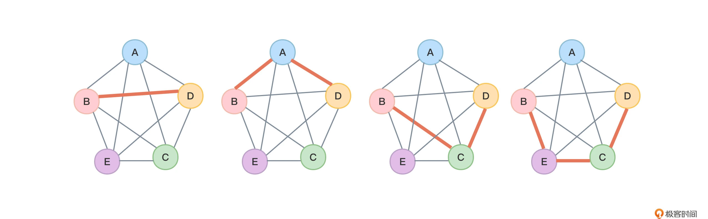

- 图7 无向图从顶点B到顶点D的四种不同路径

这里注意，对于有向图，路径也是有向的，图 8 展示了有向图中从顶点 A 到顶点 D 的两种不同路径。而对于 B 到 A 之间就不存在路径。

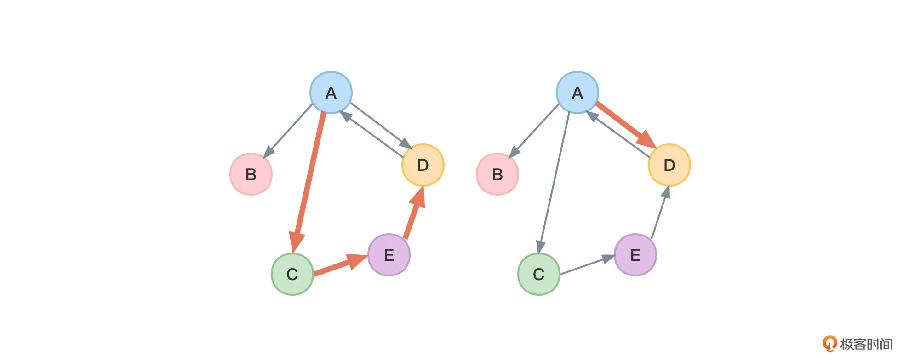

- 图8 有向图从顶点A到顶点D的两种不同路径

我们把第一个顶点和最后一个顶点相同的路径称为回路或环。如图 9 所示：

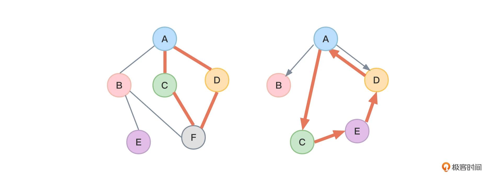

- 图9 有向图和无向图中的环

这么多的路径，其实也是涉及了一些专有名词的，我把它列在这里，你可以参考。

简单路径：在路径序列中顶点不重复出现的路径称为简单路径。图 7 中，从顶点 A 到顶点 D可以有多种不同路径，比如 A、B、A、D 这个路径，因为顶点 A 重复出现了，所以这就不是一个简单路径。

简单回路 / 简单环：除第一个顶点和最后一个顶点，其余顶点不重复出现的回路叫简单回路或简单环。

路径长度：路径上的边或弧的数目。图 7 中的四幅图路径长度分别为 1、2、2、3，图 8 中的两幅图路径长度分别为 3、1。

## v

## v

## v

## v

点到点的距离：从顶点

- 到的最短路径如果存在，则此路径的长度称为从顶点到m​nm​n​​

## v

## v

的距离，如果

- 到之间不存在路径，则称他们之间的距离为无穷（∞）。m​n​

## v

## v

## v

## v

无向图中，若从顶点

- 到之间有路径存在，则称和是连通的。图 10 中，顶点 Fm​nm​n​​

与其他顶点之间不连通，而除 F 外的其他顶点是彼此连通的。

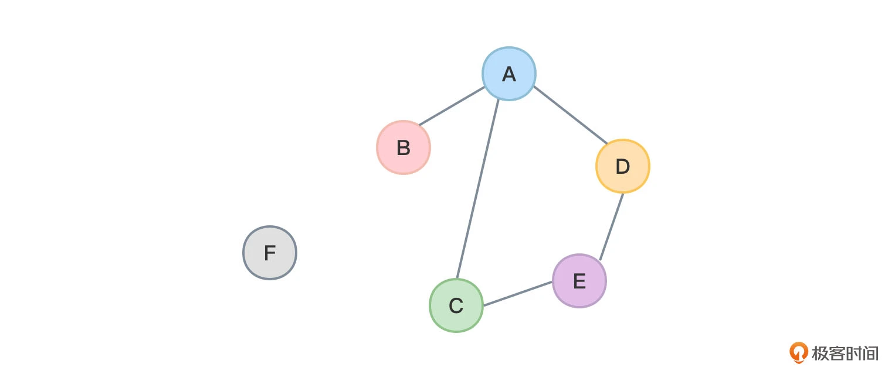

- 图10 无向图中顶点连通与不连通展示

## v

## v

## v

## v

有向图中，若从顶点

- 到之间和从顶点到之间都有路径，则称这两个顶点是强m​n​nm​​

连通的。图 3 中，顶点 A 和 D 之间就是强连通的，而顶点 A 和 B 之间就不是强连通的，因为从 B 到 A 不存在路径。

有些图的边或弧有与其相关的数字，这种与图的边或者弧相关的数字叫权（Weight）或者权值。这些权值可以表示从一个顶点到另一个顶点的距离、时间、票价等数据。这种带权的图通常称为带权图或网。如图 11 所示：

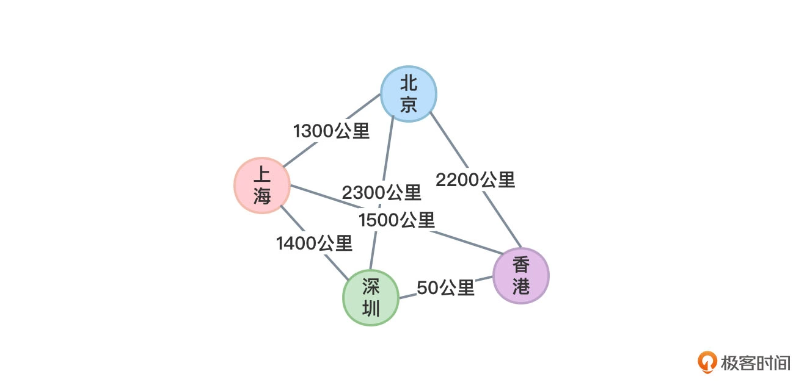

- 图11 网

### 连通图、子图

局部的顶点、边了解完之后，我们再将视角放大，着眼于整张图。

如果无向图中任意两个顶点都是连通的，则称图为连通图，否则称为非连通图。比如前面的图1 就是一个连通图。不难想象得出这么几个结论。

- 对于具有 n 个顶点的无向图，如果是连通图，则最少要有 n-1 条边。简单绘制一个有 3 个顶点的无向图，你就能得到结论。(n−1)(n−2)对于具有 n 个顶点的无向图，如果是非连通图，则最多只能有条边。2​

- n(n−1)

如何推出这个结论呢？试想，含有 n 个顶点的无向完全图有

- 条边，比如含有 5 个顶点2​

的无向完全图有 10 条边，那么如果再增加进来一个顶点变成 6 个顶点，现在只要将这个新增加的顶点和任意其他顶点连线，就构成了连通图，所以 6 个顶点的非连通图最多只能有 10 条边。

而如果有向图中任意一对顶点都是强连通的呢？那我们称此图为强连通图，如图 12 所示：

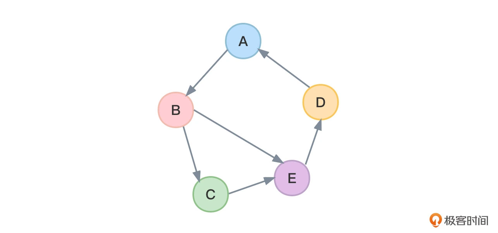

- 图12 强连通图

不难想象，对于有 n 个顶点的有向图，若是强连通图，则最少要有 n 条边以构成回路，如图13 所示：

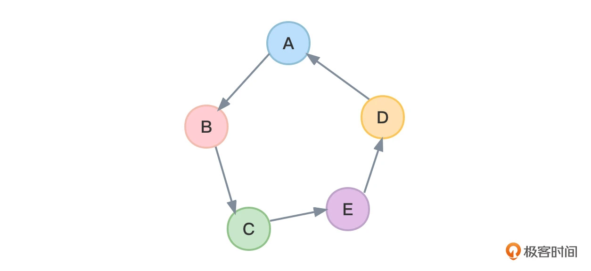

- 图13 含有5个顶点的有向图最少要有5条边才构成强连通图

我们假设有图一和图二两个图，如果图二的顶点是图一的顶点的子集，并且图二的边是图一边的子集，则称图二是图一的子图。如果子图包含原图的所有顶点，则称该子图为原图的一个生成子图，图 14 从第 2 个图开始的图都是第 1 个图的子图，而最后一个子图是原图的生成子图。

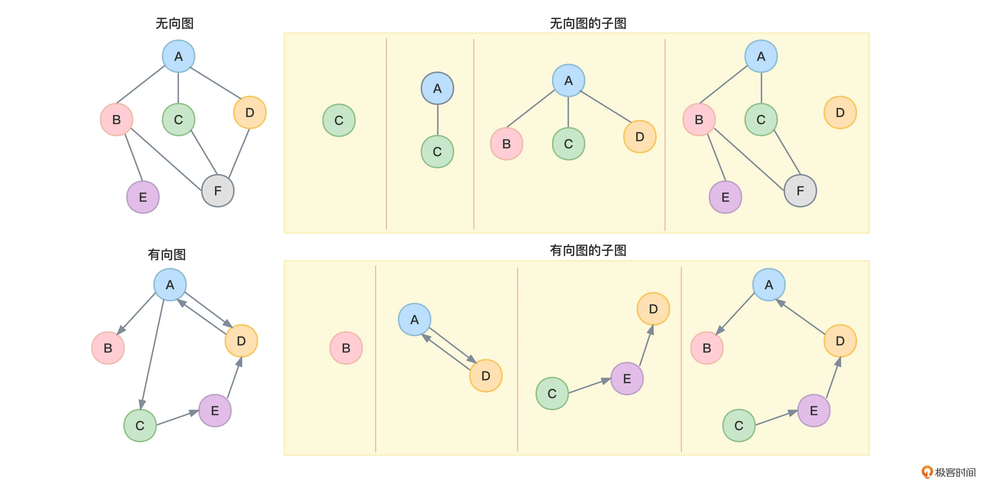

- 图14 无向图和有向图的子图

连通分量：无向图中的极大连通子图称为连通分量。换句话说，极大连通子图必须连通并且包含尽可能多的顶点和边，如图 15 所示：

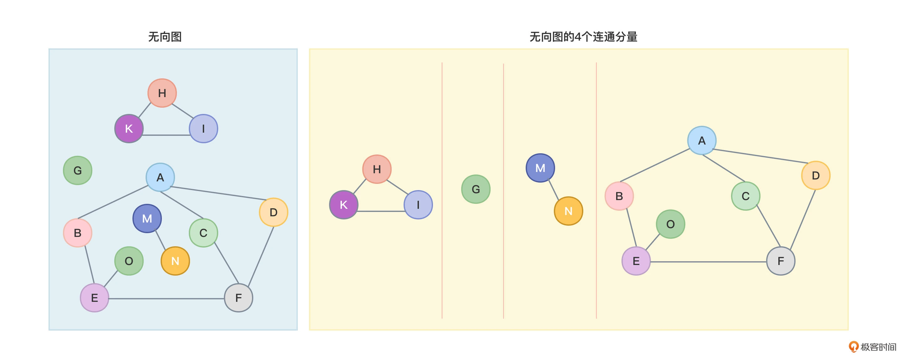

- 图15 无向图和无向图的4个连通分量

举个例子，全国各个城市的地铁网，比如上海地铁网是全国地铁网的连通分量，深圳地铁网是全国地铁网的连通分量，诸如此类。

强连通分量：有向图中的极大强连通子图称为强连通分量。这里的强连通意味着两两可达。如图 16 所示：

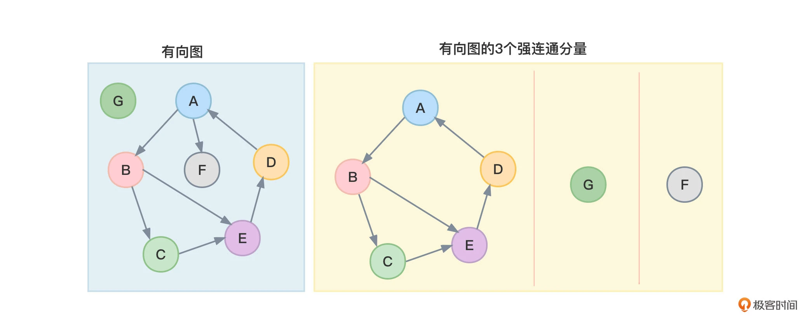

- 图16 有向图和有向图的3个强连通分量

### 生成树、生成森林

一个无向的连通图的生成树是包含图中全部顶点的一个极小的连通子图。这里的极小指边尽可能要少，如图 17 所示：

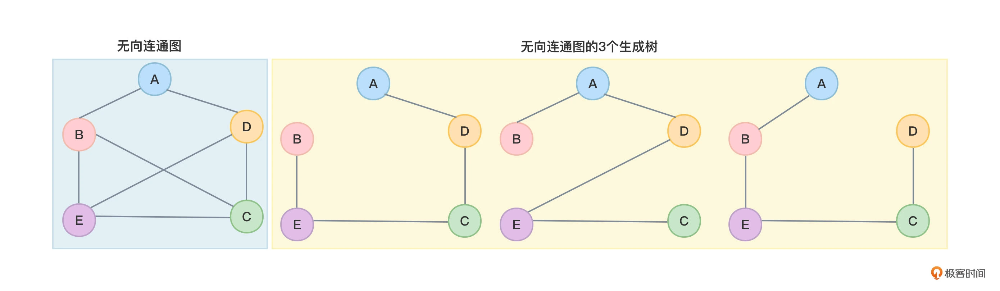

- 图17 无向连通图和无向连通图的3个生成树

从图 17 可以看到，无向连通图的生成树可以有多个，生成树中如果有 n 个顶点，则必须有 n-1 条边。因为我们前面讲解过，n 个顶点的无向图，如果是连通图，则最少要有 n-1 条边。话说回来，如果一个无向图有 n 个顶点和小于 n-1 条边，则肯定是非连通图。如果它多于 n-1条边，则一定有回路（环）。但有 n-1 条边的图不一定是生成树，因为生成树要求连通。

你可以想象一下通往各个城市的道路铺设场景，其中就可以用到生成树。生成树既可以保证各个城市之间彼此都可以到达，又可以保证铺设的道路尽可能少，而后可以在多个生成树中挑选最优的生成树方案。比如如果想最节省成本，就可以把修每段路（边）的价格作为权值来计算总成本并最终挑选出总成本最少的修路方案如图 18 所示：

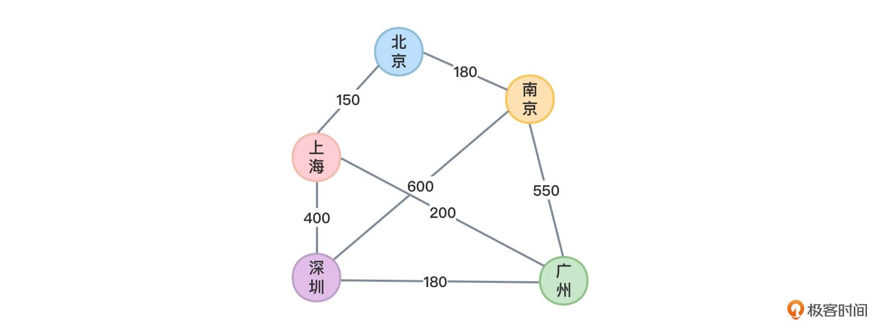

- 图18 带权值的无向连通图

当图是带权图时，一条路径上所有边的权值之和称为带权路径长度。

在无向非连通图中，连通分量的生成树构成了无向非连通图的生成森林。参照图 15 绘制图19：

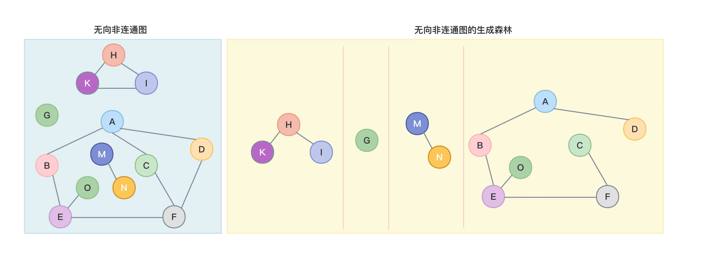

- 图19 无向非连通图的生成森林

### 树、有向树

最后需要注意的是，在无向图中，树是连通且不存在回路的，如图 20 所示：

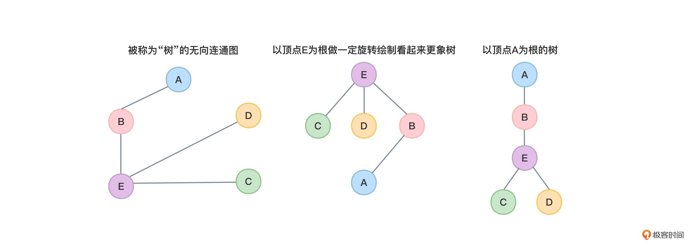

- 图20 被称为树的无向图

从图 20 可以看到，以 E、A 为根向下绘制看起来更像一棵树，当然，以任何其他顶点为根都是可以的。请注意，具有 n 个顶点的树，必然会有 n-1 条边，否则一定会是有回路的。

而在有向图中，一个顶点的入度为 0，其余顶点的入度均为 1，称为有向树，如图 21 所示：

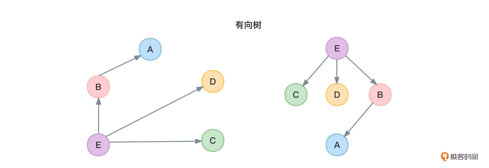

- 图21 被称为有向树的有向图

图 21 就是有向树，其中入度为 0 的顶点可以当做树的根，所以顶点 E 作为根。

## 小结

这节课我们讲解的关于图的概念不少，不必死记硬背，主要是为了我们后续学习的时候，你有一个随时可回顾的依据。我把今天的内容分成了几个主题，把主题以及主题中一些比较重要的文字列举出来作为线索，供你重点理解和记忆。

主题一：顶点、边、阶

主题二：无向图、有向图、简单图、多重图、完全图

- n(n−1)含有 n 个顶点的无向完全图有条边。2​含有 n 个顶点的有向完全图有 n(n-1) 条边。

主题三：顶点的度、入度、出度

- 无向图中所有顶点的度之和是边数 *2，即 2|E|。

- 有向图所有顶点的入度之和与出度之和相等并且等于弧的数量。

主题四：顶点之间的关系、路径、边

主题五：连通图、子图

- 对于具有 n 个顶点的无向图，如果是连通图，则最少要有 n-1 条边。(n−1)(n−2)对于具有 n 个顶点的无向图，如果是非连通图，则最多只能有条边。2​对于有 n 个顶点的有向图，若是强连通图，则最少要有 n 条边以构成回路。

主题六：生成树、生成森林

- 如果一个无向图有 n 个顶点和小于 n-1 条边，则肯定是非连通图。如果它多于 n-1 条边，则一定有回路（环）。

主题七：树、有向树

此外，我把图中涉及的概念整理成图 22 方便你复习。

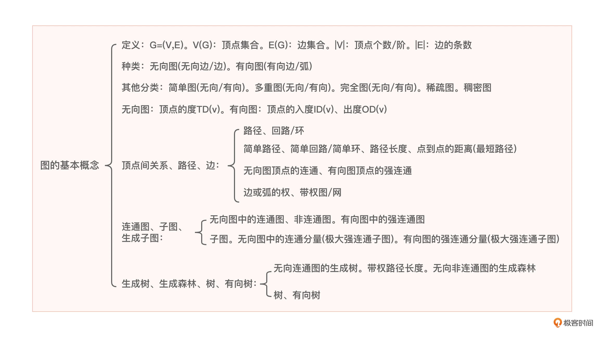

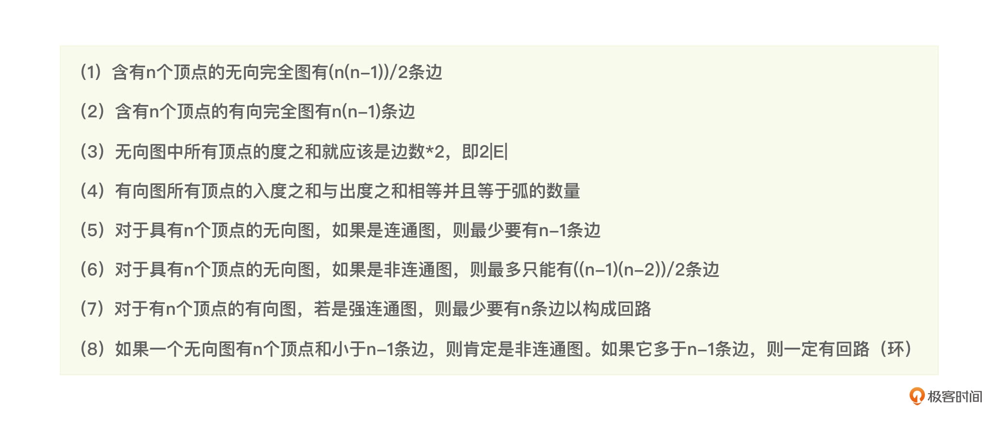

- 图22 图的基本概念、术语和需要有印象的内容整理总结

## 课后思考

你能想到的图的应用有哪些呢？

欢迎你在留言区分享自己的思考。如果觉得有所收获，也可以把课程分享给更多的朋友一起学习进步。我们下一讲见！
