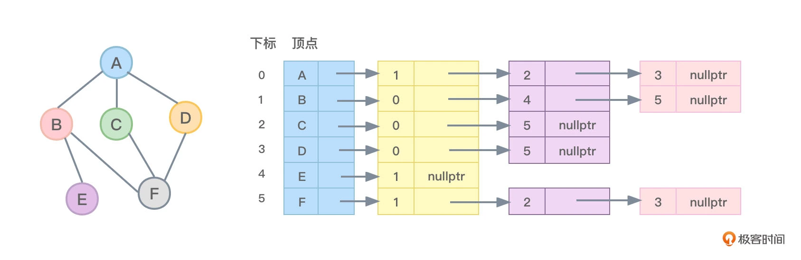
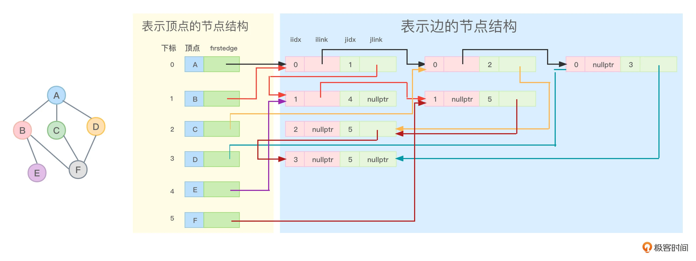
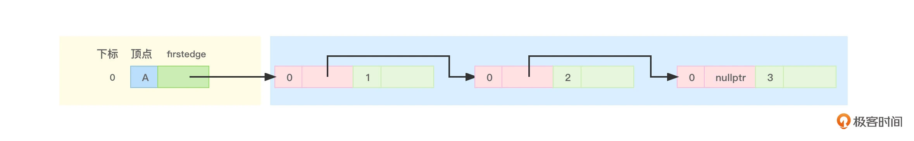
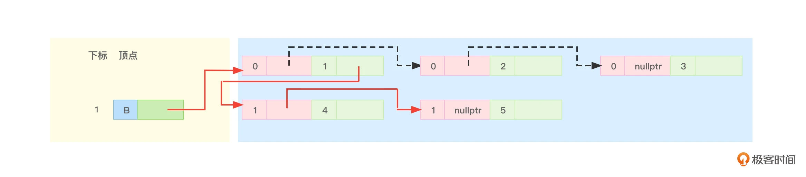
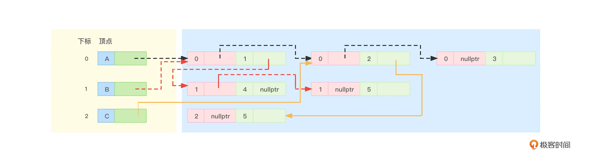
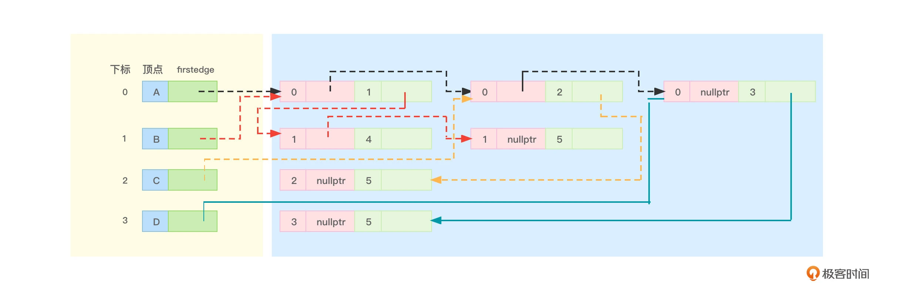
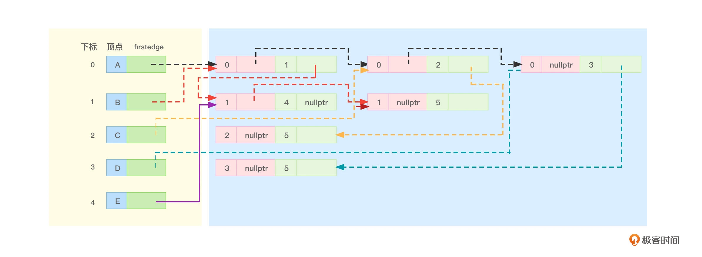
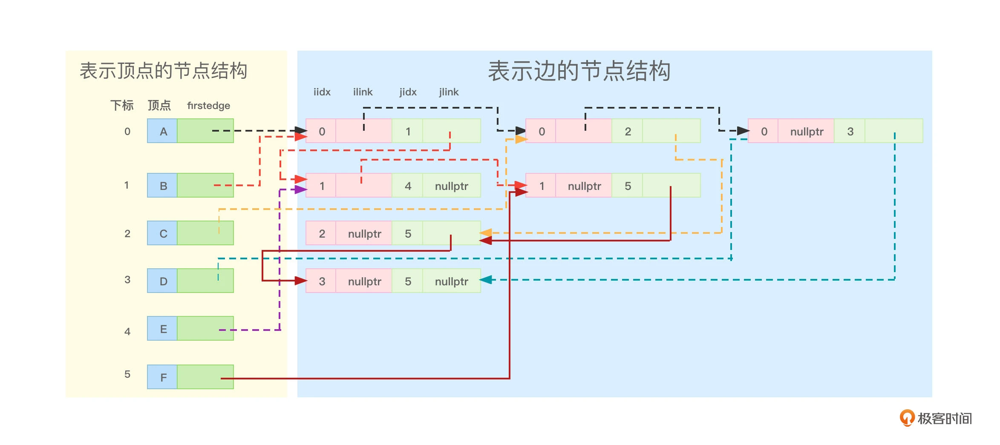
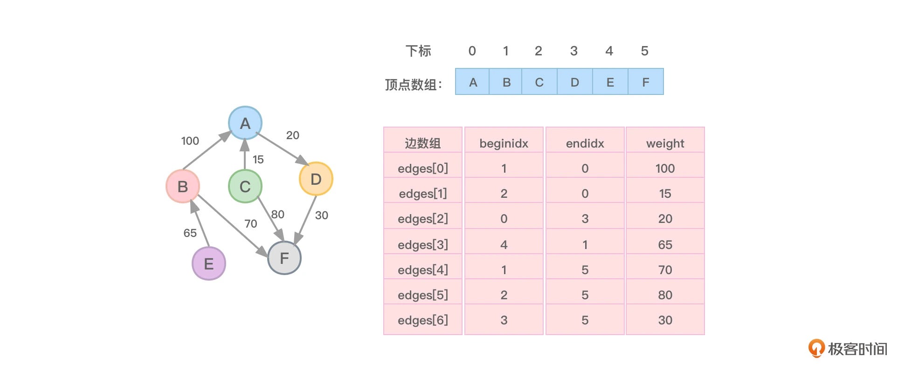

# 25 | 图的存储（下）：为什么我们还需要邻接多重表和边集数组？

你好，我是王健伟。

上节课我们讲解了用邻接矩阵、邻接表、十字链表进行图的存储，他们都有各自的优点、局限性和所适用的场景。这节课，我就带你学习另外两种图的存储结构，分别是邻接多重表和边集数组。

## 邻接多重表

邻接多重表是存储无向图的另一种链式存储结构。换句话说，邻接多重表只适合存储无向图。

使用邻接表存储无向图时，因为对于无向图从顶点 A 到顶点 B 有边，则必然意味着顶点 B 到顶点 A 有边，所以每一条边的存储会用到两个边节点，而且这两个边节点会位于两个不同的链表中（参考上节课的图 3）。



- 图0 图的存储（上）-图3

这不但造成了存储空间的浪费，也让边的操作更麻烦，比如删除边时必须考虑在两个单链表中都进行删除操作。

所以，在一些场合下，采用邻接多重表来存储就会更加适合，尤其是对于边操作，比如对已经访问过的边做标记，删除边等等，就很合适。

邻接多重表的结构类似十字链表，也分表示边的节点结构和表示顶点的节点结构。表示边的节点结构一般如下定义：

```
//表示边的节点结构
struct EdgeNode_adjmt
{
 int iidx; //边的第一个顶点下标
 EdgeNode_adjmt* ilink;//指向下一个依附于iidx所代表的顶点的边
 int jidx; //边的第二个顶点下标
 EdgeNode_adjmt* jlink; //指向下一个依附于jidx所代表的顶点的边
 //int weight; //权值，可以根据需要决定是否需要此字段
};
```

上述结构请注意，前两个成员（iidx 和 ilink）是一组，后两个成员（jidx 和 jlink）是一组。iidx和 jidx 表示的是一个顶点，而 ilink 和 jlink 会指向某个边节点，ilink 指向的边节点所代表的边所包括的两个顶点中必定有一个是顶点 iidx。同理，jlink 指向的边节点所代表的边，它包括的两个顶点中也必定有一个是顶点 jidx，后面我会画图进一步描述。

表示顶点的节点结构一般会像下面的代码一样定义。

```
//表示顶点的节点结构
template<typename T>
struct VertexNode_adjmt
{
 T data;    //顶点中的数据
 EdgeNode_adjmt* firstedge; //与该顶点相连的第一条边
};
```

如 11 所示，看一看一个无向图如何用邻接多重表来表示。



- 图1 一个无向图对应的邻接多重表

图 1 所示的邻接多重表中有 A、B、C、D、E、F 共 6 个顶点，这 6 个顶点分别存储在一个数组中，数组下标分别为 0、1、2、3、4、5。观察每个顶点，我们尝试找到与每个顶点关联的边。

1. 对于顶点 A，有三条边（“0、1”，“0、2”，“0、3”）与该顶点连接。因此，让顶点 A 的firstedge 指针指向这三条边中的任意一条——这里指向“0、1”边节点，然后进行下面的操作。

- 对于“0、1”边节点，因为其所对应的结构（EdgeNode_adjmt）的 iidx 成员等于 0，因此，和 iidx 一组的 ilink 指针指向下一个依附于 iidx（下标 0）所代表的顶点的边就可以指向“0、

- 2”边节点，因为该边节点也有一个顶点下标是 0。

- “0、2”边节点的 ilink 指针就可以指向“0、3”边节点，顶点 A 没有其他相关边了，所以“0、3”边节点的 ilink 指针就应该指向 nullptr。

这样看起来，下标 0 所代表的顶点 A 相关的所有边（“0、1”，“0、2”，“0、3”）就链在一起了，把上面的图 1 拆开细分一下，与顶点 A 相关的部分如图 2 所示：



- 图2 顶点A相关的边节点链在了一起

2. 对于顶点 B，有三条边（“1、0”，“1、4”，“1、5”）与该顶点连接。但是因为对于无向图来讲，边“1、0”与边“0、1”是同一条边，而边“0、1”刚刚已经绘制过了，因此让顶点 B 的firstedge 指针指向“0、1”边节点，然后进行下面的操作。

- 对于“0、1”边节点，因为其所对应的结构（EdgeNode_adjmt）的 jidx 成员等于 1，因此，和 jidx 一组的 jlink 指针指向下一个依附于 jidx（下标 1）所代表的顶点的边就可以指向“1、4”边节点，因为该边节点也有一个顶点下标是 1。

- “1、4”边节点的 ilink 指针就可以指向“1、5”边节点，顶点 B 没有其他相关边了，所以“1、5”边节点的 ilink 指针就应该指向 nullptr。

这样看起来，下标 1 所代表的顶点 B 相关的所有边（“1、0”，“1、4”，“1、5”）就链在一起了，把上面的图 1 拆开细分一下，与顶点 B 相关的部分如图 3 所示：



- 图3 顶点B相关的边节点链在了一起（虚线箭头表示与顶点B无关的一些指针指向）

3. 对于顶点 C，有两条边（“2、0”，“2、5”）与该顶点连接。但因为对于无向图来讲，边“2、0”与边“0、2”是同一条边，而边“0、2”刚刚已经绘制过了，因此让顶点 C 的 firstedge指针指向“0、2”边节点，然后进行下面的操作。

- 对于“0、2”边节点，因为其所对应的结构（EdgeNode_adjmt）的 jidx 成员等于 2，因此，和 jidx 一组的 jlink 指针指向下一个依附于 jidx（下标 2）所代表的顶点的边就可以指向“2、5”边节点，因为该边节点也有一个顶点下标是 2。

- 顶点 C 没有其他相关边了，所以“2、5”边节点的 ilink 指针就应该指向 nullptr。这样看起来，下标 2 所代表的顶点 C 相关的所有边（“2、0”，“2、5”）就链在一起了，把上面的图 1 拆开细分一下，与顶点 C 相关的部分如图 4 所示：



- 图4 顶点C相关的边节点链在了一起（虚线箭头表示与顶点C无关的一些指针指向）

4. 顶点 D 同 C 类似，有两条边（“3、0”，“3、5”）与该顶点连接。但因为对于无向图来讲，边“3、0”与边“0、3”是同一条边，而边“0、3”刚刚已经绘制过了，因此让顶点 D 的 firstedge指针指向“0、3”边节点，然后进行下面的步骤。

- 对于“0、3”边节点，因为其所对应的结构（EdgeNode_adjmt）的 jidx 成员等于 3，因此，和 jidx 一组的 jlink 指针指向下一个依附于 jidx（下标 3）所代表的顶点的边就可以指向“3、5”边节点，因为该边节点也有一个顶点下标是 3。

- 顶点 D 没有其他相关边了，所以“3、5”边节点的 ilink 指针就应该指向 nullptr。这样看起来，下标 3 所代表的顶点 D 相关的所有边（“3、0”，“3、5”）就链在一起了，把上面的图 1 拆开细分一下，与顶点 D 相关的部分如图 5 所示：



- 图5 顶点D相关的边节点链在了一起（虚线箭头表示与顶点D无关的一些指针指向）

5. 对于顶点 E，只有一条边（“4、1”）与该顶点连接。但因为对于无向图来讲，边“4、1”与边“1、4”是同一条边，而边“1、4”前面已经绘制过了，因此让顶点 E 的 firstedge 指针指向“1、4”边节点，然后，对于“1、4”边节点，因为其所对应的结构（EdgeNode_adjmt）的jidx 成员等于 4，而且，顶点 E 没有其他相关边了，所以和 jidx 一组的 jlink 指针指向下一个依附于 jidx（下标 4）所代表的顶点的边就应该指向 nullptr。

这样看起来，下标 4 所代表的顶点 E 相关的所有边其实只有一条边（“4、1”）就链在一起了，把上面的图 1 拆开细分一下，与顶点 E 相关的部分如图 6 所示：



- 图6 顶点E相关的边节点链在了一起（虚线箭头表示与顶点E无关的一些指针指向）

6. 对于顶点 F，有三条边（“5、1”，“5、2”，“5、3”）与该顶点连接。但是这三条边（对于无向图其实就是“1、5”，“2、5”，“3、5”三条边）前面都已经绘制过，因此让顶点 F 的firstedge 指针指向这三条边中的任意一条——这里指向“1、5”边节点，然后进行下面的操作。

- 对于“1、5”边节点，因为其所对应的结构（EdgeNode_adjmt）的 jidx 成员等于 5，因此，和 jidx 一组的 jlink 指针指向下一个依附于 jidx（下标 5）所代表的顶点的边就可以指向“2、5”边节点，因为该边节点也有一个顶点下标是 5。

- “2、5”边节点的 jlink 指针就可以指向“3、5”边节点，顶点 F 没有其他相关边了，所以“3、5”边节点的 jlink 指针就应该指向 nullptr。

这样看起来，下标 5 所代表的顶点 F 相关的所有边（“5、1”，“5、2”，“5、3”）就链在一起了，把上面的图 1 拆开细分一下，与顶点 F 相关的部分如图 7 所示：



- 图7 顶点F相关的边节点链在了一起（虚线箭头表示与顶点F无关的一些指针指向）

在邻接多重表中，找到和某个顶点相关联的边是很容易的。同时，每条边的存储只会用到一个边节点，不但节省了存储空间，同时在删除顶点或删除边时，也减少了操作上的复杂性。对于删除边的操作，实现上是比较简单的，而对于删除顶点的操作，也不要忘记删除和对应顶点相关的所有边。

使用邻接多重表存储无向图所需要的空间复杂度是 O(|V|+|E|)。相关代码在这里就不进行实现了，你可以尝试一下是否能够自行实现。

## 边集数组

边集数组由两个一维数组构成，一个存储顶点信息，另一个存储边信息。边数组的每个元素是一个结构，结构成员包括边的起始顶点下标、边的终止顶点下标、权值。

```
//表示边的结构
struct Edge_esa
{
 int beginidx; //边的起始顶点下标
 int endidx; //边的终止顶点下标
 //int weight; //权值，可以根据需要决定是否需要此字段
};
```



- 图8一个有向图对应的边集数组

在边集数组中，要计算一个顶点的度需要扫描整个边数组，效率不高。所以边集数组适合需要对边进行依次处理的场合，不太适合对顶点进行操作的场合。

使用边集数组存储图所需要的空间复杂度是 O(|V|+|E|)。相关代码并不复杂，有兴趣的话，你可以自行实现。

## 小结

这节课，我们继续上节课的内容学习了存储图的 2 个数据结构，分别是邻接多重表、边集数组来存储图。

邻接多重表是用于存储无向图的一种链式存储结构。比较适合于对边做频繁操作的场合，找到和某个顶点相关联的边是很容易。从编写代码角度来讲有一定的复杂性。

边集数组由两个一维数组构成，一个存储顶点信息，另一个存储边信息。边集数组适合需要对边进行依次处理的场合，不太适合对顶点进行操作的场合。

到这里，我们 5 种存储图的数据结构就讲完了，我把各种图所用到的存储结构的比较信息进行了整理，方便你的查阅和适当的记忆：

1．邻接矩阵

## ∣V ∣2

空间复杂度：O(

- )，空间浪费较多。

适用性：稠密图，顶点多，边也多。

找邻边（有公共顶点的两条边）：需要对行或者列进行遍历，具有 O(|V|) 的时间复杂度。

操作便利性：删除边比较容易，删除顶点需要移动许多数据。

2．邻接表

空间复杂度：无向图 O(|V|+2|E|)；有向图 O(|V|+|E|)。

适用性：稀疏图（顶点多边较少）。

找邻边：寻找有向图某个顶点的入边（入度）不方便，需要遍历整个邻接表。

操作便利性：删除无向图的边和顶点并不方便。

3．十字链表

空间复杂度：O(|V|+|E|)。

适用性：有向图。

找邻边：很容易。

操作便利性：操作比较便利，编程较复杂。

4．邻接多重表

空间复杂度：O(|V|+|E|)。

适用性：无向图。

找邻边：很容易。

操作便利性：操作比较便利，编程较复杂。

5．边集数组

空间复杂度：O(|V|+|E|)。

适用性：有向图、无向图。

找邻边：需要遍历整个边数组。

操作便利性：不太适合对顶点进行操作的场合。操作比较便利，编程较简单。

相信通过两节课的拆解，你一定对它们有了更全面、更扎实的了解。下节课，我们就看一看图的遍历问题。

## 课后思考

你能参照邻接表存储图的实现代码，完成邻接多重表和边集数组存储图的实现代码吗？

欢迎你在留言区分享自己的思考，如果觉得有所收获，也可以把课程分享给更多的朋友一起学习。我们下节课见！
