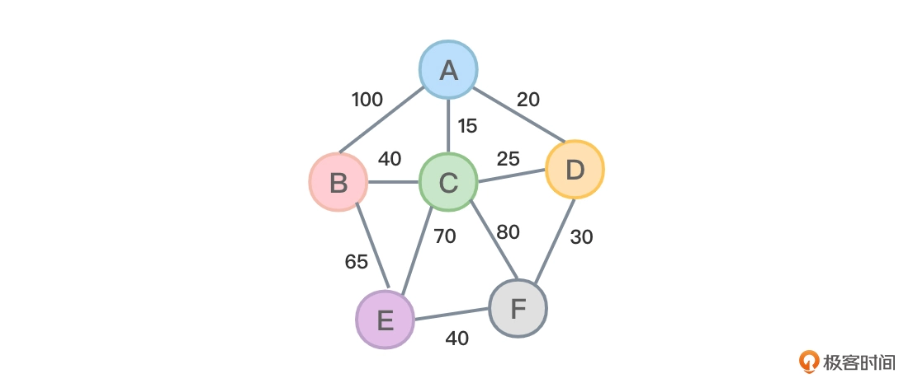
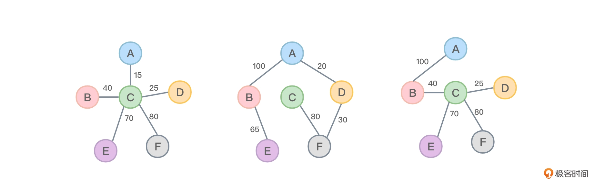
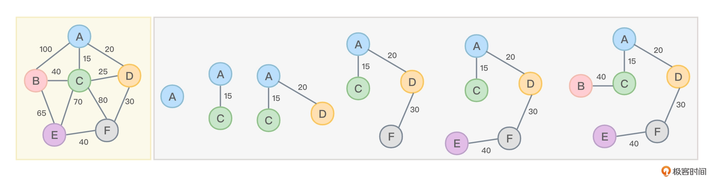
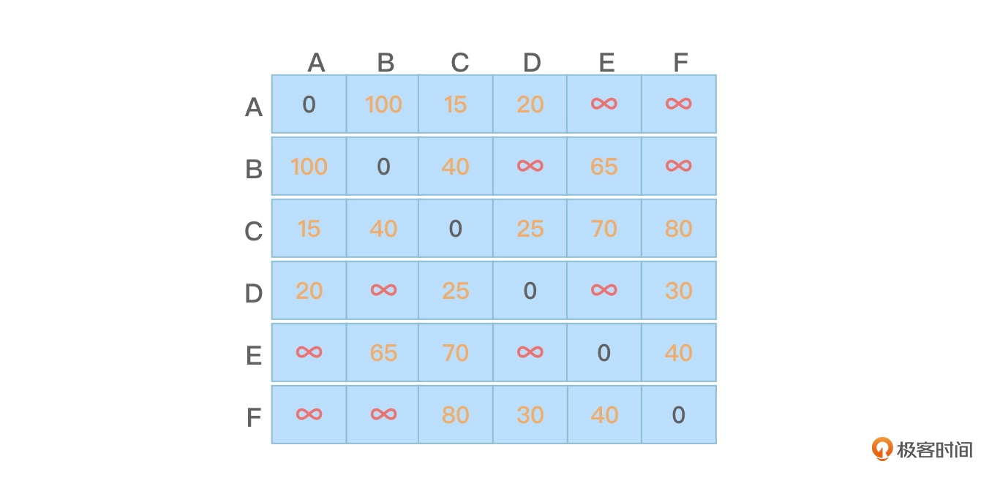
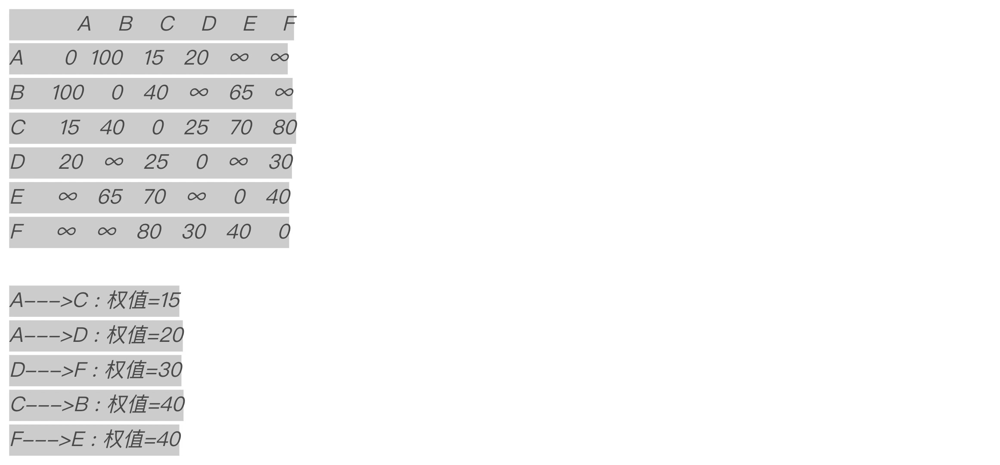
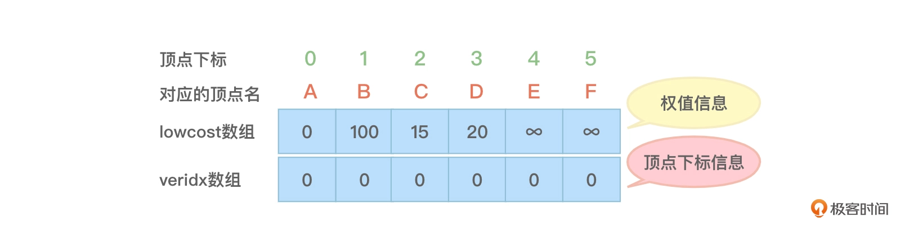
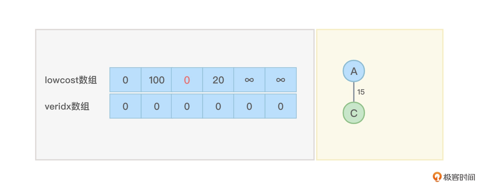
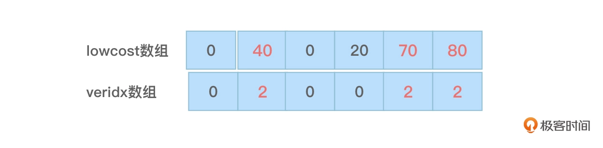
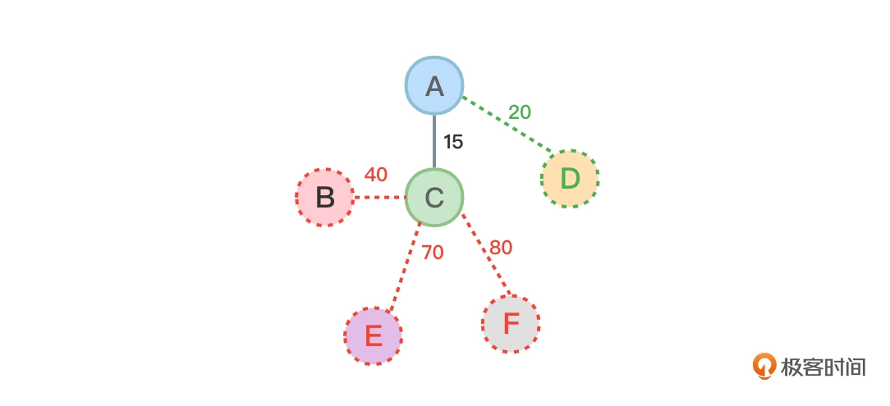
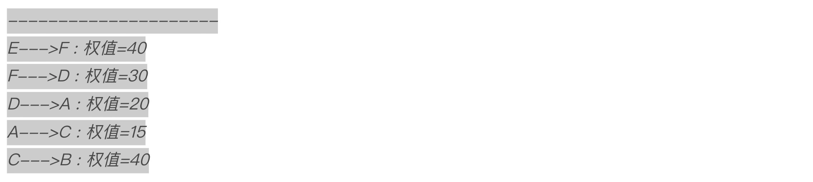

# 27 | 最小生成树：如何用普里姆（Prim）算法解决修路费用最少的问题？

你好，我是王健伟。

前面我们已经讲解了图的概念、图的存储结构以及图的遍历问题。那么你可能非常想知道图都有哪些具体的实际用途。这节课，我就和你分享图的第一个实际用途——最小生成树。

首先我们先一起看一看什么是最小生成树。

## 最小生成树

前面我们曾经展示过生成树：一个无向连通图的生成树是包含图中全部顶点的一个极小连通子图。

这里的极小，指的是边尽可能少但要保持连通。一个连通图可能会有多个生成树，生成树中如果有 n 个顶点，则必须有 n-1 条边，若减去一条边，则会变成非连通图，若增加一条边则图中就会存在回路。

好了，现在我们假设要在 n 个城市（顶点）之间修路（边）。通常来讲每两个城市之间都可以

- n(n−1)

修一条路（无向完全图），这意味着 n 个城市最多可以修

- 条路。但是每修一条路都需2​

要花费一定的资金，所以在每两个城市之间都修一条路是很不划算的。

要想让这 n 个城市连通，只需要修 n-1 条路即可，那么如何在这些可能的路线中选择 n-1 条以使总的资金花销最少呢？

图 1 是一个带权的无向图，你可以把图中的各个顶点看成是一座座城市。图中城市之间的连线对应的权值代表修一条连通这两个城市之间的道路所需要的资金。



- 图1 一个带权的无向图（权值代表修建城市之间的道路所需要的资金）

图 2 中所示的是随意列举的三种连通方案：



- 图2 图1的3个生成树代表着三种修路方式

图 2 的三种修路方式中，第一种方式所需要的资金是 40+15+25+80+70=230。第二种方式所需要的资金是 100+20+65+80+30=295。第三种方式所需要的资金是100+40+25+70+80=315。

所谓最小生成树，就是在图 1 的所有生成树中找到最小代价（所需要资金最少）生成树即找到所需要资金最少的修路方式。

这里我们给出最小生成树的定义：对于一个带权无向连通图，其生成树不同，树中所有边上的权值之和也可能不同，边上权值之和最小的生成树就是该带权连通无向图的最小生成树（Minimum Spanning Tree，简称 MST）。这里有下面几点需要说明。

- 最小生成树是可能有多个的，但最小生成树边的权值之和肯定是最小且唯一的。

- 最小生成树的边数是顶点数 -1。再减少一条边则变成了非连通图，增加一条边则图中就会存在回路。

- 如果连通图本身是一棵树（连通且不存在回路），则其最小生成树就是它本身。

寻找连通图的最小生成树的算法有很多，其中有两种比较典型，分别是普里姆（Prim）算法和克鲁斯卡尔（Kruskal）算法。这节课我们就先说普里姆算法。

## 普里姆（Prim）算法详解

普里姆算法从任意顶点（比如顶点 A）开始构建最小生成树。针对图 1，我来描述一下具体步骤。

- 将顶点 A 放入到最小生成树中。

- 找与顶点 A 连通的所有其他顶点中代价最小（两个顶点对应的边权值最小）的顶点放入到最小生成树中。这里应该是将顶点 C 放入到最小生成树中。

- 找与最小生成树中所有顶点相邻的，其他不在最小生成树里的顶点中，边权值最小的顶点（如果多个则任选一个）放入到最小生成树中。这里应该是将顶点 D 放入到最小生成树中，因为顶点 A 和顶点 D 之间的边权值是 20。

- 重复上面这个步骤，再分别将顶点 F、E、B 放入到最小生成树中，直至图中所有顶点都加入到了最小生成树中，如图 3 所示：



- 图3 针对图1采用普里姆算法得到最小生成树的步骤

从图 3 可以看到，最少生成树所对应边的权值之和是 15+20+30+40+40=145。

采用邻接矩阵的存储方式保存图更容易访问到图中边的权值，所以下面的代码中将采用邻接矩阵的方式来存储图 1 所示的带权无向图并用普利姆算法构建该图的最小生成树。因为图中顶点的边是带有权值的，因此两个不同的顶点之间若没有边则可以将它们之间代表边的权值设置为一个非常大的数字并在显示时显示为∞（无穷），相同顶点的权值显示为 0 即可，图 1 所对应的邻接矩阵如图 4 所示：



- 图4 针对图1对应的邻接矩阵

普里姆算法的实现代码也有很多种写法，这里先选择一种简单好理解的实现方法，我们看一下代码。

```sql
#define MaxVertices_size 100 //最大顶点数大小
#define INT_MAX_MY 2147483647//整型能够保存的最大数值，用以表示两个顶点之间不存在边
template<typename T> //T代表顶点类型
class GraphMatrix//邻接矩阵代表的图
{
public:
 GraphMatrix() //构造函数，空间复杂度O(n)+O(n^2)=O(n^2)
 {
   m_numVertices = 0;
   m_numEdges = 0;
   pm_VecticesList = new T[MaxVertices_size];
   pm_Edges = new int* [MaxVertices_size];
   for (int i = 0; i < MaxVertices_size; ++i)
   {
     pm_Edges[i] = new int[MaxVertices_size];
   } //end for
   for (int i = 0; i < MaxVertices_size; ++i)
   {
     for (int j = 0; j < MaxVertices_size; ++j)
     {
       if (i == j)
       {
         //顶点自己到自己对应的边的权值应该用0标记
         pm_Edges[i][j] = 0;
       }
       else
       {
         pm_Edges[i][j] = INT_MAX_MY; //开始时矩阵中不记录边信息，即边与边之间的权值信息
       }
     }
   }
 }
 ~GraphMatrix() //析构函数
 {
   delete[] pm_VecticesList;
   for (int i = 0; i < MaxVertices_size; ++i)
   {
     delete[] pm_Edges[i];
   } //end for
   delete[] pm_Edges;
 }
public:
 //插入顶点
 bool InsertVertex(const T& tmpv)
 {
   if (m_numVertices >= MaxVertices_size) //顶点空间已满
   {
     cout <<"顶点空间已满"<< endl;
     return false;
   }
   if (GetVertexIdx(tmpv) != -1) //该顶点已经存在
   {
     cout <<"顶点"<< tmpv <<"已经存在!"<< endl;
     return false;
   }
   pm_VecticesList[m_numVertices] = tmpv;
   m_numVertices++;
   return true;
 }
 //插入边
 bool InsertEdge(const T& tmpv1, const T& tmpv2,int weight) //在tmpv1和tmpv2两个顶
   {
   int idx1 = GetVertexIdx(tmpv1);
   int idx2 = GetVertexIdx(tmpv2);
   if (idx1 == -1 || idx2 == -1)//某个顶点不存在，不可以插入边
     return false;
   if (pm_Edges[idx1][idx2] != INT_MAX_MY)//边重复
     return false;
   pm_Edges[idx1][idx2] = pm_Edges[idx2][idx1] = weight; //无向图是个对称矩阵。tmpv
   m_numEdges++; //边数量增加1
   return true;
 }
   void DispGraph() //显示图信息，其实就是显示矩阵信息
 {
   cout <<"";  //为了凑一些对齐关系，所以先输出三个空格
   //输出图中的顶点，其实就是矩阵的最顶上一行的顶点名信息
   for (int i = 0; i < m_numVertices; ++i)
   {
     printf("%5c", pm_VecticesList[i]);  //5：不够5位的右对齐
   }
   cout << endl; //换行
   //输出对应的邻接矩阵
   for(int i = 0; i < m_numVertices; ++i)//注意循环结束条件是真实的顶点个数
   {
     //输出矩阵左侧的顶点名
     cout << pm_VecticesList[i] <<"";
     for (int j = 0; j < m_numVertices; ++j)
     {
       if (pm_Edges[i][j] == INT_MAX_MY)
       {
         printf("%5s", "∞");  //两个顶点之间没有边
       }
       else
       {
         printf("%5d", pm_Edges[i][j]);
       }
     } //end for j
     cout << endl; //换行
   } //end for i
   cout << endl; //换行
 }
 //判断某个idx值是否位于最小生成树顶点下标数组中
 bool IfInMstVertIdxArray(int curridx,int *p_inMstVertIdxArray,int in_MstVertCou
 {
   for (int i = 0; i < in_MstVertCount; ++i)
   {
     if (p_inMstVertIdxArray[i] == curridx) //这个idx位于最小生成树顶点下标数组中
       return true;
   } //end for
   return false; //这个idx不在最小生成树顶点下标数组中
 }
 //用 普里姆（Prim）算法创建最小生成树
 bool CreateMinSpanTree_Prim(const T& tmpv)  //tmpv作为创建最小生成树时的起始顶点
 {
   int idx = GetVertexIdx(tmpv);
   if (idx == -1) //顶点不存在
     return false;
   int in_MstVertCount = 1;  //已经增加到生成树【最小生成树】中的顶点数量，刚开始肯定是要把
   int* p_inMstVertIdxArray = new int[m_numVertices]; //已经增加到生成树中的顶点的下标
   p_inMstVertIdxArray[0] = idx; //起始顶点下标
   int minWeight = INT_MAX_MY;  //用来记录当前的最小权值，先给成最大值
   int minTmpStartVertIdx = -1; //临时存放一个开始顶点的下标值（一个边的开始顶点）
   int minTmpEndVertIdx = -1; //临时存放一个目标顶点的下标值（一个边的末端顶点）
   while (true)
   {
     if (in_MstVertCount == m_numVertices) //生成树中的顶点数量等于了整个图的顶点数量，
       break;
     minWeight = INT_MAX_MY; //权值先给成最大值
     for (int iv = 0; iv < in_MstVertCount; ++iv) //遍历所有生成树中已有的顶点，从其中
     {
       int tmpidx = p_inMstVertIdxArray[iv]; //拿到该位置的信息【顶点索引】
       for (int i = 0; i < m_numVertices; ++i) //遍历所有顶点以找到所有以tmpidx顶点为
       {
         if (pm_Edges[tmpidx][i] != 0 && pm_Edges[tmpidx][i] != INT_MAX_MY) //当前
         {
           //在以iv顶点为起点的所有边中找权值最小的边
           //权值最小的边所对应目标顶点不在最小生成树顶点下标数组中，说明是个新顶点
           if (pm_Edges[tmpidx][i] < minWeight   &&  IfInMstVertIdxArray(i, p_in
           {
             minWeight = pm_Edges[tmpidx][i];
             minTmpStartVertIdx = tmpidx; //记录边对应的开始顶点下标
             minTmpEndVertIdx = i;    //记录边对应的目标顶点下标
           }
         }
       } //end for i
     }//end for iv
     //走到这里，肯定找到了个新顶点，输出最小生成树的边信息
     cout << pm_VecticesList[minTmpStartVertIdx] <<"--->"<< pm_VecticesList[minT
     p_inMstVertIdxArray[in_MstVertCount] = minTmpEndVertIdx;  //将新顶点增加到最小
     in_MstVertCount++;
   } //end while
   //内存释放
   delete[] p_inMstVertIdxArray;
   return true;
 }
private:
 //获取顶点下标
 int GetVertexIdx(const T& tmpv)
 {
   for (int i = 0; i < m_numVertices; ++i)
   {
     if (pm_VecticesList[i] == tmpv)
       return i;
   }
   return -1; //不存在的顶点
 }
private:
 int m_numVertices;   //当前顶点数量
 int m_numEdges;      //边数量
 T* pm_VecticesList;  //顶点列表
 int** pm_Edges;      //边信息，二维数组
};
```

在 main 主函数中，增加下面的代码。

```
GraphMatrix<char> gm;
//向图中插入顶点
gm.InsertVertex('A');
gm.InsertVertex('B');
gm.InsertVertex('C');
gm.InsertVertex('D');
gm.InsertVertex('E');
gm.InsertVertex('F');
//向图中插入边
gm.InsertEdge('A', 'B', 100); //100代表边的权值
gm.InsertEdge('A', 'C', 15);
gm.InsertEdge('A', 'D', 20);
gm.InsertEdge('B', 'C', 40);
gm.InsertEdge('B', 'E', 65);
gm.InsertEdge('C', 'D', 25);
gm.InsertEdge('C', 'E', 70);
gm.InsertEdge('C', 'F', 80);
gm.InsertEdge('D', 'F', 30);
gm.InsertEdge('E', 'F', 40);
gm.DispGraph();
gm.CreateMinSpanTree_Prim('A');
```

执行结果为：



上述代码中，成员函数 CreateMinSpanTree_Prim 实现了用普里姆算法创建最小生成树，代码性能也许算不上最优，但胜在实现方法简单且易于理解。我们尝试具体描述一下。

1. 创建一个数组专门保存最小生成树中的顶点并把开始顶点放入其中。

2. 下面的步骤会不断循环直到最小生成树中的顶点数量等于整个图的顶点数量。

- 遍历最小生成树中的所有顶点，从其中找到以该顶点开始的边中权值最小的边所对应的目标顶点，当然该目标顶点必须是没有出现在最小生成树顶点数组中。

- 以“开始顶点—> 目标顶点：权值”的格式显示输出最小生成树的边信息并将目标顶点放入最小生成树顶点数组中。

CreateMinSpanTree_Prim 所实现的普里姆最小生成树算法代码有改进空间，通过改进来进一步提升代码执行效率，但改进也会增加代码理解难度。这里我来具体描述一下。

1. 引入一个称为 lowcost 的数组用来保存权值信息。lowcost 会记录最小生成树中顶点到达所有顶点的最小权值信息——最小权值也就是最近的邻接边。之后，引入一个称为 veridx 的数组用来保存顶点对应的下标信息。

假设是从顶点 A 开始构建最小生成树，那么观察图 4 可以看到，顶点 A 与其他各个顶点相关边的权值信息为“0 100 15 20 ∞ ∞”，将这个信息保存在 lowcost 数组中。而因为顶点 A的下标为 0，所以将 0 这个下标值保存在 veridx 数组中。目前 lowcost 和 veridx 两个数组中的内容看起来如下：



- 图5 lowcost和veridx数组的初始内容

2. 以下步骤会不断循环直到最小生成树中的顶点数量等于整个图的顶点数量。第一次循环描述如下：

- 在 lowcost 数组中寻找一个权值最小的边（但权值不能为 0），该边对应的目标顶点下标也就同时从 lowcost 数组中拿到了。在图 5 中，最小的权值是 15，对应的顶点下标是 2。

- veridx 数组中下标 2 对应的位置的值是 0，这代表下标为 0 的顶点和下标为 2 的顶点之间的边的权值是 15。

- 下标为 0 到下标为 2 的顶点之间的边就是最小生成树的一条边，将该信息显示到屏幕上。然后将 lowcost 数组下标 2 对应位置的权值 15 修改为 0，之后标示下标 2 代表的顶点被加入到了最小生成树中。目前 lowcost 和 veridx 两个数组中的内容和已经产生的部分生成树看起来如下：



- 图6 创建最小生成树期间的lowcost和veridx数组内容和生成的部分最小生成树内容

- 因为找到了下标为 2 的新顶点，所以需要更新 lowcost 和 veridx 数组信息。新顶点相关边的权值信息通过看邻接矩阵就可以看到，为“15 40 0 25 70 80”，这些信息与 lowcost数组对应位置的权值信息做比较，如果新顶点对应位置的权值信息小于 lowcost 数组对应位置的权值信息（这说明新加入到最小生成树的顶点到达其他相同顶点的距离更短），则将lowcost 数组对应位置的权值更改为新顶点对应位置的权值信息，并将 veridx 数组对应位置的内容修改为新顶点的下标值。这一系列操作后 lowcost 和 veridx 两个数组中的内容看起来如下：



- 图7 创建最小生成树期间的lowcost和veridx数组内容

之所以进行上述操作，是因为新加入到最小生成树中的下标为 2 的新顶点（顶点 C）比下标为0 的顶点（顶点 A）到达图 7 中下标为 1、4、5 的顶点（顶点 B、E、F）的权值更小，所以当然要记录权值更小的顶点信息。换个角度再想一想：原来顶点 A 与顶点 B 之间的边权值是100，现在因为最小生成树中加入了顶点 C，而顶点 C 和顶点 B 之间边的权值是 40，当然就不再需要理会原来顶点 A 与顶点 B 之间的权值，只需要记录顶点 C 与顶点 B 之间的权值是40 即可。

图 7 包含的信息非常多，你可能无法从图 7 中解读出全部有用的信息，这里解读一下试试看。

信息一：下标为 0 的位置（该位置代表顶点 A），lowcost 数组对应位置内容为 0，这表示顶点A 已经位于最小生成树中。

信息二：下标为 1 的位置（该位置代表顶点 B），lowcost 数组对应位置内容为 40，veridx 数组对应位置为 2（顶点 C），这表示顶点 B 和顶点 C 之间的边权值为 40。

信息三：下标为 2 的位置（该位置代表顶点 C），lowcost 数组对应位置内容为 0，这表示顶点C 已经位于最小生成树中。

信息四：下标为 3 的位置（该位置代表顶点 D），lowcost 数组对应位置内容为 20，veridx 数组对应位置为 0（顶点 A），这表示顶点 D 和顶点 A 之间的边权值为 20。

信息五：下标为 4 的位置（该位置代表顶点 E），lowcost 数组对应位置内容为 70，veridx 数组对应位置为 2（顶点 C），这表示顶点 E 和顶点 C 之间的边权值为 70。

信息六：下标为 5 的位置（该位置代表顶点 F），lowcost 数组对应位置内容为 80，veridx 数组对应位置为 2（顶点 C），这表示顶点 F 和顶点 C 之间的边权值为 80。

图 8 中虚线绘制部分内容代表了图 7 所表达的信息：



- 图8 从图7获取到最小生成树中顶点的最小权值信息

- 本次循环执行完毕，开始下一次循环。

将上述改进过的普里姆最小生成树算法实现代码命名为 CreateMinSpanTree_Prim2，就是下面的内容。

```javascript
//用普里姆（Prim）算法创建最小生成树的第二种方法
bool CreateMinSpanTree_Prim2(const T& tmpv)//tmpv作为创建最小生成树时的起始顶点
{
 int idx = GetVertexIdx(tmpv);
 if (idx == -1) //顶点不存在
   return false;
 int lowcost[MaxVertices_size];    //保存权值的数组，采用new动态分配也可以
 int veridx[MaxVertices_size];     //保存顶点下标的数组，采用new动态分配也可以
 for (int i = 0; i < m_numVertices; ++i)
 {
   lowcost[i] = pm_Edges[idx][i];   //保存开始顶点的权值信息
   veridx[i] = idx;                 //保持开始顶点的下标信息
 } //end for
 int minTmpStartVertIdx = -1;
 int minTmpEndVertIdx = -1;
 for (int i = 0; i < m_numVertices - 1; ++i)//循环“顶点数-1”次即可创建出最小生成树
 {
   //在lowcost数组中找权值最小的顶点
   int minWeight = INT_MAX_MY;
   for (int w = 0; w < m_numVertices; ++w) //遍历lowcost数组，找到其中权值最小的
   {
     if(lowcost[w] != 0 && minWeight > lowcost[w])
     {
       minWeight = lowcost[w];
       minTmpEndVertIdx = w;
     }
   } //end for w
   minTmpStartVertIdx = veridx[minTmpEndVertIdx];
   cout << pm_VecticesList[minTmpStartVertIdx] <<"--->"<< pm_VecticesList[minTmp
   lowcost[minTmpEndVertIdx]= 0;//权值设置为0表示该顶点被放入了最小生成树中
   //通过最新寻找到的顶点来修改lowcost数组和veridx数组中的内容
   for (int v = 0; v < m_numVertices; ++v)
   {
     if (lowcost[v] > pm_Edges[minTmpEndVertIdx][v])
     {
       lowcost[v] = pm_Edges[minTmpEndVertIdx][v];
       veridx[v] = minTmpEndVertIdx;
     }
   } //end for v
 }//end for i
 return true;
}
```

在 main 主函数中，继续增加下面的测试代码，这次以顶点 E 作为开始顶点构建最小生成树。

```
cout <<"---------------------"<< endl;
gm.CreateMinSpanTree_Prim2('E');
```

新增代码的执行结果如下：



从代码中可以看到，普里姆算法是从某个顶点开始构建最小生成树，每次将权值最小的新顶点加入到最小生成树直到所有顶点都加入到最小生成树中。因为算法涉及到了双重 for 循环，所

## ∣V ∣2

## n2

以普里姆算法的时间复杂度为 O(

- )，即 O()。

因为普利姆算法只与图中顶点的数量有关，与边数无关，所以当图中顶点数比较少，而边数比较多时使用该算法构造最小生成树效果较好。

## 小结

这节课我首先带你回顾了一下无向连通图的生成树的概念，接着，我们给出了一个带权无向连通图的最小生成树的定义。之所以给出这个最小生成树的定义，是因为我们要用一些算法来寻找连通图的最小生成树。最小生成树对于解决在多个城市之间如何修路所花费的资金最少等问题具有非常现实的意义。

接着我向你介绍了利用普里姆（Prim）算法来寻找一个无向连通图的最小生成树。我们重点描述一下利用该算法从图中任意一个顶点构建最小生成树的步骤。

- 将任意顶点放入到最小生成树中。

- 找与该顶点连通的所有其他顶点中代价最小的顶点放入到最小生成树中。

- 找与最小生成树中所有顶点相邻的，其他不在最小生成树里的顶点中，边权值最小的顶点放入到最小生成树中。

- 重复上面的步骤。

另外，在编写代码方面，代码中我们采用邻接矩阵来保存图，而后我带你实现了一个比较好理解的普里姆算法来创建最小生成树。不过，比较好理解的普里姆算法的缺点是执行效率上稍差一些，所以，我们又改进了现有算法，实现了另外一种比较难理解但执行效率更高的普里姆算法，这种改进算法需要引入一个 lowcost 权值信息数组以及保存顶点对应下标信息的 veridx 数组，我向你详细阐述了这两个数组的用法以帮助你更好地理解改进后的普里姆算法实现最小生成树的代码。

## n2

普里姆算法的时间复杂度是 O(

- )，并且因为该算法只与图中顶点的数量相关，与边数无关，

所以当图中顶点数比较少，边数比较多时最适合使用该算法构造最小生成树。

## 课后思考

请你想一想，现实生活中有哪些问题比较适合用普里姆算法实现的最小生成树来解决？

欢迎你在留言区和我分享。如果觉得有所收获，也可以把课程分享给更多的朋友一起学习。我们下节课见！
