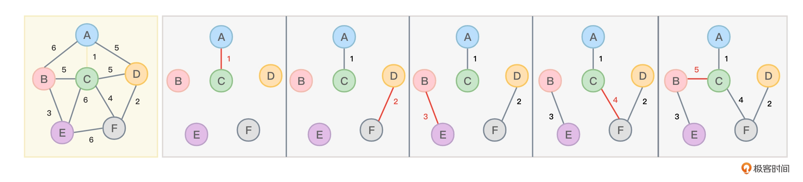
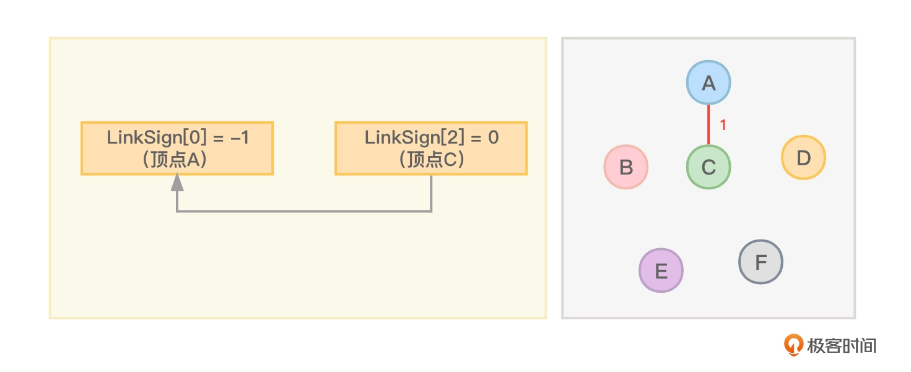
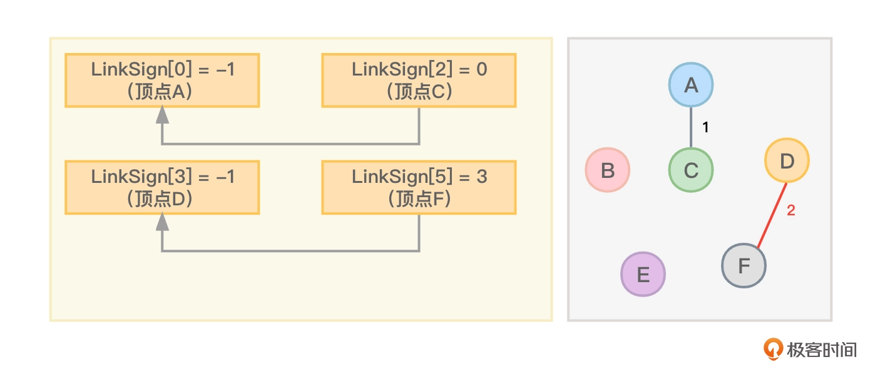
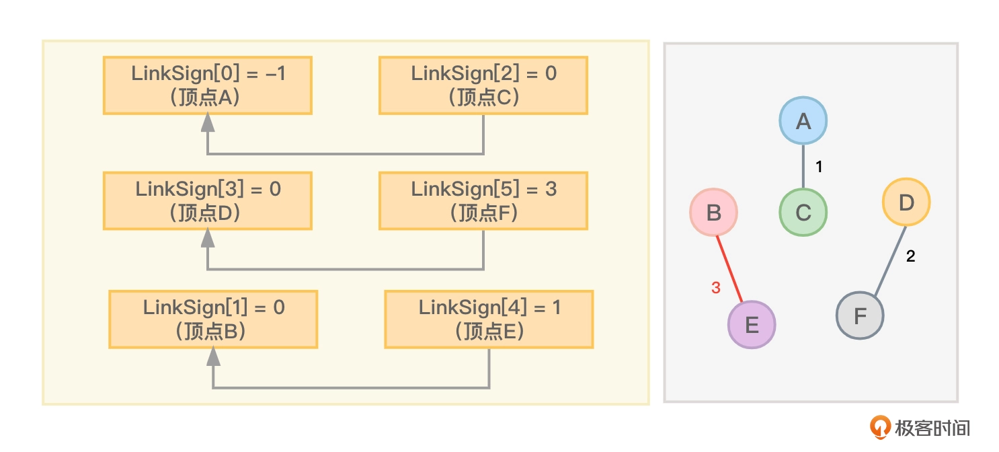
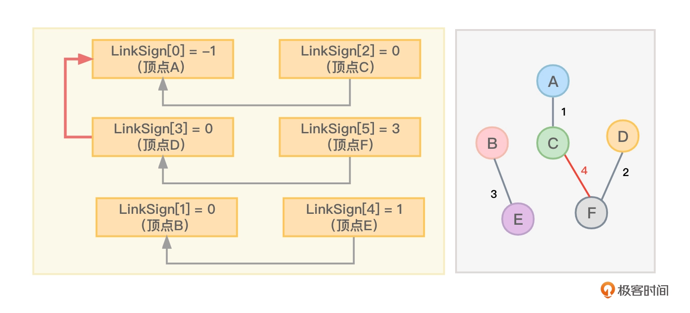
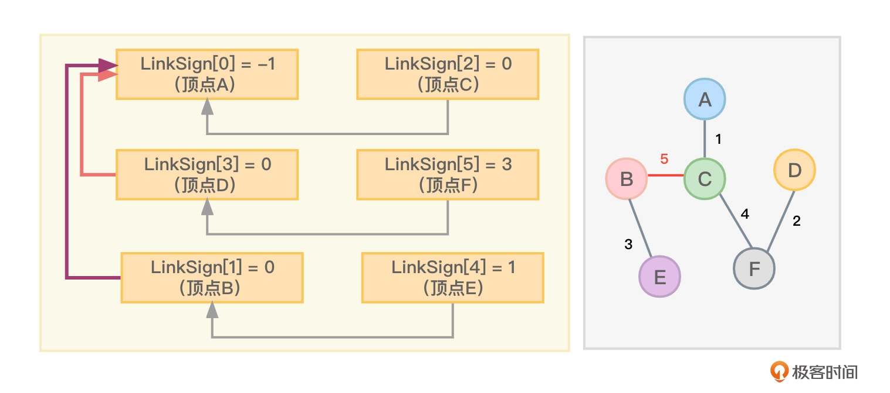
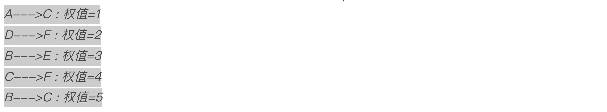

# 28 | 最小生成树：克鲁斯卡尔（Kruskal）算法与修路费用最少的问题？

你好，我是王健伟。

上节课我带你实现了用普里姆算法寻找一个无向连通图的最小生成树，并且我们已经知道，普里姆算法比较适合顶点数比较少，边数比较多的图。

这节课我带你看一看另外一种寻找无向连通图最小生成树的方法——克鲁斯卡尔（Kruskal）算法。话不多说，我们先看一看这个算法是如何描述的。

## 克鲁斯卡尔（Kruskal）算法详解

将图中的顶点列出来，挑选出权值最小的一条边，前提是第一这条边以往没被挑选过，第二这条边对应的两个顶点并没有连通。注意，直接或者间接通过其他顶点连通都算连通，连通会造成有环，是不行的。重复挑选这样的边，直到所有顶点都直接或者间接连通。

克鲁斯卡尔算法的主要难点是判断两个顶点是否已经直接或者间接地连通，因为对于已经连通的两个顶点，即便他们之间的边权值最小，也不能选择。看一看图 1 所示的无向连通图：



- 图1 采用克鲁斯卡尔算法得到的一个无向连通图最小生成树的步骤

图 1 展示了一个无向连通图最小生成树的步骤，从权值最小的边开始挑选。其中边的权值为1、2、3、4 的边都非常好挑选，但权值为 5 的边却有 3 条，分别是顶点 CD 之间的边、顶点AD 之间的边以及顶点 BC 之间的边。

但显然顶点 CD 之间的边不能选，否则 C、D、F 三个顶点就会构成环（顶点 C 和 D 已经通过F 间接连通），顶点 AD 之间的边不能选，否则 A、D、F、C 四个顶点会构成环，只能选择BC 之间的边。克鲁斯卡尔算法的难点就是如何判断 C、D、F 三个顶点会构成环或者 A、D、F、C 四个顶点会构成环。

这里图的存储仍然采用邻接矩阵的方式，那么克鲁斯卡尔算法的代码如何实现呢？

首先需要引入一个边结构：

```
//边结构
struct Edge
{
 int idx_startVert;  //边所对应的开始顶点下标索引
 int idx_endVert;    //边所对应的结束顶点下标索引
 int weight;         //边的权值
};
```

那么如何判断加入的新顶点与原来的顶点是否会构成一个环呢？这并不复杂，在前面讲解静态链表时曾采取过用一维数组来代替指针来描述单链表。在这里也同样，把从未加入过数组的顶点加入到数组中构成一个链表，那么判断某个顶点加入到该数组后是否会构成环只需要遍历这个数组看一看。

以图 1 中左侧无向图为例，图中一共有 6 个顶点，给每个顶点编一个下标。顶点 A 的下标是0，顶点 B 的下标是 1，顶点 C 的下标是 2，顶点 D 的下标是 3，顶点 E 的下标是 4，顶点 F的下标是 5。提供一个包含 6 个元素的数组比如 LinkSign[6]用于保存顶点下标信息，给每个数组元素设置一个初始值 -1（小于 0 的值），即：

LinkSign[0] = LinkSign[1] = LinkSign[2] = LinkSign[3] = LinkSign[4] = LinkSign[5] = -1

然后完成下面的 4 个步骤。

1. 选择一条权值最小的边，这里肯定选择顶点 A（下标 0）和 C（下标 2）之间权值为 1 的边，根据下标找对应的 LinkSign 数组元素。因为 LinkSign[0]和 LinkSign[2]都等于 -1，所以 LinkSign[2] = 0（当然也可以让 LinkSign[0] = 2），这样顶点 A 和顶点 C 就构成了一个静态链表，并且顶点 C 指向了顶点 A。这里是因为 LinkSign[2]里记录数字是 0，而 0 正是顶点 A 的下标，如图 2 所示：



- 图2 采用数组的方式实现静态链表将顶点A和顶点C连到了一起

2. 继续选择一条权值最小的边，这次选择了顶点 D 到顶点 F 之间的权值为 2 的边，根据下标找对应的 LinkSign 数组元素。因为 LinkSign[3]和 LinkSign[5]都等于 -1，所以 LinkSign[5]= 3（当然也可以让 LinkSign[3] = 5），这样顶点 D 和顶点 F 就构成了一个静态链表，并且顶点 F 指向了顶点 D。这里是因为 LinkSign[5]里记录数字是 3，而 3 正是顶点 D 的下标。目前的情形如图 3 所示：



- 图3 采用数组的方式实现静态链表继续将顶点D和顶点F连到了一起

3. 继续选择一条权值最小的边，这次选择了顶点 B 到顶点 E 之间的权值为 3 的边，根据下标找对应的 LinkSign 数组元素。因为 LinkSign[1]和 LinkSign[4]都等于 -1，所以 LinkSign[4]= 1（当然也可以让 LinkSign[1] = 4），这样顶点 B 和顶点 E 就构成了一个静态链表，并且顶点 E 指向了顶点 B。这里是因为 LinkSign[4]里记录数字是 1，而 1 正是顶点 B 的下标，目前的情形如图 4 所示：



- 图4 采用数组的方式实现静态链表继续将顶点B和顶点E连到了一起

4. 继续选择一条权值最小的边，这次选择了顶点 C 到顶点 F 之间的权值为 4 的边，根据下标找对应的 LinkSign 数组元素。现在的情况是 LinkSign[2]等于 0 ，而 LinkSign[5]等于 3，如果顶点对应的 LinkSign 数组元素不为 -1，则肯定表示该顶点位于一个静态链表中，所以进行下面的步骤。

- 代表顶点 C 的 LinkSign[2]值为 0，则沿着这个链向回找，一直找到静态链表头即顶点 A（LinkSign[0]）。

- 代表顶点 F 的 LinkSign[5]值为 3，则沿着这个链向回找，一直找到静态链表头即顶点 D（LinkSign[3]）。

- 因为顶点 A 和顶点 D 不是同一个点，也就是静态链表头节点不同，代表顶点 C 和顶点 F 不在同一个静态链表中，因此可以选择这条边，并且让这两个静态链表合并成为一个静态链表，即让一个静态链表头连到另外一个链表头——LinkSign[3] = 0（当然也可以让LinkSign[0]=3）。

目前的情形如图 5 所示：



- 图5 采用数组的方式实现静态链表继续将顶点C和顶点F连到了一起

- 继续选择一条权值最小的边，这次看到了顶点 C 到顶点 D 之间的权值为 5 的边，根据下标找对应的 LinkSign 数组元素。现在的情况是 LinkSign[2]和 LinkSign[3]都等于 0，因为这两个顶点对应的 LinkSign 数组元素都不为 -1，表示这两个顶点都位于静态链表中，所以分别沿着链向回找一直找到静态链表头，却发现顶点 C 和顶点 D 所在的静态链表对应的链表头顶点相同——都是 A（LinkSign[0]），这说明顶点 C 和顶点 D 之间的边不能选，否则图中会出现环。

- 继续选择一条权值最小的边，这次看到了顶点 A 到顶点 D 之间的权值为 5 的边，根据下标找对应的 LinkSign 数组元素。现在的情况是 LinkSign[0]等于 -1，而 LinkSign[3]等于 0。这说明 LinkSign[3] 位于静态链表中，沿着链向回找一直找到静态链表头，发现顶点 D 所在的静态链表对应的链表头顶点正好是顶点 A，这说明顶点 A 顶点 D 之间的边不能选，否则图中会出现环。

- 继续选择一条权值最小的边，这次看到了顶点 B 到顶点 C 之间的权值为 5 的边，根据下标找对应的 LinkSign 数组元素。现在的情况是 LinkSign[1]等于 -1，而 LinkSign[2]等于 0。这说明 LinkSign[2] 位于静态链表中，沿着链向回找一直找到静态链表头，发现头节点是顶点A。顶点 A 与顶点 B 是两个不同的顶点，代表顶点 A 和顶点 B 不在同一个静态链表中，因此可以选择这条边，并且让这两个静态链表合并成为一个静态链表，即让一个静态链表头连到另外一个链表头——LinkSign[1] = 0（当然也可以让 LinkSign[0]=1）。目前的情形如图 6所示：



- 图6 采用数组的方式实现静态链表继续将顶点B和顶点C连到了一起

- 此时，加入到最小生成树中的边已经是“顶点数 -1”个了，最小生成树生成结束。

## 克鲁斯卡尔（Kruskal）算法的代码实现

说完算法的实现思路，我们尝试写一下按照上述想法实现的克鲁斯卡尔（Kruskal）最小生成树算法代码。

```sql
//边权值排序专用比较函数
static int cmpEdgeWeight(const void* elem1, const void* elem2) //注意这里是static修
{
 Edge* p1 = (Edge*)elem1;
 Edge* p2 = (Edge*)elem2;
 return p1->weight - p2->weight;
}
//找静态链表头节点的下标
int findHeadVertidx(int* pLinkSign,int curridx)
{
 while (pLinkSign[curridx] != -1)
   curridx = pLinkSign[curridx];
 return curridx;
}
//用克鲁斯卡尔（Kruskal）算法创建最小生成树
bool CreateMinSpanTree_Kruskal()
{
 //单独创建一个边数组来保存图中所有的边，之所以创建数组，是为了方便对这个数组进行单独操作
 Edge* pedge = new Edge[m_numVertices*(m_numVertices-1)/2];    //含有n个顶点的无向图
 int edgecount = 0;  //边的数量统计
 //因为是采用邻接矩阵存储图，这是个对称矩阵，所以只考察该矩阵的一半内容即可得到图中所有边的信息
 for (int i = 0; i < m_numVertices; ++i)
 {
   for (int j = i + 1; j < m_numVertices; ++j) //注意j的值无需从0开始，其实从i+1开始即
   {
     if (pm_Edges[i][j] > 0 && pm_Edges[i][j] != INT_MAX_MY) //这两个顶点之间有边
     {
       pedge[edgecount].idx_startVert = i;
       pedge[edgecount].idx_endVert = j;
       pedge[edgecount].weight = pm_Edges[i][j];
       edgecount++;
     }
   }
 }
 //以资料中的无向连通图为例，输出相关的边信息看一看
 /*
 A---->B : 权值=6
 A---->C : 权值=1
 A---->D : 权值=5
 B---->C : 权值=5
 B---->E : 权值=3
 C---->D : 权值=5
 C---->E : 权值=6
 C---->F : 权值=4
 D---->F : 权值=2
 E---->F : 权值=6
 */
 for (int i = 0; i < edgecount; ++i)
 {
   cout << pm_VecticesList[pedge[i].idx_startVert] <<"---->"<< pm_VecticesList[p
 }
 cout <<"--------------------------"<< endl;
 //克鲁斯卡尔（Kruskal）算法是要挑选出权值最小的一条边，所以按照边权值来把边从小到大排序
 //这里排序采用C++标准库提供的快速排序函数qsort即可，可以通过搜索引擎查询本函数用法（当然自己书
 qsort(pedge, edgecount, sizeof(Edge), cmpEdgeWeight);
 //排序后的边信息就按如下顺序排好了
 /*
 A---->C : 权值=1
 D---->F : 权值=2
 B---->E : 权值=3
 C---->F : 权值=4
 C---->D : 权值=5
 A---->D : 权值=5
 B---->C : 权值=5
 C---->E : 权值=6
 A---->B : 权值=6
 E---->F : 权值=6
 */
 for (int i = 0; i < edgecount; ++i)
 {
   cout << pm_VecticesList[pedge[i].idx_startVert] <<"---->"<< pm_VecticesList[p
 }
 cout <<"--------------------------"<< endl;
 //现在边的权值已经按照从小到大排序了
 int* pLinkSign = new int[m_numVertices];  //LinkSign数组用于保存顶点下标信息。
 for (int i = 0; i < m_numVertices; ++i)
 {
   pLinkSign[i] = -1;
 }
 int iSelEdgeCount = 0; //选择的边数统计，最小生成树的边数等于顶点数-1
 int iCurEdgeIdx = 0; //当前所选择的边编号记录，从0开始
 while (iSelEdgeCount < (m_numVertices - 1))
 {
   int idxS = pedge[iCurEdgeIdx].idx_startVert;
   int idxE = pedge[iCurEdgeIdx].idx_endVert;
   if (pLinkSign[idxS] == -1 && pLinkSign[idxE] == -1)
   {
     pLinkSign[idxE] = idxS; //将两个节点链在一起
     iSelEdgeCount++; //这个边可以被选中
     cout << pm_VecticesList[idxS] <<"--->"<< pm_VecticesList[idxE] <<" : 权值="<
   }
   else
   {
     //静态链表头结点的pLinkSign[...]值都是-1的
     int idxHead1 = idxS;
     if (pLinkSign[idxS] != -1)
     {
       idxHead1 = findHeadVertidx(pLinkSign, pLinkSign[idxS]);//找到所在静态链表头节
     }
     int idxHead2 = idxE;
     if (pLinkSign[idxE] != -1)
     {
       idxHead2 = findHeadVertidx(pLinkSign, pLinkSign[idxE]);
     }
     if (idxHead1 != idxHead2) //静态链表头结点不同，表示这两个顶点不在同一个静态链表中，这
     {
       pLinkSign[idxHead2] = idxHead1; //也可以是pLinkSign[idxHead1] = idxHead2;，
       iSelEdgeCount++; //这个边可以被选中
       cout << pm_VecticesList[idxS] <<"--->"<< pm_VecticesList[idxE] <<" : 权值=
     }
   }
   iCurEdgeIdx++;
 } //end while
 delete[] pedge;
 delete[] pLinkSign;
 return true;
}
```

在 main 主函数中，注释掉以往的代码，新增如下测试代码：

```
GraphMatrix<char> gm;
gm.InsertVertex('A');
gm.InsertVertex('B');
gm.InsertVertex('C');
gm.InsertVertex('D');
gm.InsertVertex('E');
gm.InsertVertex('F');
//向图中插入边
gm.InsertEdge('A', 'B', 6); //6代表边的权值
gm.InsertEdge('A', 'C', 1);
gm.InsertEdge('A', 'D', 5);
gm.InsertEdge('B', 'C', 5);
gm.InsertEdge('B', 'E', 3);
gm.InsertEdge('C', 'D', 5);
gm.InsertEdge('C', 'E', 6);
gm.InsertEdge('C', 'F', 4);
gm.InsertEdge('D', 'F', 2);
gm.InsertEdge('E', 'F', 6);
gm.DispGraph();
gm.CreateMinSpanTree_Kruskal();
```

其中的克鲁斯卡尔（Kruskal）算法所得到的最小生成树结果如下：



在上面的代码中，用到了 C++ 标准库提供的 qsort 函数对边按权值大小进行排序，当然也可以书写自己的排序函数，代码如下：

```
//将两个位置的边信息互换
void SwapE(Edge* pedges, int i, int j)
{
 Edge tmpedgeobj;
 tmpedgeobj.idx_startVert = pedges[i].idx_startVert;
 tmpedgeobj.idx_endVert = pedges[i].idx_endVert;
 tmpedgeobj.weight = pedges[i].weight;
 pedges[i].idx_startVert = pedges[j].idx_startVert;
 pedges[i].idx_endVert = pedges[j].idx_endVert;
 pedges[i].weight = pedges[j].weight;
 pedges[j].idx_startVert = tmpedgeobj.idx_startVert;
 pedges[j].idx_endVert = tmpedgeobj.idx_endVert;
 pedges[j].weight = tmpedgeobj.weight;
}
//按权值对边进行排序（冒泡排序）
void WeightSort(Edge *pedges,int edgecount) //edgecount：边数量
{
 for (int i = 0; i < edgecount - 1; ++i)
 {
   for (int j = i + 1; j < edgecount; ++j)
   {
     if (pedges[i].weight > pedges[j].weight)
     {
       SwapE(pedges, i, j);
     }
   }
 }
}
```

当然，在 CreateMinSpanTree_Kruskal 成员函数中，也要将如下代码：

```
qsort(pedge, edgecount, sizeof(Edge), cmpEdgeWeight);
```

替换为：

```
WeightSort(pedge, edgecount);
```

运行结果与前面是一样的。

克鲁斯卡尔算法的时间复杂度和实现代码有很大关系。从上面代码可以看到，克鲁斯卡尔算法有一个很重要的步骤是对边按权值大小进行排序，所以，该算法的时间复杂度主要由排序算法决定。如果采用上述我们自己写的 WeightSort 函数对图中的边进行排序，则排序算法的时间

## ∣E∣2

复杂度可能会达到 O(

- )，而如果采用 C++ 标准库提供的 qsort（快速排序），则排序算法

的时间复杂度会变为 O(|E|log|E|)。同时，在实现代码中用到了一个 while 循环，也就是下面的代码行。

```
while (iSelEdgeCount < (m_numVertices - 1)){......}
```

其实，这个 while 中实现的代码采用了“并查集”算法来判断两个顶点是否属于同一个集合，或者说判断选中某条边后是否会出现环，“并查集”算法虽然有优化空间，但这里并没有对其进行优化，就目前的情况下，采用并查集算法的最坏时间复杂度大概是 O(Log|V|)（注意 V 代表图中顶点数量），加之这里的 while 循环次数，整个 while 循环的时间复杂度为 O(|V|Log|V|)。所以当前代码的克鲁斯卡尔算法的时间复杂度为“排序算法时间复杂度 + 并查集算法时间复杂度”，即在采用 qsort 对边按照权值排序时为 O(|E|log|E| + |V|Log|V|)。

一般来说，克鲁斯卡尔算法中的边按照权值排序算法时间复杂度较高，而这个排序算法与图中顶点个数无关，只与边的条数有关，所以当图中顶点数比较多，而边数比较少时使用该算法构造最小生成树效果较好。

## 小结

本节课我向你介绍了利用克鲁斯卡尔（Kruskal）算法来寻找一个无向连通图的最小生成树。我们从权值最小的边开始挑选，挑选的原则是不可以在图中出现环路。

这里程序实现的难点是如何判断加入的新顶点与原来的顶点是否会构成一个环路。我在文中通过大量的图形展示阐述了详细的判断方法。

在编写代码环节，我们仍旧采用邻接矩阵来保存图，然后引入一个边结构的定义和一个用于保存顶点下标信息的数组 LinkSign。

克鲁斯卡尔算法中一个很重要的步骤就是对边按权值大小进行排序，该算法的时间复杂度主要就是由这个排序算法决定的，当采用 C++ 标准库中提供的 qsort 快速排序算法对边按照权值排序时，整个克鲁斯卡尔算法的时间复杂度大概为 O(|E|log|E| + |V|Log|V|)，并且因为该算法只与图中边的数量相关，与顶点个数无关，所以当图中顶点数比较多，边数比较少时最适合使用该算法构造最小生成树。

## 课后思考

请你想一想，现实生活中有哪些问题比较适合用克鲁斯卡尔算法实现的最小生成树来解决？

欢迎你在留言区和我互动。如果觉得有所收获，也可以把课程分享给更多的朋友一起学习，我们下节课见！
