# 29 | 最短路径：迪杰斯特拉（Dijkstra）算法与选择最节省时间的行走路线问题

你好，我是王健伟。

前面我们讲解了用普里姆（Prim）算法和克鲁斯卡尔（Kruskal）算法来寻找连通图的最小生成树，从而解决诸如如何修路费用最少这样的问题。这次我和你分享图的第二个实际用途——最短路径。那么，什么是最短路径呢？

## 最短路径

在带权图中，最短路径指的是图中两个顶点之间经过的边上权值之和最小的路径。如下图所示：

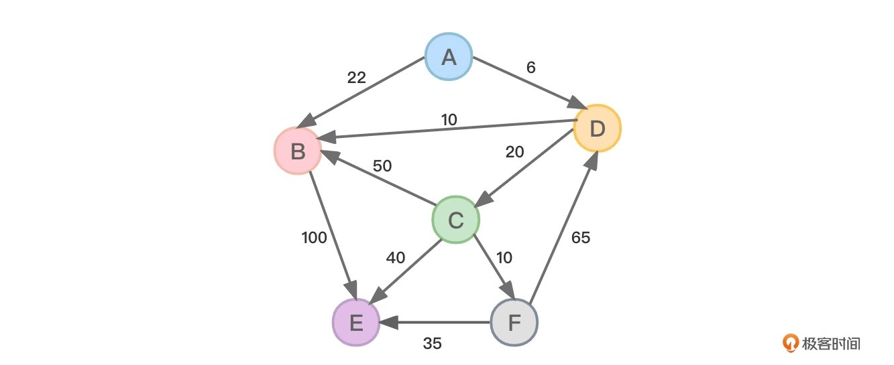

- 图1 一个有向图（带权值）

在图 1 中，顶点 A 到 E 之间的路径有多条，这里我举几个例子。

- A→B→E，顶点 A 到 E 的边上权值之和为 122。

- A→D→C→E，顶点 A 到 E 的边上权值之和为 66。

- A→D→B→E，顶点 A 到 E 的边上权值之和为 116。

- A→D→C→B→E，顶点 A 到 E 的边上权值之和为 176。

- A→D→C→F→E，顶点 A 到 E 的边上权值之和为 71。

可以看到，A→D→C→E 所代表的的路径就是最短路径，权值之和为 66。那么对于一个带权有向图，给定一个顶点，如何求得该顶点到其余各个顶点的最短路径呢？其实这个问题也适用于带权无向图，因为带权无向图中的每条边就相当于带权有向图方向相反的两条边。

如果采用带权的邻接矩阵作为图 1 中有向图的存储结构，则结果如图 2 所示：

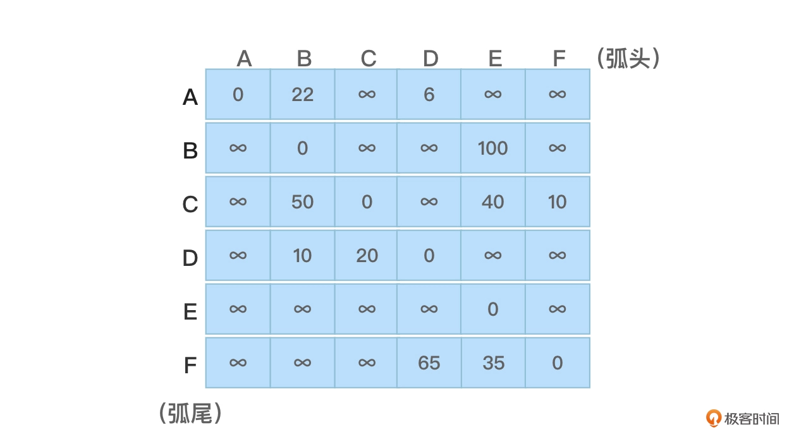

- 图2 图1所示有向图对应的带权邻接矩阵

## 迪杰斯特拉（Dijkstra）算法详解

荷兰籍的一位计算机科学家、计算机先驱之一迪杰斯特拉提出了一个按路径长度递增的次序产生最短路径的算法，称为迪杰斯特拉算法。以图 1 为例，我们看一看该算法的实现思路。

1. 设置一个集合 S 用于存放已经找到最短路径的顶点，该集合开始时只包含给定的第一个顶点。这个顶点也叫源顶点 / 起始顶点。我们就是要从该顶点找到其余各个顶点的最短路径。这里先把顶点 A 保存进去，这预示着从源顶点 A 开始已经找到了到目标顶点 A 的最短路径，毕竟本来这两个点就是同一个点。

- S = {A}

设置一个叫 dist 的数组，元素数量等同于图中顶点数量。该数组用于存放当前起始点到其他各个顶点的最短距离（权值最小），开始时该数组的内容就是图 2 中源顶点 A 所在行的值，即{0,22,∞,6,∞,∞}，因为这组数据正好代表源顶点 A 到其他各个顶点的距离。

设置一个叫 path 的数组，元素数量等同于图中的顶点数量。该数组用于记录每个顶点在最短路径上的前趋节点，里面的内容需要根据 dist 中的内容得出， dist 中对应下标位置是 0 或∞，则 path 对应位置是 -1。如果 dist 中对应下标位置有权值，那么 path 对应位置是源顶点的下标，所以开始时该数组内容为{-1,0,-1,0,-1,-1}。

2. 开始计算从源顶点 A 到不在集合 S 中的顶点的最短路径。

A→B : 距离 =22

A→C : 距离 =∞ （∞表示 A 到 C 之间不直接相连）

A→D : 距离 =6

A→E : 距离 =∞

A→F : 距离 =∞

现在，得到了从顶点 A 到其他所有顶点的路径长度。我们从其中选出一条最短的路径，即：

A→D : 距离 =6

并把顶点 D 也放入到集合 S 中，表示源顶点 A 到顶点 D 的最短路径已找到，如图 3：

S = {A，D}

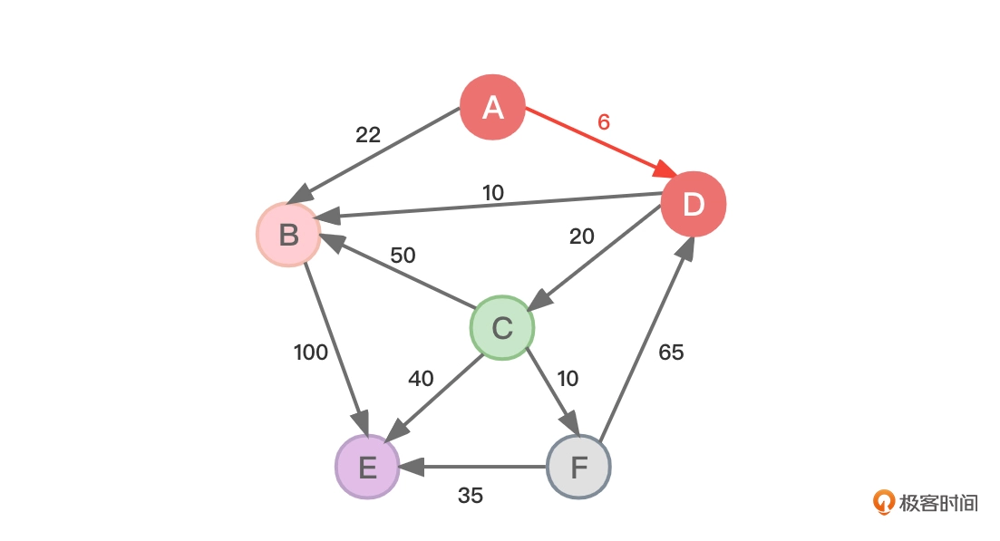

- 图3 选择与源顶点A最短的路径A→D

3. 在增加了 D 顶点到集合后，顶点 A（经过顶点 D）到其他所有顶点是不是有更短的路径存在呢？

这主要得看顶点 D 到达哪些顶点，根据图 2，顶点 D 对应的行数字是{∞,10,20,0,∞,∞}，这表示顶点 D 可以到达顶点 B、C。注意这里要求顶点 D 到达的目标顶点必须不能包含在集合 S中，所以看一下顶点 A 通过顶点 D 到达顶点 B 和到达顶点 C 的距离：

A→B : 距离 =(6+10)=16（通过 A→D→B 路径）

A→C : 距离 =(6+20)=26（通过 A→D→C 路径）

因为原来的顶点 A 到达顶点 B 和顶点 C 的距离是保存在 dist 数组的，dist 数组当前内容为{0,22,∞,6,∞,∞}。可以看到，原来 A→B 的距离是 22，A→C 的距离是∞，而现在 A→B 和A→C 的距离明显变得更小了，所以我们要更新 dist 数组中源顶点 A 到达顶点 B 和顶点 C 的距离，来保证 dist 数组中始终保存着源顶点 A 到其他各个顶点的最短距离。更新后 dist 数组的内容为{0,16,26,6,∞,∞}，这表示下面两个情况。

- 源顶点 A 到达顶点 B 的最短距离为 16。

- 源顶点 A 到达顶点 C 的最短距离为 26。

因为上述找最短路径找到了 D 顶点（下标 3），dist 数组中有两个位置做了修改，path 数组也要在相应位置做修改，即 path 数组中的内容也从原来的{-1,0,-1,0,-1,-1}更新为{-1,3,3,0,-1,-1}，这表示什么呢？

- 源顶点 A 到达顶点 B 是通过顶点 D 到达的（B 的上一个顶点是 D）。

- 源顶点 A 到达顶点 C 也是通过顶点 D 到达的（C 的上一个顶点是 D）。

4. 整理一下源顶点到其他顶点的距离信息：

A→B : 距离 =16（通过 A→D→B 路径）

A→C : 距离 =26（通过 A→D→C 路径）

A→D : 距离 =6

A→E : 距离 =∞

A→F : 距离 =∞

因为顶点 D 已经在集合 S 中了，所以 A→D 这条路径就不考虑了，从其余的 4 条路径中选出一条最短的路径，注意，这 4 条路径的弧头顶点还没有找到从源顶点 A 到它们的最短路径。所以：

A→B : 距离 =16（通过 A→D→B 路径）

并把顶点 B 也放入到集合 S 中，表示源顶点 A 到顶点 B 的最短路径已找到，如图 4：

S = {A，D，B}

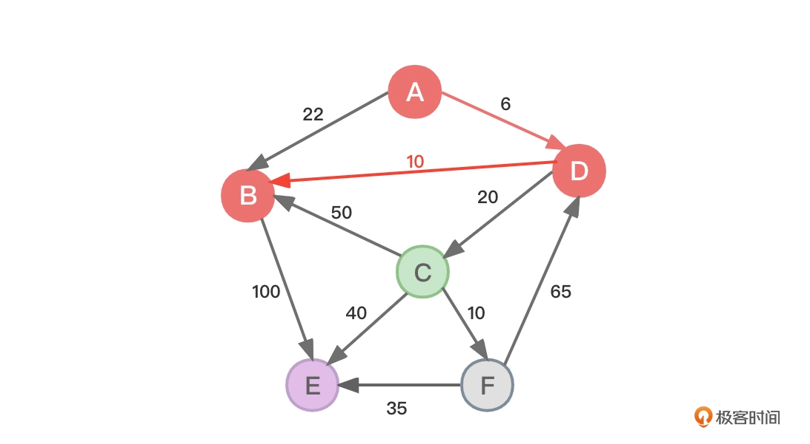

- 图4 选择与源顶点A最短的路径A→B（A→D→B）

5. 在增加了 B 顶点到集合后，顶点 A（经过顶点 B）到其他所有顶点是不是有更短的路径存在呢？

这主要得看顶点 B 到达哪些顶点。根据图 2，顶点 B 对应的行数字是{∞,0,∞,∞,100,∞}，这表示顶点 B 可以到达顶点 E。注意这里要求顶点 B 到达的目标顶点必须不能包含在集合 S 中。所以看一下顶点 A 通过顶点 B 到达顶点 E 的距离：

A→E : 距离 =(6+10+100)=116（通过 A→D→B→E 路径）

dist 数组当前内容为{0,16,26,6,∞,∞}，更新后 dist 数组的内容为{0,16,26,6,116,∞}，path 数组当前的内容为{-1,3,3,0,-1,-1}，更新后 path 数组的内容为{-1,3,3,0,1,-1}。

6. 整理一下源顶点到其他顶点的距离信息：

A→B : 距离 =16（通过 A→D→B 路径）

A→C : 距离 =26（通过 A→D→C 路径）

A→D : 距离 =6

A→E : 距离 =116（通过 A→D→B→E 路径）

A→F : 距离 =∞

因为顶点 D、B 已经在集合 S 中了，所以 A→D、A→B 这两条路径就不考虑了，从其余的 3条路径中选出一条最短的路径，即：

A→C : 距离 =26（通过 A→D→C 路径）

并把顶点 C 也放入到集合 S 中，表示源顶点 A 到顶点 C 的最短路径已找到，如图 5：

S = {A，D，B，C}

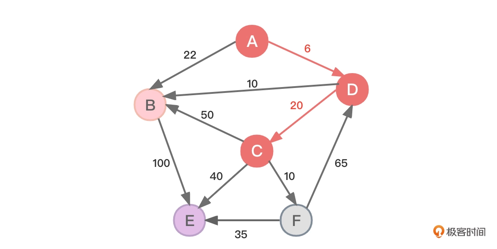

- 图5 选择与源顶点A最短的路径A→C（A→D→C）

7. 在增加了 C 顶点到集合后，顶点 A（经过顶点 C）到其他所有顶点是不是有更短的路径存在呢？

这主要得看顶点 C 到达哪些顶点，根据图 2，顶点 C 对应的行数字是{∞,50,0,∞,40,10}，这表示顶点 C 可以到达顶点 B、E、F。注意这里要求顶点 C 到达的目标顶点必须不能包含在集合S 中，所以只需要看一下顶点 A 通过顶点 C 到达顶点 E、F 的距离：

A→E : 距离 =(6+20+40)=66（通过 A→D→C→E 路径）

A→F: 距离 =(6+20+10)=36（通过 A→D→C→F 路径）

dist 数组当前内容为{0,16,26,6,116,∞}，更新后 dist 数组的内容为{0,16,26,6,66,36}，path 数组当前的内容为{-1,3,3,0,-1,-1}，更新后 path 数组的内容为{-1,3,3,0,2,2}。

8. 整理一下源顶点到其他顶点的距离信息：

A→B : 距离 =16（通过 A→D→B 路径）

A→C : 距离 =26（通过 A→D→C 路径）

A→D : 距离 =6

A→E : 距离 =66（通过 A→D→C→E 路径）

A→F : 距离 =36（通过 A→D→C→F 路径）

因为顶点 D、B、C 已经在集合 S 中了，所以 A→D、A→B、A→C 这 3 条路径就不考虑了，从其余的 2 条路径中选出一条最短的路径，即：

A→F : 距离 =36（通过 A→D→C→F 路径）

并把顶点 F 也放入到集合 S 中，表示源顶点 A 到顶点 F 的最短路径已找到，如图 6：

S = {A，D，B，C，F}

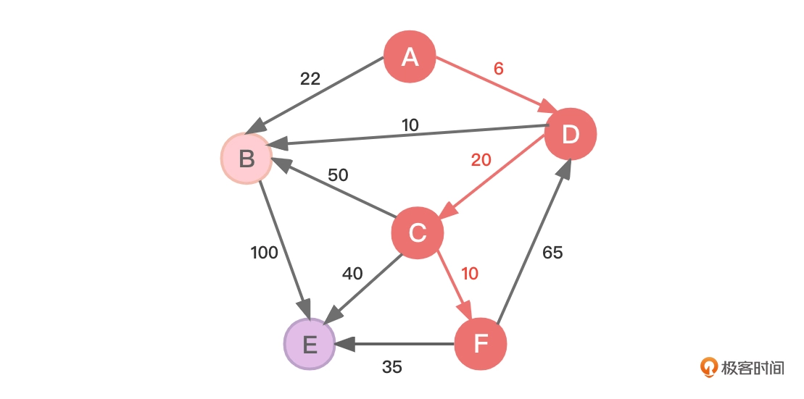

- 图6 选择与源顶点A最短的路径A→F（A→D→C→F）

9. 在增加了 F 顶点到集合后，顶点 A（经过顶点 F）到其他所有顶点是不是有更短的路径存在呢？

这主要得看顶点 F 到达哪些顶点，根据图 2，顶点 F 对应的行数字是{∞,∞,∞,65,35,∞}，这表示顶点 F 可以到达顶点 D、E。注意这里要求顶点 F 到达的目标顶点必须不能包含在集合 S中，所以只需要看一下顶点 A 通过顶点 F 到达顶点 E 的距离：

A→E : 距离 =(6+20+10+35)=71（通过 A→D→C→F→E 路径）

这个距离比原来 A→E 的距离更远，所以忽略。

dist 数组维持当前内容{0,16,26,6,66,36}，path 数组维持当前内容{-1,3,3,0,2,2}。

10. 整理一下源顶点到其他顶点的距离信息：

A→B : 距离 =16（通过 A→D→B 路径）

A→C : 距离 =26（通过 A→D→C 路径）

A→D : 距离 =6

A→E : 距离 =66（通过 A→D→C→E 路径）

A→F : 距离 =36（通过 A→D→C→F 路径）

因为顶点 D、B、C、F 已经在集合 S 中了，所以 A→D、A→B、A→C、A→F 这 4 条路径就不考虑了，只剩下也只能选择如下路径，即：

A→E : 距离 =66（通过 A→D→C→E 路径）

并把顶点 E 也放入到集合 S 中，表示源顶点 A 到顶点 E 的最短路径已找到，如图 7：

S = {A，D，B，C，F，E}

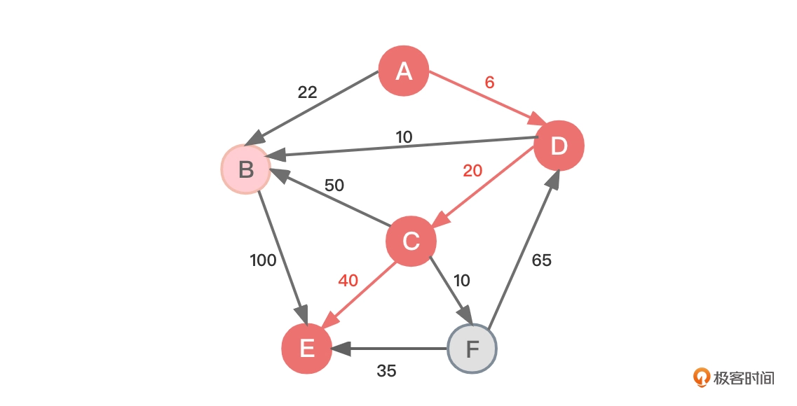

- 图7 选择与源顶点A最短的路径A→E（A→D→C→E）

11. 在增加了 E 顶点到集合后，顶点 A（经过顶点 E）到其他所有顶点是不是有更短的路径存在呢？ 没有。因为顶点 E 没有到达任何其他顶点。

至此，集合 S 中已经包含了图中的所有顶点，迪杰斯特拉算法结束。此时：

dist 数组内容为：{0,16,26,6,66,36}

path 数组内容为：{-1,3,3,0,2,2}

通过上面两个数组的内容，就可以分析出从源顶点 A 到其他顶点的最短路径。那么我们来看两个更具体的问题。

- 如何得到从源顶点 A 到顶点 B 的最短路径长度？

第一就是查找 dist 数组，查找下标为 1（顶点 B）的元素值，发现是 16，这意味着从顶点 A到顶点 B 的最短路径长度是 16。第二就是看 path 数组以获得从顶点 A 到顶点 B 的最短路径“path[1] = 3；path[3]=0；”，因为 0 代表顶点 A 即源顶点，找到源顶点之后，就可以得到结果了，以反序将刚刚 path 数组的结果输出就是最短路径，即 0→3，这些数字代表顶点的下标，所以，顶点 A 到 B 的最短路径如图 8 所示：

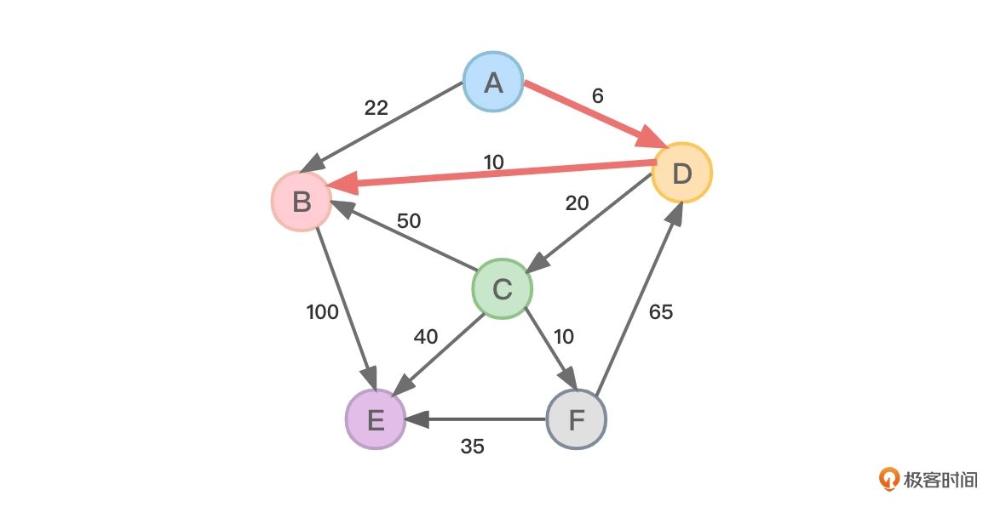

- 图8 源顶点A顶点B的最短路径（A→D→B）

- 如何查找从源顶点 A 到顶点 E 的最短路径长度？

第一就是查找 dist 数组，查找下标为 4（顶点 E）的元素值，发现是 66，这意味着从顶点 A到顶点 E 的最短路径长度是 66。第二就是看 path 数组以获得从顶点 A 到顶点 E 的最短路径“path[4] = 2；path[2] = 3；path[3] = 0”，因为 0 代表顶点 A 即源顶点，找到源顶点之后，就可以得到结果了，以反序将刚刚 path 数组的结果输出就是最短路径，即 0→3→2，这些数字代表顶点的下标，所以，顶点 A 到 E 的最短路径如图 9 所示：

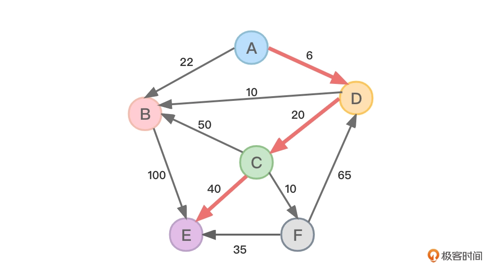

- 图9 源顶点A顶点E的最短路径（A→D→C→E）

想一想，为什么通过查找 path 数组就可以找到最短路径呢？这是因为在每次更改 dist 数组后都会在 path 数组中记录当前顶点的上一个顶点是谁。所以利用倒推的方式就可以把路径推导出来。

完整的实现迪杰斯特拉（Dijkstra）算法的类模板相关源码，参见课件中 GraphMatrix 类模板的定义与实现。这里我们重点看其中的 ShortestPath_Dijkstra() 成员函数的实现代码。

main 主函数中代码如下：

```
GraphMatrix<char> gm;
gm.InsertVertex('A');
gm.InsertVertex('B');
gm.InsertVertex('C');
gm.InsertVertex('D');
gm.InsertVertex('E');
gm.InsertVertex('F');
//向图中插入边
gm.InsertEdge('A', 'B', 22); //22代表边的权值
gm.InsertEdge('A', 'D', 6);
gm.InsertEdge('B', 'E', 100);
gm.InsertEdge('C', 'B', 50);
gm.InsertEdge('C', 'E', 40);
gm.InsertEdge('C', 'F', 10);
gm.InsertEdge('D', 'B', 10);
gm.InsertEdge('D', 'C', 20);
gm.InsertEdge('F', 'D', 65);
gm.InsertEdge('F', 'E', 35);
//显示图形
gm.DispGraph();
gm.ShortestPath_Dijkstra('A');
```

执行结果如下：

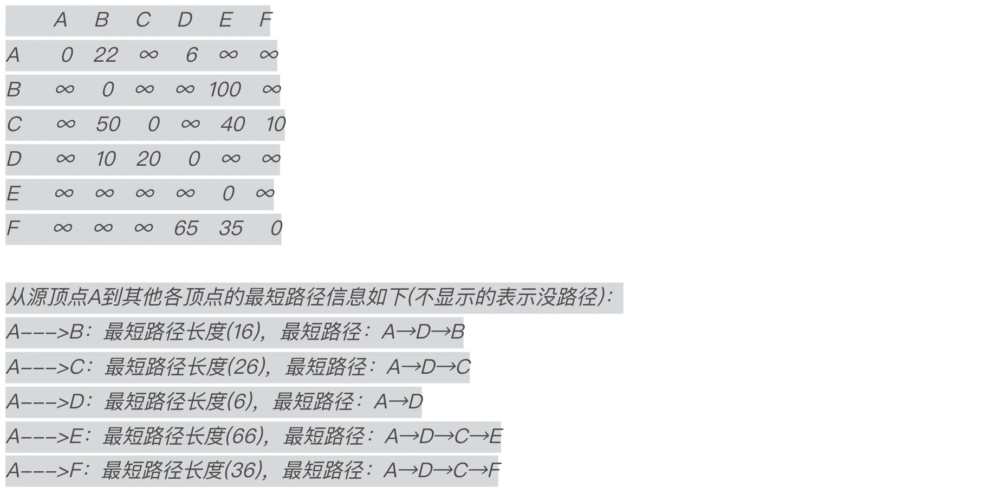

从上述代码不难看到，迪杰斯特拉算法实现中使用的 dist 数组和前面讲过的普里姆算法中使用的 lowcost 数据非常类似。在实现代码中，采用了带权的邻接矩阵作为图的存储结构，算法中使用了双重循环，每重循环的循环次数都不会超过顶点数量，所以该算法的时间复杂度为 O(

## ∣V ∣2

- )。

迪杰斯特拉算法解决了从某个源顶点到图中其余各顶点的最短路径问题。可能你会问了，是否能够找到图中某个顶点开始到另一个特定顶点的最短路径？

其实这样做和求某个顶点开始到其他所有顶点最短路径并没有区别，依然要采用迪杰斯特拉算

## ∣V ∣2

法不断计算从开始顶点到其他各个顶点的最短距离，所以时间复杂度仍旧是 O(

- )。所以，

即便是寻找某两个点之间的最短路径，解决办法仍旧是选择其中一个作为源顶点，然后用迪杰斯特拉算法求出到其余顶点的最短路径，这些路径中肯定包含着到另外一个顶点的最短路径，除非这两个顶点之间不可达。

图的最短路径求解问题在实际生活中有非常实用的价值，应用广泛。比如城市公交或者城市地铁站都可以看作是一张图，其中的各个站点都可以看作是图中顶点。如果把全国交通图看成是一张图的话，那么各个城市就可以看作是图中的顶点。如图 10 所示：

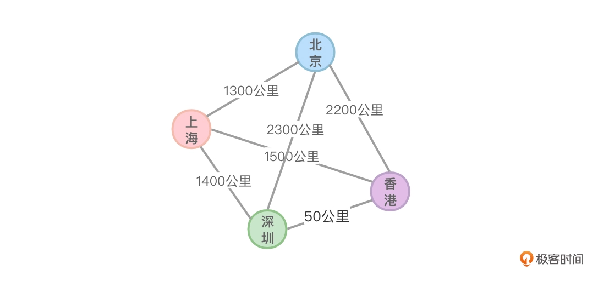

- 图10 国内城市交通图

在图 10 中，从一个城市到达另外一个城市有多种走法。

- 如果把城市之间的距离作为权值，利用最短路径算法，可以找到从某个城市去到另外一个城市如何走距离最短。

- 如果把城市之间驱车所花费的时间作为权值，利用最短路径算法，可以找到从某个城市到另外一个城市如何走最节省时间。

- 如果把城市之间坐车所花费的金钱作为权值，利用最短路径算法，可以求解出如何乘车花费的金钱最少。

## 小结

这节课我给出一个图来向你详细阐述最短路径的概念，然后提出了如何从某个顶点求得到其他各个顶点的最短路径的问题。从而引出了迪杰斯特拉（Dijkstra）算法——专门用来求从某个顶点到其他各个顶点最短路径的算法。

本节我用大量的篇幅阐述了迪杰斯特拉算法的详细实现过程，我们首先设置集合 S 来存放已经找到最短路径的顶点、设置 dist 数组存放当前起始点到其他各个顶点的最短距离、设置path 数组记录每个顶点在最短路径上的前趋节点。然后阐述详细的算法步骤。

充分理解这些算法的实现步骤是后序能够写出迪杰斯特拉算法代码的根本，否则即便是阅读别人实现的迪杰斯特拉算法，也会一头雾水。接着，我带你完成了整个迪杰斯特拉算法的实现代码。

迪杰斯特拉算法解决了从某个源顶点到其余各顶点的最短路径问题，在实际生活中有非常实用的价值，比如我为你举的几个例子，分别是从某个城市到另一个城市如何走距离最短、如何走最节省时间、如何乘车花费的金钱最少等。你可以举一反三，仔细想想还有哪些实际生活中的问题可以用迪杰斯特拉算法解决呢？

## 课后思考

许多城市的地铁线路非常繁杂，以深圳为例，如图 11 所示：

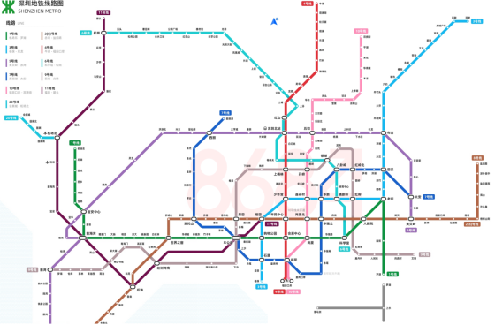

- 图11 深圳地铁线路图

目前深圳地铁已经开通运营了 10 几条线路。对于一些行动不便的老人或者残障人士，乘坐地铁时，如果目的地特别远并且要换乘多次地铁才能达到，则经常希望换乘的次数尽可能少。怎样做到呢？
