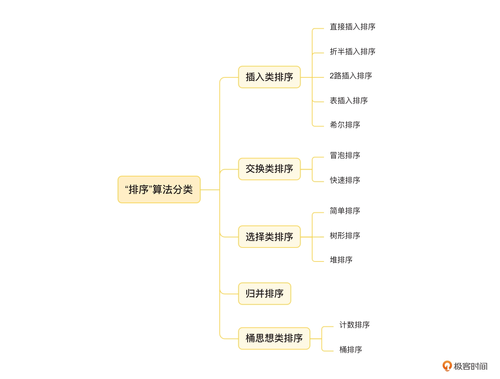
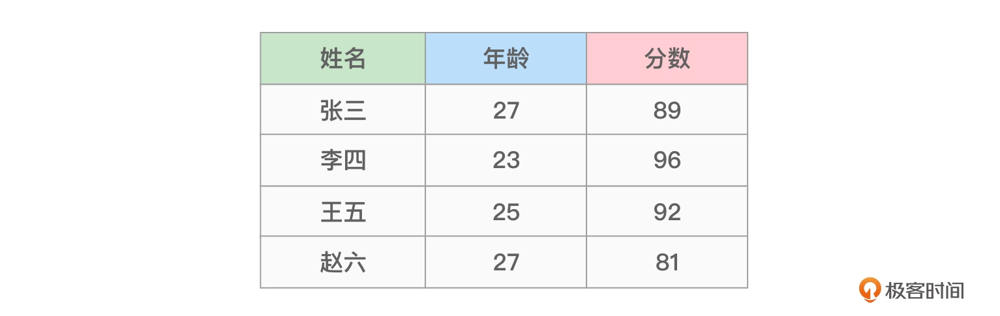
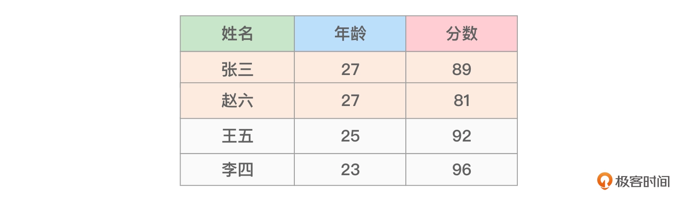
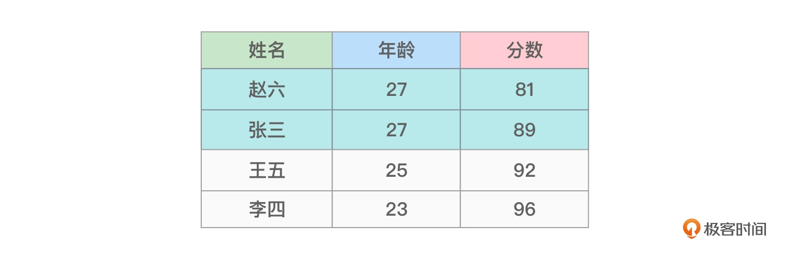

# 33 | 直接插入排序：为什么数据越有序，排序速度越快？

你好，我是王健伟。

我们已经一起学习了不少主要的数据结构知识。不知你学得怎么样了，是不是很轻松呢？从这节课开始，咱们就要进入到算法知识的学习了。

这一次，我们学习一下“排序”算法。

无论是日常生活还是很多科学领域当中，排序都是会经常面对的问题，比如按成绩对学校的学生排序，按薪水多少对公司员工排序等。

根据在排序过程中待排序的数据是否全部被载入到内存中，排序分为内部排序和外部排序。接下来我为你介绍的各种排序算法涉及的主要是内部排序，包含各种经典的内部排序算法。

我将按照对数据操作方式的不同来分类讲解。这里先给你提供一个思维导图。



在讲解具体的排序算法之前，我们先一起看一些它的基本概念。

## 排序算法有哪些基本概念？

所谓排序（Sort），就是将一组数据（也称元素），按照一定的规则调换位置，使这组数据按照递增或递减的顺序重新排列。例如数据库中有一个“学生表”，可以针对该表中的“年龄”字段进行排序，那么这个待排序的字段就称为键（key）或者关键字。排序一般是为了让查找数据的效率变得更高。

这里涉及一个排序算法的稳定性问题。依旧以“学生表”为例，假如表中数据如下：



- 图1 学生表数据

在图 1 所示的学生表中，需要针对表中的“年龄”字段（键）按照某种排序算法进行递减或者递增排序。此时（排序前）张三和赵六的年龄都是 27 岁且张三这条记录位于赵六之前，而在排序后，如果张三这条记录依旧位于赵六之前，那我们就说这种排序算法是稳定的，如图 2 所示：



- 图2 学生表数据根据“年龄”字段递减排序（稳定排序算法）

反之，如果排序后赵六这条记录位于张三之前，那我们就说这种排序算法是不稳定的，如图 3所示：



- 图3 学生表数据根据“年龄”字段递减排序（不稳定排序算法）

所以，所谓稳定的排序算法，指的就是关键字相同的元素在排序后相对位置不变。针对排序算法的稳定性有两点说明。

1. 有些排序算法，基于其实现的原理，确实是无法做到稳定，这种算法当然称为不稳定。

2. 有些排序算法，是可以做到稳定的。但是，如果稍微调整一下它的实现代码，让它变得不稳定也是很容易的。当然，当无法判断一个算法是否稳定时，可以书写测试代码来进行稳定性测试，我也会根据需要提供测试范例。

在后续讲解排序算法时，虽然很多时候都是用整数进行举例，但在真正的项目中，往往要排序的并不是单纯的数字，而是一组对象，按照对象的某个关键字来排序，所以排序的稳定性也是一个必须要考虑的问题。

想象一下，两个用户在某个电子商城中购买了相同的商品，他们的下单时间一个在前一个在后，如果按照订单中商品价格排序，那么这两张订单因为购买的是相同的商品，价格相同，所以排序后应该会相邻，但因为采用稳定的排序算法，所以排序后这两个订单依旧会按照原来下单的时间顺序排列。

根据在排序过程中待排序的数据是否全部被载入到内存中，排序分为内部排序（内排序）和外部排序（外排序）。

内部排序是指在整个排序过程中，待排序的所有数据（记录）都被载入到内存中。外部排序是指在整个排序过程中，因为排序的数据太多（比如大数据）而不能同时载入到内存中，导致整个的排序过程需要在内存和外存（比如磁盘）之间进行多次数据交换。因为磁盘和内存的读写速度相比往往要慢上数十甚至数百倍，所以外部排序往往需要尽量减少磁盘的读写次数。

这里说一下，后面咱们讲解的各种排序算法针对的都是内部排序。当然，内部排序算法也很多，甚至有许多名字非常奇葩的内部排序算法，不过我们只讲比较经典的内部排序算法。

这些经典的内部排序算法有好多种，每种排序算法都有相应的优缺点，适合在不同的情况下使用。而这些算法的分类方式也有很多种，比如按照数据操作方式来划分，按照时间复杂度来划分等。

注意，大部分经典排序算法都仅适用于顺序存储的线性表，而不太适用于链式存储的线性表。这方面在后续涉及代码实现的时候，你可以慢慢体会。

对于大多数排序算法在排序过程中有两种基本操作。

1. 比较两个关键字的大小。

2. 将记录从一个位置移动到另外一个位置。

一般来说，比较两个关键字大小是必须的，但将记录从一个位置移动到另外一个位置也许可以通过一些变通的方式来实现，从而提高排序算法的执行效率。而效率对于排序算法当然是最重要的。后续的课程我会按照对数据操作方式的不同来分类讲解各种排序算法。

这节课，我们先来讲一讲插入类排序中的直接插入排序。

所谓插入类排序，就是向有序序列（已经排好序的序列）中依据关键字的比较结果寻找合适的位置，插入新的记录，构成新的有序序列，直至所有记录插入完毕。

插入类排序可以细分为很多种，每种之间的差别主要体现在插入位置的查找以及插入新数据导致原有数据的移动方面。这节课，我先带你看一种简单粗暴但是好理解的插入类排序方式——直接插入排序。

## 直接插入排序（Straight Insertion Sort）基本概念

直接插入排序：这种算法的思想是每次将一个记录按其关键字的大小插入到已经排好序的序列中，直至全部记录插入完毕。这种排序方式将待排数据依次和数组中已经排好序的记录进行比较并确定自己的位置。

为了简化问题，这里我给你举个例子。看一个含有 10 个元素的整型数组：

int arr[] = {16,1,45,23,99,2,18,67,42,10};

现在，我们希望对这个数组中的元素进行从小到大排序。根据直接插入排序算法的思想，我们首先认为数组中的第 1 个元素（16）包含在已经排好序的序列中。而后从数组中的第 2 个元素开始，依次针对数组中的元素寻找合适的位置插入到已经排好序的序列中就可以。所以，就会有下面的操作步骤。

- 先看 1，1 比 16 小，所以 1 插入到 16 之前，16 后移。这是因为已经排好序的序列中目前只有 16，所以只需要将 16 后移，数组 arr 目前的情形是：int arr[] ={1,16,45,23,99,2,18,67,42,10};。

- 接着看 45，45 比 1 和 16 都大所以 45 位置不动，数组 arr 目前的情形是：int arr[] ={1,16,45,23,99,2,18,67,42,10};。

- 接着看 23，23 比 16 大但比 45 小，所以 23 插入到 45 之前，45 后移，数组 arr 目前的情形是：int arr[] = {1,16,23,45,99,2,18,67,42,10};。

- 接着看 99，99 目前最大，所以位置不动，数组 arr 目前的情形是：int arr[] ={1,16,23,45,99,2,18,67,42,10};。

- 接着看 2，2 比 1 大但比 16 小，所以 2 插入到 16 之前，16、23、45、99 依次后移，数组arr 目前的情形是：int arr[] = {1,2,16,23,45,99,18,67,42,10};。

- 接着看 18，18 比 16 大但比 23 小，所以 18 插入到 23 之前，23、45、99 依次后移，数组 arr 目前的情形是：int arr[] = {1,2,16,18,23,45,99,67,42,10};。

- 接着看 67，67 比 45 大但比 99 小，所以 67 插入到 99 之前，99 后移，数组 arr 目前的情形是：int arr[] = {1,2,16,18,23,45,67,99,42,10};。

- 接着看 42，42 比 23 大但比 45 小，所以 42 插入到 45 之前，45、67、99 依次后移，数组 arr 目前的情形是：int arr[] = {1,2,16,18,23,42,45,67,99,10};。

- 接着看 10，10 比 2 大但比 16 小，所以 10 插入到 16 之前，16、18、23、42、45、67、99 依次后移，数组 arr 目前的情形是：int arr[] = {1,2,10,16,18,23,42,45,67,99};。

以上就是直接插入排序算法的完整工作过程描述。把一个无序数组{1,16,45,23,99,2,18,67,42,10}最终变得有序{1,2,10,16,18,23,42,45,67,99}，只需要从前向后遍历数组中的每个元素，再为每个元素找到合适的位置就可以了。

## 直接插入排序实现源码

直接插入排序的实现代码有很多种，比如有的资料会采用哨兵位的方式来实现。所谓哨兵位，就是在数据结构中留出一个特殊位置，避免在算法实现过程中引入临时变量。如果你有兴趣，可以通过搜索引擎了解采用哨兵位的方式实现的直接插入排序算法。

但这里我会采用一种逻辑上更为简单好理解的代码实现方式，下面是参考代码，你可以仔细看看。

```
//直接插入排序（从小到大）
template<typename T>//T代表数组元素类型
void InsertSort(T myarray[], int length) //myarray：要排序的数组元素，length：数组中元
{
 if (length <= 1) //不超过1个元素的数组，没必要排序
   return;
 for (int i = 1; i < length; ++i) //从第2个元素（下标为1）开始比较
 {
   if (myarray[i] < myarray[i - 1])
   {
     T temp = myarray[i];   //暂存myarray[i]值，防止后续移动元素时值被覆盖
     int j;
     for (j = i - 1; j >= 0 && myarray[j] > temp; --j) //检查所有前面排好序的元素
     {
       myarray[j + 1] = myarray[j]; //所有大于temp的元素都向后移动
     } //end for j
     myarray[j + 1] = temp; //复制数据到插入位置，注意j因为被减了1，这里加回来
   } //end if
 } //end for i
 return;
}
```

在 main 主函数中，加入测试代码。

```
int arr[] = {16,1,45,23,99,2,18,67,42,10};
int length = sizeof(arr) / sizeof(arr[0]);   //数组中元素个数
InsertSort(arr, length); //对数组元素进行直接插入排序
//输出排好序的数组中元素内容
cout <<"直接插入排序结果为：";
for (int i = 0; i < length; ++i)
{
 cout << arr[i] <<" ";
}
cout << endl; //换行
```

执行结果就是：


从代码中可以看到，直接插入排序实现代码比较简单。因为只有一些临时变量参与运算，所以其空间复杂度为 O(1)，对于时间复杂度方面，主要来自于关键字比较和位置移动操作。对于具有 n 个元素的数组，外循环次数是 n-1 次。

在最好的情况下，即数组中元素已经是排好序的情况下，外循环需要循环 n-1 次，每次也只需要一次关键字比较（if (myarray[i] < myarray[i - 1]) 语句），不需要进行任何元素移动，所以，最好情况时间复杂度为 O(n)。

在最坏情况下，即数组中元素正好是逆序排列的情况下，外循环需要循环 n-1 次，每次循环都

## n2

要比较和移动元素若干次，所以最坏情况时间复杂度为 O(

- )。平均情况时间复杂度也为 O(

## n2

- )。

此外，从实现代码中不难看到，即使遇到了关键字相同的两条记录，这两条记录的相对顺序也不会发生改变，所以这个排序算法是稳定的。

直接插入排序比较适合待排序记录数量比较少时的情形，如果待排序记录的数量比较大，就要考虑通过减少比较和移动数据次数对这种排序实现方法进行优化。后面的课程，我们会看一看优化（改进）的插入排序算法。

## 小结

从这节课开始，我会带你学习各种排序算法，排序算法按照对数据操作方式的不同来分类一般分为插入类排序、交换类排序、选择类排序、归并排序、桶思想排序这五大类。

所谓排序，就是将一组数据（也称元素）按照一定的规则调换位置，使这组数据按照递增或递减的顺序重新排列。在排序的过程中，我们会关注排序算法的稳定性问题。我们也引出了内部排序和外部排序的概念。后面课程中我们涉及的排序算法都属于内部排序算法。

今天我们主要说的就是插入类排序算法中的直接插入排序算法。插入类排序，也就是向有序序列中依据关键字的比较结果寻找合适位置插入新的记录，从而构成新的有序序列，直至所有记录插入完毕。而直接插入排序的工作过程就是不断地从左到右在已经排好序的序列中寻找下一个待排序元素的位置，然后插入这个元素。

今天我给出的直接插入排序实现代码简单，也比较粗暴，但容易理解。需要注意的是，这个算法的执行效率不高，有优化的空间，这个排序算法比较适合待排序记录数量比较少时的情形。

## 思考题

1. 看下面含有 10 个元素的整型数组：int arr[] = {21,3,6,17,12,1,69,10,55,43};

请使用直接插入排序对该数组进行排序，试写出每一趟的排序结果。

2. 这节课我提到了直接插入排序的实现代码有很多种，其中有一种实现方式是采用哨兵位的方式来实现。请你通过搜索引擎了解一下这种实现方式的源码和这节课中的实现源码有哪些差异？

欢迎你在留言区分享自己的思考。如果觉得有所收获，也可以把课程分享给更多的同学一起学习进步。我们下节课见！
