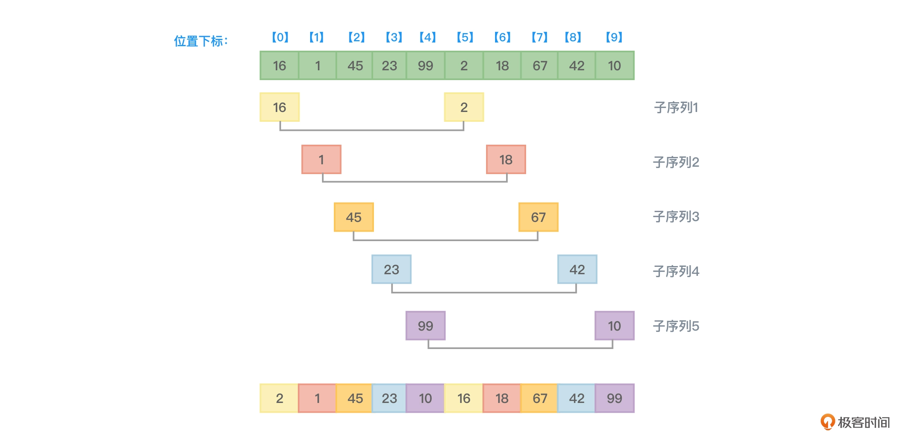
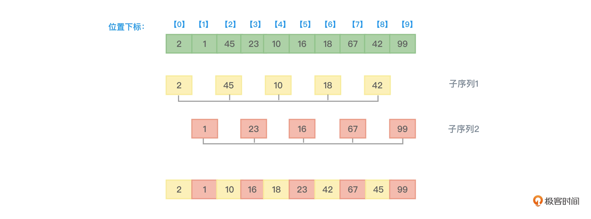
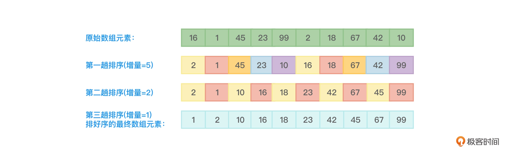
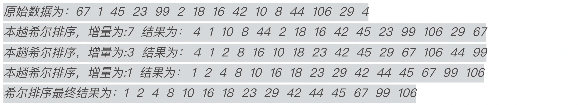
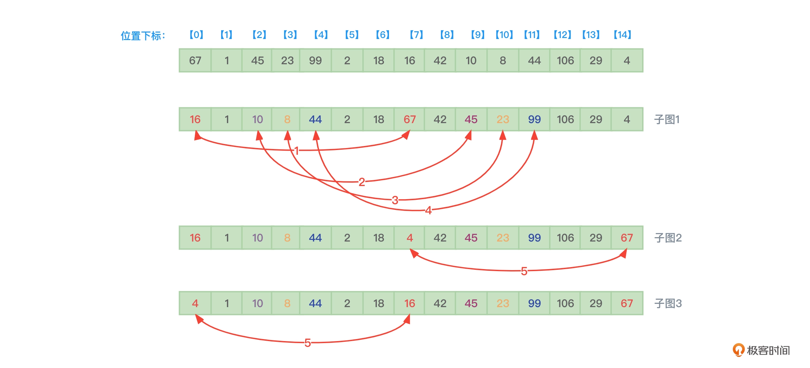
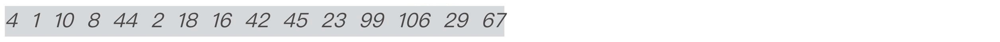
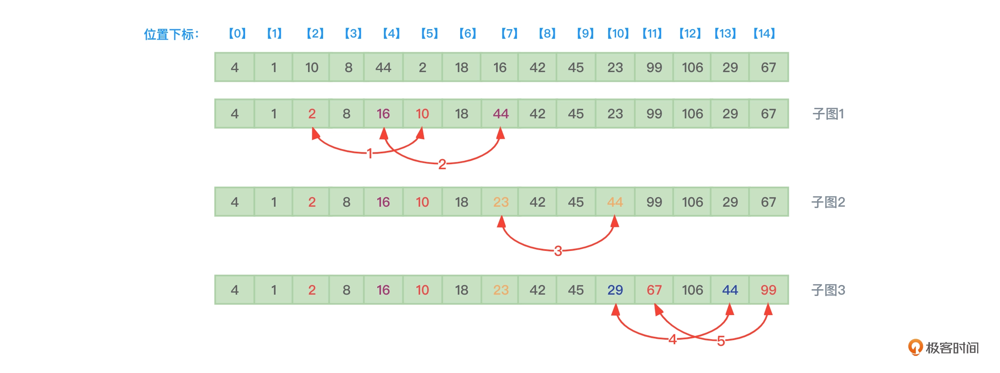
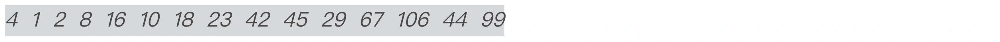
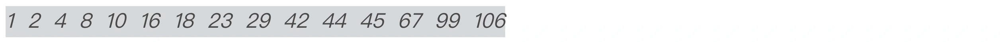

# 34 | 希尔排序：通过部分有序逼近全局有序

你好，我是王健伟。

上一节我们讲解了直接插入排序算法。回顾前面学习的直接插入排序，不难想到下面两个问题。

首先，在待排序的数组中，元素本身就是有序的情况下，就不需要移动任何元素，所以直接插入排序最好情况时间复杂度为 O(n)。不难想象，如果数组中元素多数都是有序（基本有序）的情况下，那么需要移动的元素数量就会大大减少。

这里所谈到的基本有序，可以理解成小的关键字大部分在前面，大的关键字大部分在后面，比如如下数组中的元素{1,2,10,16,18,45,23,99,42,67}和{16,1,45,23,99,2,18,67,42,10}数组中元素相比，前者算得上是基本有序了。

其次，如果数组中元素数量较少，那么直接插入排序的效率也会很高。

基于上述两点对直接插入排序算法进行改进，就可以得到希尔排序算法。

## 希尔排序（Shell Sort）基本概念

希尔排序这个名字来源于它的发明者希尔（Donald Shell），这类排序也被称作“缩小增量排序（Diminishing Increment Sort）”，是直接插入排序的一种更高效率的改进版。

希尔排序算法的思想是先追求元素的部分有序，然后再逐渐逼近全局有序。具体的做法是先将整个待排序记录序列（或称为数组元素）分割成若干个子序列，分别进行直接插入排序，等到整个序列中的记录基本有序时，再对所有记录进行一次直接插入排序。

希尔排序会进行多趟排序，每趟排序会设置一个增量，这里注意，这个增量初始值到底是多大才合适并没有公论，比如可以将“数组中元素数量 /2”作为增量的初始值。

这里我以数组{1,2,10,16,18,45,23,99,42,67}为例，来说明希尔排序。

- 数组中的元素有 10 个，所以增量初值可以设置为 5。第一趟排序，把距离为 5 的元素划分到一个子序列中，并对这个子序列中的元素从小到大排序。参考图 1：



- 图1 希尔排序（第一趟排序）

从图 1 可以看到，第一趟排序，因为增量值是 5，这意味着即将排序的元素间隔 5 个位置。所以下标为 0 的元素 16 和下标为 5 的元素 2 需要进行大小比较，并根据从小到大的顺序决定谁在前谁在后。因为 2 比 16 小，所以 2 应该在前，也就是 16 和 2 互换位置。接着，有元素 1和 18、元素 45 和 67、元素 23 和 42、元素 99 和 10 依次进行大小比较并排序，本趟排序得到的结果数组元素值为{2,1,45,23,10,16,18,67,42,99}。

- 第二趟排序，要缩小增量的值，比如可以每次缩小一半（希尔本人这样建议），也就是：增量 = 增量 /2，原来增量的值是 5，这次增量的值就变成了 2，即把距离为 2 的元素划分到一个子序列中并对该子序列中的元素从小到大排序。参考图 2：



- 图2 希尔排序（第二趟排序）

从图 2 可以看到，第二趟排序因为增量值是 2，意味着即将排序的元素间隔 2 个位置。所以下标为 0 的元素 2、下标为 2 的元素 45、下标为 4 的元素 10、下标为 6 的元素 18、下标为 8的元素 42 进行大小比较并根据从小到大的顺序决定谁在前谁在后。最终得到 2、10、18、42、45 的顺序。

同理，元素 1、23、16、67、99 从小到大排序，本趟排序得到的结果数组元素值为{2,1,10,16,18,23,42,67,45,99}。可以看到，每一趟排序，都使数组中的元素更进一步基本有序。

- 第三趟排序，继续缩小增量的值，增量 = 增量 /2，原来增量的值是 2，这次增量的值就变成了 1。这就意味着要对数组中的所有元素进行从小到大的直接插入排序，增量值为 1 后的排序也是最后一次排序。最终数组元素的值就变成了{1,2,10,16,18,23,42,45,67,99}。所以，一共进行了三趟排序，得到了最终排好序的数组元素。参考图 3：



- 图3 希尔排序（经历了三趟排序）最终结果

## 实现代码

希尔排序算法的代码实现并不复杂，但可能理解起来不那么直观。我准备先给出实现的代码，再阐述一下程序的执行步骤。

```
//希尔排序（从小到大）
template<typename T>
void ShellSort(T myarray[], int length)
{
 if (length <= 1) //不超过1个元素的数组，没必要排序
   return;
 //显示一下原始数据
 //15个元素：【67   1   45   23   99    2   18   16   42   10    8     44   106
 //下标：    【0】【1】【2】【3】【4】【5】【6】【7】【8】【9】【10】【11】【12】【13】【14】
 cout <<"原始数据为：";
 for (int i = 0; i < length; ++i) cout << myarray[i] <<"";
 cout << endl;
 int Dim = length / 2; // Dim：增量，取值分别为7、3、1
 while (Dim >= 1)
 {
   //每一趟采用直接插入排序来实现(实现代码与直接插入排序其实是一摸一样)
   //第一次while循环：i=7~14；第二次while循环：i=3~14；第三次while循环i=1~14；
   for (int i = Dim; i < length; ++i) //i值每次改变可以处理到不同的子序列
   {
     if (myarray[i] < myarray[i - Dim])
     {
       T temp = myarray[i];//暂存myarray[i]值，防止后续移动元素时值被覆盖
       int j;
       for (j = i - Dim; j >= 0 && myarray[j] > temp; j -= Dim) //检查所有前面排好序
       {
         //所有大于temp的元素都向后移动
         myarray[j + Dim] = myarray[j]; //大于temp的元素都向后移动
       } //end for j
       myarray[j + Dim] = temp; //复制数据到插入位置，注意j因为被减了Dim，这里加回来
     }//end if
   } //end for i
   //每走一趟显示一下结果
   cout <<"本趟希尔排序，增量为:"<< Dim <<""<<"结果为： ";
   for (int i = 0; i < length; ++i) cout << myarray[i] <<"";
   cout << endl;
   Dim /= 2; //增量每次减半
 } //end while(Dim >= 1)
 return;
}
```

在 main 主函数中，注释掉以往代码，加入如下代码进行测试，为了看的更清晰一些，下列测试代码中选用了一个包含 15 个元素的数组进行数组元素的从小到大排序。

```
int arr[] = {67,1,45,23,99,2,18,16,42,10,8,44,106,29,4};
int length = sizeof(arr) / sizeof(arr[0]);   //数组中元素个数
ShellSort(arr, length);//对数组元素进行希尔插入排序
cout <<"希尔排序最终结果为：";
for (int i = 0; i < length; ++i)
 cout << arr[i] <<" ";
cout << endl; //换行
```

执行结果是这样的：



从结果可以看到，一共进行了三趟排序，增量值分别为 7、3、1。增量值为 7 时，程序是怎么工作的呢？参考图 4：



- 图4 希尔排序（第一趟）的结果

图 4 展示的是第一趟排序（增量为 7）的程序执行流程，为了清晰，我分成了几个子图来绘制。最上面是待排序的原始数组数据。排序时先看子图 1。

- 67 和 16 交换位置。

- 1 和 42 不需要交换位置。

- 45 和 10 交换位置。

- 23 和 8 交换位置。

- 99 和 44 交换位置。

- 2 和 106 不需要交换位置。

- 18 和 29 不需要交换位置。

这里值得说的是元素 4。

- 元素 4 先和 67 交换位置，如子图 2。

- 元素 16 再和 4 交换位置，如子图 3。子图 2 和子图 3 这两次连续的交换位置是通过代码中最内层 for 循环实现的。

所以，经过第一趟排序后，数组中的元素内容就是：



接着，增量值减少为原来的一半，从 7 变为了 3，开始第二趟排序，增量值为 3 时，程序是怎么工作的呢？参考图 5。



- 图5 希尔排序（第二趟）的结果

- 4 和 8 不需要交换位置。

- 1 和 44 不需要交换位置。

- 10 和 2 交换位置。

- 8 和 18 不需要交换位置。

- 44 和 16 交换位置。

- 10 和 42 不需要交换位置。

- 18 和 45 不需要交换位置。

- 44 和 23 交换位置，如子图 2。

- 42 和 99 不需要交换位置。

- 45 和 106 不需要交换位置。

- 44 和 29 交换位置，如子图 3。

- 99 和 67 交换位置。

所以，经过第二趟排序后，数组中的元素内容就是：



接着，增量值减少为原来的一半，从 3 变为了 1，开始第三趟排序，此时，程序的执行步骤与前面讲述的直接插入排序步骤完全一致，这里就不再赘述，经过了三趟排序，数组中的元素已经按照从小到的顺序排好了，数组中元素的最终内容就是：



从代码中可以看到，希尔排序实现代码的空间复杂度为 O(1)。而对于时间复杂度的分析，本算法则显得比较复杂。当采用不同的增量序列，比如上面代码中每次增量减少为原来的一半时，希尔排序的总趟数会不同，而且每趟排序元素对比次数和元素移动次数都可能会受到影响。所以希尔排序的时间复杂度目前为止还无法用数学手段确切地证明。

但如果增量的初值直接设置为 1 的话，那么希尔排序会退化为直接插入排序，这时的时间复杂

## n2

度是希尔排序的最坏时间复杂度即 O(

- )。如果待排序元素的数量在一定的范围内，那么时间

## n1.3

- n

## log

复杂度可以达到 O(

- )，平均时间复杂度为 O(n)，这意味着希尔排序算法优于直接插入​2

排序算法。

此外，希尔排序算法是不稳定的，这不难证明。试想一下具有 3 个元素 99、10、10 的数组，因为增量值的设定并没有公论，所以如果设定第一趟排序增量值为 2，第二趟排序增量值为1，那么后面两个都是 10 的数组元素位置就会发生改变，也就是图 6 的样子。


- 图6 希尔排序不稳定的证明

你看图 6，第一趟排序元素 99 和最末尾的元素 10 进行了位置交换，而第二趟排序并没有做任何数组元素位置的交换。但显而易见，原下标为 2 的数组元素 10 被移动到了下标为 0 的位置，跑到了下标为 1 的数组元素 10 之前。所以，希尔排序算法是不稳定的。

## 小结

这节课我带你学习了第二种插入类排序——希尔排序，并实现了这个算法的代码编写。可以说，希尔排序算法是对直接插入排序算法的改进，它先追求元素的部分有序，然后再逐渐逼近全局有序。

希尔排序通过进行多趟排序的方式来达成，排序开始时会选择一个增量，根据增量将待排序序列分成若干个子序列，对每个子序列进行直接插入排序。然后逐步缩小增量并继续根据增量将待排序序列分成若干个子序列并对每个子序列进行直接插入排序，直到增量变为了 1 才完成了整个希尔排序的过程。

与直接插入排序相比，希尔排序的速度更快。同时，通过对增量的调整也许能进一步加速排序效率。不过，希尔排序的实现代码更加复杂，且选择合适的增量也显得特别重要。此外还要注意，希尔排序算法是不稳定的。

## 思考题

希尔排序算法的时间复杂度与增量序列的选择有关，请选择不同的增量序列来尝试是否能够得到更好的排序效果？

欢迎你在留言区分享自己的成果。如果觉得有所收获，也可以把课程分享给更多的朋友一起学习进步。我们下节课见！
