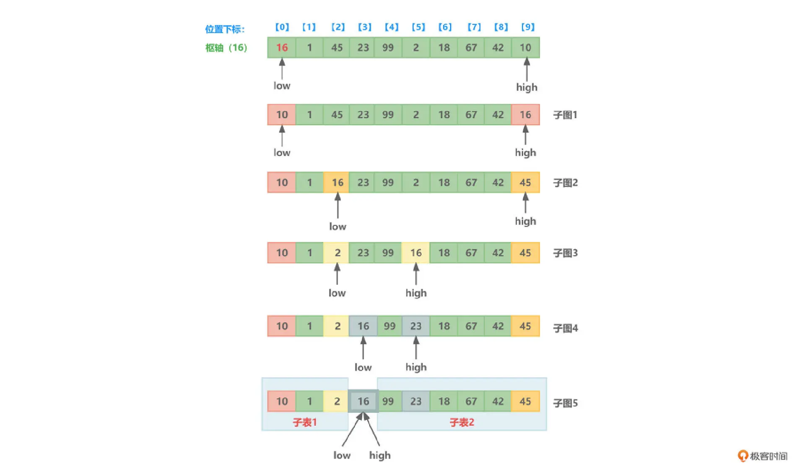
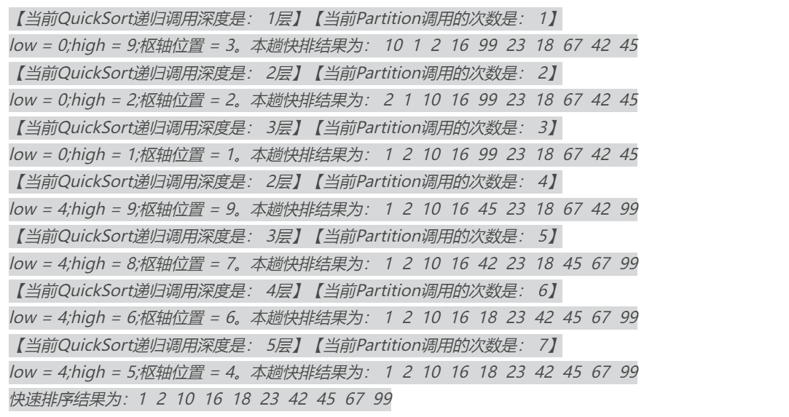
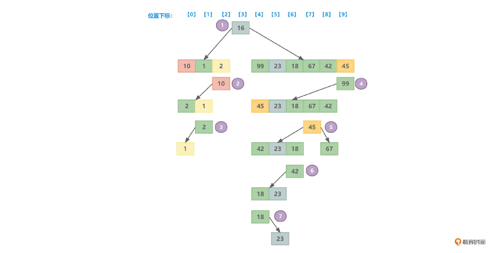
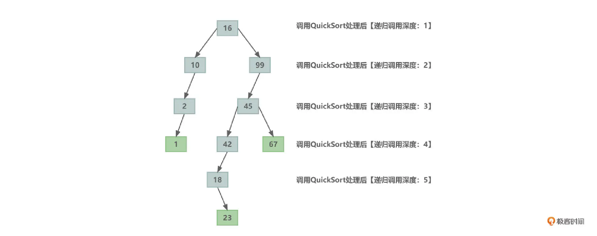
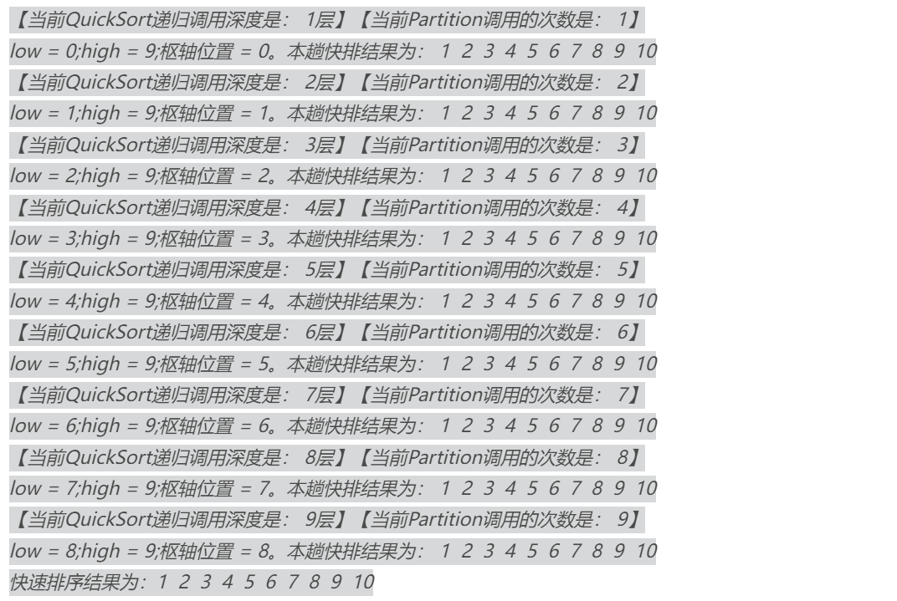

# 36 | 快速排序：如何通过基准元素改进冒泡排序？

你好，我是王健伟。

前面我们一起学习了交换类排序中的冒泡排序，这次我们继续学习交换类排序中的快速排序。这两种排序算法的主要区别在于排序的效率和实现代码。

如果说冒泡排序是通过相邻元素的比较和交换达成排序，那么快速排序就是一种分而治之的思想，是对冒泡排序的改进。

## 快速排序基本概念

快速排序的英文名称是 Quick Sort，他通过分而治之的思想，把待排序的表分隔成若干个子表，每个子表都以一个称为枢轴的元素为基准进行排序。

一般来说，在元素数量一定的内部排序算法中，快速排序算法平均性能是最优秀的，因此，C++ 标准库中也提供了 qsort 函数来实现快速排序功能（其实 qsort 的实现版本中，还可能会用到其他排序）。

快速排序的基本思想（按照从小到大排序）我们分两点说一下。

第一点，在待排序的表中选取任意一个元素作为枢轴（也叫基准元素），这个元素通常是首元素。之后，通过一趟排序将所有关键字小于枢轴的元素都放置在枢轴前面，大于枢轴的元素都放置在枢轴后面。

这样，这趟排序就将待排元素分割成了两个独立的部分。而且这个时候，枢轴元素所在的位置其实也就是该元素最终应该在的位置了。

现在核心的问题是如何实现这趟排序，这也是理解快速排序的最关键之处。基本做法是，引入两个指针 low 和 high，low 指针初始时指向待排序表最左侧元素，high 指针初始指向待排序表最右侧元素。

- 首先，从 high 所指位置开始向前（向左侧）搜索，找到第一个关键字小于枢轴的记录并和枢轴记录交换。

- 接着，从 low 所指位置开始向后（向右侧）搜索，找到第一个关键字大于枢轴的记录并和枢轴记录交换。

- 最后，重复上面这两个步骤，直到 low 和 high 指向相同的位置。

我们以图 1 为例来说明。



- 图1 快速排序第一趟排序步骤

从图 1 可以看到这么几件事。

- 选择的枢轴为数组中第一个元素（值 16），开始时 low 和 high 分别指向下标 0 和下标 9 的位置。

- high 位置发现元素值 10< 枢轴，因此元素 10 和 16 交换位置，如子图 1。

- low 向后搜索，发现下标为 2 的位置元素 45> 枢轴，因此元素 16 和 45 交换位置，如子图2。

- high 向前搜索，发现下标为 5 的位置元素 2< 枢轴，因此元素 2 和 16 交换位置，如子图3。

- low 向后搜索，发现下标为 3 的位置元素 23> 枢轴，因此元素 16 和 23 交换位置，如子图4。

- high 向前搜索，搜索到与 low 相同的位置（下标为 3），本趟排序结束。

不难发现，本趟排序后，枢轴（元素）16 所在的位置就是其最终应该在的位置。元素 16 左侧的元素都小于 16，元素 16 右侧的元素都大于 16。现在，枢轴 16 把待排序的表划分成了两个子表——子表 1 包含 10、1、2 共 3 个元素，子表 2 包含 99、23、18、67、42、45 共 6 个元素，如子图 5。

好，再说第二点：再次用相同的方法对两个独立的子表做相同的分割。这种子表的分割其实是一个递归的过程，每次分割后子表中的元素数量都会减少，一直到每个独立的子表中只包含一个元素为止。此时，所有元素就都会被放在最终的位置上。

其实，我这里针对快速排序算法的描述中，枢轴所代表的元素会频繁地与其他元素交换位置，这样做并没有必要，只需要把枢轴元素记录下来，等一趟排序结束时，用 low 和 high 指针指向的那个位置保存枢轴元素即可，这样可以进一步提升快速排序算法的执行效率。注意，low和 high 指针指向的位置是相同的，这个位置也是整个排序完成后枢轴元素最终所在的位置。

## 实现代码

下面，让我们一起看一看快速排序的实现代码吧。

```
//分割函数：一趟快速排序的实现函数。该函数是快速排序算法实现的核心函数，返回枢轴位置下标
template<typename T>
int Partition(T myarray[], int low, int high) //low：低位置。high：高位置
{
 static int icount = 0;
 icount++;
 cout <<"【当前Partition调用的次数是："<< icount <<"】"<< endl;
 //选取枢轴，就用最低位置指向的元素（首元素）作为枢轴即可
 T pivot = myarray[low]; //把枢轴保存起来
 while (low < high )
 {
   //先从高位置来
   while (low < high && myarray[high] >= pivot)
     high--;
   if (low == high) //如果原始集合已经是从小到大排序，这个条件就会成立
     break;
   if(low < high)
     myarray[low] = myarray[high];
   //再从低位来
   while (low < high && myarray[low] < pivot)
     low++;
   if (low == high) //如果原始集合已经是从大到小排序，这个条件就会成立
     break;
   if (low < high)
     myarray[high] = myarray[low];
 } //end while (low < high)
 myarray[low] = pivot; //此时low与high相等
 return low;
}
template<typename T>
void QuickSort(T myarray[], int low, int high,int length,int lvl=1) //lvl用于统计递
{
 //断言low值一定是小于high值的
 assert(low < high); //记得#include <assert.h>
 //调用者要保证low < high
 cout <<"【当前QuickSort递归调用深度是："<< lvl <<"层】" ;
 int pivotpos = Partition(myarray, low, high);  //分割函数
 //输出中间结果看看：
 cout <<"low = "<< low <<";high = "<< high <<";枢轴位置 = "<< pivotpos <<"。本趟快排
 for (int i = 0; i < length; ++i)
   cout << myarray[i] <<"";
 cout << endl;
 if(low < (pivotpos - 1))
   QuickSort(myarray, low, pivotpos - 1,length,lvl+1);//枢轴左侧子表做快速排序，即继续
 if((pivotpos + 1)< high)
   QuickSort(myarray, pivotpos + 1, high,length,lvl+1);//枢轴右侧子表做快速排序，即继
 return;
}
//快速排序（从小到大）
template<typename T>
void QuickSort(T myarray[], int length)
{
 if (length <= 1) //不超过1个元素的数组，没必要排序
   return;
 int low = 0;  //低位置
 int high = length - 1; //高位置
 //调用重载函数
 QuickSort(myarray, low, high, length); //传递length值是为了显示中间的输出结果方便
}
```

在 main 主函数中，对代码做一些调整，调整后的代码为：

```
int arr[] = {16,1,45,23,99,2,18,67,42,10};
int length = sizeof(arr) / sizeof(arr[0]);   //数组中元素个数
QuickSort(arr, length);//对数组元素进行快速排序
cout <<"快速排序结果为：";
for (int i = 0; i < length; ++i)
{
 cout << arr[i] <<" ";
}
cout << endl; //换行
```

执行结果如下：



## 快速排序算法效率分析

从代码和显示的结果可以看到，Partition 是核心的分割函数，一共被调用了七次。而递归函数QuickSort 也被调用了七次，但这个递归函数所达到的最大深度是五层。

第一次 Partition 调用会将数组中的 n 个元素，也就是从 low 到 high 之间的数据全部扫描一次，时间复杂度为 O(n)。第二次、第三次……，调用 Partition 函数所需要扫描的数据会越来越少，都会 <n，所以每次调用 Partition 的时间复杂度都不会超过 O(n)。

以前面的图 1 为基础，你可以先仔细阅读和分析上面的源码，然后我们把分割步骤逐步拆解，得到图 2：



- 图2 快速排序中调用Partition函数对数组元素的逐步分割展示

这里详细说一下图 2。从上向下，针对数组{16,1,45,23,99,2,18,67,42,10}进行了怎么样的排序过程呢？

- 第一次调用 Partition 分割，元素 16 将整个数组分割成了两块，第一块包括元素 10、1、2，第二块包括元素 99、23、18、67、42、45。

- 第二次调用 Partition 分割（第几次调用该函数如图中圆形编号所示），元素 10 将数组（这里的数组当然是上面已经分割开的子数组）分割出了第三块，第三块包含元素 2、1。

- 第三次调用 Partition 分割，元素 2 将数组分割出了第四块，第四块包含元素 1。

- 第四次调用 Partition 分割，元素 99 将数组分割出了第五块，第五块包含元素 45、23、18、67、42。

- 第五次调用 Partition 分割，元素 45 将数组分割出了第六块和第七块，第六块包含元素42、23、18，第七块包含元素 67。

- 第六次调动 Partition 分割，元素 42 将数组分割出了第八块，第八块包含元素 18、23。

- 第七次调用 Partition 分割，元素 18 将数组分割出了第九块，第九块包含元素 23。

- 至此，调用了七次 Partition 进行分割后，整个快速排序执行完毕。

上面说过，递归函数 QuickSort 被调用了七次，所达到的最大深度是五层。其实，通过统计Partition 被调用的次数来求解快速排序算法的时间复杂度，与通过统计 QuickSort 递归函数的调用深度来求解快速排序算法的时间复杂度是一回事。

所以，整个快速排序算法的时间复杂度为 O(n* 递归调用深度)，这意味着快速排序算法的时间复杂度可以看成是和递归层数紧密相关。当然，快速排序算法的空间复杂度也和递归层数相关，因为每次递归都会用到栈空间来暂存很多信息。所以，快速排序算法的空间复杂度为O(递归调用深度)。

因为每次递归调用 QuickSort 都会把当前需要处理的区间再次划分成左右两个子区间。所以图2 换一种绘制方式其实可以变成一棵二叉树，如图 3 所示：



- 图3 快速排序针对每一层QuickSort函数的递归调用后对数组元素的分割可以组织成一棵二叉树

图 3 中，快速排序把数组中的 n 个元素组织成了一棵二叉树，二叉树的层数也就代表着递归调用的深度。所以快速排序算法的递归调用深度问题就可以转换为对二叉树高度范围的判断。

- n

前面曾经讲过，对于有 n 个节点的二叉树，它的最小高度是⌊

- ⌋ +1，最大高度是 n（斜

## log

- ​2n

树）。所以，对于快速排序算法，最少的递归深度（递归层数）应该是⌊

- ⌋ +1，而最大的递

## log

- ​2

归深度应该是 n，才可以完成整个排序过程。

所以，根据前面所说——整个快速排序算法的时间复杂度为 O(n* 递归调用深度)。不难看到，

## n2

- n

## log

快速排序算法最好情况时间复杂度为 O(n

- )，最坏情况时间复杂度为 O()，平均情况时​2n

## log

间复杂度为 O(n

- )。而因为快速排序算法的空间复杂度为 O(递归调用深度)，所以快速排序​2n

## log

算法最好情况空间复杂度为 O(

- )，最坏情况空间复杂度为 O(n)，平均情况空间复杂度为​2n

## log

O(

- )。​2

设想一下，如果每一趟快速排序选中的枢轴都能够将数组元素均匀的划分为两个部分，那么调用 QuickSort 递归的深度就会最小，算法效率就会达到最高。 但如果数组元素原本就是有序（顺序逆序都可以）的，比如数组元素是 int arr[] = { 1,2,3,4,5,6,7,8,9,10 };，那么此时枢轴就完全无法将数组元素做均匀划分，此时递归调用的深度将达到 9 层，此时的算法效率会达到最低。

换句话说，如果给定的数组原本就是有序的（顺序或者逆序），此时快速排序算法的性能最差。这也称为快速排序算法的退化，退化成了冒泡排序算法。

试一试，如果以数组元素 int arr[] = { 1,2,3,4,5,6,7,8,9,10 }; 做一下快速排序测试，看一看程序运行结果是什么，结果如下所示：



好了，现在我们已经知道了什么时候快速排序算法的效率会达到最高或者最低，也明确了快速排序算法效率的好坏和所选择的枢轴关系密切。你会发现，目前的程序代码中，直接选择 low指针所在位置的数组元素作为枢轴，是很难保证该值的大小正合适的。所以，我们可以对快速排序算法做一下优化，优化的思路主要是围绕枢轴的选取，有两种选取方案。

- 在待排序序列中选择开头、中间、末尾三个位置的元素并从这三个元素中取中间值作为枢轴。

- 随机的在待排序序列中选择一个元素作为枢轴。

这两个方案能够在很大程度上改善快速排序算法在最坏情况下的性能，你可以尝试自己修改代码来实现这个需求。当然，快速排序算法还有其他的优化手段，如果有兴趣，你还可以通过搜索引擎了解。

最后，我想问你一个问题：快速排序算法的稳定性如何呢？

我们来看这么一组数据：{3,2,2}，排序后输出结果是{2,2,3}，但其实这两个 2 已经是互换位置的了。

所以，为了追踪算法的稳定性，我也对原有快速排序算法的代码增加了点内容：给排序后输出的数据元素增加一个下标。你可以参考这里提供的代码。另外，也许你认为通过修改算法的代码能把快速排序算法写成稳定算法，我测试似乎是无法做到，如果你做到了，也欢迎你随时和我交流，非常感谢！

## 小结

本节详细介绍了快速排序算法。快速排序算法是对冒泡排序算法的改进。

快速排序算法需要在待排序的表中选取任意一个元素作为枢轴，通过一趟排序将所有关键字小于枢轴的元素都放置在枢轴前面，大于枢轴的元素都放置在枢轴后面，那么此时枢轴元素的所在的位置就是该元素最终应该在的位置。

枢轴会把待排序的表划分成两个子表，然后再次用相同的方法对两个独立的子表做相同的分割。重复这种子表的分割过程。因为每次分割后子表中的元素数量都会减少，那么一直到每个独立的子表中只包含一个元素为止。此时，所有元素就都会被放在最终的位置上，快速排序算法结束。

接着我们重点分析了快速排序算法的时间复杂度和空间复杂度问题，有两个结论你可以重点记忆一下。

## n2

- n

## log

- 快速排序算法最好情况时间复杂度为 O(n)，最坏情况时间复杂度为 O()，平均情况​2n

## log

- 时间复杂度为 O(n)。​2n

## log

- 最好情况空间复杂度为 O()，最坏情况空间复杂度为 O(n)，平均情况空间复杂度为 O(​2n

## log

- )。​2

在这节课的最后，我们还针对快速排序算法给出了两种方案以对算法做出进一步的优化，并给出了快速排序算法是不稳定算法的结论。

总结：快速排序算法的基本思想是一种分治的思想，也就是将一个大的问题拆分成多个小的问题，并通过递归的方式来解决这些小问题。

## 思考题

1. 请利用本节课编写的代码，对以下数组进行排序并输出排序结果：{ 99，12，46，38，64，33，22，101，50，72 }。

2. 请分析快速排序算法的时间复杂度和空间复杂度，并给出如何进行优化的方案。

欢迎你在留言区和我分享成果。如果觉得有所收获，也可以把课程分享给更多的朋友一起学习。我们下节课见！
