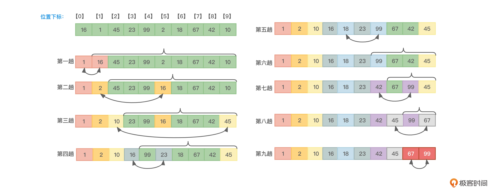
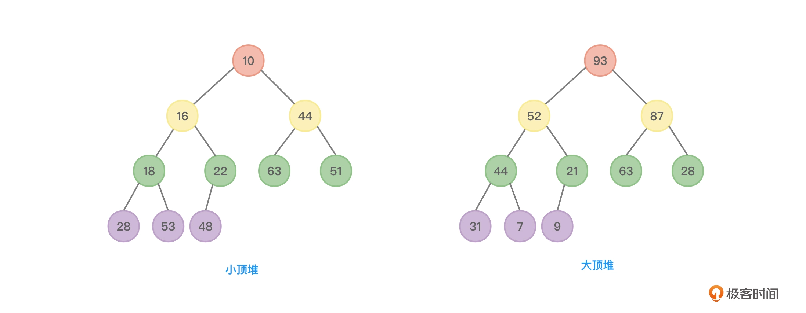
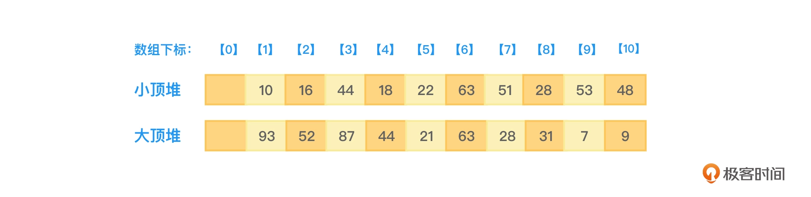
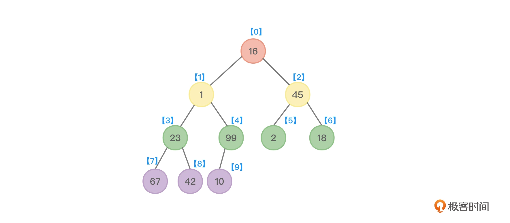
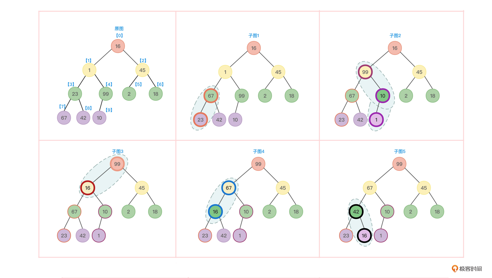
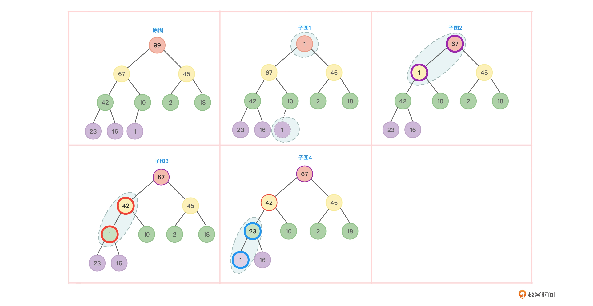
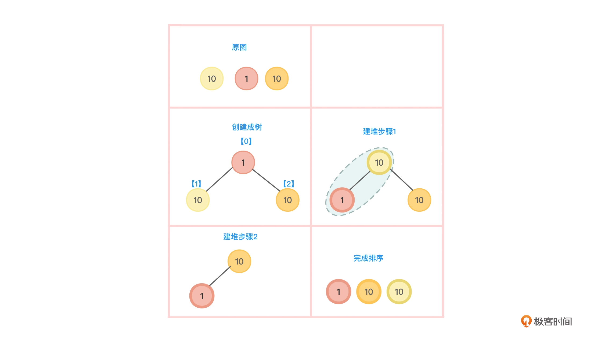

# 37 | 简单选择排序与堆排序：多趟排序与利用有序完全二叉树进行排序

你好，我是王健伟。

前面我们一起学习了交换类排序，也就是在排序过程中对元素进行两两比较并交换位置。其中，最知名的交换类排序算法——冒泡排序、快速排序我们都已经讲过了。这次，我们学习一个新的排序种类——选择类排序。

选择类排序是一种基于比较的排序算法，他的基本思想就是每一趟在待排序的元素中选取关键字最小（或最大）的元素加入到有序子序列中。而简单选择排序则是选择类排序中的一种。

## 什么是简单选择排序？

简单选择排序英文名称是 Simple Selection Sort。简单选择排序需要进行多趟排序才能得到最终结果。它的基本思想是每趟从待排序的元素中找出值最小的元素放到已排序序列的末尾，然后再从未排序的元素中选择最小的元素，继续放到已排序的序列的末尾，直到所有元素都被排序完毕。

### 简单选择排序过程演示

以图形来说明会比较直观，如图 1 所示：



- 图1 简单选择排序示意图

图 1 左上侧是待排序的 10 个元素，我们以从小到大排序来说明。

- 第一趟排序：从待排序的元素中找出值最小的元素和下标为 0 的元素做交换，这样下标为 0的位置所保存的就是最小值的元素，此时无需再理会下标为 0 的位置。

- 第二趟排序：抛开下标为 0 位置的元素，从其余元素中找出值最小的元素和下标为 1 的元素做交换，这样下标为 1 位置所保存的就是剩余待排序元素中最小值的元素，此时无需再理会下标为 1 的位置。

- 第三趟排序：抛开下标为 0、1 位置的元素，从其余元素中找出值最小的元素和下标为 2 的元素做交换，这样下标为 2 位置所保存的就是剩余待排序元素中最小值的元素，此时无需再理会下标为 2 的位置。

- 如此重复，第九趟排序：抛开下标为 0、1、2、3、4、5、6、7 位置的元素，从其余元素中找出值最小的元素和下标为 8 的元素做交换，这样下标为 8 位置所保存的就是剩余待排序元素中最小值的元素。此时，下标为 9 的元素自然就是值最大的元素。

到这里，整个简单选择排序算法就完成了。

### 简单选择排序实现代码

从图 1 中可以看到，对于具有 10 个元素的数组，只需要进行 9 趟处理即可完成整个简单选择排序，具体的实现代码如下：

```
//简单选择排序（从小到大）
template<typename T>
void SmpSelSort(T myarray[], int length)
{
 for (int i = 0; i < length - 1; ++i) //一共要进行length-1趟
 {
   int minidx = i;  //保存最小元素位置
   //在myarray[i]到myarray[length-1]中选择最小值
   for (int j = i + 1; j < length; ++j)
   {
     if (myarray[j] < myarray[minidx])
       minidx = j; //保存最小元素值位置
   } //end for j
   if (minidx != i)
   {
     T temp = myarray[i];
     myarray[i] = myarray[minidx];
     myarray[minidx] = temp;
   }
 } //end for i
 return;
}
```

在 main 主函数中，加入测试代码。

```
int arr[] = { 16,1,45,23,99,2,18,67,42,10 };
int length = sizeof(arr) / sizeof(arr[0]);   //数组中元素个数
SmpSelSort(arr, length);//对数组元素进行简单选择排序
cout <<"简单选择排序结果为：";
for (int i = 0; i < length; ++i)
{
 cout << arr[i] <<" ";
}
cout << endl; //换行
```

代码的执行结果如下：


该算法的时间复杂度如何呢？我们用 n 代表元素数量，无论原有数据是否有序，都需要进行

- n(n−1)

n-1 趟处理，总共需要对比的关键字次数是 (n-1)+(n-2)+…+1=

- 次（等差数列求和公2​

式）。而需要元素交换的次数最少为 0 次，最多也不会超过 3(n-1) 次。所以，简单选择排序算

## n2

法的时间复杂度为 O(

- )。空间复杂度为 O(1)。

此外，该算法是不稳定的，只需要用一组数据 2、2、1 测试一下即可知道。如图 2 所示，前两个元素在排好序之后位置已经调换了。


- 图2 简单选择排序算法不稳定性证明

## 堆排序

简单选择排序说完之后，我们来说一下堆排序。这两类排序都属于选择类排序，不过两者的实现方式不同。简单选择排序是每趟从待排序的元素中找出值最小的元素放到已排序序列的末尾，直到所有元素排序完成。而堆排序是通过将待排序元素构成一个堆的方式来实现元素的排序，可以说，堆排序的效率往往更高。

那么，到底什么是“堆”呢？

### 堆的基本概念

堆是有序的完全二叉树，这里所说的有序指的是父节点一定大于等于子节点值或者父节点一定小于等于子节点值。

- 大顶堆（大根堆 / 最大堆）：父节点大于等于子节点值。

- 小顶堆（小根堆 / 最小堆）：父节点小于等于子节点值。

图 3 所示为一个小顶堆和一个大顶堆：



- 图3 一个小顶堆和一个大顶堆

前面曾经讲解过用顺序存储方式（数组）来存储完全二叉树。此时父节点在数组中的编号（编号代表的就是位置）和子节点在数组中的编号是有对应关系的。回顾一下二叉树的性质六：如果对一棵有 n 个节点的完全二叉树的节点按层从 1 开始编号，对任意节点 i（1≤i≤n），有下面三种情况。

- 如果 i=1，则节点 i 是二叉树的根，无父节点，如果 i>1，则其父节点编号是⌊i/2⌋。

- 如果 2i>n，则节点 i 为叶子节点（无孩子节点），否则，其左孩子是节点 2i。

- 如果 2i+1>n，则节点 i 无右孩子（但可能有左孩子），否则其右孩子是节点 2i+1。

图 3 所示的小顶堆和大顶堆所对应的存储数组就应该如图 4 所示：



- 图4 图3所示小顶堆和大顶堆对应的存储数组

上述做法一个不太好的地方是为写程序方便浪费了数组下标为[0]的空间。其实，把这个空间利用起来也是完全可以的。下面的堆排序实现中，即是将数组下标为[0]的空间也使用了。

### 堆排序算法

如果实现从小到大的排序算法，则使用大顶堆比较方便，实现出的算法占用的辅助空间更少。如果实现从大到小排序，则使用小顶堆比较方便，你可以通过阅读后面的内容慢慢体会。不过，如果使用小顶堆，可能算法需要更多的辅助空间。

堆排序就是利用堆（大顶堆或者小顶堆）进行排序的方法。这里我将采用大顶堆来实现。基本思想就是把待排序的 n 个元素的序列构造成一个大顶堆。此时，整个序列的最大值就是堆顶的根节点。将该节点数据删除，实际是将该节点数据与堆待排序序列末尾元素交换位置，然后将剩余 n-1 个元素的序列重新构造成一个大顶堆，这样根节点就是 n 个元素中的次大值……如此反复，就可以得到一个排好序的序列了。

所以，堆排序需要解决两个主要问题。

1. 由一个无序序列建成一个堆。

2. 在输出堆顶元素（删除元素）后，对其余元素进行调整从而生成一个新堆。

以数组{ 16,1,45,23,99,2,18,67,42,10 }为例，先来创建一棵完全二叉树，参考图 5：



- 图5 用数组{ 16,1,45,23,99,2,18,67,42,10 } 创建的一棵完全二叉树并从0开始标注一下数组下标

显然，图 5 并不是一个堆（不是大顶堆也不是小顶堆）。所以第一步先创建出一个堆。因为这里要进行从小到大排序，所以这里首先要创建一个大顶堆。大顶堆的特点是父节点大于等于子节点值。所以就要检查树中所有非叶子节点，看看这些非叶子节点是否满足大顶堆的要求，如果不满足要求，则调整成满足大顶堆的要求。非叶子节点很好找，在图 5 中，观察一下数组下标，可以看到，如果整个完全二叉树的节点有 n 个，则非叶子节点的编号 i 应该满足i≤⌊n/2⌋-1。

那么，如何调整成满足大顶堆要求呢？

- 在图 5 中，从最后一个非叶子节点即以 99 为根的节点找起，不断向左上方寻找，这棵子树满足父节点大于等于子节点值的要求，无需调整。

- 以 23 为根的子树不满足大顶堆要求，因此节点 23 和节点 67 的值互换。如图 6 中子图 1。

- 以 45 为根的子树满足大顶堆要求。

- 以 1 为根的子树不满足大顶堆要求，因此节点 1 和节点 99 的值互换。这一互换再次导致以1 为根的子树不满足大顶堆要求，因此节点 1 又和节点 10 互换。如图 6 中子图 2。

- 以 16 为根的子树不满足大顶堆要求，因此节点 16 和节点 99 的值互换，如图 6 中的子图3。

- 此时出现了新问题，那就是此时以 16 为根的子树又不满足大顶堆要求，因此节点 16 又要和其左孩子节点 67 的值互换，如图 6 中子图 4。接着，以节点 16 为根的子树又不满足大

- 顶堆要求，因此节点 16 又要和其右孩子节点 42 的值互换，如图 6 中子图 5。所以这里可以看到，因为上一级元素的互换导致破坏了下一级的堆，因此要采用相同的调整方法不断向下调整。



- 图6 将一棵完全二叉树调整为大顶堆

如图 6，将一棵完全二叉树调整为大顶堆后，最大值也就得到了，正是根元素。把该值找一个适当的位置保存，然后将完全二叉树中剩余的节点中的最后一个节点放到根节点的位置，再把这个换了根的完全二叉树重复上面的步骤调整为大顶堆，这样就可以找到次大值了。如图 7 所示：



- 图7 继续将一棵完全二叉树调整为大顶堆

如此反复，最终就可以得到从小到大的排好序的序列了。

### 堆排序实现代码

堆排序算法的实现代码如下：

```
//调整以curpos为根的子树为大顶堆（这里要一直向下调整到尾部叶子才能结束）
template<typename T>
void AdjustDown(T myarray[], int length, int curpos) //length：堆中元素个数，curpos
{
 int i = curpos;  //4，当前节点下标
 int j = 2 * i + 1; //9，左子节点下标
 while (j < length)//i有左子节点
 {
   //找左右子节点中值比较大的节点，让j指向该节点
   if (j < length - 1) //i也有右子树
   {
     if (myarray[j] < myarray[j + 1]) //如果左子节点值<右子节点值
       j = (j + 1); //让j始终指向值最大的子节点。
   }
   if (myarray[i] >= myarray[j]) //父节点保持值最大
     break; //不需要调整直接break;
   //走到这里表示孩子节点比父亲节点大，那么就要进行父子位置交换了
   T temp = myarray[i];
   myarray[i] = myarray[j];
   myarray[j] = temp;
   //交换数据之后，可能就会影响到下一层了。所以还要继续向下调整
   i = j;
   j = 2 * i + 1;
 }//end while
 return;
}
//把最大值从大顶堆中删除掉，把尾元素移动到首部并且继续调整为大顶堆
template<typename T>
void RemoveMaxValue(T myarray[], int length) //length:堆中元素个数
{
 if (length == 0) //就一个元素了，就不需要调整了本身就认为是堆了
   return;
 T temp = myarray[0]; //该位置元素值最大
 myarray[0] = myarray[length]; //将最后一个元素放到最上面位置，等价于最上面位置元素被删除
 myarray[length] = temp;
 AdjustDown(myarray, length, 0);
 return;
}
//堆排序（从小到大）
template<typename T>
void HeapSelSort(T myarray[], int length)
{
 //(1)由一个无序序列建成一个大顶堆
 //现在要把myarray数组调整为大顶堆（检查树中所有非叶子节点，看看这些非叶子节点是否满足大顶堆的
 int curpos = length / 2 - 1;//非叶子节点的位置
 while (curpos >= 0) //逐渐向树的根部调整
 {
   //要从当前节点向下调整的
   AdjustDown(myarray, length, curpos);
   curpos--;
 } //end while
 //(2)通过大顶堆来进行排序
 for (int i = 0; i < length; ++i)
 {
   RemoveMaxValue(myarray, length - i - 1); //把最大值从大顶堆中删除掉，并重新整理使之再
 } //end for i
 return;
}
```

在 main 主函数中的代码如下：

```
int arr[] = { 16,1,45,23,99,2,18,67,42,10 };
int length = sizeof(arr) / sizeof(arr[0]);   //数组中元素个数
HeapSelSort(arr, length);
cout <<"堆排序结果为：";
for (int i = 0; i < length; ++i)
{
 cout << arr[i] <<" ";
}
cout << endl; //换行
```

代码的执行结果如下：


当然，通过对上述代码的改造，实现小顶堆也不困难。

### 堆中元素的插入和删除

实际上，通过对上述代码的学习。向堆中插入元素和从堆中删除元素的代码也是很容易书写的，当然要注意堆中有足够的空间以容纳新插入的元素。

这里我给出实现思路，具体的实现代码你可以尝试自己完成。

1. 向大顶堆中插入新元素。

- 将新元素放到堆的最后位置。

- 将新元素与其父节点元素做对比，若新元素值比其父节点元素值大，则将两者互换。

- 就这样不断将新元素向树根方向（向上）调整，一直到新元素无法向上调整为止。因为这意味着新元素值小于等于其父节点元素值了。

- 每次向上调整需要对比关键字一次。

2. 从大顶堆中删除一个元素。

- 因为删除元素后，原来该元素的位置会被空出来，所以用堆中最后位置的元素填补空出的这个位置。

- 让该元素和其子节点对比，若该元素比其子节点元素值小，则两者互换。若该元素有两个孩子，则和值大的孩子互换。

- 这样不断将新元素向下调整，一直到该元素无法向下调整为止（即没有子节点或者子节点比该元素值小）。

- 每次向下调整需要对比关键字一次（只有一个子节点）或者两次（有两个子节点）。

总结下来你会发现，不管大顶堆还是小顶堆插入新元素都是不断向上调整该元素。删除老元素都是不断向下调整被填补的元素。

### 堆排序算法效率分析

考虑到堆排序会花费时间来构建初始堆以及不断调整新堆以排序，所以我们一般在排序的数据记录比较多的时候采用这类方式。下面我们来分析一下这个算法的复杂度。

1. 对于有 n 条记录的序列，构建初始堆，因为对于该完全二叉树是从最下层最右侧的非叶子节点开始构建——该节点与孩子节点比较，若有必要则进行数据交换，所以对于每个非叶子节点一般会进行两次比较，也就是既和左孩子节点比较也和右孩子节点比较，当然，还有一次数据交换操作。不过，数据交换可能导致破坏下一级，所以还要对下一级继续做调整。

下面的一些信息可以辅助分析堆排序的算法效率问题：

- 如果树的高度为 h，某个节点位于第 i 层，则对该节点逐渐做向下一级的调整，该节点可能会下落 h-i 层，关键字的对比次数不超过 2(h-i)。

## 2i−1

- 第 i 层最多有个节点，而其中的第 1 到 h-1 层的节点才可能需要下落。n根据二叉树的性质五——对于一个有 n 个节点的完全二叉树高度为⌊⌋ +1。

## log

- ​2

针对上述信息，有一个复杂的公式推导，最后推导出一个结论：将整棵树调整为大顶堆，关键字对比次数不超过 4n。这里你只需要简单知道一下就可以，如果有兴趣深究可以通过搜索引擎了解。所以构建初始堆的时间复杂度为 O(n)。

2. 正式排序的时候，每次都将最后一条记录放入到最前面并重新构建堆，这样的动作重复了n-1 次。

- n

对于一个有 n 个节点的完全二叉树高度为⌊

- ⌋ +1 意味着每次重新构建堆的时间复杂度是 O(

## log

- ​2nn

## log

## log

- )，那么整个算法重新构建堆的时间复杂度就应该是 O(n)。​2​2

3. nn

## log

## log

- 对于 O(n)+O(n) 会保留大值的原则，所以总体来说，堆排序的时间复杂度是 O(n​2​2

## n2

- )，从性能上比很多时间复杂度为 O() 的排序算法要好很多。

另外，堆排序的空间复杂度为 O(1)。

最后，你可以想一想，堆排序算法的稳定性如何呢？该算法是不稳定的，如图 8 所示：



- 图8 堆排序算法不稳定性证明

从图 8 可以看到，将排序的数字 10、1、10。从小到大排序后，得到的结果虽然是 1、10、10，但显然，后面两个 10 的相对位置已经改变了。当然，读者也可以对上述实现代码进行调整，然后换一些其他数据尝试，仍旧会得到同样的结论。

## 小结

本节我们首先介绍了新的排序种类——选择类排序。这类排序的基本思想就是每一趟在待排序的元素中选取关键字最小（或最大）的元素加入到有序子序列中。

简单选择排序是选择类排序中的一种。其基本思想是每趟从待排序的元素中找出值最小的元素放到已排序序列的末尾。然后再从未排序的元素中选择最小的元素，继续放到已排序的序列的末尾，重复多趟，直到所有元素都被排序完毕。

## n2

我也给出了简单选择排序的实现代码。简单选择排序算法的时间复杂度为 O(

- )。空间复杂度

为 O(1)。简单选择排序算法属于不稳定算法。

接着我向你选择类排序中的另一种——堆排序。这里需要你先理解大顶堆和小顶堆的简单概念，然后再去理解堆排序的基本思想：将待排序序列构建成一个堆，堆顶元素即为最大值或最小值，然后将堆顶元素与堆末尾元素交换，再将剩余元素重新构建成一个堆，重复此过程直至所有元素排序完成。

同样，我详细向你介绍了堆排序的过程并给出了堆排序的实现代码。堆排序的时间复杂度为

- n

## log

O(n

- )，空间复杂度为 O(1)。堆排序算法属于不稳定算法。​2

不难看到，堆排序的时间复杂度更优秀。而且待排序元素越多，这种优秀程度体现得越明显。

## 思考题

1. 对于一个长度为 n 的数组，我们不排序，而是参考简单选择排序算法的实现代码将其中奇数放到前面，偶数放到后面，并且奇数和偶数内部的相对顺序不变（原来排在前面的奇数依旧排在前面，原来排在后面的奇数依旧排在后面，偶数也一样），可以怎么做？。

2. 在堆排序算法中，若要对一个有 10 个元素的数组进行排序，最多需要进行多少次比较和数值交换操作？

欢迎你在留言区和我交流。如果觉得有所收获，也可以把课程分享给更多的朋友一起学习。我们下节课见！
