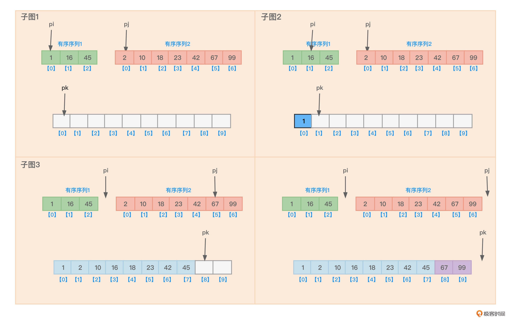
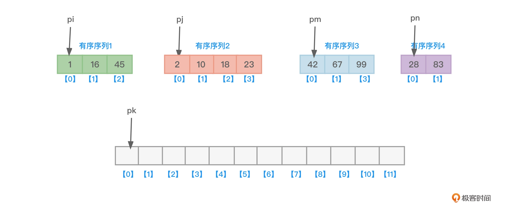
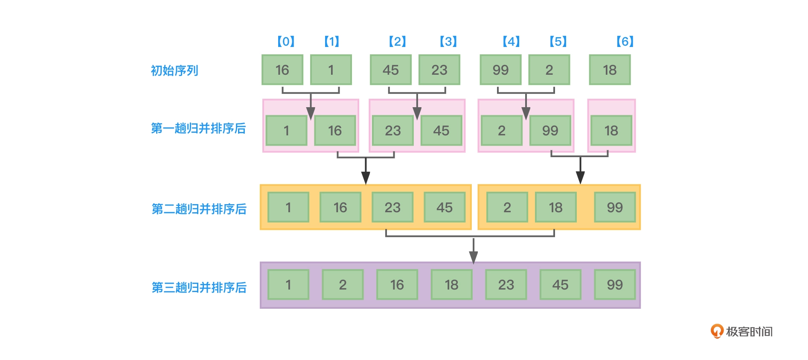
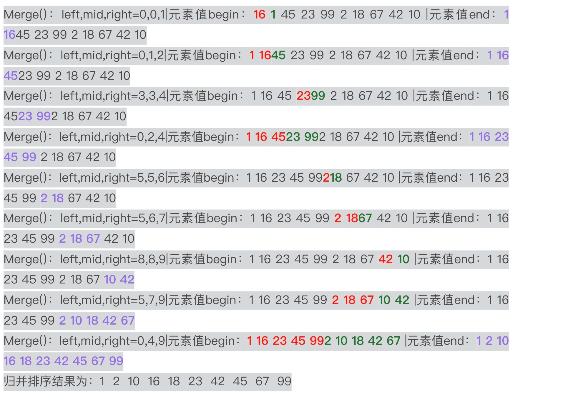
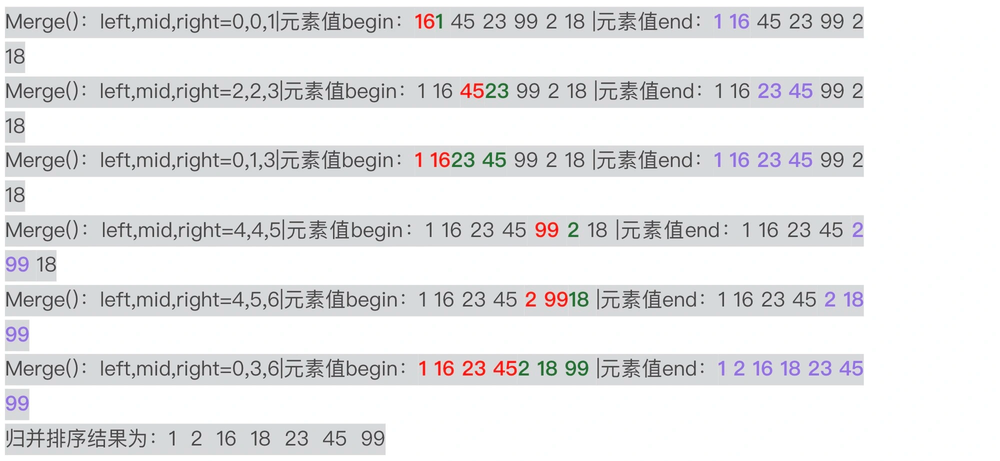
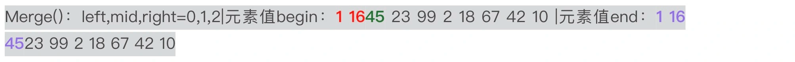
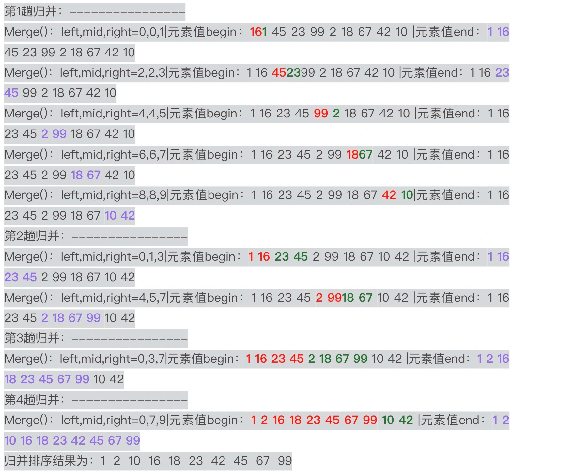
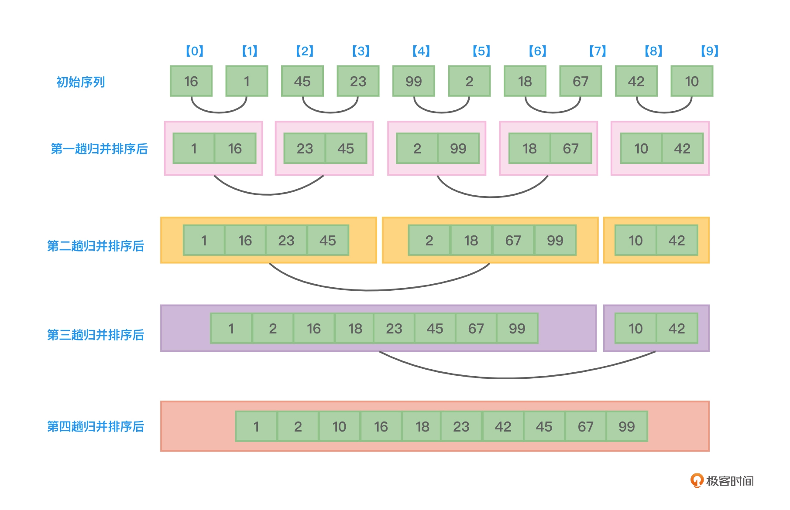

# 38 | 归并排序：将多个有序序列按其中的元素值大小两两合并

你好，我是王健伟。

上节课我们一起学习了选择类排序，回顾前面所讲，你会发现选择类排序的特点是每次从待排序的元素中选择一个最小或最大值，依次放到已经排序的序列末尾，最终得到有序序列。

而这次，我们学习一下归并排序。归并排序自成一类，它的实现方式和选择类排序不同。

归并排序，英文名称是 Merging Sort。归并排序里的“归并”，也叫合并，其实就是把两个或者多个已经有序的序列合并成一个。简而言之，归并排序采用的是一种分而治之的思想，将待排序的序列不断二分，直到每个子序列只有一个元素，然后将相邻的子序列两两归并，最终得到一个有序的序列。

下面，我们就一起看一看归并排序都涉及到哪些基本概念。

## 基本概念

图 1 是两个有序序列（数组），现在我们希望利用归并排序把这两个数组合并成一个元素按从小到大排序的数组。


- 图1 两个待排序的有序序列（有序数组）

既然要合并，那么首先必然要分配一个足以容纳两个有序数组中所有元素的内存空间，也就是一个新数组，然后进行下面的操作。

1. 针对每个数组都设置一个指向当前位置的指针（pi、pj、pk），初始状态时，这三根指针都指向数组的起始位置，如图 2 中的子图 1。

2. 每一次都会对比 pi 和 pj 位置所指向的元素值到底哪个更小，把更小的元素放入到 pk 所指向的位置处。因为 1<2，所以把 1 放入到 pk 指针所指向的位置处，同时，把 pk 指针后移一个位置。当然，因为元素 1 已经被放入到了新数组中，自然 pi 指针也要后移一个位置，结果如图 2 中的子图 2。

3. 重复上面第二个步骤，有那么一个时刻，有序序列 1 中的 pi 指针已经指向了最后一个元素后面的位置，这意味着有序序列 1 中的所有元素都被放入到了新数组中，只剩下有序序列 2中还有没排好序的元素了，如图 2 中的子图 3 所示。

4. 此时，就不再需要元素大小的对比，直接把有序序列 2 中剩余的 2 个元素放入到新数组中，最终归并排序结果如图 2 中的子图 4。



- 图2 两个待排序的有序序列进行归并排序的过程

图 2 其实是一个“2 路”归并排序。因为图中是把两个有序序列合并成一个有序序列。在 2 路归并排序中，每次需要从两个元素中选出一个更小的元素，这只需要对比 pi 和 pj 所指向的元素就可以了。或者你可以理解为，只需要对比一次关键词。

既然有 2 路归并排序，那么自然可以有多路归并排序，比如 3 路归并排序、4 路归并排序等等。这里注意，多路归并排序一般用于外部排序。图 3 展示的就是 4 路归并排序的初始状态。



- 图3 “4路”归并排序的初始状态

针对图 3，如果进行 4 路归并排序（对 4 个有序序列进行归并排序），那么每选出一个最小元素放入新数组中需要进行 3 次关键字比较——比如第 1 次需要比较元素 1 和 2 看谁比较小，选择出较小的元素继续与元素 42 相比看谁比较小，再选出较小的元素与元素 28 相比。推而广之，对于 m 路归并排序，每选出一个元素需要进行 m-1 次关键字的对比。内部排序中通常使用的是 2 路归并排序。

那么，回头就要说一说如何对一个具有 n 个记录的初始序列进行排序了。

- 首先，把这个初始序列看成是 n 个有序的子序列（n 路），每个子序列的长度为 1。n其次，两两合并（“2 路”归并排序），得到⌈⌉个长度为 2 或 1 的有序子序列，然后再两两合​2并……直至得到一个长度为 n 的有序序列为止。

如图 4 所示，将 16、1、45、23、99、2、18 共 7 个数字进行归并排序：



- 图4 对一个具有7个记录的初始序列进行归并排序的过程

- 第一趟归并排序，将相邻部分两两归并，即 16 和 1 归并，45 和 23 归并，99 和 2 归并，18 由于只剩下自己了所以不做归并操作。经过这趟归并，得到了 4 个有序的子序列。

- 第二趟归并排序，对第一趟归并排序的结果再次进行两两归并，即[1,16]和[23,45]归并，[2,99]和[18]归并。经过这趟归并，得到了两个有序的子序列。

- 第三趟归并排序，对第二趟归并排序的结果再进行两两归并，最终得到了一个排好序的序列。

## 实现代码

下面是归并排序的实现代码。

```sql
//2路归并，该函数是归并排序的核心代码，用于把两个有序子序列归并成一个
//left:指向第一个序列开头元素，mid：指向第一个序列末尾元素，right指向第二个序列末尾元素
//通过left,mid,right指定要归并的两个子序列的范围（这两个子序列相邻）
template<typename T>
void Merge(T myarray[], T* pResult, int left, int mid, int right,int length)  //l
{
 cout <<"Merge()：left,mid,right="<< left <<","<< mid <<","<< right;
 cout<<"|元素值begin：";
 for (int i = 0; i < length; ++i) cout << myarray[i] <<"";
 //把myarray指定的left到right范围内的数据先复制到pResult（临时空间）中
 for (int i = left; i <= right; ++i)
 {
   pResult[i] = myarray[i];
 } //end for i
 int curpos1 = left;   //第一个序列的开始元素
 int curpos2 = mid + 1; //第二个序列的开始元素
 int curpos3 = left;  //最终合并好的序列的开始元素位置
 while (curpos1 <= mid && curpos2 <= right)
 {
   if (pResult[curpos1] <= pResult[curpos2]) //将较小值赋值给myarray，这里的比较符可以
   {
     myarray[curpos3] = pResult[curpos1];
     curpos1++;
   }
   else
   {
     myarray[curpos3] = pResult[curpos2];
     curpos2++;
   }
   curpos3++;
 } //end while
 //如果两个子序列元素数目不同，则这里要单独处理
 while (curpos1 <= mid) //子序列1比子序列2长
 {
   //把子序列1中剩余的内容放入到myarray中去
   myarray[curpos3] = pResult[curpos1];
   curpos1++;
   curpos3++;
 }
 while (curpos2 <= right) //子序列2比子序列1长
 {
   myarray[curpos3] = pResult[curpos2];
   curpos2++;
   curpos3++;
 }
 cout <<"|元素值end：";
 for (int i = 0; i < length; ++i) cout << myarray[i] <<"";
 cout << endl;
 return;
}
//归并排序重载函数
template<typename T>
void MergingSort(T myarray[], T* pResult, int left, int right,int length) //lengt
{
 if (left >= right)
   return;//递归出口
 int mid = (left + right) / 2; //中间分开
 MergingSort(myarray, pResult, left, mid,length); //对左半部分归并排序
 MergingSort(myarray, pResult, mid+1, right,length); //对右半部分归并排序
 //上面因为左半部分归并排序完成，右半部分归并排序完成，所以下面是合并左半部分和右半部分了
 //开始真正的归并操作
 Merge(myarray, pResult, left, mid, right,length);
}
//归并排序入口（从小到大）
template<typename T>
void MergingSort(T myarray[], int length)
{
 T* pResult = new T[length]; //新数组，用于保存结果
 MergingSort(myarray, pResult, 0, length - 1,length); //调用重载函数
 delete[] pResult;
 return;
}
```

在 main 主函数中，对代码做一些调整，下面是调整后的代码。

```
int arr[] = { 16,1,45,23,99,2,18,67,42,10 };
int length = sizeof(arr) / sizeof(arr[0]);   //数组中元素个数
MergingSort(arr, length);//对数组元素进行归并排序
cout <<"归并排序结果为：";
for (int i = 0; i < length; ++i)
{
 cout << arr[i] <<"";
}
cout << endl; //换行
```

代码的执行结果如下：



从上面的结果，你可以看出一共进行了多少趟归并排序，也能看出每趟归并排序针对的是哪两个序列进行排序的。

我们再试试让上面一组测试数据减少 3 个元素，看看归并排序过程和结果：

int arr[] = { 16,1,45,23,99,2,18 };

代码的执行结果如下：



上述结果正是图 4 展示的结果。我在结果中用了不同的颜色和字体加粗来标注每趟 2 路归并排序比较与合并的是哪两个子序列，你可以重点关注一下。

代码中的核心 2 路归并函数 Merge 中用到了 3 个主要的形参，分别是 left、mid、right。因为这些参数是用于进行两个子序列的 2 路归并，所以 left 用于指向第一个子序列的开头，mid 用于指向第一个子序列的末尾，right 用于指向第二个子序列的末尾，这两个子序列当然是紧紧相邻的，如此，通过 left、mid、right 这三个变量就可以把两个子序列的头尾范围准确地标注出来了，可以参考下图 5：


- 图5 归并排序源码中Merge成员函数left、mid、right形参所指向的子序列位置标示

源码中 MergingSort 重载函数实际上是对左右两半部分递归地进行归并排序。这段代码理解起来稍微有些难度，所以我在输出结果中显示了非常详尽的 left、mid、right 信息以辅助你理解。

## 复杂度分析

图 4 所示的 2 路归并排序过程看起来是一棵倒着的二叉树，因此又被称为“归并树”。如果要对n 个元素进行排序，把二叉树的高度看成是 h，则归并排序的趟数是 h-1 趟。而二叉树的第 h

## 2h−1

层最多有

- 个节点。因为所有待排序列的节点都会出现在第 h 层，所以这也是待排序列的nn

节点总数，即 h-1 = ⌈

- ⌉。也就是说，n 个元素进行 2 路归并排序的趟数是⌈⌉。每一趟

## log

## log

- ​2​2

归并操作的时间复杂度是多少呢？观察一下图 2、图 4，不难发现是需要将所有 n 个元素都扫描一次并进行相应对比，所以每一趟归并操作的时间复杂度是 O(n)，最后得出结论——归并

- n

## log

排序算法的时间复杂度是 O(n

- )。​2

此外，从上述代码可以看到，归并排序需要额外的辅助空间，辅助空间的大小和原来保存数据的数组大小相同，所以这部分的空间复杂度是 O(n)。算法中还用到了递归调用，但递归调用

- nnn

## log

## log

## log2

的深度不会超过

- 。所以归并排序算法的空间复杂度是 O(n+)= O(max(n,​2​2

))=O(n)。

归并排序算法的稳定性受编写代码的影响，上述的代码实现方式得到的归并排序算法是稳定的。

## 非递归实现方式

归并排序算法的递归实现方式虽然代码看起来简洁，但对于有些朋友可能并不是那么容易理解。在上述参与测试的数组中包含 7 个数据时，确实如图 4 所示的两两合并。但当测试数组中包含的是 10 个数据时，其中的输出中有诸如下面这样的结果行：



上述这行结果表明代码实现中进行的是 [1,16]和[45]做归并，不是人们以为的[1,16]和[45,23]做归并。

此外，递归调用深度的加深也会引起程序执行效率的下降。也有资料会说当要排序的数据太多

- n

## log

时可能会导致栈溢出。栈溢出并不容易，因为刚刚说过，递归调用的深度不会超过

- 。但​2

不管怎么说，依旧可以用非递归方式来改写归并排序算法，经过这样的改写后，算法在性能上会有进一步的提高。下述是非递归实现代码：

```sql
//非递归程序编写方法
template<typename T>
void MergingSort_noRecu(T myarray[], int length)
{
 if (length <= 1) //不超过1个元素的数组，没必要排序
   return;
 T* pResult = new T[length]; //新数组，用于保存结果
 //标示两个子序列位置用
 int left, mid, right;
 int jianGe = 1;//间隔，开始时元素是紧挨着的两个比较，两个元素之间下标间隔是1
 int subseqTotal = length; //当前子序列数量，开始时一个元素算一个子序列
 int gbts = 0; //归并趟数
 while (subseqTotal > 1) //只要没有最终合并成1个序列，就一直循环
 {
   gbts++;
   cout <<"第"<< gbts <<"趟归并：----------------"<< endl;
   for(int i = 0; i < length; i += (jianGe*2))
   {
     left = i;
     mid  = left + jianGe - 1;
     if (mid >= length)
       break; //不行这不合法了
     right = mid + (mid - left + 1);
     if (right >= length) right = (length-1); //保证right合法
     //必须保证left,mid,right都是合理值
     if (left <= mid && right > left && right > mid)
     {
       //肯定是两个序列，能合并
       Merge(myarray, pResult, left, mid, right, length);
       subseqTotal--; //两个序列合并成一个，这里自然减少了1
     }
     else
     {
       //不能合并，这次for循环退出
       break;
     }
   } //end for i
   jianGe *= 2;
 } //end while
 delete[] pResult;
 return;
}
```

在 main 主函数中，依旧用 10 个元素的数组做测试，代码如下：

```
int arr[] = { 16,1,45,23,99,2,18,67,42,10 };
int length = sizeof(arr) / sizeof(arr[0]);   //数组中元素个数
MergingSort_noRecu(arr, length);//对数组元素进行归并排序(非递归)
cout <<"归并排序结果为：";
for (int i = 0; i < length; ++i)
{
 cout << arr[i] <<"";
}
cout << endl; //换行
```

代码的执行结果如下：



针对这个归并排序结果，用图的方式表示如图 6 所示：



- 图6 对一个具有10个记录的初始序列进行非递归归并排序的过程

## 小结

本节我带你一起学习了一种新的排序算法——归并排序。我首先向你阐述了归并排序的基本概念，然后详细阐述了利用归并排序把两个数组合并成一个元素按从小到大排序的数组所要经过的详细步骤。

2 路归并排序的概念以及多路（包括 3 路、4 路）归并排序，是每次从两个或者三个、四个元素中选择出一个最小的元素放入排好序的数组中。之后，我也详细阐述了如何对一个具有 n 个记录的初始序列进行归并排序并给出了详细的实现代码。

- n

## log

归并排序算法的时间复杂度是 O(n

- )。空间复杂度是 O(n)。归并排序算法的稳定性受编写​2

代码的影响，我们的代码实现方式得到的归并排序算法是稳定的。

考虑到前述归并排序算法是采用递归的方式实现的，不太容易理解。所以，在本节的最后，我给出了用非递归的方式实现的归并排序算法的实现代码。

与选择类排序算法相比，归并排序算法在实现方式、时间复杂度、稳定性方面皆有不同，所以建议你在学习的时候注意比较。

## 思考题

已知数组 A 和数组 B，长度分别为 m 和 n，请将数组 B 合并到数组 A 中，保证合并后的数组A 有序。请尝试实现代码，给出测试范例。

欢迎你在留言区和我分享成果。如果觉得有所收获，也可以把课程分享给更多的朋友一起学习。我们下节课见！
