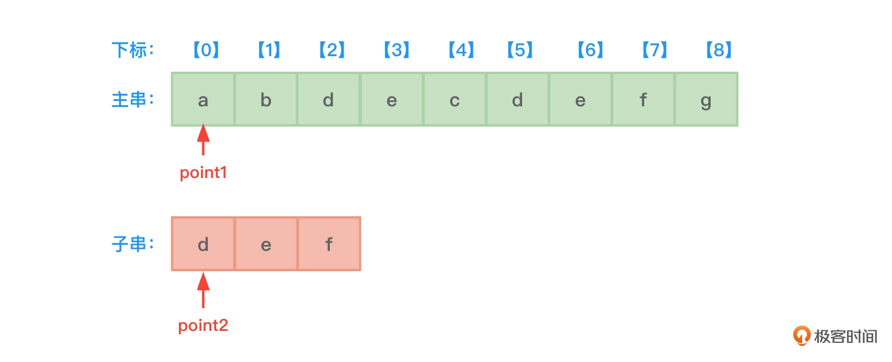
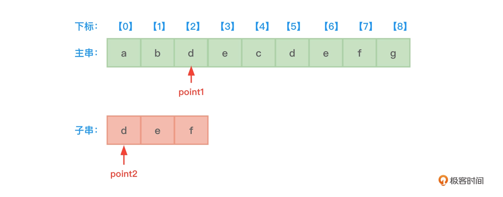
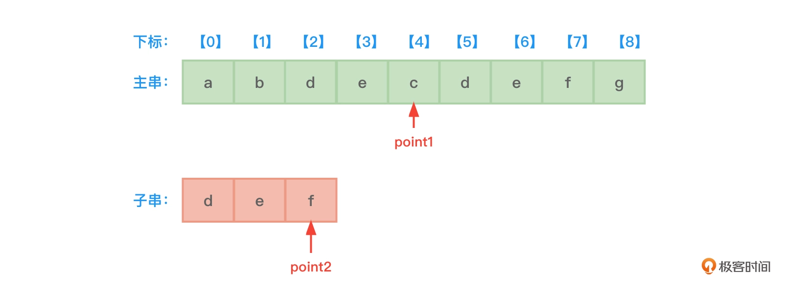
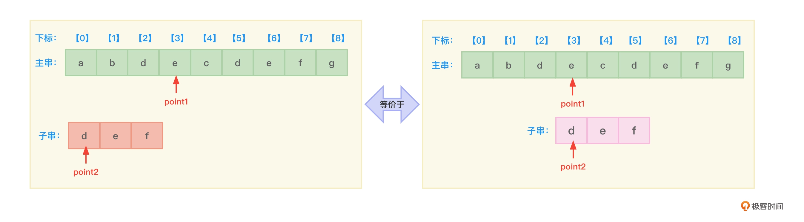
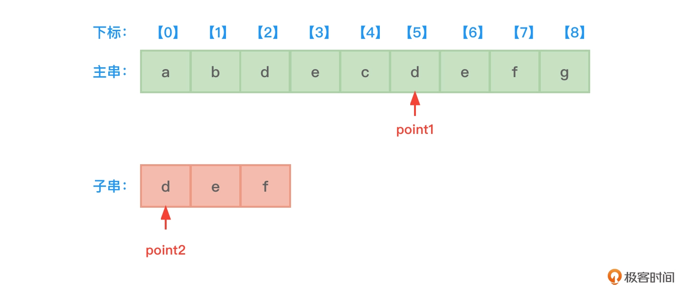
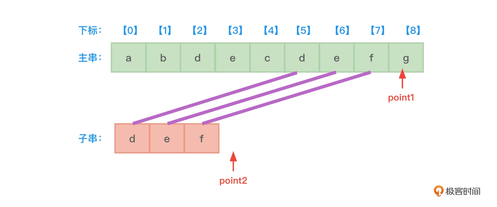
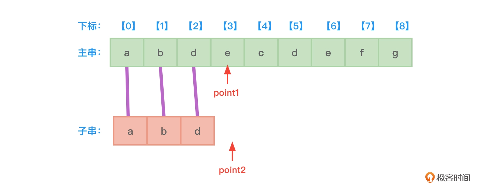
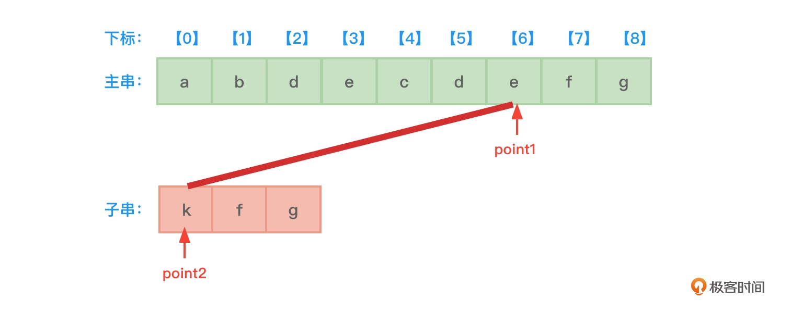
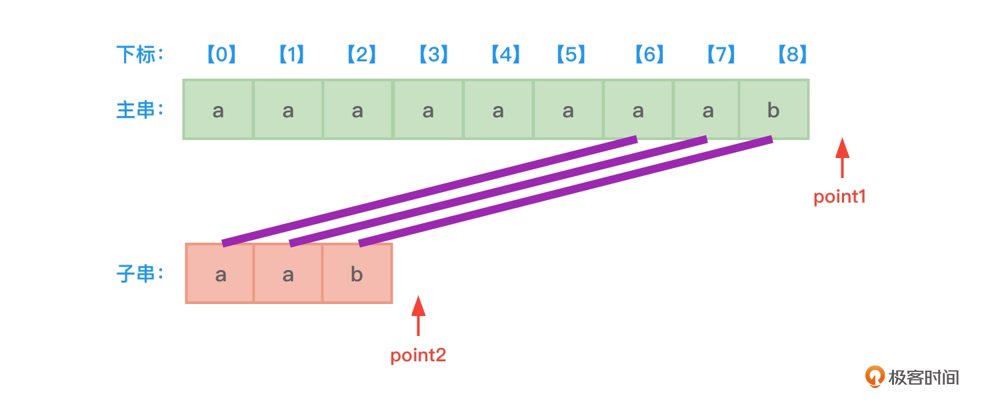
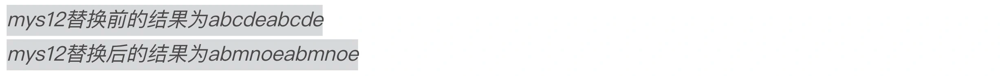

# 40 | 串的朴素模式匹配算法：暴力但容易理解

你好，我是王健伟。

前面我们在讲串的基本操作的时候，你一定发现了，我们没有提到在一个字符串中寻找子串的问题。这个寻找操作，不仅是这种数据结构中所要面对的最常见的算法，更是最重要的算法之一。这节课，我们就专门来看一看，怎么去找到这个子串。

## 问题的提出

对于一个串“abdecdefg”，如果希望在其中寻找“def”这个串，这个问题其实就相当于在一个主串（“abdecdefg”）中寻找一个子串（“def”）并返回该子串位置。这种子串的定位操作通常称为串的模式匹配。其中子串也被称为模式串。这里注意，因为是在主串中寻找子串，所以显然主串的长度不应该小于子串。

串的模式匹配算法有很多，比如朴素模式匹配算法（BF）、Rabin-Karp（RK）算法、KMP 算法、Boyer-Moore（BM）算法（常用于文本编辑器中，grep 命令中）等，我们会挑选两种常用的算法（BF、KMP）进行讲解。

通常来讲，我们可以通过调用前面编写的串中的 StrCmp()、SubString() 操作接口（方法）实现子串定位操作，但这节课，我们不依赖于串的任何其他操作接口来实现子串的定位操作，这里要实现的是串的朴素（简单）模式匹配算法。这个算法就是对主串的每个字符作为子串的开头与子串进行匹配。

串的朴素模式匹配算法也叫 BF（Brute Force）算法或暴力匹配算法，实现相对简单，容易理解，算法执行效率不高但使用频率较高。

这里我们把子串（模式串）的长度记为 m，主串长度记为 n。串的朴素模式匹配算法的思想是：在主串中检查开始位置分别是 0、1、2……n-m 并且长度为 m 的 n-m+1 个子串，看有没有跟子串匹配的。

我们还是尝试描述一下实现子串定位操作的详细步骤，如图 1 所示：



- 图1 串的朴素模式匹配算法【开始状态】

- 开始时，先设置两根指针 point1 和 point2，分别指向主串和子串的开始地址，也就是下标0 的位置。

- 接着，开始主串和子串逐个字符的比较。子串中当前指针 point2 指向的字符是 d，不等于主串中当前指针 point1 指向的字符 a。所以主串中的指针 point1 指向下一个字符 b。但是，该字符也不等于 point2 指向的字符 d。所以主串中的指针 point1 继续指向下一个字符d，发现 point1 和 ponit2 指向的字符相同，都是 d。如图 2 所示：



- 图2 串的朴素模式匹配算法【步骤1】

- 之后，让 point1 和 point2 指针指向各自串的下一个字符位置，point1 指向了字符 e，point2 指向了字符 e，比较 point1 和 point2 指向的字符，发现 point1 和 point2 指向的字符相同。

- 让 point1 和 point2 指针指向各自串的下一个字符位置，point1 指向了字符 c，point2 指向了字符 f，比较 point1 和 point2 指向的字符，发现 point1 和 point2 指向的字符不同。如图3 所示：



- 图3 串的朴素模式匹配算法【步骤2】

- 继续让子串指针 point2 返回到开始字符 d 的位置。而 point1 要回退（回溯）来指向下标为3 的位置（相当于子串右移了一个位置）。因为 point1 原来是从下标为 2 的位置开始与point2 比较的。比较图 4 的两幅子图可以发现，比较的过程其实也就是子串不断右移与主串对应位置字符比较的过程：



- 图4 串的朴素模式匹配算法【步骤3】

- 比较 point1 和 point2 指向的字符，发现 point1 和 point2 指向的字符不同，point1 指向下一个字符 c（下标 4 的位置）。

- 比较 point1 和 point2 指向的字符，发现 point1 和 point2 指向的字符不同，point1 指向下一个字符 d（下标 5 的位置）。如图 5 所示：



- 图5 串的朴素模式匹配算法【步骤4】

- 比较 point1 和 point2 指向的字符，发现 point1 和 point2 指向的字符相同，都是 d。

- 让 point1 和 point2 指针指向各自串的下一个字符位置，继续比较 point1 和 point2 指向的字符，发现 point1 和 point2 指向的字符相同，都是 e。

- 让 point1 和 point2 指针指向各自串的下一个字符位置，继续比较 point1 和 point2 指向的字符，发现 point1 和 point2 指向的字符相同，都是 f。

- 此时 point2 指针已经达到了子串的末尾，比较完毕，在主串中返回和子串第一个字符 d 对应的字符的下标位置——5。



- 图6 串的朴素模式匹配算法【步骤5，注意指针最后停留位置】

## 代码的实现

在前面的采用定长数组存储结构实现的 MySString 类中增加朴素模式匹配算法接口。下面是实现代码。

```javascript
//朴素模式匹配算法接口，返回子串中第一个字符在主串中的下标，如果没找到子串，则返回-1
int StrIndex(const MySString& substr,int pos = 0) //默认从位置0开始匹配子串
{
 if (length < substr.length) //主串还没子串长，那不可能找到
   return -1;
 int point1 = pos, point2 = 0;
 while (ch[point1] != '\0' && substr.ch[point2] != '\0')
 {
   if (ch[point1] == substr.ch[point2])
   {
     //两个指针都向后走
     point1++;
     point2++;
   }
   else //两者不同
   {
     //两个指针都恢复到该恢复的位置
     point1 = point1 - point2 + 1;
     point2 = 0; //子串指针恢复到0，不管原来是多少
   }
 } //end while
 if (substr.ch[point2] == '\0')
 {
   //找到了子串
   return point1 - point2;
 }
 return -1;
}
```

在 main 主函数中继续增加测试代码。

```
//朴素模式匹配算法接口，返回子串中第一个字符在主串中的下标，如果没找到子串，则返回-1
MySString mys10, mys11;
mys10.StrAssign("abdecdefg");//主串
mys11.StrAssign("def"); //子串
cout <<"StrIndex()结果为"<< mys10.StrIndex(mys11) << endl;
```

新增代码执行结果如下：


因为子串长度为 m，主串长度为 n，所以匹配成功的最好情况时间复杂度为 O(m)，此时子串的内容正好位于主串的开头。如图 7 所示：



- 图7 匹配成功的最好情况时间复杂度为O(m)

如果没找到子串，比较好的情况是子串的第一个字符就与主串中的字符不匹配，那么匹配失败的最好情况时间复杂度应该为 O(n-m+1)=O(n-m)，考虑到一般 n 的值远大于 m，所以=O(n)。如图 8 所示：



- 图8 匹配失败的最好情况时间复杂度为O(n)

看一看匹配成功的最坏情况时间复杂度（也可以看作是匹配失败的最坏情况时间复杂度），如图 9 所示：



- 图9 匹配成功/失败的最坏情况时间复杂度为O(n*m)

从图 9 不难看到，每个子串的前 m-1 个字符都和主串中的字符匹配，只有第 m 个字符不匹配。也就是每次都要比较子串中的前 2 个字符 a，比较到子串中的第 3 个字符 b 时，发现和主串不匹配。而后 point1 指针必须要回退“子串长度 +1”这么多的位置，再次和子串开头字符 a进行比较……如此反复。可以看到，直到匹配成功或者匹配失败最多需要对比 (n-m+1)m =

## m2

## m2

nm-

- +m 次，因为一般 n 的值远大于 m，所以 nm-+m 写成大 O 形式就是 O(nm) 这样的

最坏情况时间复杂度。

话说回来，找到子串之后到底可以干什么呢？这里我们可以进一步增加一个替换接口StrReplace()——在主串中找到子串，然后把这个子串替换成另一个子串。而且要求是不管主串中有多少个这样的子串，都应该被替换掉。

比如主串的内容是 abcdeabcde，要求将其中所有的 cd 替换成 mno，那么替换后的主串内容为 abmnoeabmnoe。具体实现代码如下：

```javascript
//串替换，主串中遇到内容为substr1的子串，全部替换成substr2子串
void StrReplace(const MySString& substr1, const MySString& substr2)
{
 int idx = -1;
 int pos = 0;
 int addlength = int(substr2.length) - int(substr1.length);
 while (pos < length)
 {
   idx = StrIndex(substr1, pos);
   if (idx == -1)
     return; //不存在substr1这样的子串，无需替换直接返回
   //能否替换，取决于空间是否够
   if (addlength > 0)
   {
     //被替换成的子串更长，要判断保存空间是否够
     if (length + addlength >= MAX_LEN)
       return; //空间不够，不能替换成新内容
   }
   StrDelete(idx, int(substr1.length));  //删除老子串
   StrInsert(idx, substr2); //插入新子串
   //位置应该向后走，跳过被替换的子串部分内容
   pos = idx + (int)(substr2.length);
 } //end while
 return;
}
```

在 main 主函数中继续增加如下测试代码：

```
//串替换，主串中遇到内容为substr1的，全部替换成substr2
MySString mys12, substr1, substr2;
mys12.StrAssign("abcdeabcde");
cout <<"mys12替换前的结果为"<< mys12.ch << endl;
substr1.StrAssign("cd");
substr2.StrAssign("mno");
mys12.StrReplace(substr1, substr2);
cout <<"mys12替换后的结果为"<< mys12.ch << endl;
```

新增代码执行结果如下：



串的朴素模式匹配算法虽然执行效率不高，但仍旧比较常用，因为大部分情况下主串和子串都不会太长，而且相信你也感觉到了，这个算法的思想相对简单，代码实现也不难，不容易出错。

## 小结

本节我带你学习了在一个在串中寻找子串的算法——串的朴素模式匹配算法。

这个算法是对主串的每个字符作为子串的开头，以此来尝试查找子串在主串中第一次出现的位置。我们将子串的长度记为 m，主串长度记为 n。串的朴素模式匹配算法的思想是在主串中检查开始位置分别是 0、1、2……n-m 并且长度为 m 的 n-m+1 个子串，看有没有跟子串匹配的。

接下来，我们还详细学习了串的朴素模式匹配算法的匹配步骤。因为子串长度为 m，主串长度为 n，所以匹配成功的最好情况时间复杂度为 O(m)，匹配失败的最好情况时间复杂度一般为O(n)。匹配成功的最坏情况时间复杂度是 O(n*m)。

此外，我还带你实现了子串替换接口 StrReplace() 的源代码编写，用于在主串中找到子串，然后把这个子串替换成另一个子串。

## 思考题

请用串的朴素模式匹配算法实现如下问题：给定一个主串和一个子串，找出主串中所有与子串匹配的位置。

欢迎你在留言区和我交流。如果觉得有所收获，也可以把课程分享课更多的朋友一起学习进步！我们下节课见！
