# 42 | 串的KMP模式匹配算法之实现与性能分析：代码实现简单

你好，我是王健伟。

上节课我们针对串的 KMP 模式匹配算法配以了大量的图形进行了非常仔细的观察，而观察的目的，就是为了这节课代码的实现。

串的 KMP 模式匹配算法实现代码并不多，但只有你学好了上节课的内容，对该算法有详细的理解，才能理解本节这样写代码的含义。

## KMP 模式匹配算法实现代码

KMP 模式匹配算法实现代码各式各样，有些实现方法虽然简洁，但并不好理解，我这里先以比较容易理解的方式进行代码实现。你可以先仔细读一遍。

```javascript
//求本串的next数组
void getNextArray( int next[])
{
 //next数组下标为0和为1的元素值固定为0和1。其实next[0]里的值并没有用到
 if (length < 1)
   return;
 //next数组的前两个元素肯定是0和1
 if (length == 1) //只有一个字符
 {
   next[0] = 0;
   return;
 }
 next[0] = 0;
 next[1] = 1;
 if (length == 2) //只有二个字符
 {
   return;
 }
 //至少三个字符
 int nextarry_idx = 2; //当前要处理的next数组下标
 int max_pub_zhui = 0; //max_pub_zhui：最大公共前后缀包含的字符数量
 //循环的目的是给next数组赋值
 while (nextarry_idx < length)
 {
   int left_RMC_count = nextarry_idx; //left_RMC_count：如果当前字符与主串的字符不匹配
   int max_pub_zhui = left_RMC_count - 1; //max_pub_zhui：最大公共前后缀包含的字符数量
   int start1idx = 0;
   int start2idx = left_RMC_count - max_pub_zhui;
   int xhtimes = max_pub_zhui; //循环次数
   //本循环的目的是获取最长公共前后缀长度，代码写法无固定方式，选择自己容易理解的方式写即可
   while (xhtimes > 0)
   {
     if (ch[start1idx] != ch[start2idx])
     {
       max_pub_zhui--;
       start1idx = 0;
       start2idx = left_RMC_count - max_pub_zhui;
       xhtimes = max_pub_zhui;
       continue; //要回去重新循环
     }
     else
     {
       start1idx++;
       start2idx++;
     }
     xhtimes--;
   } //end while (xhtimes > 0)
   next[nextarry_idx] = max_pub_zhui + 1; //如果公共前后缀长度为n，那么就需要用子串的第
   nextarry_idx++;
 } //end while
 return;
}
//KMP模式匹配算法接口，返回子串中第一个字符在主串中的下标，如果没找到子串，则返回-1
//next：下一步数组（前缀表/前缀数组）
//pos：从主串的什么位置开始匹配子串，默认从位置0开始匹配子串
int StrKMPIndex(const MySString& substr, int next[], int pos = 0)
{
 if (length < substr.length) //主串还没子串长，那不可能找到
   return -1;
 int point1 = pos; //指向主串
 int point2 = 0;  //指向子串
 while (ch[point1] != '\0' && substr.ch[point2] != '\0')
 {
   if (ch[point1] == substr.ch[point2])
   {
     //两个指针都向后走
     point1++;
     point2++;
   }
   else //两者不同
   {
     //point1和point2两个指针的处理
     if (point2 == 0) //下标0号位置子串的字符如果与主串字符不匹配则后续就要用子串的第1个字符
     {
       point1++; //主串指针指向下一位
     }
     else
     {
       //走到这个分支的，主串指针point1不用动，只动子串指针point2
       point2 = next[point2] - 1; //第这些个子串中的字符与主串当前位字符做比较
     }
   }
 }//end while
 if (substr.ch[point2] == '\0')
 {
   //找到了子串
   return point1 - point2;
 }
 return -1;
}
```

在 main 主函数中继续增加测试代码。

```sql
//KMP模式匹配算法接口，返回子串中第一个字符在主串中的下标，如果没找到子串，则返回-1
MySString mys13sub; //子串
mys13sub.StrAssign("ababaaababaa");
int* mynextarray = new int[mys13sub.length];
mys13sub.getNextArray(mynextarray); //获取next数组
MySString mys13master; //主串
mys13master.StrAssign("abbabbababaaababaaa");
cout <<"StrKMPIndex()结果为"<< mys13master.StrKMPIndex(mys13sub, mynextarray) << e
delete[]mynextarray; //释放资源
```

新增代码执行结果如下：


求解 next 数组是实现 KMP 模式匹配算法最重要的一环，它的代码也是最不好写的一环。上述我实现 getNextArray() 成员函数来求一个串的 next 数组，写法上比较暴力和繁琐，代码执行效率也不高，但优点是代码比较容易理解。

另一种典型的 KMP 算法求解 next 数组的代码写法很简洁执行效率更高但很不好理解。为了能够理解下面我要书写的求解 next 数组的高效新版本代码，这里必须要先讲述一些理论知识。

首先，假设主串用 S 表示，子串用 T 表示。point1 指向主串当前位置，point2 指向子串当前位置。通过之前的学习你已经知道，next[point2]的含义表示当 S[point1]≠ T[point2]时，point2指针需要退到的位置。这里提示一下，对应参考的代码是：point2 = next[point2] - 1;。

如果已知 next 数组中的前面元素值，能否根据这些值推出下一个 next 数组元素值呢？比如已经知道 next 数组中下标 0~15 的值，能否根据这些已知值推出 next 数组中下一个未知的值即下标为 16 的值？如果能推导出来就意味着根据前面的 next 元素值能够快速求出下个 next 元素值，那么对于求解整个 next 数组值的效率将提高数倍。

为了更明晰地阐述问题，这里以一个新范例来说明。假设 next 数组中下标 0~15 的值已知，试求解一下 next[16]的值。如图 1 所示：

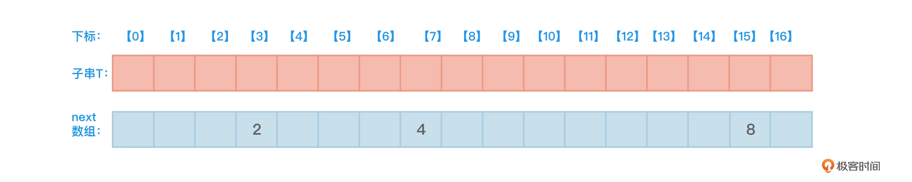

- 图1 一个子串T和一个next数组，其中不重要的内容未在图中标注出来

图 1 中，因为 next[15]=8，根据公共前后缀原理，意味着 T[0]~T[6]的内容和 T[8]~T[14]的内容相同。如图 2 中子串 T 的粗线标注部分：

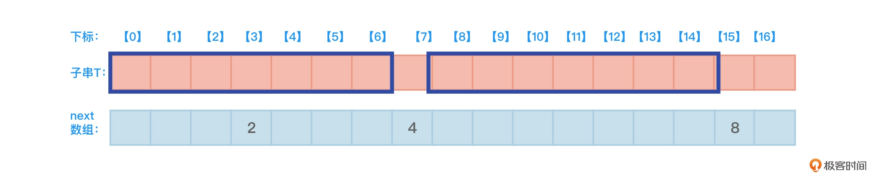

- 图2 公共前后缀：T[0]~T[6]的内容和T[8]~T[14]的内容相同

这里我给每一个关键分析步骤标上序号，方便你拆解之后慢慢理解。

1. 此时比较子串中的 T[7]和 T[15]这两个字符，如果两者相等，即 T[7]=T[15]，说明子串 T 的T[0]~T[14]之间公共前后缀长度由原来的 7 个增加到了 8 个，也就是意味着next[16]=next[15]+1=9。总结：已知 next[15]，如果 T[7] = T[15]，那么 next[16]就可以直接用 next[15]+1 求得。这是最好的情形，通过 next[15]就能求得 next[16]，如图 3 所示：

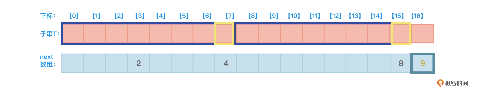

- 图3 因为T[7] = T[15]，所以可以通过next[15]求得next[16]（next[16] = next[15]+1）

2. 但是，如果 T[7]和 T[15]这两个字符不相等，即 T[7]≠T[15]，这种情况没有办法直接通过next[15]求得 next[16]的值。那么有没有办法通过前面已知的 next 元素值间接求得 next[16]值呢？又该如何思考呢？

观察 next[7]。注意，7 这个值是 T[15]位置的一半，其实就是 next[15]-1 得来的，我们发现它的值是 4，根据公共前后缀原理，意味着 T[0]~T[2]的内容和 T[4]~T[6]的内容相同。如图 4 所示：

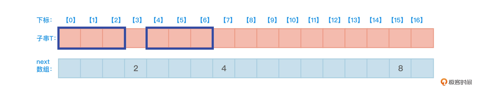

- 图4 公共前后缀：T[0]~T[2]的内容和T[4]~T[6]的内容相同

结合图 2 和图 4，可以得到这么几个结论。

- T[0]~T[2]的内容和 T[4]~T[6]的内容相等。

- T[4]~T[6]的内容和 T[8]~T[10]的内容相等。

- T[8]~T[10]的内容和 T[12]~T[14]的内容相等。

- 也就是 T[0]~T[2]=T[4]~T[6]=T[8]~T[10]=T[12]~T[14]。

如图 5 所示：

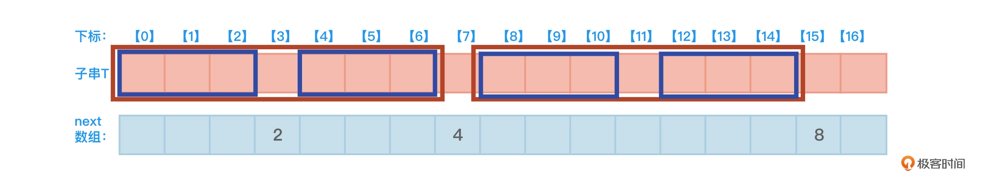

- 图5 公共前后缀：T[0]~T[2]=T[4]~T[6]=T[8]~T[10]=T[12]~T[14]

图 5 中，重点观察 T[0]~T[2]= T[12]~T[14]这组。单独绘制出来如图 6 所示：

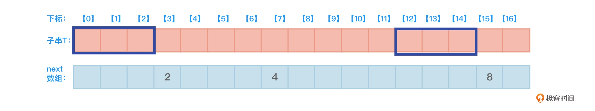

- 图6 观察T[0]~T[2]=T[12]~T[14]这组

图 6 中，如果 T[3]=T[15]，这意味着 T[0]~T[3]=T[12]~T[15]，此时根据公共前后缀原理，next[16]=next[7]+1=4+1=5。如图 7 所示：

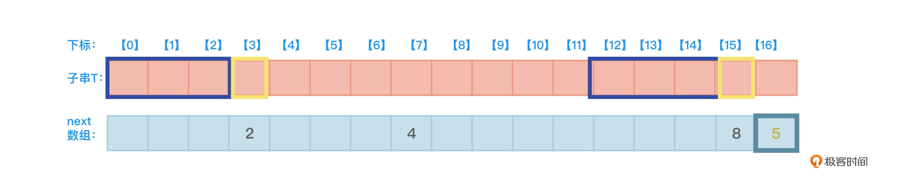

- 图7 T[3] = T[15]，所以可以求得next[16]（next[16]=next[7]+1=4+1=5）

图 7 所示的情形也很好，通过 next[7]能求得 next[16]。

3. 但是，如果 T[3]和 T[15]这两个字符不相等，即 T[3]≠T[15]，这种情况没有办法通过 next[7]求得 next[16]值。那么还要怎样求得 next[16]值呢？可以看到，这是一个递推的过程，继续重复前面的步骤。

观察 next[3]，也就是 T[7]位置的一半，发现其值为 2，根据公共前后缀原理，意味着 T[0]的内容和 T[2]的内容相同，如图 8 所示：

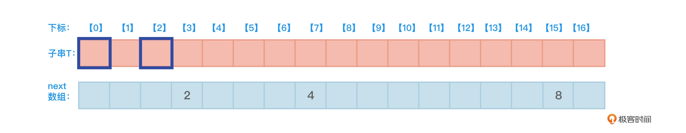

- 图8 公共前后缀：T[0]的内容和T[2]的内容相同

结合图 2、图 4 和图 8，其实也就是结合 next[15]、next[7]、next[3]，可以得到结论即T[0]=T[2]=T[4]=T[6]=T[8]=T[10]=T[12]=T[14]。如图 9 所示：

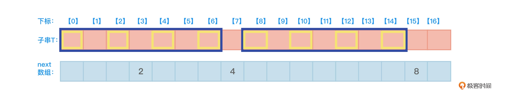

- 图9 公共前后缀：T[0]=T[2]=T[4]=T[6]=T[8]=T[10]=T[12]=T[14]

图 9 中，重点观察 T[0] = T[14]这组。单独绘制出来如图 10 所示：

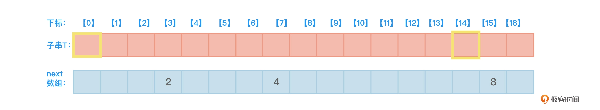

- 图10 观察T[0] = T[14]这一组

图 10 中，如果 T[1]=T[15]，这意味着 T[0]~T[1]=T[14]~T[15]，此时根据公共前后缀原理，next[16]=next[3]+1=2+1=3。如图 11 所示：

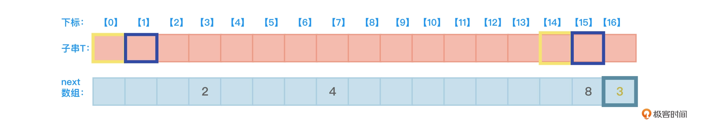

- 图11 T[1] = T[15]，所以可以求得next[16]（next[16]= next[3]+1=2+1=3）

图 11 所示的情形也还不错，通过 next[3]能求得 next[16]。

4. 但是，如果 T[1]和 T[15]这两个字符不相等，即 T[1]≠T[15]，这种情况没有办法通过 next[3]求得 next[16]值。那么还要怎样求得 next[16]值呢？

观察 next[1]（T[3]位置的一半），next[1]的固定值是 1，这表示没有前后缀信息。

观察 next[0]（T[1]位置的一半），next[0]的固定值是 0，当遇到 next 元素值为 0 的情形时，表示这个递推过程就结束了，如果递推过程结束，也没得到 next[16]的结果，那么 next[16]的结果就为 1（没有公共前后缀）。

基于上面这些理论知识，我们开始实现典型的 KMP 算法，求解 next 数组的实现代码如下：

```
//求本串的next数组——典型的KMP算法求解next数组的代码写法
void getNextArray_Classic(int next[])
{
 if (length < 1)
   return;
 //next数组的前两个元素肯定是0和1
 if (length == 1) //只有一个字符
 {
   next[0] = 0;
   return;
 }
 next[0] = 0;
 next[1] = 1;
 if (length == 2) //只有二个字符
 {
   return;
 }
 //至少三个字符
 int next_idx = 2;    //需要求的next数组中下标为2的元素值
 int qz_tail_idx = 0; //前缀末尾位置
 while (next_idx < length)
 {
   if (ch[qz_tail_idx] == ch[next_idx - 1])//next_idx-1代表后缀末尾位置
   {
     next[next_idx] = (qz_tail_idx + 1) + 1;   //qz_tail_idx+1就是前缀的宽度
     next_idx++;
     qz_tail_idx++; //前缀末尾位置：其实这样写也OK：qz_tail_idx = next[next_idx - 1]
   }
   else
   {
     qz_tail_idx = next[qz_tail_idx] - 1; //这句是最难理解的代码
     //qz_tail_idx允许等于0，等于0有机会下次while时再比较一次，所以下面只判断qz_tail_idx
     if (qz_tail_idx < 0)
     {
       //没找到前缀
       qz_tail_idx = 0;
       next[next_idx] = 1;
       ++next_idx;
     }
   }
 } //end while (next_idx < length)
 return;
}
```

在 main 主函数中继续增加测试代码。

```sql
//求本串的next数组——典型的KMP算法求解next数组的代码写法
MySString mys14sub; //子串
mys14sub.StrAssign("ababaaababaa");
int* mynextarray14 = new int[mys14sub.length];
cout <<"本次采用典型的KMP算法求解next数组：----"<< endl;
mys14sub.getNextArray_Classic(mynextarray14);
MySString mys14master; //主串
mys14master.StrAssign("abbabbababaaababaaa");
cout <<"StrKMPIndex()结果为"<< mys14master.StrKMPIndex(mys14sub, mynextarray14) <<
delete[]mynextarray14; //释放资源
```

新增代码执行结果如下：


新实现的求 next 数组的 getNextArray_Classic() 成员函数比 getNextArray() 成员函数代码更简洁，执行效率更高，但理解难度更大。其实，getNextArray_Classic() 这段短短的数行代码却是 KMP 算法中最难理解的代码段。

## KMP 模式匹配算法性能分析

最后，我们来看看这个算法的性能分析。假设子串（模式串）长度为 m，主串长度为 n。

整个 KMP 模式匹配算法所花费的时间应该是求解 next 数组的时间以及利用 next 模式数组进行模式匹配的时间。

先来看 next 数组的时间：getNextArray_Classic() 作为获取 next 数组的函数，实现得比较精炼高效，时间复杂度为 O(m)。

再来根据 next 数组在主串中寻找子串的时间。StrKMPIndex() 成员函数用于在主串中寻找子串。它的实现代码的主 while 循环中，因为 point1 指针永远不回退，整个 while 循环的时间复杂度为 O(n)。所以 KMP 算法的时间复杂度是 O(m+n)。另外，因为 KMP 算法只需要一个额外的 next 数组，因此空间复杂度为 O(m)。

KMP 算法是利用让主串中的指针（point1）不回退甚至子串一次可能会右移多个位置的实现方式达到提升字符串匹配效率的目的。如果在字符串匹配过程中不经常出现子串中的部分内容与主串匹配的情形，那么与串的朴素模式匹配算法相比，串的 KMP 模式匹配算法的优势就不太明显，所以，串的朴素模式匹配算法目前也仍然有着广泛的使用。

## 小结

本节我带你实现了串的 KMP 模式匹配算法的相关代码，在代码中，我们先求得 next 数组内容，然后利用 next 数组内容就可以快速在主串中寻找子串。

KMP 模式匹配算法的重点是求解 next 数组，我首先采用一种代码上比较容易理解的方式来实现 next 数组求解，目的就是为了让你透彻理解求解 next 数组的过程，但这种实现方式的缺陷是代码书写相对繁琐，执行效率也不高。

典型的 KMP 算法求解 next 数组的代码写法很简洁执行效率更高但很不好理解。为了能够让你理解典型的 KMP 算法求解 next 数组的代码，我又为你讲解了一些如何用更高效率的手段来求解 next 数组元素的理论知识。

有了这些理论知识做铺垫，我为你提供了典型的 KMP 算法求解 next 数组的实现代码从而以更高的效率求得 next 数组，这自然也就意味着整个在主串中寻找子串的执行效率会得到进一步提高。

KMP 算法借助 next 数组，利用让主串中的指针不回退甚至子串一次可能会右移多个位置的实现方式达到提升字符串匹配效率的目的。假设子串长度为 m，主串长度为 n，那么 KMP 算法的时间复杂度是 O(m+n)，空间复杂度为 O(m)。

当然，KMP 模式匹配算法的使用也有其制约性，也就是如果在字符串匹配过程中不经常出现子串中的部分内容与主串匹配的情形，那么与串的朴素模式匹配算法相比，串的 KMP 模式匹配算法的优势就不太明显，所以，串的朴素模式匹配算法目前也仍然有着广泛的使用。

## 思考题

1. 给定一个子串，求解该子串的 next 数组，分析一下生成 next 数组的时间复杂度。

2. 比较 KMP 模式匹配算法和朴素模式匹配算法的时间复杂度和空间复杂度，尝试说明 KMP模式匹配算法的优势和不足之处。

欢迎你在留言区和我互动。如果觉得有所收获，也可以把这节课分享给更多的朋友一起学习。我们下节课见！
