# 47 | 多路查找树：B树在数据库中的应用

你好，我是王健伟。

这节课我们来谈一谈多路查找树。传统的、用来搜索的二叉查找树有很多，比如平衡二叉树、红黑树等。

虽然通常情况下它们的查询性能很不错，但当数据量非常大的时候，它们却无能为力。因为当数据量非常大时，内存是很有限的，不可能把所有数据全部加载到内存中，大部分数据只能存放到磁盘上，只有需要的数据才会被加载到内存中。

通常来讲，计算机访问内存的速度要远远快于访问磁盘的速度，那么程序大部分的时间就会阻塞在磁盘 IO 上。所以尽量减少对磁盘的访问次数就是提高程序性能的关键。

那么，如何组织数据才能达到尽量减少对磁盘的访问次数的效果呢？一起来看一看 B 树。

## B 树的基本概念、定义及基础实现代码

B 树也被称为多路平衡查找树，也称为 B- 树，这里的 - 并不是减号而是一个连字符。这里的多路可以理解为相对于二叉树而言，二叉树是二路查找树，因为最多只有两个子节点，所以查找时最多只有两条路。而 B 树有多条路（至少 3 条路），也就是说，B 树的节点可以有多个子节点。

B 树是一种组织和维护外存（磁盘上的文件）系统非常有效的数据结构，常用在数据库里，引入 B 树的主要目的就是减少磁盘的 I/O 操作。

- n

## log

因为平衡二叉树、红黑树等最小高度保持在

- 附近，这意味着大部分针对平衡二叉树、红​2n

## log

黑树的操作（查找、插入、删除等）的时间复杂度为 O(

- )，如果树中的节点数据很多都是​2n

## log

保存在磁盘上的，那么这里就可以将 O(

- ) 理解成对磁盘的访问次数。显然，减少对磁盘的​2n

## log

访问次数这件事就变得极其重要。对比来看，B 树的高度不是

- ，而是一个可以控制的高​2n

## log

度，一般这个高度会远小于

- ，这意味着使用 B 树可以极大地减少对磁盘的访问次数。​2

换一种理解方式来说，平衡二叉树、红黑树每个节点只存储一个数据元素，或者说存储的数据量非常少，从而造成了这些树的高度显得非常高，也造成了对节点操作时间开销上的增加（比如查找某个节点之类的操作）。而 B 树每个节点可以存储多个数据元素，并且是一种多叉树，B 树的节点可以有许多孩子，从几个到数千个。

### B 树的性质

通常描述一棵 B 树的时候，需要指定它的阶数（分叉数），我们把树中节点最大的孩子数目称为 B 树的阶，一棵 m 阶的 B 树或为一棵空树，或者是满足下面这些性质的 m 叉树。我来给你梳理一下。

- 关于节点个数

1. 每个节点至多有 m 个子节点（m 个分支 /m 叉）。比如对于 3 阶 B 树，每个节点至多有 3个子节点，对于 5 阶 B 树，每个节点至多有 5 个子节点。

2. 除根节点外，所有非叶节点至少有⌈m/2⌉（向上取整）个子节点。比如对于 3 或 4 阶 B 树，非根非叶节点至少要有 2 个子节点，对于 5 或 6 阶 B 树，非根非叶节点至少有 3 个子节

- 点。

- 关于数据

1. 每个节点至多有 m-1 个数据，每个数据也可以称呼为一个关键字。比如对于 3 阶 B 树，每个节点至多有 2 个数据，对于 5 阶 B 树，每个节点至多有 4 个数据。

2. 根节点至少可以只有 1 个数据，其他节点至少有⌈m/2⌉-1 个数据（键）。比如对于 3 阶或 4阶 B 树，非根节点至少要有 1 个数据，而对于 5 阶或 6 阶 B 树，非根节点至少要有 2 个数据。

- 关于叶子节点

1. 如果一个节点有子节点，则其子节点的数目一定比该节点的数据数目多 1。

2. 节点中数据左侧挨着的指针所指向的子节点中的数据都比该数据小，数据右侧挨着的指针所指向的子节点中的数据都比该数据大，这种数据排列类似于二叉查找树（参考下图 1）。

3. 所有叶子节点出现在同一层次上。换句话说，对于任何一个节点，其所有子树的高度都是相同的。

图 1 是一棵 3 阶 B 树：

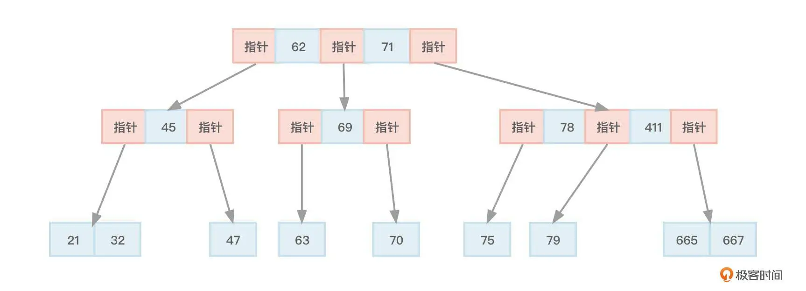

- 图1 一棵3阶B树

在图 1 中，62 左侧指针所指向的节点值为 45，小于 62，而值 62 和 71 之间夹着的指针所指向的节点值为 69，正好位于值 62 和 71 之间，值 71 右侧指针所指向的节点值为 78、411，都大于 71。B 树的各个子节点也遵循这样的数据大小规律。

我们看一个问题：一棵 m 阶 B 树所有节点共包含 n 个数据。看一看这棵 B 树的最小高度和最大高度分别是多少？

- 最小高度：若让该 B 树高度尽可能小，需要每个节点包含的数据数量尽可能多。

根据 B 树性质“每个节点至多有 m-1 个数据（有 m 个子节点）”我们来分析一下。

## m2

第 1 层为根节点（1 个节点），第 2 层有 m 个节点，第 3 层有 m*m，也就是

- 个节点，以

## mh−1

此类推，设该 B 树共有 h 层，则第 h 层有

- 个节点。

## m2 m3

## mh−1

因为每个节点有 m-1 个数据，所以这 h 层的 B 树一共有 (m-1)(1+m+

- ++…+) 个

## m2 m3

## mh−1

数据。而 1+m+

- ++…+是个等比数列求和公式（有兴趣可以通过搜索引擎了解），

## m2 m3

## mh−1

## mh

该求和公式的结果为 (1-

- )/(1-m)，将该公式代入 (m-1)(1+m+++…+)，得到

## mh

## mh

- -1，意味着高度为 h 的 B 树最多有-1 个数据。

- (n+1)

## mh

## log

因为该 m 阶 B 树包含 n 个数据，这意味着 n≤

- -1，则 h≥。即这棵 B 树的高度 hm​(n+1)

## logm

最小也不会小于

- 。

- 最大高度：也就是让这棵 B 树尽量高。这就需要让各节点包含的子节点数目或者说数据数目尽可能少。

这里需要用到 B 树的 2 个性质。一个是，除根节点外，所有非叶节点至少有⌈m/2⌉（向上取整）个子节点；另一个是，根节点至少可以只有 1 个数据，其他节点至少有⌈m/2⌉-1 个数据。

为描述方便，我们设⌈m/2⌉=k，然后尝试分析。

第 1 层为根节点（1 个节点），最少包含 1 个数据。第 2 层最少包含 2 个节点，即最少包含2(k-1) 个数据。第 3 层最少包含 2k 个节点，即最少包含 2k(k-1) 个数据。第 4 层最少包含 2

## k2

## k2

- 个节点，即最少包含 2(k-1) 个数据。以此类推，设该 B 树共有 h 层，则第 h 层最少包

## kh−2

## kh−2

含 2

- 个节点，即最少包含 2(k-1) 个数据。

## k2

## kh−2

所以这 h 层的 B 树最少包含这么多个数据：1+2(k-1)+2k(k-1)+2

- (k-1)+…+2(k-1)=

## k2

## kh−2

## k2

## kh−2

1+2(k-1)(1+k+

- +…+)，这里 1+k++…+又是等比数列求和公式，将该公式代入

## k2

## kh−2

## kh−1

## kh−1

## kh−1

1+2(k-1)(1+k+

- +…+)，得到 1+2(k-1)( (1-)/(1-k))=1+2(-1)= 2-1。

- ((n+1)/2)

## kh−1

## log

因为该 m 阶 B 树包含 n 个数据，这意味着 n≥2

- -1，则 h≤()+1，即 h≤(k​((n+1)/2)((n+1)/2)

## log

## log

- )+1。也就是说这棵 B 树的高度 h 最大也不会大于 ()+1。⌈m/2⌉k​​

### B 树的实现代码

访问“可视化数据结构算法演示网站”页面并单击其中的“B Trees”链接，在其中就可以对 B 树中节点的插入、删除等操作进行演示，很直观，对你理解 B 树的常规操作非常有帮助。

基础实现代码如下：

```sql
//B树每个节点的定义
template <typename T, int M>//T代表数据元素的类型，M代表B树的阶
struct BTreeNode
{
 T   data[M]; //数据/关键字
 BTreeNode<T, M>* childs[M + 1]; //子节点指针数组
 BTreeNode<T, M>* parent;        //父节点指针
 int size;    //节点中实际数据的个数
 BTreeNode() //构造函数
 {
   size = 0;
   for (int i = 0; i < M; ++i)
   {
     data[i] = -1; //随便给个比较特殊的值-1，这样跟踪调试时也好观察和辨认。
   }
   for (int i = 0; i < (M + 1); ++i)
   {
     childs[i] = nullptr;
   }
   parent = nullptr;
 }
};
//B树的定义
template<typename T,int M>
class BTree
{
public:
 BTree()  //构造函数
 {
   root = nullptr;
 }
 ~BTree() //析构函数
 {
   ReleaseNode(root);
 }
private:
 void ReleaseNode(BTreeNode<T,M>* pnode)
 {
   if (pnode != nullptr)
   {
     for (int i = 0; i < (pnode->size + 1); ++i)
     {
       if (pnode->childs[i] != nullptr)
       {
         ReleaseNode(pnode->childs[i]);
       }
     }
   }
   delete pnode;
 }
private:
 BTreeNode<T,M>* root; //树根指针
 };
```

## B 树的插入操作及实现代码

在这里看一个 B 树节点插入的步骤（其实就是 B 树的创建步骤）。假如要按顺序给这些数据创建一棵 4 阶 B 树：11，12，6，5，13，7，3，4，2，1，9，8，10。

有两点值得说明：

- 根据前面描述的 B 树性质，4 阶 B 树每个节点最少有 1 个数据，最多有 3 个数据。

- 新插入的数据总是会落在最底层的叶子节点上。

那么创建的步骤就会是下面这样。

- 因为当前并不存在 B 树，所以以 11 为根创建一棵 B 树。

- 插入 12，因为 12 大于 11，所以 12 位于 11 的右侧，与 11 共用一个节点。

- 插入 6，因为 6 小于 11，所以 6 位于 11 的左侧，与 11、12 共用一个节点。

- 插入 5，因为 5 小于 6，所以 5 位于 6 的左侧，此时注意，5、6、11、12 共用一个节点。但因为 4 阶 B 树最多有 3 个数据，因此这个节点必须要进行拆分（分裂），拆分的原则是取这几个数据中间（⌈m/2⌉）的那个数据并作为根节点，剩余的数据分别做这个节点的左孩子和右孩子节点。对于 5、6、11、12，一共是 4 个数据，⌈4/2⌉=2，因此取第 2 个数据 6 作为根节点（当然取第 3 个数据 11 也可以。因为当一个节点中包含偶数个数据比如 4 个数据时，中间的数据可以是第 2 个也可以是第 3 个），将数据 5 所代表的节点作为 6 的左孩子，将 11、12 这两个数据所代表的节点作为 6 的右孩子，如图 2 所示：

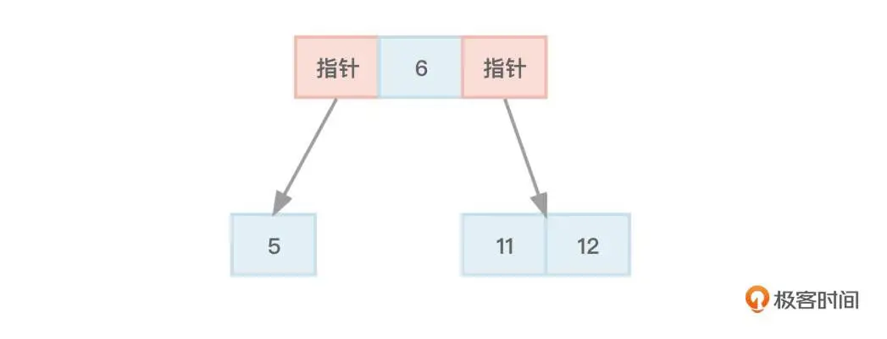

- 图2 包含4个数据的4阶B树

- 插入 13，从根节点 6 开始，因为 13 大于 6，因此沿着 6 的右指针向下找，找到 11、12 这个节点，因为 13 大于 12，因此按照排列顺序，11、12、13 三个数据被放到一起作为一个节点。

- 插入 7，从根节点 6 开始，通过比较大小，将 7、11、12、13 这 4 个数据放到一起作为一个节点，因为 4 阶 B 树最多有 3 个数据，因此这个节点必须要进行拆分，将 11 作为根节

- 点，将数据 7 所代表的节点作为 11 的左孩子，将 12、13 这两个数据所代表的节点作为 11的右孩子。再将 11 这个节点并到数字 6 所代表的根节点中（因为根节点还不超过 3 个数据），注意因为 11 大于 6，因此 11 排在 6 后面，如图 3 所示：

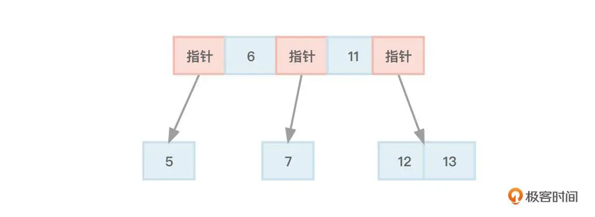

- 图3 包含6个数据的4阶B树

- 插入 3，从根节点 6、11 开始，通过比较大小，将 3 放到 5 所在的节点中。

- 插入 4，从根节点 6、11 开始，通过比较大小，将 4 放到 3、5 所在的节点中，注意顺序，现在 3、4、5 在一个节点中。

- 插入 2，从根节点 6、11 开始，通过比较大小，将 2 放到 3、4、5 所在的节点中，该节点超过 3 个数据，所以进行拆分，将 3 作为根节点，将数据 2 所代表的节点作为 3 的左孩子，将 4、5 这两个数据所代表的节点作为 3 的右孩子。再将 3 这个节点并到 6、11 所代表的根节点中（因为根节点还不超过 3 个数据），注意因为 3 小于 6 也小于 11，因此 3 排在 6 和 11 的前面，如图 4 所示：

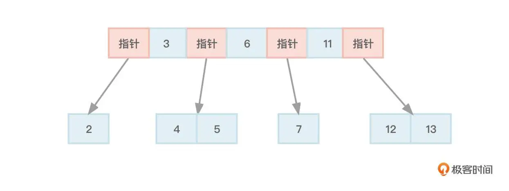

- 图4 包含9个数据的4阶B树

- 插入 1，从根节点 3、6、11 开始，通过比较大小，将 1 放到 2 所在的节点中，注意 1 排在2 的前面。

- 插入 9，从根节点 3、6、11 开始，通过比较大小，将 9 放到 7 所在的节点中，注意 9 排在7 的后面。

- 插入 8，从根节点 3、6、11 开始，通过比较大小，将 8 放到 7、9 所在的节点中，注意排列顺序是 7、8、9，如图 5 所示：

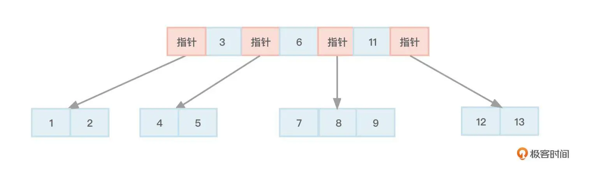

- 图5 包含12个数据的4阶B树

- 插入 10，从根节点 3、6、11 开始，通过比较大小，将 10 放到 7、8、9 所在的节点中，排列顺序是 7、8、9、10，如图 6 所示：

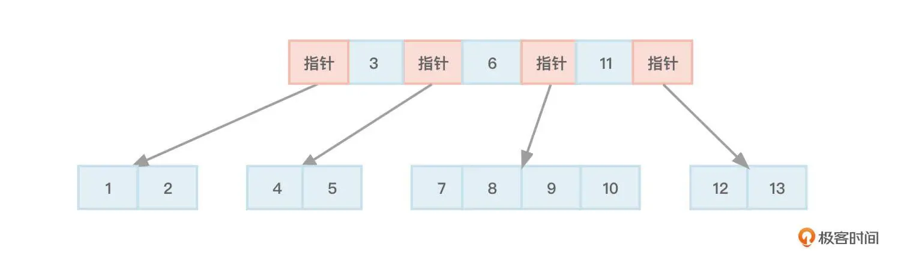

- 图6 包含13个数据的4阶B树（中间状态）

- 7、8、9、10 所在的节点超过 3 个数据，所以进行拆分，将 8 作为根节点，将数据 7 所代表的节点作为 8 的左孩子，将 9、10 这两个数据所代表的节点作为 8 的右孩子，如图 7 所示：

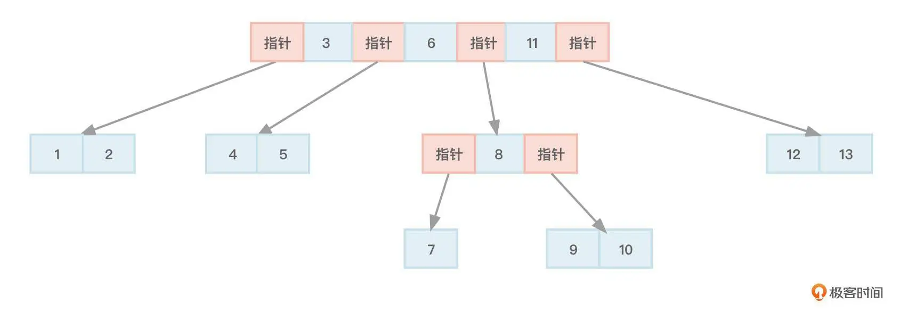

- 图7 包含13个数据的4阶B树（中间状态）

- 再将 8 这个节点并到 3、6、11 所代表的根节点中，此时根节点中数据的排列顺序是 3、6、8、11，如图 8 所示：

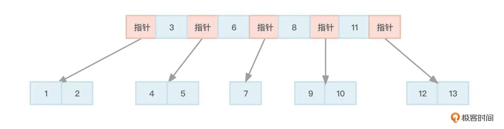

- 图8 包含13个数据的4阶B树（中间状态）

- 因为 4 阶 B 树最多有 3 个数据，因此图 8 的根节点必须要进行拆分，将 6 作为根节点，将数据 3 所代表的节点作为 6 的左孩子，将 8、11 这两个数据所代表的节点作为 6 的右孩子，如图 9 所示：

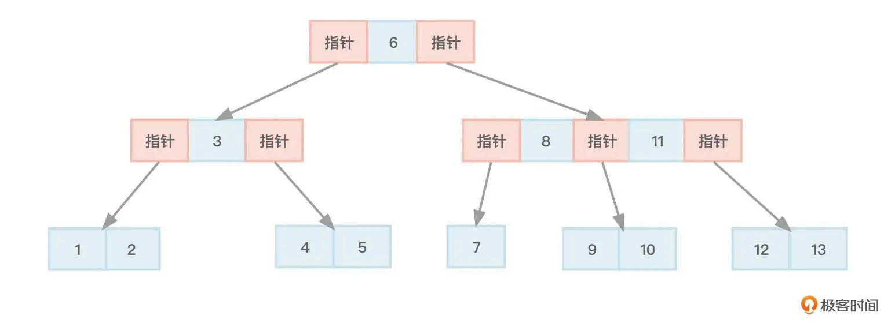

- 图9 包含13个数据的4阶B树（最终状态）

通过前述的“可视化数据结构算法演示网站”继续插入数据 14、15、16 构造一棵 4 阶 B 树如下图 10 所示：

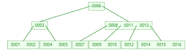

- 图10 包含16个数据的4阶B树

此时，向这个 B 树中插入数据 17 会怎样？

- 因为新插入的数据总是会落在最底层的叶子节点上，通过比较大小，数据 17 会被插入到14、15、16 所在的节点并且放在数据 16 之后。如图 11 所示：

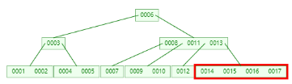

- 图11 包含16个数据的4阶B树插入数据17后的情形1（中间状态）

- 4 阶 B 树最多有 3 个数据，因此 14、15、16、17 这个节点必须要进行拆分，将 15 作为根节点，将数据 14 所代表的节点作为 15 的左孩子，将 16、17 这两个数据所代表的节点作

- 为 15 的右孩子。那么 15 这个数据摆在何处呢？要摆在 15 的父节点 8、11、13 中，并且根据大小关系是摆在这三个数据的后面。如图 12 所示：

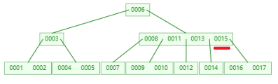

- 图12 包含16个数据的4阶B树插入数据17后的情形2（中间状态）

- 节点 8、11、13、15 超过了 3 个数据，要继续拆分，将 11 作为根节点，将数据 8 所代表的节点作为 11 的左孩子，将 13、15 这两个数据所代表的节点作为 11 的右孩子，11 这个节点摆在其父节点 6 中。如图 13 所示：

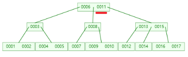

- 图13 包含16个数据的4阶B树插入数据17后的情形3（最终状态）

可以看到 B 树的创建或者说生长方向是从下到上的。在了解了 B 树的数据插入步骤后，就可以开始书写代码了。在 BTree 类模板的定义中，增加成员函数 InsertElem、InsertDataIntoNode，参考课件。

为了能够将一个 B 树比较直观地显示出来以检测插入数据元素的代码是否书写正确，这里增加前面显示红黑树时用过的层序遍历接口 levelOrder 并稍加改造，完整的实现代码参考课件里的 levelOrder 成员函数。

在 main 主函数中加入代码：

```
BTree<int, 4> mybtree;
mybtree.InsertElem(11);
mybtree.InsertElem(12);
mybtree.InsertElem(6);
mybtree.InsertElem(5);
mybtree.InsertElem(13);
mybtree.InsertElem(7);
mybtree.InsertElem(3);
mybtree.InsertElem(4);
mybtree.InsertElem(2);
mybtree.InsertElem(1);
mybtree.InsertElem(9);
mybtree.InsertElem(8);
mybtree.InsertElem(10);
mybtree.levelOrder();
```

执行结果如下：

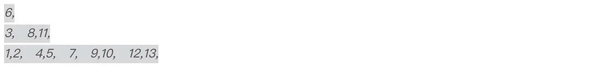

将上述结果与图 9 作比较，可以证明结果是正确的。

## B 树的删除操作及实现代码

B 树的删除操作比 B 树的插入操作稍微复杂一些。我们首先明确一下 B 树每个节点有多少个数据。根据 B 树的性质，以一棵 5 阶 B 树为例：

- 一棵 5 阶 B 树，每个节点最多有 4 个数据。

- 根节点可以只有 1 个数据，非根节点至少有 2 个数据。

因为 B 树的删除操作实际和插入操作是相反的，所以先来回忆一下 B 树的插入操作，对于一棵 5 阶 B 树：

- 如果插入数据到某个节点而该节点原来的数据不够 4 个，则可以将数据直接插入到该节点。

- 如果插入数据到某个节点而该节点原来的数据已经达到了 4 个（上限），比如原来的数据为“50、60、70、80”，而要插入的数据是 75，那么插入数据后这个节点的数据就变成“50、60、70、75、80”，这超过了 5 阶 B 树每个节点最多包含 4 个数据的上限，必须对这个节点进行拆分。⌈5/2⌉=3，因此取第 3 个数据 70 作为根节点，将 50、60 所代表的节点作为70 的左孩子，将 75、80 所代表的节点作为 70 的右孩子，如图 14 所示：

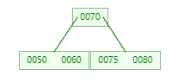

- 图14 分别插入数据50、60、70、80、75构成的一棵5阶B树

好，现在我们再看一看 B 树的删除操作。插入数据时考虑的是 B 树中每个节点数据数量的上限，删除数据时考虑的是 B 树中每个节点数据数量的下限。具体看一看删除数据的两种情况：

- 所删除的数据位于终端节点（没有子节点的节点即叶子节点）之中。

- 所删除的数据位于非终端节点（有子节点的节点）之中。

如果所删除的数据位于非终端节点，则要转换成对终端节点中数据的删除，以图 14 中删除数据 70 为例：

1. 找到 70 的前趋数据 60。找法是找数据 70 所在节点的左子树最右侧的值，最终找到的 60一定是终端节点。当然也可以找 70 的后继数据 75（数据 70 所在节点的右子树最左侧的值）。

2. 将 60 和 70 数据互换，此时 70 就位于终端节点中。

3. 删除位于终端节点中的 70。当然，删除后还要继续判断该节点中的数据数量，如果数据数量低于下限，还要继续进行节点合并处理。

所以，不管删除的数据是否位于终端节点，最终一定会转变成对终端节点中数据的删除。那么对终端节点中数据的删除，又分为两种情况。

以一棵 5 阶 B 树为例：

1. 只要删除数据后节点中的数据数量不低于下限，就可以直接在该节点中将数据删除。比如一棵 5 阶 B 树非根节点要求至少有 2 个数据，如果被删除数据的节点不是根节点并且该节点在删除数据后剩余的数据数量不少于 2 个，则直接将数据删除即可。

2. 如果将数据删除后节点的数据数量低于 2，就会导致节点的合并，合并也是 B 树删除操作最繁琐之处。

关于兄弟节点数据的个数是否超过数量 2，我们还是来分类讨论一下。

### 兄弟节点数据的个数超过2

如果兄弟节点数据的个数超过数量 2，就可以从兄弟中借一个数据过来。借的方法采用“父子换位法”，如图 15 是一棵 5 阶 B 树。

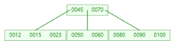

- 图15 一棵5阶B树

现在要删除数据 50，删除 50 后所在节点只剩余数据 60，低于 2 个数据，此时观察兄弟节点（优先考察紧挨着的左侧兄弟节点，若不行再考察紧挨着的右侧兄弟节点），兄弟节点（12、15、23）数据个数超过 2，可以从该兄弟节点采用“父子换位法”借一个数据，具体步骤是把父节点中的数据 45 放到数据 50 所在的节点，把左侧兄弟中最大值 23 拿出来放到父节点中，最终得到的 B 树如图 16 所示：

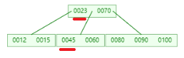

- 图16 一棵5阶B树删除数据50后的情形

再看一看图 17 这棵 5 阶 B 树：

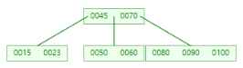

- 图17 一棵5阶B树

现在要删除图 17 中的数据 50，删除 50 后所在节点只剩余数据 60，低于 2 个数据，此时观察紧挨着的左侧兄弟节点，该节点只有 2 个数据，无法借数据，再观察紧挨着的右侧兄弟节点（80、90、100），数据个数超过 2，可以从该兄弟节点采用“父子换位法”借一个数据，具体步骤是把父节点中的数据 70 放到数据 50 所在的节点，把右侧兄弟中最小值 80 拿出来放到父节点中，最终得到的 B 树如图 18 所示：

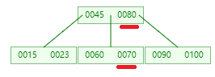

- 图18 一棵5阶B树删除数据50后的情形

### 兄弟节点数据的个数没超过 2

如果兄弟节点数据的个数没超过数量 2，就无法从兄弟中借数据。此时，被删除了数据的节点就会和兄弟节点、父节点进行合并（这其实就是插入数据的逆向操作）。如图 19 这棵 B 树：

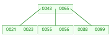

- 图19 一棵5阶B树

如果删除数据 55，则该节点只剩余数据 56，这就不满足 5 阶 B 树非根节点至少有 2 个数据的要求。于是，兄弟节点 21、23，节点 56，以及父节点中的数据 43 合并成了一个新的节点，最终得到的 B 树如图 20 所示：

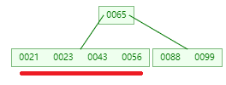

- 图20 一棵5阶B树删除数据55后的结果

再看一看图 21 这棵 5 阶 B 树：

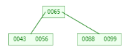

- 图21 一棵5阶B树

现在要删除图 21 中的数据 56，于是，兄弟节点 88、99，节点 43，以及父节点中的数据 65合并成了一个新的节点，最终得到的 B 树如图 22 所示：

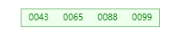

- 图22 一棵5阶B树删除数据56后3个节点合并成了一个节点

不难发现，这种合并必然会导致父亲节点的数据数量减少 1 个：

1. 如果父亲节点是根节点并且根节点的数据数量减少至 0 个，那么就需要删除原来的根节点，将合并后的新节点作为根节点。

2. 如果父节点不是根节点，那么如果该父节点的数据数量减少 1 个导致低于 2 个数据，那么就继续以该父节点为中心，采用“从兄弟节点借数据”或者“和兄弟节点、父节点进行合并”的方式来处理该节点。如此反复。

重点提醒，因为实现代码有一定复杂性，所以在阅读实现代码或者自己书写和调试实现代码时，我强烈建议利用前面介绍过的算法网站，然后删除其中的某个节点，观察删除步骤，利用这种方法，更容易读懂现有代码或书写出正确的代码。例如，可以用下面的代码构造一棵 5阶 B 树。

```
BTree<int, 5> mybtree;
for(int i = 1; i <= 35; ++i)
 mybtree.InsertElem(i);
```

同时，我们将这棵 5 阶 B 树创建在上述的算法网站中，如图 23 所示：

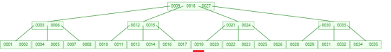

- 图23 一棵包含35个数据的5阶B树

现在，删除数据 19，看一看删除步骤：

- 删除 19 后，该节点只剩余了 1 个数据 20，这违反了 B 树规则（5 阶 B 树非根节点必须至少包含 2 个数据）。但是兄弟节点也只有两个数据所以无法从兄弟节点借数据，只能与兄弟节点、父节点进行合并。也就是说，删除数据 19 后，数据 20 所在节点、数据 22、23 所在节点以及数据 21、24 代表的父节点会进行合并，如图 24 所示：

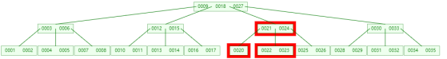

- 图24 一棵包含35个数据的5阶B树删除数据19后的情形1（中间状态）

- 合并后的情形如图 25 所示，此时数据 20、21、22、23 组成了一个新节点，尤其要注意的是数据 21 也被并入到该新节点中。

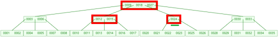

- 图25 一棵包含35个数据的5阶B树删除数据19后的情形2（中间状态）

- 现在的问题是，原来由于数据 21、24 组成的节点因为数据 21 被合并导致只剩余了数据24，该节点只剩余了 1 个数据，违反了 B 树规则。因为无法从兄弟节点借数据，于是与兄弟节点（数据 12、15 所在节点）、父节点（数据 9、18、27 所在节点）进行合并，合并后的情形如图 26 所示。

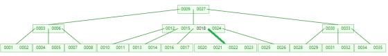

- 图26 一棵包含35个数据的5阶B树删除数据19后的情形3（最终状态）

- 图 26 中，数据 12、15、18、24 组成了一个新节点，尤其要注意的是数据 18 也被并入到该新节点中而且数据 18 右侧的指针指向的孩子节点是图 25 中数据 24 左侧指针指向的孩子节点，这种指针指向的调整在代码中都要细心实现，否则写出的代码就会产生错误。在了解了 B 树的数据删除步骤后，就可以开始书写代码了。在 BTree 类模板的定义中，增加 DeleteElem 成员函数，参考课件。

在 main 主函数中，注释掉以往代码，增加如下代码测试数据删除操作：

```
BTree<int, 6> mybtree;
for(int i = 1; i <= 30; ++i)
 mybtree.InsertElem(i);
mybtree.levelOrder();
mybtree.DeleteElem(20);
cout << endl;
mybtree.levelOrder();
```

执行结果如下：

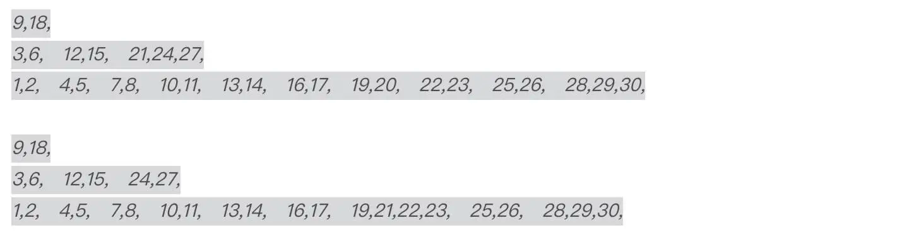

希望你多进行测试，测试的数据越多，越可能找到程序编写中的错误，从而使编写的代码尽量正确。我在编写代码中向 B 树中连续增加了近 70 个数据时才发现了代码中存在的一些不容易被觉察的错误。

## 小结

本节我带你详细学习了多路查找树中的 B 树。考虑到内存的有限性，要处理的数据不可能全部保存在内存中，绝大部分还是要保存在磁盘上，但磁盘的访问速度相对内存来讲又慢得多。

那么，如何组织数据来尽量减少对磁盘的访问次数从而提高对数据的访问效率，就变得非常重要。这也是引入 B 树这种数据结构来组织数据的初衷。

B 树是一种组织和维护外存（磁盘上的文件）系统非常有效的数据结构，常用在数据库中，引入 B 树的主要目的是减少磁盘的 I/O 操作。B 树是一种多叉树，其节点可以有许多孩子，从几个到数千个。

由此，我们引出了 B 树的性质，理解即可。我为你详细地描述了 B 树的插入和删除操作并提供了相关的实现代码。B 树的插入操作主要是要处理好节点的拆分问题，删除操作是插入操作的逆向操作，主要是要处理好节点的合并操作。注意好这几点，就已经事半功倍了。

## 思考题

1. 请尝试分析一下 B 树与红黑树之间有哪些异同，并阐述各自的适用场合。

2. 请绘制一棵高度为 3 的 5 阶 B 树，树的节点数据可以自行决定。

欢迎你在留言区和我交流，如果觉得有所收获，也也可以把课程分享给更多的朋友一起学习。我们下节课见！
