# 49 | 多路查找树：B树、B+树在数据库中的应用有何不同？

你好，我是王健伟。

B 树和 B+ 树在数据库中的应用问题是面试中常考的问题。这节课，我就带你详细分析一下这些数据结构的特点，看看怎么更好地将他们应用在数据库中。

## B+ 树在数据库中的应用举例

众所周知，数据库中的数据是保存在硬盘上的。一般来说，一块硬盘由很多张盘片构成，每张盘片会被划分成从大到小的多个被称为“磁道”的同心圆，而每个磁道，又被等分为若干个段（扇形区域），这些段便被称为“扇区”。如图 1 所示。

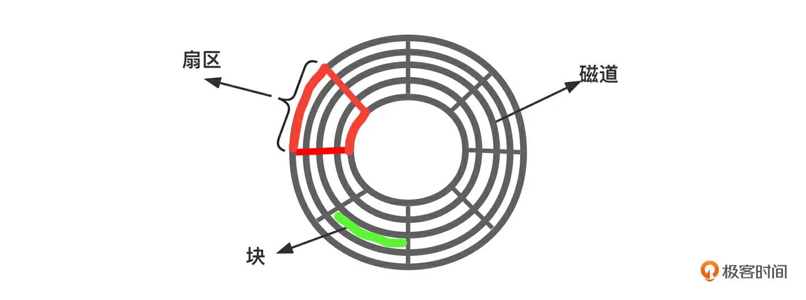

- 图1 硬盘磁道、扇区、块的概念

对于常见的硬盘，磁道和扇区相交的部分称为块。这些块可以使用磁道号和扇区号进行寻址（找到该块所在的位置）。通常，一个块的存储容量是 512 字节，不过这个大小不是一定的，主要取决于硬盘制造商。512 字节也是存取磁盘信息时的最小单位。

磁盘上的数据没有办法直接被计算机处理，必须要将其读入到内存中才能由计算机处理。在内存中，数据会被正在执行的计算机程序所使用，并按照一定的数据结构进行组织。当这些数据处理完后，再将它们从内存中写回磁盘以便永久保存。

现在来看一个数据库表是如何以块的形式保存在磁盘上的。假设数据库中有一张学生信息表，该表有 4 列（字段），分别为编号、姓名、学号、地址。表中有 1000 条学生数据，如下图 2所示。

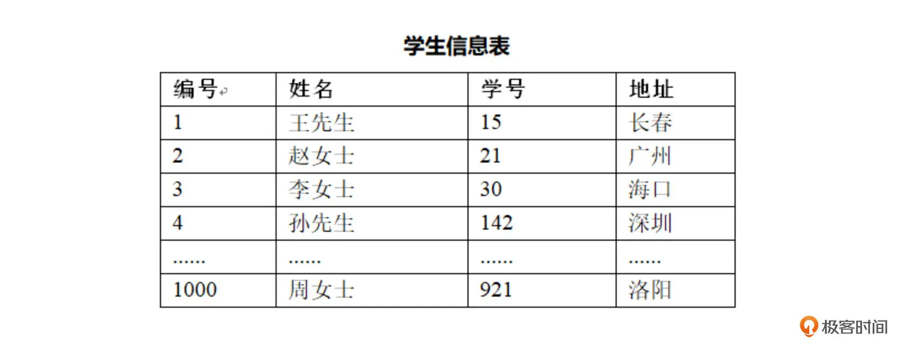

- 图2 学生信息表

创建该学生信息表时需要指定各个列的大小，于是“编号”列指定为 4 字节，姓名列指定为 20字节，学号列指定为 4 字节，地址列指定为 100 字节。这意味着一条学生数据占用的字节数是 4+20+4+100=128 字节。而 1000 条（行）学生数据将占用 128*1000=128000 字节。因为硬盘每块的存储容量是 512 字节，每个块能存储 4 条学生数据，所以存储这 1000 条学生数据将占用 250 个块。

现在要读取学生信息表中的某条学生数据，则必须要进行全表扫描（因为数据可能出现在不知道哪里的任何地方）。因为块是读取磁盘信息时最小的单位，假设最后一次读取才读到这条学生数据，这意味着最坏情况下要读取 250 次才能读到所需要的这条学生数据。

是否有办法减少读取数据的次数从而减少磁盘读取的时间呢？有，那就是为学生信息表根据“编号”列创建索引（一级索引 / 密集索引）。当然，根据其他列也可以，但这里根据编号列来演示。索引其实也是一个表，这里称为“索引表”，也保存在磁盘上。索引表有 2 列，分别为编号、地址。其中编号列与学生信息表中编号列一一对应，而地址（指针）列分别指向相同编号的学生信息表中的每行。如图 3 所示。

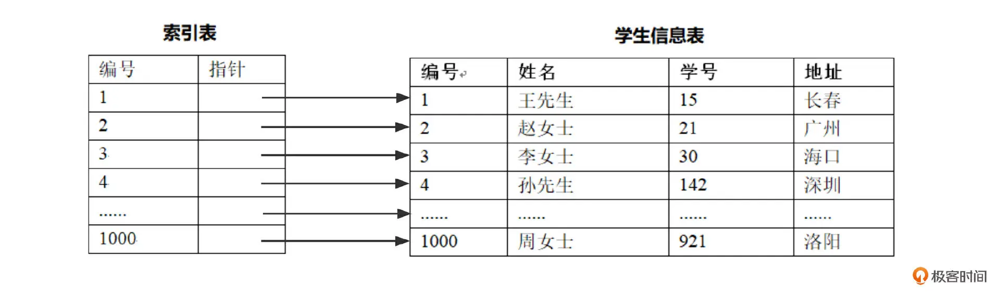

- 图3以“编号”列相同作为关联条件，将索引表中的“指针”指向学生信息表中编号相同的行

现在计算一下索引表所占用的空间。“编号”列指定为 4 字节，指针列指定为 8 字节，一条索引数据占用的字节数是 4+8=12 字节。1000 条（行）索引数据将占用 12*1000=12000 字节。所以存储这 1000 条索引数据大概要占用 24 个块（12000/512）。这意味着如果通过索引表来寻找某个学生的信息，最坏的情况也只需要读取 24 次磁盘，就能读到所需要的这条学生数据。

这里注意，其实还应该包括根据索引表中指针记录的地址去读取某个学生信息记录，这也应该算 1 次读取磁盘，所以其实是需要读取大约 25 次磁盘。不过，与原来需要读取 250 次相比，读取次数已经减少了很多，这就是索引表存在的意义。

如果学生信息表中的学生数据不是 1000 条，而是变得特别巨大，比如 10 万条呢？那么即使使用索引表，也要读取 2400 多次磁盘，是否有办法进一步减少读取数据的次数从而进一步减少磁盘读取的时间呢？这就需要在当前索引表的基础之上再创建一个索引表（二级索引 / 稀疏索引），姑且称为索引表 2。“索引表 2”与“索引表”结构相同，也包含“编号”和“指针”两列。

把“索引表”中的多行数据，比如 10 行数据分为一组，那么 1000 行数据就分为 100 组，把这100 组的索引信息记录到索引表 2 中去，这样索引表 2 中就会只有 100 行数据。如图 4 所示。

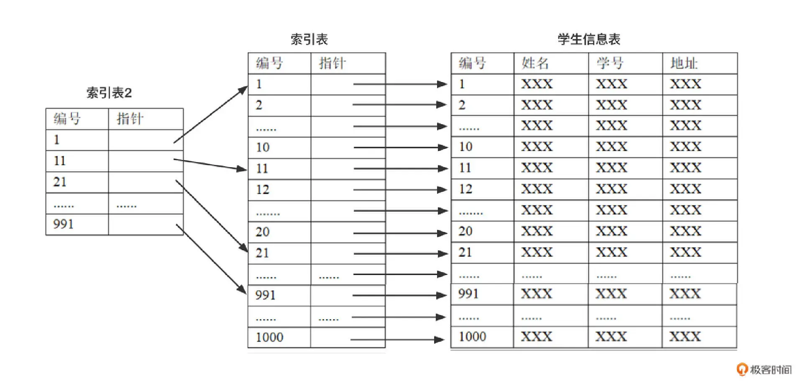

- 图4以“编号”列相同作为关联条件，对学生信息表建立二级索引

这里补充说明一下，具体将多少行数据分为一组，一种简单的决策方式是，一个磁盘块是 512字节，索引表中的 1 行记录是 12 字节，所以 512/12=42，也就是把 42 行数据分为一组，那么一次磁盘读取操作就可以读入这 42 行。

好，说回到图 4，“索引表 2”中第 1 条记录（编号为 1）的指针指向“索引表”中编号为 1 的记录（行），这样，通过“索引表 2”中编号为 1 的记录可以很快可以找到“索引表”中编号为 1 到 10记录从而最终从“学生信息表”中快速找到编号为 1 到 10 的记录。同理，“索引表 2”中第 2 条记录（编号为 11）的指针指向“索引表”中编号为 11 的记录，这样，通过“索引表 2”中编号为 11的记录可以很快找到“索引表”中编号为 11 到 20 的记录从而最终从“学生信息表”中快速找到编号为 11 到 20 的记录，以此类推。

“索引表 2”也保存在磁盘上，因为其中只有 100 行数据，所以占用 12*100=1200 字节。所以存储这 100 条索引数据大概要占用 3 个块（1200/512）。这意味着如果通过索引表 2 来寻找某个学生的信息，最坏的情况也只需要读取 3 次磁盘（读取“索引表 2”）+1 次读取磁盘（读取“索引表”）+1 次读取磁盘（读取某个学生信息记录），即 5 次读取磁盘。与原来需要读取 25次相比，读取次数又减少了数倍，这就是索引表 2（二级索引）存在的意义。

总体来看，保存学生信息表需要 250 个块，保存索引表需要 24 个块，保存索引表 2 需要 3 个块。多出来的 2 个索引表额外占用了 27 个块，但却使从磁盘上获得一条学生信息数据从可能最坏的读取 250 次磁盘变为平均读取 5 次磁盘。所以，创建更高级索引的意义在于用空间换取时间——多占用磁盘空间，换取更快速的寻找数据。如果学生信息表中的数据非常多，还可以进一步创建更多级索引来进一步减少对磁盘块的访问数量。

目前看来，图 4 中的“索引表”显得有点多余了，去掉看看效果，如图 5 所示。

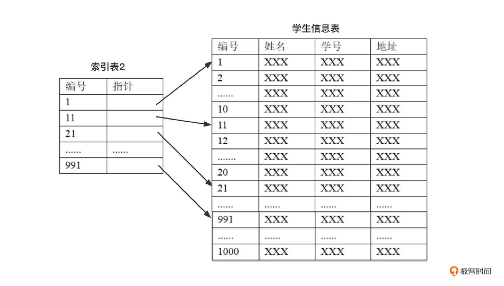

- 图5以“编号”列相同作为关联条件，对学生信息表建立索引

如果将图 5 向右旋转 90 度，再想象一下可能包含更多级索引，其实就是个 B+ 树，只不过图5 中索引表的编号为方便理解并没有严格按照 B+ 树的编号规范。

下图 6 是一个严格按照 B+ 树规范组织起来的有 22 个学生信息的 6 阶（学生信息表中的 5 行数据分为一组）B+ 树，扣除叶节点后的树的高度代表着学生信息表所对应的索引表的级数（索引表的个数），真正的学生记录是保存在每个叶子节点中的，或者说，叶子节点中的每个数据中都存有一条学生记录。

这里注意，B+ 树的叶子节点并不是必须要保存数据记录，也有的是保存一个指针，这个指针才指向真正的数据记录，本文所阐述的情形是 B+ 树的叶子节点保存数据记录的情形。

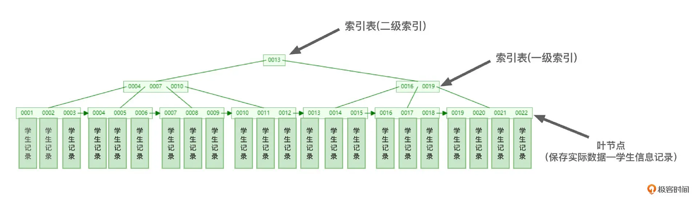

- 图6 按照B+树规范组织起来的有22个学生信息的6阶B+树

当然，如果学生信息表中数据量特别巨大，那么 B+ 树可能远远不止 6 阶，甚至可能高达上千阶，所以图 6 只是一个示意图。

## B+ 树在 MySQL 数据库中的应用

MySQL 数据库创建表索引时采用的主要是 B+ 树这种数据结构（当然还用到了其他数据结构做索引，但不在这里的探讨之中）。B+ 树的高度与创建的索引级数密切相关。B+ 树的高度也意味着磁盘读取次数，所以“矮胖”是 B+ 树的主要特征。至于应该创建几级索引，MySQL 数据库会根据表中实际数据的多少自动进行管理，不需要人工干预。但一般索引不会超过 2 级，也就是 B+ 树的高度一般不超过 3（以尽量减少读取磁盘次数），即找到任何一条记录的磁盘读取次数都不会超过 3 次。

前面曾经说过，索引也是表，也保存在磁盘上，那么 MySQL 中是如何在磁盘上保存索引的呢？页是 MySQL 中的 InnoDB 存储引擎（无需了解该存储引擎）进行磁盘管理的最小单位，默认每个页的大小是 16KB。所以有两点要注意。

1. 索引表中的一行一行的记录当然是保存在页中。

2. 用户表（也就是前面的学生信息表）中的数据当然也是保存在页中。

其实，一个页就是 B+ 树的一个节点，换句话说，B+ 树的一个节点的大小最大基本上就是16K。当然，你也可以在 MySQL 中对这个数据进行修改。

在 B+ 树中，非叶子节点只存储索引（主键值 + 指针），真正的数据记录保存在叶子节点当中。那么我们一步一步计算一下，你可以观察图 6 并发挥想象力。

- 因为非叶子节点保存的是主键值 + 指针，假设主键值类型是 __int64（占 8 字节），指针占6 字节，一共 14 字节，那么一个页 16K（16384 字节）如果存满则大概可以保存下 1170个“主键值 + 指针”对（16384/14=1170）。如图 7 所示。

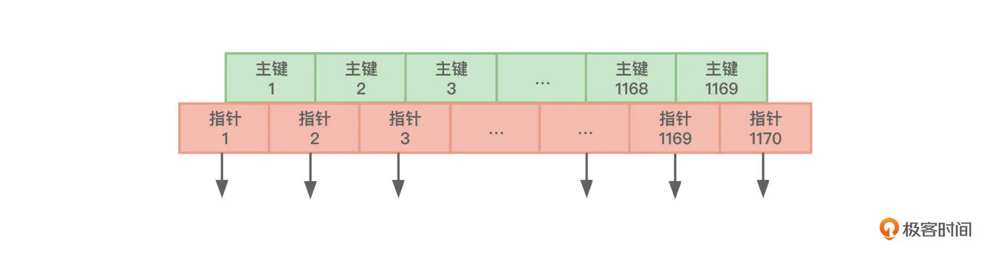

- 图7 一个B+树非叶节点存满一页数据后可以存下大概1170个“主键值+指针”对

- 图 7 表明一个非叶子节点能够存放下 1170 个指针。因为 MySQL 中 B+ 树的高度一般不超过 3，这意味着上面 2 层是非叶子节点，最下面这层第 3 层是叶子节点。也就是说， B+ 树的根节点（第 1 层）最多可以有 1170 个指针指向第 2 层，而第 2 层的每个节点又有 1170个指针，这意味着 B+ 树的第 2 层会散发出 1170*1170 根指针，每个指针指向一个叶节点，如图 8 所示。

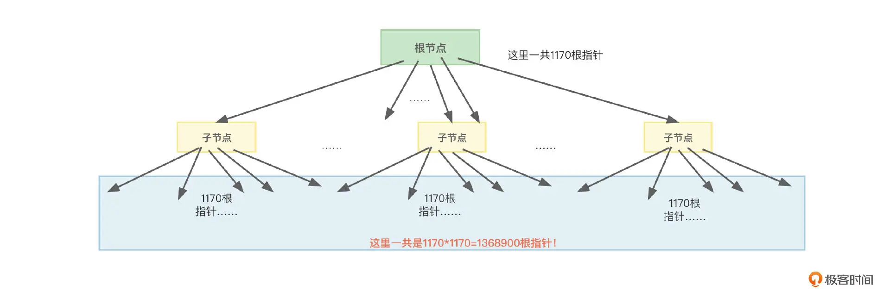

- 图8 一个B+树前2层非叶节点存满数据（每个节点存满1页即16K）后可以存下大概1170*1170也就是1368900根指针

- B+ 树的叶子节点用于保存实际的用户数据比如保存学生信息表的每一个学生的详细信息。一个页是 16K，一条学生记录按 1K 来计算，这意味着一个页存满能保存下 16 条（16 行）学生记录。叶子节点看起来如图 9 所示。

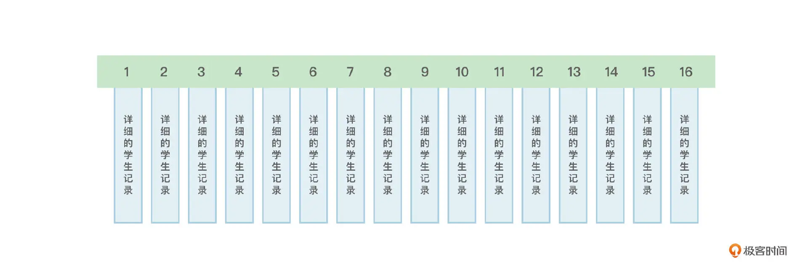

- 图9 一个B+树叶节点存满数据（一页）后可以存下大概16条学生记录

所以，在 B+ 树中的每个节点都存满数据（存满 1 页也就是 16k）的情况下，一个高度为 3 的B+ 树通常可以管理 1170117016=21902400 条（行）数据记录。

MySQL 对数据读取时的基本单位依旧是页（一个页就是 B+ 树的一个节点）。当用户使用查询语句查询用户表中的数据时，MySQL 会把该表相关的索引（即 B+ 树的根节点甚至是所有非叶子节点）数据一次性载入内存，当根据编号查询某个学生信息时，MySQL 就会从根节点的数据所记录的位置作为入口，用很少的次数迅速找到所需要的记录。

另外，B+ 树的所有叶子节点相连，从而构成了一个数据从小到大排列的链表。这个链表的作用是便于进行范围查找（提高了区间访问性能），比如要查找编号 2 到 9 之间的所有学生的信息。因为数据 1、2、3 所在的节点指向数据 4、5、6 所在的节点，而数据 4、5、6 所在的节点指向数据 7、8、9 所在的节点，所以对数据进行范围查找时会特别方便。

## B+ 树与 B 树读取区别以及各自优缺点总结

那 B+ 树和 B 树的读取有什么区别吗？我们来总结一下。

### B+ 树与 B 树的区别

- 在 B+ 树中查找不管成功还是失败，每次查找都要沿着从根节点到叶节点的路径进行。这意味着查找任何数据速度都差不多。

- B 树叶子节点包含的数据（关键字）和非叶子节点包含的数据是不重复的。

- 前面范例虽然 B 树中保存的都是数字，但实际应用中，保存的都是一个结构对象。一般都是利用结构对象中某个字段作为数字（键）来构建 B 树。所以如果要把一棵 B 树的节点绘制得完整一点，整棵 B 树看起来应该如下图 10 所示。

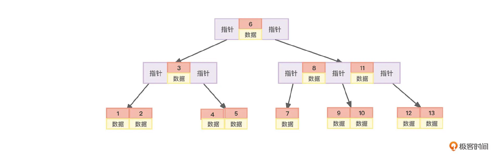

- 图10 一棵4阶B树

可以看到，B 树中的每个节点保存的都是一个结构对象（数字 + 数据，也称为键 / 值对，即数字看成“键”，数据看成“值”）。而 B+ 树和 B 树不同，B+ 树的所有非叶子节点都只保存一个数字（索引值），只有叶子节点保存的是结构对象（数字 + 具体数据记录），把一棵 B+ 树的节点绘制得完整一点，看起来应该如下图 11 所示。

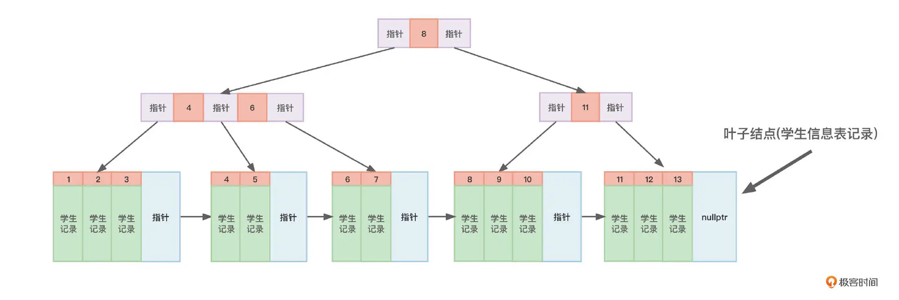

- 图11 一棵4阶B+树

可以看到，B+ 树的非叶子节点保存的只有数字和指针（指针中记录的是磁盘位置），只有叶子节点中才保存数据库表中的每条记录（这里指的是学生信息表中的学生记录）。所以在实现 B+树编码的时候，可以创建一个父类代表 B+ 树的每个节点，然后创建一个子类代表非叶子节点，再创建另一个子类代表叶子节点。

### B 树的优点

B 树的每一个节点保存的都是一个结构对象（键 / 值对），不用区分是叶子节点还是非叶子节点。如果要查找的值正好是一个非叶子节点时，一旦查询到该节点就表示查找成功并结束查询，这意味着查找离根近的数据速度会更快（相对于 B+ 树的查找任何数据速度都差不多）。所以，可以对数据的访问做统计，越频繁访问的数据可以考虑离根越近。当然这需要对节点中的数据做更改。

### B+ 树的优点

- 非叶子节点不保存数据，当节点多的时候可以节省大量存储空间。可以这样考虑，数据库的索引是保存在磁盘上的，当数据量非常大的时候，不可能将整个索引全部加载到内存，所以磁盘访问次数对于加载速度影响极大，节省存储空间意味着磁盘访问次数变少，也就意味着加载速度的提高。

- 叶子节点使用链表相连，方便对数据进行区间查找。

## 为什么 MySQL 数据库不采用 B 树创建表索引

可能有些同学疑惑为什么 MySQL 不使用 B 树而是使用 B+ 树创建表索引。这个问题应该从执行效率和存储空间两方面考虑。如果使用 4 阶 B 树来组织 13 个学生信息，可能就如下图 12所示：

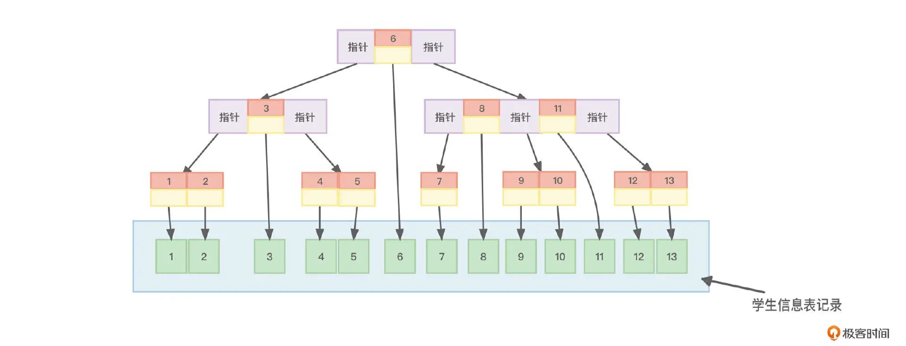

- 图12 按照B树规范组织起来的有13个学生信息的4阶B树

观察图 12，为了尽可能多的管理记录数量，将数据记录保存到每个非叶子节点并不明智。因为记录占用空间很大，前面计算过，3 层高度的 B+ 树可以管理 21902400 条数据记录，所以要管理和 B+ 树相同的记录数目，B 树可能需要的高度远远不止 3 层。因此每个节点（叶子和非叶子节点）都附加了一根指针指向最终的学生信息表中的记录。

这里有 2 个值得说的问题。

- 进行范围或者区间查找时 B 树很不方便，因为 B 树并没有 B+ 树那样做到所有叶子节点相连，所以范围查找性能肯定比 B+ 树会弱很多，而范围查找在数据库中非常频繁。

- B+ 树的非叶子节点只保存索引值（索引表中的编号），只有叶子节点才保存具体的数据记录，而 B 树无论叶子还是非叶子节点，都有一根额外的指针指向最终的数据记录，显然这意味着用 B 树创建索引会需要占用更多的磁盘空间，增加磁盘读取次数从而降低数据读取速度。

所以，数据库开发者进行仔细的考虑和权衡，在 MySQL 数据库中不使用 B 树而是使用 B+ 树做索引。

## 小结

本节我为你详细解说了 B+ 树在数据库中的应用以及 B+ 树在 MySQL 数据库中的应用。不难看到，只需要组织不超过 3 层的 B+ 树结构就可以管理高达 21902400 条数据记录。

这节课的另一个重点在于 B+ 树与 B 树读取区别，各自优缺点总结以及为什么 MySQL 数据库采用 B+ 树而不是 B 树创建表索引。这些问题经常在面试中被提及，希望你能够在理解的基础上适当记忆，从而更好地应对面试官的提问。

## 思考题

在这节课的最后，我也给你留了几道复习思考题。

1. B 树和 B+ 树的优缺点分别是什么？

2. 你是否想过，是否可以对 B+ 树的性能进行进一步优化，可以从哪些方面入手？

3. B 树与哈希表相比，有哪些优缺点。

欢迎你在留言区和我互动。如果觉得有所收获，也可以把课程分享给更多的朋友一起学习，我们下节课见！
