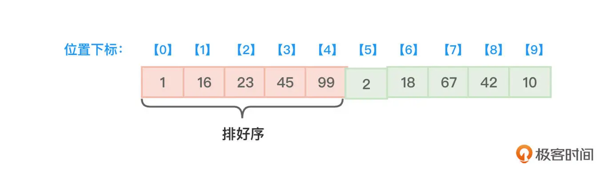
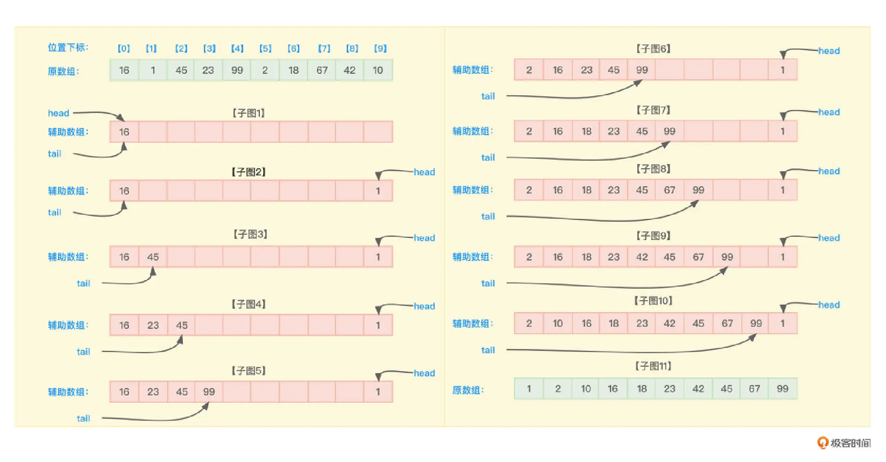
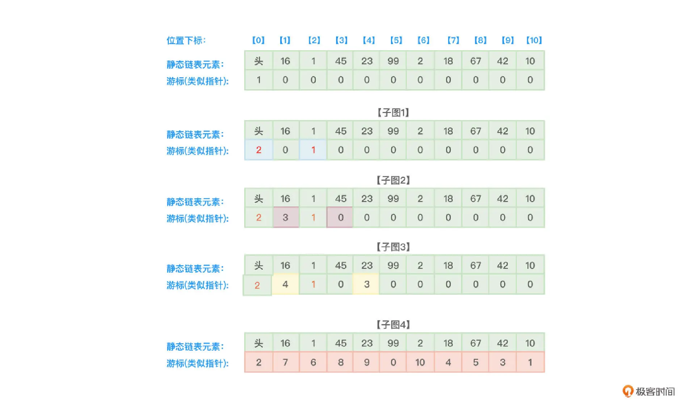

# 50 | 折半插入、2路插入、表插入：3种插入类排序类排序有哪些异同？

你好，我是王健伟。

在插入类排序中，除了我们以往学习过的直接插入排序和希尔排序之外，比较重点的还有折半插入排序、2 路插入排序和表插入排序。考虑到在面试中，这几种插入类排序的出现频率与直接插入排序、希尔排序相比要低一些，也为了防止你一直学习各种排序算法感觉太枯燥，所以我将它们放到了后面这里来讲解。

这节课，我们就专注理解这三种排序算法。

## 折半（二分）插入排序（Binary Insertion Sort）

前面我们学习的直接插入排序，是将一个待插入数据与一个已经排好序的序列中的数据进行逐个比较来确定插入数据的位置。

其实，我们完全可以用折半查找（Binary Search，也叫二分查找）的方式找到应该插入的位置，而后再移动元素。如图 1 所示。



- 图1 折半插入排序示意图

在图 1 中，元素 1、16、23、45、99 已经排好序了。现在，即将对元素 2 进行排序。如果按以往的直接插入排序算法进行排序，2 要依次和 99、45、23、16、1 比较，直至发现值比 1大，才算找到了自己的插入位置应该为下标为[1]的位置。而且每次比较时还要进行元素的移动操作，比如元素 99 要移动到[5]位置，45 要移动到[4]位置，23 要移动到[3]位置 16 要移动到[2]位置。

而对于折半插入排序，指的是在已经排好序的序列（有序区）中，使用折半查找的方式去确定待排序元素的插入位置。看一看如果即将对元素 2 进行排序，是怎样操作的呢？

- 因为元素 2 的位置是[5]，这表示位置为[0]到位置为[4]这 5 个元素是排好序的了。所以找到这 5 个已经排好序的元素的中间位置，即 (4-0)/2 = 2。

- 因为第 2 个下标位置的元素是 23，显然根据从小到大的排序规则，元素 2 是要插入到元素23 左边的。所以接下来，在下标位置[0]到[1]之间寻找元素 2 要插入的位置即可。

- 继续取位置[0]到位置[1]的中间位置，即 (1-0)/2 = 0。

- 因为第 0 个下标位置的元素是 1，显然元素 2 是要插入到元素 1 右边的。其实也就是在位置[0]到位置[1]之间。

- 就这样不断利用折半查找法寻找要插入的位置，直到左侧位置的下标值比右侧位置的下标值大的时候停止查找，此时插入位置就确定了，然后进行元素的右移和复制操作即可。

折半插入排序的实现代码同样有很多种，但在这里我依旧采用逻辑上更为简单、好理解的代码实现方式。

```
//折半插入排序（从小到大）
template<typename T>
void HalfInsertSort(T myarray[], int length)
{
 if (length <= 1) //不超过1个元素的数组，没必要排序
   return;
 for (int i = 1; i < length; ++i) //从第2个元素（下标为1）开始比较
 {
   if (myarray[i] < myarray[i - 1])
   {
     T temp = myarray[i];   //暂存a[i]值，防止后续移动元素时值被覆盖
     //记录查找的左右区间范围
     int left = 0;
     int right = i - 1;
     while (left <= right) //注意while结束条件
     {
       //取得中间元素
       int mid = (right - left) / 2 + left;
       if (myarray[mid] > temp)
       {
         //待排的元素值更小，将搜索的区间缩小到左边的一半区域
         right = mid - 1;
       }
       else
       {
         //待排的元素值更大，将搜索区间你缩小到右边的一半区域
         left = mid + 1;
       }
     } //end while
     int j;
     for (j = i - 1; j >= right + 1; --j)
     {
       myarray[j + 1] = myarray[j];
     } //end for j
     myarray[right + 1] = temp;
   } //end if
 } //end for i
 return;
}
```

在 main 主函数中，加入测试代码。

```
int arr[] = {16,1,45,23,99,2,18,67,42,10};
int length = sizeof(arr) / sizeof(arr[0]);   //数组中元素个数
HalfInsertSort(arr, length);//对数组元素进行折半插入排序
//输出排好序的数组中元素内容
cout <<"折半插入排序结果为：";
for (int i = 0; i < length; ++i)
{
 cout << arr[i] <<"";
}
cout << endl; //换行
```

下面是具体的执行结果。


从上述代码可以看到，折半插入排序算法只减少了关键字的比较次数，并没有减少记录的移动

## n2

次数。所以时间复杂度仍旧为 O(

- )，此排序算法也是稳定的。

## 2 路插入排序（Two-Way Insertion Sort）

上述折半插入排序中，只减少了关键字的比较次数，并没有减少记录的移动次数。而 2 路插入排序是对折半插入排序的改进，目的是减少排序过程中记录的移动次数，但需要 n 个记录的辅助数组空间（与原数组空间大小一致），而且这个辅助数组空间其实是被当成了一个环状空间来使用的。

看下图 2，2 路插入排序示意图。



- 图2 2路插入排序示意图

在图 2 中，首先开辟出了一个与原数组空间大小相同的辅助数组空间，用于存放排序后的结果，2 路插入排序要经历这么几个步骤。

- 子图 1：将原始数组空间的第一个元素 16 放入辅助数组空间的第 1 个位置。设置两个指针，一个代表头指针，命名为 head，另一个代表尾指针，命名为 tail，开始都指向辅助数组空间的第 1 个位置元素 16。

- 子图 2：拿出原始数组空间的第 2 个元素 1，与辅助数组空间的元素 16 作比较，因为1<16，所以应该放到 16 的左边，但因为辅助数组空间中元素 16 左边已经没位置了，此时就把辅助数组空间看成一个环形空间，这意味着元素 16 左边的位置其实就是辅助数组空间的最后一个位置，于是把元素 1 放到最后一个位置（下标为 9），同时让 head 指针指向该位置。

- 子图 3：继续拿出原始空间的第 3 个元素 45，先与 head（元素 1）所指元素作比较看是否更小，结果发现并没有更小，于是又与 tail（元素 16）作比较看是否更大，是更大，于是把元素 45 放到 tail 所指位置后面的位置，同时让 tail 指针指向元素 45 所在位置。

- 子图 4：继续拿出原始空间的第 4 个元素 23，先与 head（元素 1）所指元素比看是否更小，并没有更小，于是又与 tail 相比看（元素 45）是否更大，并没有更大。此时原始空间中的数据既不小于辅助数组空间中的头元素，也不大于辅助空间中的尾元素，那就真的需要

- 在辅助数组空间中移动数据了。找到 23 应该插入的位置并插入 23，45 向后移动，同时注意更改 tail 的指针让其保持指向元素 45。

- 子图 5 到子图 10 的情况与前面这几个子图所介绍的情况类似，这里就不赘述。

- 子图 11：排序完毕后，还要把辅助数组空间中的数据（从 head 指针开始到 tail 指针之间的数据）依次拷贝回原始空间中从下标 0 开始的位置。

从上述步骤可以看到，只要向辅助数组中插入的元素值比 head 所指向的元素数值小或者比tail 指向的元素数值大，那么插入的元素就不会导致辅助数组中其他元素的移动。

```sql
//2路插入排序（从小到大）
template<typename T>
void TwoWayInsertSort(T myarray[], int length)
{
 if (length <= 1) //不超过1个元素的数组，没必要排序
   return;
 T* pfzarray = new T[length]; //创建辅助数组空间
 pfzarray[0] = myarray[0];  //将原始数组空间的第一个元素放入辅助数组空间第1个位置
 int head = 0; //头指针指向第一个位置（下标为0的元素）
 int tail = 0; //尾指针指向第一个位置（下标为0的元素）
 for (int i = 1; i < length; ++i)
 {
   if (myarray[i] < pfzarray[head]) //小于头
   {
     //往头前面插入
     head = (head - 1 + length) % length; //要保证head值在0到(length-1)之间
     pfzarray[head] = myarray[i];
   }
   else if (myarray[i] > pfzarray[tail]) //大于尾
   {
     tail++;
     pfzarray[tail] = myarray[i];
   }
   else //数据既不小于头，也不大于尾，要往中间插入
   {
     //这里要移动数据了
     tail++;
     pfzarray[tail] = pfzarray[tail - 1];
     int j;
     for (j = tail - 1; myarray[i] < pfzarray[(j - 1 + length) % length]; j = (j
     {
       pfzarray[j] = pfzarray[(j - 1 + length) % length];
     }//end for j
     pfzarray[j] = myarray[i];
   } //end if
 } //end for i
 for (int i = 0; i < length; ++i)
 {
   myarray[i] = pfzarray[head];
   head = (head + 1) % length;
 } //end for i
 delete[] pfzarray;
 return;
}
```

在 main 主函数中，把对 HalfInsertSort 函数的调用修改为对 TwoWayInsertSort 函数的调用。

```
......
//HalfInsertSort(arr, length); //对数组元素进行折半插入排序
TwoWayInsertSort(arr, length);//对数组元素进行2路插入排序
//输出排好序的数组中元素内容
cout <<"2路插入排序结果为：";
......
```

下面是执行结果。


从上述代码可以看到，2 路插入排序虽然可以减少移动记录的次数，但无法绝对避免移动记录。而且，如果原数组中第一个元素本来就是最小值或最大值（意味着不可能在其前面或后面插入其他元素），此时 2 路插入排序算法的优势就无法体现了。

当然，上述 2 路插入排序算法中可以融合折半插入排序算法中的代码，从而达到减少关键字比较次数的目的，但实现代码可能会比较繁琐和不易理解，有兴趣可以自行实现。

## n2

不难看到，2 路插入排序算法时间复杂度仍旧为 O(

- )，空间复杂度为 O(n)，体现了空间换时

间以提高算法执行效率的编程思想。这个排序算法也是稳定的。

## 表插入排序（Table Insertion Sort）

前面叙述的各种插入类排序算法，在排序过程中不可避免地要移动记录。但是，如果希望在排序的过程中不移动记录，就要通过表插入排序来达成。

表插入排序可以使用静态链表（前面讲解过）作为待排序记录的存储结构。我们先回顾一下静态链表的每个节点定义，这里就要用到下面这些代码。

```
//静态链表中每个节点的定义
template <typename T>//T代表数据元素的类型
struct SLNode
{
 T        data;  //元素数据域，存放数据元素
 int      cur;   //游标，记录下个静态链表节点的数组下标
};
```

看下图 3，表插入排序示意图。



- 图3 表插入排序示意图

在图 3 中，表插入排序要经历如下步骤。

- 将下标为[0]的位置留出来用于代表静态链表头节点。将所有游标先设置为 0，并假设第一个数据 16 是排序好的。头节点永远会指向值最小的数据。所以把头节点的游标修改为 1，这表示头节点指向下标为 1 的位置即 16。而数据 16 的游标是 0（缺省值），这也代表数据 16指向的下个元素是头节点，头节点和数据 16 互相指向构成一个循环链表的感觉。

- 子图 1：从 16 的下个数据即元素 1 开始进入到真正的排序。元素 1 目前是最小的元素，所以只能将头节点所代表的元素作为元素 1 的前趋元素。所以头节点的游标 1 先作为元素 1的游标值，然后再将元素 1 对应的下标位置（2）作为头节点的新游标值。

- 子图 2：继续观察下个元素 45，因为元素 16 是 45 的前趋元素。所以元素 16 的游标值 0先作为元素 45 的游标值，然后再将元素 45 对应的下标位置（3）作为元素 16 的新游标值。

- 子图 3：继续观察下个元素 23，因为元素 16 是 23 的前趋元素。所以元素 16 的游标值 3先作为元素 23 的游标值，然后再将元素 23 对应的下标位置（4）作为元素 16 的新游标值。

- 子图 4：重复上面这两个步骤，最后会得到一个排好序的静态链表结构。从上述步骤可以看到，表插入排序并不需要真正移动元素的位置。

```sql
//表插入排序（从小到大）
template<typename T>
void TableInsertSort(T myarray[], int length)
{
 if (length <= 1) //不超过1个元素的数组，没必要排序
   return;
 SLNode<T> *tbl = new SLNode<T>[length + 1];
 for (int i = 1; i < (length + 1); ++i) //注意i的开始值
 {
   tbl[i].data = myarray[i-1];
   tbl[i].cur = 0;
 } //end for i
 tbl[0].cur = 1; //头节点指向下标为1的位置
 for (int i = 2; i < (length + 1); ++i)
 {
   int tmpcur = tbl[0].cur; //1
   int tmpcur_prev = 0; //前趋
   while (tmpcur != 0 && tbl[tmpcur].data < tbl[i].data)
   {
     tmpcur_prev = tmpcur;
     tmpcur = tbl[tmpcur].cur;
   } //end while
   tbl[i].cur = tbl[tmpcur_prev].cur;
   tbl[tmpcur_prev].cur = i;
 } //end for i
 int tmpcur = tbl[0].cur;
 int curridx = 0; //数组下标
 while (tmpcur != 0)
 {
   myarray[curridx] = tbl[tmpcur].data;
   ++curridx;
   tmpcur = tbl[tmpcur].cur;
 } //end while
 delete[] tbl;
 return;
}
```

在 main 主函数中，把对 TwoWayInsertSort 函数的调用修改为对 TableInsertSort 函数的调用。

```
......
//HalfInsertSort(arr, length); //对数组元素进行折半插入排序
//TwoWayInsertSort(arr, length);//对数组元素进行2路插入排序
TableInsertSort(arr, length);//对数组元素进行表插入排序
//输出排好序的数组中元素内容
cout <<"表插入排序结果为：";
......
```

下面是执行结果。


从上述代码可以看到，表插入排序算法主要是通过修改指针值代替移动记录，但关键字的比较

## n2

次数并没有减少，所以时间复杂度仍旧为 O(

- )，空间复杂度为 O(n)，此排序算法也是稳定

的。

## 小结

本节课我带你学习了三种新的插入类排序，折半插入排序、2 路插入排序以及表插入排序。

折半插入排序指的是在已经排好序的序列中使用折半查找的方式确定待排序元素的插入位置，而后再移动元素。文中我向你详细描述了确定一个元素的插入位置过程，并提供了完整的实现代码和测试代码。

因为折半插入排序只减少了关键字的比较次数而没有减少记录的移动次数。所以对该排序算法进行改进从而引出 2 路插入排序，2 路插入排序的目的是减少排序过程中记录的移动次数，这种排序需要 n 个记录的辅助数组空间。同样，我也向你详细描述了这种排序算法的实现方式，提供了完整的实现代码和测试代码。

绝大多数插入类排序都需要在排序过程中移动记录，这无疑影响了排序算法的执行效率。通过引入表插入排序，可以通过修改指针值代替移动记录，这也就等于在排序的过程中不移动记录。当然，这种排序记录也需要额外的辅助空间。这种排序算法的实现方式我也详细描述过一遍，提供了完整的实现代码和测试代码。

本节介绍的三种插入类排序方式都属于插入类排序的一种变体。它们的共同点是将待排序元素逐个插入到已经排好序的序列中，差别在于寻找插入位置的方法不同并且使用不同的数据结构来存储已经排好序的序列。总结一下就是下面的内容。

- 折半插入排序减少了待排序元素的比较次数。

- 2 路插入排序减少了待排序元素的移动次数。

- 表插入排序在每次插入时只需要修改指针，而不进行实际元素的移动，因此效率更高。

## 思考题

1. 折半插入排序的思想是什么？该算法的时间复杂度是多少？算法稳定吗？

2. 2 路插入排序算法的思想是什么，该算法是否稳定？

3. 表插入排序算法的时间复杂度和空间复杂度分别是多少？

欢迎你在留言区和我互动，如果觉得有所收获，也可以把课程分享给更多的朋友一起学习，我们下节课见！
