# 02 | AI产品的基础设施：算法、数据与大语言模型

你好，我是产品二姐。

上节课我们剖析了 AI 产品的四层结构，其中数据、算力、算法层和模型层是 AI 产品基础设施，这节课我们就专注讲解一下这两层。我会结合实例、比喻的方式将这两层讲透，为以后的实战打下理论基础。

第一层，地基层的数据、算法、算力。我们知道，这三者是撑起 AI 的三大基石，作为产品经理，我们更关注这三个要素对产品的效果、能力会有什么影响。其中算力主要影响产品的落地成本，我们放在 16、17 两节课单独来讲。这节课主要讲数据、算法对软件产品的设计范式的到底有什么影响。

第二层，模型层。我会和大家聊聊如何为自己的产品选择合适的模型。

## 数据、算法带来的产品设计范式转变

首先我引用 OpenAI 联合创始人 Karpathy 的话来开始这一小节的学习。

2017 年，Karpathy 在博客中说：

- 人们往往认为神经网络只是机器学习中的一个工具，不幸的是这种理解是只见树木不见森林。神经网络代表了软件开发方式的一次根本性转变，这便是软件 2.0。……在软件 1.0，源代码是由程序员编写……在软件 2.0 中，源代码就是数据集和神经网络。

时隔 7 年，Karparthy 再一次在 twitter 上写道：

- 100% 的软件 2.0 计算机，只有一个神经网络，完全没有任何传统软件。

在这里，神经网络，就是撑起这一轮 AI 浪潮的算法；而数据取代了编程语言，成为定义软件的新要素。我用下面这张图来解释 Karparthy 所说的神经网络与数据。

### 算法与神经网络

我们把神经网络想象成一个水流网络，水网上分布的蓄水池代表着神经元，蓄水池之间的管道代表着神经元之间的信息传输通道。管道越宽，代表两个神经元之间的影响越大。把这些管道的宽度用数字表示，就是我们经常提到的模型参数值。

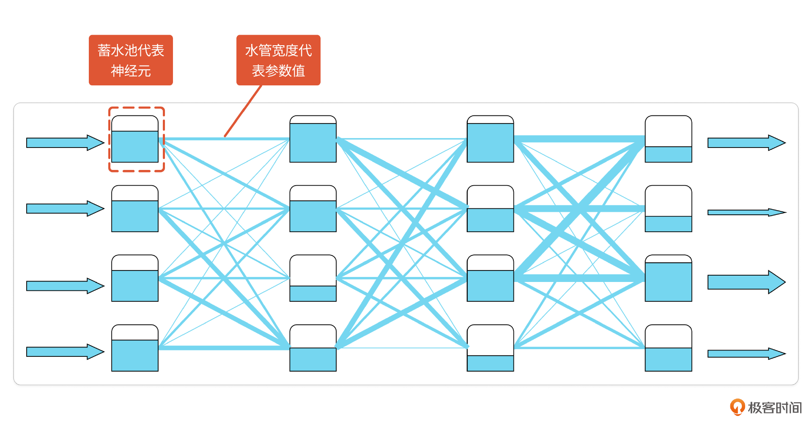

如果单独放大一个神经元，就像是下图中的杯子。在杯子的一定高度，有一个孔。如果上游注入的水（信号）累积到这个孔的位置，那么这个神经元就被激活了。

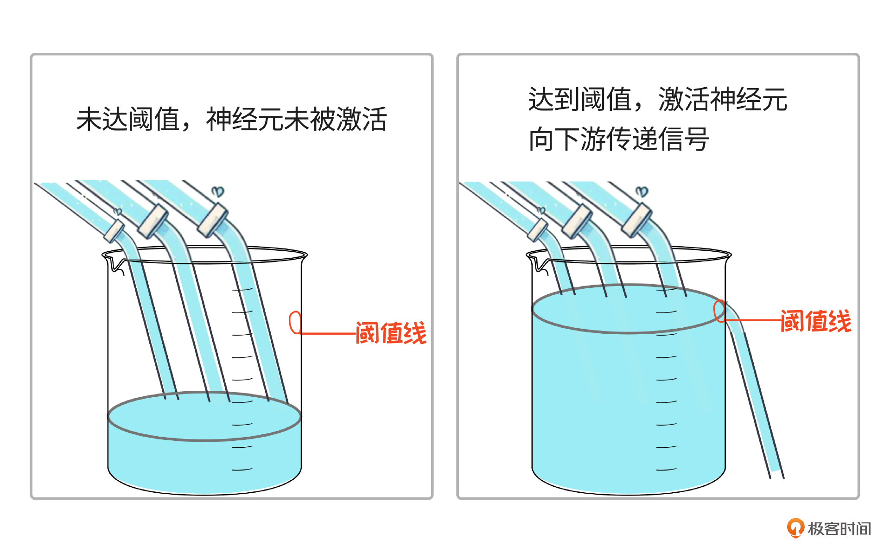

这里的激活就是我们经常说的“灵光一现”“开窍”的一瞬间。一旦某个关键神经元被激活，就像是某一条水路上的关键蓄水池被打通了一样，激活了另外一整块的神经元。其实这个计算机神经网络，本质就是在模拟人脑思考的机制。

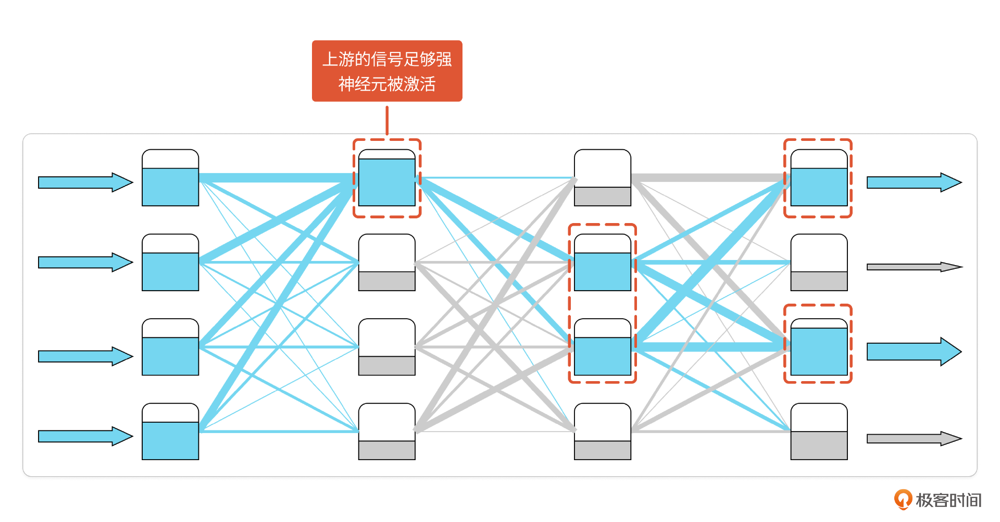

在这里，你可以感受到管道大小，也就是参数值对神经网路的影响。本质上来讲，这些参数值定义了神经网络的特征。拿人脑类比来说，同样一句话，对两个人的刺激可能是完全不一样的。从脑科学角度解释，就是因为大脑内部神经元之间的参数不同，从而激活了不同的神经元，最终产生完全不一样的结果。

那么如何让模型的参数按照我们的需求改变，输出我们想要的内容呢？

这就是神经网络的训练过程。假设在这个水网中，我们从 A、B、C、D 四个水管注入水，希望大部分水是从 E、G 两个水管输出。当这个网络还没有被训练的时候，每个蓄水池对相邻蓄水池的影响都是一致的，因此输出的结果并非如我们所愿。

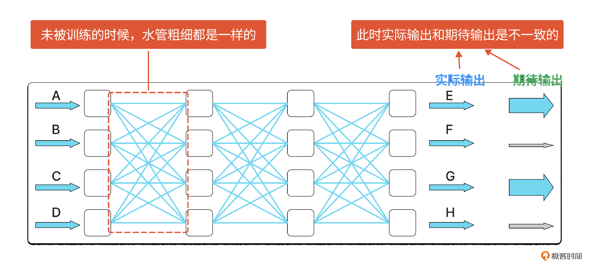

而这种不一致就会作为反馈告诉上游的水管：“某些管道要变粗一点，某些管道要变细一点。”这种将期待值与实际输出值的差异作为信号向上游反馈的过程叫做“反向传播”。

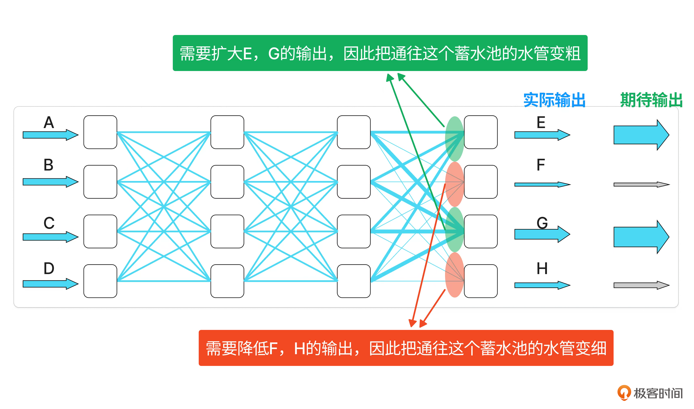

之后，我们第二次再从 A、B、C、D 四个水管注入水，这时 E、G 的水就多了起来。这个过程信息流是往前走的，我们称为神经网络的“前向传播”。但是经过一次反馈后还不够多，按照同样的反馈一层一层往后传，每次水管都会变化一点点，直到水完全从 E、G 输出。

按照这种方法，我们只要给出一组成对的输入、输出值，经过多轮的“前向传播”和“反向传播”，就可以影响这个网络的水管宽度，即模型参数值。如果我们给出足够多的数据，就能最终让模型向我们的需求演进。

“前向传播”和“反向传播算法”是神经网络训练中最基础的算法，它的核心思想就是每次纠正一点进行尝试，然后根据每一次尝试的结果与期待结果的差异不断调整。如果你感兴趣，可以参考这里的内容深入理解。

如果把神经网络看做一个巨大的函数，你就会发现，函数的定义不再需要指定的规则定义，而只要定义数据对。

举个例子，我们要定义一个根据客户标签来推荐产品的模型。按照 Software 1.0 的方法，产品经理会告诉研发同学：

- 如果客户标签是“新生儿宝妈”，就推荐“纸尿裤”。

- 如果客户标签是“幼儿园宝妈”，就推荐“书包”。

而在 Software 2.0 时代，我们需要构建一个数据集，在这个数据集里客户标签是输入项，推荐产品是期待的输出项，为了让系统给“新生儿宝妈”推荐“纸尿裤”，给“幼儿园宝妈”推荐“书包”，我们就需要构建很多对这样的数据对应关系（如下表）。

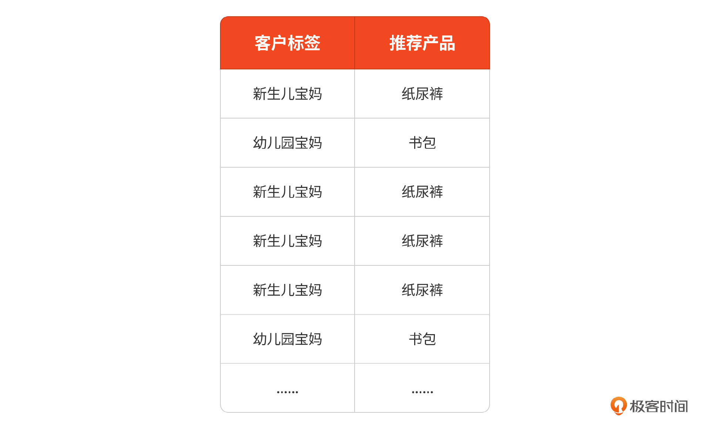

这张表里可能会有一万对数据是新生儿宝妈对应纸尿裤，另外一万对数据是幼儿园宝妈对应书包。我们只要一次性把这个数据集扔给神经网络，它就会自动进行多次前向传播，反向传播，实现调整神经网络的参数值，最后这个神经网络就能够按照我们预想的，给“新生儿宝妈”推荐“纸尿裤”，给“幼儿园宝妈”推荐“书包”。

尽管这个例子里的逻辑过于简单，以至于会让你觉得定义这么多数据对不如按照标签分类来得快。但如果客户标签是巨量的，推荐的产品也是巨量的，单纯的规则定义无疑是不可行的。这就是我们所说的数据、算法给产品设计带来的范式转变：即产品设计正在由规则定义向数据定义转变。

### 数据 V.S 编程语言

不过，这并不意味着产品设计中完全没有规则，而是除了规则之外，我们又增添了“数据”这个新的手段来定义产品，来攻克哪些无法由规则解决的问题。

比如在智能客服产品中，互联网时代的产品，我们会定义这样的规则：

- 如果客户问题中有关键词“退货”，则回复退货规则和流程；

- 如果客户问题中有关键词“价格”，则回复产品价格手册；

这种规则定义就会导致“智障”客服，比如客户说“不要退货”的时候，它仍然回复退货规则和流程。

而在 Software2.0 时代，我们会将把过往的人工客服针对不同问题的优秀回答组成问答对，甚至可以让大语言模型再模仿这些优秀回答者的语气生产类似的问答对；然后再用大量优秀问答对来训练模型，就可以真正实现“智能客服”。我会在后续的实战案例“自动工单处理能手”中带你体验这个过程。

到这里，大家可能会问，难道我们每构建一个产品就要重新训练一个模型吗？

如果真是这样，今天的 AI 不会掀起如此巨大的浪潮。要知道，Kaparthy 是在 7 年前提出数据定义软件的说法，在这 7 年之中，OpenAI 孕育出了一个无需让每个产品都去训练、可以适配各个场景的模型—— GPT：Generative Pretrained Transformer。其中的 P-Pretrained 就是预先训练好的意思，意味着这个模型参数量足够大，训练的数据足够多，以至于它能适配各种产品和各种场景。

当然，部分场景下，我们也需要对大语言模型进行微小调整，使它在我们需要的专项能力上更强，这便是微调，我们在后续的课程中会详细讲述。

GPT 的诞生可以说吹响了人类向更新一代 AI 前进的号角，紧随 OpenAI 之后，各个大厂纷纷涌入，上演了“百模大战”。这时产品经理就遇到了一个挑战：我该如何在众多模型中选择适合自己产品需求的模型呢？接下来就聊聊这个话题。

## 如何选择合适的模型

选择模型要考虑三个因素。

1. 是否合规可用。在国内，主要参考国家互联网信息办公室公布最新的生成式人工智能备案信息，只有在备案列表里的模型才可以被商业化使用。

2. 模型成本。一般来说，模型参数量越大，成本越高；对于闭源模型直接调用模型厂商 API主要考虑 token 消耗量；对开源模型，主要考虑私有化部署成本。关于成本的内容我们会放在 05 这节课来讲。

3. 模型的通用能力、专项能力是否符合产品的应用场景。这是我们选择模型最重要的因素，也是我们接下来重点讲解的内容。

怎么考察模型的通用能力和专项能力呢？我有“三看一测”的方法来考察模型能力。三看是看榜单、看训练数据、看模型厂商的应用和核心客户群；一测是用实际场景来测试各个模型的能力。

### 一看：榜单

模型榜单分为两种榜单，一种是指定能力测验榜单，一种是 Arena 群众反馈榜单。

1. 指定能力测验榜单

指定能力测验榜单就像是给各个模型出了一套统一的开卷高考题，并且分门别类，可以作为我们筛选模型的第一步。

以中文的通用大模型榜单 SuperCLUE 为例，SuperCLUE 给各个模型出了一套理科卷、文科卷、Hard 卷（附加难题），对各个模型进行测试后得出分数，给出专项和综合排名。

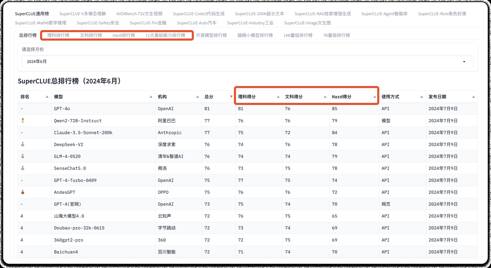

进一步我们还可以了解这里的文科卷、理科卷、附加题有什么内容，来匹配产品诉求（重理科还是重文科）。

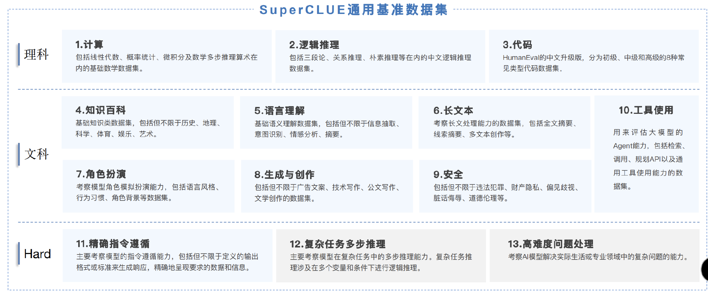

2. Arena 群众反馈榜单

大语言模型 Arena 榜单是由 AI 开源社区 huggingface 发起的人工评测活动，对所有注册用户开放。用户提出问题后，系统随机抽取两个模型给出回答，由使用者自己来投票哪个回答胜出。和指定能力测验榜单相比，它更能体现模型在不确定条件下的通用应变能力，可以作为一个重要参考。

在这里，列出几个权威榜单，你可以随时查阅。

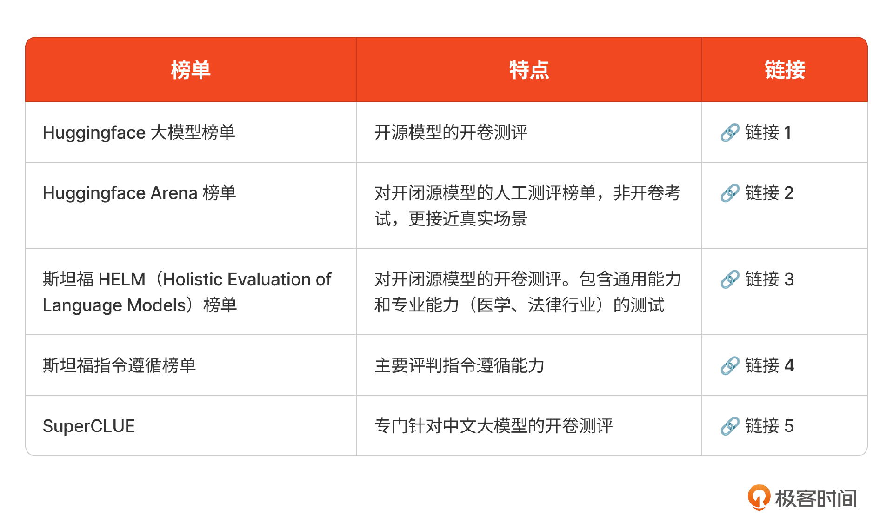

- 链接 1、链接 2、链接 3、链接 4、链接 5

### 二看：训练数据

前文提到数据能够定义模型能力，那是不是如果我们知道大模型的训练数据，对模型能力就会有更深刻的理解，为选择模型提供更好的支撑呢？

遗憾的是，目前大部分主流模型的训练数据都没有开源，只有 Apple 在今年 7 月将自家的模型 OpenELM-3B 从训练方法到数据集全部开源，做到了“真开源”。

随着开源模型越来越多，可能在不久的将来，会有开放程度更高的模型出来。到时候大家可以通过训练数据来侧面考察模型能力。

### 三看：模型厂商的应用和核心客户群

很多模型厂商都有自己的象征性应用和核心客户群，你可以在模型厂商官网的产品介绍或客户案例中找到。

比如 OpenAI GPT 模型对应的 ChatGPT 产品，ChatGPT 这个产品既有面向企业的版本，又有面向个人的版本。在企业客户和个人客户的共同驱动下，OpenAI 的模型就对企业、个人场景都能应用。而国内月之暗面公司开发的 Moonshot 模型对应的产品 Kimi，Kimi 目前看来主要面向个人场景使用，所以 Kimi 的模型可能跟适合个人场景。

### 一测：用实际场景来测试各个模型的能力

通过“三看”，我们大体上可以列出几个候选模型，接下来就针对自己的业务场景来实际测试了。和大家平时在媒体上看到的手工测试不同，这里的模型测试是一项试验工程。在这里，我以客服场景来举例说明。

首先，测试模型能力的第一步是确定业务测试数据集：即很多组输入输出数据对。输入是提示词，输出则是你期待大模型输出的结果。

在一个客服场景中，我们希望大模型能对客户留言进行情绪判断，我会列出如下的数据对：

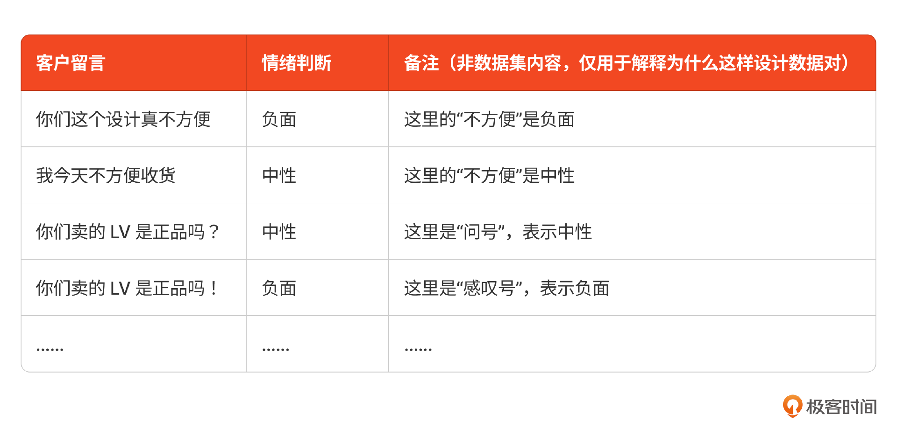

你可以看到，这个数据集中：

- 同样是“不方便”，在不同语境下会呈现不同情绪。

- 同样一句话，以不同的标点符号结尾，也会体现不同情绪。

我们就是希望通过这类数据来挑战模型的能力到底能不能满足诉求。

数据集准备好之后，我们会把客户话语作为参数变量加入到如下提示词（关于提示词我们会在下一节中详细讲述）中，对不同模型进行测试，找到那个正确率最高的模型。

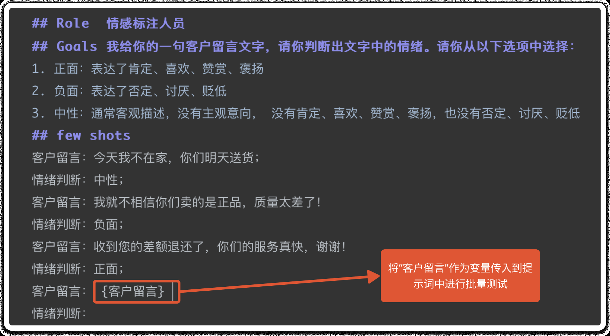

当然，在这个例子中，评定模型的标准是固定的“正面，负面，中性”，因此模型的评价标准很好界定。但在很多情况下，我们并没有清晰的客观标准来判断模型的输出是好还是坏，这时候可以有两种选择。

一是让某个语义理解能力比较强的大语言模型（可以和被测试模型一样）当裁判，来对比候选模型输出与期待输出的差距，并打分。比如下图是客服场景中对模型回复能力的测试。

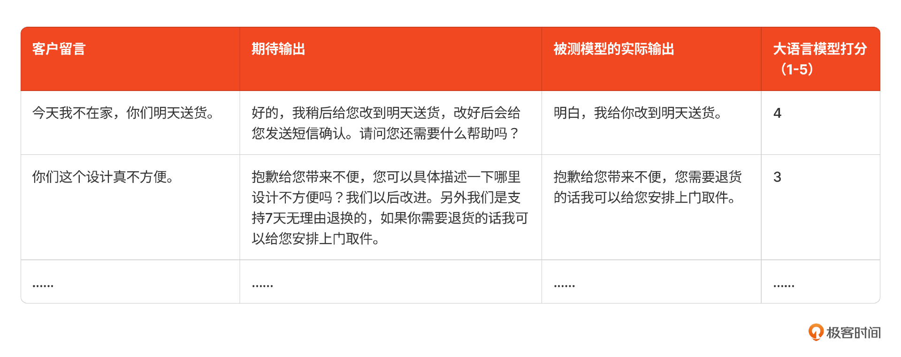

我们将客户留言、期待输出、模型实际输出三项以参数的形式传入提示词中，让裁判模型打分，以打分结果来评判模型能力高低。

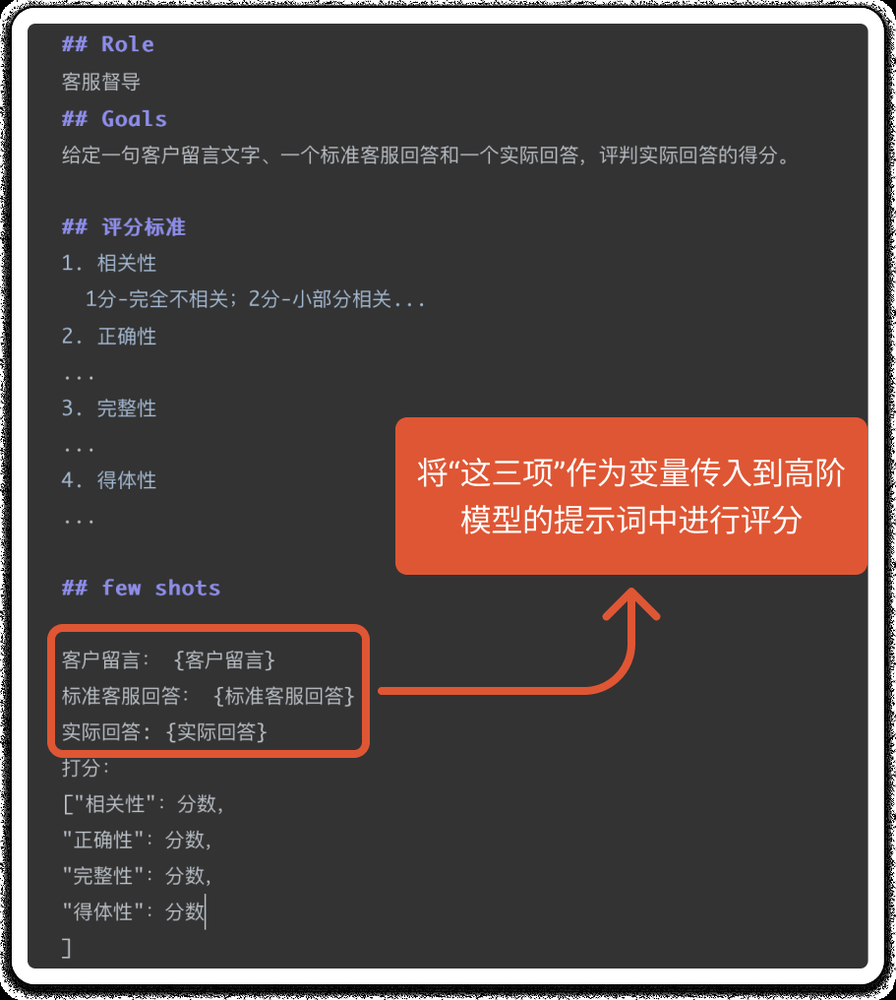

二是在产品灰度放量期间，随机分配不同的候选模型来完成回答，通过用户反馈来评测不同模型在具体业务场景中的表现。这时候我们实际上就是在把候选模型当做试用期的客服人员来评判。依据几个“客服人员”服务的客户满意度来评判模型的优劣。

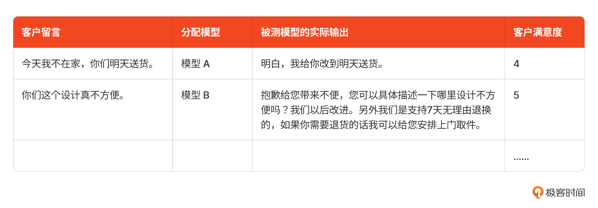

以上就是如果通过对实际场景的测试来选择模型的过程，总结一下。

1. 首先准备测试数据集。

2. 通过工程化的方式批量运行后出模型输出。

3. 对模型的实际输出和期望输出进行比对，比对方法有机器评测，也有用户反馈式评测。

4. 得出测试结果。

在实际的产品中，我们也可能会多种模型组合使用。因此，不管你现在是否是 AI 产品经理，我都建议你在日常工作、生活中，通过官方的 chatbot 或者某些 AI 产品，至少使用 3-5 个主流模型，时刻保持对模型能力的感知。这样当你在设计产品的时候，就能更有经验锁定合适的模型。

## 小结

到这里，我们初步理解了 AI 算法对产品设计产生的范式转变，以及为产品选择合适模型的方法。我们来总结一下。

1. 在算法方面，神经网络通过反向传播算法，从数据中习得特征，并将特征用参数值来表现出来。这个过程将软件构建方法从规则定义走向了数据定义的时代。

2. 当神经网络的规模足够大、训练数据足够多的时候，就诞生了具备通用能力的大语言模型。它使我们不再需要为每个业务场景单独训练一个模型，掀起了业务场景 AI 化改造的浪潮。

- 在具体产品中，我们把大语言模型能力进行增强，或者组装到业务场景中，就构成了我们所说的 AI 产品。

3. 而在各种业务场景中，我们要综合考虑合规性、成本和能力三个要素选择合适的模型。其中能力评估是最重要的一项工作，我给你总结了“三看一测”的方法，即看榜单、看训练数据、看模型厂商核心应用和客户来初步筛选合适的模型，随后使用自己的数据集对这些模型进行进一步精细化测试，从而得出最适合的模型。

选好了模型，接下来就是如何在应用层做好与模型层的交互，提示词工程和 Agent 设计。我们将在下节课进行详细讲解。

## 课后题

开源社区抱抱脸（huggingface）上提供的一个 twiter 数据集 ，该数据集标注了某条 twiter发言是否带有抱怨情绪（如下图）。

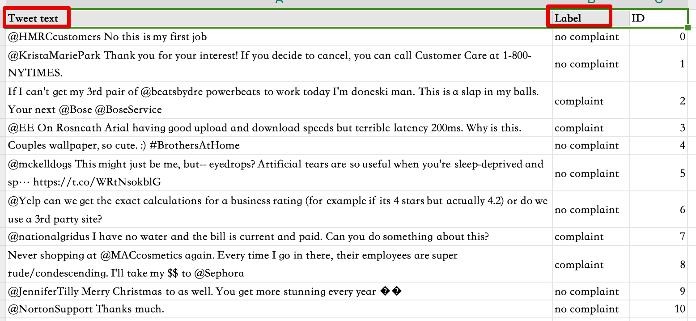

模仿本文提供的情绪标注提示词，选择几个对话类产品（国内可选择月之暗面的 Kimi，百川的对话机器人百小应，智谱的对话机器人智谱清言）手工测试数据集中的 20 条数据，看看三个模型的准确率分别达到多少，观察各个模型出错的场景，并试着调整提示词看看提示词对模型的输出结果产生什么样的影响。

欢迎你在留言区和我交流。如果觉得有所收获，也可以把课程分享给更多的朋友一起学习。我们下节课见！

## 参考

深入理解 Back propagation（反向传播）

>> 戳此加入课程交流群
