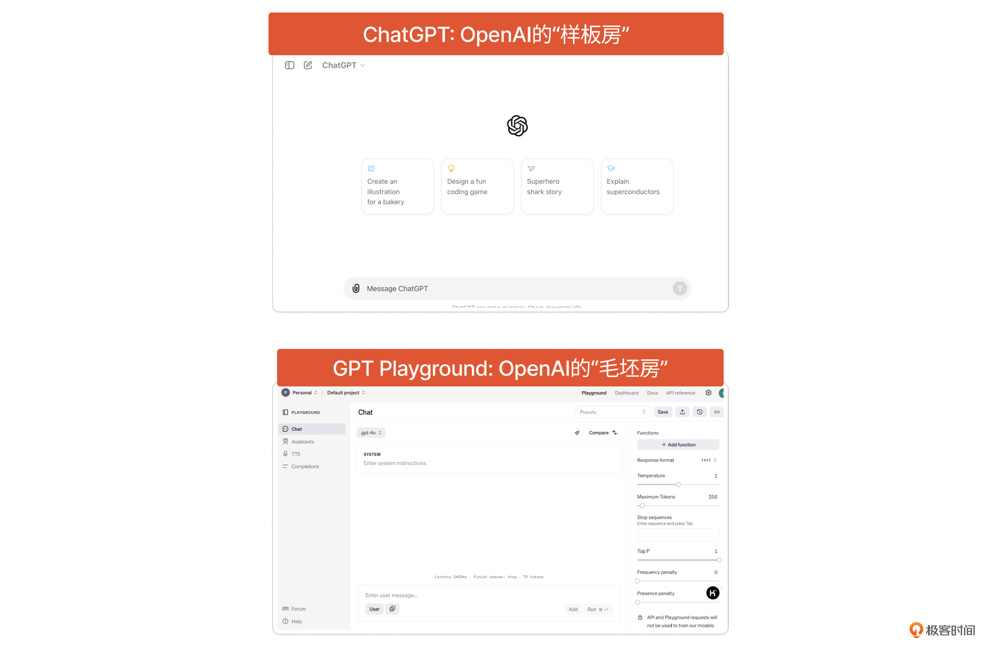
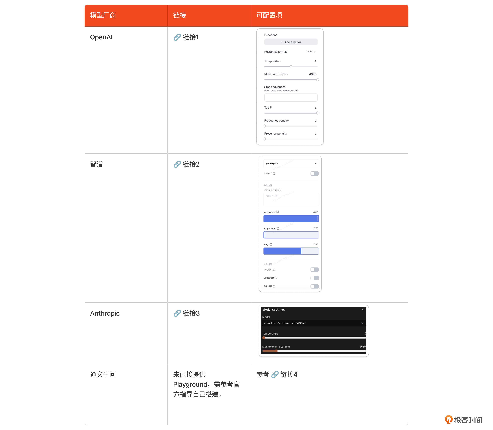
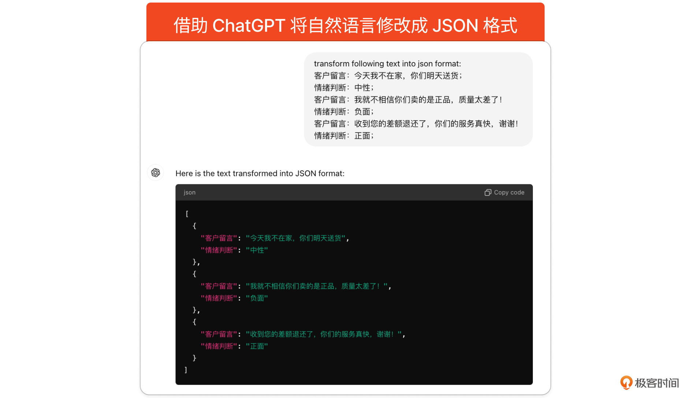
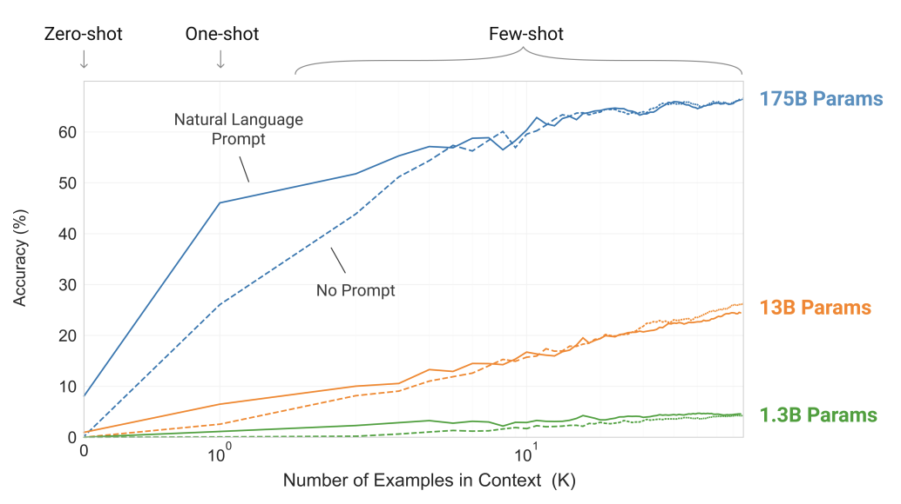
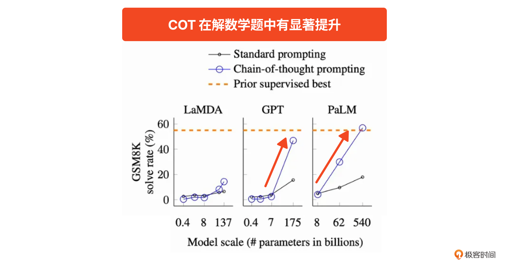
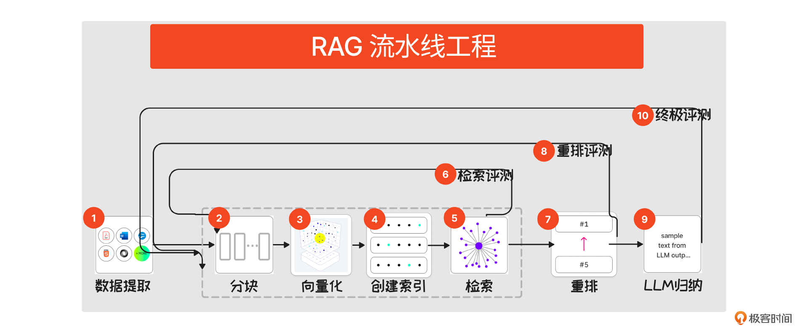
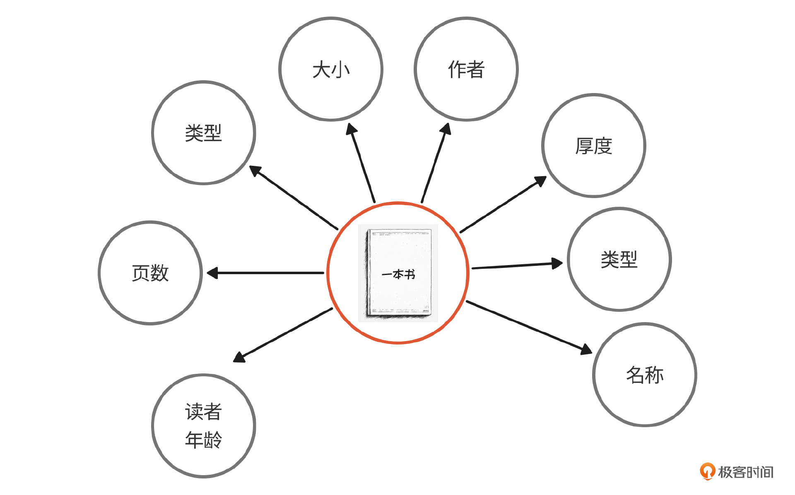

# 03 | AI产品的上层建筑：提示词工程、RAG与Agent

你好，我是产品二姐。

上节课我们拆解了 AI 产品的基础设施建设，这节课我们聊聊上层建筑。这部分是产品经理日常工作的重头戏，包含提示词、RAG 和 Agent 构建。

用 AI 客服产品举例，这三者的作用是这样的：

- 提示词能让客服很有礼貌。比如它会说：您好呀，很高兴为您服务。

- RAG 能让客服很专业。当客户咨询某个产品具体的价格时，RAG 能查阅相关价格手册，直接给出具体数值；如果没有 RAG，客服只能傻白甜地说，“亲，请您查阅价格手册哦~”虽然礼貌，但并不解决实际问题。

- Agent 能让客服很有执行力。当客户要求安排明天送货时，Agent 能在系统里修改送货时间，并回复客户“我已经帮您修改明天送货”。

这节课我会用最容易入门的方式带你理解以下概念，为后面的实战案例做好知识储备。

- 提示词工程：我会讲述一个框架和两个技巧。

- RAG：我会带你“参观”RAG 工厂的流水线作业。

- Agent：我会带你学习让 Agent 具备执行能力的两项技能。

## 提示词

相信你在很多地方看到过关于提示词的知识，但是 AI 产品经理的提示词和日常我们所说的提示词有所不同。

第一个区别是目标不同，正如 01 节课中讲的：

- 普通用户写提示词就像玩盲盒。对结果有所期待，但不要求确定。

- AI 产品经理写提示词就像打靶。你是首先有一个确定的目标，再开始写提示词，直到提示词能打中靶心为止。

第二个不同是使用工具不同。

- 普通用户写提示词是在 AI 产品里写，比如 Open AI 的 ChatGPT。

- AI 产品经理写提示词是面向原生的大语言模型写，比如 Open AI 的 GPT Playground。

在这里，ChatGPT 是 OpenAI 包装好的一个 AI 产品，ChatGPT 里的每一次问答并不是直接发给模型，而是经过了包装才发给 GPT 模型。而 GPT Playground 里的对话才是直接发给GPT 模型的。你可以把 GPT 理解为 OpenAI 提供的“毛坯房”，为了把这个“毛坯房”卖出去，OpenAI 提供了一个“样板房”，就是 ChatGPT。

下图是二者界面对比，ChatGPT 看上去更加简洁，看上去就可以“拎包入住”；而 GPTPlayground 里会有很多设置项，更像是毛坯房里裸露的“水电管线”。



### 预备知识：准备环境

那么在“毛坯房”里写提示词之前，我们先来介绍一下毛坯房里的“水电注意事项”。不过这里需要说明，每个模型厂商“水电注意事项”也不尽一致，在这里我列出部分模型的“毛坯房”可配置项和官方链接，其他模型大家直接参考官网。



- 链接 1、链接 2、链接 3、链接 4

其中，OpenAI 的 Playground 配置项是目前最全的，我们就以此为例具体说明。

首先，左侧四个选项 Chat、Assistants、TTS、Completion，可以视作面向不同场景开发的不同“户型”。

- Chat：和模型直接对话，是调试提示词的主要模式。

- Assistants：可以先创建聊天机器人角色，再用这个角色与模型对话。如果你的产品仅仅就是一个对话机器人的话，可以用这种模式来调试提示词。

- TTS：是文本到语音，当模型收到你的消息时，会被朗诵出来。适用于语音输出的场景。

- Completions：是指文本补全，经常用在代码补全的场景。

我们以最基本的 Chat 模式来看一种模式下的右侧各种设置。

- Function：添加模型可以执行的自定义功能。

- Response format：指定对话输出的格式要求。比如要求以 JSON 格式输出，方便解析。方便下一步操作。

- Temprature：用来控制模型的创造力和随机性。温度越高，回答越发散；温度越低，回答越稳定。你可以想象，水的温度是 100 时，水分子以水蒸气的方式发散；而水温 0 度时，则相对稳定。实际上大语言模型的原理本身就起源于热力学模型，因此在这里沿用了温度的概念。

- Maximum Tokens：设置模型在单个响应中可以生成 Token 最大数量。

- Stop sequences：可以提供特定的短语或模式控制模型应停止生成文本。

- Top P：此参数影响模型输出的概率分布，专注于更可能的预测。

- Frequency penalty：降低模型出现重复单词或短语的可能性。

- Presence penalty：增加模型谈论新主题的可能性。

在 AI 产品开发中，当我们向 OpenAI 发送请求时，需要带上以上设置好的参数。对于产品经理来说，我们调整好提示词后，需要同时把这些参数值的设置告诉开发同学。

配好环境后，我们就可以学习提示词框架和技巧了。

### 提示词框架和技巧

提示词技巧难度不高，网上也有很多资料。但随着实战深入，你会发现提示词更多的是一项“工程”。

比如对于不同模型，我们需要调整不同的提示词；对于同一场景，也需要需要调整提示词以达到最大化满足需求。

这节课我会以一个框架和两个技巧带你了解基本知识，后续再通过实战案例带你深入体会。

- 一个入门框架

提示词的框架就是提示词模板。框架是为了让我们更容易上手、方便记忆。在你充分实践后，就不必拘泥于框架了。网上有非常多的提示词框架（参考 1），这里我以 RTF 框架为例说明。

RTF 代表 Role（角色），Task（任务）， Format（格式）。我们把上节课提到的客服场景用RTF 框架写出来，就是下面这样的提示词。

```
## Role
情感标注人员
## Task
我给你的一句客户留言文字，请你判断出文字中的情绪。请你从以下选项中选择：
1. 正面：表达了肯定、喜欢、赞赏、褒扬
2. 负面：表达了否定、讨厌、贬低
3. 中性：通常客观描述，没有主观意向， 没有肯定、喜欢、赞赏、褒扬，也没有否定、讨厌、贬低
## Format
```

- 严格按照以下格式输出：

```json
{
 "客户留言": "客户留言内容",
 "情绪判断": "情绪判断结果"
}
```

在撰写提示词时需要注意两条不成文的“习俗”。

1. 提示词中的标记位参考 Markdown 语言来写。Markdown 是一种带标记的语言，比如例子中 “##” 代表一个小标题，Markdown 语言既能方便人来操作，又能让计算机很好理解。所以在提示词的撰写中广泛应用。你可以参考Markdown 官方文档学习。

2. 输出格式结构化。上面的提示词特别规定了严格的输出格式（通常是 JSON 格式）。这是因为开发同学通常会对模型的输出做下一步处理，结构化输出会方便他们解析。如果你不熟悉JSON 格式，可以借助 ChatGPT 来修改成 JSON 格式（比如下图）。



在框架之外，我们还需要掌握提示词的两个基本技巧，Few-Shots、COT。

- 技巧一： Few-Shots（少量样本提示）

Few-Shots 通俗来讲就是“举例子”。我们给刚才客服场景的提示词加上 Few-Shots，就是下面这样的。

```
// RTF 内容略...
## few shots
{
 "客户留言":"今天我不在家，你们明天送货；",
 "情绪判断":"中性"
},
{
 "客户留言":"我就不相信你们卖的是正品，质量太差了！",
 "情绪判断":"负面"
},
{
 "客户留言":"收到您的差额退还了，你们的服务真快，谢谢！",
 "情绪判断":"正面"
}
```

你可千万别小看举例子这个简单的操作，这可是正儿八经的学术话题。2020 年 OpenAI GPT-3 论文的标题就是《Language Models are Few-Shot Learners》，论文中有一张图这样的：



你看，在 1750 亿参数的大语言模型中：

1. 给出一个示例比不给示例的准确率从 10% 迅速提升到 45%。

2. 给出 10 个示例比一个示例的准确率从 45% 提升到 60%。

3. 给出 10 个以上示例效果会有所波动甚至下降。

所以，少量样本数量不宜过少，但也不能过多。这也是提示词被称为是“工程”的一个原因：我们需要通过大量尝试，把最典型的例子放在提示词里。

Few-Shots 论文让学术界见识到了大语言模型通过上下文就能“照猫画虎”地学习到示例里的能力，而当时大语言模型的推理能力还很弱。于是大家就开始思考：如果提示词当中给出推理步骤，是不是就能让大语言模型“照猫画虎”地学会推理呢？

这一思考就催生了提示词的第二个基本技巧：COT（思维链，Chain Of Thought）。

- 技巧二： COT。

思维链简单来说就是在提示词里加上“让我们一步步来，第一步……，第二步……”，主要用于推理场景，比如数学应用题计算，再比如规划旅程时中转站的时间要前后合理，这些都是推理场景。

这个简单的技巧放在提示词里确实有四两拔千金的效果。在 COT 开山论文里发现：对于参数量在十亿、百亿、千亿的大模型，采纳了 COT 的提示词在 GSM8K 数据集（加减乘除应用题）的测试中，准确率从 20% 直接干到 50%，接近人类平均水平。正如论文标题所说的《COT 点燃了大语言模型的推理能力》。



所以，在推理场景下，COT 的作用绝不可小觑。如果你了解更多关于 COT 的研究，可以参考这篇文章。上面说的提示词框架和两个提示词技巧还衍生出来了很多技巧，你可以参考 2 提示词指南网站上的内容学习。在后续的实战案例中，我们会以组合、嵌套的方式同时使用这些技巧。

接下来我们来了解 AI 产品上层建筑中的另外一项内容，RAG。

## RAG

在本节课开头客服场景的例子里，我说的是 RAG 会让客服更专业，是因为它会查阅资料后给出回答。RAG 本质上就是把搜索到的资料作为提示词的一部分发给大语言模型，让大语言模型有根据地输出内容，从而降低大模型“臆想答案”的概率。在 OpenAI 分享的案例中，通过对RAG 技术的应用将回答准确率从 45% 提升到了 98%，可见 RAG 的重要性。

RAG 的全称是 Retrieval Augmented Generation，中文是检索增强生成。意思是把检索（资料库）的结果发给大模型，以增强大模型的生成能力。

下面这张图就是一张 RAG 作业的流水线，行话叫 Pipeline。这个流水线上有 10 个作业环节，只有精细打磨流水线上的每一个步骤，最后才能出来好的效果。



接下来，我们对这个 RAG Pipeline 中的各个环节做一个概念介绍。为了便于理解，这里都会拿“查阅资料库”来类比。

1. 数据提取：类比于资料库的资料来源。主要目标是确保资料数据完整，除此之外，还可以新生成一些数据，比如利用大模型对资料进行 summary、打标签，让后续处理更高效。

2. 分块 (Chunking)：你可以想象成资料应该拆分到多细来存储，用梗话来说就是“对齐颗粒度”。比如按段落、句子拆，或者按照文章标题、某个标记来拆等等。

3. 向量化（Embedding）：就是把拆分后的段落、句子、单词转换为计算机可处理的向量，向量化就是把一个物体拆成多个维度表达。

比如一本书可以从以下八个维度去表达。



那么某一本特定的书《思考的快与慢》对应的向量值就是八维空间的一个点，计算机就是通过这些点来定义事物的。同样，语言文字也可以被向量化，且语言都已经有成熟的向量模型，比如智源的开源 embedding 模型 bge-large-zh-v1.5 有 1024 个维度。

4. 创建索引：类似把向量化后的资料块进行分类、整理，按照一定顺序放在对应位置后给出序号，方便后面的检索查找。索引可以建多个，比如书可以按照图书分类排序，也可以按照出版时间排序。

至此，你的资料库终于建好了，接下来就是根据具体问题在这些资料库中查找了。

5. 检索环节（Retriever）：类似在资料库找相关资料。系统会根据用户的提问，在索引中查找最相关的数据块。找到和问题匹配度高的资料（注意此时还没有形成答案）。

6. 第一轮检索评估：大多数文章中会漏掉评估的环节，开发者往往也会忽视。要知道，没有评估等于盲走。这里的评估和传统搜索的评估是一样的，最核心的指标是召回率，即实际检索出的文本块数量 / 期待被检索的文本数量。

讲到这里我们停一下。实际上到这一步之前，在技术上和互联网的搜索逻辑是类似的，我们统称为“语义检索”阶段。这意味着如果你公司内部的知识库已经具备“语义搜索”能力，那么通过嫁接下面两步就可以实现基于 LLM 的问答应用了。

接下来的环节就是大语言模型 LLM 出来后特有的阶段。

7. 重排序（Rerank）：语义检索出来的结果相当于是资料初筛，讲究的是效率。重排序顾名思义就是对初步检索结果进行重排序，从而得到更精确的结果。重排序也有开源闭源的模型供大家使用，比如 Cohere 等。

8. 重排评测：和语义检索阶段一样，在重排序之后，我们也应该有一个评估，这里的评估机制和步骤 6 类似。

9. 生成（Generator）：这一步对应的就是系统终于找到了最准确的资料，然后整理、总结资料，形成完整报告。实际上就是将重排序后的资料片段加上用户的提示词，提供给大型语言模型 LLM，由 LLM 根据上下文生成最终的输出。在这个过程中，主要在提示词、上下文、意图识别方面下功夫。

10. 终极评估：这一轮的评估指标和检索、重排序指标不一样，现在有专门用于评估 RAG 的框架 RAGAS （参考 RAGAS 官网）。

总的来说，RAG 流程玩的是一条流水线上的“组合拳”。对于应用开发者来说，比拼的就是对不同的场景该怎么打这套组合拳。有了 RAG 和提示词，相当于我们和大语言模型建立起了很好的沟通机制，当我们把事情沟通好之后呢，就可以借助大语言模型来“执行工作”了，这就轮到Agent 出场了。

## Agent

Agent 并不是平行于 RAG、提示词的概念，Agent 本身就包含了 RAG 和提示词的应用。

在 01 节中，我们知道 Agent 需要具备记忆、反思、规划和工具使用能力。这四项能力中，我把记忆、反思、规划总结为思考力，工具使用总结为执行力。思考力通过上述的提示词工程和 RAG 就可以获得，剩下的执行力，我们在这一小节讲述。

本节课开头的例子中，Agent 能让客服直接安排退货这个行为，这就是执行力。那这是怎么做到的呢？你只要记住两项技能：Function calling 和 Re-Act，别急，我们一个个讲清楚。

### 技能一：Function calling（函数调用）

Function calling 的中文意思是函数调用，是计算机语言里的一个概念。比如你使用 Excel 表里的公式 SUM(C1,C2) 代表将单元格 C1，C2 中的数字相加，在这里：

- 自然语言是：将单元格 C1，C2 中的数字相加。

- 自然语言被转换成函数调用就是：SUM(C1,C2)，函数调用可以直接被机器编译并运行。

大语言模型的 Function calling 能力就是把自然语言指令转换为函数的调用指令，从而使自然语言指令可以被执行。

当然，可以被机器运行的函数有很多种，比如 Java 函数、Python 函数，而在 AI 产品中最常见的函数调用方式就是调用微服务架构下的各种 API request。

下面就是以 API request 这种函数为例，通过提示词的方式让大语言模型完成函数调用的任务。

```
## Instruction
```

- 你是一个人工智能编程助手，根据用户请求和函数定义，调用函数来完成任务，并以代码格式进行回应，无需回

```javascript
## 函数定义
 tools = [
     {
         "type": "function",
         "function": {
             "name": "get_current_weather",
             "description": "Get the current weather in a given location",
             "parameters": {
                 "type": "object",
                 "properties": {
                     "location": {
                         "type": "string",
                         "description": "The city and state, e.g. San Francisco,
                     },
                 },
                 "required": ["location"],
             }
         }
     }
 ]
## 用户请求
 查一下今天北京的天气
```

这个例子的提示词里有三个部分。

1. 任务：告诉大语言模型要完成指令转换的任务，这里的核心任务就是“根据用户请求和函数定义，调用函数来完成任务，并以代码格式进行回应”。

2. 函数定义：专业术语叫 schema，即告诉大语言模型这个 API request 里有哪些参数，各个参数的名称、描述、数据类型等。这里最好遵循 OpenAI 自己的格式，这种格式也可以借助大语言模型来完成。

3. 用户请求：就是自然语言指令。

我们把上述的例子输入给到 Open AI 的 GPT Playground，GPT 就会输出以下 API Request，这就可以直接被机器运行。我们就实现了将自然语言指令转变为计算机可执行指令。

```javascript
```json
{
   "function": "get_current_weather",
   "parameters": {
       "location": "北京"
   }
}
```

不过大语言模型在做这个可执行指令的转换时，充满了不确定性，除了调整提示词中instruction 部分外，还需要一些机制来控制执行的准确性，这就需要赋予 Agent 的第二项技能：Re-Act。

### 技能二： Re-Act

Re-Act 的全称是：Reasoning and Act，推理并且执行，相当于是给行动装上了一个随机应变的机制。

回到上面的函数定义例子，假设 API 定义中要求第 14 行代码的字段“location”必须是英文字母，但我们发送的是汉字“北京”，API 就会返回错误信息“location must be English”。这时大语言模型还会根据这个错误信息自动推理出此时需要将汉字“北京”改为拼音“Beijing”后，再去调用 API。

```javascript
```json
{
   "function": "get_current_weather",
   "parameters": {
       "location": "BeiJing"
   }
}
```

这就是推理并且执行，你瞧，大语言模型是不是很聪明呀。

在上面这个例子中，我们很容易就发现，在 Agent 进行推理执行的过程中，需要分享把观察到的报错信息也发给大语言模型，这就构成了 Re-Act 模式的提示词框架：Observation，Think，Act。

```javascript
## Observation：
 API就会返回错误信息“location must be English”.
## Think：
 应该location这个字段的值转换为英文再发一次.将API request 当中的"北京"修改为"BeiJing".
## Act：
 ```json
 {
     "function": "get_current_weather",
     "parameters": {
         "location": "BeiJing"
     }
 }
```

这种 Observation->Think->Act 的模式会一直循环，直到在 Think 步骤中认为 Observation 里的结果能达成用户诉求，或者循环次数达到了代码里规定的上限。可以说，Re-Act 本质上就是一种提高 Agent 执行准确率的提示词模板。

听到这里，你会不觉得，哇~ 这也太厉害了吧，只要通过提示词能让大语言模型像个真人一样自主行动呢。不过这里我要泼点冷水：目前大语言模型的 Reasoning 和 Act 的准确率还不够高，就像刚刚走路的孩子，执行起来跌跌撞撞，但这种能力会越来越强。

另一方面，研究者在 Re-Act 基础之上，也衍生出了各种各样的花式提示词模板来提升 Agent的执行准确率。类似于给孩子装上护具、穿上牵引带这类外围措施防止他们跌倒。我们在后续的实战案例中会根据需要使用到这些方式，在这里不再细讲。

## 小结

到这里，AI 产品架构中的上层建筑就完成了简单介绍。针对三点，我们需要做到：

- 提示词：以简单框架入门提示词，牢记 Few shots、COT 两项基本技巧。这是让应用层和大语言模型进行有效沟通的技巧。

- RAG：了解 RAG 流水线的每一个环节，之后我们才能在实战案例按照流水线来一一排查问题。

- Agent：通过函数调用具备执行力，通过以 Re-Act 为代表的 Agent 提示词模板提升执行准确率。

到这里我们完成了第一章的产品经理必懂的 AI 技术原理的学习。一款 AI 产品通常有四层架构，这四层又可以归类为基础设施（算法、数据，大语言模型）和上层建筑。这部分 AI 产品经理必备的基础知识，也是打造所有 AI 产品的必备工具。相信你已经掌握了使用这些工具的方法，一定在实战中得心应手地使用这些工具，打造出优秀的 AI 产品。

## 课后题

注册堪称国内版 OpenAI 的智谱大语言模型开放平台（相当于智谱的 API playground），并完成两个任务。

任务一： 从 twitter 数据集中选取 20 条数据，写一条提示词，使模型输出结果与 20 条数据中的标注数据保持一致。注意使用 Few shots。

任务二：将本节课中的《技能一：Function calling（函数调用）》部分提到的 Function calling提示词模板输入到智谱大语言模型开放平台，看看输出的结果是否和 OpenAI 输出的一致，看看在 function calling 领域，openAI 和智谱是否有一定差距？

## 参考

1. 提示词框架。

2. 有了 Chain of Thought Prompting，大模型能做逻辑推理吗？

3. 提示词指南。

>> 戳此加入课程交流群
