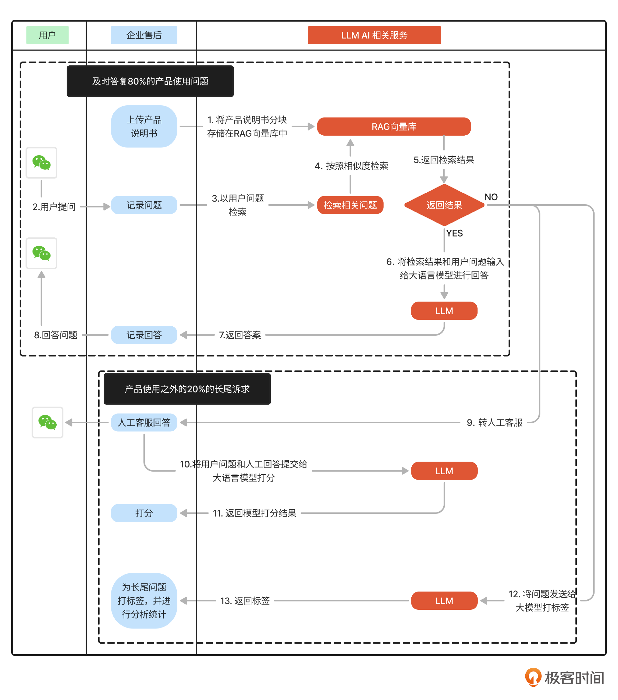
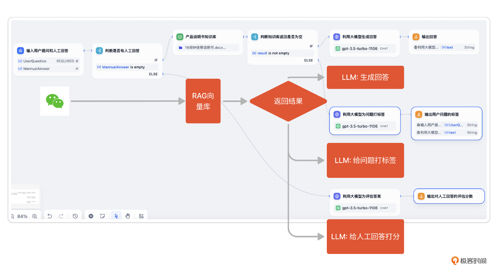
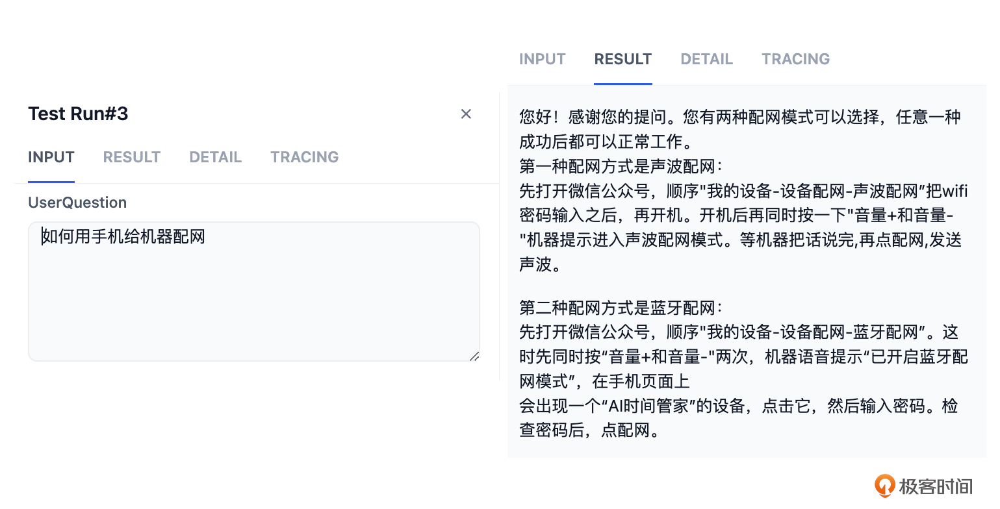

# 04 | 十倍速提升：从发现真需求到MVP，真的只需要一周吗？

你好，我是产品二姐。

第一个案例我们从提示词工程和 RAG 技术应用开始，将家电消费品中电子说明书升级到智能说明书，构建出一个“家电消费品使用问答助手”的产品，来代替 10 人左右的客服团队。

利用这个案例，我会在本节中讲述三方面的内容。

首先，发现需求。在 AI 技术还没有被广泛认知的时代，主动发现痛点比等着别人提出需求更重要，这也是传统产品经理在转型到 AI 产品经理必备的思维转变。那怎么才能保证你发现的是“真”需求，而不是做无用功呢？在这个案例中，我会讲述在简单的生活场景中发现需求的过程，从而推导如何在了解“锤子”的基础上找“钉子”。

其次，解决方案设计。也就是针对痛点，从你已知的工具箱中找到合适的工具组合。在这个案例中，我们将主要用到 RAG 来解决用户痛点。注意，是根据痛点的特点想到用 RAG 解决，而不是拿着 RAG 找痛点。

最后，实现方法。最后我会讲述产品经理如何在不需要代码开发的情况下，借助平台快速做出产品 MVP。

## 发现需求：在了解“锤子”的基础上找“钉子”

故事从去年 8 月我家热水器的一次故障说起。像热水器这种不经常操作的家电设备，一旦发生故障，我的常规操作就是：找出产品说明书 -> 查到对应目录 -> 尝试解决 -> 如果解决不了，就打客服电话。

而我在第一步就被卡住了——我找不到说明书。于是我不得求助客服，前后花了十几分钟。

几天后，家人在操作音响设备的时候，发生了同样的故事：相应的产品说明书在到货第二天就被扔到垃圾桶里了，最后不得不求助客服。好在现在的产品都有微信公众号客服，比电话方便多了。

看起来，说明书被抛弃是一种常态。虽然家电消费品的用户能通过微信客服解决问题，但这个服务成本就转嫁给了卖家：他们需要雇佣人工客服来解决这类问题。业界的确有不少 AI 解决方案，但以规则为基础的旧一代时常出现“人工智障”现象，相信你也遇到过。

为了进一步验证上述假设，我辗转找到了一位电子消费品的硬件产品经理朋友。他们的产品年出货量在一年 40 万台左右，产品用户是 6-18 岁的中小学生。用户遇到问题时，可以扫描产品上贴的二维码关注微信公众号，通过公众号消息来进行售后服务。

在与朋友深入交谈后，我发现，在他们的产品售后客服有这么四个特点。

1. 超过 80% 的用户问题都是关于产品如何使用的基本问题。这些问题通常包括如何安装、如何操作、如何进行日常维护等。

2. 市场上确实有带有 AI 特性的产品在做，但价格昂贵，且效果不好。

3. 客服成本高。为了应对这些频繁的咨询，厂商不得不雇佣 10 名全职客服人员来在线回答用户的问题。然而，客服行业流动性也很高。几乎每隔几个月，就会有新员工加入，而每次新员工的培训都需要投入大量的时间和资源，这也增加了企业的运营成本。

4. 长尾诉求分析耗时太长。除了和产品使用相关的问题， 他们也很重视剩余 20% 的用户诉求。这类长尾咨询五花八门，每隔一段时间就需要人工处理。一方面他们需要审核客服的回答是否专业，另一方面这些咨询会启发新的产品功能迭代。

你看，当我们从个人角度考虑痛点，仅仅会想如何更快地找到家电消费品的故障排除方法；但从企业角度，就会有更深层次的诉求诞生。

再向上抽象，我们认为只要是有产品说明书的地方，都存在这样的诉求。包括 to C 的各种硬件产品、家用轿车，到 to B 的生产设备、专用工具。如果能将这些不同场景的诉求标准化，就意味着一个产品诞生的机会。

而且这些说明书就像是客服坐席的外挂检索知识库，即客服本身不需要记忆这些说明书，而只要知道怎么查这些知识库资料就可以了，这种能力和 RAG 赋予大模型的能力极其类似。我有一定把握能通过大语言模型加 RAG 的技术，把这些问题解决好。于是我和朋友开始了一次简单的尝试。

## 解决方案设计

我们回溯到开头，用户排除家电消费品故障的方法：找到产品说明书 -> 查到对应目录 -> 理解相应内容 -> 尝试相关方案。

这个过程本质上就是一个 RAG 的过程，即“检索 -> 理解 -> 输出”的过程。所以，我们很容易就想到把产品说明书作为外挂知识库放在 RAG 里，这样大概率能解决那些 80% 的问题。

而对于无法用 RAG 解答的 20% 的长尾诉求，我们仍然转到人工客服。但我们可以通过一些方法解决之前“长尾诉求分析耗时太长”的问题。

1. 如果要审核客服回答的专业性，可以用大语言模型作为评判专家，为微信客服的回答打分，辅助人工审核。

2. 如果需要基于用户的咨询启发产品功能迭代，就用大语言模型把用户的诉求打上事前定义好的标签，按照这些标签对诉求进行分析统计，这样很快就能洞察出新的用户诉求。

按照这个思路，我们将这些诉求归结到三个端侧和两个功能模块。

先说三个端侧。

1. 用户端： 直接面向家电消费者，用户可以提问并接收回答。

2. 企业售后端：面向企业使用，主要由客服人员、企业管理人员使用，他们可以管理文档，查看微信问答记录。

3. LLM AI 应用端：调用大语言模型的能力生成回答，为人工客服的回答打分，为用户问题打上标签。这一部分是我们本节课的核心工作。

至于两个功能模块，就是“回答产品说明书相关问题” 和“处理长尾诉求”模块。

在下图中，我们可以借助用户旅程将这三个端侧和两个功能模块串联起来讲述。

我来带你梳理一下“家电消费品问答小助手”的用户旅程。

1. 首先由企业售后端上传产品说明书。

2. 产品说明书被分块存储到向量数据库中。

3. 用户在微信公众号提问。

4. 问题经由企业售后端发给 AI 应用服务侧，把问题经过向量化处理后，作为查询值用于检索RAG 向量库中的相关分块。

5. RAG 向量库返回相关度较高的分块。如果返回则继续下一步；如果没有返回则启动“处理长尾诉求”模块的执行，跳转至第 9 步。

6. 将用户问题与相关分块内容一起传给基座大模型。

7. 大模型生成相关回答给企业售后端。

8. 用户在微信公众号收到回答。

9. 当用户问题与产品说明书不相关，即在第 5 步中 RAG 向量库没有返回相关度较高的分块，就会启动这一步的执行，系统会转至人工服务。

10. 当人工客服回答后，系统会把回答内容和用户问题发给大语言模型打分。

11. 大语言模型把打分结果返回给企业售后端，作为未来统计分析使用。

12. 同时，与第 9 步并行执行，将用户问题发给大语言模型打标签。

13. 标签返回给企业售后端并进行分析统计。

好，到这里为止，我们的方案设计大概有个脉络了。按照传统产品经理的做法，接下我们的工作就是按照上述步骤总结功能清单，写 PRD 和开发评审，进入开发、测试阶段了。

但是在 AI 时代，这一过程被大大缩短。AI 产品经理就可以直接借助 Coze、Dify 等 Agent 平台，动手搭出 MVP 验证技术可行性，之后根据 MVP 的问答效果以及客户反馈再来决定开发人员从哪些方面可以参与到产品落地。所以说，LLM AI 不仅改变了产品本身，也改变了产品的开发范式。

接下来我们就看看具体操作。

## 实现方法：用 Dify 搭建最简单 MVP

在这个案例中，我们使用 Dify 工具实现产品的 MVP。为了不妨碍没有了解过 Dify 的同学阅读，我来简单介绍一下 Dify（更多信息大家可以参考官网学习）。

一句话，Dify 是一个大语言模型应用开发的框架工具。做个类比，如果把大语言模型应用比作是攒一台台式机电脑，那么 Dify 就是一个电脑机箱，能让你轻松对接各种大语言模型，配置各种向量数据库，把 AI 应用的输出以 API 或者其他方式开放出来，并且还可以在 Dify 平台对AI 应用进行测试、评估、监控。可以说，它非常适合你有一个初步产品构想，想进行产品概念的可行性和市场验证时使用。

对照刚才方案设计图里的诉求，我们会用到 Dify 的 2 个模块。

一个是知识库。对应方案中的知识库管理，企业售后人员可以在这里上传不同的产品说明书，设置不同的检索规则。

另一个是 Workflow。它可以将方案设计图中的不同节点连接起来。比如，在这个案例中，我们会根据知识库的返回结果是否为空确定是否要启动人工客服（步骤 9），我们还有三次要使用到 LLM 来生成回答（7）、评估人工回答质量（10）和给用户问题打标签（12）。这些都需要靠流程把他们串起来。Dify 提供的拖拉拽方式能让我们很轻松地搭建出 Workflow。

如此，我们很快就在 Dify 上搭建出了如下图的 Workflow。你可以很明显地看出图中各节点对应着我们方案设计中 LLM AI 应用端的各个功能。

注：为了方便测试，我在这里把自动回答、给客户问题打标签和评估人工回答三个任务合在一起了。因此第一步会判断是否会有人工回答，如果有的话就执行评估人工回答的任务；如果没有，会依次执行自动回答、给客户问题打标签的任务。

注：dify 不支持一个节点同时出发两件事情，比如知识库返回为空的时候，不能同时路由到人工回答、给问题打标签两个节点。所以在这里，我把获取人工回答这个步骤直接作为输入项放在第一个节点了。

当我们上传了产品说明书，简单设置提示词后，就可以开始测试了。

但是，事情还没有结束。在接下的 MVP 验证当中，我们拿客户的真题去做实验，还遇到了不少拦路虎，比如明明在知识库中看到了答案，但就是回答不出来。这些问题，我们在下节课慢慢解决。

## 阶段复盘

在这之前，让我们先来简单总结一下。

这一节中，我们从个人的细微生活体验出发，挖掘出一个企业级诉求。同时，我们提出了解决问题的方法，借助 Dify 平台快速的搭建起来一个产品雏形。在这个过程中，我们看到了 AI 给传统互联网产品设计带来的改变。

关于这节课的重点，我总结了三句话，希望你能记住。

1. 在技术变革初期，AI 产品经理必须要对技术有深度理解，才能具备发现需求的能力。

2. 要从那些没能被上一代 AI 满足的需求中，尝试用新一代的 AI 来解决。

3. AI 产品经理不用代码也能搭建出产品雏形，大大加速了研发进程，我们一定要主动尝试。

这些变化要求 AI 产品经理不再是“等风来”，而是“迎风去”。只有这样才能在 AI 的浪潮中变被动为主动。

所以，主动的产品经理，给你布置一道预习题吧！你有没有体验过一些智能客服，觉得这些客服的回答合理、准确吗？能解决你的问题吗？结合我们在第三节课讲的 RAG 技术原理，你觉得可能会有哪些原因导致这个问题呢？

## 思考题

在你的工作、生活中，是不是要经常要从一些固定资料里检索相关内容，亦或是经常要回答别人相似的问题，比如你的自我介绍，你日常负责的产品线功能介绍，接口调用文档等等。这些琐碎的事情会不自觉地占据你的时间，转移你的注意力。

你有没有想过把这些资料整理一下，做一个你自己专属的外挂知识库和“外交”小助理呢？或者，你觉得哪些场景下需要这样的小助理呢？把这些场景列出来，试着按照场景逐步构建出自己的知识库，做一个自己的个人小助理吧。

欢迎你在留言区和我交流。如果觉得有所收获，也可以把课程分享给更多的朋友一起学习。我们下节课见！

>> 戳此加入课程交流群
