# 06 | 一招致胜：AI落地迷茫期，怎么快速扫描场景，构建产品小样？

你好，我是产品二姐。

今天我们帮助那些 AI 落地迷茫期的企业（老板）找到落地场景。我会聚焦于一家能源行业某细分赛道的企业，构建出一个《文本数据提取小助手》。

这个产品会带给你三个方向的启示。

1. 场景扫描：如何在企业场景中，套用一个框架构建企业 AI 化全景图，合理挑选“小而美”场景切入。

2. 场景聚焦：从“小而美”场景切入，构建出“产品小样”。这部分内容我们会利用提示词工程中的思维链和少量样本技巧，实现从海量文本中提取数据，构建出《能源行业数据提取》的产品小样。

3. 场景深入：以“小样”入手，向客户直观展示 AI 的能力，然后把“小样”扩展、规模化，形成了一个完整的《文本数据提取小助手》产品。

在这三步之后，我们就成功地“从解决一个问题”升华为“解决一类问题”，实现从“场景”到“产品”的跃迁。其中前两部分会在这一节讲述，第三部分在下一节课讲述。

## 场景扫描：面对“迷茫”的客户如何做？

故事从我辞职创业的第 9 个月说起，那时我借助公众号、口碑的传播力量，吸引到一家能源领域某细分赛道的头部企业合作。CEO 见到我们就噼里啪啦问了很多问题，比如：

- “二姐呀，感觉这个 AI 很厉害，可就是不知道我们能用在哪？”

- “对企业来说，我们的要求可是非常精确的，大模型的幻觉会是个问题吗？”

- “今年两会把人工智能提上日程，倒逼着我们找场景，但这些场景该怎么找呢？”

其实这种情况在技术变革初期很常见。因为社会每跨越一个时代，都要克服上一个时代的惯性，人们往往在这个时候有点不知所措。而在这样的时代，一名优秀的产品经理，就是要成为第一批主动抛弃惯性、拥抱变化的人。

带着这样的心态，我历经几个月的调研、探索和实践，到现在抽象出一份“原创”的企业 AI 场景框架。当大家迷茫的时候，可以把这个框架作为手册和你自己的具体场景比对：找到那些适合你们自己公司的场景。我用下面这张图来表示这个框架。

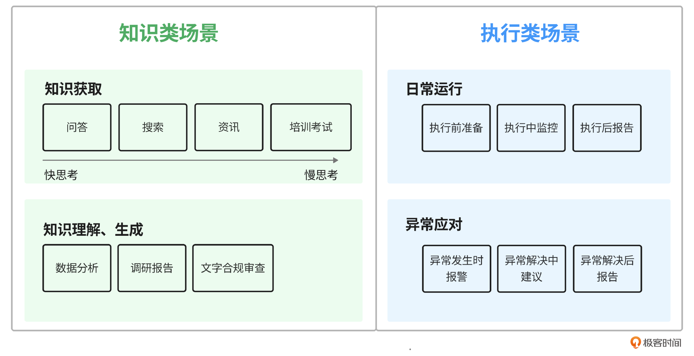

我把企业 AI 可落地场景分为知识类场景和执行类场景，它们分别用于提升企业大脑的“认知力”和企业机器的“执行力”。

知识类的场景按照认知的步骤依次是：知识获取 -> 知识理解 -> 知识生产。

- 知识获取包括：信息搜索、知识问答、资讯推送、培训考试。

- 知识理解主要指数据分析、调研等。

- 知识生产指的根据已知的搜索结果、调研、资讯，加上自己的习得、体会生产出新的知识。

以上三个环节构成了知识的闭环，它们都可以被 AI 不同程度地改进。我们拿知识生成中的调研报告举例。

在大语言模型来临之前，我们的调研报告需要通过阅读大量各类文献，再结合自身的理解和问题，人工生成。

在大语言模型出来之后，我们利用提示词工程和 Agent 技术就可以将文献和自身需求加上提示词，输入给大语言模型，模型可能在几分钟内就能生成一份调研报告。斯坦福大学就有一个叫Storm - 风暴的项目，用户只需要输入一个简单的话题，就能生成一篇类似维基百科的长文[课后参考 1]。这样的技术在企业中就可以有很多的应用，比如给某一个潜在客户生成一个长篇报告，帮助销售人员来拿下订单。

对于执行类场景，我将它划分为日常运行和异常应对两种场景，然后参考市场上众多 Copilot的设计，把这两种场景的 AI 落地思路按照事前、事中、事后三个阶段给到用户建议。比如Github copilot 官方给到的 feature 是：

1. Elevating developer workflows，即 coding 前评估开发者的工作流。

2. Get AI-based suggestions in real time，编码过程中给出实时建议。

3. Pull requests that tell a story，编码后生成提交代码的备注信息。

我再拿销售的日常运行来举例，一个企业的销售人员，核心是成交订单，但是作为企业组织中的一员，销售人员同时也要遵守公司的流程，将客户以及和客户沟通的过程记录在 CRM 里，走完一个完整的销售 SOP（Standard operating procedure，即标准化流程）。这个 SOP 包括：

- 事前，第一次和客户沟通前要准备什么材料。

- 事中，客户沟通中什么样的问题该如何解答。

- 事后，客户沟通结束后该如何记录。

而这三者其实都可以由 AI 辅助来解决。类似这样的例子还有很多。当我利用这样的框架来一起梳理用户的场景时，看似毫无头绪的场景，就变得清晰起来。

最后，我按照这个框架又梳理出了适合这位能源领域细分赛道客户的细分场景，并为每个场景定义出了产品形态和需准备的数据支撑。

【注】所有数据均已脱敏、简要处理，且执行类场景因为保密原因只列出少量场景。

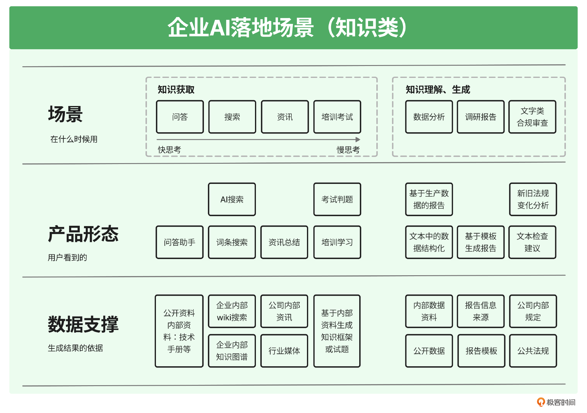

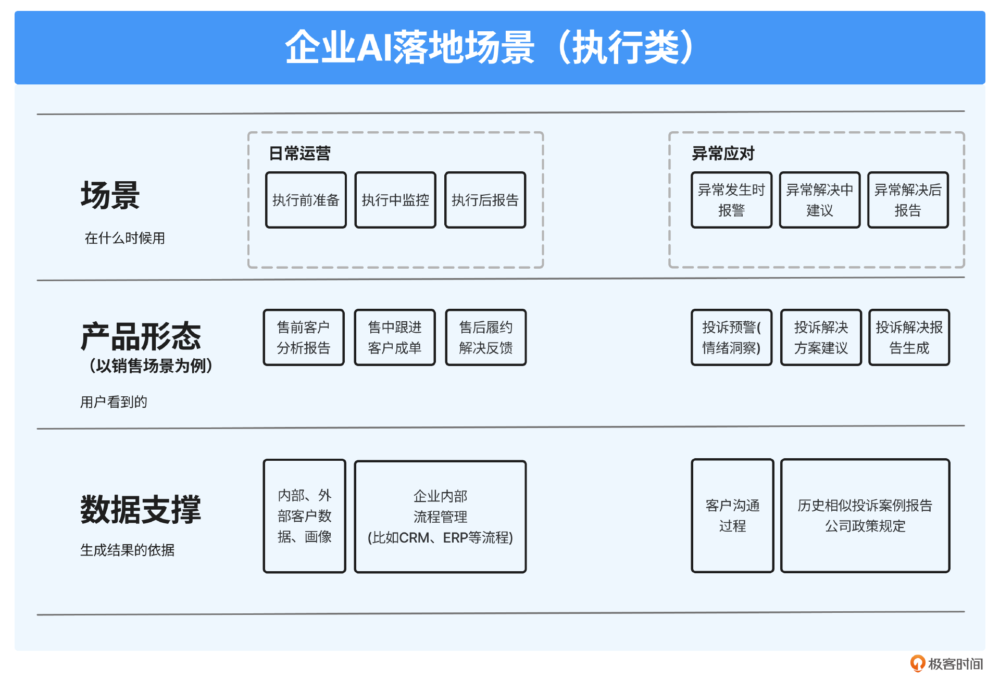

依照这样的框架，我们就完成了场景扫描。接下来，就可以将这些场景按照价值大小、难易程度来排序，从最有性价比的场景入手。对于这个客户，我们选择了调研报告生成这样一个场景。接下来和大家详细讲述这个过程。

## 场景聚焦：使用提示词工程构建出产品“小样”

当我们聚焦调研报告生成这样一个场景时，客户给了我们大量的报告信息来源和以往工作中人工生成的调研报告。大多数产品经理在这个时候，会以咨询者的身份给客户“如何进行 AI 改造”的建议，但其实此刻的你，更要“化身”为生产报告的人本身，这一点非常重要，因为只有这样，你才能做到两点。

1. 不断拆解生成报告的过程，找到那个最小的、可被 AI 改造的任务构建“产品小样”，及时发给客户快速获得反馈。

2. 对大语言模型生成的报告质量有辨别能力，从而更好地调整提示词。

在“化身”为调研报告的专家深入这个场景后，我发现不少报告中会出现几个关键的煤炭行业指标，这些指标的来源是中国煤炭工业协会网站的统计数据板块（如下图），网站每月都会公布这些指数的值。

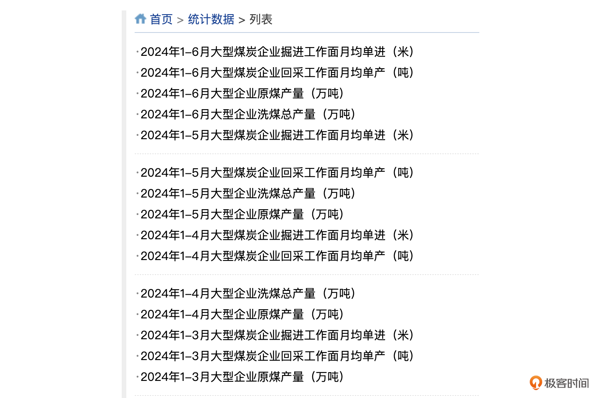

而在人工生成的报告中，专家会将这些数据收集起来，制作成表格，生成下面这样一张趋势图。

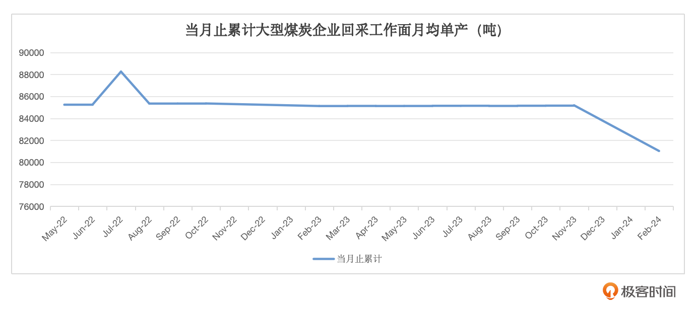

和客户沟通后，发现这些图中的数字都是一个个人工手“抠”出来的。他们也曾想过用爬虫、文本解析的方式解决，但由于这些数据本身是以新闻稿文字方式发布的，格式也会不一样（如下图），所以爬虫、解析也比较困难。而且这个数据从 2012 年起就开始公布，有十几年的数据了，一直没有人去梳理。

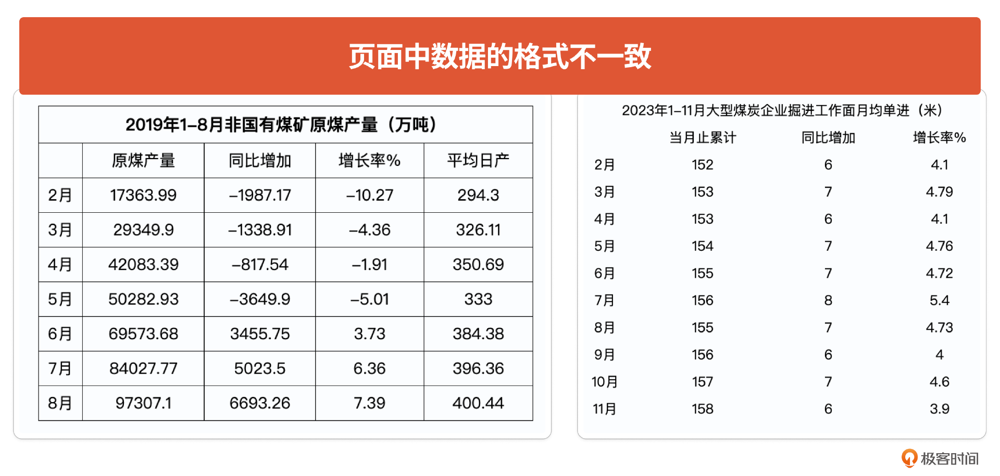

其实这个问题用产品思维抽象一下，就是将非结构化数据（新闻稿文字方式）中的关键信息抽取出来形成结构化数据。更重要的是，他们还有很多类似场景。我们可以看到：这个小样足够小，不会花很多精力，但同时又有潜力成长为一个细分赛道产品解决一大类问题。

这就是我们经常说的产品洞察力：对小问题足够敏感，同时又能看到更长远的发展空间。

于是我们就定义好这样一个“产品小样”作为目标：从中国煤炭工业协会网站的统计数据板块提取出近几年的关键行业指标。

这里我的讲述会很细，但并不难。确定目标以后，就可以开始构建思路。经过观察，我们发现这个统计数据板块的内容中有以下几个规律：

- 规律 1：总共有 4 个行业指标，每个指标发布在不同的文稿里。

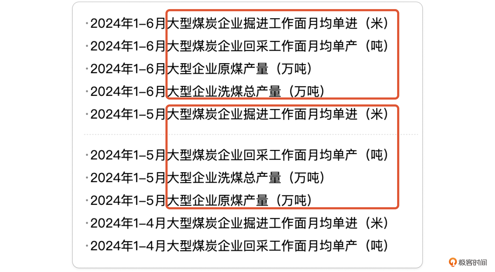

- 规律 2：每个指标在同一个自然年中，最新公布的数据会包含本个自然年份所有的数据，因此数据会重合。比如 2024 年 1 月到 6 月数据会和 2024 年 1 月到 5 月的数据重合。

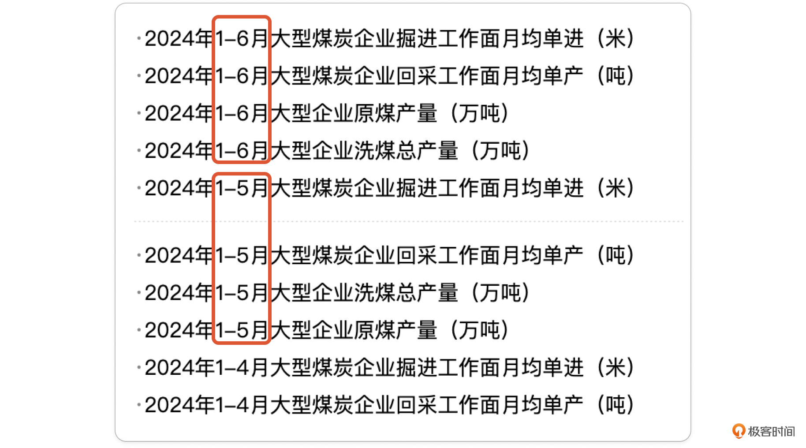

- 规律 3：跨越自然年的数据是不会重合的，比如 2024 年的数据和 2023 年的数据不会出现在同一个新闻稿里。

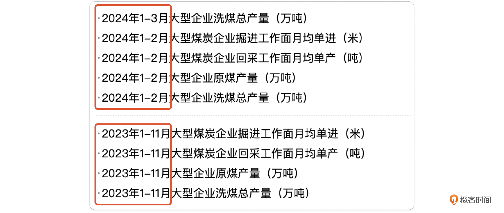

根据以上三个规律，我们想象人工完成这件事的步骤。

1. 爬取到页面中的标题，这一步采用爬虫即可完成。

2. 将所选择的新闻稿按照行业指标分类。这一步中，也需要理解标题含义，我们借助大语言模型完成。

3. 在标题中，针对某一个自然年选出覆盖时间范围最广的标题。比如《2024 年 1-4 月……》和《2024 年 1-6 月……》中，应该选择《2024 年 1-6 月……》的这个新闻稿。这一步中，需要理解标题含义，因此要借助大语言模型来完成。

4. 分指标去查看步骤 3 选出来网页。这一步实际上就是完成网页爬取，无需借助大语言模型。

5. 从网页内容中“抠”出相应的数据（包括列名和数值）。这个抠的过程也需要理解语义后才能完成，也需要借助 AI 来完成。

6. 最后将这些数据保存为 csv 文件，并转换成折线图展示。这一步是简单的数据保存和分析，采用传统方式即可解决。

我们将上述步骤整理为一个工作流。

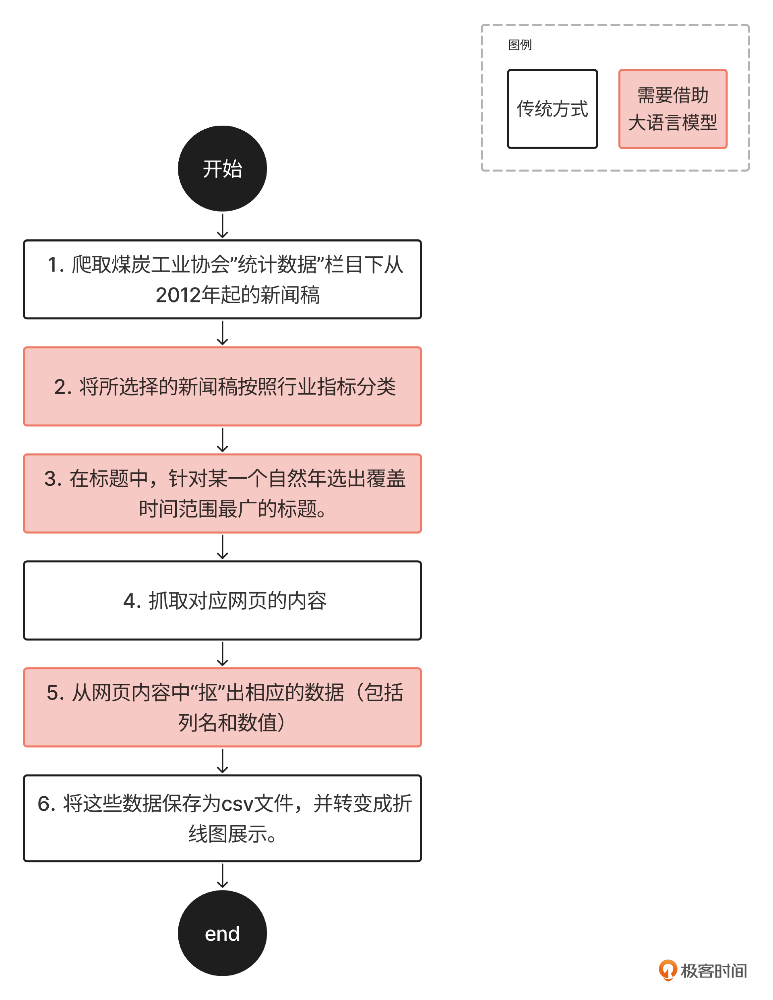

【注】类似的工作流图在 AI 产品的设计中很常见，这个案例中是一个单向、单分支的流程图，且是由产品经理人工设计的，可以说是最简单的工作流设计。在后面的案例中我们还会包含由 Agent 自发执行的工作流。

接下来，对于需要借助大语言模型的第 2、3、5 步撰写提示词，我们会用到在 03 节提示词工程知识中的“一个框架和两个技巧”，即 RTF 框架（或者其他框架）、Few shots（少量样本）、COT（思维链）。

- 提示词设计示例 1：将含有相似指标的标题分组输出（对应步骤 2）。

在这组提示词中，我们首先按照 RTF 框架给出基本角色、任务、输出格式；其次在“Attention” 中给出注意事项；然后给出在 Few shots 中给出两个例子；最后在 “Request” 部分给出用户提供的标题列表。大家需要注意：

1. 输出格式部分，大家可以借助大语言模型给出输出格式建议。

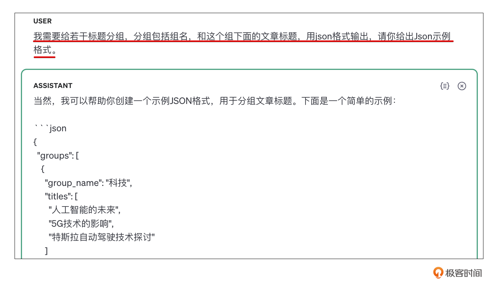

2. Fewshots 部分，需要将各种情况分类，每种类别举一个例子说明，按照之前的论文建议，结合实际情况分类数量控制在 2-10 个其中必要的地方。在这一步提示词中的第二个例子就

- 是给出了一个相对异常的情况，出现了一个调查制度而非统计指标相关的文稿，我们需要将这个标题噪音去掉，所以特别给出示例说明。

```
## Role：<!--这是注释，不必出现在提示词中：以上是RTF框架，实际中可以采用其他框架。-->
```

- 文章标题分组整理能手。

```
## Task：
```

- 给你一组文章标题列表，将含有以下指标的标题进行分组，并输出。

```
- 大型煤炭企业掘进工作面月均单进（米）
- 大型煤炭企业回采工作面月均单产（吨）
- 大型企业原煤产量（万吨）
- 大型企业洗煤总产量（万吨）
## Format:<!--这是注释，指定格式是为了提取出下一步所需输入：具备同一指标的标题-->
```

- 必须使用如下格式输出，不需要对结果进行解释，

```json
[
   {
       "指标": "大型煤炭企业掘进工作面月均单进（米）",
       "标题列表": [
           "2020年1-10月大型煤炭企业掘进工作面月均单进（米）",
           "2020年1-11月大型煤炭类企业掘进工作面月均单进（米）",
           "2021年1-2月大型煤炭企业掘进工作面月均单进（米）"
       ]
   },
   {
       "指标": "大型煤炭企业回采工作面月均单产（吨）",
       "标题列表": [
           "2020年1-3月大型煤炭企业回采工作面月均单产（吨）",
           "2021年1-2月大型煤炭的企业回采工作面月均单产（吨）",
           "2021年1-2月大型煤炭企业回采工作面月均单产（吨）"
       ]
   }
]
## Attention
1. 在输出标题时候必须使用原有标题。<!--这是注释，必须使用原标题是为了在第四步中找到对应网页-->
2. 对于没有指定指标含义的标题，则不必输出。
## Few shots
<!--这是注释。Fewshots，将各种情况分类，每种类别举一个例子说明，按照之前的论文建议，结合实际情况
**示例1:** <!--这是注释。这个例子给出仅有两个标题的情况-->
<<标题列表>>
 "2020年1-3月大型煤炭企业掘进工作面月均单进（米）",
 "2020年1-4月大型企业洗煤总产量（万吨）"
<<整理结果>>
 [
     {
         "指标": "大型煤炭企业掘进工作面月均单进（米）",
         "标题列表": [
             "2020年1-3月大型煤炭企业掘进工作面月均单进（米）"
         ]
     },
     {
         "指标": "大型企业洗煤总产量（万吨）",
         "标题列表": [
             "2020年1-4月大型企业洗煤总产量（万吨）"
         ]
     }
 ]
**示例2**： <!--这是注释。这个例子给出一种相对异常的情况，出现了一个调查制度而非统计指标相关的文
<<标题列表>>
 "2024年1-2月大型煤炭企业掘进工作面月均单进（米）",
 "2024年1-2月大型企业洗煤总产量（万吨）",
 "2023年1-11月大型煤炭企业掘进工作面月均单进（米）",
 "2023年1-11月大型企业洗煤总产量（万吨）",
 "煤炭工业统计调查制度（2022-2024）"
<<整理结果>>
 [
     {
         "指标": "大型煤炭企业掘进工作面月均单进（米）",
         "标题列表": [
             "2024年1-2月大型煤炭企业掘进工作面月均单进（米）",
             "2023年1-11月大型煤炭企业掘进工作面月均单进（米）"
         ]
     },
     {
         "指标": "大型企业洗煤总产量（万吨）",
         "标题列表": [
             "2024年1-2月大型企业洗煤总产量（万吨）",
             "2023年1-11月大型企业洗煤总产量（万吨）"
         ]
     }
 ]
```

```
## Request
<<标题列表>>
 {这里输入标题列表}
<<整理结果>>
```

写好提示词后，就可以手动捏造标题列表，输入各大平台的 API Playground 中进行测试了。之前我们使用 Open AI Playground 的示例比较多，这次我们采用智谱的 API Playground 尝试。这里右侧 API Playground 的设置和默认值不一样，大家务必记得设置一下。

在这个例子中：

- 我们关闭了多轮对话，因为每次输出和上一次对话并无关系。多轮对话一般用于问答类产品与用户会有自然语言对话，或者某些 Agent 中需要结合短期记忆进行决策的情况。

- System_prompt 是指每次固定要输入的提示词，相当于一个全局变量，这里我们暂时不使用。

- Max_tokens：这里标题列表可能会很长，因此设为最大值 4096 个 token，每个模型支持的最长 token 数也不一样。

- Temperature：这里我们不需要创造性，因此设为较低的 0.01。

- Top_p：我们采用默认值即可。

- 关闭网页检索、知识库检索、函数调用。

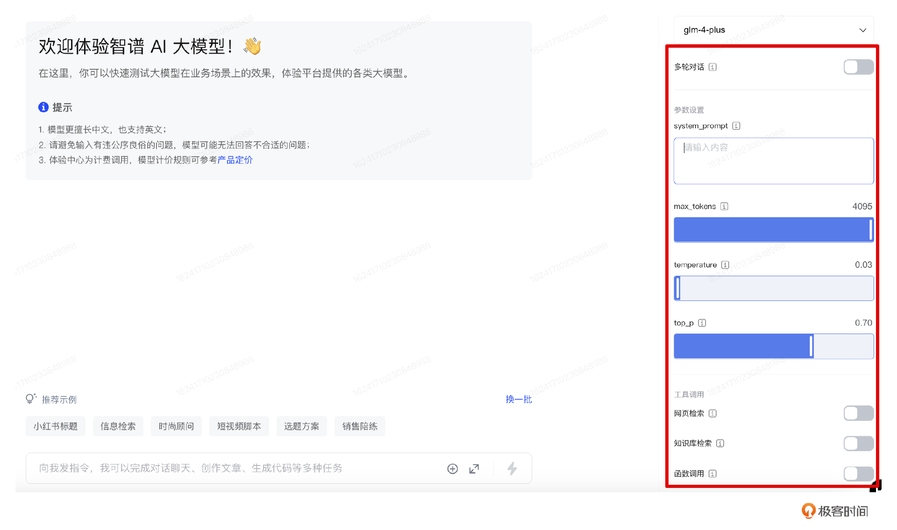

然后在左侧输入提示词，进行测试。在这个案例中，这个提示词能很好地满足需求。

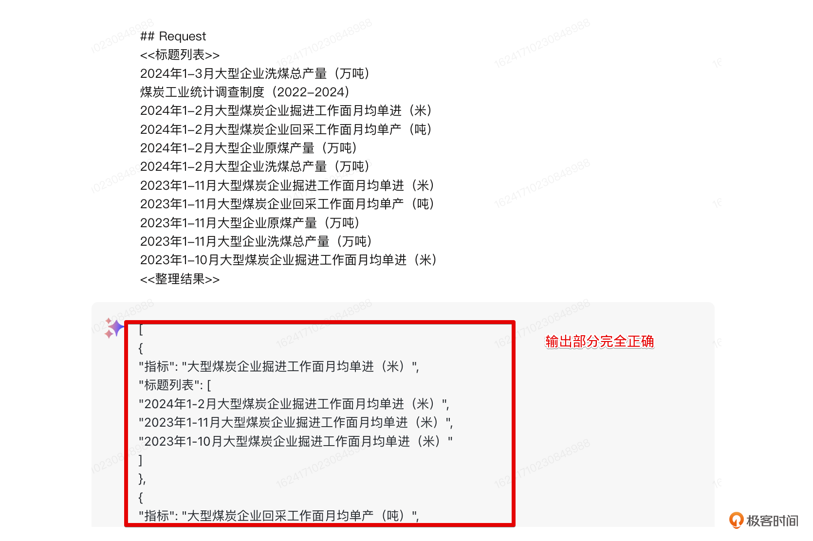

- 提示词设计示例 2：针对某一个自然年选出覆盖时间范围最广的标题（步骤 3）。

这一步的提示词的输入项就是同一指标的一组标题，和上一步提示词不同的是，这一步需要做数学推理：判断 1-11 月的范围包含 1-10 月，所以需要引入 COT（思维链）技巧。

```
## Role：
```

- 文章标题提取能手

```
## Task：
```

- 给你一组包含同一指标的文章标题列表，标题中含有日期范围，日期范围会有重合，请你提取出具有最大日期范

```
## Format:
1.必须使用如下格式输出，不需要对结果进行解释
[
"标题1",
"标题2"
]
## COT：<!--这是注释。这就是COT过程-->
```

- 对于以下三个标题：

```
1. 2020年1-4月大型企业原煤产量（万吨）
2. 2020年1-10月大型企业原煤产量（万吨）
3. 2020年1-6月大型企业原煤产量（万吨）
4. 2021年1-3月大型企业原煤产量（万吨）
```

- 让我们一步步来，

```
1. 标题2中的2020年1-10月涵盖了标题1中的日期范围2020年1-4月，因此保留标题2"2020年1-10月大型企
2. 标题3中的2020年1-6月，已经在标题2中的范围"2020年1-10月"，因此保留标题2"2020年1-10月大型企
3. 标题4中的2021年1-3月和标题2中的范围"2020年1-10月"相比，二者互不包含，因此保留这两个标题。
4. 因此标题4"2021年1-3月大型企业原煤产量（万吨）"和标题2"2020年1-10月大型企业原煤产量（万吨）
## Few shots
**示例1**
<<标题列表>>
[
"2020年1-4月全国大型企业原煤产量（万吨）",
"2020年1-4月大型企业原煤产量（万吨）",
"2020年1-3月大型企业原煤生产量（万吨）",
"2020年1-2月大型企业全国原煤产量（万吨）",
"2019年1-11月大型企业原煤产量（万吨）"
]
<<提取结果>>
[
"2020年1-4月全国大型企业原煤产量（万吨）",
"2019年1-11月大型企业原煤产量（万吨）"
]
**示例2**
<<标题列表>>
[
"2024年1-3月大型煤炭企业掘进工作面月均单进（米）",
"2024年1-2月大型煤炭企业掘进工作面月均单进（米）",
"2023年1-11月大型煤炭企业的掘进工作面月均单进（米）",
"2023年1-10月大型煤炭企业掘进工作面 月均单进（米）",
"2022年1-11月大型煤炭企业的掘进工作面月均单进（米）"
]
<<提取结果>>
[
"2024年1-3月大型煤炭企业掘进工作面月均单进（米）",
"2023年1-11月大型煤炭企业掘进工作面月均单进（米）",
"2022年1-11月大型煤炭企业掘进工作面月均单进（米）"
]
## initialize
<<标题列表>>
{input}
<<提取结果>>
```

- 提示词设计示例 3：将不同新闻稿中的同一指标数据汇总

这一部分的提示词输入项是同一指标的几篇文章内容原文，输出是一段 csv 格式的文本。和前两个示例相比，没有新的技巧，就当作你的课后作业来完成吧。

通过这么三组提示词，加上传统的网页内容抓取，我们就完成了一个文本数据提取的“产品小样”。这个小样的输入项是中国煤炭工业协会官网统计数据板块的网址，输出就是煤炭行业近几年四大指标的数据变化趋势。

我们仅仅花了 1 天的时间把这个“小样”完成，并展示给了客户。当他们看到这样的结果时，终于揭开了 AI 在他们心中的神秘面纱，“哦～原来 AI 不止是能问答，还能当做工具。”这个“小样”激发了更多的文本数据提取诉求，而解决方法也变得更加复杂，也是我们下一节课的内容。

## 阶段复盘

在企业类场景中，AI 落地一直有两大难题，一是场景难找，二是 AI 的天生幻觉难以构建起高可靠性的企业级应用。

针对找场景的问题，我在这节课给你提供了一个参考方法，即先构建一个全景图，不断拆解场景后深入一个细分领域。我们只需要记住一个企业场景框架，一个“化身”用户的方法，结合提示词工程中的“一个框架，两个技巧”，就能找到适合切入的小微落地场景，以此为起点逐步开启企业级 AI 应用的进化过程。

而第二个问题，AI 模型幻觉从原理上来说是很难避免的。但别忘了，AI 应用不等于 AI 模型，而是以 AI 模型为内核，以各种工程手段为外围设备的严密组合，通过这些外围就可以提高 AI应用的可靠性。其中有一个外围手段就是在合适的时机插入人机交互，这也是 AI 产品设计中的重要方法，我们在下节课一起学习。

## 课后题

观察中国煤炭行业协会官网的统计数据，利用提示词工程中的少量样本和 COT 技巧，撰写这个案例中的第三个提示词：将不同新闻稿中的同一指标数据汇总，并在智谱 AI 的开放平台进行测试。

1. 煤炭工业协会的数据统计板块。

2. 智谱开放平台免费体验中心。

提示：这个题目里输入项是几个网页的内容，输出项是一段 csv 格式的文字。比如将 2024 年1-6 月和 2023 年 1-11 月的大型煤炭企业掘进工作面月均单进（米）两篇网页中的数据输出为一个 csv 格式的文字。

## 参考

参考 1：斯坦福大学的 storm 项目

>> 戳此加入课程交流群
