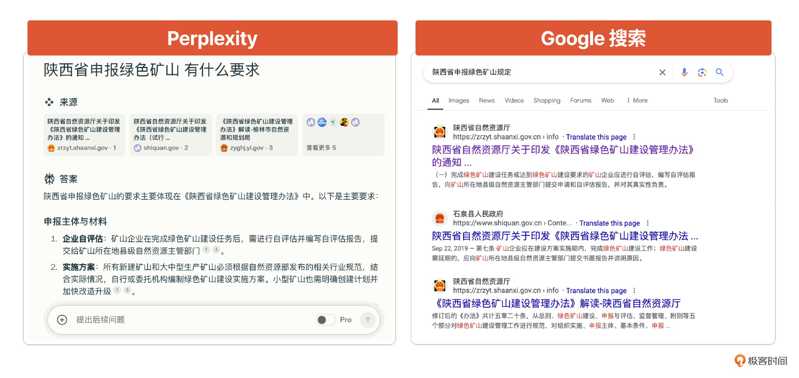
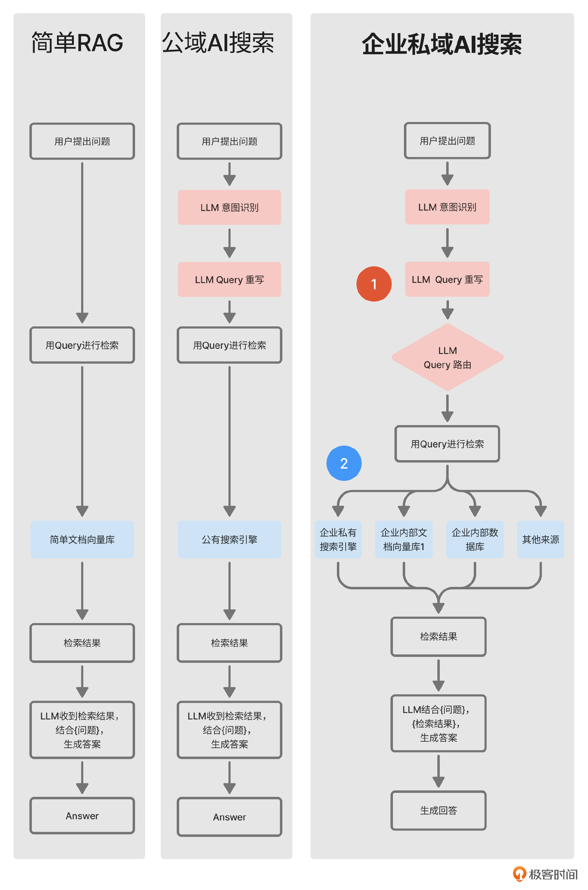
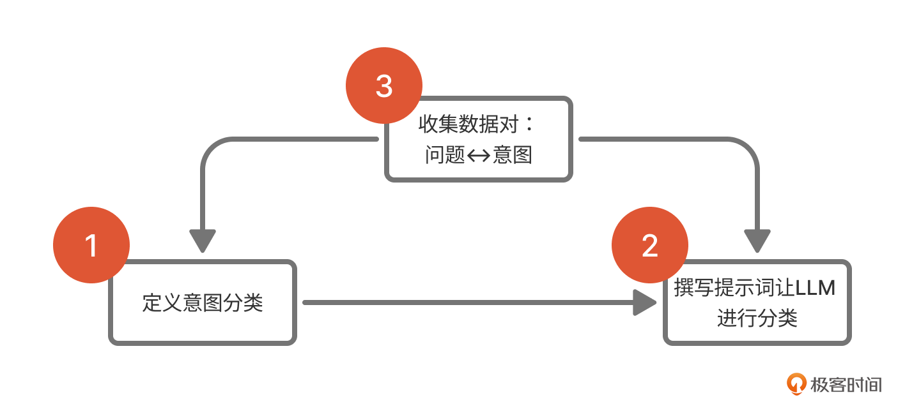
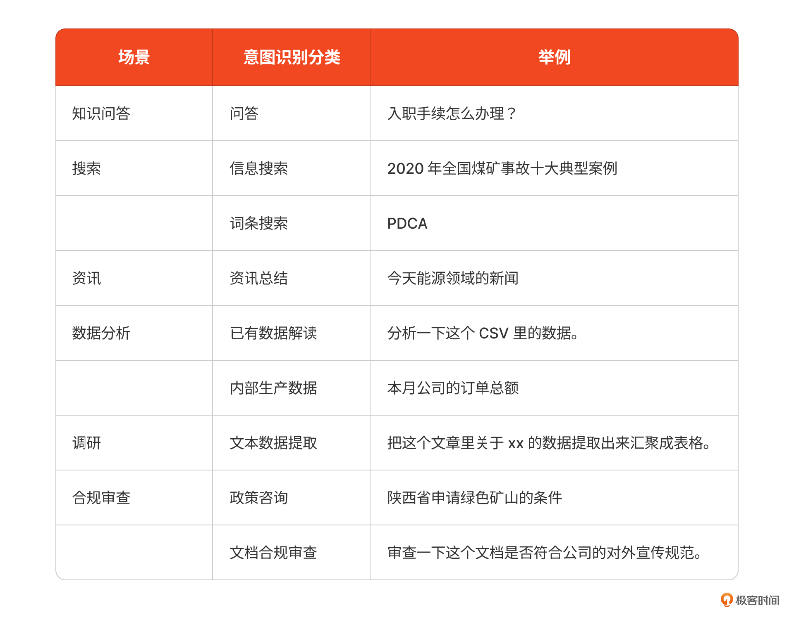

# 08 | 意图识别：做一个善于倾听的企业级AI搜索助手

你好，我是产品二姐。

在前两个案例中，我们构建的产品是解决单一场景的问题，在技术上分别侧重 RAG、提示词工程单项技术的运用。但在产品经理这个岗位上，我们也会遇到另外一种情况，尤其是对某些大型企业客户，也就是 KA（Key Account）客户，他们往往需要的是一整套解决方案。

接下来的这个案例就属于这种情况，咱们会利用 3 节课的内容一起设计一个完整的企业级知识管理 AI 升级解决方案。

你将会看到：

第一节，我会从企业级的 AI 搜索应用这个需求谈起，对 AI 搜索这类产品做一个全景概览，重点讲述 AI 搜索类产品中意图识别。这相当于首先让你的产品学会倾听、理解用户的真实意图。而意图识别也是各种“对话类”产品中的必做部分。

第二节，在倾听、理解后，就是转述用户诉求，即 Query 重写，以便于最大化地检索到匹配的内容。

第三节，在这部分会用提示词工程，让 Agent 具备规划、反思能力、工具使用能力，也就是01 节提到的，让 Agent 从第二级迈向第三级。

这三节结束之后，你可以通过同样的思路举一反三来解决企业中 70% 的知识类场景，并且整个案例会进阶使用到 RAG、提示词、Agent 设计这三项工程类技术。在你未来的岗位上，可以灵活运用，随时拿出来作为参考。

## 需求发现

2024 年初，有个叫 Perplexity 的 AI 搜索产品获得千万用户的使用，并被英伟达 CEO 黄仁勋推荐，得到广泛传播。

我用两句话来对比 AI 搜索与传统搜索的区别：

- 在 Google 里，用户输入的是陈述性的关键词，比如“陕西省申报绿色矿山规定”，得到的是若干个网址链接。

- 而在 Perplexity 里，用户输入的是 What、Why、How 的问句，比如“陕西省申报绿色矿山有什么要求”，得到的直接是一个答案。



如果我们将知识管理分为“知识获取 -> 知识调用 -> 知识生产”三个步骤，那么 AI 搜索就是将传统搜索的知识获取升级到知识调用，把计算机对知识的处理能力整体向前推进了一步。

AI 搜索在 C 端市场的运用也刺激了企业用户的诉求，我们的客户很自然地就想到了将 AI 搜索用在企业的私域中。尤其是在大型企业的运作中，每家企业都有自己的私有知识，而公域的AI 搜索不能解决企业内部的问题。

在这样的需求诞生的同时，我们也看到前阿里达摩院副总裁贾扬清在一次 Demo 中使用 500行代码就实现了 AI 搜索，并且将代码开源。

有需求，有开源的实现方法，就促成了项目的启动。

## AI 搜索背后的技术实现

AI 搜索中最核心的技术是 RAG， 但它比我们在第一个案例中的 RAG 更加复杂。我用一个图来对比一下我们之前讲的简单 RAG 和 AI 搜索里的步骤。为了更加强调二者的不同，我省略了图中 RAG 的详细步骤，如果需要复习 RAG 流程的同学可以参考 03 节的内容。



在这张图里，你会看到企业私域 AI 搜索、公域 AI 搜索和 RAG 搜索相比，有两处不同。

第一处不同是，在检索数据源之前，企业私域 AI 搜索需要对用户输入的 Query 做三次处理。

1. 意图识别。

2. Query 重写。

3. Query 路由。

前两步本质上是将自然语言转换为适合大语言模型提示词，你可以理解为语言的预处理。而第三步 Query 路由就像是一个问题分发器。比如当用户的问题和 HR 相关，就去 HR 知识向量库里去寻找；如果和技术相关，就去技术知识向量库里去找；如果同时和两个向量库相关，那么也可以同时去两个向量库里寻找。

第二处不同是资料来源不同。

- 简单 RAG 的资料来源是用户指定的文档。

- 对于公域 AI 搜索来说，资料来源是搜索引擎给出的结果。

- 对于企业来说，大部分情况下，资料来源是企业内部的知识库；当然如果企业知识原本有比较好的搜索支持（比如有的企业会直接使用 Algolia 这类的企业级 Search 服务来支持企业内部 wiki 的搜索），也可以是原有企业知识库里的搜索结果。

注意，资料的来源会根据企业自身情况不同而不同，我们在这里就不进行详细论述。这节课我们重点说意图识别。

## 企业 AI 搜索中意图识别

简单来说，意图识别就是让计算机从语言表述中探查用户真正想要做的事情。

我们通常的做法是首先定义意图分类，然后将用户意图进行分类，按照分类选择不同的解决路径。因此，在特定场景下，意图识别更准确的叫法应该是“意图分类”。

比如在银行客服这个场景，可能会定义以下几个类别：

- 存款

- 取款

- 查询

- 理财

- 办理银行卡

- 其他

- 不相关

我们需要将用户的意图分在这几类业务中，然后导向不同的路径去执行后续业务流程。

实际上，意图识别的诞生最初就是为了服务对话机器人这类场景。因为在对话里，用户的输入不是通过点击某个确定页面、按钮、选项来实现的，而是通过任意语言来实现的。类似的企业内部 AI 搜索这个场景里，用户的输入同样也存在很强的不确定性。

在这种情况下，意图识别会有两个好处。

一是分类有助于在 AI 搜索的后续流程中展开不同的处理方式。比如当用户输入“招商银行官网”时，直接输出官网网址即可，无需展开 AI 探索的过程；当用户输入“招商银行有哪些稳健的理财产品”时，则全网搜索这个问题，再进行总结。

二是可以把它想象成问题过滤的阶段，比如在银行场景中，当用户输入 “xxx 的父亲是谁”之类不相关的问题时，可以把这些“噪音提问”过滤掉，无需占用内部资源。

在大语言模型还没有被广泛认可的时候，意图识别是自然语言处理学科中的一大复杂工程，算法工程师们要针对不同场景训练不同模型。这个训练过程有以下五步，其中每一步又都会细分出一些选项。


而在大模型出来之后，这样的分类能很轻松地通过几句提示词来解决。

```
## task：
```

- 用意图标记来自对话的用户消息。仅使用意图的名称进行回复。

- 这些意图标记必须是从以下选项中选择一个或多个：

```
- 存款
- 取款
- 查询
- 理财
- 办理银行卡
- 其他
- 不相关
## Few shots
对话："存1000到我的尾号是3432的储蓄卡"
Intent: 存款
...[略]
## input
对话："最近有什么稳定收益的理财产品"
Intent:
```

而且，随着用户使用的次数变多，我们还会收集到新的意图分类，再把这些新的意图分类更新到意图列表里，通过这个迭代过程，意图识别的分类会越来越多，也会变得越来越准确。

于是，意图识别就变成了下面这样的流程。



通过这种对比我们可以看到，大语言模型不仅颠覆了旧有方法中的选择机器学习模型、训练模型、评估模型这三个步骤，同时由于语义理解能力的增强，意图分类能力也会更强。颠覆且更强，这就是典型的技术革命出现的标志。

接下来，我们再借着这节课的“企业 AI 知识搜索”案例，来看看怎么进行意图识别。

1. 定义意图分类

借用上个案例场景扫描的思路，我们甚至可以把所有知识类场景作为意图分类的定义，这种分类是按后续的回答流程来分类的。比如数据分析类的意图，可能要走查询数据库的流程，而咨询总结类的意图，要走查询当天专业新闻的流程。



2. 撰写提示词，让 LLM 分类用户意图

我们简单定义上述分类，并将表格中的例子作为提示词的 few-shots，然后使用大语言模型，即可对用户的提问进行意图识别。

```
## Role：意图识别能手
## Task：
```

- 对用户的要求和语言能进行分类，分类包含以下种类

```json
{分类列表}
如果不在分类列表里，将intent 定义为"其他"。
如果用户询问私人生活问题时，将intent 定义为"不相关"
## Few shots:
User: 审查一下这个文档是否符合公司的对外宣传规范
Intent: 合规审查
User: 本月公司的订单总额
Intent: 内部生产数据
/* [略]*/
## 格式
/*[定义输出格式]*/
## initilization
{
 "User": {User request}
 "Intent":
}
```

当然，我们还有其他方法来获得分类，比如：

- 如果企业内部有原有的搜索记录，则可以从历史的搜索关键词开始突破，通过人工 + 大语言模型辅助的方式来总结出分类。

- 如果企业的知识库有较好的垂直分割，则可以按照垂直业务总结出 HR、IT、财务报销、销售知识、售后等类别。

3. 意图分类迭代

随着用户使用次数的增多，我们不断收集用户搜索行为，将意图识别做得越来越准，让 AI 搜索工具的倾听、洞察需求的能力越来越强，之后的 AI 搜索才能在企业应用时输出准确的答案。

到这里可以看到，原有的意图识别过程在大语言模型出来之后，在速度和效率上几乎是有百倍的提升。

## 阶段复盘

最后，我想总结一下这一节课中产品经理的具体工作。

一是需求发现：从一个 toC 应用爆发发现了 toB 应用的诉求。其实，toB 的场景往往不容易被人看到，这就导致我们在做 toB 场景的时候往往难以下手。从 toC 应用中参考是一个寻找场景的方法。比如 Google 搜索就带动了企业内搜索的工具 Agolia 等一批公司的诞生，这在 AI 行业也是类似的。

二是需要为 AI 产品的意图识别收集有效的数据，选择合适的维度来定义意图分类，并调教好提示词让大模型能正确识别意图。意图识别的应用范围非常广，学会了如何做 AI 搜索里的意图识别，其他场景的意图识别也可以举一反三。这一部分类似于之前在互联网产品经理时的数据洞察工作，产品经理需要从已有的业务诉求和数据中持续观察、总结。

那么，当 AI 搜索工具通过意图识别学会倾听之后，接下来就是让它学会将自己的理解用适合机器检索的方式表达出来，也就是 Query 重写和 Query 路由。我们下节课继续。

## 课后题

在这个案例中，我们看到了一个企业构建私域 AI 搜索的过程，其实用同样的方法，你也可以用 Coze 或者 Dify 像我们在第一个案例中一样，打造一个自己个人的私域 AI 搜索。

你可以将你熟悉的语料，比如你关注的微信公众号内容、知乎问答等按照领域分类，然后将你平时在学习、工作中遇到的问题积累起来，也按照这个领域进行分类；这样你就得到一系列的“问题 <-> 意图分类”数据对。

然后，选定一个大模型（比如智谱的 ChatGLM)，看看模型是否能对你的问题进行准确的意图识别，如果不能，考虑修改你的提示词，直到可以准确识别为止。

这样你就完成了打造个人私域 AI 搜索的第一步，为下一节的练习做好准备。

欢迎你在留言区和我交流。如果觉得有所收获，也可以把课程分享给更多的朋友一起学习。我们下节课见！

>> 戳此加入课程交流群
