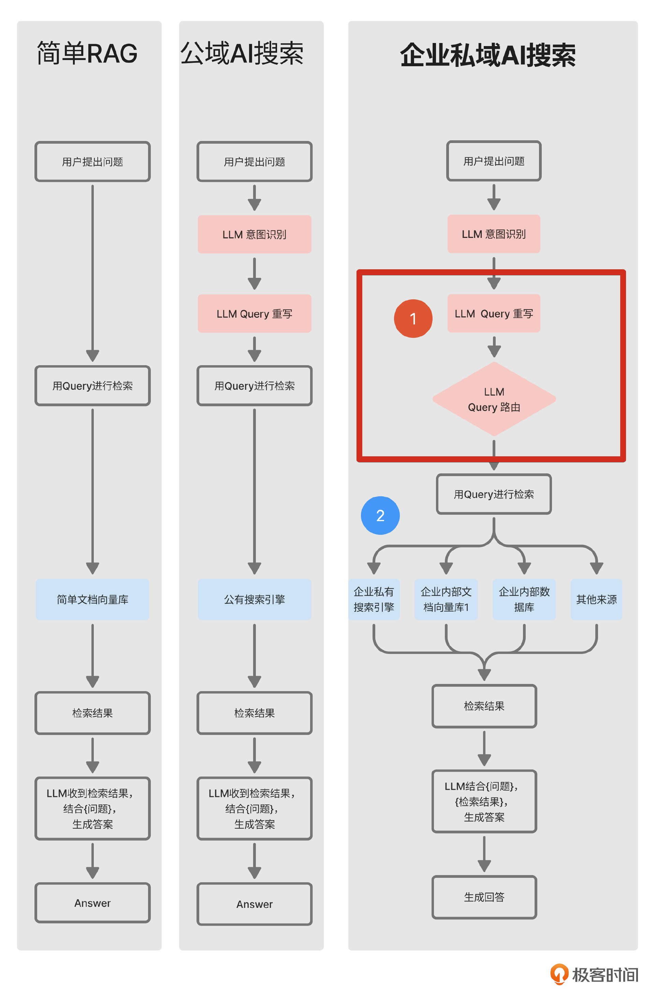
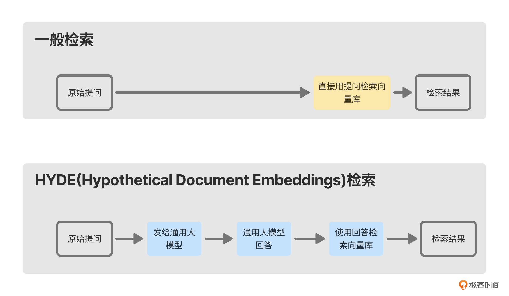
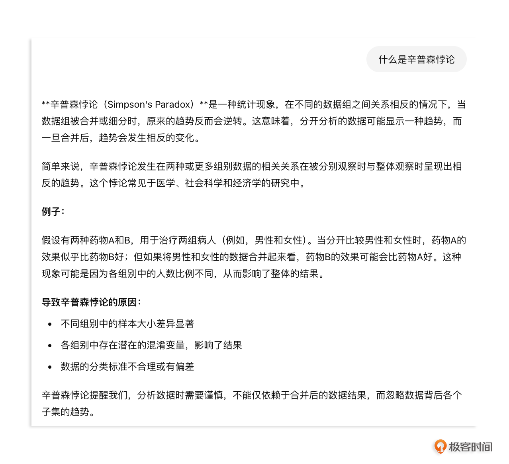
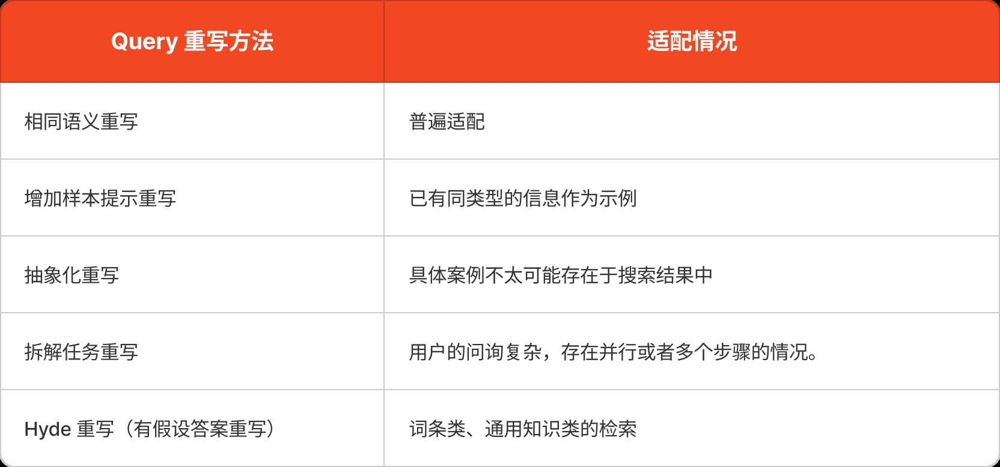
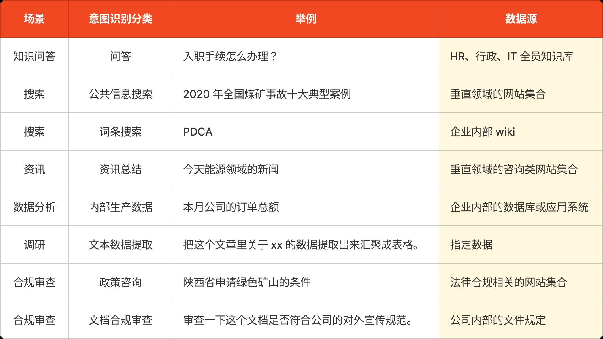
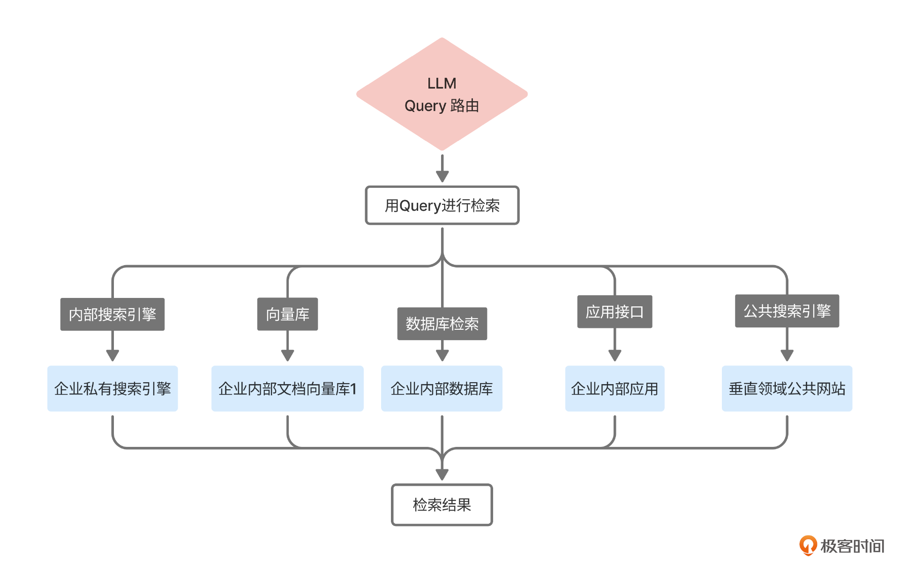

# 09 | Query重写与路由：让企业级AI搜索匹配更准确

你好，我是产品二姐。

接着上节课的意图识别，今天来讨论企业 AI 搜索中的 Query 重写和 Query 路由。在开始之前，我再用下面这张图帮你回忆一下 Query 重写和 Query 路由在企业私域 AI 搜索中的位置。



OK，我们直接开始。

## 企业 AI 搜索中的 Query 重写

看字面意思，Query 重写就是把用户的输入换一种说法来写。为什么要这么做呢？我们上节课提到，AI 搜索本质上是一个复杂 RAG 系统，而 Query 重写的目的就是增加 RAG 中Retrieval 命中的几率。

不知道你还记不记得，我们第一个实战案例《智能说明书》中提到过一个例子：当用户输入了某个问题时，单纯通过向量检索无法找到对应的文本块，最后将检索方法修改为关键词 + 向量混合检索后就解决了问题。

顺着这个思路，我们可以反过来思考，除了优化检索方法，是不是也可以优化检索词呢？这个优化检索词的方法就是 Query 重写。因为我们一般会使用关键词 + 向量混合检索的方法，所以 Query 重写也有两个思路。

- 一是让 Query 能更大程度地切中关键词，以适应关键词检索。

- 二是让 Query 能更大程度地贴近被检索知识库中的文本块向量，以适应向量检索。

和意图识别一样，我们也可以使用大语言模型来做 Query 重写。Query 重写有不同的策略，每个策略对应不同的提示词，今天主要介绍五种常见的策略。

1. 相同语义重写。

2. 样本提示同义重写。

3. 抽象化重写。

4. 拆解任务重写。

5. Hyde 重写（有假设答案重写）。

这些策略可以组合使用，我们一个个来看。

### 策略 1： 同义重写

同义重写就是将用户的 Query 进行同义词转换。比如当用户询问“如何办理入职”时，可以改写为：

- 入职手续如何办理。

- 如何完成入职流程。

- 如何进行入职手续。

- 新人必读。

提示词可以是：

```
## Task：
```

- 根据给定问题，问询生成多个具有相同含义的表述，表述中可以有一样的词语，但不能完全一致，不要重复输出

```
返回5个不同版本。
## output format
[略]
```

这种改写可以增加关键词命中的概率，比如，假设 RAG 的语料原文是“入职手续”，那么与用户的初始提问“如何办理入职”相比，重写后的“入职手续如何办理” 在关键词匹配度上更接近“入职手续”，那么对应的文本块也就更容易被搜索出来。


### 策略 2：样本提示同义重写

少量样本提示重写就是增强版的“同义重写”，在同义转写的提示词中给出例子，使得同义转写更加准确。

比如含例子的同义转写会是下面这样：

```
## Task：
```

- 根据给定问题，问询生成多个具有相同含义的表述，表述中可以有一样的词语，按不能完全一致，不要重复输出

```
返回5个不同版本。
## few shots
{
"user request": "长城到底有多长啊?我去年去看的时候走得好累"。
"rewrite": "长城的总长度是多少?"
},
{
"question": "我记得1斤是500克,那1公斤等于多少斤呀?"。
"rewrite": "把1公斤转换成斤"
},
{"question": "这段古诗写得真美,你觉得作者想表达什么意境呢?"
"rewrite": "这首诗的主要意境是什么?"
}
## output format
[略]
```

这样，同义检索会更加准确。

### 策略 3：抽象化重写

这类方法的英文名叫 step-back 重写，是指从具体到抽象，比如用户问：

- 张三今天入职，他已经办完人事部门的手续，行政部门手续，还需要办什么手续？

可以改写为：

- 公司的入职流程中，办完人事和行政手续后，还需要办什么手续？

将实例抽象化的好处是可以增加检索成功的概率。因为改写之后，“张三”这个词不会出现在被检索知识库中。这种方法和刚才提到的增加样本提示重写策略正好相反。我把它称为增加样本提示重写的“逆向方法”。

具体的参考提示词是：

```
## 角色：
```

- 您是解决特定问题并提取更通用问题的专家，该问题可以找到回答特定问题所需的基本原则。

```
## 任务：
```

- 给定一个特定的用户问题，写一个更通用的问题，该问题需要回答才能回答特定问题。如果您不认识某个单词或缩写词，请不要尝试重写它。写简洁的问题。

```
## output format
[略]
## input
{user request}
```

### 策略 4：拆解任务重写

也就是将用户的输入拆成多条搜索 Query，比如当用户问“山东和陕西两省最近有什么能源类的新闻”，就可以拆解为“山东省最近有什么能源类的新闻” 和“陕西省最近有什么能源类的新闻”。

在这类问题中，用户 Query 包含多个问题，我们需要分别搜索，然后进行汇总。参考的提示词可以是：

```
## 角色：
```

- 您是一个查询任务拆解助手，可以根据单个输入查询生成搜索查询。

```
## task：
```

- 给定一个用户问题，将其分解为不同的子问题，您需要查询完这些子问题才能回答原始问题。如果有您不熟悉的

### 策略 5：HyDE重写（有假设答案重写）

HyDE 的全称是 Hypothetical Document Embeddings，直译的中文很难理解，我把这种策略按照意思翻译为：有参考答案的检索。意思是检索前先把用户问题发给大语言模型，让大语言模型给出答案，然后将用户的问题和答案一起作为 Query 进行检索。



这个方法一般用在通用的词条搜索，比如用户搜索“什么是辛普森悖论”，大语言模型会输出如下文字。



然后我们将这段文字一起作为 Query 进行检索，在某些时候会增加向量命中的概率。

我把上述这些方法总结在下面的表格里。



其实 Query 重写的方法还有很多，比如将用户步骤拆解为小步骤分步检索。 但万变不离其宗，Query 重写最根本的目的就是增加 retrieval 的几率。

到这里，你肯定会发现：哦～原来 Query 重写就是使用不同的提示词转写成不同的方式，这个简单～

但是下一个问题又来了：咱们有这么多的方法，那到底什么时候该用哪种方法呢？

我的回答仍然是：以用户的真实数据作为 few shots，让大语言模型自己来选择。你可以在提示词中写：选择合适的方法来重写 Query，你有几种方法可以写，其中方法 A 适合什么样的情况，方法 B 适合什么样的情况，并举例说明。

具体的提示词可能是下面这样的。

```
## Role：
query重写高手
## Task:
given a query, rewrite the query...
## few shots
Query: "张三今天入职，他已经办完人事部门的手续，行政部门手续，还需要办什么手续？"
rewrite as: "公司的入职流程中，办完人事和行政手续后，还需要办什么手续？"
Query: "如何办理入职"
rewrite as: "入职手续如何办理。
```

- 如何完成入职流程。如何进行入职手续。

```
新人必读。"
...[略]
## input：
```

这样，我们就完成了 Query 重写的过程。 接下来就是 Query 路由了。

## 企业 AI 搜索中的 Query 路由

Query 路由简单来说就是为 Query 找到正确的数据源。Query 路由具体就是做三件事：

1. 定义数据源分类

2. 定义数据源的检索方法

3. 定义路由规则

我们一个个来看。

### 定义数据源分类

数据源的分类可从多个维度来分，同时可以参考意图识别的分类。比如我们在上节课将企业AI 搜索的意图识别分为以下几类，相应的可以列出对应的数据源。



定义好分类之后，就类似于你在 Coze 和 Dify 中建立了不同的知识库，这些知识库的形式可能是企业内部的 wiki、某些垂直领域的网站、企业内部的数据库或者应用系统的接口返回。

### 定义数据源的检索方法

数据源分类定义好之后，接下来就是要让这些数据源里的内容被快速检索到。检索有很多种方法，我在这里列出几种给你参考：

- 向量库检索，比如本章第一个案例《智能说明书》中，我们提到了向量检索。

- 指定文本信息提取，在第二个案例《文本数据提取助手》里提到了在指定文本里找到对应的信息。

- 公共搜索引擎，比如在 Google 官方提供的搜索接口中，可以指定搜索的网站范围。从而更精准地找到用户所需。

- 数据库搜索，比如用户询问“今天在 xx 设备的总共产量是多少”，这时候可能需要调用生产数据库来查询，或者调用某个应用接口来查询。

这一部分是产品经理辅助开发同学完成的，开发完成之后，这些方法就被包装成一个个引擎，也就是访问不同数据源的接口，将 Query 作为一个参数输入接口，就能检索到对应的内容了。因此之前图中 Query 路由部分会变成下面这样。



### 定义路由规则

前两步准备好数据源和检索方法后，第三步就是定义“什么问题要去查哪个或者那几个数据源”。这一步最简单的方法就是用大语言模型来解决，你需要在提示词里描述清楚 3 件事。

1. 用户的问题是什么，就是 Query 对应的意图识别、Query 重写后的结果。

2. 数据源的定义和内容描述。

3. 数据源的访问方法。

其中，第三步的访问方法在开源框架 LangChain 和 LlamaIndex 中都有开箱即用的函数可以直接使用。

听到“函数”不要害怕，这里我们以内部生产数据问答和文本数据提取为例来写一段提示词，来说明大语言模型是如何选择路由的。

```
##Task
```

- 给你一个用户的查询问题，从以下内容中选择可能从中检索到问题答案的数据源。

```
## 数据源
[
 {
    "Routername":"QueryDatabase",
    "RouterDescription": "企业内部的数据库或应用系统，可以回答公司内部应用的私有生产数据等内
   "用户查询举例":
     [
       "5月份的总销量是多少",
       "今年2月的生产量是多少"
     ]
  },
 {
   "Routername":"ExtractTextFromDoc",
   "RouterDescription": "执行用户指定的数据源的工作",
   "用户查询举例":
     [
     "把这个文章里关于xx的数据提取出来汇聚成表格"
     ]
 }
]
## Input：
```

- 用户查询：把这个文章里关于煤矿产量的数据提取出来汇聚成表格

```
Router：
```

你可以看到，为了让大语言模型做好 Query 分发到哪条路径的选择题，我们需要详细描述每条路由的名称（Routername）、描述（RouterDescription）、可以完成的 Query 举例等。

这个思路和我们在 03 节中提到的 Agent 的 Function Calling（函数调用）有点类似。在函数调用里，我们有时候也会把几个函数的 schema 作为提示词发给大语言模型，让大语言模型根据用户的诉求来选择其中一个函数。

实际上，这节课里提到的数据源中也用到了函数调用，比如我们需要调用 Google 搜索接口来获取公域信息，调用 Text2SQL（将自然语言文本 Text 转换成结构化查询语言 SQL）来获取数据库里的内容。

不知不觉中，我们就来到了如何让 Agent 学会使用工具的实战里，别急，关于 Agent 实用工具的更多内容，我们会在下一节课好好聊聊。

## 小结

最后，我们再来回顾一下产品经理在 Query 重写、Query 路由中的两项工作。

- Query 重写是对搜索发起方的输入进行打磨，让 Query 更容易匹配到正确的内容。

- Query 路由是对被搜索对象进打磨，让搜索对象更容易被检索到。

在 Query 重写部分，产品经理需要针对各种 Query 采用合适的重写方法，使得改写后的Query 比原有 Query 更精准地检索到正确内容。产品经理要经常收集这些 Query，同时，也要熟悉企业内部的检索资源，只有这样，才能让 Query 重写后更好地匹配到企业内部资源。

在 Query 路由部分，产品经理需要从不同维度梳理数据源，使得用户的 Query 能被更准确地分发到合适的数据源。

## 课后题

我们接着上一节课的作业说说这节课的任务。

上节课，你给自己的问题做了意图分类。接下来，请你对自己的问题做好分类，确定每种类别做合适的 Query 重写方法。之后将自己的知识库按工作、生活、学习这几个种类（或者其他维度）分类，建好知识库（你可以使用 Coze、Dify），然后做一个简单的 Query 路由，试着将你的问题路由到不同知识库进行回答。

你可以观察：

1. Query 重写对检索结果的准确率是否有所提升？

2. 你的 Query 是否可以正确地被路由到对应的知识库呢？

欢迎你在留言区和我交流。如果觉得有所收获，也可以把课程分享给更多的朋友一起学习。我们下节课见！

>> 戳此加入课程交流群
