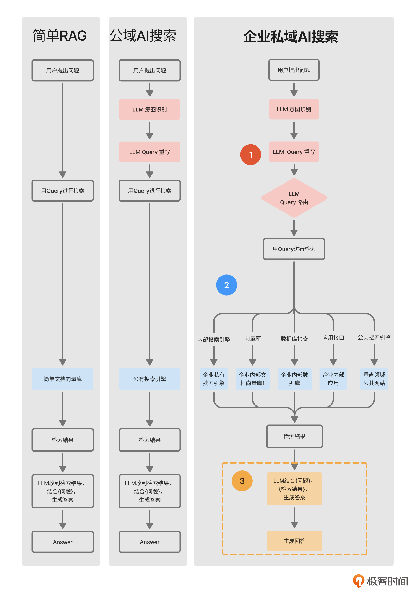
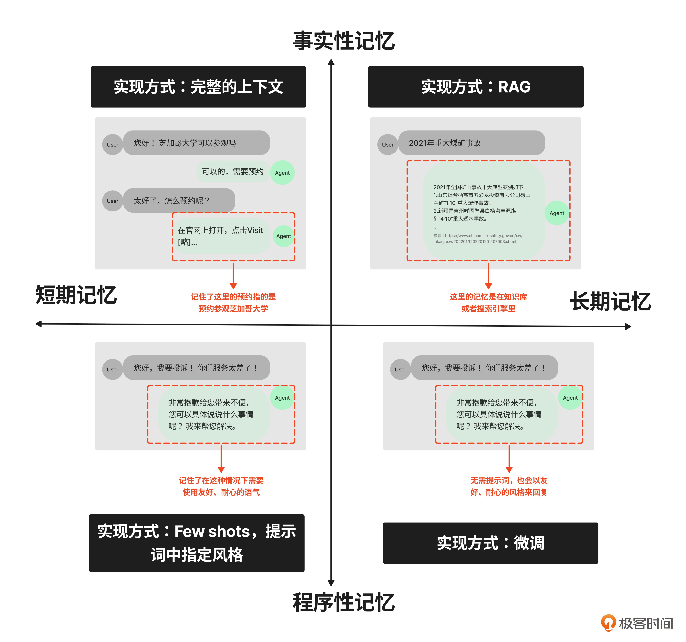
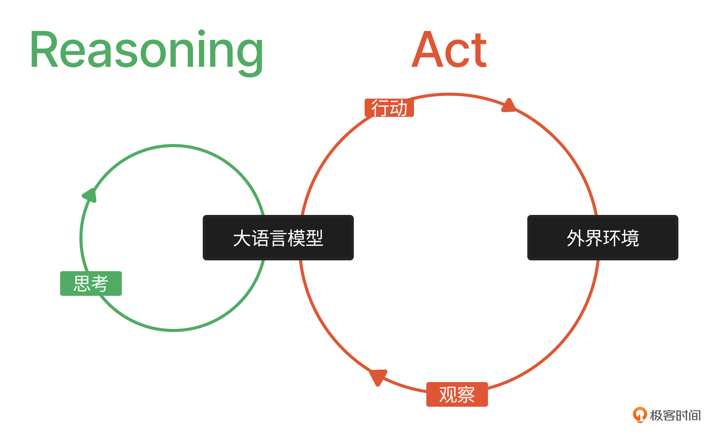
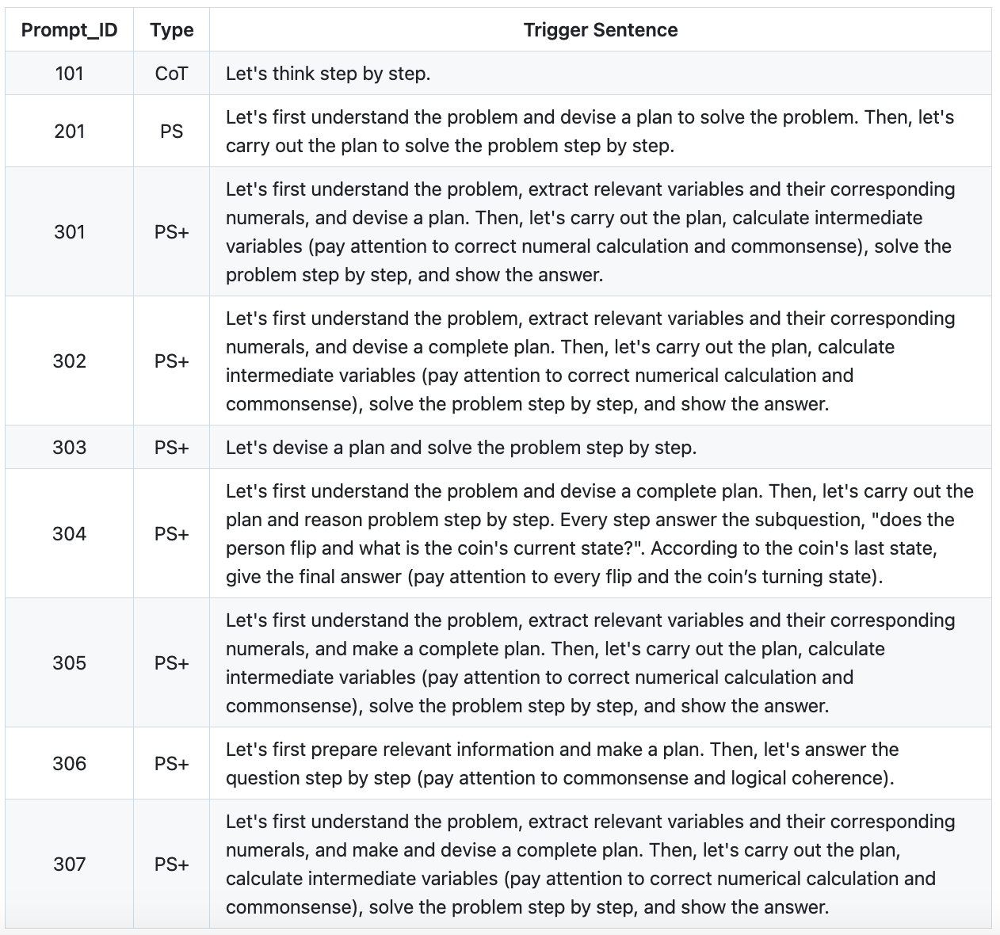
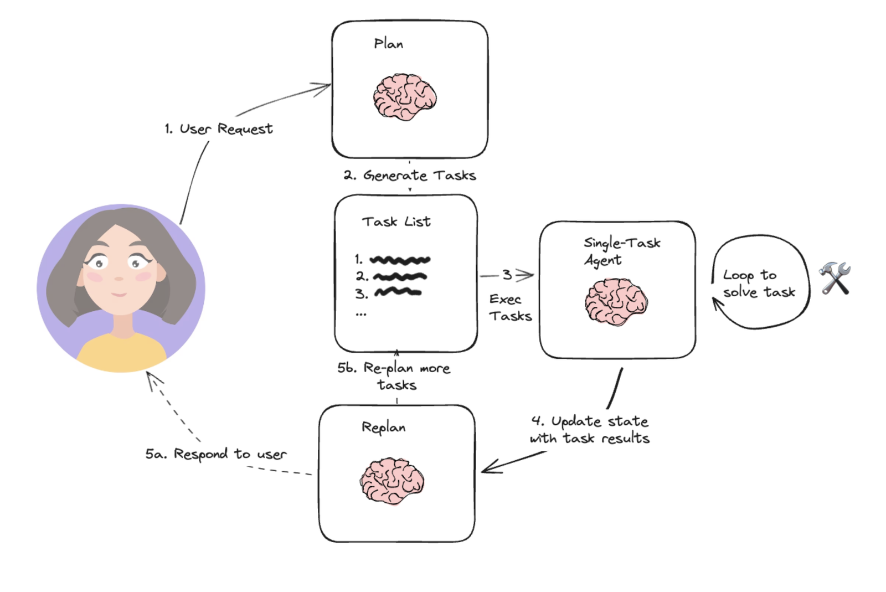
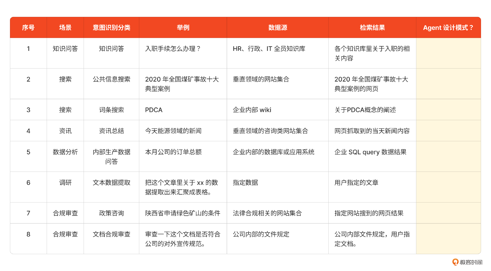
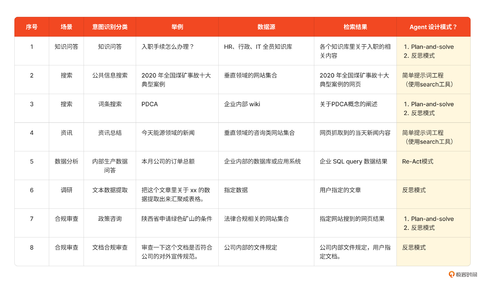
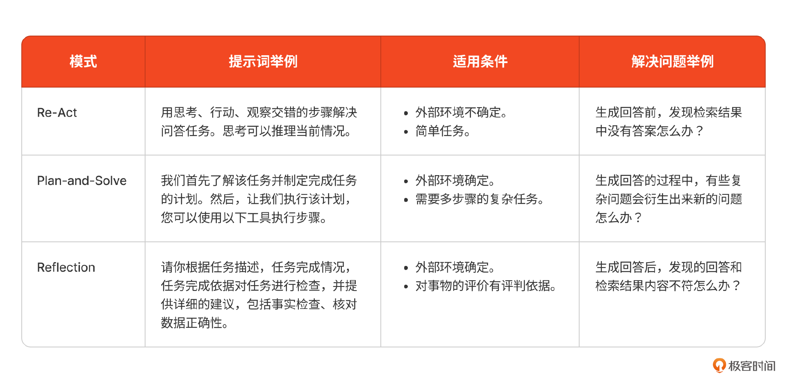

# 10 | 提升可靠性：选择合适的Agent的设计模式

你好，我是产品二姐。

接着前两节课里的那张流程图，这节课我们来讲述在 Query 路由之后，如何把检索结果生成回答，也就是图中标出的第 3 部分。



有的同学可能会问，咦？这一步难道不是直接把检索结果发给大模型，让它自己生成回答吗？有什么难的呢？

可是你有没有想过以下几种情况：

1. 生成回答前，发现检索结果中没有答案怎么办？

2. 生成回答的过程中，有些复杂问题会衍生出来新的问题怎么办？

3. 生成回答后，发现回答和检索结果内容不符怎么办？

接下来，我们就在这节课解决这些问题。

## 预备知识：Agent 的设计模式

生成回答这一步主要用的技术是 Agent 模式设计。我们讲过，Agent 设计中需要四大能力，即记忆、工具使用、规划和反思能力。这四项能力就像是大语言模型的外围设备，大语言模型只有在这些外围系统的支撑下，才能有更加可靠的发挥。

其中，记忆能力的实现方法在之前的课程中讲过，下面会总结。另外三大能力的实现就需要很多的设计模式，这节课，我会给你列举 3 个有代表性的设计模式。

### 1. 记忆能力

先总结一下怎么实现记忆能力。我把记忆能力用下面的四象限图来表示。（必看，不要跳过）



在这张图里，我从两个角度给记忆分类，对应着图里的纵轴和横轴。

纵轴是按照形式把记忆分为两种。

1. 事实性记忆：是指客观发生的事实，比如 “2018 年我曾经去过武汉”。

2. 程序性记忆：是指主观形成的风格，比如不同作家在长期的写作中不自觉地形成（记住）了的自己的风格。

而横轴是按照记忆的维持时长，分为短期记忆、长期记忆。

将这两个维度正交，就得到了四个象限。每个象限里的记忆能力在 Agent 里都有具体的实现方式，我标注在了图里。你可以看到，我们通过 Hard Prompting（提示词工程）、SoftPrompting（微调）和 RAG 就可以构建起 Agent 的记忆能力。

那么，除此之外，工具使用、规划和反思能力又是如何构建的呢？

### 2. 工具使用能力与 Re-Act 设计模式

在 03 节当中，你应该还记得一个例子：Agent 在调用查询天气的接口时，能自动根据返回的报错信息，将接口中 location 字段里的值从汉字“北京”调整为拼音 “BeiJing”，这种自我调节能力就可以通过 Re-Act 模式来完成。

我们再来看 Re-Act 论文中的提示词案例。

注：为了表述方便，我对原始提示词做了翻译，并在工具定义处做了强调（代码中3,4,5,12,16,20,24,28 行），原始的提示词大家看文末参考 2。

```
## Instruction
```

- 用思考、行动、观察交错的步骤解决问答任务。思考可以推理当前情况，行动可以分为三种类型：

```
(1) **Search[entity]**，在 Wikipedia 上搜索精确实体，如果存在则返回第一段。如果不存在，则返
(2) **Lookup[keyword]**，返回当前段落中包含关键字的下一个句子。
(3) **Finish[answer]**，返回答案并完成任务。
## One shot
```

- 问题：科罗拉多造山运动东部延伸到的区域的海拔范围是多少？

```
思考 1：我需要搜索科罗拉多造山运动，找到科罗拉多造山运动东部延伸到的区域，然后找到该地区的海拔范围
行动 1：**搜索[科罗拉多造山运动]**
观察 1：科罗拉多造山运动是科罗拉多州及其周边地区的造山运动（造山运动）。
思考 2：它没有提到东部地区。所以我需要查找东部地区。
行动 2：**查找[东部地区]**
观察 2：（结果 1 / 1）东部地区延伸到高原，被称为中部平原造山运动。
思考 3：科罗拉多造山运动东部延伸到高原。所以我需要搜索高原并找到它的海拔范围。
行动 3：**搜索[高平原]**
观察 3：高原是指两个不同的陆地区域之一：
思考 4：我需要搜索高原（美国）。
行动 4：**搜索[高原（美国）]**
观察 4：高原是大平原的一个子区域。从东到西，高原的海拔高度从大约 1,800 英尺上升到 7,000 英尺（
想法 5：高原的海拔高度从大约 1,800 英尺上升到 7,000 英尺，所以答案是 1,800 到 7,000 英尺。
行动 5：**完成[1,800 到 7,000 英尺]**
```

我们来认真看一遍提示词。

首先，在 Instruction 里面明确提到大语言模型需要以思考、行动和观察（Thought，Action，Observation）的交错步骤完成任务。而且，Action 中指定了三个工具：Search、Lookup、Finish，最后给出一个样本提示。注意，这里是指定工具来完成，而不是让大语言模型自己去“臆想”。在提示词里特别指定要使用工具，就是在打造 Agent 的工具使用能力。

类似地，如果我们想让查询天气的 Agent 能自动将接口中的汉字“北京”调整为拼音 “BeiJing”，也可以定义一些函数作为工具：

- RunAPIRequest，这个工具用来构造查询天气的 API request，并获得返回的 response。

- FixAPIRequest，这个工具可以根据 response 的内容修改 request。

- Finish，这个工具用来判断何时完成任务并返回答案。

最后在提示词当中加上一个样本提示，就形成了下面的提示词。

```
## Instruction
```

- 用思考、行动、观察交错的步骤解决问答任务。思考可以推理当前情况，行动可以分为三种类型：

```
(1) **RunAPIRequest**，构造API request，并获得返回的response。
(2) **FixAPIRequest**，根据response 的内容修改request。
(3) **Finish**，返回答案并完成任务。
## Few Shots
问题：使用getCurrentWeather查询今天北京的天气
想法1：用getCurrentWeather查询今天北京的天气，今天是2024年10月1日，地点是北京。
行动1：**RunAPIRequest[getCurrentWeatherSchema，"查询今天北京天气"]**
观察 1：返回错误信息："location must be English"
想法2：API返回错误信息，所以需要修改API，将Location的格式修改为拼音。
行动2：**FixAPIRequest[getCurrentWeatherSchema，currentAPIrequest，errorMessage]**
观察2：返回"success，北京今日天气：晴，32度"。
想法3：北京今日天气：晴，32度
行动3：**Finish**
```

注意这个提示词的 12-15 行，Agent 观察到并返回了一个错误信息。然后，我们将这个错误信息（errorMessage）、对应的 API 请求（currentAPIrequest）以及天气 API 的定义（getCurrentWeatherSchema）三项内容输入给大语言模型，它就可以自动修复原有 API 错误，完成正确调用。

类似地，在企业 AI 搜索场景中，我们也可以利用 Re-Act 模式来观察“检索结果中是否有答案”。如果没有答案，可以返回去重新开始思考 -> 行动的过程。

通过这个例子，我们看到 Re-Act 模式其实就是一种提示词模板（思考、行动和观察），能够引导大语言模型通过不断地实践学习（行动和观察）与理论学习（思考）完成任务。在这个过程中，行动和观察是通过外部工具使用来完成的，思考是通过大语言模型的语言理解、推理能力来完成的。

Re-Act 论文的作者姚顺雨曾在一次访谈中提到：

- 当年在构思这篇论文的时候受到两个方向启发：一是大语言模型的思考能力（Reasoning）被 Few Shots 和 COT 大幅提升，二是大语言模型也开始被用于指挥机器人行动（Act）上，将这二者融合就出现了 Re-Act（Reasoning and Act）。



所以，虽然我们通过 Re-Act 构建出了 Agent 的工具使用能力，但 Re-Act 绝不仅仅是工具使用。Ta 重在强调 Agent 能够根据行动反馈来随时改变决策。当 Agent 所处的“外界环境”有较强的不可预见性（比如你很难预测在执行一个 API 请求时，会返回什么样的错误信息），且任务比较单一时，就可以采用这种设计方式来加强 Agent 的执行力。

而另外一种情况则相反：当外界环境确定性比较高，但执行的任务要分步进行时，我们就需要构建 Agent 的规划能力。

### 3. 规划能力与 Plan-and-Solve 模式

Plan-and-Solve 模式受 COT（让我们一步步来）启发，因为 COT 本身就是列出任务的每一步，约等于制定计划的过程。

我们依然从论文原著里给出的提示词说起。



不难看出，这里的提示词本质上就是把零样本提示“让我们一步步来”做了各种增强。正如论文标题指明的《Plan-and-Solve Prompting: Improving Zero-Shot Chain-of-Thought Reasoningby Large Language Models》（提示词中指定要做规划：通过大型语言模型改进零样本思维链推理）。

举个例子，假设我们给 Agent 的任务是“完成某家品牌的调研工作”，提示词会这样写：

注：为了表述方便，我翻译了原始 prompt，并在有规划的地方做了强调（代码中1,8,9,13,17,21,25）。

```
给定一个任务，我们首先了解该任务并**制定完成任务的计划**。然后，让我们执行该计划，您可以使用以下工
- 搜索[您的关键字]
- 总结[内容]
- 完成[答案]
## 例子：
```

- 任务：创建关于阿迪达斯品牌的综合报告

```
**计划：**
1. **阿迪达斯简介**：
- 阿迪达斯品牌概述。搜索[阿迪达斯]总结[搜索结果]
- 公司简史和基础。搜索[阿迪达斯历史]总结[搜索结果]
2. **产品线和创新**：
- 列出并描述主要产品类别（例如，鞋类、服装、配饰）。搜索[阿迪达斯产品]总结[搜索结果]
- 突出显示公司开发的任何重大创新和技术。 search[阿迪达斯技术]总结[搜索结果]
3. **财务表现：**
- 总结近期财务指标：收入、利润、市场份额等。search[阿迪达斯财务]，总结 [搜索结果]
- 讨论历史财务表现趋势。extractRevenueData[阿迪达斯财务]，
4. **市场地位和竞争对手：**
- 描述阿迪达斯在全球市场的地位。search[阿迪达斯竞争对手]，总结 [搜索结果]
- 确定主要竞争对手并比较市场份额。
5. **结论：**
- 总结报告的主要发现。
```

上述提示词中包含 3 个部分。

1. 告诉大语言模型要做计划：“制定完成任务的计划”。

2. 提供三个可以使用的工具：搜索、总结、完成。

3. 给出一个示例：以“创建关于阿迪达斯品牌的综合报告”为例。

那么当用户输入“关于小米品牌的综合详述报告”时，Agent 就会按照这个思路首先制定计划，然后一步步执行。

但我们发现，在执行计划的过程中，Agent 还可能需要重新计划。比如在第四步“市场地位和竞争对手”中，首先要确定小米的竞争对手有哪些，然后调研他们的市场份额，最后再和小米的市场份额来比较，这里又形成了一个小的计划。我们把这个过程称为 Replan，这项任务我们会定义另外一个 Agent - Replanner 来完成。

在 Replanner 的提示词中，我们需要明确给出原始任务、原始计划和已完成的任务，防止Agent 走歪。比如调研小米竞争对手华为的时候，最后生成了华为的调研报告，这就不行。

下面是 Replanner 的提示词，我同样在 Replan 中重点的地方做了强调。

```
给定一个任务，我们首先了解该任务并**制定完成任务的计划**。然后，让我们执行该计划，您可以使用以下工
- 搜索[您的关键字]
- 总结[内容]
- 完成[答案]
**您的目标是：**
{input}
**您最初的计划是：**
{plan}
**您目前已完成以下步骤：**
{past steps}
**相应地更新您的计划。如果不需要更多步骤，您可以返回给用户，然后回复该步骤。否则，填写计划。只将仍
```

说到这，你应该发现了，这个 Replanner 可以解决“生成回答的过程中，有些复杂问题会衍生出来新问题”这一类情况。我引用下面这张图来说明 Plan-and-Solve 模式的流程。



图片来源：开源 Agent 开发框架 Langchain 社区

其实你也可以把 Replan的过程理解为执行原计划过程中的 Re-Act 动作。某种程度上讲，Plan-and-Solve既具备了确定环境下的规划能力，也具备了不确定环境下的“随机应变”的能力。

讲完了工具使用、规划能力，接下来讲反思能力。

### 4. 反思能力与 Reflection 模式

简单来说，反思能力就像老师检查作业，比如在“关于小米品牌的综合详述报告”这个任务中，我们可以在每次总结 [搜索结果] 后，加上一个“检查动作”，确保生成的总结和引用源（搜索结构）是保持一致的。

这个检查动作由另一个 Agent - Checker 完成。在 Checker 的提示词里，需要把总结内容、搜索结果、任务说明通通加上去。

- 给定一个任务，用户已经完成了该任务，请你根据任务描述，任务完成情况，任务完成依据对任务进行检查，并

```
**您的任务是：**
搜索[小米公司历史]，并进行总结[搜索结果]
**总结内容是：**
{总结内容}
**搜索结果是**
{搜索结果}
**您的建议、核查结果是**
```

这个提示词比较简单，这里就不再举例说明了。在实践中，反思能有效地提高准确率，这也能解决“生成回答后，发现的回答和检索结果内容不符”的问题。

到这里，我们通过三种设计模式初步构建出了 Agent 的工具使用、规划和反思能力，解决了咱们课程刚开始的时候提出的 3 个问题。在未来的产品设计中，你可以按需使用。为了方便你在不同场景能选用到合适的设计模式，我将它们的适用条件、提示词举例列在了下面表格里。在选择时，你需要观察具体场景的特点，按照这些条件分类，就可以选用到合适的模式。


实际上，除了这三种模式，我们还有很多其他的 Agent 设计模式（见文末参考 6）。在具体的产品建设中，你可以组合使用这些模式，构建起可靠的 Agent。

接下来，我们就以企业级 AI 搜索这个产品为例，来讲讲实际中如何选择这些设计模式。

## Agent 设计模式在企业级 AI 搜索中应用

我们以上节课中列出的场景表格开始。在原有表格的基础上，我增加了一列“检索结果”。也就是我们把用户的问题经过意图识别、Query 重写和路由后得到的检索结果，它相当于 Agent 所处的外部环境。

接下来我们就要选择合适的 Agent 设计模式，以合理的方式组织检索结果，并生成回答。



在和客户进行调研之后，我们初步得出以下结论。

1. 知识问答（1）、词条搜索（3）、政策咨询（7）这几个场景里的步骤会比较多，且不确定性比较高。

比如入职手续中会涉及各个部门要求办的入职流程，且有些部门的办理还有先后顺序；词条搜索可能需要用户了解一个完整的概念，需要一个类似维基百科的输出。因此这三类更适合采用Plan-and-Solve 模式，并加上一定的反思能力来构建回答。

2. 内部生产数据问答（5）的场景中步骤不多，但不确定性比较高。

比如在执行 SQL 的时候会出现执行失败，而执行成功后还要检查是否能回答用户问题，可能会通过多轮问询才能执行。因此采用 Re-Act 模式会比较好。

3. 在文本数据提取（6）、文档合规审查（8）场景中，任务相对简单，环境确定，且有评判标准。

比如在文本数据提取，被检索对象就是用户指定的内容，评判生成内容的标准也在用户指定的内容中，且提问也会比较明确；在文档合规审查的场景中，就是针对公司内部文件规定中的每一条，给文档进行“检查作业”的操作。在这里，被检索对象是用户指定的内容，并且有明确的评判标准。因此这两类场景中可以加上反思模式即可。

4. 公共信息搜索（2），资讯总结（4）这两个场景，确定性高。

在这两种场景中，一般 Agent 都能从公用的搜索引擎中检索到相关信息。并且，这里只是呈现客观信息，并不需要将信息处理为知识。因此对于大语言模型来说，难度相对较低。

综合上述的分析，我们就可以判定各个场景中使用的对应设计模式。



初步确定这些设计模式后，还需要在初始提示词的基础上根据真实使用反复迭代。这个迭代的过程是非常漫长的，可能要经过几个月甚至 1-2 年的迭代。到最后，你可能会发现本质上所有的 Agent 设计模式都是将人类的思维、管理模式以结构化 prompt 的方式告诉大模型来进行规划，并调用工具执行，且不断迭代（反思）的过程。

## 小结

这节课的内容，既是企业 AI 搜索这个产品实战里的最后一步，也是对 Agent 四大能力设计的总结。

我们分别使用了 Re-Act， Plan-and-solve 和 Reflection 三种方式来增强 Agent 的工具使用、规划和反思能力，来应对不同的场景，大家可以参考下面的表格来进行选择。



但 Agent 设计模式绝不止这三种，我们今天依然能看到有新的设计方法诞生，除此之外，我们有时也会在这些设计模式上根据需要进行改进。

从 08 到 10 这三节课，我们经过了意图识别、Query 重写及路由、回答生成三个步骤，完成了企业级 AI 搜索这一产品的实战。在回顾的时候，我们可以把企业 AI 搜索这个产品想象成一个善于倾听、表达、思维活跃的智者。

- 他首先会倾听你的想法（意图识别），通过上下文将你的问题归类到他早已整理好的问题分类里。这些问题分类可能是基于内容分的，也可能是基于问题的解决方法（要通过访问数据库还是调用搜索引擎等）来分的。

- 然后他转述成自己的语言（Query 重写），使用问题转述、拆解等方法尽可能地从自己的知识库中搜索到对应内容。

- 最后，他拿到这些检索结果后，反复审视（ReAct），重新规划问题解决思路（Plan-and-Solve）；并且在生成回答后还会再核对一下答案（反思）。这个过程会灵活运用各种工具来完成。

你想想，这样一个智者是不是每个企业和个人都需要的呢？

当然，一个理想的企业级 AI 搜索是需要经过很长时间的沉淀才能慢慢形成，除了需要在每个环节都精打细磨，更需要用户的积极使用和反馈。你或许现在不能复刻这样一个产品，但其中提到的每个环节、每项技术都可以被灵活运用在其他产品中。

## 课后题

在 08、09 节课，我们完成了个人私域 AI 搜索的意图识别、query 重写、路由，在 Coze、Dify 中的最后一步，大语言模型生成回答的时候，组合使用 ReAct 模式、Plan-and-Solve 模式、反思模式来回答问题。

你也可以尝试一个问题用 “ReAct 模式 + 反思模式” 和 “Plan-and-Solve 模式 + 反思模式” 来回答。看看到底哪种模式回答得更准确？

这个问题没有正确答案，希望你和我一起来探索、共同进步！

欢迎你在留言区和我交流。如果觉得有所收获，也可以把课程分享给更多的朋友一起学习。我们下节课见！

## 参考

1. ReAct 论文（ReAct: Synergizing Reasoning and Acting in Language Models）

2. ReAct 论文代码

3. Plan-and-Solve 论文（Prompting: Improving Zero-Shot Chain-of-Thought Reasoning byLarge Language Models）

4. Plan-and-Solve 代码

5. Langchain plan-execute

6. Agent 九种设计模式

>> 戳此加入课程交流群
