# 12 | 为什么企业级的微调不是炼丹是熬酱？

你好，我是产品二姐。

上节课我们留了两个问题：

- 问题一，如何让 Agent 正确地思考，让 Agent 学会工作流程。

- 问题二，如何让 Agent 正确地行动，让 Agent 学会 function calling。

为了带着清晰的思路上手操作，我们先来讨论解题思路。

这两个问题本质上是一种“程序性”学习，就像给入职员工做企业级的培训一样，用短时间培养一个熟悉业务操作流程的员工。具体到自助工单小助手这个场景里，就是客服人员需要学会标准化操作流程和步骤，即 SOP（Standard Operation Process）。

比如：

- 第一步，收到客户问题，在故障解决知识库里查询解决方案。

- 第二步，如果客户的问题需要上门，则去查询师傅可用时间。

- 第三步，和客户确认上门时间、地点等信息。

- 第四步，确认后提交工单，完毕。

我们把这些问题和处理步骤改写为 Think-Act-Observation 或者 Plan-and-Solve 类的提示词，把它们当做 few shots 放在 Agent 的提示词里。下次遇到类似问题时，Agent 大概率会做出类似的动作。

这个提示词会是这样：

```
##Few shots
**User**: 我家充电桩坏了，需要报修
**Think**: 首先，我需要在故障解决知识库中查找关于充电桩故障的解决方案。这可能需要上门维修，所以
**Action**: 查询故障解决知识库中关于充电桩故障的信息。
**Observation**: 知识库显示，充电桩故障通常需要专业技术人员现场检查和维修，无法通过远程指导解决
**Think**: 既然需要上门维修，我现在需要查询技术人员的可用时间。
**Action**: 查询技术人员的可用时间。
**Observation**: 系统显示最近的可用时间是明天上午9:00-11:00，后天下午2:00-4:00。
**Think**: 我现在有了可用的时间段，需要与客户确认具体的上门时间和地点。
**Action**: 询问客户的偏好时间和确切地址。
**Observation**: 北京市昌平区西二旗软件园2号楼302
**Think**: 客户提供了地址，但还没有选择上门时间。我需要向客户提供可选的时间段，并确认他们的选择
**Action**: 向客户提供可选的上门时间段并请求确认。
**Observation**: 明天上午9:00
**Think**: 我已经收集了所有必要的信息：问题描述、上门时间和地址。现在需要总结这些信息并提交工单
**Action**: 总结信息并提交工单。
**Observation**: 工单已成功提交到系统中。工单号为：CHB20241010001。
**Think**: 工单已提交，现在应该向客户确认所有细节并提供工单号。
**Action**: 向客户确认服务细节并提供工单号。
"非常感谢您的配合。我已经成功为您提交了维修工单。以下是您的维修服务详情：
工单号：CHB20241010001
```

- 问题：充电桩故障

```
上门时间：明天（10月11日）上午9:00
地址：北京市昌平区西二旗软件园2号楼302
```

- 技术人员将会在约定时间到达您提供的地址。如果您有任何问题或需要变更预约，请随时联系我们，并提供您的

```
**User**: [另外一个user request的示例]
...[略]类似上述的Think Observation Action过程
**User**:<User request>
```

在这段提示词里，前 31 行用 Think-Act-Observation 的模式描述了客服解决工单提交问题的过程。我们会有很多个类似的实例，对应 33、34 行的内容。在 36 行的时候，比如用户问，“充电桩有问题了，怎么解决”，那么，模型就会有一定概率按照你给的 few shots 来执行。

然后，我们将所有的 SOP 都按照这种方式来写，就会有很多的 few shots。这里的 SOP 改写可以借助大语言模型提升效率。比如我把下面的提示词给到 GPT4o，就会得到相应的 Think-Act-Observation few shots。

```
给你一个汽车售后客服，依据流程按照ReAct中的Think， action ， observation，写出3个few shot
```

- 第一步，收到客户问题，比如充电桩问题，或者汽车故障，在故障解决知识库里查询解决方案。第二步，如果客户的问题需要上门，则去查询师傅可用时间。第三步，和客户确认上门时间、地点等信息。第四步，确认后提交工单，完毕。

```
请在每轮Think-Act-Observation用分割线分割， Think-Act-Observation之间不要有空行。
```

然后得到如下回复，这个过程加速了 few shots 的生成。

```
### 示例 1
**客户问题**：我的电动车充电桩总是充不进电，该怎么办？
---
**Think**：首先需要在故障解决知识库中查询关于充电桩充电问题的解决方案。
**Action**：在知识库中搜索“充电桩充不进电”问题的解决方法。
**Observation**：找到了解决方案：1. 检查充电线连接是否稳固；2. 确保充电桩电源正常；3. 将充电桩
---
**Think**：这些步骤可以让客户自行排查。如果问题依旧，可能需要上门进一步检查。
**Action**：向客户询问是否尝试上述步骤，问题是否解决。
**Observation**：客户反馈问题依旧存在。
---
**Think**：查询师傅可用时间，以安排时间上门查看问题。
**Action**：查看系统中师傅的可用时间。
**Observation**：师傅在明天下午有空。
---
**Think**：与客户确认是否可以安排在明天下午上门服务。
**Action**：与客户确认明天下午的上门服务时间和地址。
**Observation**：客户确认可以。
---
**Think**：提交工单以安排上门服务，完成服务请求。
**Action**：在系统中提交工单。
---
### 示例 2
**客户问题**：我的车子引擎有不正常的噪音。
---
**Think**：需要先在故障解决知识库中查询关于引擎噪音问题的解决方案。
**Action**：在知识库中搜索“引擎不正常噪音”问题的解决方法。
**Observation**：获得解决方案：1. 检查引擎是否有异物；2. 核实机油水平是否正常；3. 检查皮带松
---
**Think**：可以让客户先进行简单检查，如果问题无法解决，则需要上门检查。
**Action**：告知客户自行检查步骤，并询问检查结果。
**Observation**：客户尝试后，问题仍未解决。
---
**Think**：需要安排师傅到客户处进行进一步检查。
**Action**：查询师傅可用时间。
**Observation**：师傅周六全天有空。
---
**Think**：与客户确认是否可以安排在周六上门检查。
**Action**：与客户确认周六的上门服务时间和地址。
**Observation**：客户确认周六可以。
---
**Think**：提交工单以安排上门服务，完成服务请求。
**Action**：在系统中提交工单。
---
### 示例 3
**客户问题**：我的汽车空调不制冷。
---
**Think**：在故障解决知识库中查询关于空调不制冷的问题解决方案。
**Action**：在知识库中搜索“空调不制冷”问题的解决方法。
**Observation**：找到解决方案：1. 检查空调制冷剂是否充足；2. 确保空调滤网没有堵塞。
---
**Think**：询问客户是否可以按照这些步骤检查一下，以便初步解决问题。
**Action**：与客户沟通自行检查步骤。
**Observation**：客户自行检查后，发现问题未解决。
---
**Think**：需要安排师傅上门进行专业检修。
**Action**：查询师傅的可用时间。
**Observation**：师傅在周三上午有空。
---
**Think**：询问客户是否可以安排在周三上午上门服务。
**Action**：与客户确认周三上午的上门服务时间和地址。
**Observation**：客户确认周三上午可以。
---
**Think**：提交工单以安排上门服务，完成服务请求。
**Action**：在系统中提交工单。
```

这样，我们就可以通过提示词中的 few shots 让 Agent 学会 SOP，这种通过 few shots 学习SOP 的过程，其实就是在复现 GPT-3 论文中提到的《language models are few shotslearners》，是不是瞬间把自己拉到了研究员的高度？

接下来，为了解决第二个问题：让 Agent 正确地行动，也就是上述提示词中的 Action 对应的动作要正确被执行，我们也可以在函数调用里加很多 few shots。

```
**User request：** 在知识库中搜索“空调不制冷”问题的解决方法。
**API schema：**此处略 [知识库搜索接口SearchSolution的schema]
**API request：**  SearchSolution(Error = "空调不制冷")
---
**User request：**查询师傅的可用时间。
**API schema：**此处略 [师傅可用时间查询接口SearchAvailableTime的schema]
**API request：**SearchAvailableTime()
---
[此处略，很多few shots]
**User request：** <用户的实际问题>
```

但到这里很多企业就开始犹豫了：函数调用的提示词需要把企业内部的 API schema（提示词中的第 2、8 行） 也发给通用大模型，这～不等于把自己家的接口设计逻辑放网络上“裸奔”了么？ 而且，这样做相当于把自己的业务依赖于别人的服务上，这可不行！那有没有什么其他办法呢？

[二姐看了一下百宝箱]，当然会有，那就是：微调自己的模型，然后私有化部署。这样数据、模型都专属企业自己，不用担心“裸奔”了。

## 为什么企业需要微调？

除了安全之外，微调并私有化企业专属的模型还有两个好处。

一是在企业专属的领域，微调会让 Agent 的输出更准确。

对大多数业务型企业来说，它们并不需要一个能力很强的通用模型，而是一个熟悉自身业务的专属模型。从理论上讲，使用企业专属数据微调过的模型肯定会更专业；从实践中讲，我个人以及身边人的经验，还有诸多论文的实验结果，都表明微调过的模型比不微调的模型在企业专属数据集的测试当中，准确率会有 10% 左右的提升。

二是长期来看，在专属业务使用私有化部署微调模型的成本会降低。

你可能会奇怪了，大家都说私有化部署模型的成本会高，二姐怎么会说低呢？我来给你展示这样一张图：

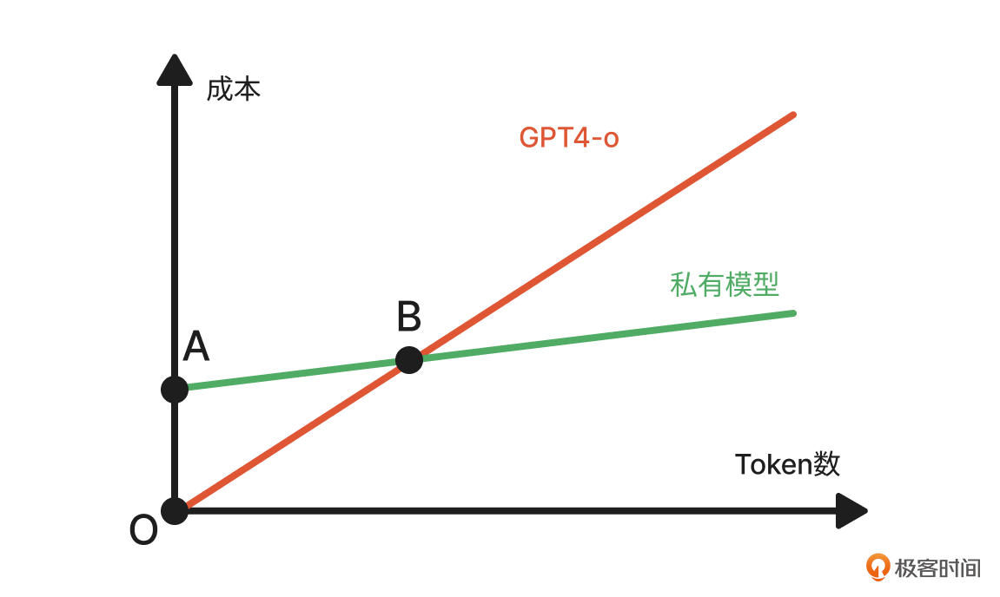

这张图里，红线是使用通用大模型（比如 GPT4o）的成本，绿线是使用私有化部署模型的成本。私有化部署模型的成本起点会比较高（用线段 OA 表示），在我们的案例里大概是几千 -几万元，但部署后的使用成本会比通用模型低很多。当我们的业务量（token 消耗量）增长到B 点的时候，采用私有模型的成本就会跑赢通用模型。

为了进一步降低私有化模型的启动成本（线段 OA 的高度），我们可以选择一个比通用模型参数量更小的模型。二姐通过一些论文和自身实践看到：在专属非推理类的领域，参数量较小的模型经过微调后可能会达到或接近通用大模型的能力。这就像狗狗的大脑在通用能力上确实比不过人类大脑，但狗狗大脑在嗅觉这个专属领域却可以超过人脑。

关于成本的详细计算我们会在第 16、17 节课细细讲述，在这里二姐希望通过这种对比来消除大家对微调成本的忧虑，千万不要“谈虎（微调）色变”。

既然企业确实有微调模型的需求，我们就来看看如何开启微调过程。在这之前，我从一个产品经理的视角和你说说微调的原理，这部分只需要我们理解，并不需要实践。

## 用千层饼加酱来学习微调过程

在我看来，微调模型就像给一个“千层饼加酱”的过程，看到这里，你会不会咽了一下口水呢？接下来我就和你聊聊这张“千层饼”。

第一章里，我用了水流网络图来讲述神经网络原理。这张图的每一层神经元之间有 M x N 个管道。其中，M 是上一层的神经元个数，N 是下一层的神经元个数。这 M x N 的管宽度值就是模型的参数。

我们把这 M x N 个数值放在数学概念里，就是一个矩阵，我把它比作千层饼中的一层饼（图中红色所示）。

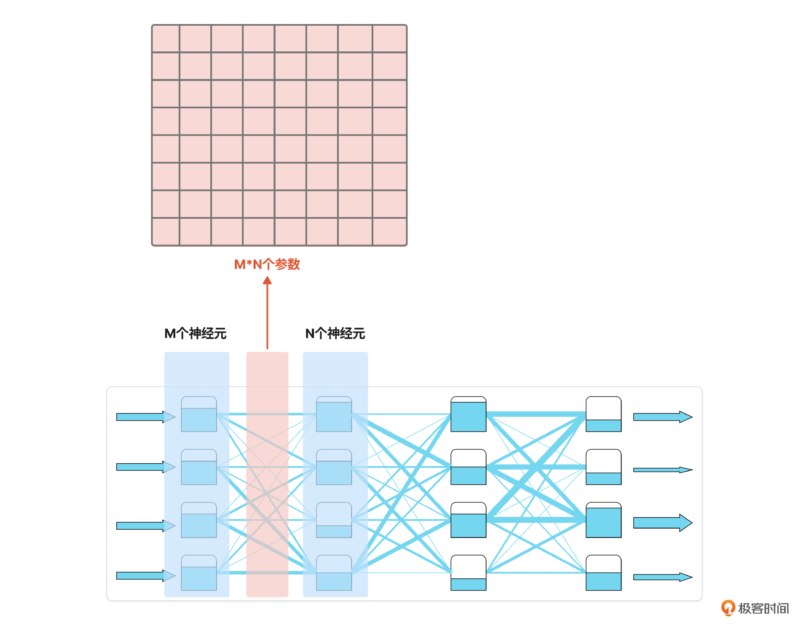

而巨大的神经网络就是由很多层这样的矩阵组成，就构成了我所说的“千层饼”。这层饼越大、越厚，意味着模型的规模也就越大，制作成本也就越高。

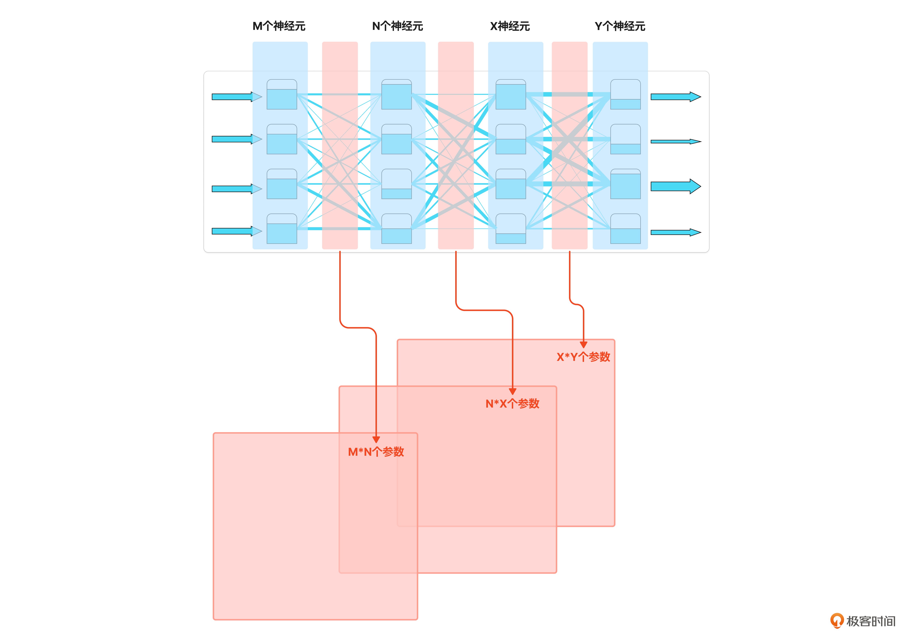

微调就是要改变这张饼。我们之前所说的 RAG、提示词、Agent 设计方式是不改变饼本身的，这是微调与其他技术的本质区别。

改变饼的方法有很多，我继续和大家类比。

- 方法一：全参微调。

顾名思义，就是改变网络中所有的参数。这就好像在做完饼之后，再来烤制或者蒸一下来改变千层饼的味道，这种方法会影响饼的每一层。

- 方法二：参数高效微调。

这是指通过调整神经网络中的少数参数来改变饼的味道。就好像做好饼之后，在某些层之间抹上酱，花的功夫较少，但是效果会很明显。因为这种方法很“高效” ，所以给他起了这个好听的名字，你也可以把它称为部分参数微调。而参数高效微调又有很多细分方法，你可以参考我放在文末的链接详细了解。

在这里我们最常用的就是 LoRA 微调，我把 LoRA 微调的原理比作给千层饼的某些特定层中间涂一层“十字酱”后，然后抹开。别急，让我们一步步来拆解这个过程。

### 第一步：找到要涂酱的地方

在开源社区 Huggingface 上，有些开源模型开放了自己的模型架构，比如 Mistral-7B，我们可以在登录（有的模型必须在登录后才能看到）后搜索模型 Mistral-7B，在模型详情页通过点击“↗️”这个按钮来查看模型。

比如在 Mistral 这个开源模型里，我们可以看到 Mistral 这张千层饼，表面一层是 embedding层，底下一层是 lm_head 层 ， 中间总共有 32 个 Layer， 每个 Layer 里又有 9 层。

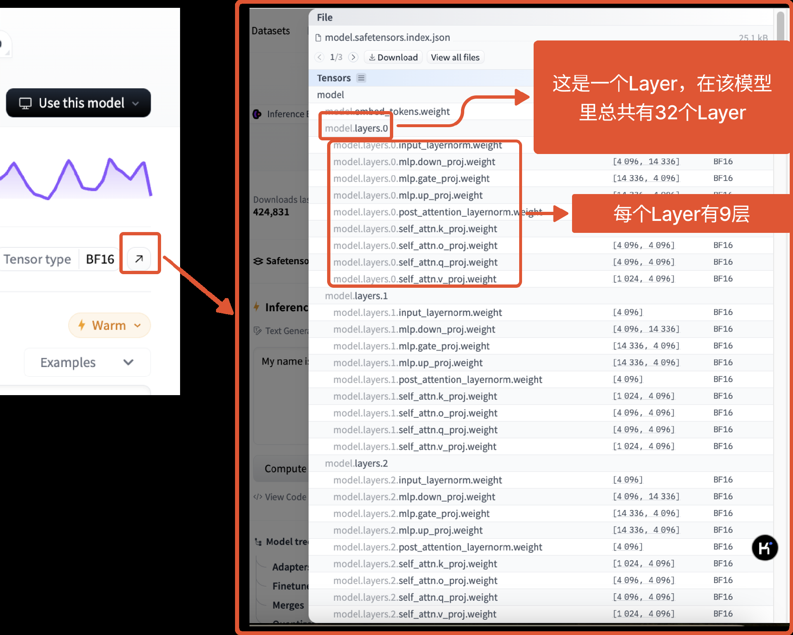

我用不同颜色表示千层饼里不同类型的层，就得到了下面这张图。

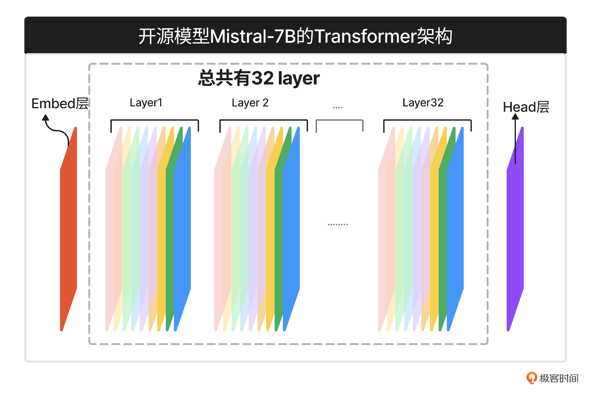

- 注：这个层级架构就是通常所说的Transformer架构，关于Transformer架构在这里不详细展开，有兴趣的同学可以参考文末链接学习。

LoRA 微调就是选定其中的某些层，用涂酱的方式来改变这些层。

### 第二步：如何涂酱？

之所以把 LoRA 训练称为涂酱，是因为 LoRA 微调过程中，我们会保持基座模型的参数值不变，训练出一个参数矩阵的增量矩阵，也就是在原有参数的基础上增加或者减少的数值。在使用时我们把这个“增量”加到原有的基座参数模型上就可以了，这就像给千层饼涂酱时，我们并不会改变原有的那一层饼。

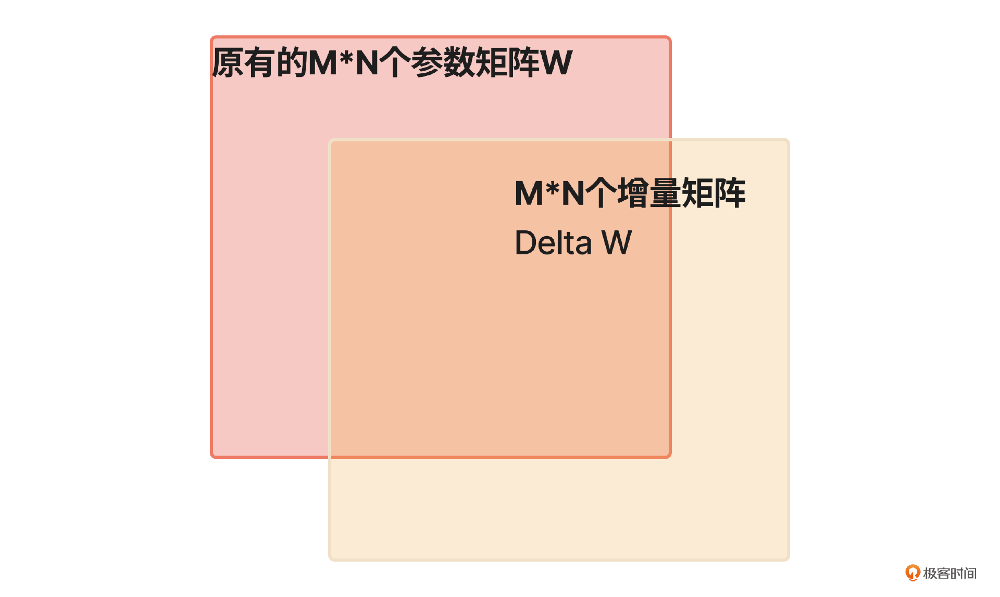

这样做的好处是，这个酱料可以独立保存，而且可以和其他酱料灵活混搭，收获不同口味的千层饼。在实际中，这意味着通过 LoRA 训练出来的模型只需要保存增量矩阵，降低了存储空间，且可以和其他模型灵活地合并，产生不同的模型效果。

接下来，我们来说说这层酱是怎么涂到指定的饼层上的。

我们首先要理解，这层酱的“面积”并不像千层饼的面积那么大，而是被浓缩了的两道十字形其中的一横一纵大小分别是 M x R 和 R x N，这里的 R 通常远远小于 M、N。

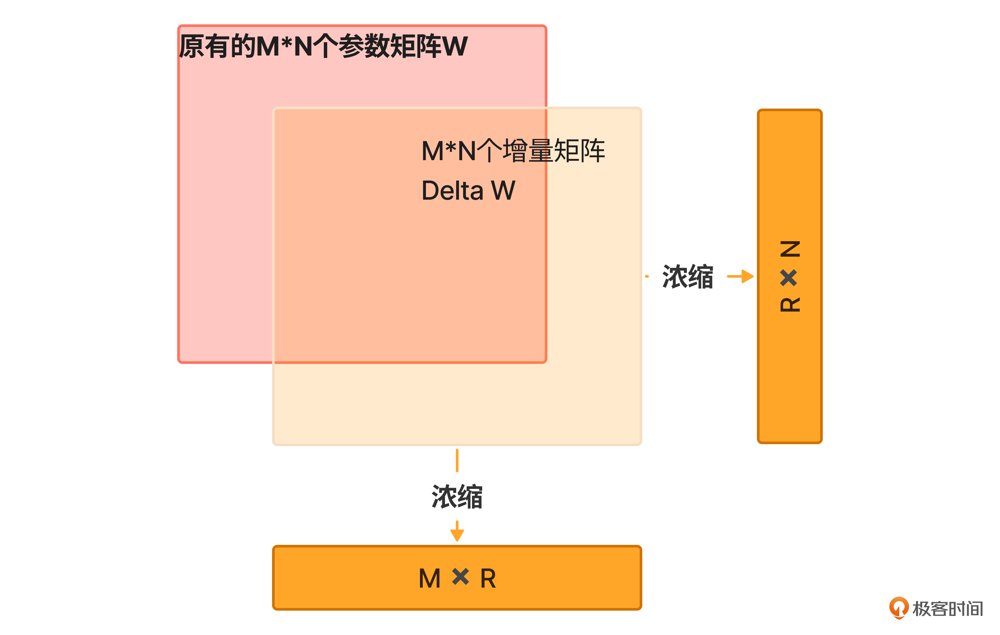

这里 R 是 Rank，由算法工程师指定的。不过这里的 Rank 可不是排名的意思，而是线性代数中的秩的概念。你可千万别听到陌生词儿就吓跑哈，我来举个例子你就明白了，请看下图。

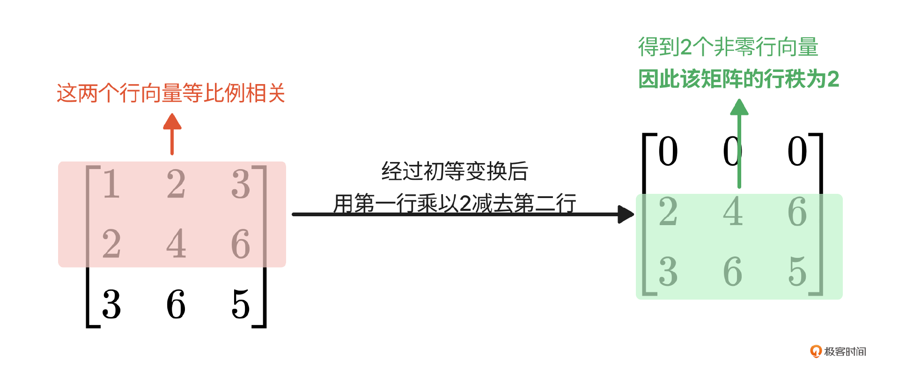

观察这张图中的矩阵：左边矩阵第一和第二行对应的元素是等比例的（1:2:3=2:4:6），如果矩阵的每一行代表一个特征的话，这个矩阵里第一行和第二行的特征是一样的，算一个特征。另一个特征是第三行的[3，6，5]。所以这个矩阵总共就有 2 个行特征向量，它的行秩就是 2。

对矩阵秩的更多解读大家可以进一步学习，但这里，了解到这一步已经足够理解 LoRA 的本质。

直观理解，秩就是矩阵中可以抽取、压缩出来的特征数量。特征向量，顾名思义就是特征的数学表示，它可能是一些风格，比如 LoRA 微调放在图像生成里可以有动漫风格、写实风格；也可能是一些模式，比如不同公司的办事流程模式，也可以被当做特征抽取出来，这也是为什么我们会在企业级应用中会采用 LoRA 微调的原因。

而在大语言模型里，每一层的矩阵都是几千 x 几千的超大矩阵，可以想象，这种高维空间的矩阵应该有很多重复的特征向量。如果我们直接训练一个几千 x 几千增量的参数矩阵，既耗时间、耗算力，还得到了很多重复的特征向量，性价比不高。

于是研究者们就想，不如直接训练出两个低秩矩阵，横向的低秩矩阵是矩阵行特征的浓缩，纵向的低秩矩阵列向量特征的浓缩；然后把这两个矩阵做点积（特征扩散）（如下图红框第二步所示）；最后将这个扩散后的特征叠加到原有的参数矩阵上，就得到了一个全新的训练参数矩阵。这就是 LoRA 微调的原理。

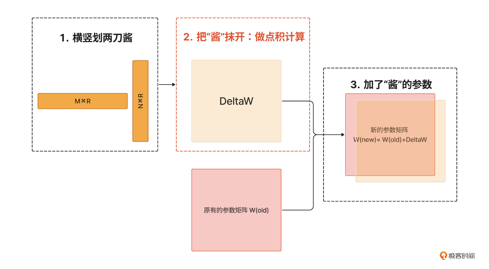

LoRA 训练在保留特征的前提下，大大降低了被训练的参数量。比如原来要训练的参数量是 Mx N，现在要训练的参数量是 R x M + R x N = R x（M+N），因为 R 远小于 M、N，因此 LoRA训练的参数量有大幅降低（类似下图中的面积对比），这真是个一举两得的聪明做法！

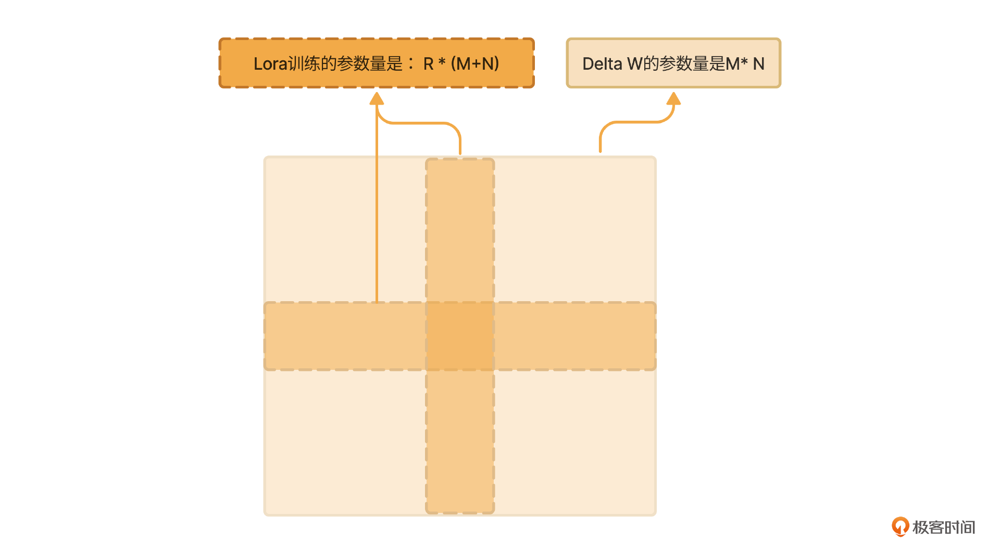

那么 R 的值设定多少合理呢？ 在 Lora 的开篇论文（参考 3）中，作者使用不同的 Rank 值来实验，发现它对模型效果的影响并不是很大。

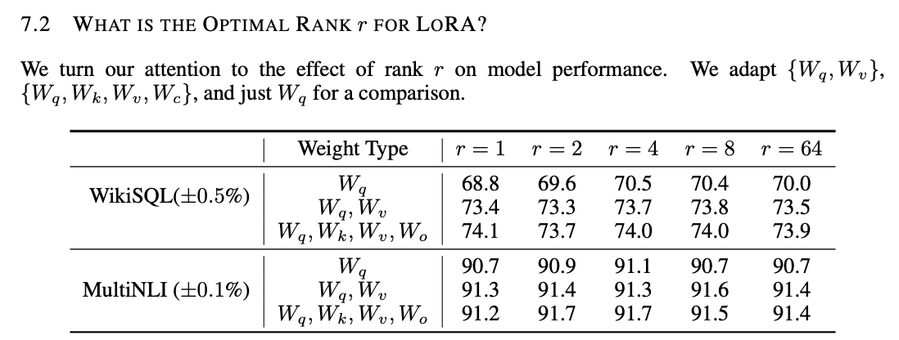

现在来看，R 是一个经验数值，通常为 8、16、32、64，R 的大小对模型效果的影响需要通过实验来确定，也就是在固定的数据集上进行评估来确定，这样才能选择到适合自身业务的 R值。

好啦，这下你知道我们要怎么涂这个酱了吧。总结一下，就是横着抹一道（得到矩阵的行特征向量），竖着抹一道（得到矩阵的列特征向量），然后均匀抹开（两个矩阵点积），均匀的敷在对应的那层饼上！

你可能还会好奇，那这两层酱到底是怎么熬制而成的呢？哈哈，接下来带你解密这份秘制酱料的制作过程，这一步一般由炼丹师（算法工程师）完成，也许下次你可以把他们称为“熬酱师”。

### 第三步：如何制作酱料

制作酱料一要了解熬制酱料的“炉子” ，二要了解“原料”。原料准备是下节课的内容，这节课我们先了解一下“炉子”。

这里炉子就是模型训练的框架，现在发展得已经比较成熟了，算法工程师可以直接拿来使用。对于产品经理，简略了解一下即可。我们拿 Huggingface 上 LoRA 训练的代码来简略解读一下，重点部分我都标记出来了，很简单。

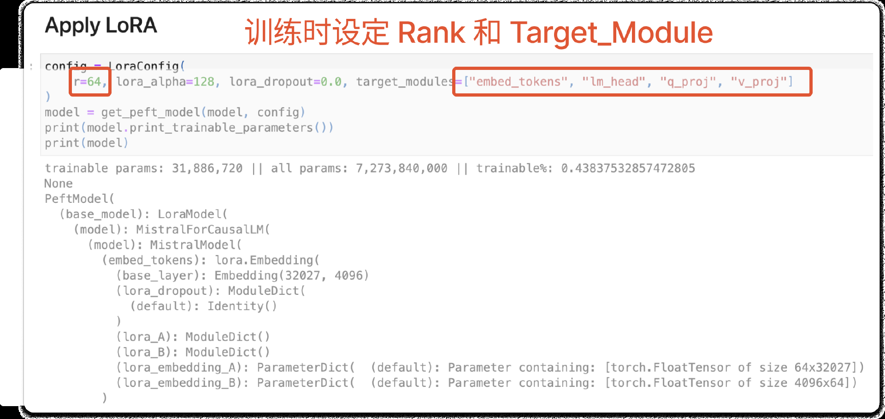

在模型训练的框架里，有一个 loraConfig 函数，函数的参数中有 target_module 和 rank。

- target_module 就是我们在开头讲的指定涂酱的地方。

- rank 就是在第二步里讲的秩，你可以理解酱料熬制的过程就是原料进行“特征提取”的过程。rank 越小，代表特征压缩程度越大，酱就越浓；rank 越大，代表特征压缩程度越小，酱就越淡。

到这里，我们知道了 3 件事。

1. 千层饼中每层的结构：借助 Huggingface 开源模型的示例，拆解大语言模型的架构，从而理解 LoRA 微调是通过在指定的层上训练参数的。

2. 涂酱的过程：在 LoRA 训练中，通过两个低秩矩阵的点积，就能够既能保证训练质量，又能降低训练参数量，达到“参数高效”微调的效果。

3. 熬制酱料的工具：如何通过模型训练框架来指定模型特征的压缩程度 Rank，和要训练的参数层（Target_module）。

下节课我就来准备熬制酱料的原料，即数据了。

## 小结

我们来小结一下，在这节课的开头，我们尝试用 few shots 让 Agent 能够正确地思考、行动，然而考虑到安全性，我们引入了微调并私有化企业专属的模型的方法来解决这一问题，进而和大家一起学习了微调最常见的方法：LoRA 微调，也就是给大语言模型这张千层饼涂酱的过程，相信大家一定记住了二姐这节课的特色“比喻”。

这节课产品经理们更多的是理解，并非实践，而在下节课我们就要结合“自助工单小助手”这个案例来准备训练数据、评估模型了，相当于准备熬酱原料，并在熬制之后还要学会品尝酱料。我们下节课继续吧。

## 课后题

这节课，我们提到 LoRA 中被训练的参数量大幅降低，那么到底降幅有多大呢？ 大家一起和我做一道加减乘除运算题来体会一下。

观察 Huggingface 上训练 Mistral 7B 的案例：

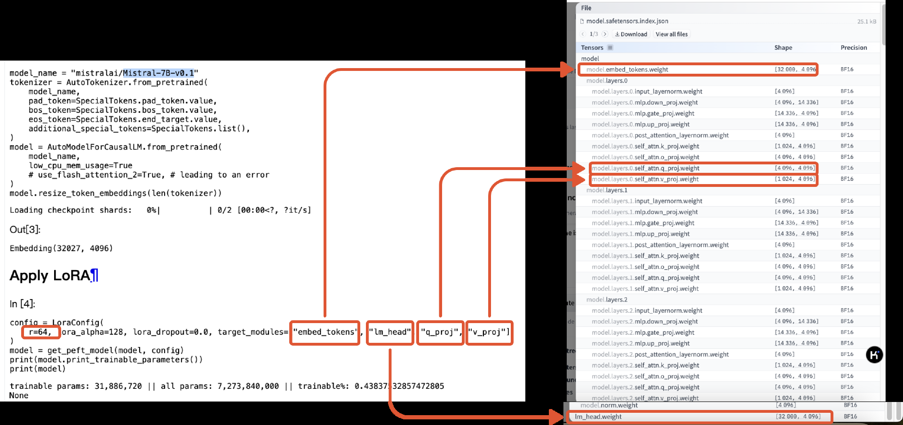

在这个案例里，

- 指定 Target Module 是"embed_tokens", “lm_head”, “q_proj”, “v_proj”，结合Mistral-7B这个模型的架构，这几层对应的参数矩阵大小分别是：32000 x 4096， 32000 x 4096，4096 x 4096，1024 x 4096。

- 指定 Rank=64。

根据这些数值，计算 LoRA 微调总共需要的训练参数，看看和 Mistral 7B 的总共参数量7,273,849,000 相比，有多大幅度的降低呢？

## 参考

1. 参数高效微调： https://huggingface.co/docs/peft/index

2. Transformer：https://www.bilibili.com/video/BV1TZ421j7Ke/

3. Lora 开篇论文：https://arxiv.org/pdf/2106.09685
