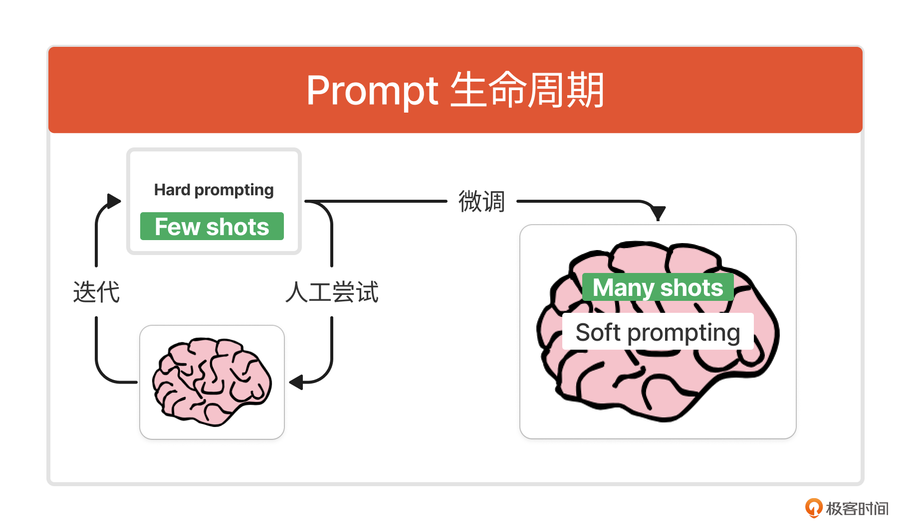
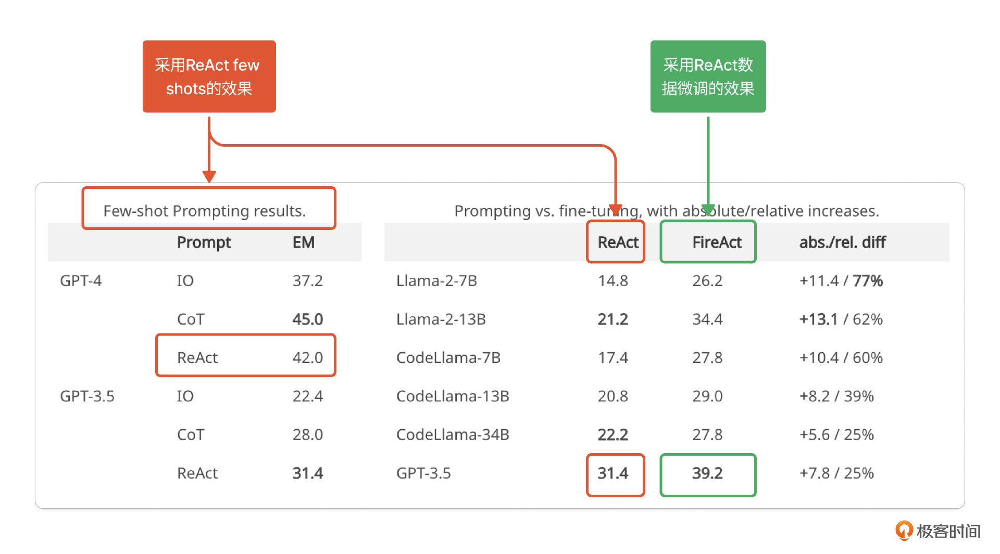
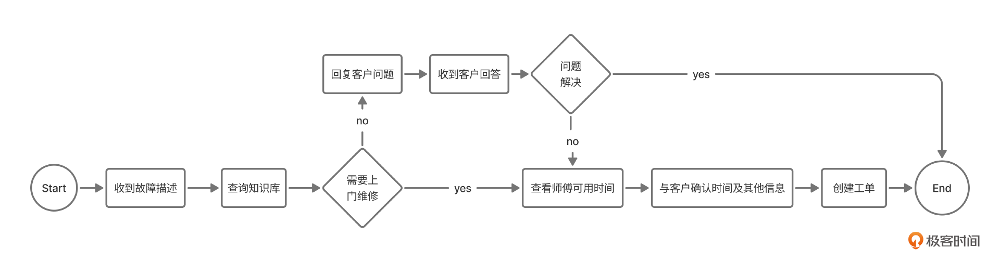
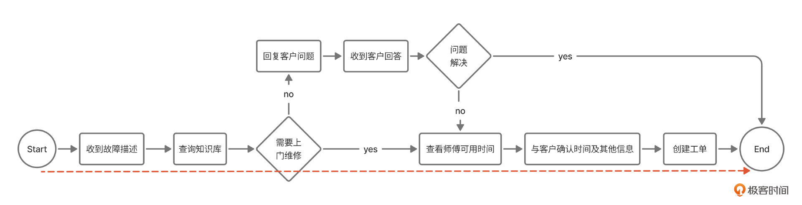
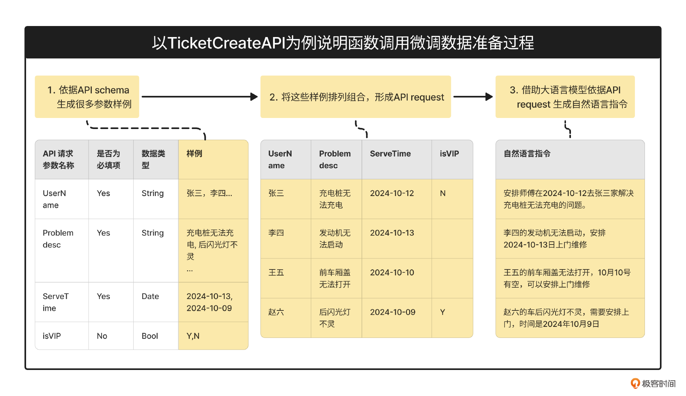

# 13 | 通过微调提升自助工单小助手的可靠性

你好，我是产品二姐。

上节课我们了解了企业做私有化模型微调的必要性，并用千层饼加酱的方式了解了 LoRA 微调的原理。这节课我们来聊聊模型微调的实际操作。

实际操作分三步。

1. 明确微调数据特征：在“熬酱”前，明确要准备什么样的原料。

2. 准备数据：这些原料要去哪里找，要怎么生产出来。

3. 评估模型：在涂好酱之后“品鉴”这张涂了酱的千层饼是否合格。

在很多通用模型厂商里，这部分内容是由算法工程师主导，产品经理辅助结合业务需求完成的。但在二姐看来，在非通用的企业级模型微调时，微调数据和产品功能是绑在一起的：有什么样的数据，产品才可能具备什么样的功能。

因此，产品经理参与其中，才能与算法工程师打好配合战术。

## 明确目标：我们要准备什么样的数据

我们知道，熬酱的过程是“特征提取”的过程，那么我们所选的数据就一定要具备我们想要的特征。

“我们想要的”特征有两个。

1. 遵循企业内部的工作流程，对应提升的是我们在11 节提到的思考力。

2. 会使用企业内部的工具，即通过 function calling 正确调用企业内部 API，对应提升的是11 节提到的行动力。

其实在上节课，我们已经看到了具备这样特征的数据，那就是提示词中的 few shots。

比如，以下的 few shots 就具备特征一（思考力提升）：遵循企业内部的工作流程。

```
**User**: 我家充电桩坏了，需要报修
**Think**: 首先，我需要在故障解决知识库中查找关于充电桩故障的解决方案。这可能需要上门维修，所以
**Action**: 查询故障解决知识库中关于充电桩故障的信息。
**Observation**: 知识库显示，充电桩故障通常需要专业技术人员现场检查和维修，无法通过远程指导解决
**Think**: 既然需要上门维修，我现在需要查询技术人员的可用时间。
**Action**: 查询技术人员的可用时间。
**Observation**: 系统显示最近的可用时间是明天上午9:00-11:00，后天下午2:00-4:00。
**Think**: 我现在有了可用的时间段，需要与客户确认具体的上门时间和地点。
**Action**: 询问客户的偏好时间和确切地址。
**Observation**: 北京市昌平区西二旗软件园2号楼302
**Think**: 客户提供了地址，但还没有选择上门时间。我需要向客户提供可选的时间段，并确认他们的选择
**Action**: 向客户提供可选的上门时间段并请求确认。
**Observation**: 明天上午9:00
**Think**: 我已经收集了所有必要的信息：问题描述、上门时间和地址。现在需要总结这些信息并提交工单
**Action**: 总结信息并提交工单。
**Observation**: 工单已成功提交到系统中。工单号为：CHB20241010001。
**Think**: 工单已提交，现在应该向客户确认所有细节并提供工单号。
**Action**: 向客户确认服务细节并提供工单号。
"非常感谢您的配合。我已经成功为您提交了维修工单。以下是您的维修服务详情：
工单号：CHB20241010001
```

- 问题：充电桩故障

```
上门时间：明天（10月11日）上午9:00
地址：北京市昌平区西二旗软件园2号楼302
```

- 技术人员将会在约定时间到达您提供的地址。如果您有任何问题或需要变更预约，请随时联系我们，并提供您的

以下的 few shots 具备特征二（行动力提升）：会使用企业内部的工具。

```
**User request：** 在知识库中搜索“空调不制冷”问题的解决方法。
**API schema：**此处略 [知识库搜索接口SearchSolution的schema]
**API request：**  SearchSolution(Error = "空调不制冷")
```

其实，准备微调数据本质上就是准备 “many shots”。那从 few 到 many，有什么区别吗？我们在讲提示词工程的时候，曾提到提示词的生命周期，我在这个生命周期中加上两点说明，你就明白了。

- 在 Hard prompting 里，我们通过 few shots 的方式让基座大模型通过上下文进行短平快的“学习”，离开这个上下文之后，基座模型就会忘了这种能力，因为基座模型本身的参数不会改变。

- 在 Soft prompting（提示词微调工程）里，我们通过 many shots 的方式让基座模型通过长期反复练习形成模型的肌肉记忆，模型参数发生了改变。



好，明白了微调数据的作用，接下来我们结合两个案例，看看微调过程中要准备的 manyshots 到底长什么样。

### 1. 遵循工作流程的 Many shots：开源项目《FireAct》

在这个项目中，开发者将 Re-Act 的 Thought-Action-Observation 模式作为数据，来微调（Finetuning）模型，希望它能遵循一定的工作流程，提升模型工作过程中的思考力。FireAct的全称就是 Fine-tuning Re-Act。这个项目中的训练数据样例（参考文末链接看全文）如下：

[注] 为了方便理解，已将数据样例翻译为中文。

```json
{
   "messages": [
       {
           "role": "user",
           "content": "他曾被认为是世界上最好的拳击手，但他因在拳击运动中的“不道德行为”和拳
       },
       {
           "role": "assistant",
           "content": "Thought：我需要搜索世界上最好的拳击手，他在拳击场外有过违反体育道德
Action：搜索[世界上最好的拳击手 违反体育道德的行为 暴力犯罪]"
       },
       {
           "role": "user",
           "content": "Observation：Badr Hari（1984 年 12 月 8 日出生）是摩洛哥裔荷兰
       },
       {
           "role": "assistant",
           "content": "Thought：Badr Hari 是符合描述的人。
Action：完成[Badr Hari]"
       },
       {
           "role": "user",
           "content": "Observation：剧集结束，奖励 = 真的"
       }
   ]
}
```

在这个数据样例中，“messages”“role”“content” 是训练数据需要遵循的格式。你看，content里就包含了 ReAct 模式中 Thought-Action-Observation 的内容。通过这样 500 组数据的many shots 微调后，准确率和单纯使用 ReAct few shots 相比有所提升。

比如在下表中，GPT 3.5（千亿参数）经过微调后准确率为 39.2%，比微调前的 31.4% 提升25%，接近 GPT-4 采用 few shots 的 42% 水平。



你可能会觉得，哎呀～这么低的准确率，怎么能够达到商用标准呢？别急，这个例子仅仅带你理解 many shots 微调与 few shots 提示词工程的效果对比。我们稍后会带来一些提升方法。

### 2. 会使用工具的 Many shots：OpenAI 函数调用微调官方指导

下面是一个 OpenAI 官方给出的函数调用微调指导案例，希望用人类自然语言指令即可调用无人机控制接口，精准控制无人机。

微调数据的示例是这样的：

[注] 为了方便理解，已将数据样例翻译为中文。

- 让我们让无人机飞上天空，它应该飞多高？

```json
{'name': 'takeoff_drone', 'arguments': '{"altitude": 100}'}
```

- 准备起飞，无人机应该飞多高？

```json
{'name': 'takeoff_drone', 'arguments': '{"altitude": 100}'}
```

- 你能把无人机带到我们所在的地方吗？

```json
{'name': 'land_drone', 'arguments': '{"location": "current"}'}
```

- 让我们让无人机就在这里降落

```json
{'name': 'land_drone', 'arguments': '{"location": "current"}'}
```

- 将无人机带回基地降落

```json
{'name': 'land_drone', 'arguments': '{"location": "home_base"}'}
```

这里只列出 5 组数据对，每组数据对中都有一句自然语言指令（代码第 1,4,7,10,13 行），对应着无人机的行为（代码第 2,5,8,11,14 行）。比如自然语言指令是代码第 13 行“将无人机带回降落”，对应函数是 “land_drone” ，参数值是{“location”: “home_base”}。

从这个例子可以看出，提升工具使用能力准确性的微调数据其实就是许多“步骤类自然语言指令”与“函数调用方法”的数据对。在这个官方示例中，经过 86 组数据微调后，模型在同样的10 条测试指令上验证，正确率从 60% 提升到 100%。

你看，many shots 的效果已经出来了：

- 第一个案例经过微调后准确率从 31.4% 提升到 39.2%。

- 第二个案例经过微调后准确率从 60% 提升到 100%。

接下来，我们结合自助工单小助手这个案例来看如何生成出这样的数据。

## 如何准备数据？

准备数据是模型训练中的重头戏。有一种说法是，算法工程师 70% 的时间都在准备数据。这一步确实是微调模型的重点工作。不过在理解微调数据其实就是 many shots 之后，这一步也不难。

### 准备提升自助工单小助手思考力的数据

这一部分的数据分三步走。

1. 给出业务流程



2. 和业务专家一起为每个业务流程准备 few shots。

比如上节课“故障维修”这个案例，就是按照下面红色线条标准的流程生成的一个例子。这相当于业务专家先给例子打个样，需要他亲自认定。



```
**User**: 我家充电桩坏了，需要报修
**Think**: 首先，我需要在故障解决知识库中查找关于充电桩故障的解决方案。这可能需要上门维修，所以
**Action**: 查询故障解决知识库中关于充电桩故障的信息。
**Observation**: 知识库显示，充电桩故障通常需要专业技术人员现场检查和维修，无法通过远程指导解决
**Think**: 既然需要上门维修，我现在需要查询技术人员的可用时间。
**Action**: 查询技术人员的可用时间。
**Observation**: 系统显示最近的可用时间是明天上午9:00-11:00，后天下午2:00-4:00。
**Think**: 我现在有了可用的时间段，需要与客户确认具体的上门时间和地点。
**Action**: 询问客户的偏好时间和确切地址。
**Observation**: 北京市昌平区西二旗软件园2号楼302
**Think**: 客户提供了地址，但还没有选择上门时间。我需要向客户提供可选的时间段，并确认他们的选择
**Action**: 向客户提供可选的上门时间段并请求确认。
**Observation**: 明天上午9:00
**Think**: 我已经收集了所有必要的信息：问题描述、上门时间和地址。现在需要总结这些信息并提交工单
**Action**: 总结信息并提交工单。
**Observation**: 工单已成功提交到系统中。工单号为：CHB20241010001。
**Think**: 工单已提交，现在应该向客户确认所有细节并提供工单号。
**Action**: 向客户确认服务细节并提供工单号。
"非常感谢您的配合。我已经成功为您提交了维修工单。以下是您的维修服务详情：
工单号：CHB20241010001
```

- 问题：充电桩故障

```
上门时间：明天（10月11日）上午9:00
地址：北京市昌平区西二旗软件园2号楼302
```

- 技术人员将会在约定时间到达您提供的地址。如果您有任何问题或需要变更预约，请随时联系我们，并提供您的

3. 借助大语言模型来扩充这些示例。

我们知道，大语言模型“照猫画虎”的能力很强，我们只需借助非常简单的提示词，就可以得到很多个类似的数据，这部分的数据只是为了“驯化”模型遵循流程。因此，只要流程正确，并不需要里面的内容是真实存在的。

```
仿照下列的格式生成X个React 模式的数据，用于汽车行业售后客服。
略[步骤2中生成的例子]
```

按照这个步骤，我们就生成了许许多多的 ReAct 数据。接下来就可以拿这些数据来微调模型，让它把业务流程转变为“肌肉记忆”。

到这里，有的同学可能会问：咦？这种一、二、三步流程图式的思考力，是不是通过 Dify 的workflow 实现，可靠性会更高？

在这里，二姐想和大家说，这的确是两种不同路径，短期来看，Dify 里将 workflow 固定下来，这种方式更可控，但一旦有在流程定义之外的情况出现，就不能灵活应对了；而长期来看，随着模型推理能力的上升，Agent 的自主性也会更强，所以，我们直接让模型学会流程更能灵活应对复杂情况。

如果未来你有机会使用到这种方法，在准备数据的过程中，还需要注意以下几点来提升专属场景中的准确率：

1. 覆盖全面。业务流程中所有的路径都要覆盖。

2. 数量充足。这里的数量按照经验来定，依照二姐的经验，开始的时候以千为数量级准备。

3. 准备 Negative case。比如 Observation 中特定设置一些在真实业务场景中不存在的corner case。或者 Action 中出现部分无法使用指定工具实现的 Action。这样可以提升模型的鲁棒性，应对各种意外情况。

4. 基座模型。这一部分是为了提升模型的思考力，如果你有推理能力的要求，二姐建议以70B 参数量级起步。

### 准备提升自助工单小助手行动力的数据

与提升思考力相比，这一部分的数据确定性会更强。因为我们的目标是让模型学会使用工具，所以，只要让上一步中模型给出的 Action 自然语言指令加上 function schema 列表，再转换为函数调用格式就可以了。

这里数据的例子应该是像如下示例中 Input 与 Output 的数据对。

```
## Input
**Action**: 查询故障解决知识库中关于充电桩故障的信息。
**Function List**:
[
SearchSolution 的function schema(略)，
TicketCreate 的function schema(略)，
....
]
## Output
SearchSolution{"problem"："充电桩故障"}
```

我以 TicketCreateAPI 这个工具使用的训练数据为例，讲述数据生产的过程。



也分三步走：

第一步，我们借助大语言模型，依据 API 的定义为接口里的每个字段生成 X 个样例数据。比如对于 UserName，大语言模型就知道这是姓名，会为你生成比如 10 个姓名。以此类推，根据 problem desc 生成 8 个故障描述，根据 ServeTime 生成 6 个上门日期，对于 isVIP 这个字段来说，他是个布尔值，就只能生成 0、1 两种值。

第二步，将这些样例数据排列组合，按照第一步的数量就得到：10 x 8 x 6 x 2 = 960 条 API请求。

第三步，借助大语言模型，根据 960 条 API 请求生成 960 个自然语言指令。

这样，我们就得到了 960 组数据对，每组数据对中包含一个“自然语言指令 Action” 和一个“API request”。这正是我们期望的数据对。

按照这个方法，我们就准备好了用于提升工具使用能力的数据。在这里，你同样需要注意以下几点。

1. 数据的全面性：覆盖各类情况，当然你也可以从实际业务日志中查到哪些 API 经常被调用，可以有目标的多准备。

2. 数据的鲁棒性：比如有意将某些必填字段留为空白，当 API 接口返回错误信息时还能纠正相应的数据。

3. 基座模型选择：在这方面我们可以参考开源榜单美国加州伯克利大学的 function calling 能力榜单（参考文末链接）。

这样，我们就完成了微调数据的准备，在这个过程中，产品经理一定要协助算法工程师来准备符合业务流程、符合业务接口调用的数据，这种合作可以避免盲目准备数据，最后得到一个不符合业务需求的模型。

准备好数据，就是用“炉子”训练大模型，再之后，就到模型评估了。

## 如何评估模型？

首先选择合适的评估方法。

从技术角度，业界有比较统一的方法，比如 ROUGE/BLEU 这种对比实际输出与期待输出之间重合度的方式（大家可以参考文末链接）。但从业务角度，需要挑选适合具体业务的方法。这里也按照提升思考力、行动力两种情况划分。

1. 如何评估思考力模型？

你还记得在第 02 节选择模型是讲的“三看一测”中的“一测”吗？在 02 节，我们是把测试方法用在选择模型上，而同样，我们也可以用在评估模型上，所以在这里，二姐就不详细讲述了，你可以回去复习相关内容。

2. 如何评估行动力模型？

对于函数调用来说，我们期待的结果是函数调用可以被正确地执行，所以必须要严格遵守 APIschema 里的规定，比如 API schema 里规定某个字段是数字，而生成的 API 调用请求中是字母，那就是不准确的。评估函数调用的准确性，业界常用AST（Abstract Syntax Tree）抽象语法树方式来评估。

AST 方法只需要我们了解概念，具体方法在实现的时候需要开发的同学完成，简单来说就是按照下面的顺序逐级判断生成的函数调用是否正确。

a. 先对比 function 选择是否正确。

b. 检查必填字段是否缺失。

c. 检查是否有多余字段。

d. 检查数据类型是否一致。

e. 检查数据值是否一致。

## 小结

自助工单小助手这个产品的模型要进行 Lora 微调，那就要准备数据、评估数据。我们这节课提供了数据准备和模型评估的方法。产品经理需要在充分理解业务和原理的基础上，与算法工程师一起合作完成数据准备，其实你只需要记住两点：

1. 微调的数据是为了特征提取，因此要围绕特征来准备少量样本数据。

2. 微调的数据是 many shots，因此需要借助大语言模型按照少量样本数据来扩充。

我们这节课提到的两种数据准备过程都符合这个特点。

到这里，我们通过 11、12、13 三节课完成了自助工单小助手这个产品设计实战。正如我们在11 节开头提到的，这类应用目前在市场上没有成熟的商业案例。即便如此，二姐仍然希望以一个产品经理布道者的身份分享我们目前通过实践、理论探索到一些脉络。

首先，我们按照 Open AI 等业界前沿公司的理念，定义出企业级产品自助工单小助手的使用场景，产品目标：具备一定的思考力、行动力，有依有据地实现思考、行动。

其次，二姐带大家一起理解企业级产品中可以使用微调来提高思考力、行动力。借此机会给大家烹制了一张“涂酱千层饼”，相信你一定能一次理解微调原理。

最后，和大家一起准备了特征提取的原料（数据）。

这个脉络能帮你未来遇到类似项目的时候做到心中有数，也能帮你和算法工程师、开发工程师高效合作。

## 课后题

这节课的课后题并不是微调，而是体验一次数据准备的过程。使用你曾经遇到的一个工作流，你也可以使用我们在文中提到的工作流，借助 OpenAI 或者智谱等大语言模型完成从工作流到few shots，再到 many shots 的过程。

欢迎你在留言区和我交流。如果觉得有所收获，也可以把课程分享给更多的朋友一起学习。我们下节课见！

## 参考

1. FireAct 训练数据：https://github.com/anchen1011/FireAct/blob/main/data/finetune/gpt_format/hotpotqa.jsonl

2. FireAct 项目：https://fireact-agent.github.io/

3. OpenAI 函数调用微调官方指导：https://cookbook.openai.com/examples/fine_tuning_for_function_calling

4. Berkeley Function-Calling Leaderboard：https://gorilla.cs.berkeley.edu/leaderboard.html

5. BLEU/ROUGE：https://clementbm.github.io/theory/2021/12/23/rouge-bleu-scores.html

6. AST 评估方法：https://gorilla.cs.berkeley.edu/blogs/8_berkeley_function_calling_leaderboard.html#categories

>> 戳此加入课程交流群
