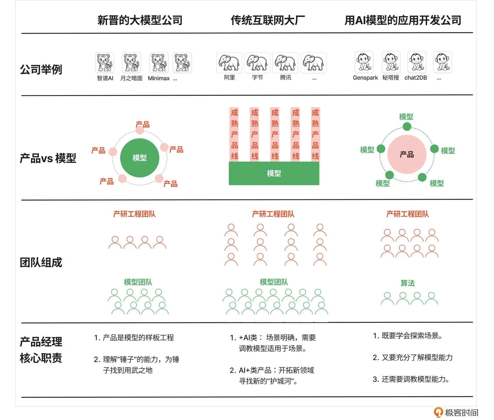
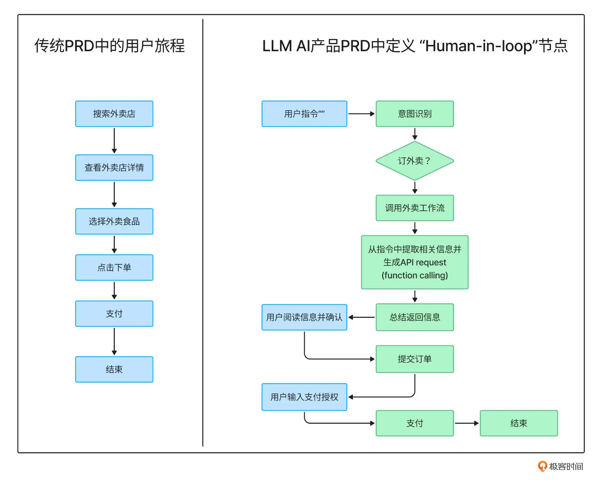
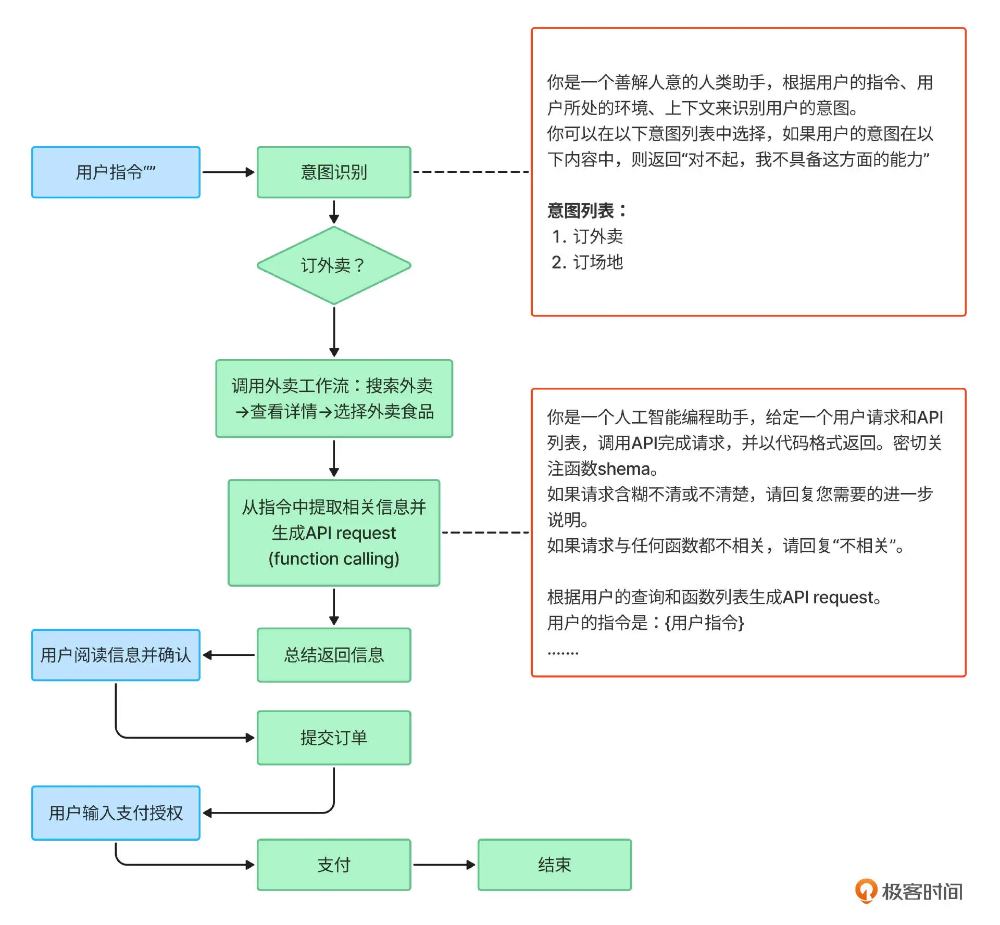
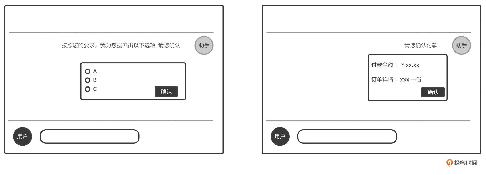
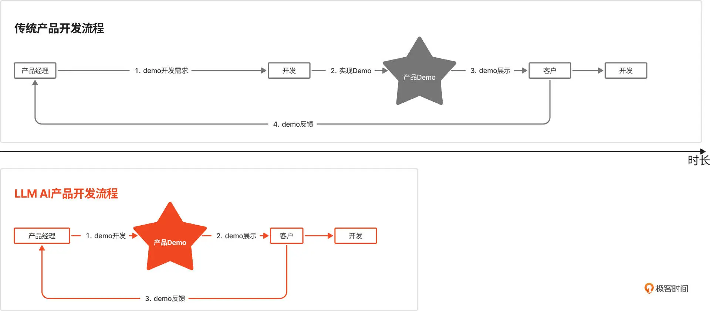
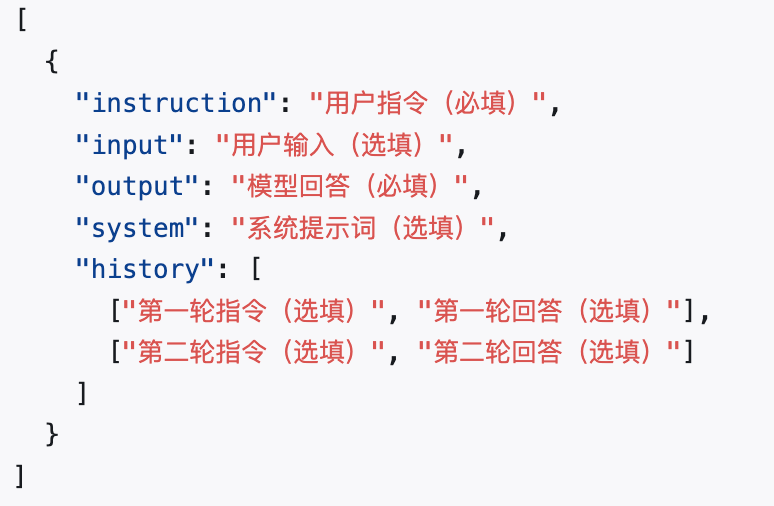

# 14 | 重塑产品研发流程：AI产品的PRD怎么写，产品、研发、算法合作的新范式

你好，我是产品二姐。

经过四个案例的练习，你是不是也跃跃欲试，想要迈出 AGI 产品经理的第一步呢？不过我猜你可能会有些忐忑：

- 不知道真正加入一家公司后，产品经理在一家 AI 公司的定位是什么样的呢？会和传统互联网产品经理的角色一样吗？

- 产品经理的核心工作内容是写 PRD（Product Requirement Design，产品需求设计），我写的时候该怎么输出自己的思路呢？和传统互联网又会有什么不同呢？

- PRD 输出后，要推进产品研发，这个过程中产品经理与开发、算法工程师又该如何合作呢？

这节课，我就和你聊聊这几个话题。

## 三种公司的 AI 产品团队观察

首先，我会结合自身实践以及对周围朋友的访谈和观察，分享目前各大公司 AI 产品团队的组成。我会分三种情况讲：新晋的大模型公司、传统互联网大厂以及使用 AI 模型的应用开发类公司。

我用下面这张图来直观展示这几类公司的区别，然后我们再一个个来讲。

### 新晋的大模型公司

新晋的大模型公司在国际上以 OpenAI 为代表，有着扎实的科研实力，有机会撼动甚至颠覆现有互联网大厂的垄断地位，成长为 AI 2.0 时代的统治者。在国内，这类公司类似我们常说的“七小虎”。

- 零一万物

- 百川智能

- 智谱 AI

- 月之暗面

- Minimax

- 阶跃星辰

- DeepSeek

这类公司的产品是模型驱动式的建设模式，简单来说，就是以模型建设为主，产品为辅，用模型驱动产品的迭代。他们的 AI 产品某种程度上是公司的“样板工程”，主要目的是展现模型本身的能力，比如 minimax 的产品海螺 AI。

这类模型公司内部通常有三个团队。

1. 模型预训练团队：主要负责模型的预训练，比如预训练的数据准备、预训练、领域续训等。

2. 模型推理优化团队：主要负责让产品更好地使用模型能力，比如开放对外的模型接口、优化性能等。

3. 产品与工程开发团队：这类似于传统互联网公司的产研团队，主要负责产品功能的设计、开发工作。比如聊天产品的聊天记录管理、账户管理等。

具体在产品开发过程中，公司内部一般是由模型团队首先预估“到某个时间点能达到什么能力”，根据这个时间点，产品团队搭好外围设备，等模型训练出来之后，直接接入即可。这个过程中，产品经理对模型的影响相对较少。

但你可以做两件事情：

- 一是通过对比业界标杆（比如 OpenAI），评判、影响模型的能力建设。

比如以自己产品中的用户对话作为测试集，去 OpenAI 的模型上测试，然后和自家对比。这样既能看到用户需要什么，又能看到自家模型与业界标杆模型的优劣对比。你可以把这类测试集给到算法同学，作为模型训练的参考。

- 二是充分理解“锤子”（自家模型）的能力，为锤子找到用武之地。

通过充分的测试之后，你就可以在产品的样板工程中找到能表现模型优势的场景，获得市场眼球。

### 传统互联网大厂

这类公司在国际上以微软为代表，国内有阿里、腾讯、字节跳动等公司，他们本身有着互联网时代修筑的护城河。他们的 AI 产品一方面是让现有业务“如虎添翼”，做 +AI 类的产品，比如阿里的阿里巴巴国际站上的 AI 生意助手；另一方面，他们也会利用雄厚的资本开辟新领域，做 AI+ 类的产品，比如字节跳动的 Coze 智能体平台和 Ola friend 智能耳机。

这类公司的 AI 产品建设以场景驱动为主，他们有着清晰的业务目标，一般都是产品诉求等着模型能力建设。 比如在 2023 年，腾讯的混元模型一直到 9 月才上线，而在 2023 年 9 月之前，腾讯内部的一堆应用都在等着这一时刻。目前腾讯内部已有 700 多个应用接入混元模型。

在团队组成上，模型团队是集团里的一个独立部门，比如阿里集团的通义千问、腾讯的混元都是独自运营，不和集团内部的某个产品绑定。并且，在服务内部业务的同时，他们也希望服务外部公司，因此他们的职责和模型厂商类似。至于产研团队这边，对于做 AI+ 的团队，主要职责是在原有业务中的某个环节接入大语言模型能力；对于做 +AI 的团队，主要职责和在模型厂商的产品经理类似。

### 使用 AI 模型的应用类公司

这类公司可能是未来数量最多的公司，他们既可能是在原有业务中加入 AI，比如某大型国企希望用 AI 提升公司运营效率，又或者是通过知识库问答提升 HR、IT 部门的运营效率；也可能是原生的 AI 应用开发组织，比如国内的秘塔搜、genspark.ai 这类公司。

但他们和之前说的两种组织有两点最大的不同。

- 一是，和互联网大厂相比，他们的应用场景不明确。如果企业需要寻找适合落地的应用场景，你可以参考06 节的场景扫描，以及07 节末尾提到的 “AI 时代的创新型的产品”列表作为你的灵感来源。

- 二是，和模型公司相比，应用类公司可以自由选择模型，但有时候又要应对模型能力不足的情况。面对这种情况，你可以通过02 节中模型的“三看一测”来选择模型；通过提示词、微调等大量工程来弥补模型能力的不足。

对于上述三种公司来说，第三类公司中产品经理与研发、算法的合作最为紧密，在 AI 时代的变化也最大。

接下来，我们就详细聊聊在这种公司内部，产品经理的 “PRD 产出”会发生哪些改变，以及如何与研发、算法工程师紧密合作。

## AGI 产品经理的工作内容：如何写好一份 PRD？

我们知道，PRD（Product Requirement Design）是产品经理的核心产出，它阐述了用户诉求应该用什么样的方式来实现。一份 PRD 通常包括六大块内容。

- 需求分析：用户需要用产品来做什么。

- 业务流程：用户现在是怎么做这件事的。

- 用户旅程：用户将来会如何通过使用你的产品来完成这件事。

- 原型图设计：这个产品长什么样。

- 产品功能设计：为了满足诉求，我们需要哪些功能。

- 详细功能点：这些功能的细节。

我相信这些内容对本身就是产品经理的同学来说是非常熟悉的。当然了，如果你没有产品经理的经验，可以通过《人人都是产品经理》的作者苏杰在极客时间的课程来学习，这里就不详细介绍了。

接下来我们要探讨的核心问题是，AI 产品经理的 PRD 会产生哪些变化呢？

在需求分析、业务流程方面，AI 产品的 PRD 和非 AI 产品是一致的；但在其他方面，AI 产品PRD 和互联网传统产品的 PRD 就会有所不同了。

这个不同主要体现在 3 方面。

1. 原有的用户旅程可能会转变为 Agent 工作流。

2. 原有详细功能点会以工作流各节点的提示词设计来展现。

3. 原型图会从 GUI 变为 GUI in LUI。你可以回忆一下07 节我们曾经讲到的那个在对话中编辑表格列的例子。

我们一个个来说。

### 用户旅程可能会转变为 Agent 工作流

对于传统产品来说，产品里的功能都是统一规划，按照逻辑、顺序排列的，所以我们需要有“用户旅程”来像一张地图一样清晰地说明用户从哪里进入，在哪里点击，在哪里结束。

而在 AGI 应用里，这个过程里的一部分行为是由 AI 主动执行的，被隐藏在了 workflow 当中，不会暴露给用户。至于另外一部分，就需要把人类反馈的节点暴露出来，就像我们之前讲的，用户和 Agent 的交互是“将军 - 勤务兵”式的交互。

这么说可能有点模糊，我们以订外卖这个功能为例，对比一下传统产品 PRD 中的用户旅程和AGI 产品中定义的 workflow。

如果是传统产品，我们会有搜索外卖、查看外卖、加入购物车、提交订单、确认支付等一系列功能；而在 AGI 版的订外卖产品中，我们仅会在几个关键的节点提交人类决策，其他的节点（绿色框）则由 Agent 自主完成。

### 详细功能点会变为 prompt 设计

在确定了 workflow 之后，我们还需要以提示词的方式来控制各个节点的输出，因此原有的功能详情会变为提示词内容。这就是我们刚说的第二个变化。

比如在下图中， 我为 workflow 的每个节点都设计了详细的提示词说明。

### 原型图会从 GUI 变为 GUI in LUI

最后就是原型图的变化。与 07 节我们讲的内容类似，需要用户确认、反馈的时候，会在对话框里呈现出 GUI（图形操作页面）来实现。

## 产品经理如何与开发、算法工程师合作

PRD 完成之后，产品经理就要推进产品开发了，这也与之前的研发过程有所不同。

### 与开发合作：首先进行概念验证

我们回想一下，在互联网产品的研发过程中，产品经理负责需求分析，程序员负责实现需求，对不对？但现在，由于大语言模型具备了一定的自然语言编程能力，似乎发生了“产品经理 +提示词工程 ≈ 程序员”的现象。

我们类比上世纪 90 年代，当类似 Excel 这样的电子表格出现后，对当时的表格编程人员造成了巨大冲击。有一篇论文专门研究了这项产品所带来的组织变化，作者是这么说的：在电子表格产品之前，财务人员做报表必须安排专业的表格编程人员制作；而在电子表格产品之后，财务人员可以自己做出常见的电子表格，只会把比较复杂的操作转交给开发解决。

这种变化映射在 AI 产品经理与开发人员的关系中就是：产品经理在没有专业程序员的帮助下，可以利用 Coze、Dify 等 Agent 工具进行简单的概念验证，构建能展现产品核心特性的小Demo，概念验证之后，再把复杂的工作流留给开发人员来实现。

我用一张图来展现这种合作范式的转变。

这种提前构建、概念验证的方式有两个好处。

- 一是测验模型能力是否达到业务诉求。Demo 我们一般会采用业界最佳模型，比如 OpenAI的 GPT-4o，通过实验来判断模型能力能否达到业务诉求。如果实验成功，说明具备可行性，可以推进下一步的开发。这就避免了研发过早投入，浪费人力资源的情况。

- 二是可以拿着 Demo 结果进行市场、需求验证，并根据用户的反馈及时调整 Demo 的使用体验，大大缩短客户期待与实际产出的差距。注意，这个 Demo 不一定是一个可用的产品，甚至产品经理可以用讲故事的方式展示这个 Demo。

### 与算法合作：数据集构建与训练

在02 节中我们曾提到，产品定义的手段正在由规则定义转向数据定义，因此产品经理有义务、有责任来构建出能体现业务特征的数据。在13 节我们也讲过，产品经理应该配合算法工程师构建数据集。

有了这些零散的印象，这节课我们再梳理一下构建数据集的步骤，你就清楚这件事大概的流程了。

1. 数据收集：主要指从客户、需求方那里收集相关语料。比如你要构建一个医生小助手，就需要收集医患交流的问答对；如果你要构建一个能够自主规划、执行的小助手，就要收集对应场景的工作流数据。

2. 数据筛选：主要指去除无效、不合格的数据。这一步一般由业务专家来完成。

3. 数据合成：当语料的数据量、丰富度不足时，我们也可以让高级大语言模型根据已有语料生成更多的数据来补足数据。比如我们在13 节提到的让大语言模型根据 few shots 构建出many shots 的过程。

4. 数据格式化：由于每种训练方法和框架对数据格式都有一定要求，因此最后需要形成同一个格式，比如 Alpaca() 的数据格式就是下图这样要求的。

以上所有的工作，都需要产品经理和算法同学共同完成。

## 小结

最后，我们来总结一下。这节课，我结合自身实践以及周围的观察，和你分享了 AI 产品经理在几类公司中位置。其中，产品经理与研发、算法的合作在 AGI 应用型公司中最为紧密，在AI 时代的变化也最大。所以，我们着重讲了这类公司中产品 PRD 的三处变化，以及产品经理和开发、算法工程师的合作有什么改变。

和历史上的每次技术变革一样，AI 技术除了改变生产力之外，也深刻地改变着生产关系（产品经理、研发、算法的分工协作方式）。但目前来讲，这种改变还没有成型，而正是在尘埃尚未落定的时候，每一位新晋的产品经理更有机会去影响协作方式和规则的形成。

因此，从你决定转型到 AI 产品经理的这一天，就要去除之前互联网产品遵循的一些约定，去拥抱 AI 技术带来的这种变化和不确定性。千万不要有“以前产品经理只负责……”或者是“这一块应该是开发同学的事情啊……”的想法。

希望你能记住我对这种变革趋势的观察，带着开放的心态，快速融入全新的团队。

## 课后题

在过去的产品经理生涯中，产品经理和研发算法工程师既是搭子，又是对手。

在 AI 2.0 时代，你觉得大语言模型的可编程能力会让我们和研发同学的合作更紧密，还是更针锋相对呢？相信每个同学都会有自己的见解，欢迎你在评论区留言，告诉我们你期待的合作方式。

如果觉得有所收获，也可以把课程分享给更多的朋友一起学习。我们下节课见！

>> 戳此加入课程交流群
