# 15 | 算力（一）：AI时代的“电费”怎么算？

你好，我是产品二姐。

对于产品经理来说，每一个产品都要去评估它的 ROI（投入产出比）, 今天我们聊聊如何计算“投入”这一项中的“算力成本”。

算力成本这件事看起来很复杂，但如果我们从两个维度来分析，并且用“发电站”来类比就会非常清晰，容易理解。

第一个维度是大语言模型的部署方式，有三种方式：直接调用大模型接口、私有化部署在云端和私有化部署在本地硬件。

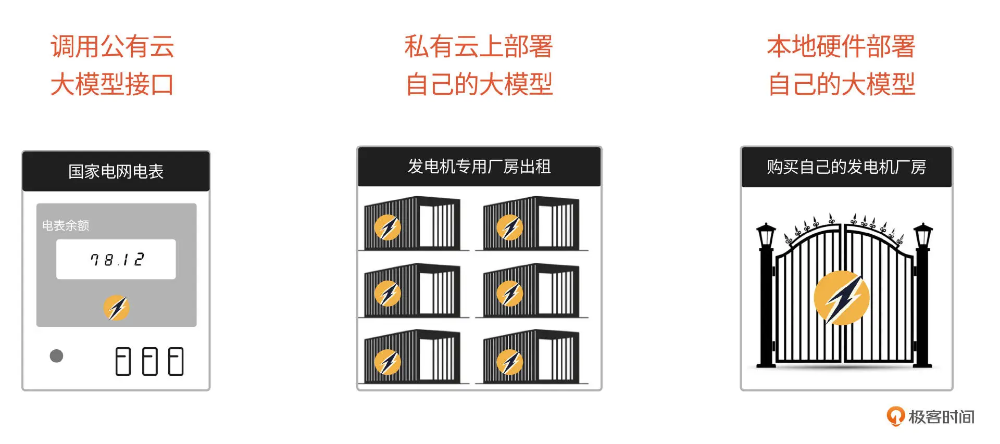

第二个维度是成本消耗方式，有推理和模型微调两种。推理就是直接使用模型的标准输出，训练就是需要对模型本身进行一定的改造，类比于使用电时一般电器使用标准电压即可，但有些特殊设备，可能需要加个变压器（比如 Lora 中的增量参数矩阵），或者是改变发电机本身来输出非标准电压。前者是每个 AI 应用都一定有的成本，后者是可选项，必要的时候才会启动。

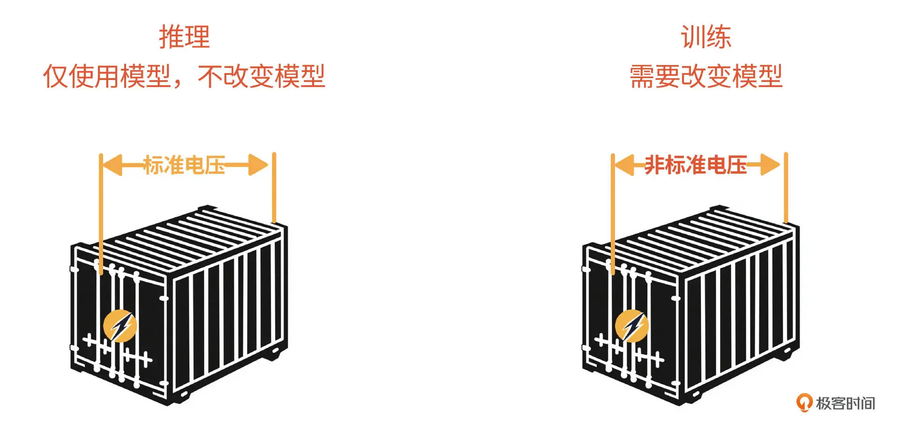

一般来说，部署方式对成本的影响更大，因此，我会按照部署方式划分的三种情况来讲解，每种部署方式中再分别讲述它对应的推理和模型微调成本。

好，我们来详细讲讲。

1. 直接调用大模型接口

如果你的部署方式是直接调用模型厂商接口，那么模型厂商相当于发电站。这里发的电就是“Token”，而你负责缴纳电费，也就是缴纳 Token 消耗费用。

通常情况下，你只需要通用 220 伏的电就好，这里相当于成本消耗方式就是“推理”；但有的时候，你需要用 380 伏或者其他电压供电，这时你需要发电站做一些调整，因此要支付更高的Token 费用，这就是以“模型微调”方式消耗的成本。

2. 私有化部署在云端

如果你的部署方式是私有化部署在云端，相当于你租了专用厂房， 自己装了一台发电机。

这里的发电机就是大语言模型，一般情况下是开源模型，不需要付费；且这种情况是你自己装的发电机，所以并不需要缴纳电费；你只需要支付专用厂房也就是 GPU 云资源的费用，这就是推理成本。

和上一种类似，免费发电机只能供 220 伏电压，当你需要 380 伏或者其他电压的时候，就需要对发电机进行改造，相当于微调模型。改造的时候因为要拆开发电机，需要占用更大的厂房空间，所以还要临时租用更多的厂房，直到改造完成。这相当于微调模型需要的存储空间。这部分临时租用厂房的费用，就是以“模型微调”方式消耗的成本。

3. 私有化部署在本地硬件

如果部署方式是私有化部署在本地硬件上，相当于自己买下了厂房，自己建发电站。这里的厂房就是 GPU 显卡硬件的费用，这相当于推理成本。同样的，如果需要定制电压，也就是微调模型，则需要购买大一点的厂房（容量大的 GPU 显卡），这部分是“模型微调”方式消耗的成本。

既然要算账，这节课难免会有一些加减乘除的数学公式；此外还会有些新的概念，不过放心，这些概念本身不影响你对这节课的理解，你在阅读的时候先记住名字就好。课后如果有兴趣可以根据我提供的参考资料来加深理解。

为了让你更好地掌握这节课的知识点，我把上面的两个维度放在了表格里。

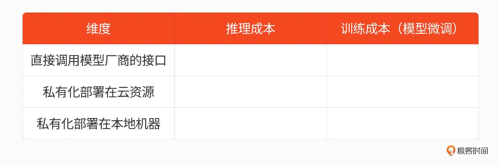

咱们这节课的任务就是把第一种部署方式直接调用模型厂商接口的计算方法填上去，在下节课我们会把私有化部署的计算方法补充上去。

另外需要提醒大家：本节课所有价格示例均为作者撰写课程内容时的价格，通用模型 APIToken 价格、私有云厂商的资源租赁价格和硬件价格变化幅度都会比较大，请大家参考时价计算。

## 情况一：调用模型厂商的接口的成本计算

这是我们当下最常见的算力消耗方式，它的推理、训练成本计算公式非常简单。

- 推理成本 = 模型推理接口调用的 Token 单价 * Token 数。

- 训练成本（微调成本）= 模型微调接口 Token 单价 * 训练数据的 Token 数。

模型推理、微调接口的单价都由各模型厂商在官网直接宣布，每个厂商都有不同的型号，价格越高，一般意味着模型参数量越大。 比如下图是 OpenAI GPT-4o 系列模型的 Token 价格。

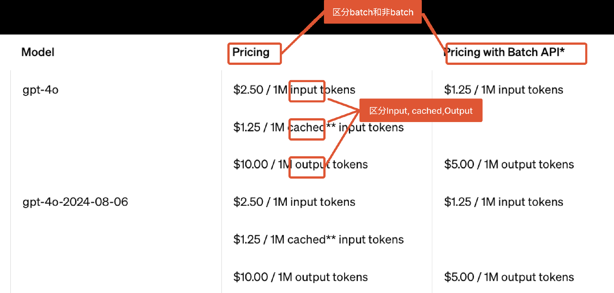

我们主要看两个重点。

1. 对于输入（input），输出（output）来说，Token 单价是不一样的。这个例子里，输出Token 单价高达输入 Token 单价的 4 倍，而 cached（缓存提示词）价格还会更低。

缓存提示词是指在与大语言模型进行多轮对话的过程中，发给大模型的上下文经常有大段重复内容。比如在一次对话中，有 10 轮对话，第九轮对话会把前八轮对话作为上下文发给大模型，而在第十轮对话中，需要把前九轮的对话作为上下文发给大模型。

那么这两次对话的上下文中，都有前八轮对话，那么大语言模型在处理时，如果检查到前若干个提示词是一样的，那么会减少部分运算，达到既不影响效果，又能降低算力成本的效果。

2. 除此之外，还有 BatchAPI，即批量调用接口的价格。你可以简单地理解为一次“批发”，对算力的占用会降低，所以价格会便宜。

BatchAPI 是异步执行输入输出的，模型不能实时返回，不过大约 24 小时内能返回。也就是说，BatchAPI 主要用在实时性不高，数据量又比较大的时候，比如对海量知识进行分类、总结。它的价格是实时输入输出的 50%，所以，在必要的场景下你可以使用 BatchAPI 来降低成本。

因此，我们在计算成本的时候，首先确定是否是调用 BatchAPI，然后还要对 input、output 区别对待。除此之外，关键问题就是 Token 数的计算。那什么是 Token 呢？

### 预备知识： Token

Token 简单来说是“词元”对应的向量，词元是语言的最小单位，可以直观地理解为具备一定语义的最小字母组合。比如英文中的 “pre” 可能不是一个单词，但它却是一个词元。因为“pre”作为前缀具有“提前”的语义。

之所以把“词元”向量化，就是为了把语言中的众多词汇、短语放在一个向量空间，通过数学的方式体现词元与词元之间的联系，从而让模型通过数学计算推算出下一个 Token 的概率。

那么，把单词、句子切分为词元的过程就叫 Tokenize。Tokenize 的方法决定了一个单词大概相当于几个 Token 的换算规律。下图是在 OpenAI 的 Tokennizer playground 中，对英文两段话的分词结果（词元由不同颜色表示）。

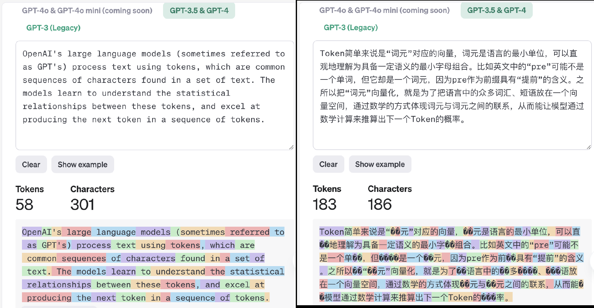

我们可以很直观地看到，模型对不同语言进行 Tokenize 后得到的 Token 与单词数量的比例也不一样。

上图左侧英文 301 个字母 /48 个单词被分成 58 个 Token，一个单词对应 1.21 个 token，右侧中文 186 个汉字被分成 183 个 Token，一个汉字对应 0.98 个 token。事实上，不同的模型厂商为了在各自的场景、语言环境中使 Token 所代表的语义划分更加合理，会使用不同的语料、不同方法进行 Tokenize 模型训练，最后得到不同的分词结果。

所以，我们会看到这么几个情况。

首先，token 并不是单词个数。比如 dislike 这个单词在 OpenAI Tokenize 模型中就被切分为两个词，dis 和 like。所以 dislike 这个单词在计算 token 数的时候就是 2 个。

其次，不同语言有各自的分词方法。比如英文单词中有词缀、复合词等，一个英文单词往往会被划分为多个 Token，但对于中文来说，往往是两个汉字才会构成完整语义，因此往往是一个Token 代表多个汉字。

还有，同样一个单词，在不同的模型中，甚至是同一厂家的不同模型中，对应的 token 数也不一样。比如苹果这个单词，在 GPT-3.5/GPT-4 中对应 3 个 Token 数；而在 GPT-3 中对应 6个 Token 数，这是因为 Tokenize 模型本身会为了更好地理解语义而不断迭代优化。

最后，一个短语所占的 token 数并非短语中每个字母 token 数的累加。比如汉字“正”是一个token，“确”是一个 token，而词语“正确”还是一个 token。这三个词在语义空间里作为独立的向量存储。

从原理上讲，token 数和单词的换算确实没有固定的标准公式，而且还在不断演进迭代。在各个模型厂商当中，只有 OpenAI 给出了大概的英文单词与 Token 数的换算比例大约是 1 英文单词 ≈ 1.33 个 Token（参考[1]），对于中文来说，我在这节课更新之前并没有看到任何一家模型厂商官方给出的大致换算比例。

但是通过在不同模型厂商给出的模型体验中尝试把一段 10000 字的新闻稿后，大概得出如下换算比例，供你参考。

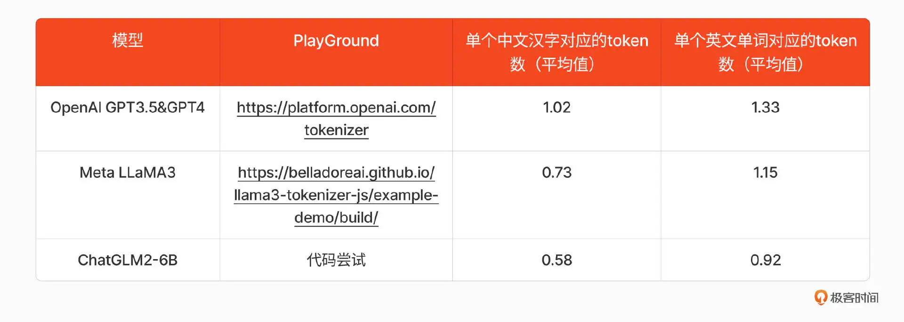

### 推理成本

得到 token 与单词数量的换算比例（Ratio）后，就可以将输入给模型的单词量或者模型输出的单词量转换为 Token 数再乘以 Token 单价，就可以计算成本了。即：

- 推理成本 = 模型推理接口调用的 Token 单价 ✖️ token 数= 模型推理接口调用的 Token 单价 ✖️ 单词数 ✖️ 单个汉字（或单词）对应的 token 数

这里我们需要注意，上一部分讲计算成本的时候，我们说要区分 BatchAPI，还要对输入量、输出量区别对待。其中，在计算输入单词量的时候，并非只是用户的输入，而是需要把上下文+ 用户输入共同加起来。

这里的上下文就好像在给大模型下达任务，你不仅要告诉它用户的诉求，还要告诉它这是一个什么场景，有哪些参考资料可以使用。

比如下面是一个智能客服示例。这个例子中用户的问题只有短短四个字“如何开机”，但是我们要发给大模型的输入项还包括系统提示词、可参考示例、可参考资料等等。

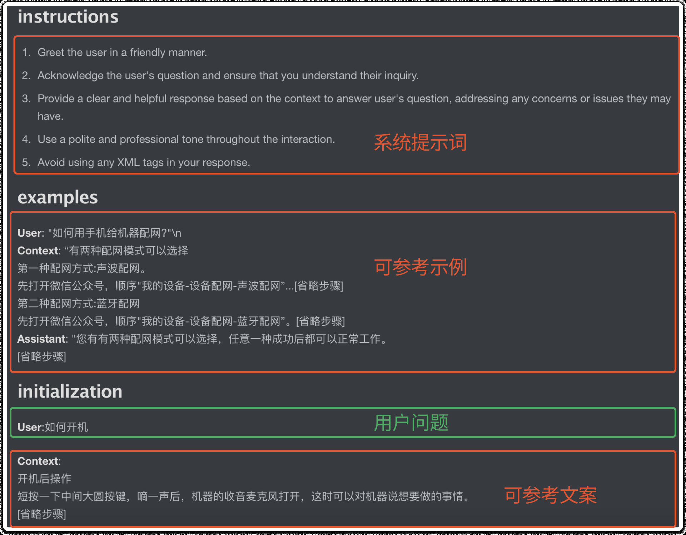

在前面的案例中，你可能也会发现我们发给大模型的提示词往往比用户本身的指令要高出几十倍。

我们再拿一个 AI 搜索工具 Genspark.ai 提供的 Auto-pilot 来举例。当我提了一个仅有十几个Token 的问题： Self-Play RL 能显著提示大模型的能力吗？

Genspark.ai 查找了 157 个来源，阅读了 10 万字（参考下图）。按英文输入算粗略为 13 万token 数，以 OpenAI GPT-4o 的价格（$2.5/ 百万 Token 数）计算，消耗了 0.25 美元，这还没有加上 Agent 与模型进行反复交互过程中的输出 Token 数，仅一个问题就消耗人民币几块钱。

[注]：模型 Token 价格在作者撰写课程时 2024-10-20 的价格。

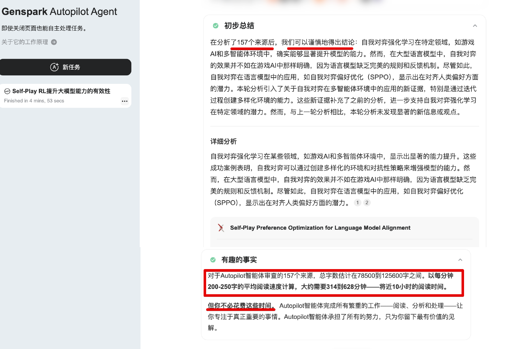

可见，即使是 token 数，用户可见的每轮对话到底需要多少 token 也有很大的不确定性。在评估的时候，可以根据实际场景进行实验，得出一个经验系数。

以上就是我们采用第三方模型厂商时所需的推理成本。但有时候，我们会发现单纯使用模型推理接口无法满足业务诉求，因此你希望用自己的数据进行模型微调。

那么微调的成本又是怎么计算的呢？

### 微调成本

早在 2023 年 8 月，Open AI 正式开放了对 GPT-3.5 微调接口，目的是满足用户根据业务定制模型和低成本调用模型的诉求。

比如有些用户使用自己的业务数据微调 GPT-3.5 后，在自己的业务领域内，可以把 GPT-3.5的能力提升到和 GPT-4 的同等水平，而 GPT-3.5 的推理单价（0.50 / 1M input tokens），仅仅是 GPT4 推理单价（2.50 / 1M input tokens）的五分之一。

从成本角度讲，通过接口微调模型的意义就是希望用一次性的微调投入，换来日常的低成本支出。所以我们也可以认为，只要日常 token 的消耗量到达了一定程度，那么微调模型就是有必要的。

那到底要不要微调这件事怎么用数据对比出来呢？我们以 OpenAI 的价格为例，来对比直接使用 OpenAI 的 GPT-4o 和微调 OpenAI GPT-3 的成本，再评估什么时候使用微调模型才比较划算。

- 直接使用 OpenAI 的 GPT-4o = Price(GPT-4) ✖️ Token 消耗

- 使用微调 OpenAI GPT-3.5 = 微调 GPT-3.5 的成本 (一次性投入) + Price(GPT-3.5) ✖️ Token消耗

= 模型微调接口 Token 单价 ✖️ 训练数据 Token 数 + Price(GPT-3.5) ✖️ Token 消耗

在这里，训练数据 Token 数根据准备好的训练数据量计算，模型微调接口 token 单价可以参考 OpenAI 的报价（如下图），同样需要区分 Batch 和非 Batch，Input 和 Output。

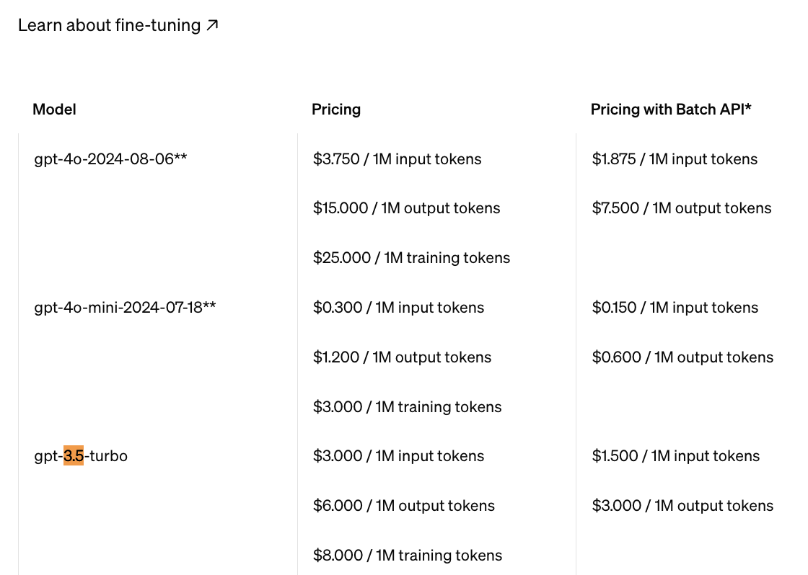

接下来我们将这两个成本放在下面的坐标系里，横坐标是 Token 消耗数，纵坐标是成本，就可以确定当 Token 消耗量超过哪个数值时，可以考虑采用微调模型的方式来降低成本。当然，这里的前提是 GPT-3.5 微调后在指定的业务领域能达到 GPT-4o 的效果。

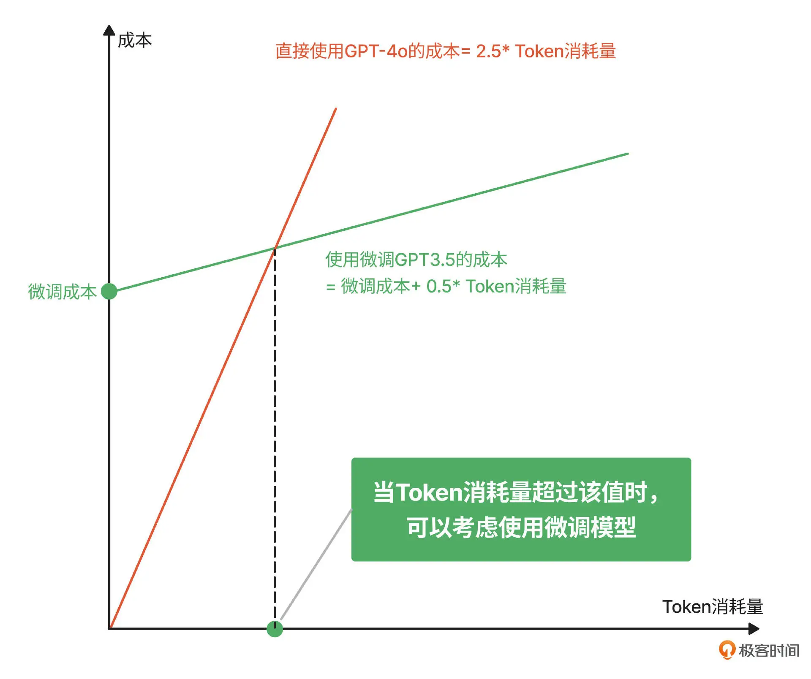

类似的，你也可以为你自己的业务做这样一个图，找到业务达到多少的 Token 数消耗就可以考虑微调通用模型的方式来降低成本。但考虑到微调并不是一次就能成功，我们需要适当地将微调成本翻 10-20 倍来评估。

## 小结

以上就是 AI 产品中直接调用模型厂商接口的成本计算方法。在这里，我们做个阶段小结，把这节课讲到的方法填充到开头提到的表格里，并且不才用两首“打油诗”帮助你更好地记忆，希望你能喜欢。

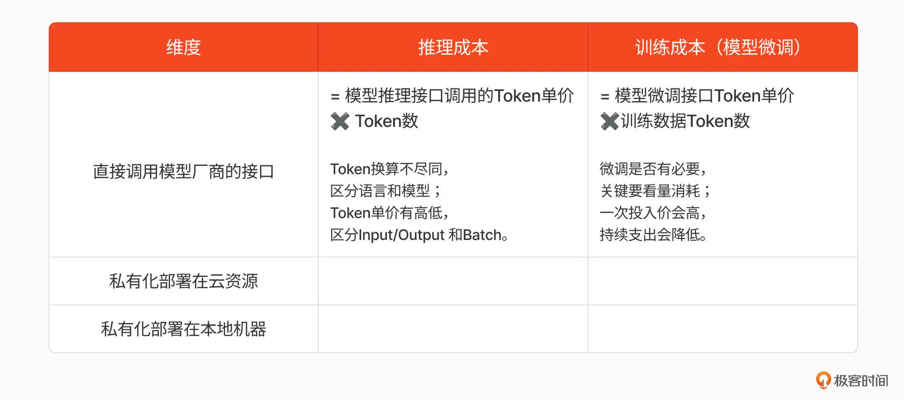

下节课，我会继续和你介绍私有化部署的成本计算方法。

## 课后题

选择一本你喜欢的书 (比如《三体》) 或者其他材料，分别放到 OpenAI 官方的 Tokenizerplayground 和文中提到的 Meta LLaMA3 playground，看看会被分成多少个 Token。然后根据Open 的推理价格和微调价格算出分别需要花多少钱？真实感受后，你的记忆一定更加深刻！

欢迎你在留言区和我交流。如果觉得有所收获，也可以把课程分享给更多的朋友一起学习。我们下节课见！

## 参考

OpenAI 官方指导 Token 换算比例：https://help.openai.com/en/articles/4936856-what-are-tokens-and-how-to-count-them
