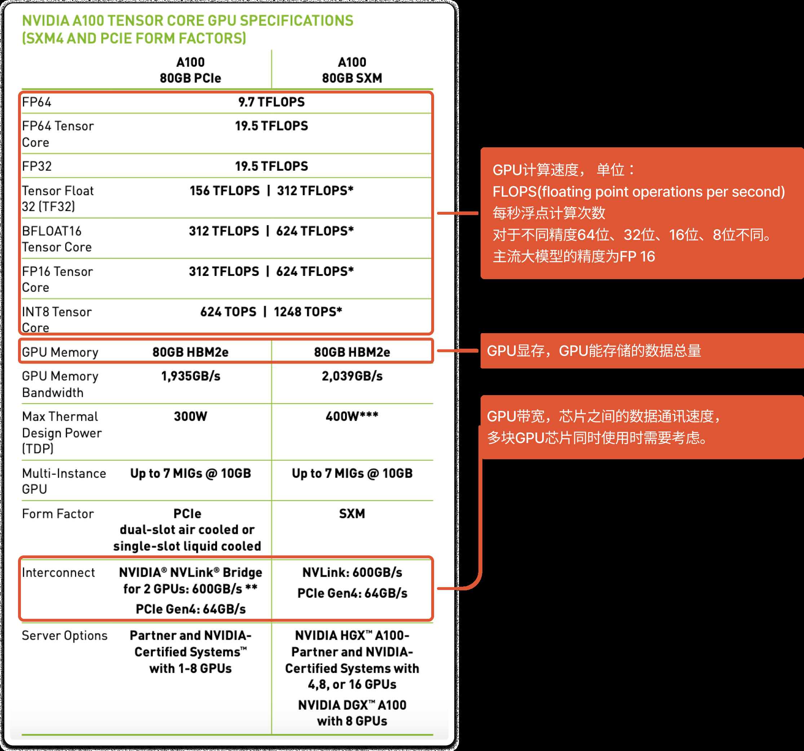
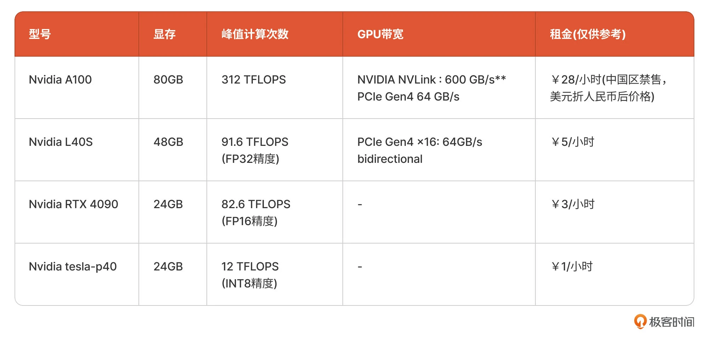
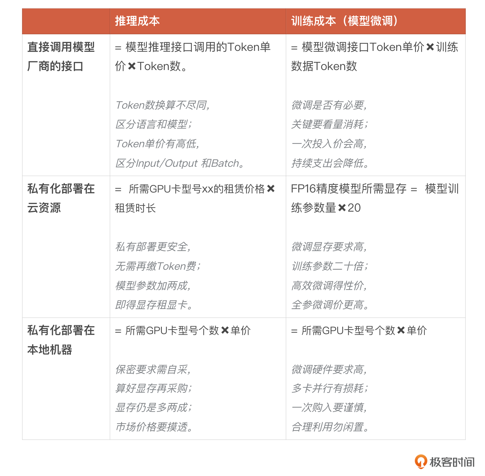

# 16 | 算力（二）：私有化部署大模型到底有多贵？

你好，我是产品二姐。

上节课，我们介绍了 AI 产品中直接调用模型厂商接口的成本计算方法，这也是 AI 应用最容易起步的方法。但随着 AI 逐步深入各种场景，尤其是企业场景里，这种直接调用的方法并不友好。

比如企业希望大模型能对内部的业务数据进行分析、总结，但考虑到数据安全，企业无法接受将业务数据直接发给模型厂商，比如我们在第 12 节就遇到了类似的诉求。

而私有化部署开源模型能保障所有和模型交互的数据不外泄，企业可以更自由地把大语言模型与企业数据库、业务接口集成在自己的 AI 产品中。比如用户可以直接问“这个月的工厂产量有多少”，AI 应用就可以直接读取企业数据库，拿到这个数据。同时，一些企业在 AI 建设初期也希望避免大额硬件投资。

于是，将开源模型私有化部署在云端成为另一种选择。

这节课，我就来介绍一下这种部署方式的算力成本计算方法。

同样需要提醒大家：本文所有价格示例均为作者撰写课程内容时的价格，通用模型 API Token价格、私有云厂商的资源租赁价格和硬件价格变化幅度都会比较大，请大家参考时价计算。

## 情况二：使用云端私有化部署模型的成本计算

我们继续用发电站做类比：不同的发电机体量，对厂房的要求也不一样；发电机越大，对厂房要求也更高；并且如果大到需要多个厂房的时候，厂房之间的数据通讯会降低单个厂房的使用率。

OK，翻译一下。不同的开源模型对 GPU 云资源的要求也不一样。比如参数量较小的 1B 开源模型在单张英伟达 4090 GPU 卡上就能实现微调。而 7B 以上的开源模型，在单张 4090 上就会显得有些局促，那么就需要多张 GPU 资源来支撑。对需要用到多个 GPU 云资源的情况，GPU 之间的数据通讯会降低单个厂房的使用率。目前来说，这个使用率在 0.3~0.55 之间[参考 1]。

明白这一点后，我们再分推理、微调两种情况来拆解成本计算的核心任务。

- 推理成本。这是持续支出，需要根据模型参数量计算所需显存资源，也就是租什么配置的GPU 卡。

- 模型微调：这是一次性支出，需要根据模型参数量计算所需显存资源、根据训练数据量计算所需时长。

### 预备知识：GPU 芯片的三大核心参数

在具体计算之前，我们先准备一下 GPU 芯片的相关知识。

下图是 Nvidia 官网上对于 A100 芯片的参数介绍[参考 2]。

不用觉得复杂，我们重点关注三个指标就好，分别是显存、计算速度、GPU 带宽。

1. 显存，是指 GPU 芯片能存储的数据量，也是选择 GPU 芯片配置的首要因素。

我们知道，大语言模型的本质是十亿、百亿甚至是千亿个参数组成的数值矩阵。我们假设每个参数是 16 位精度的浮点数，占 2 个字节，把这些参数加载到 GPU 里，则需要巨大的存储空间。

比如 7B 模型，占用 140 亿个字节，即 14GB 的存储空间。对于推理场景来说，GPU 显存主要是用来存储模型参数矩阵的；而对于训练（微调）场景，那就还要存储计算过程中所产生的临时数据需要的显存。

2. 峰值计算次数，是指 GPU 的计算速度。

GPU 计算速度， 单位是 FLOPS（FLoating point Operations Per Second）， 即每秒浮点计算次数。对于不同精度 64 位、32 位、16 位、8 位的要求，计算速度也不同。主流大模型大多采用 16 位精度。在满足显存的条件下，FLOPS 主要会影响训练或推理所需时长。

需要注意的是，图上标出的“标准计算次数”是峰值计算次数，实际使用时，因为受多种因素影响，实际计算速率是峰值的 0.3~0.55 倍。

3. GPU 带宽：是指卡与卡之间的数据传递速度。

在多卡共同参与训练、推理时，带宽显得尤为重要，它就像是卡和卡之间的高速公路，带宽过窄会引发“计算堵车”，影响训练、推理进度。如果由于显存需求同时使用多张卡时，就必须保证高带宽。

按照这三个指标，会有不同的 GPU 云端资源，也对应着不同的租金价格。我在这里列出了几款常见英伟达 GPU 芯片的关键指标和价格，你可以参考。

### 推理成本（直接使用开源模型）

在云端私有化部署模型中，模型部署所需的显存空间主要是用来加载模型参数的。我们再加上20% 作为冗余空间，那么计算公式就是：

## 所需显存≈模型参数所需存储空间× 1.2 = 模型参数量× 每个参数占用空间

得出了这个数字，再根据模型参数量计算选择所需的 GPU 卡型号。确定型号之后，再乘以相应的租赁单价即可，即：

## 模型推理能力成本= 所需GPU卡型号XX的租赁价格× 租赁时长

我来举个例子。比如私有化部署清华智谱的 GLM-4-9B 模型，模型参数量大小是 9B，参数精度是 FP16(（6 位浮点精度）。

我们首先计算“所需显存”。

- 9

## 显存= 模型参数量× 每个参数占用空间× 1.2 = 9 × 10 ×

## 2 × 1.2 = 21.6GB

这个 21.6GB 代表着租用显存为 24G 的英伟达 4090 型号的 GPU 显卡刚刚够，保险起见，我们可以租用 2 张来使用。

如果参考某租赁平台的价格为 2.01/ 卡 / 小时，那么部署 GLM-4-9B 模型，仅仅使用模型做推

## 2.01 × 24（小时）× 30（天）× 2 = 2880元/月

理，成本最少就是

- 。

### 微调成本

和我们上节课说的情况一类似，单纯地使用开源模型做推理，往往不能适配具体业务场景。这时候就需要对模型进行微调。

和模型推理成本相比，模型微调成本不是持续支出，而是按照次数来算的，计算分 3 步走。

1. 计算所需 GPU 显存，得出对应 GPU 型号 xx。

在02这节课我们讲过，模型训练就是通过反复使用前向传播和反向传播算法，逐步改变模型参数的值，直到模型的实际输出和期待输出达到一定程度，训练完成。所以，这个过程就不仅需要存储模型参数，还需要存储大量计算中间值。

以 FP16 精度为例，总共需要参数大小空间的 20 倍（这里的 20 倍的推理过程，你可以阅读参考[1]）。即：

## FP16精度模型所需显存= 模型训练参数量× 20

这里还有一个细节。所谓的“模型训练参数量”并不是模型全部参数量，而是会根据不同微调方法变化。我们在 02 这节课讲到，在全参微调中，它和模型全部参数量一致；在参数高效微调中，比如 Lora 微调中，这个参数量就是最终低秩化后的训练参数，可能是模型参数量的百分之一、千分之一。

2. 计算微调所需计算时长

还是在 02 这节课，我们讲过模型训练过程中的计算发生在神经网络的前向传播和反向传播中。在每一次前向传递中，对于每个 token、每个模型参数，需要进行 2 次浮点数运算，也就是一次乘法运算和一次加法运算。

一次训练迭代包含了前向传播和反向传播，反向传播的计算量是前向传播的 2 倍，所以每个token、每个模型参数，一共需要 2✖️（1+2）=6 次计算（参考[1][3]）。

根据 GPU 型号 xx 的每秒计算次数和微调所需计算次数 N，再考虑 GPU 计算有效率 0.3～0.55，就能得出所需训练时长。即：

## 训练时长= 模型训练参数量× 训练数据量× 6/芯片型号XX的FLOPS数/G

3. 计算云资源租赁价格

根据第二步计算得到的时长，乘以 GPU 芯片的租赁单价，得到云资源消耗成本。即：

## 微调成本= 训练时长× 芯片的租赁单价

好，我们还是以 GLM-4-9B 为例，尝试计算一遍整个过程。

## 所需显存= 20 ×

假设要进行全参微调 (训练参数量为 9B)，微调数据量为 1GB。那么

## 9 = 180GB

- 。

如果我们采用 Nvidia A100（显存 80G，带宽为 2TB/s），且至少需要 3 张 A100。

假定 GPU 计算效率为 0.4， 训练精度为 FP16，那么：

## 训练时长= 模型训练参数量× 训练数据量× 6/A100的FLOPS数/GPU计算

参考某平台 A100 的租赁价格约 28 元 / 小时，最后算出一次全参微调所需的租赁价格为：3360 元。

当然，更多的时候，我们会采用像 12 节中提到的参数高效微调的方法来训练，这时训练参数量可能会降低为全参微调的百分之一、千分之一。

## 情况三：自采硬件私有化部署的成本计算

最后我们来看一下如果企业要自购裸金属硬件所需成本。

这种方式一般适合对安全程度要求非常高的场景，比如公司的核心财务信息、国家政府的保密单位等等。这种方式的计算步骤和上一小节步骤类似。

对于推理场景来说，根据模型大小算出显存诉求，选中对应型号直接购买即可。

## 9 × 2 × 1.2 = 21.6GB

比如将 GLM-4-9B 私有化部署到本地，至少需要

- 的 GPU 芯片，而

24GB 的 4090 略显局促，可能需要购入 A100-40G。 价格约为 10 万元人民币。

## 所需显存= 20 × 9 = 180GB

- ，需要 3 张 A100-80G 芯片，价格约

对于训练场景来说，为人民币 60 万元。

## 小结

好了，到这里，我们就把 AI 应用落地过程中所需算力成本的计算方法讲完了。

要特别说明的是，咱们这节课里所有的价格都是参考网络公开价格，实际中的价格会有市场浮动，客户分群浮动，不能作为实际价格。在这里列出是为了大家有更直观的感受。大家在实际预估的时候更多的是参考我说的方法，而不是直接照抄数值。

最后，我们再一起来将上节课开头的那张表格填充完整，和上节课一样，给你总结了各自的“打油诗”，帮你记忆各个场景中的关键点。

## 课后题

假设你的公司想要用大语言模型识别客户的反馈中是否带有抱怨情绪，考虑到数据安全因素，老板并不愿意把客户反馈发给通用大模型，但他又担心私有化部署会很贵，希望你做一个算力成本预算报告给 ta。这时该怎么做呢？

你可以使用 LlaMA-7B 的模型，训练数据使用 02 节课中下载的标注了是否含有抱怨情绪的Twitter 文本数据集。按照本文的方法，分别计算出：

- 使用云端资源私有化部署的推理成本（GPU 租金）和微调成本。

- 自采硬件私有化部署的推理和微调成本（采购 GPU 硬件）

## 参考总结

1. 分析 transformer 模型的参数量、计算量、中间激活、KV cache。

2. Nvidia A100 卡介绍。

3. 浅谈后向传递的计算量大约是前向传递的两倍。
